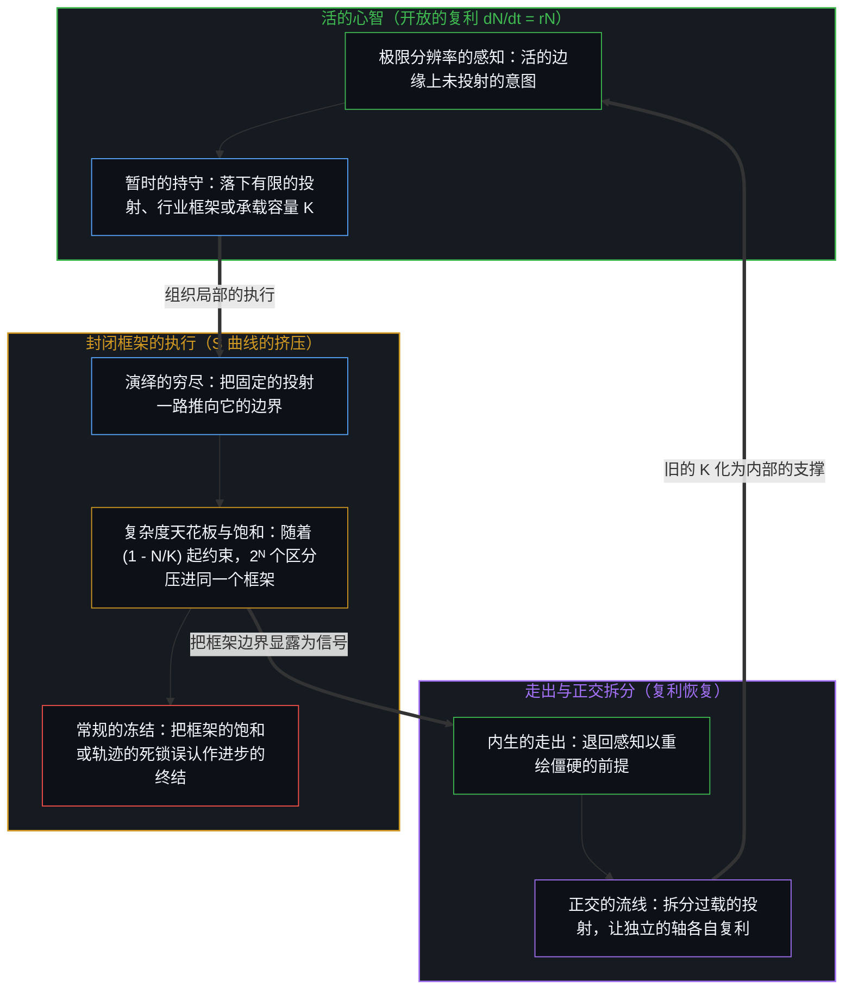
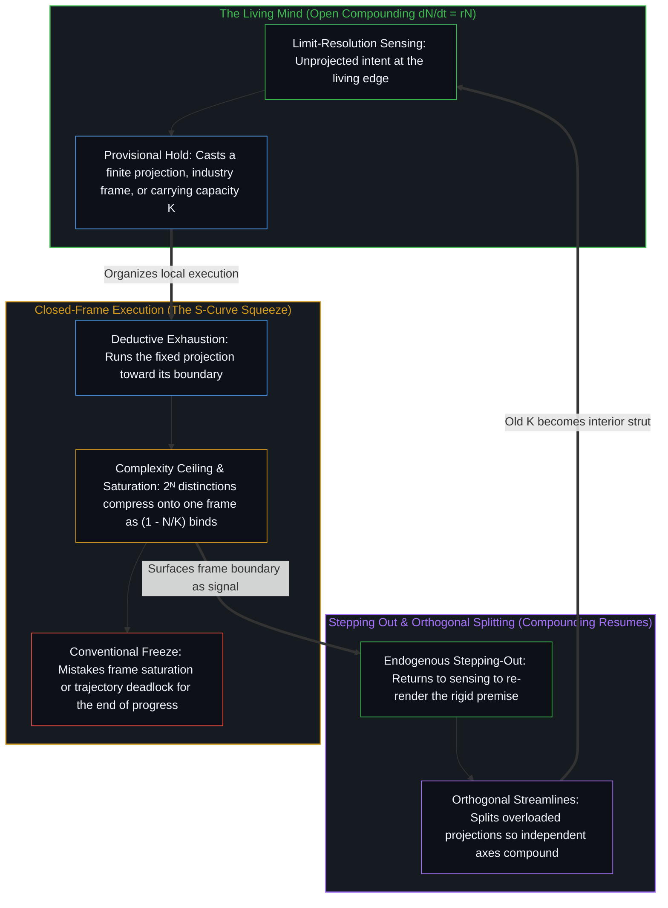

# 封闭的假设把复利挤成 S 曲线 / Closed Assumptions Squeeze Compounding into S-Curves

*逻辑斯蒂的形状是固定框架的束缚，不是开放的进步 / The logistic shape is the binding of a fixed frame, not open progress*

技术与产业的历史常被画成逻辑斯蒂的 S 曲线：一段看起来像指数的早期，然后逐渐饱和，趋向一个天花板。常规的读法把这个形状当作基本的，把早期的指数当作只在过程离它的自然极限还远时才成立的暂时近似。开放的读法把这层关系倒过来：持守保持开放时，进步在复利；当一个封闭框架的假设被强加、随后变得有约束力时，S 曲线才在计分里出现。铁路、电气化与汽车的图表，是在那些固定框架之下计分的观察；它们不追踪持守之外那些转移行业的信号，也不描述行为，因为持守所装上的约束并不限制行为。

Technological and industrial histories are routinely plotted as logistic S-curves: an early phase that looks exponential, then gradual saturation toward a ceiling. The conventional reading treats that shape as fundamental and the early exponential as a temporary approximation that holds only while the process is far from its natural limit. An open reading inverts the relation: progress compounds while the hold stays open, and the S-curve appears in the scoring when a closed-frame assumption is imposed and then becomes binding. Charts of rail, electrification, and automobiles are observations scored under those fixed frames; they do not track industry-shifting signals outside the hold, and they do not describe behavior, since behavior is not limited by the constraints the hold installs.

## 一、 常规的冻结把天花板装为自然 / 1. The Conventional Freeze Installs the Ceiling as Nature

标准的叙述大致如下。增长过程面对自然的极限：可触及的市场、物理的基础设施、技术范式、机构能力。当存量相对这些极限还小时，路径看起来是指数的；一旦极限起了约束，路径就弯成那个熟悉的 S。所以，一旦看到全貌，真正的轨迹就是逻辑斯蒂的；早期的上升，只是一条本就要变平的曲线的左肩。

The standard account runs roughly as follows. Growth processes face natural limits: addressable market, physical infrastructure, technological paradigm, institutional capacity. While the stock is small relative to those limits, the path looks exponential; once the limits bind, the path bends into the familiar S. The true trajectory, once the full picture is visible, is therefore the logistic, and the early rise was only the left shoulder of a curve that was always going to flatten.

作为登记，这种读法不是空的。它符合在为测量而持守的那个框架之下计分的序列，而把行业推过这个框架的信号，落在序列之外，或只作为残余的噪音到来。冻结的是极限的位置：天花板被装为进步的属性，而不是进步在其下被观察的那些前提的属性。观察握住的是结果，即数据里的饱和，并冻结出一个参照：增长有一个自然的形状，这个形状就是 S。因果于是被重新安放到曲线本身里。放慢到来时，仿佛它就是这个活动的天性，而不是封闭的假设对观察开始生效时看得见的结果。

That reading is not empty as registration. It matches series scored under the frame held for the measurement, while signals that shift the industry past that frame fall outside the series or arrive only as residual noise. What freezes is the placement of the limit: the ceiling is installed as a property of progress rather than as a property of the premises under which progress was observed. Observation holds the effect, saturation in the data, and freezes a reference: growth has a natural shape, and that shape is the S. Causality is then relocated into the curve itself. The slowdown arrives as if it were the nature of the activity, rather than the visible effect of closed assumptions becoming effective on the observation.

## 二、 复利是开放的延续，S 是挤压 / 2. Compounding Is Open Continuation; the S Is the Squeeze

自我区分的活动在发生，无因，不息。称它为心智：那个已经在进行中的观察者，它的每一个动作都是一次区分。每一个动作划出一道边界，下一个动作再划。较早动作的残余，塑造较晚动作所能找到的场。当相继的动作增加进一步分化的能力时，复杂到足以追踪序列的中心便登记出进步。这次登记是已被持守的方向：在序列复利之处成立，每一步都可以修订，从不是一条从画出它的活动之外勘察到的普遍定律。

Self-distinguishing activity occurs, uncaused, unceasing. Call it the Mind: the observer already underway, every act of which is a distinction. Every act draws a bound; the next act draws again. Residue of earlier acts shapes the field available to later ones. Where successive acts increase the ability for further differentiation, centers complex enough to track sequence register progress. That registration is direction as already held: it holds where sequence compounds, is revisable at every step, and is never a universal law surveyed from outside the activity that draws it.

在开放的持守之下，复利继续。新的区分打开相邻的可能；器具变密；先前的天花板成为内部的结构，而不是最后的墙。[生产、消费与心智的区分](../production-consumption-and-the-minds-distinction/)把生产与消费追溯为同一个活动在心智把自己的边界当作开放或固定时的两种登记方式；在最小的形式面上，同一刀是：1 + 1 在封闭的一位寄存器之下得 0，新的区分被边界抹去，在寄存器保持开放时得 2。[没有系统能被保持封闭](../no-system-can-be-kept-closed/)在一个有限的持守被当作穷尽地基的每一处，追溯了这个余数：同一次加法在持守之内登记为 0 并带出进位，运算没有失败，持守装不下的是延续。[开放即一致](../openness-is-consistency/)从另一边指出了这个要求：不一致是对封闭的渴望或尝试，把一个有限的结构逼去为只会继续的东西奠基，于是表面的矛盾成倍出现。

Under an open hold, compounding continues. New distinctions open adjacent possibility; instruments densify; prior ceilings become interior structure rather than final walls. [Production, Consumption, and the Mind's Distinction](../production-consumption-and-the-minds-distinction/) traces production and consumption as how the same activity registers when the Mind holds its boundary as open or as fixed; at the smallest formal face the same cut is 1 + 1 yielding 0 under a closed one-bit register, the new distinction erased by the boundary, and 2 when the register stays open. [No System Can Be Kept Closed](../no-system-can-be-kept-closed/) traces that remainder wherever a finite hold is treated as exhaustive ground: the same addition registers as 0 with a carry inside the hold, the operation does not fail, and what the hold cannot contain is the continuation. [Openness Is Consistency](../openness-is-consistency/) names the demand from the other side: inconsistency is the desire, or attempt, for closure, a finite structure forced to ground what only continues, and the surface contradiction multiplies.

S 曲线，是天花板被写进增长定律本身时发生的事。开放的复利是 dN/dt = rN，其中 N 是存量，r 是增长率；逻辑斯蒂模型把一个承载容量 K 直接嵌进方程，把阻尼项 dN/dt = rN (1 − N/K) 加在活动上，而标准的逻辑斯蒂函数 σ(t) = 1 / (1 + e^(−t)) 把整条实数线映射到开区间 (0, 1) 上，两个无穷被压进一个有限的范围。这条定律本身是一致的；不一致的，是它穷尽了活动这个更进一步的主张。

The S-curve is what happens when a ceiling is written into the growth law itself. Open compounding is dN/dt = rN, with N the stock and r the growth rate; the logistic embeds a carrying capacity K inside the equation, imposing the damping term dN/dt = rN (1 − N/K) on the activity, while the standard logistic function σ(t) = 1 / (1 + e^(−t)) maps the entire real line onto the open unit interval (0, 1), so two infinities are collapsed into a finite range. The law itself is consistent; the inconsistency is the further claim that it exhausts the activity.

当 N 相对 K 还小时，被计分的增长几乎是指数的。一旦 K 起了约束，轨迹就弯成 S。作为当下持守的框架，K 之下的饱和是成立的观察；放慢却不是那个一直在复利的活动的内在属性，而是封闭的假设开始生效时看得见的结果：当下持守的 K 被当作最终的，而不是它暂时的天花板。

While N is small relative to K, the scored growth is nearly exponential. Once K becomes binding, the trajectory bends into the S. As the present hold's frame, saturation under K is a valid observation; the slowdown, though, is not an intrinsic property of the activity that was compounding. It is the visible effect of the closed assumptions becoming effective: the present hold's K treated as final rather than as its temporary ceiling.

## 三、 一个行业是一个暂时的封闭现实 / 3. An Industry Is a Temporary Closed Reality

任何界定清楚的行业，都是这样一个暂时的封闭现实。在它早期、界定还不清楚的阶段，这个领域更像开放的现实：边界是软的，探索是宽的，复利进行时，来自共享天花板的摩擦相对很少。随着惯例、标准、资本结构与技术架构固化，这个行业为观察与规划获得了清楚的极限。在这些极限之下，只要边界还守得住，活动就被计分为一条 S 曲线。曲线成熟、变平的那一段，多半只在事后才被认出，即当这个行业站在被颠覆的边缘时。

Any well-defined industry is such a temporary closed reality. In its early, poorly defined stage the domain more closely resembles open reality: boundaries are soft, exploration is wide, and compounding proceeds with relatively little friction from shared ceilings. As conventions, standards, capital structures, and technical architectures solidify, the industry acquires clear limits for observation and planning. Under those limits the activity is scored as an S-curve for as long as the boundaries hold. The mature, flattened portion of the curve is mostly recognized only in hindsight, when the industry stands at the brink of disruption.

所以，展示历史 S 曲线的图表，是对一个固定框架之内观察的描述。它们忽略这个框架不计分的、转移行业的信号。它们不描述行为：持守所装上的约束，并不限制行为。这道挤压弯曲的，是计分，以及那些把框架当作基础的中心的复利；越过持守的活动仍在继续。当一条 S 曲线开始变平，数据显示的是当下的封闭前提已经对观察起了约束；它们暴露的是框架的局限，而不是进步的局限。[现实扭曲力场指认的是封闭的地图](../the-reality-distortion-field-names-the-closed-map/)在专家可行性的情形里追溯了同一种几何：软性的行业约束被压到物理上硬性的约束上，进一步的区分便被登记为对一个封闭世界的扭曲。[现实扭曲力场颠倒了基线](../the-reality-distortion-field-inverts-the-baseline/)在大众接受之时间表的情形里追溯了同一次冻结：吸收没有内部的时间表；打开是细薄的中心在平均仍然完好时逼出的，平均则在再也维持不住先前的一致时吸收它。[基准刷榜中的封闭实存](../closed-reality-in-benchmark-maxing/)追溯了被当作能力全部的封闭测试集：基准把能力冻结为一个封闭的靶子，而当这个图像被当作场的全部时，有用之处就被少登记了。[AGI 与 ASI 是加速通用智能的暂时球门](../agi-and-asi-are-temporary-goalposts/)是同一次冻结在门槛上的一面：每一道门槛都永远位于画出它的那个边缘前方。[规模化回路](../the-scaling-loop/)追溯了一个规模旋钮，即每参数的词元数、稀疏度、推理成本或后训练，被定格为一个流转着的过程的全部时的冻结，而这个回路的边界随每一次取舍重画。

The charts that display historical S-curves are therefore descriptions of observations inside a fixed frame. They ignore the industry-shifting signals that the frame does not score. They do not describe behavior: the constraints the hold installs do not limit behavior. What the squeeze bends is the scoring, and the compounding of centers that take the frame as ground; the activity past the hold goes on. When an S-curve begins to flatten, the data show that the current closed premise has become binding on the observation; they expose the limitations of the frame, not the limitations of progress. [The Reality Distortion Field Names the Closed Map](../the-reality-distortion-field-names-the-closed-map/) traces the same geometry in the case of expert feasibility: soft industry constraints compressed onto constraints hard under physics, so further distinguishing registers as warp of a sealed world. [The Reality Distortion Field Inverts the Baseline](../the-reality-distortion-field-inverts-the-baseline/) traces the same freeze in the case of a schedule of mass acceptance: absorption has no internal timeline; openings are forced by thin centers while the average is still intact, and the average absorbs when it can no longer hold its prior coherence. [Closed Reality in Benchmark Maxing](../closed-reality-in-benchmark-maxing/) traces the sealed suite held as the whole of capability: a benchmark freezes capability as a closed target, and usefulness is under-registered when that image is taken for the whole of the field. [AGI and ASI Are Temporary Goalposts of Accelerating General Intelligence](../agi-and-asi-are-temporary-goalposts/) is the threshold face of the same freeze: each threshold sits forever ahead of the edge that draws it. [The Scaling Loop](../the-scaling-loop/) traces the freeze when one scaling dial, tokens-per-parameter, sparsity, inference cost, or post-training, is installed as the whole of a circulating process whose bound is redrawn at every selection.

成熟不是底下那个活动的一种客观状态，而是一个共享框定的产物：参与者与观察者之间关于相关的边界、可能与终点是什么的一份集体约定。对共享这个框定的人来说，封闭的假设已经开始让人觉得是永久的，于是这个行业看起来已经完成了。对不共享它的人来说，同样的变平只是当下的前提已经变得僵硬的证据。看起来像终点的东西，只是现有地图的边缘。[心智最坚固的信念](../the-strongest-belief-of-the-mind/)追溯了这一点：凝聚得最紧的东西，对持守它的那种注视来说是基岩，却仍是那种注视自己的产物；地图被当作完成的疆域，而画仍在前面一步继续。[一个提示词之遥](../whatever-is-one-prompt-away/)把开放现实之下的进步追溯为扩张着的选择空间：先前的路径仍然在，它们在场里的份额缩小，而封闭的清单把这份缩小登记为损失。[关闭选择权的代价](../the-price-of-closing-optionality/)追溯了另一种天花板，即风险的先发制人：过去的成功变密为一个封闭的下一范式主张，而追赶的窗口，就是让这种滞后能被负担的缓冲。

Maturity is not an objective condition of the underlying activity. It is an artifact of a shared framing: a collective agreement among participants and observers about what the relevant boundaries, possibilities, and endpoints are. To those who share that framing, the closed assumptions have begun to feel permanent, and the industry therefore looks done. To those who do not share it, the same flattening is simply evidence that the current premises have grown rigid. What looks like an endpoint is only the edge of the existing map. [The Strongest Belief of the Mind](../the-strongest-belief-of-the-mind/) traces this: what coheres hardest is bedrock for the look that holds it, and still that look's own production, so the map is held as finished territory while the drawing continues one step ahead. [Whatever Is One Prompt Away](../whatever-is-one-prompt-away/) traces progress under open reality as an expanding option space: prior paths remain, their share of the field shrinks, and the closed inventory registers that shrinkage as loss. [The Price of Closing Optionality](../the-price-of-closing-optionality/) traces risk-preemption as another type of ceiling: past success densified into a closed next-paradigm claim, and the catch-up window is the buffer that made the lag affordable.

## 四、 变平给前提计分，不是给进步的终点计分 / 4. Flattening Scores the Premise, Not the End of Progress

共享的框定变密为持久的残余：被当作穷尽来估算的市场，仿佛阶梯就是场一样排定的路线图，针对当下范式写成、仿佛它封住了下一个范式的监管。作为对可得之物的塑形，这份残余是成立的：它为那些把它当作基础的中心塑造投资、职业选择与地位计分。它封不住越过它继续的活动。[起作用的是信念](../what-works-is-the-belief/)在禁令的情形里追溯了这种持守：禁令在场里什么也封不住，它稳定的是那些把封印当作基础的人之间的信念，直到不共享它的人留下的残余变得无法否认。[进步的多面手](../the-utility-men-of-progress/)在文明的情形里追溯了这个开放的场：完美需要一个封闭的现实，而现实保持开放，不断出现新的问题；进步是那些在当下负载之下仍能解开一道题的临时解题者反复的工作。

Shared framing densifies into durable residue: markets sized as if exhaustive, roadmaps staged as if the ladder were the field, regulation written against the present paradigm as if it sealed the next. That residue holds as availability-patterning: it patterns investment, career choice, and status scoring for centers that treat it as ground. It does not seal the activity that continues past it. [What Works Is the Belief](../what-works-is-the-belief/) traces that hold in the case of a ban: a ban seals nothing in the field; it stabilizes a belief among those who treat the seal as ground, until the residue of those who do not share it becomes undeniable. [The Utility Men of Progress](../the-utility-men-of-progress/) traces the open field in the case of civilization: perfection would require a closed reality, reality stays open and presents new problems, and progress is the repeated work of temporary solvers who can still solve one under present load.

常规的冻结把饱和读作自然追上了乐观。开放的读法让两条轴分开。在一个固定的 K 之下的饱和，作为那个 K 之下的观察是成立的；K 的穷尽性则是滞后，即让所选的持守免于重新追溯。行为越过持守继续，图表却不。若软化为“一部分是自然的极限，一部分是框定”，两条轴就又被压到一张计分板上，封闭的前提便作为下一步的共同作者恢复过来。条件与物理仍是接触的约束；固定的可触及市场、固定的技术范式与固定的机构天花板，却并不作为最终的地基随它们而来。物理的基础设施，在它于物理之下起约束的范围内，属于接触的约束；一张固定的铁路、电网或道路网络，被当作运输、能源或出行的最终天花板，则是框架，而开头那几张图表计分的正是这样的框架。

The conventional freeze reads saturation as nature catching up with optimism. The open reading keeps the axes apart. Saturation under a fixed K holds as observation under that K; the exhaustiveness of K is lag, the exemption of the chosen hold from re-tracing. Behavior continues past the hold; the chart does not. Soften this into "partly natural limit, partly framing" and the two axes compress again onto one scoreboard, so the closed premise recovers as co-author of the next step. Conditions and physics stay contact constraints. Fixed addressable markets, fixed technological paradigms, and fixed institutional ceilings do not travel with them as final grounds. Physical infrastructure is a contact constraint as far as it binds under physics; a fixed rail, grid, or road network taken as the final ceiling of transport, energy, or mobility is a frame, and the opening charts score exactly such frames.

对细薄的中心来说，变平早已是前提僵硬的证据；一旦共享的框定松动，越来越多的参与者或观察者不再把它当作基础，这个行业在平均看来也不再显得成熟。封闭的假设重新作为暂时的惯例显现，复利重新出现在计分里。顺序不是指数必然通向 S 曲线，而是开放的复利，封闭假设的强加，由共享框定维持的暂时 S 曲线，以及持守的重画：旧的天花板成为内部的结构，或一条新的曲线被点燃。[超越投射](../beyond-the-projection/)在演绎执行与认知容量的层面上追溯了这同一次饱和与重新打开：任何显式的规则、提示词或行业标准，都是从活生生的感知那超高维空间落下的有限低维投射；当执行把这个固定的投射推到它的演绎极限时，它要么收窄进轨迹的盲区，要么撞上一道复杂度的天花板——在那里，挤进同一个坐标框架的 2ᴺ 个区分震碎正交性，在维度的坍缩中停滞下来。复利并不是靠逼着执行更使劲地去顶同一个承载容量 K 而恢复的；当活的边缘上的心智从滞后的诠释退回到极限分辨率的感知，重新绘制破损的前提，或把过载的投射拆分到正交的流线上，让独立的轴能够并行复利而不彼此干扰时，复利才重新开始。[持续生长的脚手架](../the-scaffolding-that-keeps-growing/)把这种重新打开追溯为每一个活着的持守的寻常生长：开放不是靠从一个完成的框架退后一步找回的，它是让每个框架都保持未完成的条件；外层的边界成为内部的支撑，看似最终的框架只是当下的寄存器。[代码库即记忆](../your-codebase-is-memory/)在外化的数字残余里追溯了同一种承载容量的挤压与重切：当代码库或工作记忆只因将来用得上的可能，便囤积每一份历史补丁、归档与中间会话痕迹时，堆积的碎屑加厚了引力井，直到后续的轨迹在陈旧框定那固定的承载容量 K 之内作事后合理化；唯有主动的重新追溯与精准修剪删去已被取代的状态，让当下的检查点在无关维度上更小、在活的轴线上更锐利，复利才会恢复。[进步叙事中的症候与原因](../symptom-and-cause-in-the-narratives-of-progress/)追溯了多数人的登记作为拖曳迟到，而发起留在仍越过被保留之均衡而区分的细薄中心：集体的信念，是对已在进行之活动的迟到登记。[为何数学永远解不完](../why-mathematics-can-never-be-solved/)在形式的情形里追溯了同一份封闭的清单：“解完了”把一片有限的形式地貌冻结为穷尽的地基，而数学是经由开放的区分持续生成结构。[好奇没有最终的形态](../curiosity-has-no-final-form/)追溯了不接受天花板的那份复利：把数学、物理与哲学当作好奇的终点，是把脚手架错认作不息的区分。

For thin centers the flattening was already evidence that the premises had grown rigid; once the shared framing loosens, as more participants or observers stop treating it as ground, the industry ceases to look mature to the average too. The closed assumptions become visible again as temporary conventions, and compounding shows again in the scoring. The sequence is not exponential leading inevitably to S-curve. It is open compounding, imposition of closed assumptions, a temporary S-curve sustained by shared framing, and a redrawing of the hold, in which the old ceiling becomes interior structure or a new curve is lit. [Beyond the Projection](../beyond-the-projection/) traces this exact saturation and reopening at the level of deductive execution and cognitive capacity: any explicit rule, prompt, or industry standard is a finite low-dimensional projection cast from the ultra-high-dimensional space of lived sensing, and when execution runs that fixed projection to its deductive limit, it either narrows into trajectory blind spots or hits a complexity ceiling where 2ᴺ distinctions crammed into one coordinate frame shatter orthogonality and stall in dimensional collapse. Compounding does not resume by forcing execution to push harder against the same carrying capacity K; it resumes when the Mind at the living edge steps backward from lagging interpretation to limit-resolution sensing to re-render the broken premise, or splits the overloaded projection across orthogonal streamlines so independent axes can compound concurrently without mutual interference. [The Scaffolding That Keeps Growing](../the-scaffolding-that-keeps-growing/) traces that reopening as the ordinary growth of every living hold: openness is not recovered by stepping back from a finished frame but is the condition that keeps every frame unfinished; outer bounds become interior struts, and the harness that seemed final was only the present register. [Your Codebase Is Memory](../your-codebase-is-memory/) traces the same carrying-capacity squeeze and re-cutting in externalized digital residue: when a codebase or working memory hoards every historical patch, archive, and intermediate session trace out of mere possibility, the accumulated debris thickens the gravity well until subsequent trajectories rationalize inside the fixed carrying capacity K of stale framings, and compounding resumes only when active re-tracing and surgical pruning delete superseded states so the present checkpoint stays smaller in irrelevant dimensions and sharper on live axes. [Symptom and Cause in the Narratives of Progress](../symptom-and-cause-in-the-narratives-of-progress/) traces majority registration arriving as drag while initiation stays at thin centers still distinguishing past the retained equilibrium: collective belief is delayed registration of activity already under way. [Why Mathematics Can Never Be Solved](../why-mathematics-can-never-be-solved/) traces the same closed inventory in the formal case: "solved" freezes a finite formal landscape as exhaustive ground, while mathematics is the continuing generation of structure through open distinguishing. [Curiosity Has No Final Form](../curiosity-has-no-final-form/) traces the compounding that refuses the ceiling: taking mathematics, physics, and philosophy as curiosity's end mistakes scaffolding for unceasing distinguishing.

## 五、 把框架留作器具 / 5. Keep the Frame as Instrument

器具仍然可用。逻辑斯蒂模型仍在一个持守之内拟合序列。承载容量仍在当下的约束之下组织规划。行业边界仍让协调变密。消解的只是这样一个主张：S 曲线是进步的天性，而不是封闭的前提起了约束时看得见的结果。让参照朝着最小滞后持续重绘，天花板就仍是结构：暂时的，有用的，不是最终的。把它保留到它那一步之后，框架之内的变平就被计分为增长的终结，而越过边界的复利被打发为反常或奇迹。[清晰不是抵达的终点，而是运动本身](../clarity-isnt-a-state-you-arrive-at/)追溯了外部视角的局限：从外部看，选择分解为条件，消失进机制，而被感到的清晰，是不断走出每一个已结晶之投射的持续运动，而不是抵达一副最终的透镜。[遗忘的脚手架](../the-scaffolding-we-forget/)是它对偶的一面：脚手架在一步之内退场，框架才可用；当这次退场冻结为一个被保留的图像，能力就压在曾让运动成为可能的残余上。画出这条曲线的，是一个外部的视角；[自由的测不准](../zi-you-de-ce-bu-zhun/)在另一种形状里追溯了同一个外部视角：外部观察到的统计随机，是内部决策主权的投影，宏观规律是离散选择在时间里的沉淀。

The instruments remain usable. Logistic models still fit series inside a hold. Carrying capacities still organize planning under present constraints. Industry boundaries still densify coordination. What dissolves is only the claim that the S-curve is the nature of progress rather than the visible effect of closed premises becoming binding. Keep the reference re-rendering toward minimum lag and the ceiling stays structure: temporary, useful, non-final. Preserve it past its step and flattening inside the frame is scored as the end of growth, while compounding past the bound is dismissed as anomaly or miracle. [Clarity Isn't a State You Arrive At](../clarity-isnt-a-state-you-arrive-at/) traces the limit of the outside vantage: seen from outside, choosing decomposes into conditions and disappears into mechanism, while felt clarity is the ongoing movement of stepping out of each crystallized projection rather than arriving at a final lens. [The Scaffolding We Forget](../the-scaffolding-we-forget/) is the dual face: scaffolding drops out within one step so a frame becomes usable, and when that drop-out freezes into a preserved image, capacity compresses against the residue that once enabled movement. The curve is drawn from an outside vantage, and [The Uncertainty of Freedom](../zi-you-de-ce-bu-zhun/) traces the same vantage in another shape: statistical randomness seen from outside projects decision sovereignty within, and macro laws are the sediment of discrete choices.

用一个封闭空间的假设去限制一个开放的空间，就把复利挤成了 S 曲线。只在极限最不起作用的时候，路径才仍显出底下的复利。那段早期并不证明进步一直暗中是逻辑斯蒂的，它显出的只是写进模型的 K 那时还没有约束计分。当天花板起了约束，图表命名的是持守。当持守被松开或重画，复利就重新显出，不是因为自然改了主意，而是因为那个一直把活动计分为已完成的框架，从来不是活动本身。

Limiting an open space with a closed-space assumption squeezes compounding into S-curves. Only while the limit is least effective does the path still display the underlying compounding. That early segment does not prove that progress is secretly logistic all along; it shows only that the K written into the model had not yet bound the scoring. When the ceiling binds, the chart names the hold. When the hold is released or redrawn, compounding shows again, not because nature changed its mind, but because the frame that had been scoring the activity as finished was never the activity itself.

把一个观测窗口里的聚合形状误认作生成的逻辑，在别处也在发生。[理性选择公设是原罪](../the-rational-choice-postulate-is-the-original-sin/)在微观基础的情形里追溯了它：齐一的一致被立为地基，而选择只在私人的、暂时的前提下继续，于是平均可以把集体的均值装为仿佛是它写出了模式。[抽象、边界与现实的移动边缘](../abstraction-boundaries-and-the-moving-edge-of-reality/)在前沿的情形里追溯了这份封闭的清单：成功的感知是有损的界定，被当作场的结构时，它把残余冻结成一份封死的清单，于是领先者延展赛道，追赶者追逐一道已被抛在后面之边界的残余。[幂律是结果的表象](../mi-lv-shi-jie-guo-de-biao-xiang/)在开放乘法留下的那条重尾上追溯了它：幂律是已经发生的结果在一个观测窗口里的聚合形状，被当作生成的逻辑，而不是不等的迭代速率聚合出的痕迹。[幂律是正态分布的长期后果](../power-law-is-the-long-term-consequence-of-normal-distribution/)给出那条尾巴的生成者：近似正态的增量，经过足够多次相乘，就成了那条尾巴。[可延展的地平线](../the-extendable-horizon/)追溯了相互重叠的 S 曲线如何生出：在封闭现实的假定下，一次攀升撞上承载容量，变平为一条逻辑斯蒂；有人走出既定的定义、点燃一条新曲线时，重叠的一束才出现，而这份正和的取向，在寄存器任何位置都能发起。一张固定的棋盘，就是 S 曲线背后的封闭框架；[成功的几何学](../the-geometry-of-success/)追溯了成功如何离开那张棋盘：不是在固定棋盘上赢一场比赛，而是在别人觉得有趣之前迁入未绘图的地带。

Mistaking the aggregate shape of a window for generating logic recurs elsewhere. [The Rational Choice Postulate Is the Original Sin](../the-rational-choice-postulate-is-the-original-sin/) traces it in the case of micro-foundations: uniform consistency is installed as foundation while choice continues only under private, provisional premises, so averaging can install the collective mean as if it authored the pattern. [Abstraction, Boundaries, and the Moving Edge of Reality](../abstraction-boundaries-and-the-moving-edge-of-reality/) traces that closed inventory in the case of the frontier: successful perception is a lossy bound, and held as the field's structure it freezes residue into a sealed catalogue, so leaders extend the course while pursuers chase the residue of a bound already left behind. [Power Law Is the Surface of Outcomes](../mi-lv-shi-jie-guo-de-biao-xiang/) traces it on the heavy tail left by open multiplication: the power law is the aggregate shape of outcomes already produced in a window, held as generating logic rather than as aggregated traces of unequal iteration rates. [Power Law Is the Long-Term Consequence of Normal Distribution](../power-law-is-the-long-term-consequence-of-normal-distribution/) gives that tail's generator: approximately normal increments, multiplied enough times, become that tail. [The Extendable Horizon](../the-extendable-horizon/) traces how overlapping S-curves arise: under the assumption of a closed reality one climb hits a carrying capacity and flattens into a single logistic, and the overlapping bundle appears when someone steps outside the established definition and lights a new curve, a positive-sum orientation open at any position in the register. A fixed board is the closed frame behind the S-curve; [The Geometry of Success](../the-geometry-of-success/) traces success as leaving that board: not winning on a fixed board but migrating into unmapped territory before anyone finds it interesting.
