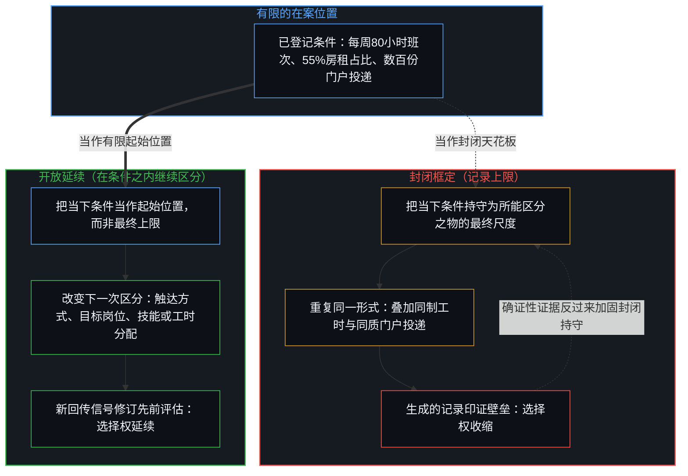
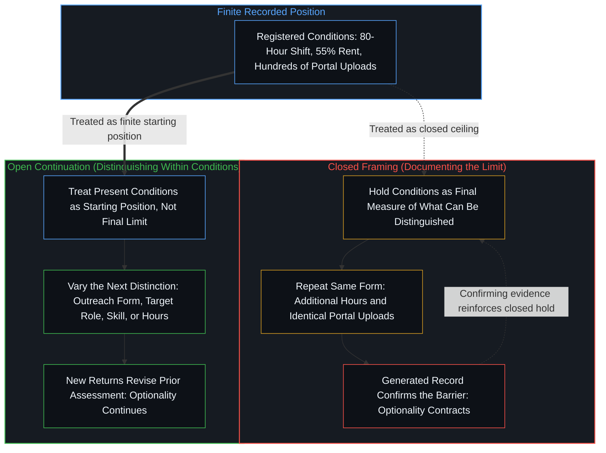
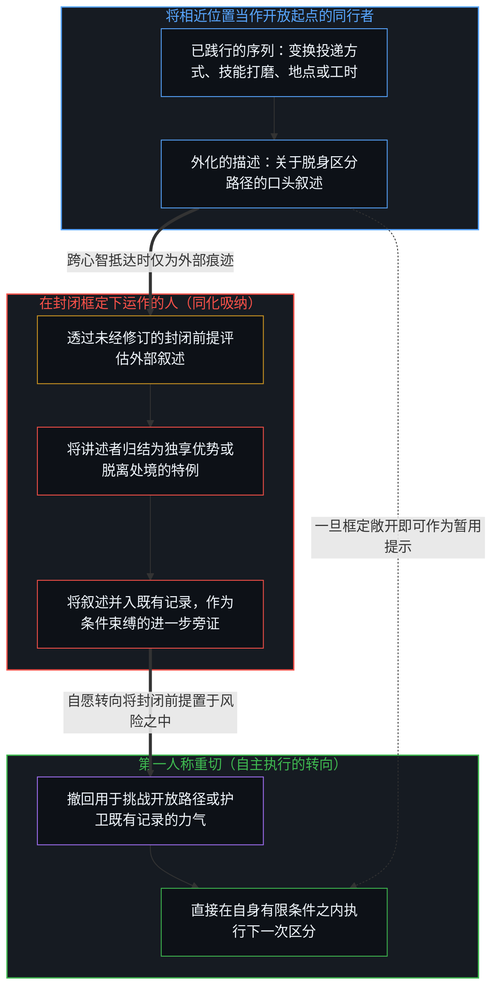
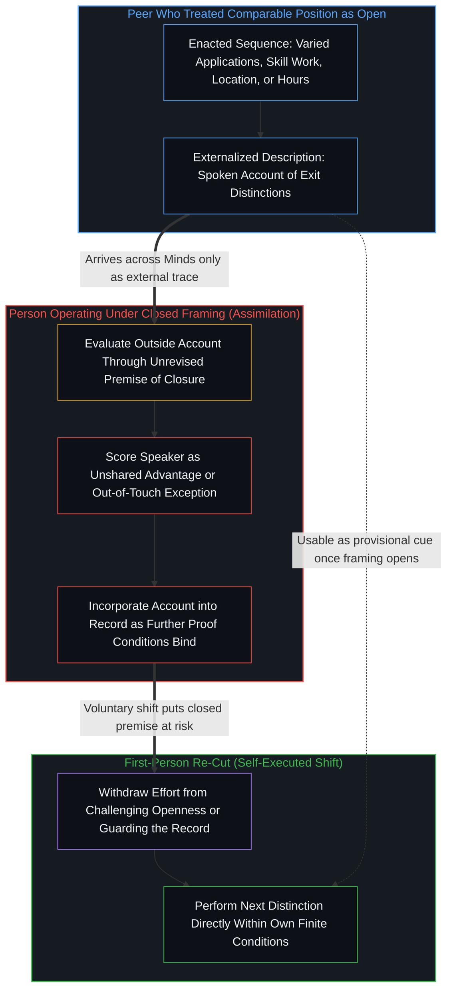

# 封闭框定与选择权的缩减 / Closed Framing and the Reduction of Optionality

*把当下的有限当作封闭上限，区分便转向确证受限；当作开放起点，选择权便在原条件中延续。 / Treating present finiteness as a closed limit directs distinguishing to confirm closure, while treating it as open continues optionality.*

每一次抉择都从既有的有限条件起步，而有限本身并不阻断进一步区分的生成。当一个人把当下条件持守为封闭定论——无论是面对漫长工时与千篇一律的求职投递，还是面对数月停滞的技能练习——努力并未停止；人会把力气花在重复同一种行动形式上，汇集壁垒已成定局的证据。旁人从相近起点脱身的具体路径叙述，会被吸纳进这份记录，而非在心智之间直接迁移；因为选择权是收缩还是延续，取决于抉择的心智在当下条件处把下一次区分引向何方。

Every choice begins from finite conditions already in place, yet nothing in finiteness itself halts the generation of further distinctions. When a person holds present conditions as a closed verdict—across long work hours and uniform applications or across months of stalled practice—effort does not stop; the person spends it repeating the same form of action and assembling proof that the barrier is final. Concrete accounts of exit from others who started in comparable positions are absorbed into that record rather than transferred across Minds, because optionality contracts or continues by the direction the choosing Mind gives its next distinction where the conditions stand.

## 一、 有限位置与封闭上限 / 1. Finite Position and Closed Limit

任一时刻的现实都是有限的。可供区分的条件如其所是。从这一有限位置出发，区分活动继续进行，而这一延续本身便供给进一步的区分。一旦把当下的有限当作封闭上限，区分活动便转向对其他选项的否定——这正是[区分活动与否定的显现](../differentiation-and-the-appearance-of-negation/)所追溯的转折：把有限边界持守为穷尽一切，会将未择取的可得余量变成一道常设排斥，要求后续行动去巡守。努力随之投向确证这些条件的束缚力，而非在其中生成进一步的区分。随后生成的记录供给了这份确证，回路便维持下去。

Reality at any given moment is finite. The conditions available for distinction are what they are. From that finite position the activity of distinguishing continues, and the continuation itself supplies further distinctions. Treating the present finiteness as a closed limit redirects the distinguishing activity toward negation of alternatives—the shift traced in [Differentiation and the Appearance of Negation](../differentiation-and-the-appearance-of-negation/), where holding a finite bound as exhaustive turns unchosen availability into a standing exclusion that subsequent acts are asked to patrol. Effort is then spent on confirming that the conditions are binding rather than on generating further distinctions within them. The record that follows supplies the confirmation, and the loop holds.

在第一人称起点上，并没有一本独立于区分活动的外部账本，预先核定某个有限位置容许什么。一旦某道解释边界被持守为定论，它便会组织起具体行动，而这些行动的下游残余又反过来印证起始前提；其中的不一致，在于迫使一项有限登记去为持续进行的活动奠基——即[开放即一致](../openness-is-consistency/)所追溯的闭合要求——而非误读了某个外在真相。让位置保持敞开并不竖起对立的丰碑——区分只是从手头的有限状态继续推进——而封闭则不断耗费鲜活的容量，去维护那道将其他可能排除在外的边界。

At a first-person starting point, no outside ledger stands apart from distinguishing to certify in advance what a finite position permits. Once an interpretive boundary is held as final, it organizes concrete acts whose downstream residue confirms the starting premise; the inconsistency lies in forcing a finite registration to ground an ongoing activity—the demand for closure traced in [Openness Is Consistency](../openness-is-consistency/)—rather than in misreading an exterior truth. Leaving a position open erects no counter-monument—distinguishing simply continues from the finite state at hand—whereas closure expends live capacity maintaining the boundary that rules alternatives out.

## 二、 把努力投入记录封闭 / 2. Effort Directed at Documenting Closure

一名保安每周工作八十个小时。收入的百分之五十五用于交房租。求职申请已经投出数百份。这些条件都是有限且记录在案的。一旦把它们当作下一步所能区分之物的最终尺度，剩余的区分活动便转向记录这份封闭：工时证明了付出，投递证明了壁垒，房租证明了约束。继续按同一形式投递申请，或在同一安排下增加工时，都在持续供给同一类证据。留下的路径，就是与这种封闭对待相一致的路径。不需要任何额外的外力。

A security guard works eighty hours a week. Fifty-five percent of the income goes to rent. Hundreds of applications have been submitted. These conditions are finite and recorded. When they are treated as the final measure of what can next be distinguished, the remaining distinguishing activity is directed at documenting the closure: the hours prove the effort, the applications prove the barrier, the rent proves the constraint. Further applications of the same form, or further hours under the same arrangement, continue to supply the same class of evidence. The path that remains is the one consistent with the closed treatment. No additional force is required.

这种收缩丝毫不是源于懒散。在预防性值守岗位上每周工作八十个小时，并通过标准招聘门户上传数百份同质简历，需要持续的体力消耗。然而，一旦把当下条件升格为决定性原因——如[外部归因是个人进步的障碍](../wai-bu-gui-yin-ge-ren-jin-bu-de-zhang-ai/)所追溯的那样把抓手移到自身之外——能动性并未消失；正如[个体抉择是唯一的因果杠杆](../individual-choices-as-the-only-causal-levers/)所确立的，条件只塑造回报之场，却不会成为下一步的第二个作者，因此维持这条回路的仍是当事者自己的抉择。沿着不变的坐标轴堆叠数量——在同一薪资结构下攒更多值守工时，或提交更多一模一样的门户投递——是把 N 个熟悉动作组成的闭合集合当作穷尽一切。固定样本集内的被拒，随之登记为不存在出路的证明；而选择权恰恰在于改变这一步本身的形式——改变展示能力的方式、接洽的岗位或渠道，或是当下工时的分配——即如[闭合的N与开放的现实](../the-closed-n-and-the-open-reality/)所追溯，在既有目录之外走出未被列举的加一。

Nothing in that contraction stems from idleness. Working eighty hours in a preventative role and uploading hundreds of uniform resumes through standard job portals require sustained physical exertion. Yet when present conditions are raised into decisive causes—relocating the grip outside oneself in the manner traced by [External Attribution Is the Obstacle to Personal Growth](../wai-bu-gui-yin-ge-ren-jin-bu-de-zhang-ai/)—agency does not vanish; as [Individual Choices as the Only Causal Levers](../individual-choices-as-the-only-causal-levers/) establishes, conditions pattern the field of payoffs without becoming a second author of the next step, so the person's own choices sustain the loop. Intensifying volume along an unchanged axis—logging more waiting hours under the same pay structure or submitting more identical portal uploads—treats a closed set of N familiar moves as exhaustive. Rejection inside that fixed sample set then registers as proof that no exit exists, whereas optionality lies in varying the form of the step itself—changing how capability is demonstrated, which role or channel is approached, or how present hours are allocated—the unenumerated plus-one beyond the catalog traced in [The Closed N and the Open Reality](../the-closed-n-and-the-open-reality/).

## 三、 技能习得中的确证缺口与再区分 / 3. Confirming the Gap Versus Further Distinction in Skill Acquisition

同样的转向也出现在技能习得中。一个人花了好几个月练习某件乐器或某项编程任务，尚未产出自己视为进步标志的结果。当目前有限的表现水平被当作能力已经封闭的证据时，后续练习便围绕确证这道缺口展开：练习场次被逐一记数，失败记录被逐条编目，预期结果的缺席被登记为定死的上限。而当同一有限水平被当作进一步区分的起始位置时，练习便围绕在当前能力之内生成更多区分来重新组织——换用不同的序列、不同的反馈标准、不同的时长分配——即便起步时已投入的时长与过往差错仍是原样，也会产出另一份后续记录。

The same redirection appears in skill acquisition. A person has spent months practicing a particular instrument or coding task and has not yet produced the output they treat as the criterion of progress. When the current finite level of performance is taken as evidence that the capacity is closed, subsequent practice is organized around confirming the gap: the sessions are counted, the failures are catalogued, and the absence of the desired result is registered as the binding limit. When the same finite level is treated as the starting position for further distinction, the practice is reorganized around generating additional distinctions within the present capacity—different sequences, different feedback criteria, different durations—producing a different subsequent record even though the starting hours and errors remain what they were.

一旦执行自动化并进入平台期，单纯叠加同质重复的时长便不再推动表现；而将困难读作对禀赋的判决，则会使努力转向维护自身排位，而非调整策略。无论是套用外部训练公式，还是事后贴上按坚毅程度给人排名的特质标签，都无法打破这一平台期，因为两者都在[好奇先行](../curiosity-first-the-hidden-engine-of-talent-and-development/)所剖析的因果倒置中，把复利累积的残余冻结成先在原因——可供照搬的固定配方，或可供排名的静态特质。只要学习者仍把当前能力视为封死的，一份开好的训练清单照样可以被执行成同质化的按次记数；而把下一次陌生变式评为“太难”，也依然会像[难度不在行动本身](../hardness-is-not-inherent-in-the-action/)所追溯的那样，充当推迟尝试的事后许可。将平台期记录与进一步区分隔开的，是练习者如何使用一次失败尝试之后的间隙：究竟把失手记作触顶的证明，还是像[失败即信息](../failure-as-information/)所揭示的那样，让这道间隙免于自我判决，使误差直接成为下一次变式尝试的参数。

Once execution automates into a plateau, additional hours of uniform repetition stop moving performance, and reading difficulty as a verdict on endowment turns effort toward protecting standing rather than varying strategy. Neither external training formulas nor retrospective trait labels for ranking who possesses grit resolve that plateau, since both freeze compounded residue into a prior cause—a fixed recipe to copy or a static trait to rank—in the causal reversal dissected by [Curiosity First](../curiosity-first-the-hidden-engine-of-talent-and-development/). A prescribed drill sheet can still be run as uniform session-counting if the learner treats present capacity as sealed, and scoring the next unfamiliar variation as "too hard" still operates as a post-hoc license to defer it, as traced in [Hardness Is Not Inherent in the Action](../hardness-is-not-inherent-in-the-action/). What separates a plateau record from further differentiation is how the practitioner uses the interval after a failed attempt: logging the miss as proof of a ceiling, or keeping that gap clear of self-verdicts so the error directly parameterizes the next varied trial, as in [Failure as Information](../failure-as-information/).

## 四、 为何突围者的路径描述无法直接迁移 / 4. Why Descriptions of Exit Do Not Transfer

曾把相近的有限位置当作开放起点的人，看得出这种缩减。他们之所以能描述这一机制，是因为自己执行过相反的选择：从原先的位置持续区分，由此扩大了可得区分的集合。有人曾身处类似的低回报工作安排，因把这项安排当作有限而非封闭而得以脱身，便能把随后展开的一连串区分叙述出来——不同的投递方式、不同的技能打磨、不同的地点或工时安排。这份描述就摆在眼前。但它无法迁移。对于仍把区分活动导向确证封闭的人而言，这份描述只会登记为又一项有待归入既有记录的外部条件：要么算作条件具有束缚力的又一重证据，要么算作讲述者握有某种独享优势的证据。从外部供给那道缺失区分的尝试，终究被吸纳进封闭框定，而未由仍处其中的人作为进一步的区分亲自执行。

Those who have treated a comparable finite position as open can see the reduction. They can describe the mechanism because they have performed the opposite selection: continued distinguishing that enlarged the set of available distinctions from their own prior position. One who has moved from a similar low-return job arrangement by treating the arrangement as finite rather than closed may describe the sequence of distinctions that followed—different applications, different skill work, different location or hours. The description is available. It does not transfer. For the person still directing distinguishing activity toward confirmation of closure, the description registers as another external condition to be incorporated into the existing record: further evidence that the conditions are binding, or evidence that the describer possessed some unshared advantage. The attempt to supply the missing distinction from outside is absorbed into the closed framing rather than performed as a further distinction by the person still operating under it.

这种无法迁移并非源于措辞不够清晰，而是源于心智之间的边界。正如[论封闭系统、开放心智与证明的界限](../on-closed-systems-open-minds-and-the-limits-of-proof/)所确立的，从一个心智传向另一个心智的只是外化的描述——共享语言中的痕迹残余——而非从内部践行出来的活态开放。当走出困境的人把多年局部试错与变式压缩成一句生硬的“再努力干”或“再努力找”时，这种压缩便会招致当场排斥，因为它开出的药方正是在早已耗尽的那根轴上继续堆量；然而即便对方给出具体的区分动作——直接自荐而非再投一份门户简历、转换目标岗位、改走另一条渠道——如[信念如何真正改变](../how-belief-actually-changes/)所追溯的，未经修订的前提仍会透过那个被豁免于修订的坐标来评估每一条外来建议。在执意确证封闭的持守内部，每一个新提出的选项都只是多铺开一块可供驳回、或被圈定为独享特权的接触面，重演着[解释为何失效](../why-explanation-fails/)中的非对称性。把力气花在挑战那些讲述开放路径的人身上，只会让区分继续指向护卫封闭记录；而指望建议能从外部执行这次转向，则是把外部提示误作唯有每个心智自己才能完成的内在重切——即[没有普渡，只有自渡的无限可能](../mei-you-pu-du-zhi-you-zi-du/)所标出的界限。

That non-transfer follows from the boundary between Minds rather than from a lack of clearer wording. As [On Closed Systems, Open Minds, and the Limits of Proof](../on-closed-systems-open-minds-and-the-limits-of-proof/) establishes, what crosses from one Mind to another is an externalized description—trace residue in shared language—never the live openness enacted from within. When someone who exited a constraint compresses years of local trial and variation into a blunt demand to "work harder" or "look harder," the compression invites immediate dismissal because it prescribes more volume along the very axis already exhausted; yet even when a concrete differentiation is offered—a direct pitch instead of another portal upload, a shift in target role, a different channel—an unrevised premise evaluates every incoming suggestion through the coordinate it has exempted from revision, as traced in [How Belief Actually Changes](../how-belief-actually-changes/). Inside a hold committed to confirming closure, each proposed option merely supplies another surface to disqualify or fence off as an unshared privilege, enacting the asymmetry of [Why Explanation Fails](../why-explanation-fails/). Spending effort challenging those who report open paths keeps distinguishing pointed at defending the closed record, while expecting advice to execute the turn from outside mistakes an external cue for an inner re-cut that each Mind can perform only for itself, the limit named in [No Universal Salvation, Only Boundless Possibilities of Self-Salvation](../mei-you-pu-du-zhi-you-zi-du/).

## 五、 同一有限起点上的方向选择 / 5. Selecting Direction at the Same Finite Starting Point

对待同一位置的这两种方式，都从同一个有限起点出发。两者都不需要在产生该起点的区分活动之外另做一次测量。把位置持守为封闭的心智，经由那道额外添上的排斥收窄后续的区分场域，并收到确证性的回传；把位置持守为开放的心智，则不加这道封印而继续区分，并收到足以修订先前评估的回传。两者的差异，在于当下条件登记之后区分活动所取的方向。

Both ways of treating a position begin from the same finite starting point. Neither requires a measurement taken from outside the distinguishing that produces the starting point. A Mind holding the position closed narrows its subsequent field of distinctions through that added exclusion and receives confirming returns; a Mind holding the position open continues distinguishing without that seal and receives returns that can revise its prior assessment. The difference is the direction the distinguishing activity takes once the present conditions are registered.

选择开放的方向，既不会抹平不均等的起始条件，也不会许诺不同位置都能取得相同结果。将收入的百分之五十五用于房租会带来摩擦，留下的容错余地也比手握累积富余的起点更薄；正如[可延展的地平线](../the-extendable-horizon/)所追溯的，任何坐标上的敞开，意指改变下一步行动的能力在那里依然鲜活，而非每个起始坐标距离某一既定结果都一样近。这一选择也不是脱离具体行动与纠错的空想。如[约束的样子不是自由的失去](../the-look-of-constraint-is-not-the-loss-of-freedom/)所示，感到的困锁，是能动性向后指向看守或记录过往痕迹、而非从已实现状态向前推进时的拖累；掉转这一航向，便在[抉择的跨界](../the-boundary-crossing-of-choice/)所追溯的当下阈值处跨入物理行动。条件本身如其所是。这个心智为下一次区分选定的方向，决定着选择权是收缩还是延续。

Selecting an open direction does not flatten unequal starting conditions or promise identical outcomes across different positions. Paying fifty-five percent of income to rent imposes friction and leaves thinner margins for error than starting from accumulated slack; as [The Extendable Horizon](../the-extendable-horizon/) traces, openness at any coordinate means the capacity to vary the next step remains live there, not that every starting coordinate stands at the same distance from a given result. Nor is that selection a wish detached from concrete action and error-correction. As [The Look of Constraint Is Not the Loss of Freedom](../the-look-of-constraint-is-not-the-loss-of-freedom/) shows, felt lock-in is the drag of agency pointed backward at guarding or documenting prior traces rather than forward from the realized state, and turning that heading crosses into physical action at the immediate threshold traced in [The Boundary Crossing of Choice](../the-boundary-crossing-of-choice/). The conditions themselves remain what they are. The direction this Mind selects for its next distinction is what determines whether optionality contracts or continues.
