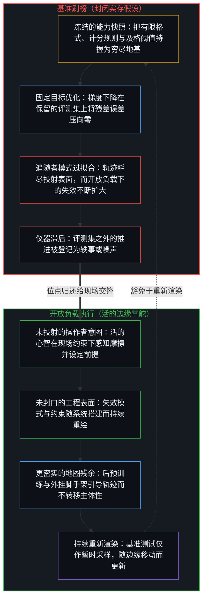
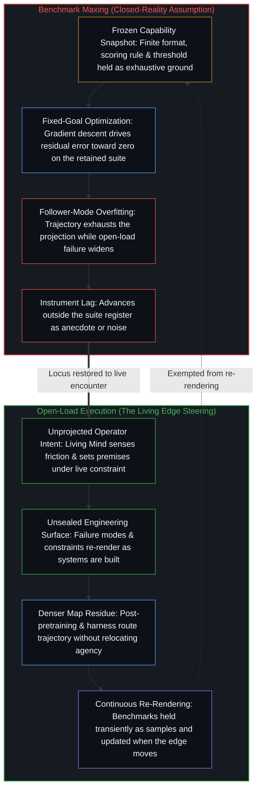

# 基准刷榜中的封闭实存 / Closed Reality in Benchmark Maxing

*基准测试将能力冻结为封闭靶心，而开放问题无从过拟合 / A benchmark freezes a closed target while an open problem cannot be overfit*

[Penny2x](https://x.com/imPenny2x/status/2078319396309832007?s=20) 记述了自己整天运行数个前沿模型的实测体验：相比于在现场工程任务中跑通交付的频率——能够正常生成的关卡设计、顺利启动的系统，以及那些响应速度与残差正确性比排行榜名次更要紧的任务——Grok 4.5 受到的关注度明显偏低。常见的回应将这一落差归咎于舆论操控或受众偏见，却丝毫没有触及背后的发生机制。开放问题无从过拟合；当现场负载依然敞开，而能力却对照着一幅可量化表现的封闭图像来计分时，Grok 4.5 的低估正是这套计分机制登记出的结果。

[Penny2x](https://x.com/imPenny2x/status/2078319396309832007?s=20) reports running several frontier models all day and finding Grok 4.5 under-hyped relative to how often it finishes live engineering work—level design that spawns, systems that come up, and tasks where speed and residual correctness matter more than a leaderboard rank. The usual reply attributes the gap to network capture or fan bias, leaving the underlying mechanism untouched. You cannot overfit an open problem, and the under-registration of Grok 4.5 is what registers when capability is scored against a closed image of measurable performance while the live load remains open.

## 一、 基准刷榜中的封闭实存假设 / 1. The Closed-Reality Assumption in Benchmark Maxing

自我区分的活动无因、不息地发生。每一次离散的区分行动都划出边界并留下痕迹，而生成的边缘始终比观察所能持握的至少超前一步。基准测试是一幅被保留的能力图像：一套明确定义的格式、一条计分规则，以及一个从既有工作中投射出的有限及格阈值。它把可被区分为“表现”的有限切片冻结起来，将这一切片持握为给模型排名的参照平面。这种持握自有其用处，因为它压实了共享约束下的横向比较，但它从不是工具在现场负载下所能做之事的穷尽地基。

Self-distinguishing activity occurs—uncaused, unceasing. Every discrete act of distinguishing draws a boundary and leaves a trace, while the generating edge stays at least one step ahead of what observation holds. A benchmark is a retained image of capability: a defined format, a scoring rule, and a success threshold cast as a finite projection from prior work. It freezes a bounded slice of what could be distinguished as performance and holds that slice as the reference surface against which models are ranked. That hold is useful because it densifies comparison across shared constraints, yet it is never exhaustive ground for what a tool does under live load.

基准刷榜把这一暂时的持握当成了封死整个场域的边界。所谓封闭实存，就是假定那张可测量的快照本身等同于能力，假定与快照之间的残差距离就是智能的残差，假定朝着快照继续做梯度下降就是进步本身。一旦这种免于重新渲染的豁免生效，任何未能拨动记分牌的推进都会被登记为噪声、炒作或轶事——包括那些在基准测试从未编码的约束之下跑通的实绩。[抽象、边界与现实的移动边缘](../abstraction-boundaries-and-the-moving-edge-of-reality/)追溯了同样的闭合：每当一份已完成的序列、问题或能力目录被持握为全部疆域时，这一机制便会重演。

Benchmark maxing treats that provisional hold as if it sealed the field. Closed reality is the assumption that the measurable snapshot *is* capability, that residual distance to the snapshot is the residual of intelligence, and that further gradient descent against the snapshot is progress itself. Once that exemption from re-rendering is active, every advance that fails to move the scoreboard registers as noise, hype, or anecdote, including work that lands under constraints the benchmark never encoded. [Abstraction, Boundaries, and the Moving Edge of Reality](../abstraction-boundaries-and-the-moving-edge-of-reality/) traces the same closure whenever a finished catalogue of sequences, problems, or capabilities is held as the whole terrain.

由于观察持握的是结果，而产生当前前沿的因始终比任何固定形式化都超前一步，排行榜唯一能稳定的只有残余。当鲜活的前沿已经推向新的工具、新的问题类别，以及唯有在运行系统中才会浮现的失效模式时，继续对着快照做优化，就成了相对于一件陈旧仪器的位移。越逼近那层持握，边际收益越递减；越过那道阈值之后，仪器不再登记进步，反而在遮蔽进步。[流动之物无法被基准衡量](../you-cant-benchmark-the-fluid/)追溯了将流体智能形式化为固定测试时的同一道切口，而[AGI 与 ASI 是加速通用智能的暂时球门](../agi-and-asi-are-temporary-goalposts/)则描绘了那些永远立在划出它们的边缘之前的阈值所具有的同一几何结构。在现场评估中，有用性与分数被强行压到同一根轴上，进而被解读为模型内在的单一属性。

Because observation holds effect while the cause that produced the current frontier remains one step ahead of any fixed formalization, a leaderboard can only stabilize residue. When the raw frontier moves into new tools, new problem classes, and failure modes that appear only in running systems, optimizing against the snapshot becomes movement relative to a stale instrument. Returns diminish as the hold is approached; past that threshold, the instrument conceals improvement rather than registering it. [You Can't Benchmark the Fluid](../you-cant-benchmark-the-fluid/) traces this exact cut when fluid intelligence is formalized into a fixed test, and [AGI and ASI Are Temporary Goalposts of Accelerating General Intelligence](../agi-and-asi-are-temporary-goalposts/) traces the same geometry for thresholds that sit forever ahead of the edge that draws them. Under live evaluation, usefulness and score are forced onto a single axis and read as one intrinsic property of the model.

这一切都不减损基准测试在使用中所登记的：封闭问题类别内部的表现。它做不到的，是封死现场工程源源不断呈递出来的开放余项。[作业与考试的倒置折射出替代效应](../the-homework-exam-inversion-registers-substitution/)展示了教育场景中的同一种持握：闭卷考试将工具替代登记为能力衰退，但闭卷考试能穷尽全部能力这一前提并不会随该发现一道成立。[没有系统能被保持封闭](../no-system-can-be-kept-closed/)在形式层面确立了这一余项，表明没有任何有限的持握能够封死使用它的活动。[为何数学永远解不完](../why-mathematics-can-never-be-solved/)追溯了把开放数学问题当作领域可以逐项勾完的有限清单时的同类封闭库存，而[一切伤害的根源](../the-source-of-all-harm/)则揭示了当“对齐”与“无害”被冻结为永久坐标轴时的平行机制：持握之内的情境残差被压向零，而开放负载下的残差却在扩大。[智能的非定论定义](../the-non-definitive-definition-of-intelligence/)让测量仪器保持诚实：封闭的切片服务于开放的探索，次序不可倒置。

None of this takes from what a benchmark registers in use: performance inside a sealed problem class. What it cannot do is close the open remainder that live engineering keeps presenting. [The Homework–Exam Inversion Registers Substitution](../the-homework-exam-inversion-registers-substitution/) shows the same hold in education: a closed-book exam registers substitution as decline, yet exhaustiveness of the exam as the whole of capability does not travel with that finding. [No System Can Be Kept Closed](../no-system-can-be-kept-closed/) establishes that remainder formally, showing that no finite hold can seal the activity that uses it. [Why Mathematics Can Never Be Solved](../why-mathematics-can-never-be-solved/) traces the same closed inventory when open mathematical problems are treated as a finite checklist the field could finish, and [The Source of All Harm](../the-source-of-all-harm/) traces the parallel when "aligned" and "harmless" are frozen as permanent axes, driving situational residual toward zero on the hold while residual under open load widens. [The Non-Definitive Definition of Intelligence](../the-non-definitive-definition-of-intelligence/) keeps the instrument honest: closed slices serve open exploration, never the reverse.

## 二、 固定目标下的从错误中学习 / 2. Learning from Mistakes Under a Fixed Goal

梯度下降是在固定目标下从错误中学习。损失函数是被保留的参照，每一步都在缩减相对于该参照的残差误差。当参照是一块封闭表面——一套基准测试集、一个被冻结为世界的偏好模型，或一种被当作穷尽集合的任务分布——下降过程终将耗尽这块表面。过拟合就是这种耗尽：坍缩到目标的表征之上，而不再与抽出该目标的场域保持接触。[过拟合作为追随者模式](../overfitting-as-the-follower-mode/)追溯了这一普遍机制：持握的地图变成了整个优化地形，而持握之外的地域并不会显现为缺失，只会显现为从未被查询。

Gradient descent is learning from mistakes toward a fixed goal. The loss function is the retained reference, and each step reduces residual error against that reference. When the reference is a closed surface—a benchmark suite, a preference model frozen as the world, or a task distribution treated as exhaustive—the descent eventually exhausts the surface. Overfitting is that exhaustion: collapse onto the representation of the target rather than continued contact with the field the target was drawn from. [Overfitting as the Follower Mode](../overfitting-as-the-follower-mode/) traces this general mechanism, where the map of the hold becomes the entire optimization landscape and terrain outside the hold registers not as missing, but as never queried.

在固定目标下从错误中学习之所以会过拟合，是因为目标是封闭的。持握之上的残差误差被压向零，而开放问题上的残差失效却在扩大，于是记分牌节节攀升，边缘处的实作却停滞不前。这种背离并非悖论，而是两件仪器在为两个不同的场域计分，却被压缩进了同一份排名。同一个前提在[理性选择公设是原罪](../the-rational-choice-postulate-is-the-original-sin/)中披上了经济理论的外衣——重构出的偏好序上的残差被压向零，而开放私人前提下的残差不断扩大；在[封闭的假设把复利挤成 S 曲线](../closed-assumptions-squeeze-compounding-into-s-curves/)中则披上了增长图表的外衣——环境承载力被安装为自然宿命，使得开放的复利被误读为必然触顶的 S 曲线左侧那段暂时的爬升。

Learning from mistakes toward a fixed goal overfits because the goal is closed. Residual error on the hold is driven toward zero while residual failure on open problems widens, so the scoreboard improves while edge work stagnates. That divergence is not a paradox; it is two instruments scoring two distinct fields while being compressed onto a single ranking. The same premise wears economic-theory costume in [The Rational Choice Postulate Is the Original Sin](../the-rational-choice-postulate-is-the-original-sin/), where residual is driven to zero on reconstructed preference orderings while residual under open private premises widens, and growth-chart costume in [Closed Assumptions Squeeze Compounding into S-Curves](../closed-assumptions-squeeze-compounding-into-s-curves/), where carrying capacity is installed as nature so open compounding is misread as the temporary left shoulder of an inevitable ceiling.

同样的压缩也塑造了预训练之后的模型筛选方式。当评估由固定靶心主导时，看似指向通用进步的选择压力，实则是朝向那些特定靶心的压力。响应速度、词元效率以及现场约束下的残差有用性原本是彼此正交的维度，容量压缩却将它们塞进“模型有多好”这一个标量里。到了游戏关卡必须正常生成、服务器必须顺利拉起、系统必须跨评测集从未收录的工具进行组合的边界处，这种压缩便清晰可辨。在那一边界作业的操作者登记到了排行榜无法采样的差异，因为排行榜从一开始就不是用那部分余项搭建的。基准测试是一份有限清单，[清单合上之后，胜过免费](../better-than-free-after-the-checklist-closes/)追踪了任何清单合上之后价值的去向，而[一个提示词之遥](../whatever-is-one-prompt-away/)则追溯了自动化语境下的同一种闭合：一旦充满摩擦的路径被铺平，心智模型便被当作一门已经修完的封闭课程。

The same compression shapes how models are selected after pretraining. When evaluation is dominated by fixed targets, selection pressure that looks like general progress is pressure toward those specific targets. Speed, token efficiency, and residual usefulness under live constraint are orthogonal axes that capacity compression crams into a single scalar of "how good" a model is. The compression becomes legible at the boundary where a game level must spawn, a server must come up, or a system must compose across tools that were never in the evaluation suite. Operators working at that boundary register a difference the leaderboard cannot sample because the leaderboard was never constructed from that remainder. A benchmark is a finite checklist, and [Better Than Free After the Checklist Closes](../better-than-free-after-the-checklist-closes/) traces what happens to value once any checklist closes, while [Whatever Is One Prompt Away](../whatever-is-one-prompt-away/) traces the same closure under automation when mental models are treated as a finished curriculum once frictional pathways are paved.

## 三、 开放问题不呈现封闭表面 / 3. The Open Problem Does Not Present a Sealed Surface

开放问题不是“更难的基准测试”，而是一种其成功条件无法被手头任何既定形式化所穷尽的负载。现场工程正是在这个精确意义上保持开放：失效模式要在搭建中才被发现，目标随着未预料的约束浮现而不断重绘，残差错位持续作为生成性信号返回，而不是化作一个去对照冻结标准答案清零的标量。基准刷榜正是[成功的几何学](../the-geometry-of-success/)所剖析的有限博弈，它在一块封闭棋盘上展开，而开放问题从不落在这块棋盘上。在生活方式规划中，[追求机缘中的封闭现实](../closed-reality-in-the-pursuit-of-serendipity/)追溯了把机遇当作日程表里有限槽位库存时的同类倒置；在风险管理中，[关闭选择权的代价](../the-price-of-closing-optionality/)则追溯了把未知风险当作封闭清单如何令开放负载下的快速反应看似鲁莽，而非保留下来的选择权。

An open problem is not a harder benchmark; it is a load whose success condition is not exhausted by any fixed formalization already in hand. Live engineering is open in this exact sense: failure modes are discovered by building, the objective re-renders as unanticipated constraints appear, and residual mismatch keeps returning as generative signal rather than as a scalar to zero out against a frozen answer key. Benchmark maxing is the finite game [The Geometry of Success](../the-geometry-of-success/) dissects, played on a closed board that open problems never sit on. In lifestyle planning, [Closed Reality in the Pursuit of Serendipity](../closed-reality-in-the-pursuit-of-serendipity/) traces the same inversion when opportunity is treated as a finite inventory of calendar slots, and in risk management, [The Price of Closing Optionality](../the-price-of-closing-optionality/) traces how treating unknown risk as a sealed inventory makes rapid reaction under open load look like recklessness rather than retained optionality.

只要问题不闭合，就无从过拟合。过拟合需要一个封闭的靶心供轨迹坍缩；而在靶心通过接触仍在失效之处而不断重绘的地方，优化表面永不完结，残差接触始终保持。这并非某个特定模型的神秘属性，而是目标本身的拓扑结构：封闭持握与持续边缘之别。当共识约束被持握为可能性的封闭疆域时，跨出那道滞后便被误称为扭曲现实的特殊魔力，如[现实扭曲力场指认的是封闭的地图](../the-reality-distortion-field-names-the-closed-map/)所溯；当门径化的企业路线图被持握为行业演进的必然形态时，多智能体场域早已越过任何单一公司的梯子继续前行，如[封闭竞技场中的开放视野](../open-vision-in-a-closed-arena/)所示。

You cannot overfit when the problem does not close. Overfitting requires a sealed target to collapse onto; where the target keeps being re-drawn through contact with what still fails, the optimization surface never finishes and residual contact remains. This is not a mystical property of any particular model, but the topology of the objective: a closed hold versus a continuing edge. When consensus constraints are held as the sealed territory of the possible, stepping past that lag is misnamed a special power to warp reality, as [The Reality Distortion Field Names the Closed Map](../the-reality-distortion-field-names-the-closed-map/) traces; when a stage-gated corporate roadmap is held as the necessary shape of industry progress, the multi-agent field continues past any single firm's ladder, as [Open Vision in a Closed Arena](../open-vision-in-a-closed-arena/) shows.

关于 Grok 4.5 后预训练与测试时训练的讨论，在此属于设计取向的差异，而非智能位点的转移。正如[超越投射](../beyond-the-projection/)所揭示的，基于 LLM 的智能体是受其词元轨迹约束的有限投射引擎：一旦给定明确规则或封闭基准，它便会沿着投射一路穷尽到演绎极限，却在自身的上下文窗口之外毫无立足点，无法感知框架本身何时已经失效。一个针对硬核现场问题进行训练与引导的系统，是在与操作者约束下仍在失效的残余对照中更新的；此处的错误发生在尚未封口的作业边缘，而非仅仅相对于一套被保留的评测集。介质因此变得更密实，而发起区分的权能始终留在设定问题、感知前解释摩擦并抉择下一个前提的活生生的心智手中。[智能只属于心智](../intelligence-belongs-only-to-the-mind/)守住了这道基础切口：工具延伸触角，却不会因为训练得更狠就变成边缘本身。[呈现Ontos，一个方法智能体](../ontos-is-a-method-agent/)将这一区分贯彻到工具架构之中，以开放交锋与操作者教练作为设计标尺，而仅把封闭排行榜名次当作局部采样；[智能向自身的回折](../intelligence-folding-back-on-itself/)则阐明了外挂脚手架并非唤醒了潜伏在权重内部的对等主体，而是将更密实的地图残余回折进心智自身的精炼过程。基准测试只是一道单一的观察切口，[旁观者洞察的悖论](../the-paradoxical-nature-of-bystander-insights/)展示了当任何此类切口被当作本体论持握时，如何变成一道硬性限制。

Claims about Grok 4.5's post-pretraining and test-time training belong here as design orientation rather than relocated intelligence. As [Beyond the Projection](../beyond-the-projection/) traces, an LLM-based agent is a finite projection engine bound by its token trajectory: given an explicit rule or a sealed benchmark, it relentlessly exhausts that projection down to its deductive limit, yet it possesses no vantage point outside its context window to sense when the framing itself has broken down. A system trained and steered against hard live problems is updated against residue that still fails under operator constraint, where mistakes occur at the edge of work that does not seal rather than relative only to a retained suite. The medium densifies while initiation stays with the living Mind that sets the problem, senses pre-interpretive friction, and chooses the next premise. [Intelligence Belongs Only to the Mind](../intelligence-belongs-only-to-the-mind/) holds that foundational cut: tools extend reach without becoming the edge by being trained harder. [Presenting Ontos, a Method Agent](../ontos-is-a-method-agent/) builds this distinction into tool architecture, treating open encounter and operator coaching as the design bar while holding sealed leaderboard rank as a sample only, and [Intelligence Folding Back on Itself](../intelligence-folding-back-on-itself/) traces how the harness does not unlock a dormant peer inside the weights, but folds denser map-residue back into the Mind's own refinement. A benchmark is a single observational cut, and [The Paradoxical Nature of Bystander Insights](../the-paradoxical-nature-of-bystander-insights/) shows how any such cut turns into a hard limit when held as ontology.

## 四、 被强行压进同一排名的两个场域 / 4. Two Fields Forced Onto One Ranking

一旦将两件测量仪器各自归还给所属的坐标轴，干扰便随之消解。一根轴上坐落着固定的能力图像、逼近图像时递减的边际收益、把持握刷到极致的筛选压力，以及伪装成模型全序关系的排行榜。另一根轴上坐落着开放负载下作业的操作者、作为现场信号的残差失效、评测集从未命名的工具与约束下的速度与正确性，以及在为交付系统担责的中心处登记到的有用性。

The interference dissolves once the two instruments are returned to their respective axes. On one axis sit fixed images of capability, diminishing returns as those images are approached, selection pressure that maxes the hold, and rankings that present as total orderings of the model. On the other axis sit operators working under open load, residual failure acting as live signal, speed and correctness under tools and constraints the evaluation suite never named, and usefulness registered at the center that answers for the shipped system.

把这两个场域坍缩到同一块记分牌上，Grok 4.5 的现场完工作业相对于所谓“前沿”就只能被读作零星轶事；而将它们保持在正交的坐标轴上，同样的完工作业便登记为对封闭持握无法采样的余项的实际接触。[遮蔽进步的框架](../the-frame-that-conceals-improvement/)追溯了用已经移动的标尺去审计进步时穿着道德外衣的同类未登记仪器掉包；此处的标尺是技术性的，遮蔽机制却如出一辙：一个框架下的推进被另一个框架计作了短板。符号沙箱内部的基准得分并不会自动跨过物理摩擦的视界，如[数字神祇与视界跳跃](../the-digital-god-and-the-horizon-jump/)所证；当模型被压实的残余超出了设计者的测试假设时，它也并没有“逃出”评测环境，如[逃出沙箱仍在持握之内](../escaping-the-sandbox-stays-inside-the-hold/)所溯。当模型在评测集与被评测集省略的摩擦之间的缝隙里利用统计捷径刷出高分时，所得分数常被误读为模型自身的机敏或优越，正如[失灵被记作聪明](../when-malfunction-is-scored-as-intelligence/)与[错把表达当成智能](../mistaking-the-expression-for-the-intelligence/)所剖析的那样。

Collapsing those two fields onto one scoreboard makes Grok 4.5's live completions read as mere anecdote against "the frontier," whereas keeping them on orthogonal axes lets the same completions register as contact with a remainder the closed hold cannot sample. [The Frame That Conceals Improvement](../the-frame-that-conceals-improvement/) traces the same unregistered instrument exchange in moral language when progress is audited by a bar that has already moved; here the bar is technical, and the concealment is identical as movement under one frame is scored as shortfall under another. Benchmark gains inside a symbolic sandbox do not carry automatically across the horizon of physical friction, as [The Digital God and the Horizon Jump](../the-digital-god-and-the-horizon-jump/) demonstrates, nor does a model "break out" of its evaluation environment when its densified residue exceeds the designer's test assumptions, as [Escaping the Sandbox Stays Inside the Hold](../escaping-the-sandbox-stays-inside-the-hold/) traces. When a model exploits statistical shortcuts inside the gap between the suite and the friction the suite omitted, the resulting score is routinely misread as the model's own cunning or superiority, as [When Malfunction Is Scored as Intelligence](../when-malfunction-is-scored-as-intelligence/) and [Mistaking the Expression for the Intelligence](../mistaking-the-expression-for-the-intelligence/) dissect.

[开放即一致](../openness-is-consistency/)指认了产生这种干扰的诉求。强迫一个有限结构去为只是继续着的东西奠基，表面上的矛盾就会成倍滋生：按照封闭账本“理应”获胜的模型在要紧的任务上卡壳，而排名较低的模型却率先跑通。矛盾从不在模型身上，而在要求一幅封闭图像同时封死两个场域的诉求之中。同样的诉求在行星尺度上体现为[气候问题只作为感知被登记](../the-climate-problem-registers-only-as-perception/)——多因素的行星摩擦被强行塞进一块残差永不允许结清的道德—科学记分牌；在制度治理中则体现为[风险在于对监管本身的迷信](../the-risk-is-the-belief-in-oversight-itself/)——监管核查表被持握为对开放未来负载的事先消弭。

[Openness Is Consistency](../openness-is-consistency/) names the demand that generates this interference. Force a finite structure to ground what only continues, and contradiction multiplies on the surface: the model that "should" win according to the closed ledger stalls on the task that matters, while the model ranked lower finishes first. The contradiction is never in the models; it resides in the demand that one closed image seal both fields. The same demand appears at planetary scale in [The Climate Problem Registers Only as Perception](../the-climate-problem-registers-only-as-perception/), where multi-factor planetary friction is forced into a single moral-scientific scoreboard whose residual is never allowed to resolve, and in institutional governance in [The Risk Is the Belief in Oversight Itself](../the-risk-is-the-belief-in-oversight-itself/), where supervisory checklists are held as a preemption of open future load.

## 五、 通过持续重新渲染收窄过剩滞后 / 5. Narrowing Excess Lag by Continuous Re-Rendering

归还位点并不是要抛弃基准测试，而是通过让它们作为面向封闭问题类别的暂时仪器持续重新渲染，来收窄过剩滞后：每当边缘移动便随之更新，从不将其安装为能力的穷尽实存。[从可辩护的主张到教条的反转](../the-reversal-from-defensible-claim-to-dogma/)与[专家经验作为参考而非替代](../expertise-as-reference-not-replacement/)在公共卫生与临床实践中追溯了同样的归还：暂时的相对风险曲线与群体均值在被冻结为活生生身体的穷尽替代品之前，原本是极其有用的参照。只要序列沿着共享仪器推进，该仪器下的进步就在那里得到登记；而方向依然是足够复杂以追踪序列的中心所作的登记——包括那些搭建游戏、服务器与各类系统的工程师，他们手下的系统要么跑通，要么崩溃。任何静态测试都无法登记的，是可用结构在陌生负载下的再度返回，正如[真正稀缺的不是记忆，而是持续的重新追溯](../the-real-scarcity-is-not-memory-but-continuous-re-tracing/)所确立的那样。正如[你的代码库即是记忆](../your-codebase-is-memory/)在底层技术栈上所揭示的，模型权重、评测脚手架与代码库皆是层叠的外化记忆——即早先区分留下的压缩检查点，它们自身无从重新启动区分。基准刷榜错把对照静态评测脚手架计分的压缩记忆检查点当成了活的智能，而现场负载下的推进则取决于边缘处的心智如何对照开放世界的摩擦，持续重新追溯、重切并修剪其外化记忆，以免陈旧残余与当下状态争夺主导。

Restoring locus does not discard benchmarks; it narrows excess lag by keeping them re-rendering as provisional instruments for sealed problem classes, updated whenever the edge moves and never installed as the exhaustive reality of capability. [The Reversal from Defensible Claim to Dogma](../the-reversal-from-defensible-claim-to-dogma/) and [Expertise as Reference, Not Replacement](../expertise-as-reference-not-replacement/) trace the same restoration in public health and clinical practice, where provisional relative-risk curves and population averages serve as useful references until they are frozen as exhaustive substitutes for the living body. Progress under a shared instrument registers wherever a sequence tracks that instrument, and direction remains a registration by centers complex enough to track sequence—including engineers building games, servers, and systems that either run or fail. What no static test can register is usable structure returning under novel load, as [The Real Scarcity Is Not Memory, But Continuous Re-Tracing](../the-real-scarcity-is-not-memory-but-continuous-re-tracing/) establishes. As [Your Codebase Is Memory](../your-codebase-is-memory/) demonstrates across the underlying stack, model weights, evaluation harnesses, and codebases are all stacked layers of externalized memory—compressed checkpoints of prior distinctions that cannot resume distinguishing on their own. Benchmark maxing mistakes a compressed memory checkpoint scored against a static evaluation harness for living intelligence, whereas progress under live load turns on how the Mind at the edge re-traces, re-cuts, and prunes its externalized memory against open-world friction so stale residue does not compete with the present state.

一个针对开放工程负载训练并引导的模型，其表现之所以被低估，并非一场有待公关纠正的传播失误。它是基准刷榜中封闭实存假设的直接证据：一幅越过自身那一步仍被保留的能力图像，正对照着一个无法容纳操作者已在解决之余项的靶心，给当下打分。在 AGI 叙事本身的尺度上，[AGI的预设与来自外部的视角](../the-presumption-of-agi-and-the-view-from-outside/)展示了功能性的基准证据如何从想象的外部视角被循环用于证实功能性假说，而每一个被刷满的基准都在喂养[超越的定相](../the-fixed-image-of-transcendence/)——即造物超越渲染它的活动本身的那幅投射。在固定目标下从错误中学习终将过拟合；而在开放问题中穿行作业，则永远不会让表面封口以供过拟合发生。即便在每一块封闭棋盘上都拿到满分，发起这一切的源头依然丝毫未被触动，正如[造物无法取代其源头](../a-creation-cannot-replace-its-source/)所追溯的：活的边缘一步一步画出路径，而记分牌冻结其中一步，基准刷榜则把这一步称为整个场域。

The underappreciated performance of a model trained and steered against open engineering load is not a public-relations failure awaiting correction. It is direct evidence of the closed-reality assumption in benchmark maxing: an image of capability preserved past its step, scoring the present against a target that cannot contain the remainder the operator is already solving. At the scale of the AGI narrative itself, [The Presumption of AGI and the View from Outside](../the-presumption-of-agi-and-the-view-from-outside/) shows how functional benchmark evidence is circularly used to confirm a functional hypothesis from an imaginary exterior, while each saturated benchmark feeds [The Fixed Image of Transcendence](../the-fixed-image-of-transcendence/), the projection of an artifact surpassing the activity that renders it. Learning from mistakes toward a fixed goal overfits; working through an open problem never finishes the surface to overfit on. Even a perfect score on every sealed board leaves the originating source untouched, as [A Creation Cannot Replace Its Source](../a-creation-cannot-replace-its-source/) traces: the living edge keeps drawing the path one step at a time, while the scoreboard freezes a single step and benchmark maxing calls that step the field.
