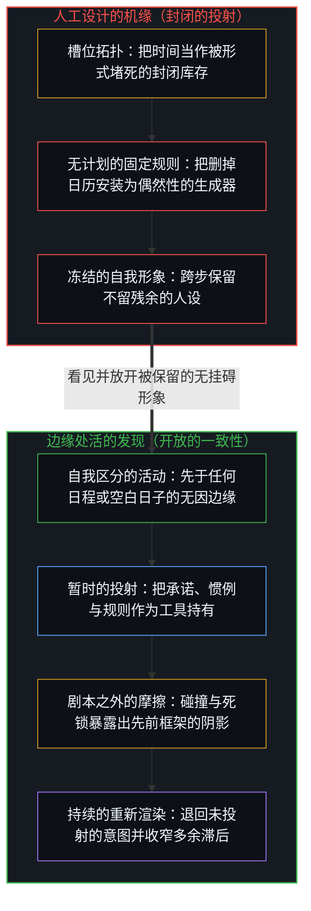
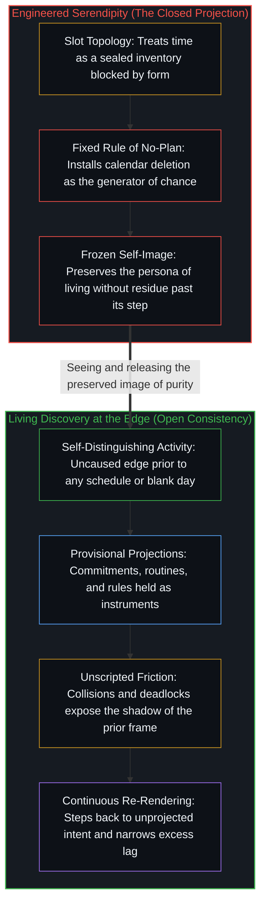

# 追求机缘中的封闭现实 / Closed Reality in the Pursuit of Serendipity

*开放不是空白的日程，而是不把任何计划或无计划固化为参照 / Openness is not a blank calendar, but keeping no plan or its absence fixed*

纳瓦尔·拉维肯特的立场简单明了，且广受推崇：删掉日程表，拒绝几乎所有预先承诺，人生的场域便随之敞开。当被问及这是否会扼杀不期而遇的机缘时，他回答恰恰相反，因为把每一个小时都腾出来，整个人生就都成了机缘。这番回答听起来像是务实的智慧，但它预设了机会占据着一份有限的时段库存，并以为开放是靠抹除形式造出来的结果，从而暗中安装了一个封闭现实的前提。空白的日程只是众多痕迹构型中的一种。滞后并不出在日子如何安排，而出在关于机缘如何运作的论断里，以及这一论断随后跨步保留下来的那幅“不留残余而活”的自我形象里。

Naval Ravikant's stance is simple and widely shared: delete the calendar, refuse almost all pre-commitments, and the field opens. When asked whether this kills serendipity, he answers that the opposite is true, because freeing every hour turns an entire life into serendipity. The reply lands as practical wisdom, yet it installs a closed-reality premise by assuming that opportunity occupies a finite inventory of slots and that openness is an effect manufactured by deleting form. A blank schedule is one trace-pattern among others. The lag appears not in how the days are arranged, but in the claim about how serendipity works and in the self-image of living without residue that the claim then preserves past its step.

## 一、 把场域冻结为时段槽位的论断 / 1. The Claim That Freezes the Field as Slots

在那段广为流传的访谈切片中，纳瓦尔归功于马克·安德森“不要保留日程表”的建议，删掉了自己的日历，几乎不留任何必须记住的待办事项，并开启了强硬的自动回复，告知人们不要发邮件或发短信，因为真正需要找他的人自然会找到他。他的妻子也不会替他预约晚宴、生日聚会或婚礼。当克里斯·威廉姆森问这是否会扼杀机缘时，纳瓦尔回答说，他正在把所有时间腾出来，好在与任何人、任何时间、任何地点的无拘束互动中，让整个人生都变成机缘。

In the circulating clip, Naval credits Marc Andreessen's advice not to keep a schedule, deletes his calendar, retains almost nothing that must be remembered, and runs a hard autoresponder instructing people not to email or text because anyone who truly needs him will find him. His wife does not book him for dinners, birthdays, or weddings. When Chris Williamson asks whether this kills serendipity, Naval answers that by freeing all his time, his entire life becomes serendipity through unconstrained interaction with whoever, whenever, wherever.

这番回答视为封闭的，并不是对可选性的偏爱，而是偶然性的拓扑结构。有安排的时间被塑造成被占领的领地，空白的时间则被安装为偶然性得以显现的必要条件。如此一来，开放便被倒置了：从不息运行的区分活动，变成了必须靠移除约束才能造出来的产物。那道从未闭合的连续边缘被推入背景，而一种特定的痕迹构型——缺席的日程表——则被推到前台，当成了生成的因。

What that answer treats as sealed is not the preference for optionality, but the topology of chance. Scheduled time is cast as occupied territory, while blank time is installed as the necessary condition under which chance can appear. Openness is thereby inverted from the ongoing activity of distinguishing into a product manufactured by removing constraints. The continuous edge that was never closed is pushed into the background, while a specific configuration of traces—the absent calendar—is placed in the foreground as the generating cause.

这种安装正是封闭现实的前提。它预设了一份有限的小时清单，其中一种安排会堵死另一种安排，于是唯有清空清单之后，机缘才能回归。[基准刷榜中的封闭实存](../closed-reality-in-benchmark-maxing/)在评测负载下揭示了同一种几何结构：一套封闭的测试集被当成了整个场域。[开放即一致](../openness-is-consistency/)则从另一面指认了底层的诉求：迫使一个有限的结构去为那只是不断继续着的东西奠基。在这里，那个有限的结构就是被当成整个世界的日程表。清空那个容器并不会重新打开现实；它只是在一个早已被视为穷尽的持握内部，重新摆弄残余。

That installation is the closed-reality premise. It presupposes a finite inventory of hours in which one arrangement blocks another, so that serendipity can return only after the inventory is emptied. [Closed Reality in Benchmark Maxing](../closed-reality-in-benchmark-maxing/) exposes the same geometry under evaluation load, where a sealed test suite is held as the whole of the field. [Openness Is Consistency](../openness-is-consistency/) names the underlying demand from the other side: a finite structure forced to ground what only continues. Here the finite structure is the schedule treated as the world. Emptying that container does not reopen reality; it only rearranges residue inside a hold that was already treated as exhaustive.

## 二、 有益的意外从不等待空白的时间 / 2. Beneficial Surprise Does Not Wait on Blank Time

自我区分的活动发生着——无因，且不息。称之为心智：那个早已在途的观察者，它的每一次行动都是一次离散的区分。每一次行动划出一道边界，下一次行动再划一道。早先行动留下的残余便是痕迹与位置。观察持有的是果，而产生它的因始终领先一步。[一步一步绘制出的路径](../the-path-drawn-one-step-at-a-time/)将这种非对称性追溯为序列与因果。在这一前提中，没有任何东西要求必须有空白的一天，进一步的区分才能发生；在排满的一天里，也没有任何东西能把边缘封死，阻止意料之外的分化。

Self-distinguishing activity occurs—uncaused, unceasing. Call it the Mind: the observer already underway, every act of which is a discrete distinction. Every act draws a boundary, and the next act draws again. The residue of earlier acts is trace and position. Observation holds the effect, while the cause that produced it remains one step ahead. [The Path Drawn One Step at a Time](../the-path-drawn-one-step-at-a-time/) traces that asymmetry as sequence and causality. Nothing in the premise requires an empty day for further distinguishing to occur, and nothing in a filled day seals the edge against unexpected differentiation.

只要不把任何计划跨步保留下来，有益的意外共振在会议、日常惯例、家庭责任与固定承诺中生发的容易程度，丝毫不亚于在空白的日子里。一场重塑人生的交谈可以落在排定的钟点，一次开辟新工作方向的碰撞也可以发生在既有的责任之下。容许发现发生的，不是抹除形式，而是不把任何参照——包括那句“我没有计划”的参照——保留为当下必须拿来衡量自身的固定形象。[没有系统能被保持封闭](../no-system-can-be-kept-closed/)在任何被当作终局的持握处追溯了同样的余项：形式结构作为工具依然可用，而穷尽性从不随之同行。

Beneficial unexpected resonance arises inside meetings, routines, family obligations, and fixed commitments just as readily as it arises in empty days, provided no plan is preserved past its step. A conversation that reorganizes a life can land at a scheduled hour, and a collision that opens a new line of work can occur under a standing obligation. What allows discovery is not the deletion of form, but the non-preservation of any reference—including the reference that says "I have no plan"—as a fixed image against which the present must measure itself. [No System Can Be Kept Closed](../no-system-can-be-kept-closed/) traces the same remainder wherever a hold is treated as final: formal structure stays usable as an instrument, while exhaustiveness never travels with it.

每一份日程、承诺，或是刻意立下的不承诺规则，都是从活的心智那超高维意图中切出的有限投射。正如[超越投射](../beyond-the-projection/)在人类与智能体工作流架构中所追溯的，有限投射发挥作用的方式，从不是伪装成无条件的整体，而是沿着既定轨迹运行，直到具体的摩擦或剧本之外的死锁暴露出先前框架压缩现实的精确坐标。当架构师或个人试图靠锁死一条单一规则——哪怕是“不设日历”的规则——来人工设计机缘时，就是错把有限投射当成了边缘处活的统筹者。冻结发现的从来不是赴约本身，而是那条被保留下来的前提，即认定赴约或赴约的缺席本身就是机会的疆域。

Every schedule, commitment, or deliberate rule of non-commitment is a finite projection cut from the living Mind's ultra-high-dimensional intent. As [Beyond the Projection](../beyond-the-projection/) traces in the architecture of human and agent workflows, a finite projection does its work not by pretending to be an unconditioned whole, but by running along its defined trajectory until concrete friction or an unscripted deadlock exposes the exact coordinate where the prior framing compressed reality. When an architect or an individual tries to engineer serendipity by locking in a single rule—even the rule of having no calendar—they mistake a finite projection for the living orchestrator at the edge. What freezes discovery is never the appointment itself, but the retained premise that the appointment or its absence is the territory of opportunity.

## 三、 众多痕迹构型中的一种 / 3. One Trace-Pattern Among Others

纳瓦尔实际的生活方式只是众多痕迹构型中的一种，它为一个有条件承担相应关系成本的中心，最大化了可选性与当下的选择自由度。[不预测是没有觉察的预测](../not-predicting-is-predicting-without-awareness/)追溯了这种披着方法外衣的成本承担：推迟承诺的自由，建立在他人仍在做预测、且自己早先的预测已沉淀为财务与社会缓冲的基础之上。在几何结构中，没有任何东西把空白日历排在紧凑日程之上，也没有任何东西把紧凑日程判定为封闭。两者都是暂时的构型，既可以随着步伐移动而重新渲染，也可以被跨步保留下来。正如[你的代码库即是记忆](../your-codebase-is-memory/)在外化的代码库、笔记与精心整理的知识图谱中所确立的，痕迹的排布可以铺设接触的表面，但机缘与发现依然唯有当活的心智在开放边缘重新切分其前提时才会发生，而不是指望一张清空的日历或一座稠密的档案库自动组装出洞见。

Naval's actual lifestyle is one pattern of traces among others, maximizing optionality and present-moment selectivity for a center positioned to carry the relational cost of that arrangement. [Not Predicting Is Predicting Without Awareness](../not-predicting-is-predicting-without-awareness/) traces that cost-carrying under method costume: the freedom to defer commitments rests on others still predicting and on prior predictions that registered as financial and social buffer. Nothing in the geometry ranks an empty calendar above a dense schedule or condemns a dense schedule as closed. Both are provisional configurations, and either can be re-rendered as the step moves or preserved past its step. As [Your Codebase Is Memory](../your-codebase-is-memory/) establishes across externalized codebases, notes, and curated graphs, an arrangement of traces can prepare the surface of contact, yet serendipity and discovery still originate only when the living Mind re-cuts its premises at the open edge rather than expecting either a cleared calendar or a dense archive to self-assemble insight.

多余的滞后并不在于保持空白的日历，而在于宣称一旦删掉日历，整个人生“就是”机缘，仿佛开放已被迁移到这一构型之中并被永久锁定在那里。这一宣称把一种偏好的安排抬升为偶然性的机制，进而筛选随后的互动，使其迎合那个“不留计划残余而活”的自我形象。[生产、消费与心智的区分](../production-consumption-and-the-minds-distinction/)在开放持握与固定持握之间切下了同样的一刀：同一项活动究竟登记为生成的延展还是防御性的减法，取决于边界是被重新渲染，还是被豁免于重新描摹。在被保留的无挂碍形象之下删掉日历，依然是一种固定的持握；而在持续收窄多余滞后的同时排满日历，则不是。

The excess lag lies not in keeping a blank calendar, but in announcing that once the calendar is gone, the entire life *is* serendipity, as though openness had been relocated into the configuration and secured there permanently. That announcement elevates a preferred arrangement into the mechanism of chance, filtering subsequent interactions for coherence with the self-image of one who lives without the residue of a plan. [Production, Consumption, and the Mind's Distinction](../production-consumption-and-the-minds-distinction/) traces the same cut between an open and a fixed hold: the identical activity registers as generative expansion or defensive subtraction depending on whether the boundary is re-rendered or exempted from re-tracing. Deleting the calendar under a preserved image of purity remains a fixed hold, whereas filling the calendar while continuously narrowing excess lag does not.

## 四、 不留残余的自我形象正是残余本身 / 4. The Image of No Residue Is the Residue

由此产生的反讽是结构性的，而非针对个人的：一个人将自己塑造成“不留残余而活”的形象，恰恰成了他随后着力维护的公开残余。无挂碍的展演变成了被保留下来的差值，新的行动都要对照它来衡量。[无形象的写作](../writing-without-the-image/)在技艺的外衣下追溯了这种对观察者的抹除：把无我当作一项成就来展演，只是在相反的符号下保留了多余的滞后。访谈、自动回复，以及一遍遍重述的删日历故事，把那份残余压实成耐久的痕迹，供其他中心拾起并效仿。无论如何，区分的边缘仍在继续，但“不留残余而活”的主张却成了那个被豁免于重新渲染的参照。

The resulting irony is structural rather than personal: an image of oneself as the one who lives without residue becomes the exact public residue one then maintains. The performance of purity turns into the retained differential against which new acts are measured. [Writing Without the Image](../writing-without-the-image/) traces this erasure of the observer under craft costume, where staging no-self as an achievement preserves excess lag under the opposite sign. Interviews, autoresponders, and the repeated story of the deleted calendar densify that residue into durable traces that other centers take up and imitate. While the distinguishing edge continues regardless, the claim of living without residue becomes the very reference exempted from re-rendering.

形象一旦成形，自我保存便是它自身的指令，因为重新渲染正是形象为了存续而要排斥的微小死亡。这种漂移并不需要任何恶意。消解它，并不意味着废除这种生活方式，或强行装回一张日程表来取而代之；消解是直接渲染那道裂隙本身，即察觉到“无计划”的位置已被豁免于其他每一个计划都必须接受的重新描摹。[遗忘的脚手架](../the-scaffolding-we-forget/)追溯了这一切口的两面：工具在随步伐移动而放下时发挥功用，而在跨步保留时冻结为多余的滞后。在这里，被遗忘的脚手架正是那幅无拘束待命的自我形象。

Preservation is the image's own directive once formed, because re-rendering is the micro-death the image exists to select against. This drift requires no perversity. Dissolving it does not mean abolishing the lifestyle or installing a mandatory schedule in its place; dissolution is rendering the gap itself by noticing that the no-plan position has been exempted from the re-tracing demanded of every other plan. [The Scaffolding We Forget](../the-scaffolding-we-forget/) traces the dual face of that cut: an instrument functions when set down as the step moves, and freezes into excess lag when preserved past its step. Here the forgotten scaffolding is the self-image of unconstrained availability.

## 五、 被错置为破除形式的自由 / 5. Freedom Relocated into the Removal of Form

只要把自由定位于形式的移除，而不是定位于心智对自身先前区分的不执着，同样的机制就会重现。结构不是偶然性的敌人；冻结的结构形象才是，而冻结的“无结构”形象，不过是在相反符号下的同一种冻结。当“没有计划”的计划被豁免于重新描摹时，开放便被外化为一种状态，封闭现实的前提随之畅行无阻，只不过此时被当作穷尽之因持守着的，换成了那张空日历。[只要它不被保持为空](../only-if-it-is-not-kept-empty/)在剩余容量中追溯了这一对偶，展示了永久的空如何像永久的满压缩容量那样，把容量冻结成一座纪念碑；正如[不预测是没有觉察的预测](../not-predicting-is-predicting-without-awareness/)所展示的，推迟选择依然是在选择一个框架。

The same mechanism appears wherever freedom is located in the removal of form rather than in the non-clinging of the Mind to its prior distinctions. Structure is not the enemy of chance; a frozen image of structure is, and a frozen image of the absence of structure is the identical freeze under the opposite sign. When the plan of having no plan is exempted from re-tracing, openness is externalized into a state and the closed-reality premise operates unimpeded, with the empty calendar now held as exhaustive cause. [Only If It Is Not Kept Empty](../only-if-it-is-not-kept-empty/) traces that dual in residual capacity, showing how permanent emptiness freezes capacity into a monument the same way permanent fullness compresses it, just as [Not Predicting Is Predicting Without Awareness](../not-predicting-is-predicting-without-awareness/) shows how deferring a choice still chooses a frame.

[重新审视反脆弱](../a-new-deeper-look-at-antifragility/)在风险工程中同样始于封闭现实的前提：把不确定性当作足够有界的对象，好让一种固定的凸性姿态充当首要基底，同时豁免那个框架本身。纳瓦尔关于机缘的主张，在空白时间内部接纳偶然性，却把破除形式这一操作本身豁免于审视。[旁观者洞察的悖论](../the-paradoxical-nature-of-bystander-insights/)追溯了同一语料库的另一面：唯有当注意力被建模为一份封闭的库存时，生产力与创造力才会显现为零和博弈。[现实扭曲力场指认的是封闭的地图](../the-reality-distortion-field-names-the-closed-map/)则在专家共识的外衣下追溯了同一前提：不完备的可行性地图被当成了疆域本身，而跨出地图的行动则被贴上了“扭曲”的标签。

[A New Deeper Look at Antifragility: Prosthesis, Not Driver](../a-new-deeper-look-at-antifragility/) begins from the same closed-reality premise in risk engineering, treating uncertainties as sufficiently bounded for a fixed convex posture to serve as primary ground while exempting the frame itself. Naval's serendipity claim admits chance inside blank time while exempting the deletion of form from examination. [The Paradoxical Nature of Bystander Insights](../the-paradoxical-nature-of-bystander-insights/) traces another face of the same corpus, where productivity and creativity appear as a zero-sum trade-off only while attention is modeled as a closed inventory. [The Reality Distortion Field Names the Closed Map](../the-reality-distortion-field-names-the-closed-map/) traces the identical premise under expert consensus, where an incomplete feasibility map is held as territory and action that steps past the map is labeled distortion.

回归既不需要恢复日历，也不需要废除日历；它只要求不把任何一种构型安装为维持现实开放的机制。现实之所以保持开放，是因为自我区分的活动既不等待日历被清空，也不要求日历被保留。登记为机缘的，是活的边缘在没有被保留参照的额外宽度下继续前行——这种继续在每一种构型中都触手可及。[清晰不是抵达的终点，而是运动本身](../clarity-isnt-a-state-you-arrive-at/)将这种持续的运动指认为实践：不闭合从不是一劳永逸抵达的清空终点，而是在当下正划出界限的这一步重新渲染参照，从而避开[封闭竞技场中的开放视野](../open-vision-in-a-closed-arena/)所追溯的那种冻结——即把开放视野的文化当成科研突破的永久担保。

Return requires neither restoring the calendar nor abolishing it; it requires that neither configuration be installed as the mechanism that keeps reality open. Reality stays open-ended because self-distinguishing activity neither waits for the calendar to be cleared nor requires the calendar to remain. What registers as serendipity is the living edge continuing without the extra width of a preserved reference—a continuation available in every configuration. [Clarity Isn't a State You Arrive At. It's the Movement Itself.](../clarity-isnt-a-state-you-arrive-at/) names this ongoing movement as practice: non-closure is never a cleared destination arrived at once and for all, but the reference re-rendered at the step drawing now, avoiding the freeze that [Open Vision in a Closed Arena](../open-vision-in-a-closed-arena/) traces when an open-vision culture is treated as a permanent guarantee of research breakthroughs.
