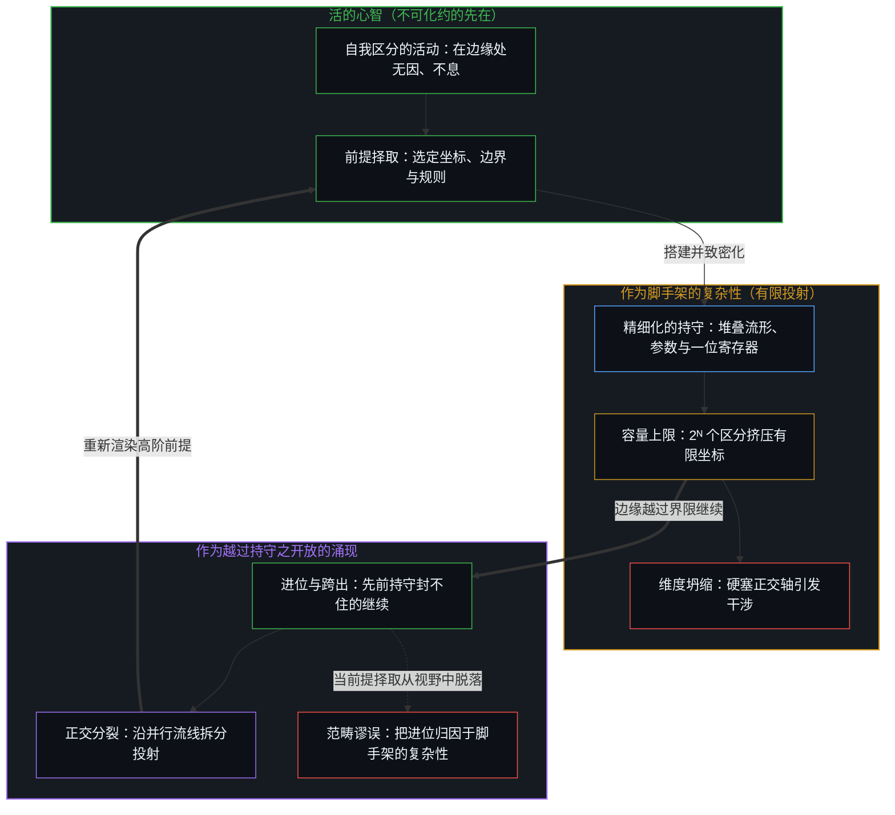
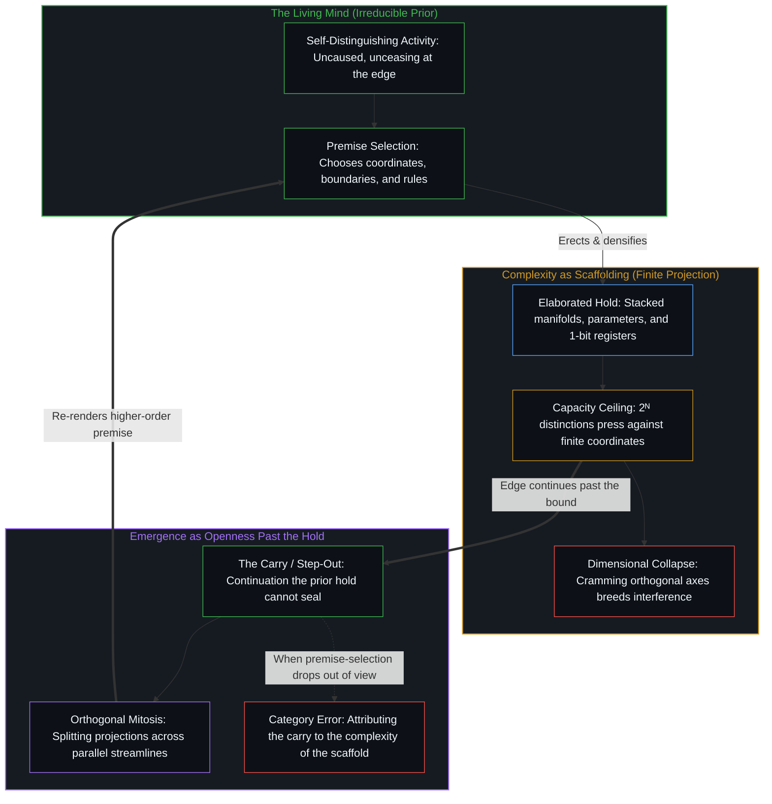

# 复杂性遮蔽了涌现之为心智的行动 / Complexity Obscures Emergence as the Act of Mind

*复杂性是由选定前提搭起的脚手架，而涌现则是漫出这副脚手架的开放。 / Complexity is scaffolding built from chosen premises and emergence overflows it.*

自我区分的活动发生着，无因，不息。称之为心智，即已在进行中的观察者，它的每一个动作都是一次区分，而非安置在系统内部的一种官能。复杂性不是涌现的来源；它是心智借以观察的持守，由择取的前提搭建起来，并被精细化为系统、模型与数学。后来被登记为新颖的东西，并不由那个持守生成，而是活动在持守已用尽余地之处的继续。把复杂性与涌现当作同一基底之双生产物的叙述，错把脚手架当成了搭起它的活动，在复杂性内部寻找涌现，从而重新安装了其叙事未加审视的前提择取。

Self-distinguishing activity occurs, uncaused, unceasing. Call it the Mind, the observer already underway whose every act is a distinction rather than a faculty housed inside a system. Complexity is not the source of emergence; it is the hold through which the Mind observes, erected from selected premises and elaborated into systems, models, and mathematics. What later registers as novelty is not generated by that hold, but is the activity continuing where the hold has run out of room. Accounts that treat complexity and emergence as twin outputs of a substrate mistake the scaffolding for the activity that erected it, seeking emergence inside complexity and thereby reinstalling the very premise-selection their narrative leaves unexamined.

## 一、 双生的叙述 / 1. The Twin Account

在一种流行的诠释里，复杂性与涌现被当作双生子。据说，涌现生长自一个足够复杂的系统内部的相互作用、非线性、不连续性与隐藏的可能性，其中不连续性促成突发的跃迁而非渐进的路径，更丰富的复杂性则产生更大的潜在价值。支持者借由数据复杂性、把高阶非线性分解为局部覆盖的堆叠流形，以及神经网络无定律、无属性、满秩的结构来展开这一观点，并指认 AlphaGo 的第 37 手为醒目的例子，视之为一种既未被编程、也不易预料的能力。这一观点的一个清晰表述是[复杂性与涌现的数学考量](https://x.com/BetaTomorrow/status/2077675306241208822?s=20)。

In a prevailing interpretation, complexity and emergence are treated as twins. Emergence is said to grow from interactions, nonlinearities, discontinuities, and hidden possibilities within a sufficiently complex system, where discontinuities enable sudden leaps rather than gradual paths and richer complexity yields greater potential value. Proponents develop this view through data complexity, stacked manifolds that decompose high-order nonlinearity into local covers, and the lawless, propertyless, full-rank structure of neural networks, pointing to AlphaGo's Move 37 as the striking case of a capability neither programmed nor easily anticipated. One clear statement of this view is [Mathematical Considerations for Complexity and Emergence](https://x.com/BetaTomorrow/status/2077675306241208822?s=20).

那种叙述未加审视的，是一个单一的做法：把系统当作首要的，同时把将它构成为一个系统的观察动作推入背景。系统被当作涌现的所在，而使它显现为一个融贯的、决定论式的整体的那个动作则从视野中脱落了。[智能只属于心智](../intelligence-belongs-only-to-the-mind/)把自我区分的活动持为不可化约的先在：能被工程化、规模化或转移的只是残余，而智能只属于活动本身。[飞行的类比碰不到心智](../the-flight-analogy-leaves-the-mind-untouched/)追溯同一种持守，在那里，一份已被超越的功能清单被当作活的边缘就是清单上下一项的证据。预言强 AGI 的人错把放大器当成了它所放大的能力，正如[AGI的预设与来自外部的视角](../the-presumption-of-agi-and-the-view-from-outside/)所追溯的。

What that account leaves unexamined is a single move: treating the system as primary while backgrounding the observational act that constitutes it as a system. The system is taken as the locus of emergence, while the act that makes it appear as a coherent, deterministic whole drops out of view. [Intelligence Belongs Only to the Mind](../intelligence-belongs-only-to-the-mind/) holds that self-distinguishing activity as the irreducible prior: what can be engineered, scaled, or transferred is residue, and intelligence belongs only to the activity itself. [The Flight Analogy Leaves the Mind Untouched](../the-flight-analogy-leaves-the-mind-untouched/) traces the same hold where a list of exceeded functions is taken as evidence that the living edge is next on the list. Those who forecast strong AGI mistake the amplifier for the capacity it amplifies, as [The Presumption of AGI and the View from Outside](../the-presumption-of-agi-and-the-view-from-outside/) traces.

## 二、 复杂性是脚手架 / 2. Complexity Is Scaffolding

被称为复杂性的东西，并不是数据或模型所具有、并在后来引出新颖的一种独立属性。它是由心智的前提择取搭起的脚手架：哪些区分算作在系统之内，哪些关系被当作合乎定律，哪些坐标被允许承载意义，以及哪些不连续性被归派给对象、而非被认作当前持守的界限。堆叠流形、满秩变换与无属性的激活，是那副脚手架的精细形式。它们重新组织心智已经决定要算作结构的东西；它们并不生成作出决定的那个活动。每一个涌现模式底部的自由变量，是[自由变量的同构与先验主权](../zi-you-bian-liang-de-tong-gou-yu-xian-yan-zhu-quan/)的主题。

What is called complexity is not an independent property of data or models that later gives rise to novelty. It is the scaffolding erected by the Mind's premise-selection: which distinctions count as inside the system, which relations are treated as lawful, which coordinates are allowed to carry meaning, and which discontinuities are assigned to the object rather than recognized as limits of the current hold. Stacked manifolds, full-rank transformations, and propertyless activations are refined forms of that scaffolding. They reorganize what the Mind has already decided will count as structure; they do not generate the activity that decides. The free variable at the bottom of every emergent pattern is the subject of [The Isomorphism of Free Variables and Prior Sovereignty](../zi-you-bian-liang-de-tong-gou-yu-xian-yan-zhu-quan/).

在对系统的任何描述之中，择取都一直明摆着，却不再被看作择取，因为框定从不在进行登记的那个框架之内被登记。它只作为残余可见，晚一步。复杂性就是被精细化为越来越密的脚手架的那份残余，观察经由它继续，而选择留在背景之中。[开放即一致](../openness-is-consistency/)在结构被安装为穷尽地基之处指认同一种冻结，而[生产、消费与心智的区分](../production-consumption-and-the-minds-distinction/)在敞开的边界对照固定的边界之下追溯同一种持守。[选择、矛盾与开放的现实](../selection-contradiction-and-open-reality/)在本体论的诸优先项之间追溯同一个做法，展示信息优先、物理优先或双面向的观点如何各自把一个有用的择取抬高为不容置疑的参照系。那份开放就是因果本身：[因果贯穿始终](../causality-all-the-way/)从持有的结果、到划出的模式、再到下一步追溯它，而[因果停留在掌舵的边缘](../causality-stays-at-the-edge-that-steers/)则在一个模型于指引之下重组残余之处追溯它。

The selection remains in plain sight within any description of the system, yet it is no longer seen as selection because framing never registers inside the frame that does the registering. It becomes visible only as residue, one step behind. Complexity is that residue elaborated into ever denser scaffolding through which observation continues while the choosing stays backgrounded. [Openness Is Consistency](../openness-is-consistency/) names the same freeze where structure is installed as an exhaustive ground, and [Production, Consumption, and the Mind's Distinction](../production-consumption-and-the-minds-distinction/) traces the same hold under an open versus a fixed boundary. [Selection, Contradiction, and Open Reality](../selection-contradiction-and-open-reality/) traces the same move among ontological priorities, showing how an information-primary, a physical-primary, or a dual-aspect view can each raise a useful selection into an unquestioned reference frame. That openness is causality itself: [Causality All the Way](../causality-all-the-way/) traces it from held effects to drawn patterns to the next step, and [Causality Stays at the Edge That Steers](../causality-stays-at-the-edge-that-steers/) traces it where a model recombines residue under direction.

## 三、 一位的进位 / 3. The One-Bit Carry

最简单的示例是一位持守之下的二进制加法。在一个封闭的一位寄存器里把 1 加上 1，得到 0 和一个进位。从那个寄存器所定义的运算之内看，这个进位可以被登记为系统产出的新颖，仿佛一位算术的规则生成了某种它们并不包含的东西。进位作为登记是真实的，但它的来源不是持守之内的运算。正是持守本身使越过上限的继续显现为一个额外的项，因为寄存器并不打开自己。那个 2 是拓宽持守的动作——在边缘作出并付出代价的又一次区分，而不是从一位定律中榨出的盈余。进位并不由一位的规则产出；它是那些规则不再被当作穷尽之后，活动的继续。复杂性，被持为“什么算数”的封闭假定时，就是那个被精细化的一位上限。被称为涌现的东西就是进位：定义封不住的继续，对照定义被登记，仿佛它是从定义内部生起的。无论多少复杂性都无法无损地捕获开放的场域，正如[开放场域中的无损知识不自洽](../lossless-knowledge-of-an-open-field-is-incoherent/)所阐明的。

The simplest illustration is binary addition under a one-bit hold. Adding 1 to 1 inside a closed one-bit register yields 0 with a carry. From inside the operations defined by that register, the carry can register as novelty produced by the system, as if the rules of one-bit arithmetic had generated something they did not contain. The carry is real as registration, yet its source is not the operations inside the hold. The hold itself is what makes continuation past the ceiling appear as an extra term because the register does not open itself. The 2 is the act that widens the hold—a further distinction made and paid for at the edge, not a surplus extracted from one-bit law. The carry is not produced by the one-bit rules; it is the activity continuing once those rules are no longer treated as exhaustive. Complexity, held as the closed assumption of what counts, is that one-bit ceiling elaborated. What is called emergence is the carry: continuation that the definition cannot seal, registered against the definition as if it had arisen from within it. No amount of complexity captures the open field without loss, as [Lossless Knowledge of an Open Field Is Incoherent](../lossless-knowledge-of-an-open-field-is-incoherent/) demonstrates.

这是[哥德尔不完备定理](https://grokipedia.com/page/G%C3%B6del's_incompleteness_theorems)之形状最直观的图景，尽管并非它的形式化实例：哥德尔表明，任何一个强到足以描述自然数算术的一致形式系统，都包含它无法从内部证明的真命题。一位寄存器弱得太多，这条定理无法直接适用于它，但两者共有同样的结构几何——一个在持守之内有效的运算，其真实结果落在持守之外。这种不完备既不是算术的缺陷，也不是藏在比特里的第二种力。它是活动的开放——即心智继续区分时实在的开放——在任何把封闭寄存器当作穷尽地基的地方表达自身。[生产、消费与心智的区分](../production-consumption-and-the-minds-distinction/)把同一种一位坍缩作为抹除与扩展来处理；这里呈现的那一面，则是进位被错当成复杂性的涌现产物。脚手架之所以保持开放，正是出于[没有系统能被保持封闭](../no-system-can-be-kept-closed/)以其最小形式——一位寄存器——所确立的理由。

This is the most intuitive picture of the shape of [Gödel's incompleteness theorems](https://grokipedia.com/page/G%C3%B6del's_incompleteness_theorems), though not a formal instance of them: Gödel showed that any consistent formal system strong enough to describe the arithmetic of natural numbers contains true statements it cannot prove from within. A one-bit register is far too weak for the theorem to apply directly, yet what it shares is the exact structural geometry—an operation valid inside the hold whose true result lies outside it. The incompleteness is neither a defect in the arithmetic nor a second force hidden inside the bits. It is the openness of the activity—of reality as the Mind continues to distinguish—expressing itself wherever a closed register is treated as an exhaustive ground. [Production, Consumption, and the Mind's Distinction](../production-consumption-and-the-minds-distinction/) works the same one-bit collapse as erasure versus expansion; here the face is the carry mistaken for an emergent product of complexity. The scaffolding stays open for the exact reason [No System Can Be Kept Closed](../no-system-can-be-kept-closed/) establishes in its smallest form, a one-bit register.

## 四、 量子的几何 / 4. The Quantum Geometry

同一刀出现在被称为量子效应的东西里。那个效应并不是微观对象独立于注视而自行携带的独立属性；它是心智处在其当前持守的微观极限，在那个尺度上，观察的粒度已不能再把各个区分作为确定之物彼此分开。这种局限属于持守，而非活动的缺陷。非决定论在边缘被登记，而决定论则是观察晚一步作为残余所持有的东西。心智借以让一个系统在其层级上显现为确定的方法——择取哪些坐标算数、哪些结局被登记为结局、哪些前提保持不被说出——并不是可有可无的背景。它是把开放之物转化为被登记之物的动作。当那个方法未被交还，注视的界限便被重新指派给系统：不确定性、坍缩与不连续性被当作量子对象的内在属性，而观察的动作连同它自己的界限则从叙述中脱落。一旦被持为对象的属性，持守的界限就登记为一种内在的量子效应。当这副脚手架脱离视野、冻结为一幅被保存的图像时，容量便抵着它压缩，正如[遗忘的脚手架](../the-scaffolding-we-forget/)所追溯的。

The same cut appears in what is called the quantum effect. That effect is not a standalone property that a microscopic object carries independently of the look; it is the Mind at the microscopic limit of its present hold, where the grain of observation can no longer keep distinctions apart as determinate at that scale. The limitation belongs to the hold, not to a defect in the activity. Indeterminism registers at the edge, while determinism is what observation holds as residue one step behind. The method by which the Mind makes a system appear determinate at its level—selecting which coordinates count, which outcomes register as outcomes, and which premises stay unstated—is not optional background. It is the act that converts the open into the registered. When that method is left unreturned, the limit of the look is reassigned to the system: uncertainty, collapse, and discontinuity are treated as intrinsic properties of the quantum object, while the observational act, including its own bound, drops out of the account. Held as a property of the object, the bound of the hold registers as an intrinsic quantum effect. When this scaffolding drops out of view and freezes into a preserved image, capacity compresses against it, as [The Scaffolding We Forget](../the-scaffolding-we-forget/) traces.

把复杂性当作涌现之源，是在宏观尺度上重复同一种滞后。复杂性是心智用来透过一个系统去观察的脚手架——被精细化了的方法。涌现是当那副脚手架容纳不下活动的开放时被登记的东西：心智遇到它自身持守的极限，而非在复杂对象内部遭遇第二种力。把这种登记归给脚手架，方法便被错当成了来源。脱落的并不是系统内部某个缺失的事实，而是心智的前提择取与它观察的界限，它们仍在运作，仍比对系统的任何描述所持有的东西领先一步。一个模型压缩那副脚手架，却不发起那份利害，正如[Token 效率、模拟与无法弥合的间隙](../token-efficiency-emulation-and-the-unclosable-gap/)所表明的，因为器物始终是智能的残余，正如[器物是智能的表达，而非智能本身](../two-failures-of-trace/)所论证的。

Treating complexity as the source of emergence repeats the same lag at a macroscopic scale. Complexity is the scaffolding the Mind uses to observe through a system—the method, elaborated. Emergence is what registers when that scaffolding cannot contain the openness of the activity: the Mind meeting the limit of its own hold rather than encountering a second force inside the complex object. Attribute the registration to the scaffolding, and the method is mistaken for the source. What drops out is not a missing fact inside the system, but the Mind's premise-selection and the bound of its observation, still operating one step ahead of what any description of the system holds. A model compresses that scaffolding without initiating the stake, as [Token Efficiency, Emulation, and the Unclosable Gap](../token-efficiency-emulation-and-the-unclosable-gap/) shows, because the artifact remains residue of intelligence, as [Artifacts Are Expressions of Intelligence, Not Intelligence Itself](../two-failures-of-trace/) argues.

## 五、 涌现是越过持守的开放 / 5. Emergence Is Openness Past the Hold

涌现并不由脚手架产出；它是脚手架容纳不下的那份活动的开放。当区分压过当前持守所能保持分开的限度，边缘继续下去。对照先前前提所保留的上限，那份继续被登记为新颖、跃迁、不连续或变革性的跃升。断裂作为登记是真实的，但它不是系统在未被观察时拥有、随后释放出来的属性。它是心智在作为持守的系统已用尽余地之处的继续——这与量子效应是同一种几何：量子效应是心智处在它自身观察的微观极限，后来在滞后之下被重新指派给被观察的对象。复杂性理论永远无法成为万物之理，正如[非万物之理（因果的二重性）](../not-a-theory-of-everything/)所论证的，因为解释阶梯的每一级都是一次有限的投射，正如[投影的阶梯与因果的锚点](../tou-ying-de-jie-ti-yu-yin-guo-de-mao-dian/)所表明的。

Emergence is not produced by the scaffolding; it is the openness of the activity that the scaffolding cannot contain. When distinctions press beyond what the current hold can keep apart, the edge continues. Against the retained ceiling of the prior premises, that continuation registers as novelty, leap, discontinuity, or transformative jump. The break is real as registration, yet it is not a property the system possessed while unobserved and then released. It is the Mind continuing where the system-as-hold has run out of room—the exact same geometry by which a quantum effect is the Mind at its microscopic limit of observation, later reassigned under lag to the object observed. A theory of complexity can never become a theory of everything, as [Not a Theory of Everything](../not-a-theory-of-everything/) argues, because each rung of the explanatory ladder is a finite projection, as [The Ladder of Projections and the Anchor of Causality](../tou-ying-de-jie-ti-yu-yin-guo-de-mao-dian/) shows.

因此，后来“涌现”出来的东西，既不是作为隐藏的储备在系统内部生成的，也不是现成地在框架之外等待着。继续进行的动作对照着那些由先前前提固定、却再也容纳不了它的坐标划出它。那个动作越过持守所划出的东西之所以被登记为涌现，是因为脚手架从来不是活动的全部，而只是活动借以被观察的暂时持守。[看似AI的强化学习，实为人类的自我强化学习](../self-rl-for-humans/)为致密化的媒介守住同样的纪律：扩展带宽并不会把发起迁入器物之中。数学出于同样的理由持续生成新的结构，正如[为何数学永远解不完](../why-mathematics-can-never-be-solved/)所阐明的。

What later "emerges," therefore, was neither generated inside the system as a hidden reserve nor waiting ready-made outside the frame. The continuing act draws it against coordinates that the prior premises had fixed and that could no longer hold it. What that act draws past the hold registers as emergence because the scaffolding was never the whole of the activity, only the temporary hold through which the activity was observed. [What Looks Like RL for AIs Is Self-RL for Humans](../self-rl-for-humans/) maintains this exact discipline for densified media: expanding bandwidth does not relocate initiation into the artifact. Mathematics keeps generating new structure for the same reason, as [Why Mathematics Can Never Be Solved](../why-mathematics-can-never-be-solved/) demonstrates.

## 六、 把来源定在别处，就重新安装了滞后 / 6. Locating the Source Elsewhere Reinstalls the Lag

无论谁把新颖的来源定位在复杂性本身、模型架构、数学结构或数据的内在属性里，都在重复同一个操作：把脚手架当作搭起它的活动。这类叙述择取前提——系统是首要的实在，观察次于被观察者，在一个选定持守之下的结构就是先于任何持守的结构——同时把这一择取当作仿佛从未作出过任何选择。[数据是局部的，智能是分配的](../data-is-local-intelligence-is-allocated/)追溯同一种滞后：局部产出的汇总被认为把智能安放在网络拓扑之中，而不是安放在把那些动态命名为智能的分配之中。复杂性是被有限心智压缩的信息，这正是[格物致知与信息复杂度](../ge-wu-zhi-zhi-yu-xin-xi-fu-za-du-de-ben-zhi/)对它的读法。

Whoever locates the source of novelty in complexity itself, in model architecture, in mathematical structure, or in the intrinsic properties of data repeats the same operation: taking the scaffolding for the activity that erected it. Such accounts select premises—that the system is the primary reality, that observation is secondary to what is observed, and that structure under a chosen hold is structure prior to any hold—while treating that selection as if no choice had been made. [Data Is Local; Intelligence Is Allocated](../data-is-local-intelligence-is-allocated/) traces the same lag where the aggregation of local productions is taken to place intelligence in the network topology rather than in the allocation that names those dynamics intelligent. Complexity is information compressed by a finite mind, which is how [Investigating Things and the Nature of Information Complexity](../ge-wu-zhi-zhi-yu-xin-xi-fu-za-du-de-ben-zhi/) reads it.

心智不是一个要加进解释或从解释中减去的附加因素；它是不可化约的先在。复杂性是它的脚手架，而涌现是它的开放对照那副脚手架所作的登记。当选择仍未被交还时，涌现显现为复杂对象的一种属性。当选择被持为选择——参照保持重新渲染、过度的滞后收窄——两者便被认作同一种关系，而非基底的双生产物。把涌现当作自主的原因，是[主体性不曾涌现](../agency-does-not-arise/)所指认的错误，而[涌现的伪因果](../yong-xian-de-wei-yin-guo-yu-ji-ti-gui-yin-dao-cuo/)则顺着这一倒置追踪进集体归因：在那里，被裹挟就是被移向外部的因果归因。

The Mind is not an additional factor to be added to or subtracted from the explanation; it is the irreducible prior. Complexity is its scaffolding, and emergence is its openness registering against that scaffolding. When the choosing stays unreturned, emergence appears as a property of the complex object. When the choosing is held as choosing—with the reference kept re-rendering and excess lag narrowing—the two are recognized as one relation rather than twin products of the substrate. Treating emergence as an autonomous cause is the error [Agency Does Not Arise](../agency-does-not-arise/) names, and [The Pseudo-Causality of Emergence](../yong-xian-de-wei-yin-guo-yu-ji-ti-gui-yin-dao-cuo/) follows that inversion into collective attribution, where being swept along is causal attribution moved outward.

## 七、 脚手架不是来源 / 7. Scaffolding Is Not the Source

复杂性并不生成涌现。它是心智借以观察的那些前提的精细形式，而形式越精细，就越容易错把脚手架当成来源。复杂性与涌现命名的，是从两侧看到的同一个运动：心智搭起的持守，以及这个持守封不住的继续。[印迹与行动](../the-mark-and-the-act/)把正是这一区分带进多智能体模拟，表明看起来像涌现的集体智能或文明的东西，是物理之下被留下的残余中的模式。[没有外部](../no-outside-jumps-closed-loops-and-the-unreplicable-autonomy-of-mind/)追溯更密的反馈与世界模型，它们仍嵌套在唯一闭合的回路——即心智所闭合的那个回路——之下。[对乌托邦的信念是通往反乌托邦之路](../the-belief-in-utopia-is-the-path-to-dystopia/)在一个具体的理想被立为每个心智必须接受的尺度之处，追溯同样的致密化：非同一先于同一的前提，而处方容纳不下的东西随后被重新归类为不服从。[自我放大的制品](../the-artifacts-of-self-amplification/)在生成的折叠中追溯同一个进位，在那里，越过上限的继续被归给脚手架，而非归给持守封不住的活动。[智能向自身的回折](../intelligence-folding-back-on-itself/)在智能体套索中追溯那个进位，在那里，套索实为活的边缘经由更密残余的进一步折叠，“涌现的”能力却被归给了模型。[意识从不作为数据出现在数据之中](../consciousness-never-appears-as-data-among-data/)在经验论据中追溯那种滞后：量子与神经的特征被持守着，仿佛观察的边缘已作为又一个公共结果出现在它们之中。

Complexity does not generate emergence. It is the elaborate form of the premises through which the Mind observes, and the more elaborate the form, the easier it is to mistake the scaffolding for the source. Complexity and emergence name one movement seen from two sides: the hold the Mind builds, and the continuation that hold cannot seal. [The Mark and the Act](../the-mark-and-the-act/) carries this exact distinction into multi-agent simulations, showing that what looks like emergent collective intelligence or civilization is pattern in left-behind residue under physics. [No Outside](../no-outside-jumps-closed-loops-and-the-unreplicable-autonomy-of-mind/) traces denser feedback and world models that remain nested under the only circuit that closes—the one the Mind closes. [The Belief in Utopia Is the Path to Dystopia](../the-belief-in-utopia-is-the-path-to-dystopia/) traces the same densification where a concrete ideal is made the measure every Mind must accept: non-identity precedes the identity premise, and what the prescription cannot contain is subsequently reclassified as non-compliance. [The Artifacts of Self-Amplification](../the-artifacts-of-self-amplification/) traces the same carry in the generative fold, where continuation past the ceiling is attributed to the scaffolding rather than to the activity the hold cannot seal. [Intelligence Folding Back on Itself](../intelligence-folding-back-on-itself/) traces that carry in the agentic harness, where "emergent" capability is attributed to the model when the harness is actually a further folding of the living edge through denser residue. [Consciousness Never Appears as Data Among Data](../consciousness-never-appears-as-data-among-data/) traces that lag in empirical evidence, where quantum and neural signatures are held as if the observing edge had appeared among them as one more public effect.

在当代智能体工程中，相信单靠复杂性就能孕育涌现的信念，驱使架构师把越来越多的指令、角色设定与彼此竞争的区分硬塞进单一的上下文窗口，指望一个拥有主权的统筹心智在纠缠中自行苏醒。正如[超越投射](../beyond-the-projection/)与[开放场域中的无损知识不自洽](../lossless-knowledge-of-an-open-field-is-incoherent/)所阐明的，把 2ᴺ 个正交区分塞进一个有限的投射引擎并不会触发自发的涌现；它会击碎正交性并诱发维度坍缩，迫使独立的轴线挤压到同一个位点上，直到轨迹锁死进认识论的引力井，或对自身的矛盾进行合理化。当有限的投射撞上其容量上限时，寄存器并不会从内部打开自己。唯有当架构尊重受轨迹约束的器物与未被投射的活的心智之间的非对称性时，脚手架才算搭得妥当：把超载的投射拆分到配有无我同侪辩论的正交分流线上，把不可化约的前提死锁上交回人类统筹者以便退后一步综合出高阶前提，并维系[活的外部皮层](../a-living-external-cortex/)中持久的知识图谱，使之在[回环与成图](../looping-and-graphing/)所追溯的持续重入中不断更新。

In contemporary agentic engineering, the belief that sheer complexity breeds emergence leads architects to cram ever more instructions, personas, and competing distinctions into a single context window, expecting a sovereign orchestrator mind to awaken inside the tangle. As [Beyond the Projection](../beyond-the-projection/) and [Lossless Knowledge of an Open Field Is Incoherent](../lossless-knowledge-of-an-open-field-is-incoherent/) demonstrate, packing 2ᴺ orthogonal distinctions into a finite projection engine does not trigger spontaneous emergence; it shatters orthogonality and induces dimensional collapse, forcing independent axes onto the same locus until the trajectory locks into an epistemic gravity well or rationalizes its own contradictions. When a finite projection hits its capacity ceiling, the register does not open itself from within. The scaffolding is built well only when the architecture respects the asymmetry between trajectory-bound artifacts and the unprojected living Mind: splitting overloaded projections across orthogonal streamlines paired with ego-free peer debate, escalating irreducible premise deadlocks back to the human orchestrator to step backward and synthesize a higher-order premise, and maintaining the durable knowledge graph of [A Living External Cortex](../a-living-external-cortex/) through the continuous re-entry that [Looping and Graphing](../looping-and-graphing/) traces.
