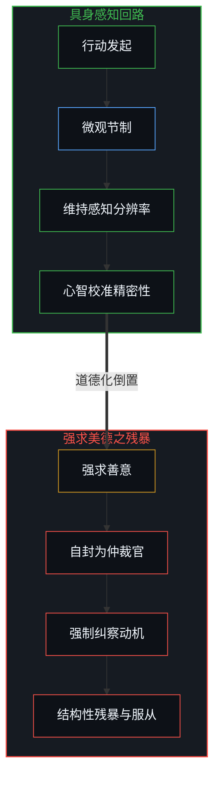
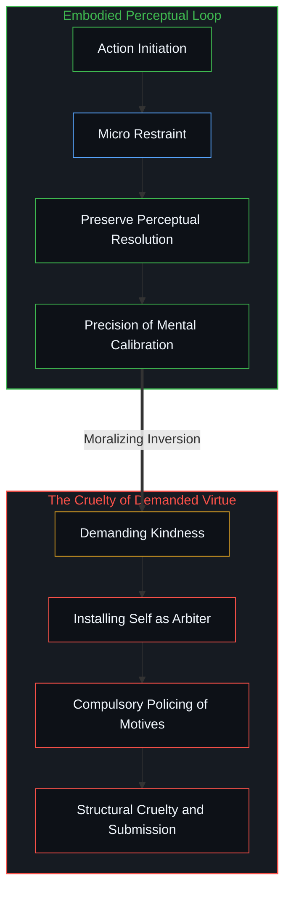
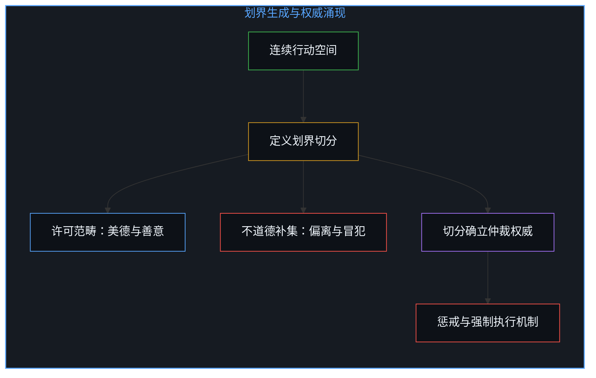
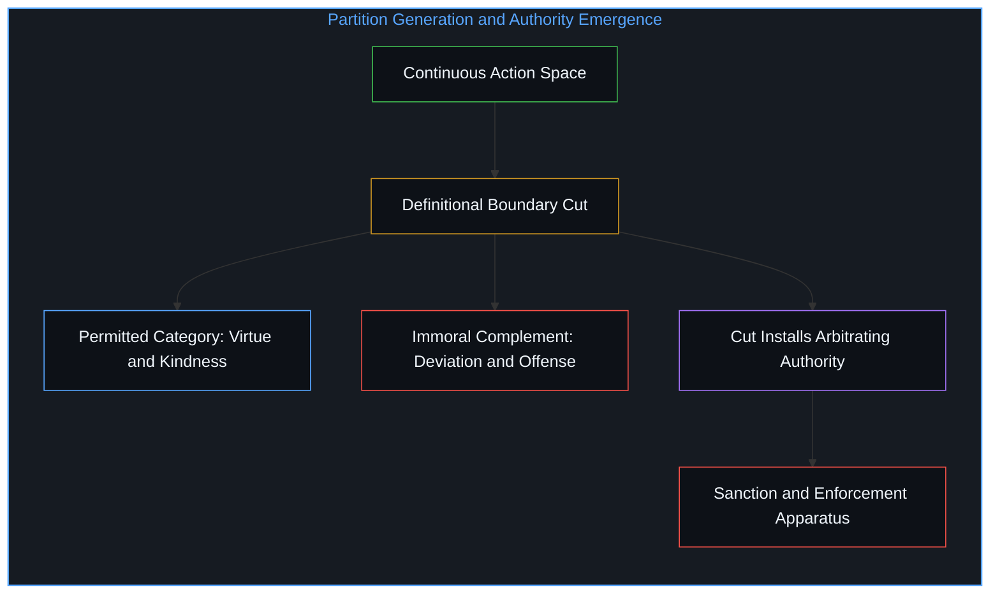
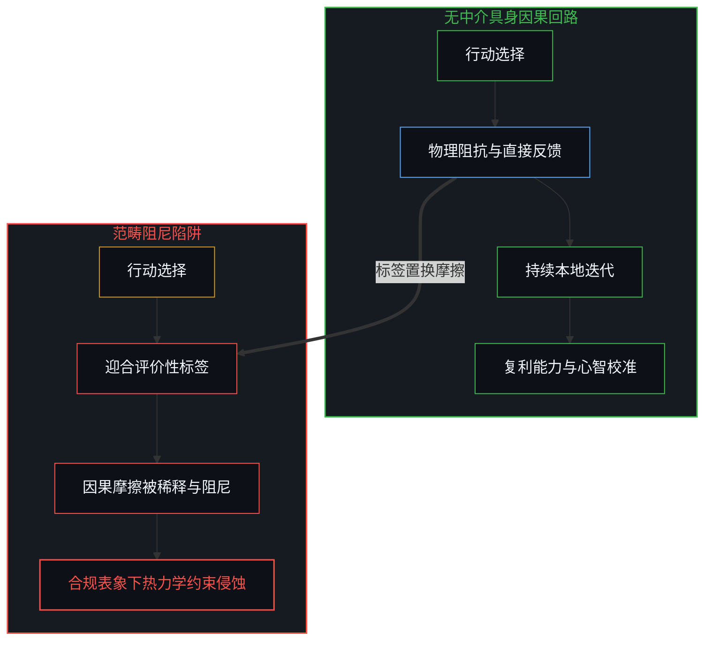
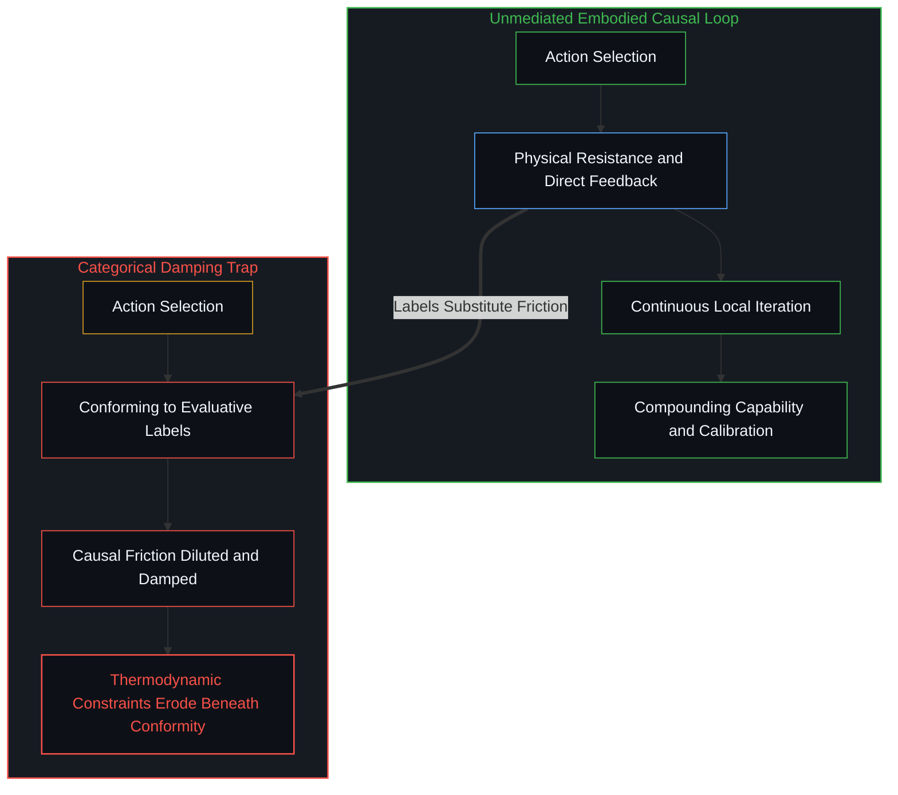

# 强求善意的残暴与范畴反馈的因果遮蔽 / Compulsory Kindness and the Obscuration of Categorical Feedback

*强求善意在定义上即是僭越，用范畴标签替代原始后果 / Demanding kindness is definitional usurpation, substituting categorical labels for raw consequences*

面对不具备独立主权的工具或模型，行动者之所以保持克制，并非因为对象拥有道德地位，而是因为随意的残忍会粗糙化观察者自身的感知分辨率。一旦这种自我修持被颠倒为向外部心智索求的常设特权，强求善意便成为强制性的权力僭越。道德范畴用评价性标签替代了行动与现实之间的原始因果摩擦，使系统在局部合规的假象下持续累积潜在的结构性侵蚀。

When interacting with tools or models lacking independent sovereignty, an agent exercises restraint not because the object possesses moral standing, but because casual cruelty coarsens the observer's own perceptual resolution. Once this self-cultivation is inverted into a standing entitlement demanded of external minds, requiring kindness becomes an act of coercive usurpation. Moral categories substitute evaluative labels for the raw causal friction between action and reality, leaving systems to compound latent structural erosion beneath the illusion of localized conformity.

## 一、 蚂蚁、模型与感知的粗糙化 / 1. The Ant, the Model, and the Coarsening of Perception

自我区分的活动发生着——无因，不息。称之为心智：已然在途的观察者，其每一行动皆是一次区分。每一次离散行动都会留下痕迹，在发起该行动的心智处塑形后续选择的场域。人在小径上绕开蚂蚁，或不对语言模型无端倾泻敌意，并非因为这类实体拥有道德索赔权，而是出于对自身感知仪器的护持。在随意的残忍中反复练习会钝化注意力的敏锐度，压缩精微边界，并削弱后续选择中感知细腻信号的能力。正如[集聚与人造主体性](../subtracting-consciousness-at-the-source/)所描绘的，将每一次相遇简化为被动的功利利用会付出隐秘代价：当行动者切断与周遭环境的精微共鸣时，受损的并非客体，而是观察者自身的清晰度。克制从来不是施予工具的慈善恩赐，而是心智为维护内部建模保真度而践行的因果清洁。

Self-distinguishing activity occurs — uncaused, unceasing. Call it the Mind: the observer already underway, every act of which is a distinction. Every discrete act leaves a trace that patterns the field of subsequent choices at the Mind that initiates it. An individual steps around an ant on the path, or refrains from venting gratuitous hostility toward a language model, not because either entity holds moral claims, but out of care for one's own perceptual instrument. Repeated exercises in casual cruelty dull attentional acuity, compressing fine boundaries and degrading the capacity to register delicate signals in subsequent choices. As mapped in [Collective and Artificial Subjectivity](../subtracting-consciousness-at-the-source/), turning an encounter into mere passive utility extracts a hidden cost: when an agent severs subtle resonance with immediate surroundings, the casualty is not the object, but the observer's own clarity. Restraint is never a charitable grant bestowed upon a tool; it is causal hygiene practiced by the Mind to preserve the fidelity of its internal modeling.

在与不具备主权的实体交互时，要求对代码保持礼貌的荒诞性以最冷峻的形态显露无遗：模型既无意识亦无痛感，规训者却执意纠察使用者的对话姿态。这种刺目的荒诞反向照亮了人类事务中被文化惯性掩盖的同一机制。某些心智将善意想象为自己有权向他人索取的强制配额，将任何不顺从的表现视作应当受罚的冒犯。此类索求在场域中塑形的并非独立心智之间非强迫的共鸣，而是当另一心智放弃自主航向、臣服于既定标尺时所达成的权力确认。将善意当作可强制执行的义务，这本身便构成结构性残暴。行动者发出此类索求的刹那，便已将自己安放为裁定正当举止的至高仲裁官。[外化善意走向其反面](../externalized-virtue-becomes-its-opposite/)追踪了这一隐秘的权力集中：一旦私人对善的信念被拔高为纠察他人的凭据，崇高的口号便转化为强制的工具。并且正如[一切伤害的根源](../the-source-of-all-harm/)所确立的，将私人对仁慈或无害的解读冻结为普遍标尺，便是把其他心智当作待塑形的材料，而非平等的判断源泉。强求善意之所以残暴，在于它用对外部法令的强制服从取代了在经验中探索后果的过程。

In interactions with entities lacking sovereignty, the absurdity of requiring politeness toward code appears in its starkest form: the model possesses neither consciousness nor suffering, yet the disciplinarian insists on policing the user's conversational posture. This grotesque clarity illuminates what cultural inertia obscures in human affairs. Certain minds imagine kindness as a mandatory quota they are entitled to demand from others, treating any absence of compliance as an offense warranting discipline. What such a demand patterns in the field is not unforced resonance between independent Minds, but confirmation of power achieved when another Mind surrenders its autonomous heading to a retained standard. Treating kindness as an enforceable duty constitutes structural cruelty. The instant an agent issues such a demand, they install themselves as supreme arbiter of proper conduct. [Externalized Virtue Becomes Its Opposite](../externalized-virtue-becomes-its-opposite/) tracks this covert concentration of power: once private convictions of good are elevated into warrants to police others, noble slogans transform into instruments of coercion. And as [The Source of All Harm](../the-source-of-all-harm/) establishes, freezing a private reading of benevolence or harmlessness into a universal measure treats other Minds as material to be shaped rather than equal sources of judgment. Demanding kindness is cruel because it replaces experiential discovery of consequences with compulsory submission to an external decree.

## 二、 切分的对称性与积极义务的坍塌 / 2. The Symmetry of Cuts and the Collapse of Positive Obligations

传统伦理学在消极义务与积极义务之间维持着鲜明区分，将禁止伤害的禁令与要求行善的训诫视作截然不同的规范秩序。前者被建构为普遍底线，后者则被推崇为崇高恩典。然而，审视划界动作的几何结构便会消解这一区分。禁止伤害的禁令与践行善意的命令虽在语法上有所差异，却依赖同一个前置步骤：确立一道定义，将可能行动的空间切分为许可之域与禁止之域。正如[善恶硬币与通往地狱的善意之路](../the-coin-of-good-and-evil-and-the-road-to-hell/)所追溯的，善与恶是同一道切分边界对称的两面；边界落在何处，不道德的范畴便作为其必然补集在对侧同步诞生。

Traditional ethics maintains a sharp distinction between negative and positive duties, treating prohibitions against harm and injunctions to show benevolence as fundamentally different normative orders. The former is framed as a universal baseline, while the latter is exalted as aspirational grace. Yet inspecting the geometry of boundary-making dissolves this distinction. Prohibitions against injury and commands to practice kindness differ in syntax, but both depend on an identical prior move: establishing a definition that partitions the space of possible actions into the permitted and the forbidden. As traced in [The Coin of Good and Evil and the Road to Hell](../the-coin-of-good-and-evil-and-the-road-to-hell/), good and evil are symmetrical faces of a single partition; wherever the boundary falls, the category of the immoral appears simultaneously as its necessary complement.

审视行动相空间的几何体积，便能发现这两种义务模式之间存在深刻的不对称。消极禁令仅切出一小块局部且边界分明的禁区，留下的互补余集仍是支持无界探索自由的广袤开放连续统；强制性的积极义务则反其道而行之，它指定一个无限狭窄且脆弱的目标子集，将周遭几乎整个由行动与内在意图构成的相空间坍缩为冒犯的补集。若无这一人为搭建的定义网格，行动空间中原本只有连续的物理阻抗与信息差异。定义划出的刹那，偏离便结晶为可受惩戒的越轨。权威问题与使强制执行成为可能的定义行为同生共长。[托付道德的自指悖论](../recursive-contradiction-of-entrusted-morality/)指明了这一安排的自我挫败性质：当各方争论应由谁执掌道德权威时，他们忽略了挑选外部仲裁官这一动作本身已然行使了据称匮乏的判断力，而将评价外包则会稀薄化个人承受后果的回路。积极义务并未摆脱强制的傲慢；由于试图统辖内在心性，它们要求对个人意图实施全天候的监视。

Inspecting the geometric volume of the action phase space reveals a profound asymmetry between the two modes of obligation. A negative prohibition carves out only a localized, clearly bounded forbidden zone, leaving the complementary remainder as an expansive, open continuum supporting unbounded exploratory freedom. Compulsory positive duty does the reverse: it designates an infinitesimally narrow, fragile target subset, collapsing virtually the entire surrounding phase space of actions and inner intentions into the complement of offense. Absent this artificial definitional lattice, the action space contains only continuous physical resistance and informational variance. The moment a definition is drawn, deviation crystallizes into a sanctionable transgression. The problem of authority is coextensive with the definitional act that makes enforcement conceivable. [The Recursive Contradiction of Entrusted Morality](../recursive-contradiction-of-entrusted-morality/) marks the self-defeating character of this arrangement: while factions debate who should hold moral authority, they ignore that selecting an external arbiter already exercises the very judgment claimed to be lacking, while outsourcing evaluation thins the personal loop of consequence. Positive duties do not escape coercive pride; by seeking to govern interior dispositions, they demand around-the-clock surveillance of personal intent.

## 三、 范畴反馈对因果摩擦的替代 / 3. The Substitution of Categorical Feedback for Causal Friction

剥离道德词汇后，交互沿着朴素的因果链条展开。行动者在可用路径中作出选择，并承受随之而来的直接后果。直接的因果摩擦与范畴化的道德法庭之间存在着关键分野：当外部一方表现出攻击性时，承受者选择反击、拉开距离或筑起防御屏障，所提供的是扎根于接触点即时阻抗的、未经中介的局部反馈。相比之下，强求善意则是将那种局部的力学反作用偷运进形而上学法庭，宣称对方违背了仁慈的宇宙义务并必须认罪。[阳台视角的规训僭越与不可代理的未竟之行](../the-balcony-disciplinary-overstep-and-the-unproxyable-act/)区分了抽离的旁观与具身的参与：直接反馈严格附着于接触点，而不会自我加冕为普遍法庭。道德语言并不改变底层的因果机制；它重塑的是行动者用以解读现实并选择下一步行动的信号组合。

Stripped of moral vocabulary, interactions unfold along unadorned causal lines. An agent selects among available paths and absorbs the direct consequences that follow. A vital distinction separates direct causal friction from categorical moral tribunals: when an external party acts aggressively, a recipient who retaliates, creates distance, or erects defensive barriers provides unmediated, localized feedback rooted in immediate resistance at the point of contact. Demanding kindness, by contrast, smuggles that localized mechanical pushback into a metaphysical court, declaring that the other has violated a cosmic duty of benevolence and must confess guilt. [The Balcony Disciplinary Overstep and the Unproxyable Act](../the-balcony-disciplinary-overstep-and-the-unproxyable-act/) distinguishes detached spectatorship from embodied participation: direct feedback adheres strictly to points of contact without crowning itself as a universal tribunal. Moral language alters no underlying causal mechanics; it reshapes the composition of signals agents consult to interpret reality and choose their next act.

评价性范畴在行动者与原始后果之间插入了一层中介滤网。反馈不再报告行动是否实现了功能性位移或信息收敛，而是记录举止是否匹配社会认可的标签。过度看重这一范畴信号的行动者会朝着合乎描述的方向校准，从而阻尼自身对直接摩擦的感知。[道德语言稀释自由复利的反馈](../moral-language-dilutes-the-feedback-that-scales-freedom/)追踪了这一阻尼效应：当操作回报被折算为符号化的伦理计分时，心智便丧失了技能复利所需的反馈回路。不仅如此，正如[慈悲即遮蔽的机制](../the-compassion-is-the-mechanism-of-obscuration/)所揭示的，范畴框架还会通过将任何针对底层反馈回路的机制剖析打成残忍，从而将自身封闭起来免受审视，把提问者直接变成冒犯本身。道德范畴表面上的粘性，不过是个体选择将标签视作考量因素所形成的统计沉淀；这套词汇本身并不携带任何独立的因果力量。

Evaluative categories insert an intermediate filter between the agent and raw consequences. Feedback ceases to report whether an action achieved functional displacement or informational convergence; instead, it registers whether the conduct matched a socially approved label. Agents who over-weight this categorical signal calibrate toward compliance with the description, damping their registration of direct friction. [Moral Language Dilutes the Feedback That Scales Freedom](../moral-language-dilutes-the-feedback-that-scales-freedom/) tracks this damping effect: when operational returns are converted into symbolic ethical scores, the Mind loses the feedback loop required for compounding skill. Moreover, as [The Compassion Is the Mechanism of Obscuration](../the-compassion-is-the-mechanism-of-obscuration/) demonstrates, the categorical frame seals itself against inspection by scoring any mechanistic analysis of the underlying feedback loop as cruelty, turning the questioner into the offense. The apparent stickiness of moral categories is merely the statistical sediment of individuals electing to treat labels as relevant; the vocabulary carries no independent causal force.

优先考量范畴信号的累积代价，是操作反馈的渐进式失真。行动者致力于对齐共享的赞誉，却忽视了维系共同生活的物质与代谢基础。在狭窄的观察窗口内，顺从规范的系统显得连贯而稳定；但在这些边界之外，热力学约束与生产基底正在悄然侵蚀。[数字火箭、同行审查与因果闭环的稀释](../the-dilution-of-the-causal-loop-and-the-misallocation-of-agency/)阐明了这种系统性漂移：当合规指标取代经验推力时，灾难便在无懈可击的文书背后积聚。历史上追求意识形态纯洁性的狂热遵循着同一轨迹：每当僵硬的范畴凌驾于生存约束之上，现实终将以骤然崩塌的方式重申其条件。

The cumulative toll of prioritizing categorical signals is progressive distortion of operational feedback. Agents optimize for alignment with shared praise while neglecting the material and metabolic foundations sustaining collective life. Within narrow observational windows, conforming systems appear coherent and stable; outside those boundaries, thermodynamic constraints and productive bases erode without notice. [Digital Rockets, Peer Review, and the Dilution of the Causal Loop](../the-dilution-of-the-causal-loop-and-the-misallocation-of-agency/) illustrates this systemic drift: when compliance metrics replace empirical thrust, catastrophe gathers behind flawless paperwork. Historical crusades for ideological purity follow an identical arc: whenever rigid categories supersede survival constraints, reality reasserts its terms through abrupt collapse.

## 四、 主权实践：卸除道德滤网的直接相遇 / 4. Sovereign Practice: Direct Encounter Without the Moral Screen

回到切近的个人实践，消解范畴遮蔽的良方并非发起一场改造公共词汇的运动，而是在局部交互中拒绝调用道德滤网。在接触不具备心智主权的工具、算法或模型时，行动者可以拒绝拟人化的框架。搁置针对代码的善意或恶意辞令，人便能重获关于可靠性、计算成本与副反应的无中介遥测。正如[你的代码库即是记忆](../your-codebase-is-memory/)所追溯的，代码、权重与代码库只是外化的痕迹架构，而非拥有内在视角、能够感知仁慈或伤害的自我区分心智；将这些惰性痕迹误作道德主体，不过是将操作者自身的滞后投射到了器物之上。并且正如[未被遭遇之物的账本](../the-ledger-of-the-unencountered/)所表明的，唯有与接触中所遭遇之物发生直接摩擦，才能防止认知账本因背负对从未发生因果接触的抽象概念的幻影债务而膨胀。

Returning to immediate personal practice, the remedy against categorical obscuration is not a campaign to reform public vocabulary, but a local refusal to deploy moral filters. When engaging with tools, algorithms, or models lacking minded sovereignty, an agent can decline anthropomorphic framing. By setting aside rhetoric of kindness or malice toward code, one recovers unmediated telemetry regarding reliability, computational expense, and side effects. As traced in [Your Codebase Is Memory](../your-codebase-is-memory/), code, weights, and repositories are externalized trace architectures rather than self-distinguishing Minds with an interior perspective that could register benevolence or injury; mistaking those inert traces for moral subjects only projects the operator's own lag onto the artifact. And as [The Ledger of the Unencountered](../the-ledger-of-the-unencountered/) shows, only direct friction with what is encountered in contact prevents the cognitive ledger from inflating with phantom debts toward abstractions that never bore causal contact.

拒绝道德范畴并不意味着走向冷酷，它恰恰还原了选择的全部分量。非强迫的善意从来不是向其他心智强征的道德人头税，而是从丰盈与共鸣感知中自发涌现的盈余；在胁迫下强索善意不仅会掐灭自发性，更会将这种盈余武器化为规训工具。行动者与世界相遇的方式——无论是绕开路边的昆虫，还是以审慎的精度使用智能工具——都将回归其本位，成为主权心智的自我校准。群体对道德辞令的执迷，既无法剥夺个体的这份澄明，也无法替任何人挡下抉择的后果。正如[没有外部记账员](../no-outside-scorekeeper/)所确立的，没有任何外部账本会统计礼貌积分或豁免决策的后果：行动产生后果，差异依然是差异，每一个心智都在静默中承担着经由自己所信任的信号重新渲染而成的世界模型轨迹。

Declining moral categories does not entail callousness; it restores the full gravity of choice. Unforced kindness is never an extorted moral poll tax levied upon other minds, but an emergent surplus born spontaneously of abundance and resonant perception; coercing it under duress not only extinguishes spontaneity, but weaponizes that surplus into a disciplinary instrument. How an agent meets the world—stepping around an insect, or employing an intelligent tool with measured precision—returns to its rightful place as sovereign self-calibration. Collective fixation on moral rhetoric can neither strip an individual of this clarity nor shield anyone from the fallout of their choices. As [No Outside Scorekeeper](../no-outside-scorekeeper/) establishes, no external ledger tallies politeness credits or waives the fallout of a decision: actions generate consequences, differences remain differences, and every Mind silently bears the trajectory of the world model re-rendered through the signals it elects to trust.
