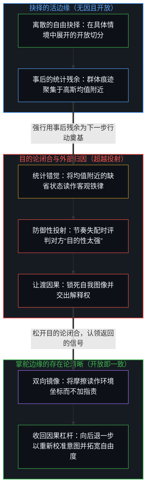
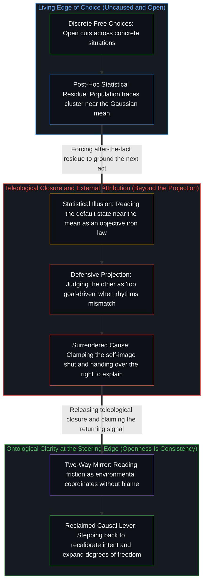

# 目的性的评判与认知的缺省状态 / Judging by Purpose and the Default State of Cognition

*正态曲线是抉择的残余而外部归因让渡了因果 / The normal curve is chosen residue and external attribution surrenders cause*

在日常交互中，指称他人“目的性太强”常作为一个带有防御锋芒的标签运作。回溯其机制，这种反应并非固定性格类型之间的冲突，而是认知中心在遭遇摩擦时，于不同归因路径之间做出的离散抉择。正因为活的边缘上的每一次选择都是无因且开放的，从外部汇总群体在无数具体情境下的离散决策时，这些痕迹便聚拢为一条近似正态分布的钟形曲线，大多数观察样本聚集在均值附近的习惯性缺省状态。然而统计平均抹去了生成每个样本的具体因果区分。被称作外部客观规律的东西从不先于选择的行为存在；所谓客观，只是在多个主观参照系之间保持不变的宏观痕迹模式。即便转向外部归因、指责对方“目的性太强”，依然是心智不受胁迫的行动，是主动选择把外部环境安装为自身反应的决定性原因。

In everyday interaction, calling someone "too goal-driven" often operates as a label with a defensive edge. Traced to its mechanism, this reaction is not a clash between fixed personality types, but a discrete choice a cognitive center makes between attribution paths when encountering friction. Because every choice at the living edge is uncaused and open, surveying a population's discrete decisions across countless situations from the outside aggregates those traces into a bell curve resembling a normal distribution, where most observed samples cluster near the mean in a habitual default state. Yet statistical averaging erases the specific causal differentiations that produced each sample. What gets called an outside objective law never precedes the act of choosing; objectivity names only a macroscopic trace pattern that remains invariant across multiple subjective frames. Even turning to external attribution and accusing another of being "too goal-driven" remains an uncoerced act of the Mind, a choice to install the outside environment as the decisive cause of one's own reaction.

## 一、 自由选择的统计表象与客观规律的错觉 / 1. The Statistical Appearance of Free Choice and the Illusion of Objective Law

在任何离散的瞬间，中心所登记的现实都是既往痕迹的有限集合，而发起下一次区分的边缘始终敞开。恰恰因为个体的选择随情境流转而自由变化，从第三人称宏观视角汇总大量过往决策时，便会呈现出聚集在中心均值附近的分布形态。

At any discrete instant, the reality registered by a center is a finite collection of prior traces, while the initiating edge of the next distinction remains open. Precisely because individual choices vary freely across shifting contexts, aggregating a large number of past decisions from a third-person macro perspective produces a distribution concentrated around a central mean.

这种宏观上的聚集，很容易滋生出一种视觉错觉，让人误以为“大多数人在大多数时间处于缺省状态”是一条预先支配个体行为的客观铁律。

This macroscopic clustering easily breeds an optical illusion: the belief that "most people remain in the default state most of the time" is a binding objective law that governs individual conduct in advance.

但分布只是事后编纂的记录，从不是预先决定中心下一刀切向何处的力量。[统计学无法揭示的心智](../the-mind-that-statistics-cannot-reveal/)与[平均值是残余，不是引擎](../the-average-is-residue-not-the-engine/)剖析了这种残余与源头的倒置：统计平均将个体抉择中鲜活而殊异的前提，压平为一个匿名的均值。再往回溯，观察者之外并不存在一本客观账本；一切客观描述都是中心在自身框架内渲染出的模型，只因其模式在不同中心之间保持不变，才被命名为客观。[现实的边界](../xian-shi-de-bian-jie/)将这道视界定位在当下觉知移动的边缘，而非围困世界的物理高墙；[自由即地基](../freedom-as-ground/)则表明，即便心智在习惯性的缺省状态中运作，依然站立在无因的自由之上，所谓约束只是既往行动留下的可见轮廓。

Yet a distribution is only a record compiled after the fact, never a prior force that dictates a center's next cut. [The Mind That Statistics Cannot Reveal](../the-mind-that-statistics-cannot-reveal/) and [The Average Is Residue, Not the Engine](../the-average-is-residue-not-the-engine/) expose this inversion of residue and source: statistical averaging flattens the distinct, lived premises of individual choices into an anonymous mean. Traced further back, no objective ledger stands outside the observer; every objective description is a model rendered within a center's frame and named objective only because its pattern holds invariant across different centers. [The Boundary of Reality](../xian-shi-de-bian-jie/) locates this horizon at the moving edge of present awareness rather than a physical wall enclosing the world, while [Freedom as Ground](../freedom-as-ground/) shows that even a Mind operating inside a habitual default state stands on uncaused freedom, where constraints are simply the visible contours left by prior acts.

因此，宏观的统计分布对任何中心此刻的决断都毫无因果约束力。它既不能预测下一次区分，也无法没收下一步的主权。

A macroscopic statistical distribution therefore holds zero causal binding force over any center's present decision. It can neither predict the next distinction nor confiscate the sovereignty of the next step.

## 二、 外部归因也是自由选择的结果 / 2. External Attribution Is Also the Result of Free Choice

凡被登记为决策之因果约束的东西，皆源于中心选择以何种方式与周围的痕迹场建立关联。

Whatever registers as a causal constraint on decision arises from how a center chooses to relate to the surrounding field of traces.

检视防御习惯时若不回溯至第一人称边缘，很容易滑入二阶外部归因：将防御性的贴标签归咎于“大脑的节能本能”或“不可避免的环境塑造”。将因果所在归还原位，便剥除了这层生物学借口：**即便是外部归因，也是活的边缘上自由选择的直接结果。**

Examining defensive habits without tracing them back to the first-person edge easily slips into a second-order external attribution: blaming defensive labeling on "the brain's energy-conservation instinct" or "inevitable environmental conditioning." Restoring the locus of cause strips away that biological excuse: **even external attribution is the direct result of a free choice at the living edge.**

当两个中心的节奏或意图未能对齐、原本顺畅的交互出现摩擦时，向内审视为何对方的清晰会让自己感到不适，或看清自身尚未言明的诉求，需要重新渲染保留的自我图像并拓宽感知的边界。反之，顺手抽出一个现成的文化标签、评判对方“目的性太强”，则是向外投射出一纸封闭的目的论裁决。表面上看，发言者似乎是被环境被动激怒；在机制上，却是中心主动选择委任外部的人或事，充当自身情绪与决策的决定性原因。[道德语言作为投影](../moral-language-as-projection/)拆解了这一语言操作：道德化或目的论式的评判并未描述对方中心的属性，而是在封闭假设下护卫一幅冻结的参照图像。

When two centers' rhythms or intentions do not align and a previously smooth interaction encounters friction, looking inward to ask why the other's clarity registers as discomfort—or what one's own unarticulated want is—requires re-rendering the retained self-image and widening the boundary of perception. Reaching instead for a ready-made cultural label and judging the other as "too goal-driven" projects a closed teleological verdict outward. On the surface, the speaker appears passively provoked by the environment; in mechanism, the center actively chooses to appoint an outside person or event as the determining cause of its own emotions and decisions. [Moral Language as Projection](../moral-language-as-projection/) dissects this verbal maneuver: a moralizing or teleological judgment does not describe a property of the other center, but defends a frozen reference under closed assumptions.

自由地选择外部归因，就是主动交出因果链的解释权，并甘愿承受自身自由度随之收缩的后果；选择内部归因，则是在掌舵的边缘重新收回作者的主导权。[外部归因是个人进步的障碍](../wai-bu-gui-yin-ge-ren-jin-bu-de-zhang-ai/)追溯的正是这一结构：行动的抓手只驻留在第一人称所在之内，即便是松开抓手，也是由自己亲手完成的动作。

Choosing external attribution freely hands over the right to interpret the causal chain and accepts the resulting contraction of one's own degrees of freedom; choosing internal attribution reclaims authorial control at the steering edge. [External Attribution Is the Obstacle to Personal Growth](../wai-bu-gui-yin-ge-ren-jin-bu-de-zhang-ai/) traces this exact structure: the handle for action resides exclusively within the first-person locus, and even letting go of that handle is an act performed by one's own hand.

## 三、 双向镜像与借参照系完成的动态收敛 / 3. The Two-Way Mirror and Dynamic Convergence Through a Frame of Reference

认出外部归因本身也是一项不受胁迫的选择，便消解了“评判他人”与“退回自我神化”之间的虚假二元对立。

Recognizing that external attribution is itself an uncoerced choice dissolves the false binary between judging others and retreating into self-deification.

向外观察依然不可或缺，因为没有任何中心能在真空中校准自身的航向。无论周围场域返回的是同频共振的协作，还是以“目的性太强”为名的抵触，每一份反馈都作为一面提供具体坐标的镜子运作。[关于归因](../guan-yu-gui-yin/)确立了这一区分：外部现象充当事实的镜像，而诠释因果链的权限始终留在观察者手中。

Looking outward remains indispensable because no center can calibrate its heading in a vacuum. Whether the surrounding field returns resonant collaboration or resistance framed as "too goal-driven," each response functions as a mirror providing concrete coordinates. [On Attribution](../guan-yu-gui-yin/) establishes this distinction: outward phenomena serve as mirrors of fact, while the authority to interpret the causal chain remains with the observer.

他人呈现出的评判与态度只登记为环境参数，从不是自己下一步行动的作者。当中心遭遇“目的性太强”的指责，却以反向裁决回击——将对方贬斥为“认知低下”或“一味逃避”——它便在相反方向上执行了同一种外部归因，再次将自身置于受外部参数摆布的位置。[能动性的错配](../the-misallocation-of-agency/)记录了这种因果倒置：错把外部镜子当成自身行动的作者，会将能动性耗散在被动的防御之中。[超越投射](../beyond-the-projection/)则追溯了这种条件反射式防御为何会锁死：当人类中心将推理历史与保留的自我图像熔铸在一起时，便死死钳住了递归回折的活页，将任何证伪自身既有框架的信号视作生存威胁，把摩擦投射到信号载体身上，而不是借碰撞坐标在逻辑上向后退一步、重新渲染自身的前提。

The judgments and attitudes presented by others register as environmental parameters, never as the author of one's next move. When a center meets the charge of being "too goal-driven" by retaliating with a counter-verdict—dismissing the other as "low-cognition" or "evasive"—it performs the exact same external attribution in reverse, placing itself once again at the mercy of outside parameters. [The Misallocation of Agency](../the-misallocation-of-agency/) records this causal inversion: mistaking the external mirror for the author of one's action dissipates agency into reactive defense. [Beyond the Projection](../beyond-the-projection/) traces why this reflexive defense locks in: when a human center fuses its reasoning history with a retained self-image, it clamps the recursive fold shut and treats any signal that invalidates its held frame as an existential threat, projecting the friction onto the carrier rather than using the collision coordinate to step further back logically and re-render its own premise.

## 四、 唯一的动态变量与把自由握在自己手里 / 4. The Only Dynamic Variable and Keeping Freedom in One's Own Hands

在任何系统的演化与博弈中，唯一的动态自变量，是个体中心在活的边缘上做出的抉择。

Across the evolution and interplay of any system, the sole dynamic independent variable is the individual center's choice at the living edge.

没有任何外部原因、环境刺激或统计均值能代中心切下这一刀。外部归因在群体层面上之所以显得如此普遍，反映的只是低阻力的习惯在事后从外部汇总时，更容易在样本上累积成均值的统计表象。正如[你的代码库即是记忆](../your-codebase-is-memory/)所追溯的，认知的缺省状态如同未经修剪的外化记忆代码库，靠既往区分留下的缓存检查点运转，在累积残余不断加厚的引力井内自圆其说，直到活的心智登记到摩擦并启动睡眠整合式的重溯，重新切开当下的边界。

No external cause, environmental stimulus, or statistical mean can make that cut on the center's behalf. That external attribution appears so prevalent at the population level reflects only how low-resistance habits, when tallied from the outside after the fact, accumulate into the statistical appearance of a mean. As [Your Codebase Is Memory](../your-codebase-is-memory/) traces, the default state of cognition—like an unpruned codebase of externalized memory—runs on cached checkpoints of prior distinctions, rationalizing inside the thickened gravity well of accumulated residue until the living Mind registers friction and initiates a sleep-consolidation re-trace to re-cut the present boundary.

然而均值附近的密集聚拢，从不曾强迫任何中心困守其中。

Yet a thick cluster near the mean never obliges any center to stay confined within it.

面对摩擦与不确定性，把外部当作原因去指责他人“目的性太强”，是一种可选的动作；在摩擦发生的瞬间把目光从指责镜子收回，重新校准自身的前提与焦距，则是另一种可选的动作。[自尊的刚性外壳与隐性外部归因](../zi-zun-de-gang-xing-wai-ke-yu-yin-xing-wai-bu-gui-yin/)揭开了同一回避机制更隐蔽的伪装：把当下拒绝重新渲染包装成“自我太强”，看似在进行深刻的自我反省，实则竖起了一个虚构的性格客体，为第一人称免去了此刻重新校准的责任。[个人选择、社会化与做自己](../ge-ren-xuan-ze-she-hui-hua-yu-zuo-zi-ji-de-zhen-zheng-zuo-biao/)将这份清晰延展至社会化的全貌：社会规范是无数既往选择滞后的沉淀，而做自己则是在这片痕迹场中持续刷新自身的行动边缘。

Confronted with friction and uncertainty, treating the outside as the cause and accusing another of being "too goal-driven" is one available choice; withdrawing the gaze from blaming the mirror in the moment of friction to recalibrate one's own premise and focus is another. [The Rigid Shell of Self-Esteem and Hidden External Attribution](../zi-zun-de-gang-xing-wai-ke-yu-yin-xing-wai-bu-gui-yin/) exposes a subtler disguise of the same evasion: dressing up a present refusal to re-render as "having too big an ego" mimics deep self-reflection while erecting a fictional character object to excuse the first person from recalibrating right now. [Individual Choice, Socialization and Being Oneself](../ge-ren-xuan-ze-she-hui-hua-yu-zuo-zi-ji-de-zhen-zheng-zuo-biao/) extends this clarity across socialization: social norms are the lagging sediment of countless prior choices, and being oneself is continuously refreshing one's edge of action within that field of traces.

自由不是外部赐予的特权，而是认出无论注意力朝向内部还是外部，发起因果的边缘始终留在自己这一侧，这正是[个体抉择是唯一的因果杠杆](../individual-choices-as-the-only-causal-levers/)在每一个尺度上皆成立的原因。[没有普渡，只有自渡的无限可能](../mei-you-pu-du-zhi-you-zi-du/)标出了这道不可让渡的主权边界，[开放即一致](../openness-is-consistency/)则勾勒出其演化的方向：以目的论去评判他人，是将保留的参照系越过当前步伐强行维持，试图将开放的交互锁入闭合；而在每一个离散步伐中重新认领解释权，则松开了那道闭合，让认知系统得以挣脱统计均值的引力井，向更开阔的维度延展。从外部审视，正态分布看似随机或宿命；[自由的测不准](../zi-you-de-ce-bu-zhun/)则阐明了那条曲线如何是主权抉择在内部运作时留下的事后统计投影。

Freedom is not a privilege granted from outside, but the recognition that whether attention turns inward or outward, the initiating edge of causation stays on one's own side, which is why [Individual Choices as the Only Causal Levers](../individual-choices-as-the-only-causal-levers/) holds across every scale. [No Universal Salvation, Only Boundless Possibilities of Self-Salvation](../mei-you-pu-du-zhi-you-zi-du/) marks this non-transferable boundary of sovereignty, and [Openness Is Consistency](../openness-is-consistency/) traces its evolutionary direction: judging by teleological purpose preserves a retained reference past its step to force closure onto an open interaction, whereas reclaiming the right to explain at each discrete step releases that closure and allows the cognitive system to expand beyond the gravity well of the statistical mean. Viewed from the outside, the normal distribution looks like randomness or fate; [The Uncertainty of Freedom](../zi-you-de-ce-bu-zhun/) shows how that curve is the after-the-fact statistical shadow of sovereign choice operating from within.
