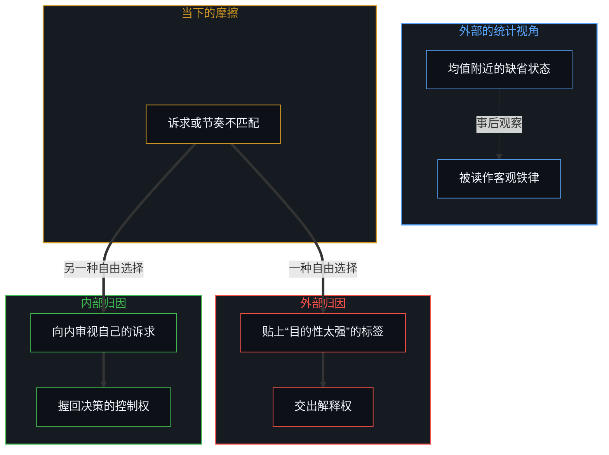
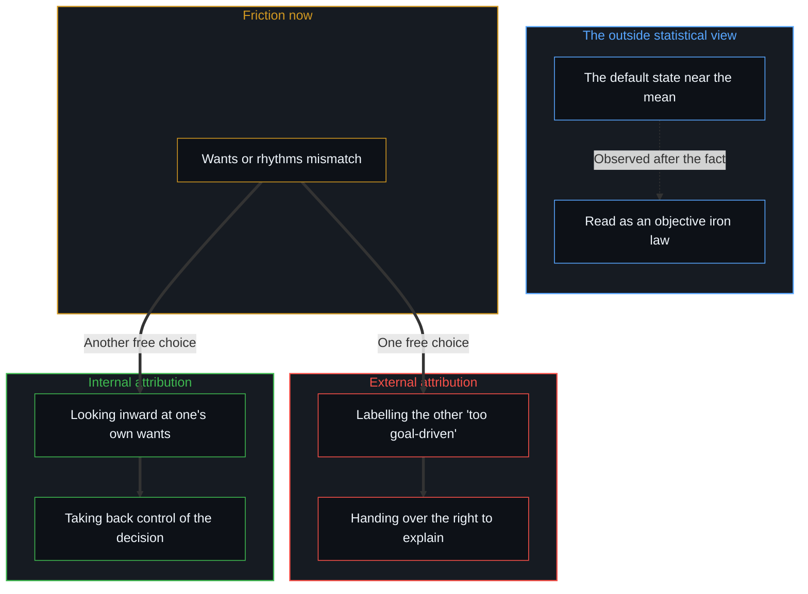

# 从“目的性”的评判，看认知系统的缺省状态与动态跃迁 / Seeing the Default State and Dynamic Leaps of Cognition Through Judgments of Purpose

*正态分布是自由选择的统计沉淀，外部归因也是自由交出解释权的选择 / The normal distribution is the sediment of free choices; even external attribution freely hands over the right to explain.*

在日常语境里，“目的性太强”常被当作一个带着微妙防御意味的标签。这个现象多半不是非黑即白的性格对立，而是认知在面对不同情境时，在不同的归因路径之间做出的动态选择。正因为每一个人的每一次选择都是自由的，在面对无数复杂情境的离散决策中，群体的行为分布在统计上才自然呈现出接近正态分布的钟形曲线：大多数观察样本聚集在均值附近的“缺省状态”。可统计平均恰恰抹平了个体自由选择的真实差异。被说成外部“客观规律”的东西，并不先于选择存在；所谓客观，是在不同的主观认知之间保持不变的宏观现象。即便选择了“外部归因”，指责对方“目的性太强”，这依然是个体自由做出的选择：是自己主动选择把外部环境当作自己做出反应的原因。

In everyday talk, "too goal-driven" is often used as a label with a faintly defensive edge. The phenomenon is mostly not a black-and-white opposition of characters but a dynamic choice cognition makes between different paths of attribution as it meets different situations. Precisely because every choice of every person is free, across discrete decisions in countless complex situations the distribution of a group's behaviour naturally shows, statistically, a bell curve close to the normal distribution: most observed samples gather in the "default state" near the mean. Yet the statistical average flattens exactly the real differences among individual free choices. What is called an outside "objective law" does not exist prior to the choices; what is called objective is a macroscopic phenomenon that stays invariant across different subjective cognitions. Even choosing "external attribution", accusing the other of being "too goal-driven", is still a choice the individual makes freely: one actively chooses to take the outside environment as the cause of one's own reaction.

## 一、 自由选择的统计表象与“客观规律”的错觉 / 1. The Statistical Appearance of Free Choice and the Illusion of "Objective Law"

在任何给定的时刻，人能感知到的现实都是有限而已经确定的。恰恰因为个体的选择有充分的开放与多样，从外部宏观的视角去审视群体的大量选择时，它在概率统计上会呈现出一种聚集在均值附近的分布形态。

At any given moment, the reality a person can perceive is finite and already determined. Precisely because individual choices are fully open and varied, when the many choices of a group are surveyed from an outside, macro view, they show statistically a distribution that gathers around the mean.

这种宏观上的集中，很容易让人生出一种错觉，误以为“大多数人在大多数情况下处于缺省状态”是一条不可抗拒的客观铁律。

This concentration at the macro level easily produces an illusion: that "most people are in the default state most of the time" is an irresistible objective iron law.

可这只是一种事后的观察现象，而不是决定个体命运的客观规律。[统计学无法揭示的心智](../the-mind-that-statistics-cannot-reveal/)与[平均值是痕迹，不是引擎](../the-average-is-residue-not-the-engine/)揭示了统计学的深层陷阱：统计平均抹平了个体自由选择的丰富内容。再往下追，并不存在一个脱离观察者的“客观”；一切客观的描述，都是心智依自身框架做出的诠释，在许多心智之间保持了不变，才被称作客观。[现实的边界](../xian-shi-de-bian-jie/)阐明了这条界限：边界是当下觉知的边缘，而不是世界的物理围墙。在缺省状态下看似被束缚的心智，依然站在[自由即地基](../freedom-as-ground/)所说的地基上：约束只是自由行动时显出的轮廓。

But this is only an observed phenomenon after the fact, not an objective law that decides an individual's fate. [The Mind That Statistics Cannot Reveal](../the-mind-that-statistics-cannot-reveal/) and [The Average Is Residue, Not the Engine](../the-average-is-residue-not-the-engine/) expose the deeper trap of statistics: the statistical average flattens the rich content of individual free choices. Traced further, there is no "objective" detached from the observer; every objective description is an interpretation the Mind makes from its own frame, and it is called objective because it stays invariant across many Minds. [The Boundary of Reality](../xian-shi-de-bian-jie/) sets out this limit: a boundary is the edge of present awareness, not a physical wall around the world. A Mind that seems bound in the default state still stands on the ground that [Freedom as Ground](../freedom-as-ground/) describes: constraints are only the contours that show when freedom acts.

所以，宏观的统计分布，对任何一个具体个体此刻的选择，都没有因果上的约束力。它既不能预测下一个念头，也无法剥夺下一刻的决断。

So the macro statistical distribution has no causal binding force on any particular individual's choice now. It can neither predict the next thought nor take away the next moment's decision.

## 二、 外部归因也是自由选择的结果 / 2. External Attribution Is Also the Result of Free Choice

任何所谓的“因果约束力”，都来自一个人选择怎样与外部环境建立关系。

Any so-called "causal binding force" comes from how a person chooses to relate to the outside environment.

阐述这一机制时如果不加审视，就很容易再次滑进外部归因：把个体的防御行为归咎于“大脑的节能本能”或“环境的必然塑造”。要站回原点：**即便是外部归因，本身也是个体自由选择的结果。**

If this mechanism is set out without scrutiny, it is easy to slide back into external attribution: blaming an individual's defensive behaviour on "the brain's instinct to save energy" or "the inevitable shaping of the environment". The thing is to stand back at the origin: **even external attribution is itself the result of an individual's free choice.**

当双方的诉求或节奏不相匹配、稳定的交互出现摩擦，要向内审视“为什么对方的清晰让自己不舒服”“自己在此处更深的诉求是什么”，需要主动拓宽认知的边界。而顺手抽出现成的文化标签，指责对方“目的性太强”，表面上看是受制于环境，实际上是主动选择把外部的人或事，设定为自己的决策与情绪的决定性原因。[道德语言作为投影](../moral-language-as-projection/)剖析了这种语言投射的机制：道德化的评判描摹的不是对方的事实，而是个人在封闭的假设之下，自由选择调出的一种防御性站位。

When the two sides' wants or rhythms do not match and a stable interaction meets friction, looking inward at "why does the other's clarity make me uncomfortable" and "what is my deeper want here" takes an active widening of the boundary of understanding. Reaching instead for a ready-made cultural label and accusing the other of being "too goal-driven" looks on the surface like being governed by the environment, but is in fact an active choice to set an outside person or event as the decisive cause of one's own decisions and emotions. [Moral Language as Projection](../moral-language-as-projection/) dissects the mechanism of this verbal projection: a moralizing judgment does not depict a fact about the other; it is a defensive stance an individual freely chooses to call up under closed assumptions.

自由地选择“外部归因”，就是主动把解释权交了出去，并选择承受自由度大幅降低的后果；选择“内部归因”，则是自由地把决策的控制权重新握回自己手里。[外部归因：个人进步的障碍](../wai-bu-gui-yin-ge-ren-jin-bu-de-zhang-ai/)揭示的正是这个悖论：行动的抓手只在内部，即便是放弃抓手，也是由自己亲手完成的动作。

To choose "external attribution" freely is to actively hand over the right to explain and to choose to bear the consequence of much reduced freedom; to choose "internal attribution" is to take the control of decision freely back into one's own hands. [External Attribution: The Obstacle to Personal Growth](../wai-bu-gui-yin-ge-ren-jin-bu-de-zhang-ai/) exposes exactly this paradox: the handle for action is only ever inside, and even letting go of the handle is an act one performs oneself.

## 三、 镜像的双向性，借参照系完成动态收敛 / 3. The Two-Way Mirror, Converging Dynamically Through a Frame of Reference

认出外部归因也是自由选择，就能越过“评判他人”与“自我神化”的二元对立。

Recognizing that external attribution is also a free choice lets one step past the binary of "judging others" and "deifying oneself".

向外观察是必要的，因为人无法在虚空中看清自己。无论外界反馈的是同频的协作，还是对“目的性太强”的抵触，都是一面面提供真实坐标的镜子。[关于归因：从事实到因果，从外部节点到内部迭代](../guan-yu-gui-yin/)指出：外部现象是事实的镜像，而因果链的解释权留在自身。

Looking outward is necessary, because no one can see oneself clearly in a void. Whether the outside world returns attuned collaboration or resistance to being "too goal-driven", each is a mirror that supplies real coordinates. [On Attribution: From Fact to Cause, From Outside Node to Inner Iteration](../guan-yu-gui-yin/) points out that outside phenomena are mirror images of fact, while the right to explain the causal chain stays with oneself.

外界呈现的评判与态度只是环境的参数，因果链最终的解释权与决策权一直在自身。遭遇“目的性太强”的指责时，如果同样陷入“对方认知低、对方在逃避”的反向指责，这依然是又一次自由地选择了外部归因，把自己放在了被外部参数推动的位置上。[能动性的错配](../the-misallocation-of-agency/)记录了这种因果倒置：把外部的镜子误认作自身行动的作者，自身的能动性就会耗散。

The judgments and attitudes the outside world presents are only parameters of the environment; the final right to explain and decide the causal chain has stayed with oneself all along. Meeting the charge of being "too goal-driven" with the counter-charge that "the other has low understanding and is avoiding things" is again a free choice of external attribution, one that puts oneself in the position of being pushed by outside parameters. [The Misallocation of Agency](../the-misallocation-of-agency/) records this causal inversion: when the outside mirror is mistaken for the author of one's own action, one's agency dissipates.

## 四、 唯一的动态变量，把自由握在自己手里 / 4. The Only Dynamic Variable, Keeping Freedom in One's Own Hands

在任何系统的演化与博弈中，唯一的动态自变量，是个人的自由选择。

In the evolution and play of any system, the only dynamic independent variable is the individual's free choice.

没有哪个外部原因、环境刺激或统计均值能决定这个选择。在群体层面看起来大多数人、大多数时间都在选择外部归因，只是因为从外部视角统计时，阻力低的选择在样本上更容易汇聚成均值的表象。

No outside cause, environmental stimulus or statistical mean can decide this choice. That at the group level most people seem to choose external attribution most of the time is only because, counted from the outside, low-resistance choices gather more easily in the sample into the appearance of a mean.

可这并不意味着任何人生来就必须被困在均值之中。

But this does not mean that anyone is born obliged to stay trapped in the mean.

面对摩擦与不确定，选择把外部当作原因，去指责“目的性太强”，是一种自由选择；在觉察到摩擦的瞬间，把目光从评价镜子收回来，调整自己的选择与焦距，是另一种自由选择。[自尊的刚性外壳与隐性外部归因](../zi-zun-de-gang-xing-wai-ke-yu-yin-xing-wai-bu-gui-yin/)揭示了这种回避的进阶形态：把当下的不肯妥协包装成“Ego 太大”，看似深刻地反省，实则是用一个虚构的性格客体，免去第一人称此刻校准参数的责任。[个人选择、社会化与做自己](../ge-ren-xuan-ze-she-hui-hua-yu-zuo-zi-ji-de-zhen-zheng-zuo-biao/)把这份清醒扩展到社会化的全景：社会现象是无数个人选择的滞后沉淀，做自己是在既有的痕迹场中持续刷新自己的行动边缘。

Facing friction and uncertainty, choosing to treat the outside as the cause and accuse the other of being "too goal-driven" is one free choice; in the moment friction is noticed, withdrawing the gaze from evaluating the mirror and adjusting one's own choice and focus is another. [The Rigid Shell of Self-Esteem and Hidden External Attribution](../zi-zun-de-gang-xing-wai-ke-yu-yin-xing-wai-bu-gui-yin/) exposes an advanced form of this avoidance: dressing up a present refusal to compromise as "having too big an Ego" looks like deep self-reflection, but uses a fictional object of character to excuse the first person from the responsibility of recalibrating now. [Individual Choice, Socialization and Being Oneself](../ge-ren-xuan-ze-she-hui-hua-yu-zuo-zi-ji-de-zhen-zheng-zuo-biao/) extends this clarity to the whole of socialization: social phenomena are the lagging sediment of countless individual choices, and being oneself is continually refreshing one's edge of action within the existing field of traces.

真正的自由不是外部赋予的特权，而是清醒地意识到：无论向内还是向外，因果的源头始终在自己这一边，所以[个体抉择是唯一的因果杠杆](../individual-choices-as-the-only-causal-levers/)。[没有普渡，只有自渡](../mei-you-pu-du-zhi-you-zi-du/)划定了这道主权的边界，[开放即一致](../openness-is-consistency/)则指明了演化的方向：在每一个当下的离散选择中不断认领自己的解释权，认知系统才能打破统计均值的重力，向更广阔的维度持续扩容。正态分布从外面看是随机，[自由的测不准](../zi-you-de-ce-bu-zhun/)说明了它怎样是内部抉择主权的统计投影。

Real freedom is not a privilege granted from outside but the clear awareness that, whether one turns inward or outward, the source of causation stays on one's own side, which is why [Individual Choices as the Only Causal Levers](../individual-choices-as-the-only-causal-levers/). [No Universal Salvation, Only Boundless Possibilities of Self-Salvation](../mei-you-pu-du-zhi-you-zi-du/) draws this boundary of sovereignty, and [Openness Is Consistency](../openness-is-consistency/) points the direction of evolution: only by continually claiming one's own right to explain in each present, discrete choice can a cognitive system break the gravity of the statistical mean and keep expanding into wider dimensions. Seen from outside, the normal distribution looks random; [The Uncertainty of Freedom](../zi-you-de-ce-bu-zhun/) shows how it is the statistical projection of the sovereignty of choice within.
