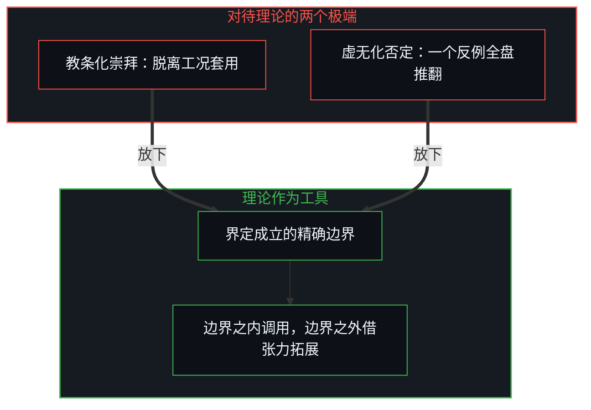
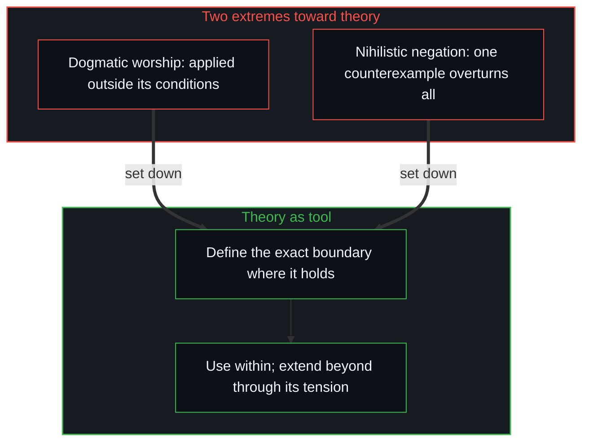

# 从形式迷思到逻辑闭环 / From the Myth of Form to the Closed Loop of Logic

*通道不等于认知，标签背书不了真理，以逻辑为准绳，在每个决策里知行合一 / A channel is not cognition and a label vouches for no truth; with logic as measure, knowing meets acting in each decision.*

在关于自我提升与认知进化的讨论里，人们常被外在的“标准范式”与“权威符号”裹挟：从“读书必须读纸质书”“每年必须刷完一百本书”的形式崇拜，到社交媒体上言必称“达利欧原则、塔勒布反脆弱、费曼学习法、爱因斯坦名言”的引言癖好。许多人想借照搬这些外在形式与现成结论换来内心的确定，可在现实里面对复杂的决策时，依然频繁地进退两难，做完决定又反复懊悔。

In discussions of self-improvement and cognitive growth, people are often swept along by outside "standard paradigms" and "authority symbols": from the cult of form that says "reading must be on paper" or "a hundred books a year", to the social-media habit of always citing "Dalio's principles, Taleb's antifragility, the Feynman technique, Einstein's quotes". Many hope to buy inner certainty by copying these outer forms and ready-made conclusions, yet facing complex decisions in reality they still often find themselves torn, and regret their decisions again and again once made.

这种内耗的来源，在认知维度的错位：把获取信息的物理通道、提出理论的历史人物这些表象符号，误当成了认知演进本身。一旦离开第一人称的因果推演，学习就容易退化成形式主义的仪式模仿与对权威的无意识附庸。

The source of this inner friction is a displacement of cognitive dimensions: taking surface symbols, the physical channel through which information comes and the historical figure who proposed a theory, for the evolution of understanding itself. Once detached from first-person causal reasoning, learning easily degrades into ritual imitation of form and unthinking attachment to authority.

## 一、 媒介与形式的祛魅 / 1. Disenchanting Medium and Form

在知识获取的领域里，最顽固的偏见之一，是把特定的物理媒介当成定则。一种流行的论调认为，只有读纸质书才算深度思考，数字阅读必然浮躁浅薄；或者认为只有研读非虚构的学术典籍才算正统的学习，读虚构文学或碎片化的交流只是低级的消遣。这种把特定物理载体与认知质量硬绑在一起的观点，是在很窄的经验截面上得出的局限判断。

In acquiring knowledge, one of the most stubborn biases is turning a particular physical medium into a fixed rule. A popular view holds that only reading paper books counts as deep thought and digital reading must be shallow and restless; or that only studying non-fiction scholarly classics counts as proper learning, while reading fiction or fragmentary exchange is low entertainment. Binding a particular physical carrier forcibly to the quality of understanding is a limited judgment drawn from a very narrow cross-section of experience.

[数据是局部的，智能是分配的](../data-is-local-intelligence-is-allocated/)与[智能只属于心智](../intelligence-belongs-only-to-the-mind/)揭示了信息的物理样子：纸张、墨水、发光的像素、声波乃至大语言模型的交互界面，都只是信息传输的物理通道；承载物的物理形态本身不带任何先验的理解力，理解与计算只发生在心智对它做区分与解码的那一刻。不同人的认知系统在架构与带宽上天然有偏向：有人借电子书的全文检索与拓扑跳转快速编织全局图谱，有人习惯精读纸质书吃透局部的句法，有人借播客在流动的场景里捕获意外的变量，也有人直接与 AI 做高密度的多维辩难。即使在社交网络的碎片互动里，只要某句话击中了旧模型的盲区、引发了底层参数的松动，它就是信噪比很高的有效输入。

[Data Is Local; Intelligence Is Allocated](../data-is-local-intelligence-is-allocated/) and [Intelligence Belongs Only to the Mind](../intelligence-belongs-only-to-the-mind/) reveal what information physically is: paper, ink, glowing pixels, sound waves and even the interface of a large language model are only physical channels of transmission; the physical form of a carrier holds no prior understanding, and understanding and computation happen only at the moment the Mind distinguishes and decodes it. People's cognitive systems lean differently by architecture and bandwidth: some weave a global map quickly through an e-book's full-text search and topological jumps, some are used to close reading of paper books to master local syntax, some catch unexpected variables through podcasts in moving situations, some argue densely with AI across many dimensions. Even in fragmentary social-network exchanges, a sentence that hits a blind spot of the old model and loosens an underlying parameter is effective input with a high signal-to-noise ratio.

虚构文学同样带着高密度的逻辑推演。优秀文学作品里每一个鲜活的人物设定，其命运的演进在自身的前置假设之下都有严密的因果必然。比如《阿甘正传》，世俗视阿甘为智力缺损，他之所以能穿过复杂动荡的时代风浪，恰恰因为他在微观的当下没有患得患失的功利算计，顺着最质朴的因果链把手头的具体任务做到极致，宏观上自然涌现出卓越的人生轨迹；看透文学人物行为背后的因果闭环，本身就是高阶的推演训练。决定认知是否真的跃迁的，从来不是手中触碰的是纸张还是玻璃，而是输入的信息能否引发心智模型底层假设的真实校准，[错置的因果与心智编译器](../cuo-zhi-de-yin-guo-yu-xin-zhi-bian-yi-qi/)说的正是这一点。硬性规定某种“最优形式”，是用外部的仪式感替代了内部真实的认知重塑。剥离形式之后，知识怎样获取，[格物致知与信息复杂度](../ge-wu-zhi-zhi-yu-xin-xi-fu-za-du-de-ben-zhi/)给出了具身推演的路径。

Fiction also carries dense logical reasoning. Each vivid character in a fine literary work has a fate whose unfolding follows strict causal necessity under its own premises. Take Forrest Gump: the world sees him as intellectually deficient, yet he can pass through the storms of a complex, turbulent era precisely because in the micro present he has no anxious utilitarian calculation, carrying each concrete task in hand to its utmost along the plainest causal chain, so that an outstanding life trajectory emerges naturally at the macro level; seeing through the causal loop behind a literary character's behaviour is itself higher-order training in reasoning. What decides whether understanding truly leaps is never whether the hand touches paper or glass but whether the input really recalibrates the underlying assumptions of the mental model, as [Misplaced Causality and the Mind's Compiler](../cuo-zhi-de-yin-guo-yu-xin-zhi-bian-yi-qi/) says. Prescribing an "optimal form" replaces real inner reshaping of understanding with outward ritual. Once form is stripped away, how knowledge is gained is laid out as embodied reasoning in [Investigating Things and the Nature of Information Complexity](../ge-wu-zhi-zhi-yu-xin-xi-fu-za-du-de-ben-zhi/).

## 二、 权威标签的解构 / 2. Taking Apart Authority Labels

与形式崇拜并存的，是对知识创造者的符号化与图腾化。在各类内容平台上，言必称大师成了标准的表达范式。习惯依赖权威背书的思维，露出第一人称认知责任的缺位：一方面，拿大师的名字给自己的观点垫底，是用现成的权威符号修筑认知的防火墙，免去自己从底层公理一步步推导因果的思考负担；另一方面，开创者之所以伟大，正因为敢于打破既有的教条假设、直面现实未知的因果张力，后人把他们的结论剥离具体工况、制成教条时，活生生的探索过程就被矮化成不可置疑的宗教图腾。从科学图腾到道德审判，[投影的阶梯与因果的锚点](../tou-ying-de-jie-ti-yu-yin-guo-de-mao-dian/)沿着同一条逻辑，把每一级投影锚回第一人称。

Alongside the cult of form is the symbolising and totemising of those who created knowledge. On content platforms of every kind, always citing a master has become the standard form of expression. The habit of leaning on authority for endorsement shows the absence of first-person cognitive responsibility: on one hand, propping one's view on a master's name builds a firewall of ready-made authority symbols, sparing oneself the work of deriving causality step by step from underlying axioms; on the other, the pioneers were great precisely because they dared to break existing dogmatic assumptions and face the causal tension of reality's unknowns, and when later people strip their conclusions of the concrete conditions and make them into dogma, a living process of exploration is shrunk into an unquestionable religious totem. From scientific totems to moral judgment, [The Ladder of Projections and the Anchor of Causality](../tou-ying-de-jie-ti-yu-yin-guo-de-mao-dian/) follows the same logic to anchor each rung of projection back in the first person.

有价值的知识不需要标签。[专家经验作为参考而非替代](../expertise-as-reference-not-replacement/)确立了权威的位置：专家与大师的结论只能作为参考坐标，不能替代自己的判断。一条规律之所以成立，是因为它在自身的假设前提下能自洽地解释因果，并在现实的反馈中得到验证，而不是因为说出这句话的人是谁。物理定律不因牛顿或爱因斯坦的署名而生效，商业规律也不因达利欧或巴菲特的背书而改变。一个道理如果只有冠上大师的名字才显得有说服力，对它的理解就还停在权威崇拜的表层；只有看透了底层的因果齿轮，即使把所有名人的名字都抹去，这套机制仍能清楚地嵌进自己的决策模型、指导行动时，知识才真正被内化。

Valuable knowledge needs no label. [Expertise as Reference, Not Replacement](../expertise-as-reference-not-replacement/) sets the place of authority: the conclusions of experts and masters can serve only as reference coordinates, never as a substitute for one's own judgment. A regularity holds because, under its own premises, it explains causality consistently and is verified in reality's feedback, not because of who said it. Physical laws do not take effect by Newton's or Einstein's signature, and business regularities do not change with Dalio's or Buffett's endorsement. If a principle seems persuasive only with a master's name attached, the understanding of it is still at the surface of authority worship; only when the underlying causal gears are seen through, so that with every famous name erased the mechanism still fits clearly into one's decision model and guides action, has the knowledge really been internalised.

## 三、 理论是工具，不造神也不毁神 / 3. Theory as Tool, Neither Deified Nor Destroyed

古人说“尽信书不如无书”。任何经典著作或宏大理论，都是作者在特定的历史观测截面与前置约束下做出的局部抽象。对待既有的理论，心智容易落进两个极端：一是教条化的崇拜，把某个理论奉为放之四海而皆准的真理，脱离适用工况生搬硬套，在现实里处处碰壁；一是虚无化的否定，一旦发现理论有反例或局限，就把它全盘推翻，甚至把反例本身立成新的真理。

An old saying holds that believing everything in books is worse than having no books. Every classic or grand theory is a local abstraction its author made under a particular historical cross-section of observation and particular prior constraints. Facing existing theories, the Mind easily falls into two extremes: dogmatic worship, holding a theory as truth valid everywhere and applying it mechanically outside its conditions, hitting walls in reality at every turn; or nihilistic negation, overturning a theory wholesale the moment a counterexample or limit appears, even setting the counterexample itself up as the new truth.

大卫·多伊奇在《无穷的开始》里承袭的科学哲学，给了拆开这组二元对立的利器：卡尔·波普尔提出的“可证伪性”，在流行语境里[常被用成简单粗暴的攻击武器](../guan-yu-gui-yin/)，想靠找出一个反例来宣判整个理论的死亡；提出反例真正的价值，不是消灭理论、制造虚无，而是逼着现有的理论直面自己的假设极限、修正前提，提炼出边界更清楚、解释力更广的新模型。[持续生长的脚手架](../the-scaffolding-that-keeps-growing/)与[没有系统能被保持封闭](../no-system-can-be-kept-closed/)揭示了认知的工具属性：一切理论都是带着明确工况约束的专用工具。既不盲目信奉，也不虚无否定；剖析理论，是为了界定它成立的精确边界，看清它在什么前提下有效、在什么边界之外失效。在有效的边界之内，可以清醒、自由地调用它解决具体的问题；面对边界之外的现实挑战，就借它的张力去拓展更深的因果认知。

The philosophy of science David Deutsch carries forward in The Beginning of Infinity offers a sharp tool for taking this dichotomy apart: Karl Popper's "falsifiability" is [often used in popular discussion as a crude weapon](../guan-yu-gui-yin/), trying to sentence a whole theory to death by finding one counterexample; the real value of a counterexample is not destroying the theory and producing emptiness but forcing the existing theory to face the limits of its assumptions and revise its premises, distilling a new model with clearer boundaries and wider explanatory power. [The Scaffolding That Keeps Growing](../the-scaffolding-that-keeps-growing/) and [No System Can Be Kept Closed](../no-system-can-be-kept-closed/) reveal the tool nature of understanding: every theory is a special-purpose tool bound by explicit conditions. Neither blind belief nor nihilistic negation; a theory is dissected to define the exact boundary within which it holds, to see under what premises it works and beyond what boundary it fails. Within its valid boundary it can be called on clearly and freely to solve concrete problems; facing a challenge from beyond the boundary, its tension can be used to extend deeper causal understanding.

## 四、 必要的基石：逻辑与第一人称 / 4. The Necessary Foundations: Logic and the First Person

既然一切理论都是局部截面上的有限工具，有没有一个终极的、囊括一切的理论框架？没有。[因果贯穿始终](../causality-all-the-way/)与[稳定与溢出](../stability-and-excess/)确立了认知的地基：现实的因果链在时空上连绵无尽，没有哪个观察者能跳出宇宙、占据一个上帝视角；任何模型无论看起来多么完备，都只是当下认知局限处的一次局部切分。所谓“无穷的开始”，不是宇宙里有一个起点，而是心智在某一刻诚实承认自己的局限、开始打破旧边界的那个微观瞬间。权威的公式同样会藏起观察者，[双生子佯谬与隐秘观察者](../the-twin-paradox-and-the-hidden-observer/)在相对论里找到了它。

Since every theory is a finite tool on a local cross-section, is there an ultimate, all-encompassing theoretical framework? No. [Causality All the Way](../causality-all-the-way/) and [Stability and Excess](../stability-and-excess/) set the foundation of understanding: reality's causal chain runs without end through space and time, no observer can step outside the universe to occupy a God's-eye view, and any model, however complete it looks, is only one local cut at the present limit of understanding. "The beginning of infinity" is not a starting point somewhere in the universe but the micro moment in which the Mind honestly admits its limits and begins to break old boundaries. Authoritative formulas also hide the observer, and [The Twin Paradox and the Hidden Observer](../the-twin-paradox-and-the-hidden-observer/) finds it in relativity.

没有一劳永逸的终极教条，可一切有效的模型与决策，都立在两个不可化约的必要前提上。一是第一人称的认知视角：任何观察、思考与决策，都由身处系统之内的第一人称主体发起并承担后果，没有脱离主体的、客观的无主体视角。二是逻辑与因果的不可化约：因果与逻辑本身无法用经验去“证实”或“证伪”，因为任何论证或反驳的动作本身就要依靠逻辑，它是认知得以启动的自指闭环与底线。在视界之内解释现实，要保证逻辑链的内在一致；逻辑不是某个学科的人为教条，而是万事万物在心智里得以呈现的语法。把投影当作向量本身，是形式迷思的另一张面孔，[向量与投影的迷局](../the-vector-and-the-puzzle-of-projections/)专门拆解过。

There is no once-for-all ultimate dogma, yet every effective model and decision stands on two irreducible necessary premises. One is the first-person view of understanding: every observation, thought and decision is initiated by a first-person subject within the system, who bears its consequences, and there is no objective view without a subject. The other is the irreducibility of logic and causality: causality and logic cannot themselves be "verified" or "falsified" by experience, because every act of argument or refutation already relies on logic, the self-referring loop and floor from which understanding can start. Explaining reality within the horizon requires keeping the chain of logic internally consistent; logic is not a human dogma of some discipline but the grammar by which all things can appear in the Mind. Taking a projection for the vector itself is another face of the myth of form, taken apart in [The Vector and the Puzzle of Projections](../the-vector-and-the-puzzle-of-projections/).

## 五、 微观决策与演进的路径 / 5. Micro Decision and the Path of Growth

看清了知识获取的形式迷思、权威标签的虚幻与逻辑的底层地位，个人在现实里的演进路径就很清楚了。先是戒掉速成的幻想，相信微观决策的复利涌现：年轻时最容易落进的误区，是找一劳永逸的“终极解”或人生捷径，可在局部的视界里，拿到的永远只是有限的信息，追求所谓“长远正确”在本体上做不到。[自由的测不准](../zi-you-de-ce-bu-zhun/)表明，宏观上的卓越成就不是规划出来的，而是微观当下无数次二元选择累积复利的结果；诚实地面对反馈，在每一个微观截面上微调决策质量，正向的偏置在时间的迭代下自然会涌现出幂律的回报。

With the myth of form in acquiring knowledge, the illusion of authority labels and the foundational place of logic seen clearly, a person's path of growth in reality becomes plain. First, giving up the fantasy of shortcuts and trusting the compounding emergence of micro decisions: the easiest mistake when young is looking for a once-for-all "final solution" or a shortcut through life, yet within a local horizon one only ever holds limited information, and pursuing so-called "long-run correctness" is ontologically impossible. [The Uncertainty of Freedom](../zi-you-de-ce-bu-zhun/) shows that outstanding macro achievement is not planned but results from countless binary choices in the micro present compounding; facing feedback honestly and fine-tuning the quality of decisions at each micro cross-section, a positive bias naturally yields power-law returns over iterations in time.

再是认出读书的两个陷阱，完成操作系统的动态更新：一是把知识当教条，堆砌高深的名词却用不到具体的现实上；二是把知识当认同的工具，只读迎合自己已有偏见的材料，对相左的观点本能地排斥，[自尊的刚性外壳与隐性外部归因](../zi-zun-de-gang-xing-wai-ke-yu-yin-xing-wai-bu-gui-yin/)拆解过这种排斥。“学”是为了引入超出当前预设的意外变量，“思”是借严密的逻辑把新变量内化进决策模型；[学习中不可观测的驱动力](../the-unobservable-driver-of-learning/)指出，不更新底层参数的学习只是算力的空转。

Second, recognising two traps of reading and updating the operating system dynamically: one is treating knowledge as dogma, piling up lofty terms that cannot be applied to concrete reality; the other is treating knowledge as a tool of identity, reading only material that flatters one's existing biases and instinctively rejecting opposing views, a rejection taken apart in [The Rigid Shell of Self-Esteem and Hidden External Attribution](../zi-zun-de-gang-xing-wai-ke-yu-yin-xing-wai-bu-gui-yin/). "Learning" brings in unexpected variables beyond present presumptions; "thinking" internalises new variables into the decision model through rigorous logic; [The Unobservable Driver of Learning](../the-unobservable-driver-of-learning/) points out that learning that updates no underlying parameter is only idling computation.

最后，知行合一是因果理顺之后的输出。不必把行动上的犹豫、拖延或反复动摇归咎于抽象的“缺乏执行力”。[个体抉择是唯一的因果杠杆](../individual-choices-as-the-only-causal-levers/)揭示了行动真实的动力：在微观决策的那一刻，人总是按自己底层最真实的因果信念行动；出现“知而不行”，说明那个道理只停在口头修辞上，底层的因果假设从没真正改变。[破除概念的僭越](../po-chu-gai-nian-de-jian-yue/)进一步指明了算术隐喻的实质：纸面上的 1 + 1 = 2，替代不了身体入局、执行 +1 所要消耗的能量与摩擦。因果链在第一人称之内被想通、逻辑闭环时，知行合一用不着苦苦坚持，它就是系统在当下的输出。

Finally, the unity of knowing and acting is the output once causality has been set straight. There is no need to blame hesitation, procrastination or repeated wavering in action on an abstract "lack of execution". [Individual Choices as the Only Causal Levers](../individual-choices-as-the-only-causal-levers/) reveals the real dynamics of action: at the moment of micro decision a person always acts on their deepest, truest causal beliefs; "knowing without doing" shows the principle has stayed at verbal rhetoric while the underlying causal assumption never really changed. [Breaking the Overreach of Concepts](../po-chu-gai-nian-de-jian-yue/) further points to what the arithmetic metaphor means: 1 + 1 = 2 on paper cannot stand in for the energy and friction spent when the body enters and performs the +1. When the causal chain has been thought through within the first person and the logic closes, the unity of knowing and acting needs no strained persistence; it is simply the system's output in the present.

剥掉一切外在的形式包装与权威光环，以严谨的因果逻辑为尺度，在每一个当下诚实地选择、承受反馈、校准心智；认知的位宽在一次次微观纠错中拓展，内心的笃定、自由与从容，会在因果里自然地出来。对权威的评判若止于评判，就又落回[止步于评判，是认知的歧途](../zhi-bu-yu-ping-pan-shi-ren-zhi-de-qi-tu/)所说的歧途。

Stripping away every outer wrapping of form and halo of authority, taking rigorous causal logic as the measure, choosing honestly at each present, bearing the feedback and calibrating the Mind, the bit-width of understanding widens through one micro correction after another, and inner certainty, freedom and composure come out naturally within causality. Judging authority, if it stops at judging, falls back into the wrong turn named in [Stopping at Judgment Is a Wrong Turn of Cognition](../zhi-bu-yu-ping-pan-shi-ren-zhi-de-qi-tu/).
