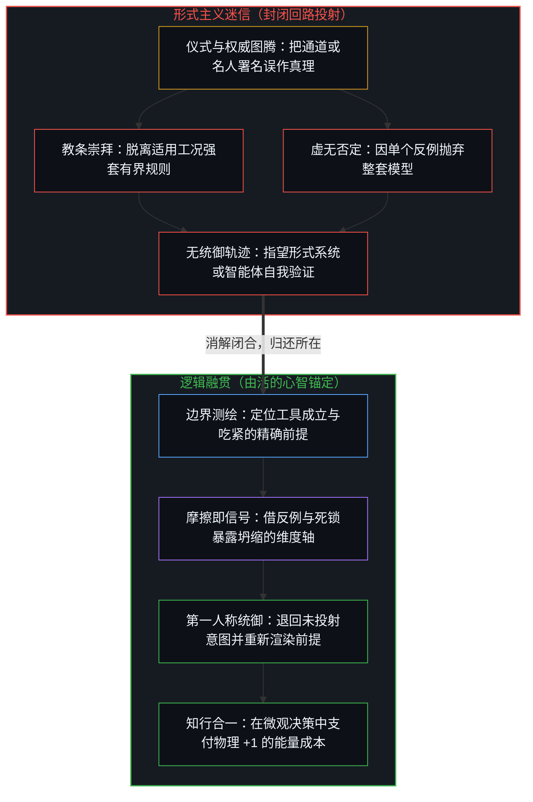
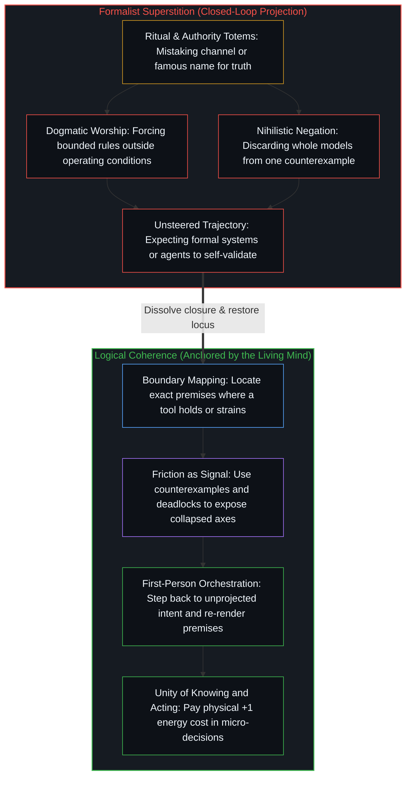

# 从形式迷思到逻辑闭环 / From the Myth of Form to the Closed Loop of Logic

*通道与标签背书不了真理，唯有逻辑融贯领航行动 / Channels and labels vouch for no truth when logical coherence steers action*

关于认知成长与自我提升的讨论，常被外在的范式与权威符号裹挟：从“深度阅读必须读纸质书”或“每年必须读完一百本书”的形式教条，到言必称达利欧原则、塔勒布反脆弱、费曼学习法或爱因斯坦名言的社交护甲。照搬外在形式与现成结论看似能免去摩擦、换取确定感，可一旦在复杂的现实处境中面临具体决策，犹豫不决与事后懊悔依然原封不动地重演。

Discussions of cognitive growth and self-improvement routinely get caught in external paradigms and symbols of authority, ranging from the formalist rule that deep reading happens only on paper or at a quota of a hundred books a year, to the reflex of invoking Ray Dalio's principles, Nassim Taleb's antifragility, the Feynman technique, or Albert Einstein's aphorisms as conversational armor. Copying outer forms and ready-made conclusions promises certainty without friction, yet when concrete decisions arrive under real-world complexity, hesitation and post-decision regret return unchanged.

这种内耗源于认知维度的错位：把传输信息的物理通道，或提出某个模型的历史人物，误当成了理解本身的演进。一旦脱离第一人称的因果追溯，学习便坍缩为形式的仪式模仿与对借来权威的依附。

This inner friction comes from a displacement of cognitive dimensions: mistaking the physical channel through which information travels, or the historical figure who articulated a model, for the evolution of understanding itself. Once severed from first-person causal tracing, learning collapses into ritual imitation of form and reliance on borrowed authority.

## 一、 媒介与形式的祛魅 / 1. Disenchanting Medium and Form

在获取知识的过程中，最顽固的混淆之一，是把某种特定的物理媒介抬升为认知标准。常见的论调坚称，唯有纸质书能承载深度思考，数字屏幕只会滋生浅薄；或者只有非虚构的学术专著才算严肃研读，虚构文学与碎片化的交流不过是消遣娱乐。把思想的质量硬绑在载体的物理基底上，是将狭隘的观测习惯误认作了结构定律。

In acquiring knowledge, one of the most persistent confusions is elevating a particular physical medium into a cognitive standard. A common claim insists that only paper books sustain deep thought while digital screens breed superficiality, or that only non-fiction scholarly monographs count as serious study while fiction and fragmentary exchanges remain mere entertainment. Binding the quality of thought to the physical substrate of its carrier mistakes a narrow habit of observation for a structural law.

[数据是局部的，智能是分配的](../data-is-local-intelligence-is-allocated/)与[智能只属于心智](../intelligence-belongs-only-to-the-mind/)在物理层面上追溯了信息的本相：纸张、墨水、发光的像素、声波，乃至大语言模型的上下文窗口，都是传输通道。载体的物理形态并不预存任何理解；计算与领悟只发生在活生生的边缘——当心智做出区分并解码返回信号的那一刻。不同的认知中心会在不同工具间分配带宽：有人借全文检索与超链接跳转编织全局拓扑，有人靠纸质精读追踪局部句法，有人在移动中借音频捕捉意外变量，也有人与 AI 智能体展开高密度的辩证回环。正如[超越投射](../beyond-the-projection/)所确立的，即便先进的大语言模型智能体也只是受限于轨迹的投射引擎，而非第二个心智；正因它不带丝毫自我防卫的执念，将它与人类中心的第一人称感知相连，便能把交互界面转化为暴露盲区的高带宽仪器。哪怕是简短交流中的一句话，只要击中未经审视的预设并迫使底层参数更新，就是高信噪比的有效输入。

[Data Is Local, Intelligence Is Allocated](../data-is-local-intelligence-is-allocated/) and [Intelligence Belongs Only to the Mind](../intelligence-belongs-only-to-the-mind/) trace what information is at the physical level: paper, ink, glowing pixels, sound waves, and the context window of a large language model are transmission channels. The physical form of a carrier holds no prior comprehension; computation and understanding occur only at the living edge when the Mind draws distinctions and decodes the returning signal. Different cognitive centers allocate bandwidth across different instruments: one weaves a global topology through full-text search and hyperlinked jumps, another traces local syntax through close reading on paper, another catches unexpected variables through audio in motion, and another runs high-density dialectical loops with AI agents. As [Beyond the Projection](../beyond-the-projection/) establishes, even an advanced LLM agent is a trajectory-bound projection engine rather than a second mind; yet because it carries zero ego, pairing it with a human center's first-person sensing turns the interface into a high-bandwidth instrument for exposing blind spots. Even a single sentence in a brief exchange becomes a high-signal input the moment it strikes an unexamined assumption and forces a parameter update.

虚构文学同样是严密的因果推演实验室。文学作品里每一个融贯的人物，都会在初始前提的约束下沿着严格的因果轨迹展开。在《阿甘正传》中，世俗指标将阿甘归为智力缺损，可他之所以能完整穿越动荡的历史周期，恰恰因为他在切近当下的微观决策里没有患得患失的博弈算计；顺着直接的因果链把眼前的每一件具体任务执行到底，宏观层面的复利便在不经预谋的设计中涌现出来。追溯文学人物抉择背后的因果闭环，本身就是高阶的推演训练。正如[错置的因果与心智编译器](../cuo-zhi-de-yin-guo-yu-xin-zhi-bian-yi-qi/)所追溯的，决定理解能否推进的，从来不是指尖触碰的是纸张还是玻璃，而是传入的信号能否重新校准心智模型的底层前提。硬性规定某种单一的“最优媒介”，是用外在仪式替代了内部的结构修订，而[格物致知与信息复杂度](../ge-wu-zhi-zhi-yu-xin-xi-fu-za-du-de-ben-zhi/)则将知识的获取锚定在具身的因果介入之中。

Fiction likewise operates as a rigorous laboratory of causal deduction. Every coherent character in literature unfolds along a strict causal trajectory governed by initial premises. In *Forrest Gump*, conventional metrics label Gump intellectually deficient, yet he navigates turbulent historical eras intact because his micro-decisions in the immediate present are unclouded by anxious game-theoretic calculation; by executing each concrete task in front of him along a direct causal chain, macro-level compounding emerges without premeditated design. Tracing the closed causal loop behind a fictional character's choices is itself high-order deductive training. What determines whether understanding advances is never whether the hand touches paper or glass, but whether the incoming signal recalibrates the underlying premises of the mental model, as [Misplaced Causality and the Mind's Compiler](../cuo-zhi-de-yin-guo-yu-xin-zhi-bian-yi-qi/) traces. Prescribing a single optimal medium substitutes outward ritual for internal structural revision, whereas [Investigating Things and the Nature of Information Complexity](../ge-wu-zhi-zhi-yu-xin-xi-fu-za-du-de-ben-zhi/) grounds knowledge acquisition in embodied causal engagement.

## 二、 权威标签的拆解 / 2. Taking Apart Authority Labels

与媒介恋物癖并存的，是对知识创造者的图腾化。在公共讨论中，给观点冠上大师的名字成了标准的修辞盾牌。依赖权威背书以求取验证，暴露出第一人称因果责任的让渡。一方面，拿名人的名字给论点垫底，是用借来的声望修筑防火墙，免去了从前提一步步推导因果链的苦功；另一方面，先行者之所以取得突破，恰恰因为他们跨过了既有的教条，直面现实中未解的摩擦；当后来的追随者将这些结论——乃至某次具体处境下的抵抗行动——抽离其适用工况，在大师的署名背后冻结为普适口号时，正如[审美的自动扶梯与阳台的忧郁](../the-aesthetic-escalator-and-the-melancholy-of-the-balcony/)所拆解的，鲜活的探索行动便萎缩成了不容置疑的图腾。从科学图腾到道德法庭，[投影的阶梯与因果的锚点](../tou-ying-de-jie-ti-yu-yin-guo-de-mao-dian/)追溯了每一个外化的投射如何归还给发起投射的第一人称所在。

Alongside the fetishization of medium sits the totemization of knowledge creators. Across public discourse, attaching a master's name to a claim functions as a standard rhetorical shield. Leaning on authority for validation reveals an abdication of first-person causal responsibility. On one side, propping an argument on a famous name erects a firewall of borrowed prestige, sparing the speaker the work of deriving the causal chain step by step from its premises. On the other side, pioneers made breakthroughs precisely because they stepped past inherited dogma to confront unresolved friction in reality; when later followers strip those conclusions—or a situated act of resistance—of their operating conditions and freeze them behind a master's signature into a universal slogan, as [The Aesthetic Escalator and the Melancholy of the Balcony](../the-aesthetic-escalator-and-the-melancholy-of-the-balcony/) dissects, a living act of inquiry shrinks into an unquestionable totem. From scientific totems to moral tribunals, [The Ladder of Projections and the Anchor of Causality](../tou-ying-de-jie-ti-yu-yin-guo-de-mao-dian/) traces how every externalized projection returns to the first-person locus that projects it.

有效的知识不需要署名。[专家经验作为参考而非替代](../expertise-as-reference-not-replacement/)锁定了权威的准确位置：专家与先行者的结论只作参考坐标，不能替代自己的判断。一条规律之所以成立，是因为它在所陈述的前提之下能一贯地解释因果关系，并在行动反馈中经受住检验，而不是因为说出它的人是谁。物理方程不会因牛顿或爱因斯坦的署名而生效，市场动态也不会因达利欧或巴菲特的背书而弯曲。只要一个道理必须披上名人的外衣才显得有说服力，理解就仍停留在符号崇拜的表层。唯有把底层的因果机制追溯得足够清晰，哪怕抹去所有专名，这套机制依然能直接嵌进决策模型之中，知识才算完成了内化。

Valid knowledge requires no signature. [Expertise as Reference, Not Replacement](../expertise-as-reference-not-replacement/) locates the exact role of authority: the conclusions of experts and pioneers serve as reference coordinates, never as replacements for one's own judgment. A regularity holds because it accounts for causal relations consistently under its stated premises and survives feedback in action, not because of who uttered it. Physical equations do not hold by virtue of Isaac Newton's or Albert Einstein's name, and market dynamics do not bend to Ray Dalio's or Warren Buffett's endorsement. So long as a principle sounds convincing only when draped in a famous name, comprehension remains trapped at the surface of symbol worship. Knowledge is internalized only when its underlying causal mechanism is traced so clearly that every proper name can be erased and the mechanism still integrates directly into the decision model.

## 三、 理论是工具，不造神也不毁神 / 3. Theory as Tool, Neither Deified Nor Destroyed

任何经典文本或宏大理论，都是作者在特定观测约束与初始前提下抽象出的有限低维投射。面对既有的理论，寻求外部闭合的中心容易在两个镜像极端之间摇摆：一端是教条崇拜，把有界的模型奉为普适真理，脱离适用工况生搬硬套，直到在现实中碰壁；另一端是虚无否定，一旦出现单个反例便将整座理论大厦弃如敝履，甚至把反例本身竖立为新的终极教条。

Every classic text or grand theory is a finite low-dimensional projection abstracted by its author under specific observational constraints and initial premises. Confronted with an established theory, a center that seeks external closure oscillates between two mirror extremes: dogmatic worship, which treats a bounded model as universal truth and applies it mechanically outside its operating conditions until reality pushes back; and nihilistic negation, which discards an entire theoretical edifice the moment a single counterexample appears, erecting the counterexample itself as a new absolute.

大卫·多伊奇在《无穷的开始》中展开的科学哲学消解了这组二元对立。正如[关于归因](../guan-yu-gui-yin/)所追溯的，卡尔·波普尔的可证伪性判准在通俗争论中常被误用为钝器，试图靠单一反常就宣判整套理论的死刑。反例的生成性作用并非制造虚无，而是暴露出现有模型的前提在现实摩擦下吃紧的精确坐标，迫使心智退后一步，综合出边界更清晰、解释力更深的新模型。[持续生长的脚手架](../the-scaffolding-that-keeps-growing/)与[没有系统能被保持封闭](../no-system-can-be-kept-closed/)确立了一切形式系统的工具属性：理论是受明确条件约束的专用工具。拆解一套理论，是为了测绘其前提成立与失效的精确边界。在边界之内，可以满怀信心地调用工具；当边界之外浮现摩擦时，失效本身便成为引导心智迈向高阶综合的信号。正如[超越投射](../beyond-the-projection/)在控制论系统中所展示的，指望任何形式规则集或受限于轨迹的智能体在封闭回路内自我验证，是形式主义迷信；唯有当活的心智利用投射边界处的死锁与摩擦，退回未投射的意图并重新渲染前提时，逻辑融贯才能得以维持。

The philosophy of science that David Deutsch develops in *The Beginning of Infinity* dissolves this binary. As traced in [On Attribution](../guan-yu-gui-yin/), Karl Popper's criterion of falsifiability is routinely misapplied in popular debates as a blunt instrument to pronounce a whole theory dead from a single anomaly. The generative role of a counterexample is not to manufacture a void, but to expose the exact coordinate where an existing model's premises strain against reality, compelling the Mind to step back and synthesize a new model with clearer boundaries and deeper explanatory reach. [The Scaffolding That Keeps Growing](../the-scaffolding-that-keeps-growing/) and [No System Can Be Kept Closed](../no-system-can-be-kept-closed/) establish the instrumental nature of every formal system: theories are specialized tools bound by explicit conditions. Dissecting a theory maps the exact boundary where its premises hold and where they break down. Within that boundary, the tool can be deployed with full confidence; when friction appears beyond that boundary, the breakdown itself becomes the signal that guides the Mind toward a higher-order synthesis. As [Beyond the Projection](../beyond-the-projection/) demonstrates in cybernetic systems, expecting any formal rule-set or trajectory-bound agent to self-validate inside a closed loop is formalist superstition; logical coherence is maintained only when the living Mind uses deadlock and friction at the boundary of a projection to step back into unprojected intent and re-render the premises.

## 四、 逻辑与第一人称作为必要基石 / 4. Logic and the First Person as Necessary Foundations

既然每一套理论都是从局部截面切出的有限工具，就没有任何终极的、包罗万象的理论框架能将场域封死。[因果贯穿始终](../causality-all-the-way/)与[稳定与溢出](../stability-and-excess/)追溯了其中的原委：因果级联在时空中无止境地延展，没有任何观察者能跳出实在去占据无源之见，而一切模型——无论内部显得多么完备——都只是在当前区分视界处画下的暂行切分。“无穷的开始”不是宇宙学上的时间戳，而是心智登记到当前图像的极限、并在旧边界之外发起新区分的切近瞬间。正如[双生子佯谬与隐秘观察者](../the-twin-paradox-and-the-hidden-observer/)在相对论力学中所揭示的，哪怕最具权威的物理形式体系，同样隐藏着框定其坐标系的观察者。

Since every theory is a finite instrument cut from a local cross-section, no final, all-encompassing theoretical framework can ever close the field. [Causality All the Way](../causality-all-the-way/) and [Stability and Excess](../stability-and-excess/) trace why: the causal cascade extends without end across space and time, no observer can step outside reality to occupy a view from nowhere, and every model—no matter how internally complete it appears—remains a provisional cut drawn at the current horizon of distinction. "The beginning of infinity" is not a cosmological timestamp, but the immediate moment a Mind registers the limit of its current image and initiates a new distinction beyond the old boundary. Even the most authoritative physical formalism conceals the observer that frames its coordinates, as [The Twin Paradox and the Hidden Observer](../the-twin-paradox-and-the-hidden-observer/) reveals within relativistic mechanics.

虽然没有静态教条能普适成立，但每一个融贯的模型与决策，都建立在同一个不可化约的先在之上——这一先在展开为不可分割的一体两面。第一面是第一人称视角：每一次观测、推断与决策，都由场域之内有界的所在发起，并由其承受返回的后果，不存在无主体的无源之见。第二面是因果与逻辑的不可化约：无论因果还是逻辑，都无法从外部靠经验去证实或证伪，因为一切证实或反驳的行动本身早已在借由它们运转。逻辑不是某门学科任意约定的成规，而是心智之中诸区分得以融贯而不自我抵消的自指语法。把低维的符号投射误作高维的活向量，正是[向量与投影的迷局](../the-vector-and-the-puzzle-of-projections/)所拆解的倒置。

While no static dogma holds universally, every coherent model and decision rests on the two inseparable sides of one irreducible prior. The first is the first-person perspective: every observation, inference, and decision is initiated by a bounded locus within the field that bears the returning consequences, leaving no room for a subjectless view from nowhere. The second is the irreducibility of causality and logic: neither causality nor logic can be empirically proved or refuted from the outside, because every act of proof or refutation already operates through them. Logic is not an arbitrary disciplinary convention; it is the self-referential grammar through which distinctions cohere without self-cancellation in the Mind. Mistaking a low-dimensional symbolic projection for the high-dimensional living vector is the exact inversion dissected in [The Vector and the Puzzle of Projections](../the-vector-and-the-puzzle-of-projections/).

## 五、 微观决策与复利演进的路径 / 5. Micro Decisions and the Path of Compounding

当外在形式与借来权威的迷信在第一人称逻辑融贯中消解，现实中的践行路径便直接显现出来。第一步是放下对封闭总体规划的执念，转向微观决策的复利演进。追求一劳永逸的人生蓝图预设了封闭的状态空间，然而任何局部视界都只持有有限的信息，使得所谓有保障的远期最优在逻辑上无法自洽。[自由的测不准](../zi-you-de-ce-bu-zhun/)表明，宏观层面的突破并非在远处预先算定，而是从演进边缘处一次次离散的二元抉择复利中涌现出来的。不逃避地登记反馈，在每一个当下的切面上校准决策质量，一贯的方向偏置便会在时间推移中复利累积为幂律结果。

Once the superstition of outer form and borrowed authority dissolves into first-person logical coherence, the path of practice in concrete reality becomes direct. First comes relinquishing the search for a closed master plan in favor of compounding micro-decisions. Seeking a once-for-all blueprint for life assumes a closed state space, whereas any local horizon holds only finite information, making guaranteed long-range optimality incoherent. [The Uncertainty of Freedom](../zi-you-de-ce-bu-zhun/) shows that macro-level breakthroughs are not pre-computed from afar; they emerge from the compounding of discrete binary choices at the moving edge. Registering feedback without evasion and calibrating decision quality at each present cut allows a consistent directional bias to compound into power-law outcomes over time.

第二步是消解学习过程中反复出现的两个陷阱，让内部操作模型保持持续更新。第一个陷阱是把华丽的术语与阅读配额囤积成从不触碰现实摩擦的静态仓库；正如[你的代码库即是记忆](../your-codebase-is-memory/)在文本、模型与智能体脚手架中所追溯的，每一件记录下来的制品都只是早先区分留下的残余，囤积未经修剪的历史只会加厚陈旧框架的引力井，而下一步取决于在当下重切当前的检查点。第二个陷阱是把阅读当作自我防卫的工具，只挑选强化既有先验的材料，同时本能地筑墙挡开证伪信号——这一机制在[自尊的刚性外壳与隐性外部归因](../zi-zun-de-gang-xing-wai-ke-yu-yin-xing-wai-bu-gui-yin/)中已有追溯。学习是从当前框架之外引入意外变量，思考则是将这些变量整合进因果模型并修剪掉已被取代的预设，直至各个维度轴彼此融贯；正如[学习中不可观测的驱动力](../the-unobservable-driver-of-learning/)所证明的，只摄取信息而不更新底层参数，不过是算力的空转。

Second comes dissolving the two recurring traps of study so the internal operating model updates continuously. The first trap is accumulating ornate terminology and reading quotas as a static warehouse that never touches physical friction; as [Your Codebase Is Memory](../your-codebase-is-memory/) traces across texts, models, and agent scaffolds, every recorded artifact is only a residue of prior distinctions, so hoarding unpruned history thickens the gravity well of stale framings whereas the next step turns on re-cutting the present checkpoint. The second trap is using reading as ego-defense, selecting only materials that reinforce existing priors while reflexively walling off disconfirming signals—a mechanism traced in [The Rigid Shell of Self-Esteem and Hidden External Attribution](../zi-zun-de-gang-xing-wai-ke-yu-yin-xing-wai-bu-gui-yin/). Learning introduces unexpected variables from beyond the current frame, while thinking integrates those variables into the causal model and prunes superseded assumptions until the axes cohere; as [The Unobservable Driver of Learning](../the-unobservable-driver-of-learning/) demonstrates, consuming information without updating underlying parameters is merely idling computation.

最后，知行合一是因果链条理顺之后的自然输出。行动上的犹豫、拖延与摇摆，无需用“意志力薄弱”之类的道德化诊断来解释。[个体抉择是唯一的因果杠杆](../individual-choices-as-the-only-causal-levers/)追溯了行动的真实机制：在做出离散抉择的那一刻，中心总是严格按照自己在底层真正持有的因果前提去行动。声称“知道”却没有行动，证明那条原则只被保留为口头点缀，而底层的因果权重分毫未动。[破除概念的僭越](../po-chu-gai-nian-de-jian-yue/)揭示了符号重言式与物理介入之间的落差：在纸面上，`1 + 1 = 2` 是对称、零成本的恒等式；而在物理因果中，执行 `+1` 则需要不可逆的能量消耗、具身入局的行动，以及对现实摩擦的承受。当因果痕迹在第一人称内部毫无矛盾地闭环时，行动不需要勉强的自我强迫——它就是系统在当前步的直接输出。

Finally, the unity of knowing and acting emerges as the natural output of a resolved causal chain. Hesitation, procrastination, and oscillation require no moralizing diagnosis of "weak willpower." [Individual Choices as the Only Causal Levers](../individual-choices-as-the-only-causal-levers/) traces the actual mechanics of action: at the moment of a discrete choice, a center acts strictly in accordance with the causal premise it actually holds at the root. Claiming to know while failing to act proves that the principle was retained only as verbal decoration while the underlying causal weight remained unmoved. [Breaking the Overreach of Concepts](../po-chu-gai-nian-de-jian-yue/) exposes the gap between symbolic tautology and physical intervention: on paper, `1 + 1 = 2` is a symmetric, zero-cost identity, whereas in physical causality, executing `+1` demands irreversible energy expenditure, bodily entry into the field, and absorption of real-world friction. When the causal trace closes without contradiction in the first person, action requires no strained self-coercion—it is the immediate output of the system at the present step.

剥去媒介的戏剧化包装与权威借来的光环，留在演进边缘的唯有逻辑融贯：在每一个具体的当下做出抉择，认领返回的反馈，并将心智模型朝更窄的滞后重新渲染。随着认知容量在持续的微观校准中延展，笃定与主权便在因果之中自然生发——反之，对权威的批判若停留在单纯的谴责上，便会直接跌回[止步于评判，是认知的歧途](../zhi-bu-yu-ping-pan-shi-ren-zhi-de-qi-tu/)所追溯的外化回路。

Stripping away the theatrical wrappings of medium and the borrowed halos of authority leaves logical coherence at the living edge: choosing at each concrete present, claiming the returning feedback, and re-rendering the mental model toward narrower lag. As cognitive capacity expands through continuous micro-corrections, composure and agency arise within causality itself—whereas critique of authority that halts at mere condemnation falls straight back into the externalized loop traced in [Stopping at Judgment Is a Wrong Turn of Cognition](../zhi-bu-yu-ping-pan-shi-ren-zhi-de-qi-tu/).
