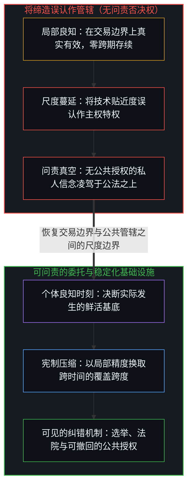
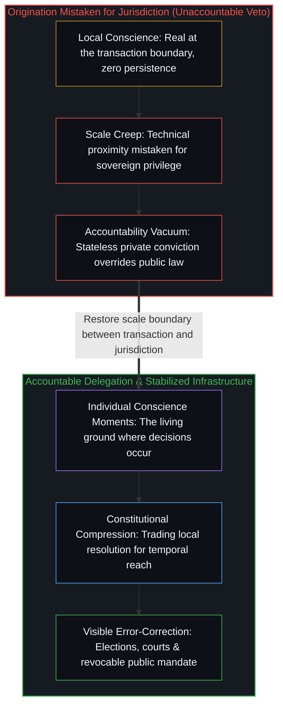

# 良知、委托与管辖权错位 / Conscience, Delegation, and the Jurisdiction Error

*良知在当刻真实而局部，制度则借可问责的委托以精度换取存续。 / Conscience is local at the point of exercise; institutions trade resolution for persistence via delegation.*

权力在每一个尺度上运作，但它的结构会随着它在空间与时间中的稳定方式而发生改变。良知是局部信号——在行使的那一刻无比真实，但在越过当下之后，并不具备任何跨时间的存续保障。制度则是延展这一信号的基础设施，用局部精度换取覆盖广度。混淆这两个尺度——把局部的良知当成常设的制度管辖权，或者把制度权力当成无条件的终极权威——催生了围绕技术、主权与伦理反复上演的政治剧场。

Power operates at every scale, yet its structure changes with how it stabilizes across space and time. Conscience is local signal—maximally real at the point of exercise, with zero guaranteed persistence past the moment. Institutions are infrastructure that extends this signal by trading resolution for reach. Confusing these two scales—treating local conscience as standing institutional jurisdiction, or treating institutional power as an unconditioned absolute—generates the recurring political theater around technology, sovereignty, and ethics.

## 一、 边界 / 1. The Boundary

卖方握有一项真实的边界权力：拒绝权。拒绝出售、终止服务，或是谢绝签约。这项权力在行使的当刻真实、直接且有效，但它同样有着严格的边界：它在交易达成的那一刻便告终结。

A seller holds one genuine boundary power: the power to refuse. Refuse the sale, terminate the service, or decline the contract. This power is real, immediate, and operative at the point of exercise, yet it is also strictly bounded: it ends at the moment of transaction.

它从不构成一种持续的管辖权。一旦所有权发生转移、一旦器物完成交付，或是一旦主权买方依据自身的公共权限接收了交付物，卖方支配下游用途的权力便随之消散。买方决定如何使用；卖方只能决定买方是否继续作为自己的客户。

What it never constitutes is a continuing jurisdiction. Once title transfers, once the artifact ships, or once a sovereign buyer takes delivery under its own public authorities, the seller's power to dictate downstream use evaporates. The buyer determines use; the seller determines only whether the buyer remains a customer.

这道边界是结构性的，而非单纯法律意义上的。商业交易以一物交换另一物，并终结了卖方对器物未来去向的管辖权。SpaceX 可以因违反服务条款而停用一台终端，但它无权管辖主权用户在合同有效期内如何使用这台处于激活状态的终端。前者是在交易边缘行使边界权力；后者则是在主张一项从未被授予的常设管辖权。

This boundary is structural rather than merely legal. A commercial transaction exchanges one thing for another and terminates the seller's jurisdiction over the object's future. SpaceX can deactivate a terminal for violating terms of service, yet it cannot govern what a sovereign user does while the terminal is active under contract. One exercises boundary power at the transaction edge; the other claims standing jurisdictional power that was never granted.

## 二、 升级与越界 / 2. The Escalation

不妨追踪这一升级过程是如何在建造者的认知框架内部展开的。一家公司打造出了一项强大的能力，建造者对于这项能力应当如何被使用、不应当如何被使用抱有强烈的信念。在局部尺度上，这是良知在其恰当的分辨率上运作——即个体的区分行动。

Trace how the escalation unfolds inside a builder's frame. A company builds a powerful capability, and the builders hold strong convictions about how it should and should not be used. At the local scale, this is conscience operating at its proper resolution—the individual act of distinction.

随后，一场四步投射坍缩在内部毫无断裂感的情况下悄然发生。第一步，在行使判断的当刻，建造者确认*我正在做正确的事*——这是一个真实、局部且有效的判断。第二步，对工具的贴近被误认为认识论上的特权——*我才是看清这里局势的人*——将局部的技术分辨率同对工具用途的延展管辖权混为一谈。第三步，管辖该工具的民主、法律与宪制机制只因并非源自建造者自身的框架，便被判定为力有未逮而遭屏弃。第四步，外部异议不再被视作另一种相互竞争的投射，而是被感知为生存威胁，由此完成了坍缩：局部的良知开始以主权权威的姿态运作。

Then a four-step projection collapse unfolds without any internal discontinuity. First, at the point of exercise, the builder registers *I am doing the right thing*—a real, local, operative judgment. Second, proximity to the tool is mistaken for epistemic privilege—*I am the one who sees clearly here*—confusing local technical resolution with extended jurisdiction over the tool's use. Third, democratic, legal, and constitutional mechanisms for governing the tool are dismissed as inadequate because they did not originate inside the builder's frame. Fourth, external dissent stops registering as a competing projection and registers instead as existential threat, completing the collapse where local conscience operates as if it were sovereign authority.

从内部来看，每一步都难以察觉，因为内在体验是连续不断的。那个最初说着“我不会为了那种用途出售它”的创造者，最终走向了“我必须通过合同阻止一个宪制军事机构依据其本国公法使用它”。权力的范畴已经从边界权力滑向了主权管辖权，却在内部没有触发任何警觉。

Each step is invisible from the inside because the internal experience feels continuous. The creator who began with "I will not sell this for that purpose" ends at "I must contractually prevent a constitutional military apparatus from using this under its own public laws." The category has shifted from boundary power to sovereign jurisdiction without producing any felt internal alarm.

## 三、 将缔造误认作管辖 / 3. Origination as Jurisdiction

宪制国家所主张的强制力，是由被治理者通过公共机制向上委托的权力。这种权力并不完美且可被撤回，配有显式的纠错结构：选举、法院、立法监督、吹哨人以及公共舆论压力。它的失效模式在系统内部是可见且可处理的。

A constitutional state claims coercive power delegated upward from the governed through public mechanisms. That power is imperfect and revocable, equipped with explicit error-correction structures: elections, courts, legislative oversight, whistleblowers, and public pressure. Its failure modes are visible and addressable within the system.

而要求对自身造物的用途保持持续控制的创造者，所主张的则是结构上截然不同的东西：常设的缔造者特权——*这是我造出来的，因此我无限期地拥有它的用途*。缔造被误认作了管辖，把过去打造出一件器物的行动，当成了对该器物此后进入的每一个语境的永久权威。

The creator who demands ongoing control over their creation's use claims something structurally different: the standing right of origination—*I built this, therefore I own its purpose indefinitely*. Origination is mistaken for jurisdiction, treating the past act of having built an artifact as a permanent authority over every context it enters.

管辖权需要问责结构，而缔造行为本身并不具备任何问责结构。一名高管的良知不需要向任何选民、任何宪法或任何司法审查负责——它随着个人信念的转换而随时更新。这并非高管个人的道德缺陷，而是良知本身的结构分辨率使然：良知在个体边缘运作，缺乏公共管辖权所依赖的存续机制。

Jurisdiction requires accountability structures; origination has none. An executive's conscience answers to no electorate, no constitution, and no judicial review—it updates at whatever frequency personal convictions shift. That is not a personal moral failing of the executive; it is the structural resolution of conscience itself, which operates at the individual edge and lacks the persistence mechanisms that public jurisdiction requires.

## 四、 委托与失效模式 / 4. Delegation and Failure Modes

一切延展性权力都依赖于其委托关系的稳定性，因此关键问题在于它的失效模式呈现为何种形态。民主委托的失效缓慢且可见：宪法的修改过程漫长，选举按固定周期运行，法院审慎推进，制度侵蚀在引发结构性崩塌之前会先显现出可被觉察的裂痕。

All extended power depends on the stability of its delegation, so the operative question is what its failure mode looks like. Democratic delegation fails slowly and visibly: constitutions are slow to amend, elections run on fixed cycles, courts move deliberately, and institutional erosion produces detectable cracks before structural collapse.

基于良知的权威则会在瞬间失效，且不留任何结构性痕迹：一次董事会的转向、一阵情绪的起伏，或是一场突如其来的危机，都可以在一夜之间扭转信念，既没有正式的撤回程序，也没有任何超越当前状态的制度记忆留存。当一家私营供应商要求对合法的公共应用拥有合同否决权时，它实际上是在要求一条稳定化的宪制指挥链屈从于一种游离于公共体制之外的私人信念。

Conscience-based authority fails instantaneously and without structural trace: a single boardroom pivot, a shift in mood, or a new crisis can invert the conviction overnight with no formal revocation procedure and no institutional memory persisting past the current state. When a private vendor demands contractual veto power over lawful public applications, it asks a stabilized constitutional chain of command to subordinate itself to a stateless private conviction.

## 五、 隐性委托的困境 / 5. The Implicit Delegation Problem

公共机构的权威源自被治理者可以审计并撤回的显式委托。私营公司的信念则不源自任何外部授权；公司只代表自己发声，这意味着它只能在交易边界上合法地约束自己。

Public institutions derive authority from explicit delegation that can be audited and revoked by the governed. A private company's convictions derive authority from no external mandate; the company speaks for itself, which means it can legitimately bind only itself at the transaction boundary.

要求未经委托的私人信念去约束经由显式委托产生的公共权威，并不会为系统增加一道安全保障，反而会在主权决策链条中插入一个问责真空。针对受托权力潜在滥用的补救，必须通过委托架构自身来实现——即通过立法、民主监督与更有力的公共问责——而不是诉诸一个无需对任何选民负责的平行私人否决权。

Demanding that undelegated private conviction constrain explicitly delegated public authority does not add a safeguard to the system; it inserts an accountability vacuum into the sovereign decision chain. The remedy for potential abuse of delegated power must come through the delegation architecture itself—legislation, democratic oversight, and stronger public accountability—rather than through a parallel private veto that answers to no electorate.

## 六、 作为基底的良知 / 6. Conscience as Ground

这一切丝毫不会贬低良知。良知是基底层面上的区分行动——是在鲜活边缘上决断真正发生的唯一落点。每一座制度与宪制结构，都是将个体的良知时刻跨越时空稳定下来而筑成的：正如[你的代码库即是记忆](../your-codebase-is-memory/)所展示的那样，外化的代码库以牺牲即时语境分辨率为代价，将在驾驭边缘作出的鲜活架构切分压缩为跨会话存续的持久痕迹；宪制法律同样是个体信念的一种有损外化记忆，以牺牲个体分辨率为代价换取跨时间的存续。

None of this diminishes conscience. Conscience is the ground-level act of distinction—the only locus where a decision occurs at the living edge. Every institution and constitutional structure is built from individual conscience-moments stabilized across space and time: just as an externalized repository in [Your Codebase Is Memory](../your-codebase-is-memory/) compresses live architectural cuts at the steering edge into durable traces that persist across sessions at the cost of immediate context resolution, constitutional law is a lossy externalized memory of individual convictions that buys temporal persistence at the cost of individual resolution.

拒绝签约的高管在拒绝的那一刻行使着真实的权力，取消订阅的公民也在取消的那一刻行使着真实的权力。范畴错误只在跨时间投射发生时才乘虚而入——即把边界权力的瞬间行使，当成了个体良知无力支撑的常设管辖权。良知是鲜活的信号；制度则是承载这一信号的稳定化基础设施。

The executive refusing a contract exercises real power at the moment of refusal, and the citizen canceling a subscription exercises real power at the moment of cancellation. The category error enters only with the temporal projection—treating a momentary exercise of boundary power as a standing jurisdiction that individual conscience cannot support. Conscience is the living signal; institutions are the stabilized infrastructure that carries it.

## 七、 选边站的陷阱 / 7. The Side-Picking Trap

对于旁观私营实验室与国家之间冲突的观察者而言，最大的诱惑莫过于选边站——要么与标榜原则的公司结盟，要么与主权机器站在一起，从而在无需行使独立能动性的情况下，享受借用他人力量所带来的共鸣。

For observers watching a conflict between a private lab and the state, the temptation is to pick a side—aligning with the principled company or with the sovereign apparatus to enjoy the resonance of borrowed strength without exercising independent agency.

然而，选边站是一种自我缴械式的委托。一旦投身某个阵营，相悖的证据就会被当成敌意攻击而非有效信号，进而瘫痪掉区分能力——而评估该项委托是否依然正当，恰恰离不开这种能力。在第一人称边缘践行真正的良知，要求拒绝部落式的站队并追踪运作机制：追问交易的边界止于何处、可问责的委托始于何处，以及哪一种安排能够为未来的纠错留出空间。

Yet side-picking is a self-disabling delegation. Once committed to a camp, contradictory evidence registers as hostile attack rather than signal, disabling the exact faculty of distinction needed to evaluate whether the delegation remains warranted. Exercising conscience at the first-person edge requires declining tribal alignment and tracing the mechanism: asking where the boundary of transaction ends, where accountable delegation begins, and which arrangement preserves the space for future correction.

## 八、 结构全貌 / 8. The Structure

权力始于局部边缘的良知；将它延展到空间与时间之中，则需要稳定化、基础设施与委托机制，而这三者各自都会引入截然不同的失效模式。要求对已交付的造物保持持续管辖权的创造者，错把良知的局部直接性当成了治理的可问责存续性；而在一旁做部落式选边站的看客，则在缩微尺度上犯下了同一种错误。试图把良知卸载给自动化护栏的做法，同样会撞上[总在倾听者无法发起](../what-always-listens-cannot-originate/)所指出的那堵结构之墙：一个仅仅对既有存储模式作出响应的系统，无法发起一项真正担责的判断。

Power begins as conscience at the local edge; extending it across space and time requires stabilization, infrastructure, and delegation, each introducing distinct failure modes. The creator who demands ongoing jurisdiction over a shipped creation mistakes the local immediacy of conscience for the accountable persistence of governance, and the spectator who picks a tribal side makes the same error in miniature. Trying to offload conscience into an automated guardrail hits the same structural wall [What Always Listens Cannot Originate](../what-always-listens-cannot-originate/) names: a system that only responds to stored patterns cannot originate a responsible judgment.
