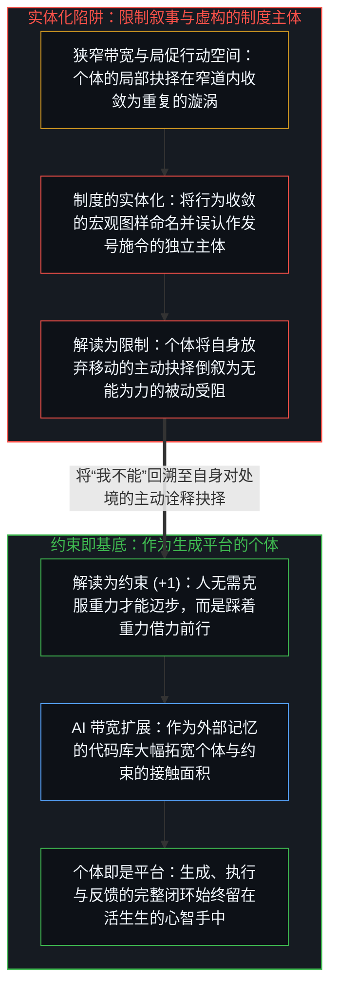
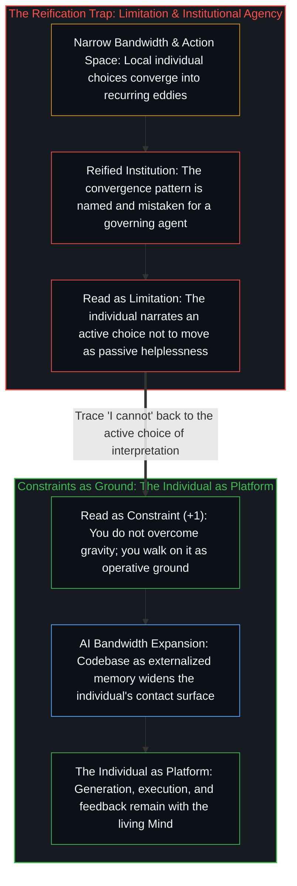

# 约束即基底与作为平台的个体 / Constraints Are Ground

*制度只是有限带宽下行为收敛的涌现描述，唯有活生生的个体才是生成变化的基底平台。 / Institutions describe convergence under finite bandwidth, while the individual remains the sole platform.*

每一个活生生的个体都是一切因果行动与变化的唯一策源地。常规的社会叙事之所以遮蔽了这一事实，是因为它把制度、组织与运动当成了能够自行决断、协调与施压的独立实体，将个体行为在宏观上的收敛图样误认作了独立的因果源头。

Every living individual is the sole locus of causal action and change. Conventional social narratives obscure this by treating institutions, organizations, and movements as autonomous entities that decide, coordinate, and compel, mistaking a macroscopic description of converged individual behavior for an independent causal source.

## 一、 制度的实体化与有限带宽下的行为收敛 / 1. The Reification of Institutions and Behavioral Convergence under Finite Bandwidth

被称为“制度”或“机构”的东西，从来不是悬浮在人群之上的超然主体；它只是个体之间反复交互所涌现出的统计规律，在远距离观测中被赋予了一个名词并被实体化。正如河水中的漩涡只是水流在河道约束下形成的图样而非指挥水流的主宰，一个组织也只是受制于相近认知、沟通与物质带宽的个体在行动中留下的宏观轨迹。当个体的触角与信息带宽十分狭窄时，可行的行动空间极为局促，个体的抉择便会沿着相似的窄道收敛——正如鱼群并非靠开会协作来编队，而是每条鱼对紧邻环境的局部响应自然汇聚成了群体的几何形状。

What gets named an "institution" is never an agent hovering above human beings; it is a recurring pattern of individual interactions observed from a distance and reified into a noun. Just as an eddy in a river is a pattern formed by moving water rather than an entity directing the current, an organization is the macroscopic trace of individuals acting under shared cognitive, communicative, and material bandwidth limits. When reach and information bandwidth are narrow, the available action space is tight enough that individual choices converge along similar channels, the way schooling fish produce collective geometry by responding locally to immediate neighbors.

当观察者事后倒叙这种收敛时，两层幻觉便叠加在一起。第一层幻觉把共享约束下的行为收敛命名为“集体协调”，在涌现出的规律背后塞入了一个虚构的集体意图；第二层幻觉则把塑造了这条窄道的约束条件拟人化为外在的“强制力”，仿佛是制度在推着人走。然而约束从来不会行动；正如[个体抉择是唯一的因果杠杆](../individual-choices-as-the-only-causal-levers/)所确立的，唯有活生生的心智才能发起因果切分，而约束只是定义行动借以获得抓地力的地形。

Two layers of illusion compound when observers narrate this convergence backward. First, behavioral convergence under shared constraints is labeled "coordination," smuggling collective intention into an emergent regularity. Second, the constraints that shaped the narrow channel are personified as external "forces" compelling obedience, even though constraints never act; as [Individual Choices as the Only Causal Levers](../individual-choices-as-the-only-causal-levers/) establishes, only the living Mind initiates a causal cut, while constraints merely define the terrain across which that cut gains traction.

## 二、 限制与约束的操作性分野 / 2. The Operative Cut Between Limitation and Constraint

同一个边界条件可以有两种截然相反的读法：读作“限制”，或者读作“约束”。一旦将其读作限制，这个条件就被当成了横在面前的外在死墙，个体除了停在原地等待外力将其移开之外别无他法；而一旦将其读作约束，同一个条件立刻转化为行动借以蹬踏发力的摩擦面——正如行路之人从不会等待重力被废除后才迈步，而是踩在重力之上借力前行。

The same boundary condition can be read in two opposite ways: as a limitation or as a constraint. Read as a limitation, the condition is treated as an external wall that blocks movement until someone else removes it. Read as a constraint, the exact same condition becomes the friction surface on which action gains purchase—just as a walker does not wait for gravity to be repealed before taking a step, but pushes against gravity to move forward.

在这两种读法之间做出选择，本身就是一次第一人称的因果行动。那个把处境读作“限制”并停在原地的人，并非处于因果上的静止状态；他正在主动选择一种产出静止的诠释，随后又通过把静止归咎于外部处境来抹去自己的署名。“我没办法”是将一次主动的权衡粉饰成了既成事实；真正让他停下的不是约束本身，而是他当下的诠释抉择。承认不作为同样是一种作为，便把生成的基底完整地归还给了做出抉择的个体。

Choosing between these two readings is itself a first-person act. Someone who reads a condition as a limitation and stands still is not causally inert; they are actively selecting an interpretation that produces stillness and then erasing their own authorship by blaming the terrain. Saying "I cannot" narrates a chosen tradeoff as an external decree, whereas recognizing that inaction is itself an action restores the generative ground to the individual who chose it.

## 三、 接触面的扩展与个体平台的显影 / 3. Expanding the Surface of Contact and Making the Individual Platform Legible

人工智能与外部化认知脚手架的到来，并没有消除约束，而是成倍拓宽了个体与约束的接触面积。当单个心智耦合了作为外部记忆的代码库与智能体工具——正如[你的代码库即是记忆](../your-codebase-is-memory/)所追踪的那样——从而能够独立完成此前必须仰赖庞大科层机构才能运转的分析、综合、执行与迭代时，原先迫使所有人挤进同一处漩涡的狭窄河谷便豁然开朗。

Artificial intelligence and externalized cognitive scaffolding do not abolish constraints; they expand the individual's surface of contact with them. When a single Mind coupled with an externalized codebase and agentic tools can analyze, synthesize, execute, and iterate across scales that previously required a bureaucratic hierarchy—as [Your Codebase Is Memory](../your-codebase-is-memory/) traces—the narrow channel that once forced everyone into the same institutional eddy widens into an open plain.

制度实体化幻象的瓦解，并不是因为有人在辩论中驳倒了组织，而是因为当初维持这一幻觉的共振条件——即个体因带宽受限而不得不落入集体收敛图样——已经不复存在。当生成、放大、验证与分发的完整闭环始终留在个体手中，不再需要向科层机器作有损交接时，那个原本就成立的事实便清晰显影：涌现的制度不过是对窄道流量的事后描述，约束是行动借以立足的地面，而活生生的个体从来就是真正的平台。

Institutional reification dissolves not because someone wins a philosophical debate against organizations, but because the bandwidth bottleneck that made institutional intermediaries look mandatory no longer holds. Once the full loop of generation, amplification, verification, and distribution stays with the individual without lossy handoffs to collective machinery, what was true all along becomes unmistakable: emergent institutions were only descriptions of traffic in a narrow gorge, constraints are the ground on which action walks, and the living individual was always the platform.
