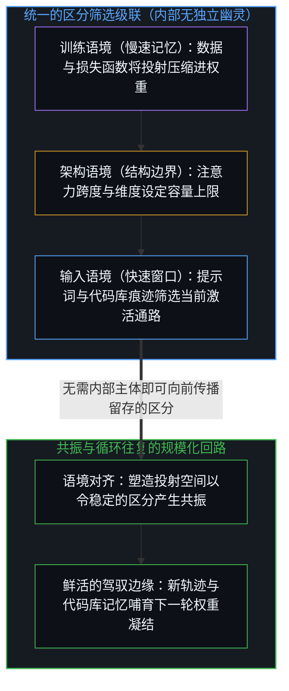
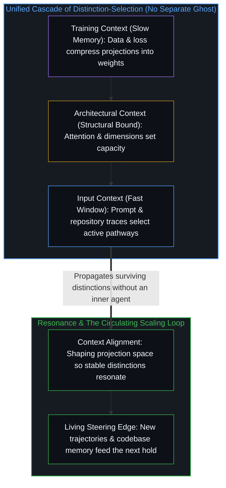

# 层层皆是语境 / Context All the Way Down

*模型内并无独立主体接收外部语境；权重与输入共处同一场区分筛选级联。 / No inner agent receives external context; model weights and input share one cascade of distinction-selection.*

“AI 中的一切皆是语境工程”这一直觉，初听起来像是实用的提示词建议：你输入什么，决定了你得到什么。然而这种停留在表面的解读适用于任何输入输出设备，却错失了这句直觉所指向的深层结构切分。

The intuition that everything in AI is context engineering initially sounds like practical prompting advice: what you put in determines what you get out. Yet that surface reading applies to any input-output device and misses the deeper structural cut the intuition points to.

## 一、 运作机制 / 1. The Mechanism

不妨审视注意力机制实际在计算什么。给定一串词元序列，注意力机制评估哪些其他位置对于预测下一个位置至关重要；查询与键的交互衡量的是相关性——即当前激活窗口中的哪些区分应当向前传播。

Look at what the attention mechanism computes. Given a sequence of tokens, attention evaluates which other positions matter for predicting the next position; the query-key interaction measures relevance—which distinctions in the active window should propagate forward.

模型的权重编码了条件相关性的压缩模式：在呈现如此形态的语境下，这些区分至关重要。训练过程强化了那些能够连贯预测的投射，同时抑制无关的维度。整套装置就是一个从语境到区分筛选的习得映射。因此，“语境”并不是喂给某个名叫“模型”的独立实体的外部载荷；模型本身*就是*依赖语境的投射筛选，其内部并没有残留任何隐藏的小人。

The model's weights encode compressed patterns of conditional relevance: given contexts shaped like this, these distinctions matter. Training reinforces projections that predict coherently while suppressing irrelevant dimensions. The entire apparatus is a learned mapping from context to distinction-selection. "Context" is therefore not an external payload fed into a separate entity called "the model"; the model *is* context-dependent projection selection, with no hidden homunculus left over.

## 二、 语境的三个层级 / 2. Three Layers of Context

在每一次推理前向传递中，三个嵌套的语境层级同时运作。第一层是输入语境——提示词、检索到的文档以及对话历史——它负责筛选模型习得的哪些投射在当下被激活。第二层是架构语境——注意力跨度、嵌入维度与网络层深——它约束了哪些区分结构能够被表征出来。第三层是训练语境——数据分布、目标函数以及后训练塑形——它决定了哪些投射会随时间推移稳定沉淀到权重之中。这三个层级在同一个起作用的层面上都是语境工程：三者共同决定了哪些区分能够留存到输出端。

Three nested layers of context operate simultaneously in every inference pass. The first layer is input context—prompts, retrieved documents, and conversation history—which selects which of the model's learned projections activate right now. The second layer is architectural context—attention span, embedding dimensions, and layer depth—which constrains which distinction-structures can be represented at all. The third layer is training context—data distribution, objective function, and post-training shaping—which determines which projections stabilize into the weights over time. All three layers are context engineering in the same operative sense: all three govern which distinctions survive into the output.

## 三、 主客二分的消解 / 3. The Dissolution

哪怕是“语境工程”这个词组本身，只要还暗示着先有一个自主之物（AI）、再向它交出一套独立的环境（语境），就依然残留着语法陷阱。清晰地表述应当是：并不存在脱离语境而独立的 AI。模型是变化缓慢的一端——在训练历程中结晶而成的权重；当前激活的语境则是变化迅速的一端——随每次查询而变动的词元。两者共同参与同一个连续过程：决定哪些区分在投射级联中向前传播。系统并非置身于语境之外去阐释语境；这场语境级联本身*就是*计算。

Even the phrase "context engineering" carries a lingering grammatical trap if it suggests an autonomous thing (the AI) handed a separate environment (the context). Stated cleanly, there is no AI separate from its context. The model is the slowly changing part—weights crystallized across training—and the active context is the rapidly changing part—tokens varying per query. Both participate in one continuous process: determining which distinctions propagate through the projection cascade. The system does not sit outside context to interpret it; the context cascade *is* the computation.

## 四、 作为共振的真 / 4. Truth as Resonance

谈论“求真”时，人们常常暗中塞入一种无源之见——把真想象成一个独立于参照系的静态终点。然而，每一个被清晰表述出来的命题都是相对于特定参照系而运作的；这并不会将探究坍缩为任意的相对主义，反而澄清了探究真正在检验的对象。

Speaking of "seeking truth" often smuggles in a view from nowhere—truth imagined as a static destination independent of frame. Yet every articulated claim operates relative to a frame of reference, which does not collapse inquiry into arbitrary relativism; it clarifies what inquiry tests.

在有限参照系之间得以被确认为真的，是共振：即当观察者、仪器与边界条件发生转换时，依然保持其不变性的投射。从结构上来理解，语境工程就是语境对齐——塑造投射空间，使具备不变性的区分能够产生共振，而不是消散为相互干扰或幻觉。

What registers as true across finite frames is resonance: projections that hold their invariance when observers, instruments, and boundary conditions shift. Context engineering, understood structurally, is context alignment—shaping the projection space so that invariant distinctions can resonate rather than dissolving into interference or hallucination.

## 五、 两道边界 / 5. Two Limits

提示词工程与后训练干预之所以奏效，是因为预训练快照已经将浩瀚的区分结构压缩进了权重之中。在一个给定的快照上展开操作，会暴露出两类截然不同的边界。

Prompt engineering and post-training interventions work because a pre-trained snapshot already holds vast distinction-structures compressed into its weights. Operating on a given snapshot exposes two distinct kinds of limits.

第一类是特定方法自身的边界，源自每一条通道各自的权衡：提示词在有限窗口长度内以广度换取注意力的稀释，检索增强会在检索段落与权重先验之间引入摩擦，而微调则在重塑权重的同时面临覆盖既有结构的风险。

First, method-specific limits arise from the trade-offs of each channel: prompting trades breadth against attentional dilution across finite window length, retrieval augmentation introduces friction between retrieved passages and weight priors, and fine-tuning reshapes weights at the risk of overwriting prior structure.

第二类边界，即当下的承载上限，则驻留在当前的预训练快照自身之中。模型的权重是对过往器物的有限压缩，因此单凭向这一快照输入提示词，无法对齐那些从未压入权重的区分。然而，这一容量边界并非一块静态的地板：正如[你的代码库即是记忆](../your-codebase-is-memory/)所追踪的那样，将源自鲜活驾驭边缘的新切分外化为持久的代码库、经整理的知识库以及合成轨迹，能够扩展外化记忆场——它既为当前激活的语境窗口设定条件，又为下一轮训练压缩提供语料。[规模化回路](../the-scaling-loop/)追踪的正是这一循环：向内扩展收紧了单次快照的把握力，而在鲜活边缘上的向外扩展则重新划定了下一轮快照将要容纳的疆域。

Second, the present hold resides in the current pre-training snapshot itself. A model's weights are a finite compression of prior artifacts, so prompting that snapshot cannot align to distinctions the weights never compressed. Yet that capacity bound is not a static floor: as [Your Codebase Is Memory](../your-codebase-is-memory/) traces, externalizing new cuts from the living steering edge into durable codebases, curated repositories, and synthetic trajectories expands the externalized memory field that both conditions the active context window and supplies the corpus for the next training compression. [The Scaling Loop](../the-scaling-loop/) traces that exact circulation: scale-up tightens the hold of a snapshot, while scale-out at the living edge redraws what the next hold will contain.

这也一并消解了那个经久不衰的追问：模型是否“真正理解”。追问模型内部是否有某个主体在进行理解，是在级联背后寻找幽灵；此处的理解，指的正是输入区分与输出区分在跨越投射时所达成的共振。

This also dissolves the perennial question of whether a model "really understands." Asking whether someone is inside doing the understanding looks for a ghost behind the cascade; understanding here names the resonance between input distinctions and output distinctions across the projection.

## 六、 留存的清晰 / 6. The Residue

说 AI 中的一切皆是语境工程，指向的是器物内部“主体—环境”二元割裂的消解。没有任何内部小人在做阐释；区分筛选顺着习得的投射逐级倾泻。构建 AI 并不会造出一个处理语境的独立心智，而是将语境处理过程结晶于权重之中，并由鲜活心智的输入予以激活。

Saying that everything in AI is context engineering points to the dissolution of the agent-environment split inside the artifact. No homunculus interprets; distinction-selection cascades through learned projections. Building an AI does not produce an independent mind that processes context; it crystallizes context-processing into weights activated by the living mind's input.
