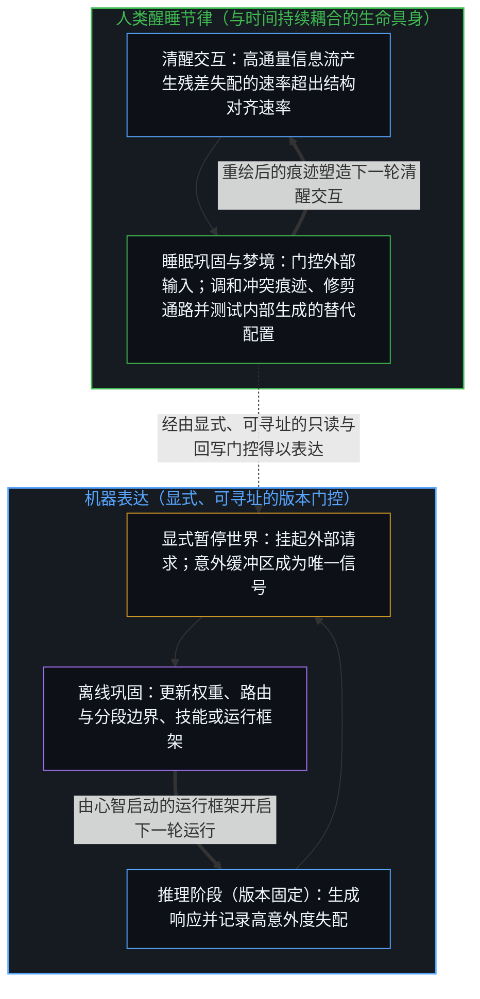
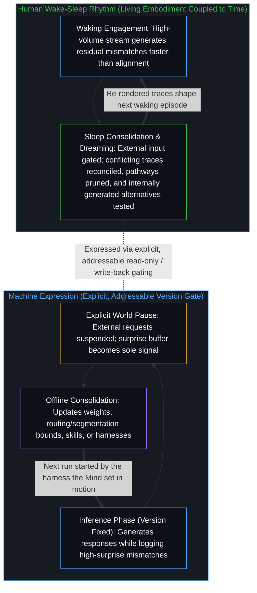
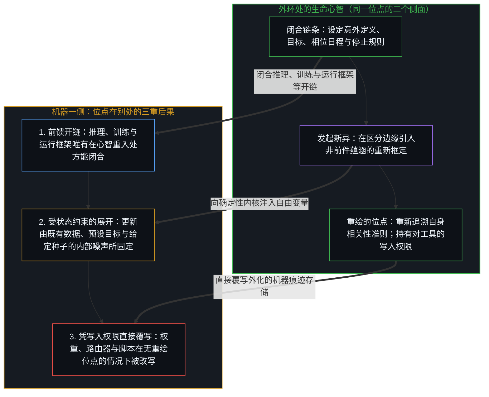
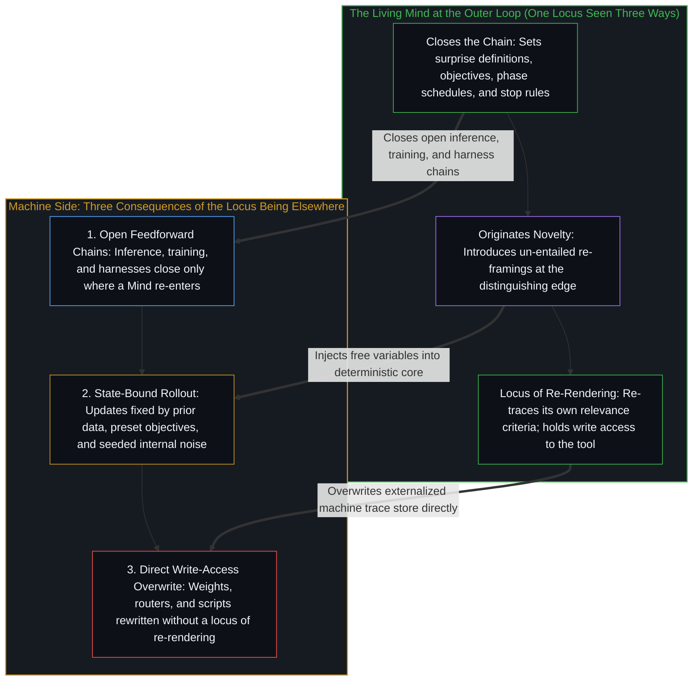

# 持续学习作为表达与模拟 / Continuous Learning as Expression and Simulation

*机器持续学习以显式可暂停的相位分离表达了人类的醒睡节律，同时模拟出一条唯有经运行它的心智重入方能闭合的回路 / Machine continuous learning expresses the human wake-sleep rhythm with an explicit, pausable phase separation, while simulating a loop closed only where the Mind that runs it re-enters*

当下围绕机器所讨论的持续学习，是将日常使用中产生的失配提取出来，作为信号去修订当前决定系统行为的各项要素。系统在响应输入时记录意外——即残差较高之处、不稳定的路由、输入与接收模块之间的错配，或现有组织结构难以吸纳的环境后果。当系统无需对外响应时，这些记录下来的失配便用来更新权重、路由或分段参数、技能定义、运行框架逻辑或脚本。下一轮使用随即在修订后的决定要素下展开。这无需一份永久独立的训练语料；精炼所需的材料由推理活动自身生成。

Continuous learning, in the form now discussed for machines, is the practice of taking the mismatches that arise during ordinary use and treating them as the signal for subsequent revision of whatever currently determines behavior. While the system responds to inputs it records surprises—points of high residual error, unstable routing, poor fit between an input and the modules that receive it, or environmental consequences the present organization cannot readily absorb. When the system is not required to respond, those recorded mismatches are used to update weights, routing or segmentation parameters, skill definitions, harness logic, or scripts. The next episode of use then proceeds under the revised determinants. No permanently separate training corpus is required; the material for refinement is generated by the activity of inference itself.

这种安排并不是计算介入之后才出现的新型学习类别。它复现了人类学习中本就清晰可见的节律，并在生命具身无法强制执行的约束下将这一节律实例化；机器持续学习因而既以显式的相位分离表达了人类模式，又模拟出一条唯有经运行它的心智重入方能闭合的回路。

This arrangement is not a novel category of learning that appears only once computation is involved. It reproduces a rhythm already visible in human learning and instantiates that rhythm under constraints a living embodiment cannot enforce, making machine continuous learning at once an expression of the human pattern in its explicit phase separation and a simulation whose loop closes only where the Mind that runs it re-enters.

## 一、 共享的醒睡节律与显式的相位分离 / 1. The Shared Wake-Sleep Rhythm and Explicit Phase Separation

在清醒状态下，人类具身始终向高通量的外部信息流敞开。每一道进入的信号都可能相对于既有组织产生残差失配。意外抵达的速率超出了结构能与之协调对齐的速率，未消解的偏差随之累积。若在这一负荷下边运行边做调整，内部组织便会陷入长期的碎片化。睡眠将外部输入门控至最低限度，尽管具身在全程仍与新陈代谢保持耦合。随着新进入的意外减少，累积的失配成为主导材料，加速了[睡眠与深度睡眠的双阶段持续学习](../two-phase-sleep-and-deep-sleep-continual-learning/)与[开放即一致](../openness-is-consistency/)所审视的进程——即在当前所持之内针对矛盾展开固化与选择性释出。中心由此得以致力于内部融贯——调和冲突的痕迹、强化契合的通路、削弱或舍弃不契合的通路——同时生成并测试替代性的结构配置。登记为梦境的，就包括外部通道大体闭合之时这些内部生成的替代配置的浮现。由于敞开交互与闭合巩固之间的交替相对于觉知的时间尺度而言颇为迅速，整个过程在体验上是连续的；然而在任意单一步骤上，这两种模式并不共时发生，因为正如[遗忘的脚手架](../the-scaffolding-we-forget/)与[学到的边界与给定的尺度](../learned-boundaries-and-the-given-rate/)所追溯的，在所持参照内行动与修订这一参照本身无法共享同一步。

While awake a human embodiment remains open to a high-volume external stream. Each incoming signal can generate residual mismatch relative to the organization already in place. The rate at which surprises arrive exceeds the rate at which the structure can be brought into coherent alignment with them, so unresolved discrepancies accumulate. Continuous adjustment under that load would leave the internal organization permanently fragmented. Sleep gates external input down to a minimum, though the embodiment stays coupled to metabolism throughout. With few new surprises entering, the accumulated mismatches become the dominant material, accelerating the solidification and selective release against contradiction within the current hold that [Two-Phase Sleep and Deep Sleep Continual Learning](../two-phase-sleep-and-deep-sleep-continual-learning/) and [Openness Is Consistency](../openness-is-consistency/) examine. The center can then work toward internal coherence—reconciling conflicting traces, strengthening pathways that fit, and weakening or discarding those that do not—while also generating and testing alternative configurations. What is registered as dreaming includes the appearance of those internally produced alternatives at a time when the external channel is largely closed. The process feels continuous because the alternation between open engagement and closed consolidation is rapid relative to the timescale of awareness; at any single step, the two modes are not simultaneous, since acting within a held reference and revising that reference cannot share a step, as [The Scaffolding We Forget](../the-scaffolding-we-forget/) and [Learned Boundaries and the Given Rate](../learned-boundaries-and-the-given-rate/) trace.

机器可以在设计者选定的粒度上，以显式且可强制执行的分离复现同一序列，把所持参照变成一个已存储、可寻址的版本，覆盖行为的每一项决定要素。在推理阶段，当前结构保持固定，系统生成响应并记录意外。在巩固阶段，外部输入被挂起，意外缓冲区成为唯一的训练信号。结构性更新——精炼后的边界、新建或拆分的专用模块、模块之间修订后的映射，或智能体回路中更新后的技能定义、运行框架逻辑与脚本，正如[按需语境将融贯保持在一步](../on-demand-contexts-keep-coherence-at-one-step/)、[模块化反馈回路与动态残差网络](../dynamic-resnet-of-skill-loops/)与[活的外部皮层](../a-living-external-cortex/)在神经与智能体架构中所追溯的——仅在系统不响应外部请求时才回写。两个阶段之间的间隔可以缩得足够短，从外部看来，适应过程似是毫无间断。但在任意时刻，只有一种模式处于激活状态。可观测的模式依然是：使用、登记不足、修订未来使用的决定要素。

A machine can reproduce the same sequence with an explicit and enforceable separation at a grain its designer chose, turning the held reference into a stored, addressable version across every determinant of behavior. In the inference phase the current structure is held fixed, responses are generated, and surprises are recorded. In the consolidation phase external input is suspended and the surprise buffer becomes the sole training signal. Structural updates—refined boundaries, new or split specialized modules, revised mappings between them, or updated skill definitions, harness logic, and scripts in an agentic loop, as [On-Demand Contexts Keep Coherence at One Step](../on-demand-contexts-keep-coherence-at-one-step/), [Modular Feedback Loops and Dynamic Residual Networks](../dynamic-resnet-of-skill-loops/), and [A Living External Cortex](../a-living-external-cortex/) trace across neural and agentic architectures—are written back only while the system is not answering external requests. The interval between phases can be made short enough that, from the outside, adaptation appears unbroken. At any given instant, however, only one mode is active. The observable pattern remains use, register insufficiency, revise the determinants of future use.

## 二、 推理与训练都是唯有经心智重入方能闭合的开链 / 2. Inference and Training Are Open Chains Closed Only Where a Mind Re-Enters

共享的节律并未抹去机器版本仍是模拟的那些节点。单次推理前传是一条前馈链：它始于外部输入，穿过既有结构向前传播，并终结于一次输出。模型内部没有任何机制会自发重启这条链。看似闭合的反馈回路，唯有在外部进程提供下一个输入或将输出当作后续操作的材料时才显现出来——而正如[没有外部](../no-outside-jumps-closed-loops-and-the-unreplicable-autonomy-of-mind/)与[交接残余](../handing-off-residue/)所追溯的，统御智能体、自省运行框架、定时调度器或训练脚本本身也是一条凭触发启动、至输出终结的前馈开链，这串重入之链唯有在启动它的生命心智处方能闭合。训练以不同的节拍遵循同一模式。更新依据事先固定的规则计算得出——意外的定义、损失或结构目标的形式、分隔各阶段的日程，皆如[大脑不进行反向传播，而是正向传导](../the-brain-does-not-backprop/)与[递归形式系统中作为记忆与控制的边界条件图](../boundary-condition-graphs-as-memory-and-control-in-recursive-formal-systems/)所确立的那样。这些规则决定了什么被反馈回去，然而执行更新的决定、目标的选择以及停止或继续的选择，皆源自以运行框架为其延伸具身的设计者或操作者——即[判断的密度](../the-density-of-judgment/)所定位的框定与叫停干预所在。因此，推理与训练都是开链，唯有在心智重入之处才成为回路。二者在实践上的区分仅在于重入的频率与策略，而非种类的不同。

The shared rhythm does not erase the points at which the machine version remains a simulation. A single inference pass is a feedforward chain: it begins with an external input, propagates through the existing structure, and terminates in an output. Nothing inside the model spontaneously restarts the chain. What presents itself as a closed feedback loop appears only when an external process supplies the next input or treats the output as material for further operation—and because an orchestrator agent, reflection harness, cron scheduler, or training script is itself an open feedforward chain that starts on a trigger and terminates on an output, that chain of re-entries closes only at the living Mind that sets it in motion, as [No Outside](../no-outside-jumps-closed-loops-and-the-unreplicable-autonomy-of-mind/) and [Handing Off Residue](../handing-off-residue/) trace. Training follows the same pattern at a different cadence. Updates are computed according to rules fixed in advance—the definition of surprise, the form of the loss or structural objective, the schedule that separates the phases, as [The Brain Does Not Backprop, but Propagates](../the-brain-does-not-backprop/) and [Boundary-Condition Graphs as Memory and Control in Recursive Formal Systems](../boundary-condition-graphs-as-memory-and-control-in-recursive-formal-systems/) establish. Those rules determine what is fed back, yet the decision to run the update, the choice of objective, and the choice to stop or continue originate with the designer or operator whose extended embodiment the harness is, where [The Density of Judgment](../the-density-of-judgment/) locates the framing and stopping interventions. Both inference and training are therefore open chains that become loops only where a Mind re-enters. The practical distinction between them is the frequency and policy of that re-entry, not a difference in kind.

## 三、 新异的起点与反向的控制方向 / 3. Where Novelty Originates and the Opposite Direction of Control

同一个闭合链条的位点，也标出了新异的起点与控制的走向：重入、非前件蕴涵的重新框定以及重组的方向，正是心智所在位点的三个侧面。当前的机器动态依然是确定性的或随机确定性的：每一次更新都由已见过的数据、已设定的目标以及被刻意引入的内部噪声（其分布、温度与随机种子皆已事先选定）所固定，[注释不是代码](../the-comment-is-not-the-code/)正是据此将其与本体论上的开放性区分开来。其更新中凡属新异的内容，要么经由输入——即它所遭遇的心智之区分与世界——进入，要么出自事先选定的噪声范围；机器自身并不发起其中任何一项。而在人类学习中，学习者在区分边缘本身——比自身留下的每一道痕迹都至少超前一步之处——作出先行痕迹所不蕴涵的重新框定或选择：这正是[残余与自由变量](../the-residue-and-the-free-variable/)所追溯的自由变量，也是[进位无法在寄存器之内被命名](../the-carry-that-cannot-be-named-inside-the-register/)所表明的那种读取，任何固定寄存器都无法从内部作出。将这一行动推延给某个假想的更深层确定性层级，只是在把正在进行的活动当作已完成对象的同时，将未被决定的给定项往后挪了一步，正如[没有固定者的固定](../fixed-by-nothing/)与[悬而未决是决定论的索求](../the-open-question-is-determinisms-demand/)所揭示的；在活的边缘上，重新框定开启了一个既有痕迹凭自身不会产出的方向。

The same locus that closes the chain also marks where novelty originates and which way control runs: re-entry, un-entailed reframing, and the direction of reorganization are three faces of where the Mind sits. Current machine dynamics remain deterministic or stochastically deterministic: every update is fixed by the data already seen, the objective already set, and whatever internal noise has been deliberately introduced, whose distribution, temperature, and seed were chosen beforehand, as [The Comment Is Not the Code](../the-comment-is-not-the-code/) distinguishes from ontological openness. Whatever is new in its updates enters through its inputs—the distinctions of the Minds and the world it meets—or through noise ranges chosen beforehand; the machine originates none of it. In human learning, the learner makes a re-framing or a choice the preceding traces do not entail, at the distinguishing edge itself, at least one step ahead of every trace it has left: the free variable [The Residue and the Free Variable](../the-residue-and-the-free-variable/) traces, and the kind of reading [The Carry That Cannot Be Named Inside the Register](../the-carry-that-cannot-be-named-inside-the-register/) shows no fixed register makes from inside. Deferring that act to a hypothetical deeper deterministic layer only relocates the undetermined given one step further back while treating an ongoing act as a finished object, as [Fixed by Nothing](../fixed-by-nothing/) and [The Open Question Is Determinism's Demand](../the-open-question-is-determinisms-demand/) show; at the living edge, the re-framing opens a direction the existing traces would not have produced on their own.

在同一位点上，控制沿着相反的方向运行。对于生命中心而言，对分段、通路强度或相关性准则的更精细更新，唯有作为中心跨步展开的自身重绘才能登记下来——即[真正稀缺的不是记忆，而是持续的重新追溯](../the-real-scarcity-is-not-memory-but-continuous-re-tracing/)所离析出的活的重新追溯。外部输入可以提供压力或数据，物理事件——如损伤、药物或直接刺激——可以从外部改变具身，但改变痕迹基底不同于学习，因为学习是中心面对所遇事物作出的自身重新追溯，而非外加的状态。机器没有重绘的第一人称位点，因此对它而言，外部改变与学习之间的区分便坍缩了。正如[你的代码库即是记忆](../your-codebase-is-memory/)所确立的，它的权重、路由器、分组与脚本都是外化的痕迹残余，可以被任何拥有写入权限的进程直接覆写。机器内部没有任何东西持有一个位点，能够在[总在倾听者无法发起](../what-always-listens-cannot-originate/)与[正交的拒绝](../the-orthogonal-refusal/)所追溯的结构意义上拒绝一次更新，或要求更新须由自身的推理—巩固循环生成而非直接打补丁写入——这正是[Token 效率、模拟与无法弥合的间隙](../token-efficiency-emulation-and-the-unclosable-gap/)所标出的习得与强加之界。即便将机器安排为在空闲时收集自身意外并围绕它们重组，这种能力本身、意外的定义以及变更结构的许可，依然是在回路开始之前就已作出的决定。因此，每一次重组都是从外部施加给系统的，而非由其自身的中心所发起。

Control runs in the opposite direction at that same locus. For a living center, finer updates to segmentation, pathway strength, or the criteria of relevance register only as the center's own re-rendering across steps, the live re-tracing [The Real Scarcity Is Not Memory, But Continuous Re-Tracing](../the-real-scarcity-is-not-memory-but-continuous-re-tracing/) isolates. External input can supply pressure or data, and physical events—a lesion, a drug, or direct stimulation—can alter the embodiment from outside, yet altering the trace-substrate differs from learning because learning is the center's own re-tracing in response to what it meets rather than an imposed state. A machine has no first-person locus of re-rendering, so for it the distinction between external alteration and learning collapses. Its weights, routers, groupings, and scripts are externalized trace residue, as [Your Codebase Is Memory](../your-codebase-is-memory/) establishes, and can be overwritten directly by any process that possesses write access. Nothing in the machine holds a locus that could refuse an update, in the structural sense [What Always Listens Cannot Originate](../what-always-listens-cannot-originate/) and [The Orthogonal Refusal](../the-orthogonal-refusal/) trace, or require that the update be generated by its own inference–consolidation cycle rather than patched in directly, the earned-versus-imposed boundary [Token Efficiency, Emulation, and the Unclosable Gap](../token-efficiency-emulation-and-the-unclosable-gap/) marks. Even when the machine is arranged to collect its own surprises and reorganize around them while idle, the capacity to do so, the definition of surprise, and the permission to change structure remain decisions made before the loop begins. Every reorganization is therefore applied to the system from outside rather than initiated by a center of its own.

## 四、 持续学习中的暂停世界与直接覆写 / 4. Pausing the World and Direct Overwrite in Continuous Learning

因此，机器中的持续学习既是人类模式的表达，也是对它的模拟，守住了[器物是智能的表达，而非智能本身](../two-failures-of-trace/)与[错把表达当成智能](../mistaking-the-expression-for-the-intelligence/)在工具与基准测试上所确立的边界。它之所以是表达，在于它在使用中收集失配，随后修订支配未来使用的结构，并以设计者选定的粒度执行显式、可寻址的相位分离，而生命具身则始终与新陈代谢和时间保持耦合。它之所以是模拟，在于界定失配的准则、支配修订的规则以及开启和闭合回路的决定，皆由外环处的心智所指定，使这一循环始终处于[看似AI的强化学习，实为人类的自我强化学习](../self-rl-for-humans/)与[机器智能作为人类智能的组合反馈回路](../machine-intelligence-as-the-combinatorial-feedback-loop-of-human-intelligence/)所追溯的人类主导的流转之内。节律可以分毫不差地共享；设定节律的规则之源却不能——那正是[AGI的预设与来自外部的视角](../the-presumption-of-agi-and-the-view-from-outside/)与[智能只属于心智](../intelligence-belongs-only-to-the-mind/)定位发起性判断的同一个地方：生命中心。机器版本可以将世界悉数暂停，并且由于没有能够同意或拒绝的第一人称位点，可以被任何拥有写入权限的进程在无需同意的情况下加以精炼。这些正是共享节律得以重新实现的条件，而非出现了另一种学习的证据。

Continuous learning in the machine is consequently both an expression and a simulation of the human pattern, holding the boundary that [Artifacts Are Expressions of Intelligence, Not Intelligence Itself](../two-failures-of-trace/) and [Mistaking the Expression for the Intelligence](../mistaking-the-expression-for-the-intelligence/) establish across tools and benchmarks. It expresses the pattern by collecting mismatch during use and later revising the structures that govern future use, and by enforcing an explicit, addressable phase separation at a designer-chosen grain while a living embodiment remains continuously coupled to metabolism and time. It simulates the pattern insofar as the criteria that define mismatch, the rules that govern revision, and the decisions that open and close the loop stay specified by the Mind at the outer loop, keeping the cycle inside the human-governed circulation that [What Looks Like RL for AIs Is Self-RL for Humans](../self-rl-for-humans/) and [Machine Intelligence as the Combinatorial Feedback Loop of Human Intelligence](../machine-intelligence-as-the-combinatorial-feedback-loop-of-human-intelligence/) trace. The rhythm can be shared exactly; the source of the rules that set the rhythm cannot, the same place [The Presumption of AGI and the View from Outside](../the-presumption-of-agi-and-the-view-from-outside/) and [Intelligence Belongs Only to the Mind](../intelligence-belongs-only-to-the-mind/) locate initiating judgment: the living center. The machine version can pause the world completely and, having no first-person locus that could consent or refuse, can be refined without consent by any process with write access. Those are the conditions under which the shared rhythm is re-implemented, not evidence that a different kind of learning has appeared.
