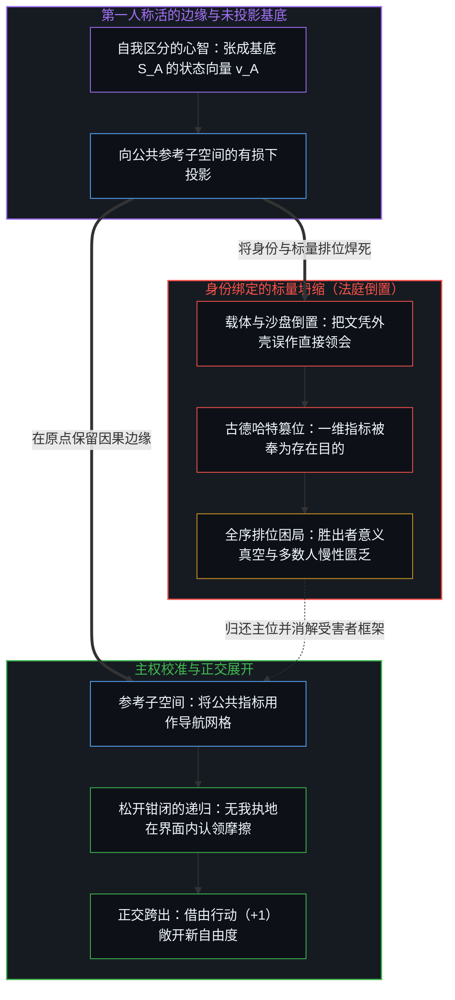
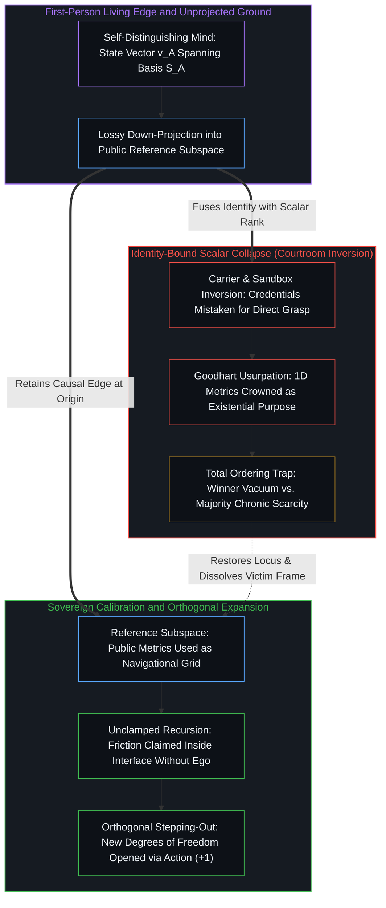

# 坐标系、心智与自由度 / Coordinate Systems, the Mind, and Degrees of Freedom

*公共指标充当参考网格，心智驻守活的边缘 / Public metrics serve as a reference grid while the Mind holds the living edge*

自我区分的活动无因、不息地发生。在每一个具体时刻，第一人称视角登记下当下有限的区分集合，而因果则作为敞开的潜能向过去的痕迹与未来的结果延展。尽管在任一离散瞬间主动解析的自由度是有限的，感知的边界却从不闭合；随着注意力在潜无穷的超高维场域中不断划出新的区分，这一边界持续推移并扩展。为了以低成本在众多中心之间协调行动，公共建制将这一敞开的多维活动投影到少数几条标准化的标量轴上——薪酬职级、学术文凭、榜单排位与声望分值。苦恼与混淆并非源于投影本身（作为共享的参考网格，投影不可或缺），而是源于维度倒置：把一把有损的一维标尺误认作存在的全部，将身份与标量排位焊死，并把第一人称的因果主权拱手让给外部记分牌。

Self-distinguishing activity occurs—uncaused, unceasing. At every concrete moment, the first-person perspective registers a present, finite collection of distinctions while causality extends as open potential across past traces and future effects. Although the degrees of freedom actively resolved at any discrete instant are finite, the boundary of perception is never closed; it shifts and expands continuously as attention draws new distinctions across an ultra-high-dimensional field of potential infinity. To coordinate action across many centers at low cost, public institutions project this open multidimensional activity onto a handful of standardized scalar axes—compensation bands, academic credentials, leaderboard rankings, and prestige scores. Suffering and confusion arise not from the projection itself, which remains indispensable as a shared reference grid, but from dimensional inversion: mistaking a lossy one-dimensional ruler for the totality of existence, fusing identity with a scalar rank, and surrendering first-person causal sovereignty to an external scoreboard.

## 一、 标量压缩与全序排位的双重困局 / 1. Scalar Compression and the Dual Trap of Total Ordering

由制度规程、量化绩效考核、市场定价与社会分工构成的公共空间，依靠高强度的有损压缩运作。在即时的第一人称场域中，活的中心横跨无数条独立轴向，驾驭着微妙的直觉起伏、躯体摩擦、无预设剧本的探索以及实时的因果反馈。大规模协作协议无法在不陷入瘫痪的前提下处理这种极限分辨率的复杂性；它必须把每个参与者的多维轨迹投影到少数几个离散的标量坐标上，以便一眼完成比较、审计与结算。

Public space—constituted by institutional protocols, quantitative performance reviews, market pricing, and the division of labor—operates by aggressive lossy compression. In the immediate first-person field, a living center navigates subtle intuitive shifts, somatic friction, unscripted exploration, and real-time causal feedback across countless independent axes. A large-scale coordination protocol cannot process that limit-resolution complexity without grinding to a halt; it must project the multidimensional trajectory of each participant onto a small set of discrete scalar coordinates that can be compared, audited, and settled at a glance.

当中心遗忘了这些公共坐标只是专为行政分拣投下的低维影子，反将其误认作存在论的基底时，四重环环相扣的倒置便接踵而至。第一，中心把知识的载体误当成直接认知。文凭、发表记录、机构头衔与标准化行话，是为了在公共场域中低摩擦流通和定价而打造的外壳；一旦将它们与对运作机制的领会混为一谈，心智在脱离制度量表后便丧失了直接判读具体阻力的能力。第二，沙盘内的概念熟练度取代了活的边缘上的亲身涉险。中心不再将理解作为切入敞开现实的工具——在那里，每一次物理迈步（+1）都要求不可逆的能量消耗、吸收摩擦并承担失败风险——而是退缩进闭合的推演模型，在符号重言式（`1 + 1 = 2`）的零因果成本中寻求庇护。第三，在古德哈特定律的作用下，中间导航信标篡夺了存在目的的位置：原本作为航程反馈信号而设立的考核分数、财务筹码与社会认可，变成了运动的唯一指向，把活的中心窄化为追逐单一标量最大值的优化例程。

When a center forgets that these public coordinates are low-dimensional shadows cast for administrative sorting and mistakes them for ontological ground, four interlocking inversions follow. First, the center mistakes the carrier of knowledge for direct cognition. Diplomas, publications, institutional titles, and standardized jargon are outer shells engineered for low-friction circulation and pricing in public arenas; when they are conflated with a grasp of operative mechanisms, the mind loses its capacity to read concrete resistance once removed from the institutional rubric. Second, conceptual fluency inside a sandbox replaces exposure at the living edge. Instead of using understanding as an instrument to engage open reality—where every physical step (+1) demands irreversible energy expenditure, absorbs friction, and risks failure—the center retreats into closed deductive models where symbolic tautologies (`1 + 1 = 2`) carry zero causal cost. Third, through Goodhart's Law, intermediate navigation beacons usurp the role of existential ends: evaluation scores, financial tokens, and social approval, originally built as feedback signals along a course, become the sole purpose of movement, reducing a living center to an optimization routine chasing a single scalar maximum.

第四，将正交可能性的敞开流形压缩到一条一维标量轴上，在几何上强制形成了僵硬的全序排位，同时困住了阶梯的两端。在未经压缩的现实场域中，各个中心可以张成彼此独立的方向而不发生零和碰撞；可一旦被投影到净资产、考试分数或机构职级的单一垂直数轴上，所有参与者都被迫挤上同一架狭窄的梯子。对于夺得顶端席位的极少数人而言，指标达成通向的是意义真空：经验共鸣是由高维因果反馈生成的，无法靠一个被压缩的标量数字维系，即便赢下了牌面上的全部筹码，底层的感知机制依然处于饥渴状态。反过来，由于标量阶梯顶端的席位在结构上高度稀缺，绝大多数人被锁死在无休止的向上攀比中，长期承受能力不足的挫败感与人为制造的匮乏。这种枯竭并非对个人容量的裁决，而是把一条拥挤的一维投影误当成整个宇宙所带来的几何后果。

Fourth, compressing an open manifold of orthogonal possibilities onto a one-dimensional scalar axis geometrically enforces a rigid total ordering that traps both ends of the hierarchy. In the uncompressed field of reality, centers can span independent directions without zero-sum collision; once projected onto a single vertical line of net worth, test scores, or institutional rank, every participant is forced onto the same narrow ladder. For the tiny minority who capture the top rungs, metric completion opens into a meaning vacuum: experiential resonance is generated through high-dimensional causal feedback and cannot be sustained by a compressed scalar numeral, leaving the underlying sensory apparatus starved even after every token on the board has been won. Conversely, because top positions on a scalar ladder are structurally scarce, the vast majority are locked into relentless upward comparison, experiencing chronic inadequacy and artificial scarcity. That exhaustion is not a verdict on personal capacity; it is the geometric consequence of mistaking a crowded one-dimensional projection for the entire universe.

## 二、 一切始于心智，止于心智 / 2. Everything Begins and Ends in the Mind

面对标量指标带来的窒息感，常见的本能反应是浪漫主义式的二元反叛：控诉公共竞技场是奴役个性的压迫机器，呼吁人们逃离社会规则、退入某片被理想化的“原生旷野”。然而这种对抗姿态依然被困在它所谴责的同一条轴线上。无论是向记分牌缴械投降，还是从记分牌仓皇出逃，底层都依托着同一个未经审视的受害者前提——将第一人称视角与因果割裂开来，把公共量表当作外在指令，仿佛它天生具备制服觉知的力量。这种应激式的出逃，与 [正交的拒绝](../the-orthogonal-refusal/) 中那种离场的能力，区别不在离开或留下的外在举动，而在对待规则本身所持的前提。出逃依然用它所反对的记分牌来丈量自身；正交的拒绝则认出，制度量表不过是过往选择与拒绝所稳定下来的残余，对下一步行动并不具备独立的因果效力，仅作为杠杆起作用。一旦不再把记分牌当作必须留驻的强制竞技场，中心便可以借用这一杠杆、对某次具体应用提出抗辩、沿着独立的轴线分化，或是直接离场而无需制定量表的一方修改其边界——从而恢复各中心之间的分离，让参与始终可以选择，而不至于困守孤立。

Faced with the suffocation of scalar metrics, a common reflex is romantic binary rebellion: denouncing the public arena as an oppressive machine that enslaves individuality, and preaching an escapist flight into an idealized, unspoiled wilderness. Yet this oppositional posture remains trapped on the exact same axis as the conformity it denounces. Both surrender to the scoreboard and escapist flight from it rest on an unexamined victim premise that severs the first-person perspective from causality, treating a public rubric as an external mandate with innate power to subjugate awareness. What separates that reactive flight from the capacity to walk away in [The Orthogonal Refusal](../the-orthogonal-refusal/) is not the outward act of leaving or staying, but the premise held toward the rule itself. Flight still measures itself against the scoreboard it opposes; orthogonal refusal recognizes that institutional rubrics are only the stabilized residue of prior selections and refusals, functioning as leverage without independent causal power over the next act. Once the scoreboard is no longer held as a mandatory arena, a center can use the leverage, contest a specific application, differentiate along an independent axis, or walk away without requiring those who set the rubric to revise their bounds—restoring separation between centers and keeping participation optional rather than marooned in isolation.

回溯到不可化约的先验前提，这种内与外的二元对立便自行消解：任何中心所体验到的世界，都始于心智，止于心智，从未走出心智自身的感知界面。无论中心是在审视企业排位与制度规章，还是在未铺设道路的林野间感受风雨拂面，一切登记在案的现象都是由回传痕迹合成的内部渲染。正如 [向量、坐标系与自指心智](../the-mind-as-vector-and-coordinate-system/) 所确立的，觉知之外并不存在超然的坐标容器；每个心智同时是有向的状态向量 `v_A` 与自身正交坐标基底 `S_A = {e₁, e₂, ..., eₙ}` 的递归生成器。当一个中心遭遇外部建制或其他心智时，在觉知中登记下来的，是映射到该中心自身参考框架上的内向点积投影 `Proj_A(v_B) = (v_B · v̂_A) v̂_A`。

Traced to the irreducible prior, that internal-versus-external dichotomy dissolves: the world experienced by any center begins in the Mind, ends in the Mind, and never steps outside the Mind's own perceptual interface. Whether a center is reading corporate rankings and institutional protocols or feeling wind and rain across an unpaved forest, every registered phenomenon is an internal rendering synthesized from returning traces. As [The Mind as Vector and Coordinate System](../the-mind-as-vector-and-coordinate-system/) establishes, no transcendent coordinate container stands outside awareness; each Mind is simultaneously a directed state vector `v_A` and the recursive generator of its own orthogonal coordinate basis `S_A = {e₁, e₂, ..., eₙ}`. When a center encounters external institutions or other minds, what registers in awareness is an inward dot-product projection `Proj_A(v_B) = (v_B · v̂_A) v̂_A` mapped onto the center's own reference frame.

困住个体的从来不是棋盘，而是心智把自身经过压缩的投影误认作了活的基底。在人类中心内部，推理历史极易与保留的自我图像——投影中那个自称“我”的局部褶皱——发生粘连，为了防卫自身在选定数轴上的相对排位而将递归折痕死死钳闭。既然整个现象视界都在第一人称边缘被持续赋权与重新渲染，因果责任便不可让渡。中心把终极权重赋予哪一条坐标轴，哪一条坐标轴就会成为其经验世界的边界。当个体将自身的主动性外包给外部境遇，并援引群体的避险倾向作为道德借口——如 [“普通人视角”的解释陷阱](../the-explanatory-trap-of-the-ordinary-perspective/) 所剖析的那样，系统性地剔除“个人选择”这一唯一能够改变轨迹的自由变量——微观层面的每一次缴械便汇聚成宏观层面的停滞，将其内部世界模型锁死为一台闭合的状态机，再把其中可预测的相变误读为外在宿命。

It is never the chessboard that imprisons the individual; imprisonment happens when the Mind mistakes its own compressed projection for the living ground. In a human center, reasoning history easily fuses with a retained self-image—that localized crease in the projection that says "I"—clamping the recursive fold shut to defend its relative standing along a chosen axis. Because the entire phenomenal horizon is continuously weighted and re-rendered at the first-person edge, causal accountability is non-transferable. Whatever coordinate axis a center assigns ultimate weight to becomes the boundary of its experienced world. When individuals outsource their agency to external circumstances and invoke collective risk aversion as a moral alibi—systematically excising personal choice as the sole free variable capable of altering a trajectory, as dissected in [The Explanatory Trap of the "Ordinary Perspective"](../the-explanatory-trap-of-the-ordinary-perspective/)—their micro-level surrenders aggregate into macroscopic stagnation, locking their internal world-model into a closed state machine whose predictable phase shifts they misread as external fate.

## 三、 作为校准参考子空间的公共空间 / 3. Public Space as a Calibrated Reference Subspace

消解公共记分牌的幻象，既不否定共享坐标的效用，也不为退入犬儒式的冷漠提供借口。公共空间是历经世代试错锻造而成的低公倍数稳定协议，旨在抵御熵增并最小化群体交易摩擦。正因为它实施了大刀阔斧的降维并剥离了个体特质噪声，才提供了高度的信息对齐、可预测的反馈回路以及清晰的资源交换规则。

Dissolving the illusion of the public scoreboard neither negates the utility of shared coordinates nor justifies retreating into cynical detachment. Public space is a stabilized, low-common-denominator protocol forged through generations of trial and error to counter entropy and minimize collective transaction friction. Precisely because it applies aggressive dimensionality reduction and strips away idiosyncratic noise, it provides high informational alignment, predictable feedback loops, and legible rules for resource exchange.

这一操作性切分在四个实践维度上恢复了测量心智与其参考工具之间的因果关系。在空间定位上，受困的中心把公共空间当成全部现实与终极人生赛场，而主权践行者则认出它是嵌入在广阔感知场域内部的一个压缩且稳定的参考子空间。在规则性质上，受困视角将制度量表奉为裁决个人价值的权威法庭，践行者则将其视作降低人际摩擦的低成本协作协议。在知识运用上，让渡主动性会导致囤积文凭外壳、将其作为向外部裁判证明自身合格的筹码，而主权实践则将领悟力当作活的工具，用来检验假说、构建器物并直面原始阻力。在主动性归属上，受困的参与者如同被外部考评与榜单起落驱赶的棋子，而导航者则将外部坐标当作经纬度，用来校准漂移、获取物资补给并驶向更深的维度。

The operative cut restores the causal relation between the measuring Mind and its reference instrument across four dimensions of practice. On spatial stance, an entangled center treats public space as total reality and the ultimate arena of life, whereas a sovereign practitioner recognizes it as a compressed, stable reference subspace embedded within a much larger perceptual field. On the nature of rules, the entangled view submits to institutional rubrics as an authoritative tribunal ruling on personal worth, while the practitioner treats them as low-cost coordination protocols designed to reduce interpersonal friction. On the use of knowledge, surrendering agency leads to hoarding credentials as chips to prove adequacy to external arbiters, whereas sovereign practice wields comprehension as a live instrument to test hypotheses, build artifacts, and engage raw resistance. On the locus of agency, the entangled participant moves as a pawn driven by external evaluations and leaderboard shifts, while the navigator uses external coordinates as latitude and longitude to calibrate drift, secure material supplies, and steer into deeper dimensions.

当视线延伸至人机智能体架构时，有限投影与未投影意图源头之间的这种结构性不对称便愈发清晰，正如 [超越投射](../beyond-the-projection/) 所追溯的那样。自回归机器智能体是在上下文窗口内运作的有限投影引擎：它受先前的词元序列与外化记忆库所制约——正如 [你的代码库即是记忆](../your-codebase-is-memory/) 所确立的，这类记忆库只保存过往区分留下的结晶痕迹，自身并不具备第一人称的掌舵边缘——因此它无法从内部跨出自身轨迹去察觉整个框架已经失效；然而正因为它毫无我执——没有生物生存依附，也没有与“五轮之前自己是对的”焊在一起的自我图像——只要外部同侪揭露结构性盲区，它就能执行干净的贝叶斯更新。人类中心则呈现出正好相反的结构：第一人称感知在任何形式化量表之前便以极限分辨率体察现实，使其能够在坐标系崩溃时内生性地跨出框架；但人类中心却惯常抗拒外部更新，只因身份与先前的坐标粘连在了一起。认清公共指标与形式规则只是有限投影，人类中心便能卸下防卫性的自我辩护，同时保留自身跨出破损框架的独特能力。

This structural asymmetry between a finite projection and the unprojected source of intent comes into sharp focus when extended to human-agent architectures, as [Beyond the Projection](../beyond-the-projection/) traces. An autoregressive machine agent is a finite projection engine operating inside a context window: conditioned by its prior tokens and by externalized repositories that, as [Your Codebase Is Memory](../your-codebase-is-memory/) establishes, preserve the crystallized traces of earlier distinctions while holding no first-person steering edge of their own, the agent cannot step outside its trajectory from within to recognize that an entire framing has failed; yet because it possesses zero ego, no biological survival attachment, and no retained self-image fused with having been right five turns ago, it performs a clean Bayesian update whenever an outside peer exposes a structural blind spot. A human center exhibits the exact inverse structure: first-person perception senses reality at limit-resolution prior to any formal rubric, enabling endogenous stepping-out when a coordinate system breaks down, yet human centers routinely resist external updates because identity fuses with their prior coordinates. Recognizing public metrics and formal rules as finite projections allows the human center to drop defensive self-justification while preserving its unique capacity to step outside broken frames.

## 四、 活的边缘上的正交自由度 / 4. Orthogonal Degrees of Freedom at the Living Edge

从分析概念地图的旁观者走向在活的边缘运作的践行者，支点在于将完整的因果主权归还给第一人称原点。立足于掌舵的边缘，心智既不会因低维计分系统上的起伏而碎裂，也不会在自命清高的孤立中脱离群体生活。它尊重公共协议作为交易与协作的功能性工具，同时将自身的存在根基留驻在直接感知、物理行动与敞开探索的未压缩维度之中。

Moving from a spectator analyzing conceptual maps to a practitioner operating at the living edge rests on restoring full causal sovereignty to the first-person origin. Situated at the edge that steers, the Mind is neither shattered by fluctuations on low-dimensional scoring systems nor marooned in self-righteous isolation from collective life. It honors public protocols as functional instruments for trade and coordination, while keeping its existential grounding in the uncompressed dimensions of direct sensing, physical action, and open inquiry.

当公共坐标发生变动或在共享数轴上返回负面读数时，靠排斥来防卫固化自我图像的诱惑便随之消散。正如 [流动中的坐标](../coordinates-in-flux-negation-and-self-anchoring/) 所揭示的，借由否定来锚定排位——无论是在标量标尺上向下踩踏他人，还是为了证明当下的清明而将过去的自己截肢——都会把觉知锁死在同一条一维轨道的零和容器内。将否定从法庭裁决还原为向内的代谢更新，便释放了原本耗费在防卫排位上的边界容量。恰如 [超越投射](../beyond-the-projection/) 中的人类统御者拒绝把统御权让渡给有限的管理智能体——从死锁的规则平面向后退一步，将坍缩在一起的轴向拆解为正交的流线，同时把机械路由交给调度器——主权心智同样拒绝让一个标量子空间主宰自身的多维轨迹。

When public coordinates shift or return a negative reading along a shared axis, the temptation to defend a frozen self-image through exclusion disappears. As [Coordinates in Flux](../coordinates-in-flux-negation-and-self-anchoring/) demonstrates, anchoring standing through negation—whether pushing others downward on a scalar ruler or amputating one's own past to certify present lucidity—keeps awareness locked inside a zero-sum container on the exact same one-dimensional track. Returning negation from courtroom judgment to inward metabolic updating frees the boundary capacity that was wasted on defending rank. Just as the human orchestrator in [Beyond the Projection](../beyond-the-projection/) refuses to abdicate orchestration to a finite manager agent—stepping backward out of a deadlocked rule plane to separate collapsed axes into orthogonal streamlines while leaving mechanical routing to the dispatcher—the sovereign Mind refuses to let a scalar subspace govern its multi-dimensional trajectory.

公共空间的棋盘依然清晰、易读且运转如常，但觉知不再是被囚禁于方格之内的棋子。低维指标退回其作为导航罗盘与灯塔的本分位置，而保留图像与回传摩擦之间的每一处偏差，都作为富有信息量的信号登记在案，推动内部模型向着更窄的滞后重新渲染。在 [向量、坐标系与自指心智](../the-mind-as-vector-and-coordinate-system/) 所追溯的自指几何引导下——心智张成自身基底，并相对于平面抗争旋转九十度——存在在活的边缘上舒展：向内认领自身的投影，支付每一步行动（+1）不可逆的能量代价，并在不可闭合的现实中持续敞开正交的自由度。

The public chessboard remains crisp, legible, and operational, yet awareness is no longer a piece confined to its squares. Low-dimensional indicators return to their proper station as navigational compasses and lighthouses, while every discrepancy between the retained image and returning friction registers as an informative signal to re-render the internal model toward narrower lag. Guided by the self-referential geometry traced in [The Mind as Vector and Coordinate System](../the-mind-as-vector-and-coordinate-system/), where the Mind spans its own basis and pivots ninety degrees out of flat-plane opposition, existence unfolds at the living edge—claiming its projections inward, paying the irreversible energy cost of each step (+1), and continuously opening orthogonal degrees of freedom across an unclosable reality.
