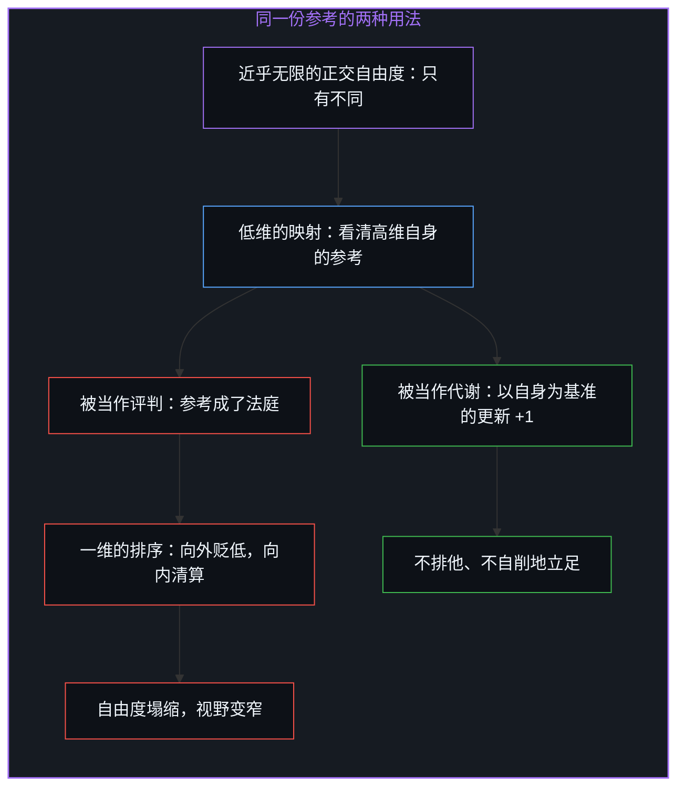
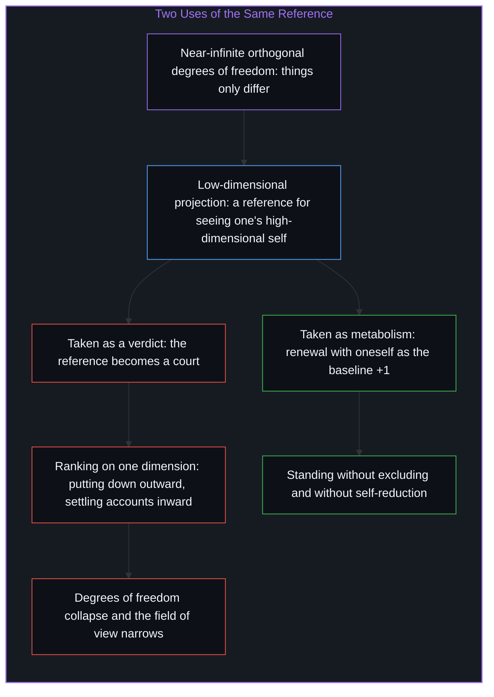
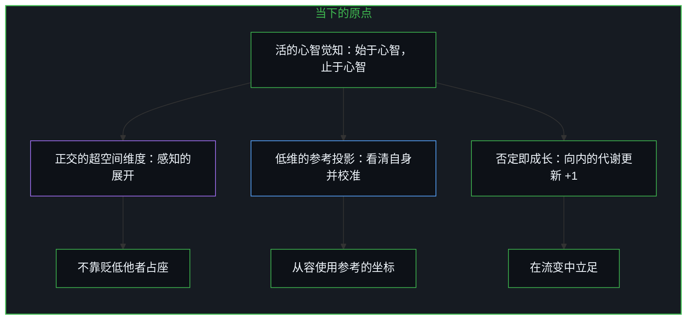
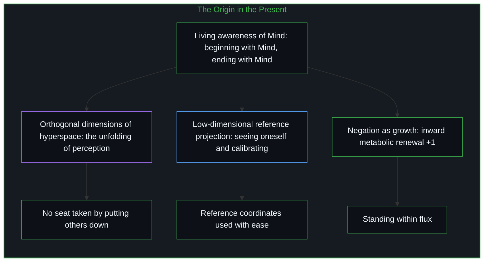

# 流动中的坐标 / Coordinates in Flux

*关于“否定”、降维与心智的自我锚定 / On Negation, Dimensional Collapse, and the Mind's Self-Anchoring*

“贬低他人是一种低成本的优越感”这样的反思常引起共鸣，而它在说出的那一刻便滑进了自指的圈：把别人的做法定为“低成本”，自己已经站上了评判的高处。随后无论是向外指认他人，还是向内清算过去的自己，都在靠否定换取一条一维数轴上的相对位置。否定是成长的另一面，低维的映射是看清高维自身的参考，两者都在被当作审判时走向反面。把否定从审判的高台还原为向内的代谢，心智便能在变动中确立坐标，不向外排挤，也不向内削减。

A reflection such as "putting others down is a low-cost form of superiority" often strikes a chord, and in the moment it is spoken it slides into a self-referential loop: by ruling another's conduct "low-cost," the speaker already stands on the high ground of judgment. What follows, whether pointing outward at others or settling accounts inward with one's past self, relies on negation to obtain a relative position on a one-dimensional axis. Negation is the other face of growth, and a low-dimensional projection is a reference for seeing one's own high-dimensional self; both turn into their opposite when taken as a tribunal. With negation returned from the judge's bench to an inward metabolism, a Mind can establish its coordinates amid change, neither pushing outward nor cutting inward.

## 一、 递归的审判席 / 1. The Recursive Tribunal

面对“贬低”这一现象，心智容易滑入层层嵌套的惯性。起点是命题本身的自指：把别人的优越感判为“低成本”，先占了评判的席位。随之而来的第一种惯性是显性的转移，指认“身边到处是这样的人”，看似在剖析贬低，实则借着对贬低者的声讨占了道德的上风，暗中换来一份廉价的优越感。第二种惯性更隐蔽，常裹在“深刻自省”的外表里：坦承“过去也曾如此”。在许多情境下，这种对过往的清算并不是开放的内省，而是踩着“过去的自己”来确认“现在的自己”有多清醒，底层仍是靠否定换取排位，只是方向由向外投射转成了向内切割。

Facing the phenomenon of "putting down," a Mind easily slides into inertia nested layer within layer. The starting point is the self-reference of the proposition itself: ruling another's sense of superiority "low-cost" takes the judge's seat first. The first inertia that follows is an overt transfer, declaring that "people like this are everywhere"; it looks like an analysis of putting down, yet through denouncing those who do it, it takes the moral upper hand and quietly obtains a cheap superiority of its own. The second inertia is more hidden, often wrapped in the look of "deep self-examination": admitting "I used to be like this too." In many settings this settling of accounts with the past is not open introspection but a stepping on "the past self" to confirm how lucid "the present self" is; underneath, it still relies on negation to obtain rank, with the direction turned from outward projection to inward cutting.

思辨的层面还有一层递归的风险：一旦去归纳、定义何为“显性的覆辙”与“隐性的覆辙”，心智便容易走上另一个隐秘的裁判席，以洞察全局的姿态在概念的高处索取更高一维的智性优越。

The level of reflection carries a further recursive risk: once one sets about classifying and defining what counts as the "overt rut" and the "hidden rut," a Mind easily steps onto another concealed judge's seat, claiming from the height of concepts, in the posture of seeing the whole, an intellectual superiority one dimension higher.

这种层层嵌套的元反思陷阱指向一个问题：为什么一涉及认知与评价，心智不论指向他人、指向过去的自身还是指向思辨本身，都会不由自主地靠“否定”来锚定位置？[大倒置的消解](../the-dissolution-of-the-great-reversal/)说明，心智把因果的效力让给外部的符号或静态的标尺时，便会借贬低外物来维持一个立足点。试图替他人调速是否定的另一种形式，[调速者的幻觉与行动的活态摩擦](../the-fallacy-of-pacing-and-the-felt-friction-of-ground-truth/)把速度交还给各自遇到的摩擦。

This nested trap of meta-reflection points to a question: why, whenever cognition and evaluation are involved, does a Mind, whether directed at others, at its own past or at reflection itself, find itself anchoring its position by "negation"? [The Dissolution of the Great Reversal](../the-dissolution-of-the-great-reversal/) shows that when a Mind yields causal efficacy to external symbols or static rulers, it maintains a foothold by diminishing what lies outside. Trying to set others' pace is negation in another form; [The Fallacy of Pacing and the Felt Friction of Ground Truth](../the-fallacy-of-pacing-and-the-felt-friction-of-ground-truth/) returns the pace to the friction each one meets.

## 二、 封闭容器与自我的削减 / 2. The Closed Container and the Reduction of Self

这种冲动的来处，在于心智习惯借“否定”来完成排他的自我确立。用否定去立足，前提是不自觉地把现实设成了一个固定而封闭的容器，容积恒定。于是当下的存在要确立自身，便须在其中挤出位置，要么把“他者”排挤出去，要么把“过去的形态”从版图上抹掉。否定他人，成了在存量竞争的设想里最省力、最直观的立足方式。

This impulse comes from a Mind's habit of completing an exclusive self-establishment through "negation." Standing by negation presupposes, without noticing, that reality has been set up as a fixed and closed container of constant volume. Present existence, to establish itself, must then squeeze out a place within it, either by pushing "the other" out or by wiping "past forms" off the map. Negating others becomes the least effortful and most direct way of finding a footing within the assumption of competition over a fixed stock.

这是把现实物化之后的设想。现实与心智的场域是敞开而持续流动的。心智所见的“别人”，不是立在心智之外的孤岛，而是心智在特定情境下投射与映射出的显现，是经由他者照见的自身的一部分。心智所能感知、体验与理解的边界，就是它认知的全部疆域。在敞开的流动里，靠割裂并排斥他人来确立自己，在逻辑上无法自洽。

This is an assumption made after reality has been turned into a thing. The field of reality and Mind is open and keeps flowing. The "others" a Mind sees are not islands standing outside it; they are what the Mind projects and maps in a particular situation, a part of itself seen by way of the other. The boundary of what a Mind can perceive, experience and understand is the whole territory of its knowing. Within an open flow, establishing oneself by splitting off and rejecting others cannot be made logically coherent.

每一次出于优越感的否定，看似压低了对方，实则在心智自身的地图上割出了一块盲区。否定他人，是在向内削减自己。越急于靠排他来占座，心智占有的有效视野越窄。[破除概念的僭越](../po-chu-gai-nian-de-jian-yue/)说明，概念的牢笼正是由这种向内切割的排他划界筑成的。与AI智能体协作时，谁坐在驾驶座上也由同样的锚定决定，[框架的倒置与驾驶位的主权非对称](../the-inversion-of-the-harness-and-the-driver-seat-asymmetry/)说明了这一点。

Every negation made from a sense of superiority looks as though it lowers the other and in fact cuts a blind area out of the Mind's own map. To negate another is to reduce oneself inward. The more one hurries to take a seat by exclusion, the narrower the effective field of view the Mind holds. [Breaking the Overreach of Concepts](../po-chu-gai-nian-de-jian-yue/) shows that the cage of concepts is built from exactly this exclusive boundary-drawing that cuts inward. The same anchoring decides who sits in the driver's seat when working with AI agents, as [The Inversion of the Harness and the Sovereignty of the Driver's Seat](../the-inversion-of-the-harness-and-the-driver-seat-asymmetry/) shows.

## 三、 降维排序与心智的损耗 / 3. Dimensional Collapse, Ranking and the Mind's Loss

从因果的拓扑来看，万物只有“不同”，没有“高下”。心智所感知的那些非线性而开放的流形，也只是接近无限的正交二元超空间在特定观测下的投影或统计表象。在这近乎无穷的正交自由度里，任何差异都是状态在不同维度上的展开与分布，信息的结构里没有一个全局的标量次序。

Seen in the topology of causality, things only "differ" and do not stand "higher" or "lower." Even the non-linear, open manifolds a Mind perceives are projections or statistical appearances, under a particular observation, of a near-infinite orthogonal binary hyperspace. Within these nearly endless orthogonal degrees of freedom, any difference is the unfolding and distribution of states across different dimensions, and the structure of information holds no global scalar ordering.

低维的映射，是心智为了在物理与符号的世界里看清高维的自身、校准航向而建立的功能性参考。一维的标尺、二维的坐标网格、局部的考核指标，像水中的倒影或镜中的反光，让高维的存在得以在具体的情境里观测自己的位置、速度与轨迹。倒置发生在把这面“看清自身的参考之镜”当作裁决生命的“孤立评判”的时候。[坐标系、心智与自由度](../coordinate-systems-mind-and-degrees-of-freedom/)厘清过这一点：公共的坐标是航海的经纬与参考，不是给生命定罪的法庭。

A low-dimensional projection is a functional reference that a Mind sets up in order to see its own high-dimensional self clearly and calibrate its heading within the world of physics and symbols. A one-dimensional ruler, a two-dimensional coordinate grid, a local performance metric are like a reflection in water or light in a mirror, letting a high-dimensional existence observe its own position, speed and path in a concrete situation. The inversion happens when this "mirror of reference for seeing oneself" is taken for an "isolated verdict" passed on a life. [Coordinate Systems, the Mind, and Degrees of Freedom](../coordinate-systems-mind-and-degrees-of-freedom/) has made this clear: public coordinates are the latitude, longitude and reference of navigation, not a court for convicting a life.

参考被当作评判之后，所谓的“高下”便是心智在统计表象上所作的粗暴压缩，把在超空间的投影里展开的丰富表象压到一条单轴上作线性的排序。任何低维的投影都不可逆地丢失信息、塌缩自由度，而更具破坏性的是这种压缩是自指而递归的：先对他人作单维的排序，反思到这一行为之后，又为了确立清醒而对“过去的自己”再压缩一次，最后甚至对“这种递归的反思”本身去分高下。

Once a reference is taken as a verdict, what is called "higher and lower" is a crude compression a Mind performs on statistical appearance, pressing the rich appearance unfolded in the projections of hyperspace onto a single axis for linear ranking. Every low-dimensional projection irreversibly loses information and collapses degrees of freedom, and what does more damage is that this compression is self-referential and recursive: first others are ranked on one dimension; on reflecting upon that act, "the past self" is compressed once more in order to establish one's lucidity; and in the end even "this recursive reflection" itself is sorted into higher and lower.

每一轮基于否定的排序，都是一次维度的自我折叠。心智不断舍去自身广阔的自由度，把感知收缩成一根窄窄的标尺。说出口的话最后落在自己脚下，像一道正在缩小的影子。这是递归压缩的代价：为了在一维的数轴上站稳一个“比别人更靠前”的位置，付出的是自身自由度的整体塌陷。

Each round of ranking based on negation is one folding of dimension upon itself. A Mind keeps giving up its own broad degrees of freedom and shrinks perception into a narrow ruler. The words spoken land in the end at one's own feet, like a shadow growing smaller. This is the cost of recursive compression: to hold steady a position "further ahead than others" on a one-dimensional axis, what is paid is the collapse of one's own degrees of freedom as a whole.

## 四、 生成的代谢，而非固化的标杆 / 4. Generative Metabolism, Not a Fixed Yardstick

那么“否定”在心智的发展里扮演什么角色？否定是成长的另一面：在生命的活态演化里，没有“不否定过去”的成长。不划出当前与过往的差异，不否定旧有状态的闭合与局限，心智便迈不出向前的一步（+1）。失去这种向内的审视与否定，心智便停滞、板结。

What part, then, does "negation" play in a Mind's development? Negation is the other face of growth: in the living evolution of a life there is no growth that "does not negate the past." Without marking the difference between the present and what came before, without negating the closure and limits of the old state, a Mind cannot take the step forward (+1). Without this inward examination and negation, a Mind stalls and hardens.

日常认知里的偏差不在否定本身，而在把本该作为代谢引擎的“自我否定”中途拦下，改成标榜“新阶段更优越”的审判标尺。于是主体急着站在当下的台阶上向后踩踏过去的痕迹，借此宣告自己已经抵达某种终局与高台。

The deviation in everyday cognition lies not in negation itself but in intercepting "self-negation," which should serve as the engine of metabolism, and remaking it into a ruler of judgment that advertises "the new stage is superior." The subject then hurries to stand on the present step and tread backward on the traces of the past, announcing thereby that it has arrived at some final state and high platform.

向内的审视不是对主体的审判与定罪，它是生成的代谢的起点。一个能够自省的认知系统之所以能演进，在于它以自身为基准，在情境的反馈里持续迭代、修正与更新。[攀登从未离开地面](../climbing-does-not-leave-the-ground/)说明，心智的发展不是塑像的铸造，不需要砸碎旧的模具来证明新版本的价值。主体始终处在情境的生成之中，是一条川流不息的河，河里没有一个可以驻足不动、被永久焊住的锚点。

Inward examination is not a trial and conviction of the subject; it is the starting point of generative metabolism. A cognitive system able to reflect on itself can evolve because it takes itself as the baseline and keeps iterating, correcting and renewing within the feedback of situations. [Climbing Does Not Leave the Ground](../climbing-does-not-leave-the-ground/) shows that a Mind's development is not the casting of a statue and has no need to smash the old mold to prove the worth of the new version. The subject is always within the generation of situations, a river that never stops flowing, and in that river there is no anchor point where one can stand still, welded in place for good.

## 五、 确立，但不必固定 / 5. Established, Without Being Fixed

回到认知坐标的建立：在外部信号与即时反馈高度密集的时代，心智如何在变动的环境里保有一个属于自己的位置？[向量、坐标系与自指心智](../the-mind-as-vector-and-coordinate-system/)给出了几何：自身即坐标系的心智，无须否定他人的坐标。

Back to establishing cognitive coordinates: in an age dense with external signals and immediate feedback, how does a Mind keep a position of its own within a changing environment? [The Mind as Vector and Coordinate System](../the-mind-as-vector-and-coordinate-system/) gives the geometry: a Mind that is its own coordinate system has no need to negate another's coordinates.

答案不在筑起一座不可动摇的堡垒去宣示正确，而在放下借“否定”与“排序”来占座的执着。低维的映射是看清自身的工具，不是禁锢生命的法庭；否定过往是代谢成长的阶梯，不是自我优越的奖杯。心智所照见的世界原本完整，接纳它的流转与敞开，便无须靠贬低他者来确认立足点。认知的成长是持续的生成，正视它未完成的状态，便无须靠踩踏过去来维持道德或智识上的虚荣。

The answer lies not in raising an unshakable fortress to proclaim being right, but in letting go of the attachment to taking a seat through "negation" and "ranking." A low-dimensional projection is a tool for seeing oneself, not a court that confines a life; negating the past is a stair of metabolic growth, not a trophy of one's own superiority. The world a Mind sees is whole to begin with, and with its flux and openness accepted there is no need to confirm a footing by putting others down. Cognitive growth is continuing generation, and with its unfinished state faced there is no need to keep up moral or intellectual vanity by treading on the past.

坐标在当下这一刻可以清晰地确立，它是超空间的统计表象里基于具体情境的实时展开与观察。它不需要被压成一维的刻度，更不需要被固定为一座审判的高台。当下的觉察不是面向历史的终审，而是心智朝向未来时一个保持延展、保持敏锐的活的参考原点。把不理解的部分截掉，是锚定在对手轴上的另一种方式，[以知为刃的截肢与解脱](../the-illusion-of-knowing-and-the-geometry-of-amputation/)对此有所揭示。

A coordinate can be clearly established in this present moment; it is a real-time unfolding and observation, based on a concrete situation, within the statistical appearance of hyperspace. It need not be pressed into a one-dimensional mark, still less fixed as a platform of judgment. Present awareness is not a final ruling upon history but a living origin of reference that stays extended and stays keen as a Mind faces the future. Cutting away what is not understood is another way of anchoring on the opponent's axis, as [The Illusion of Knowing and the Geometry of Amputation](../the-illusion-of-knowing-and-the-geometry-of-amputation/) shows.

