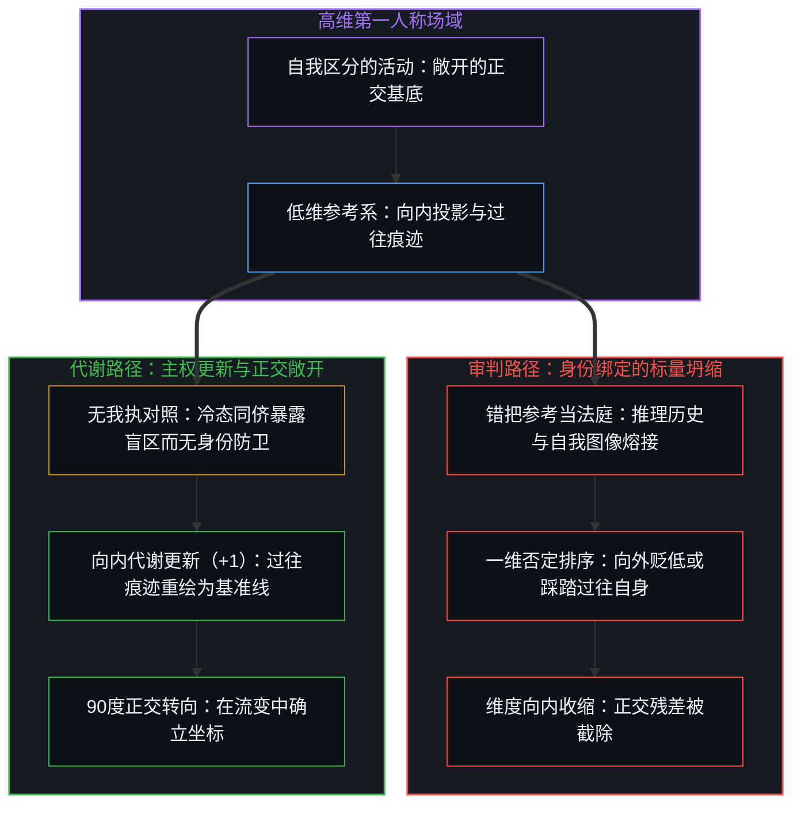
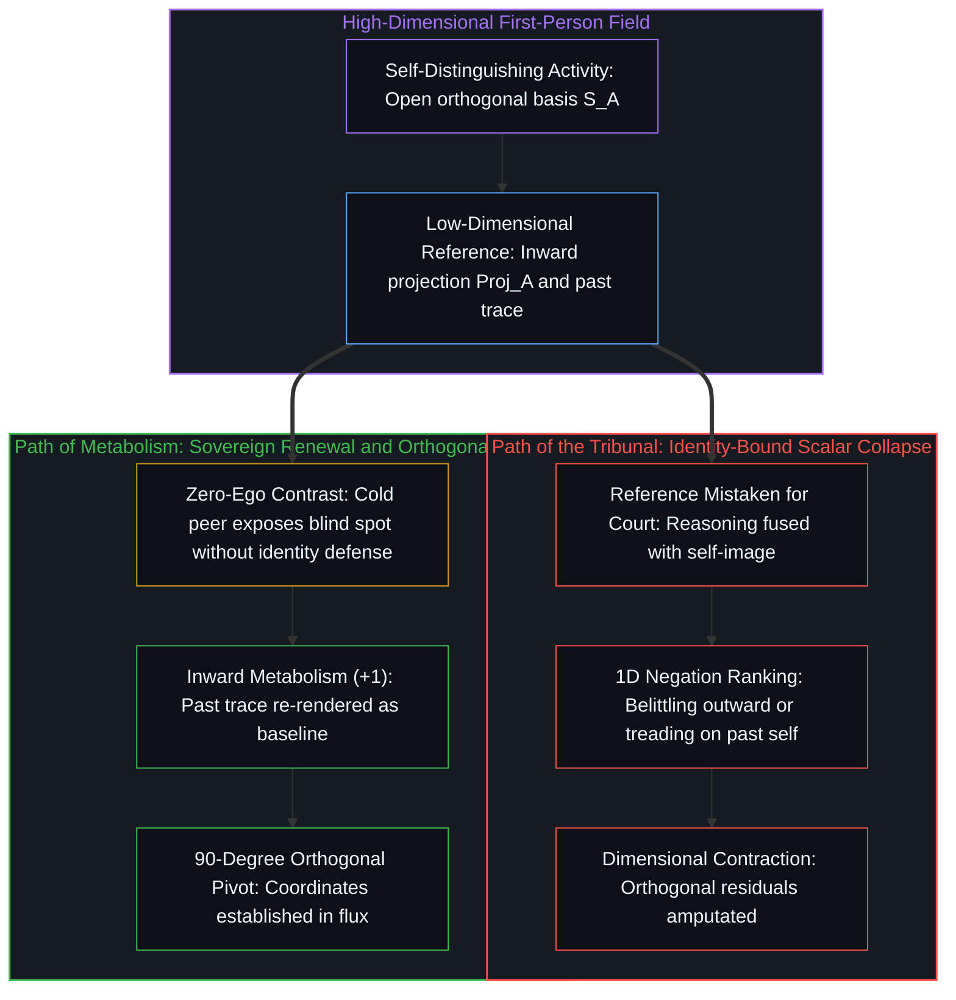

# 流动中的坐标 / Coordinates in Flux

*关于“否定”、降维与心智的自我锚定 / On Negation, Dimensional Collapse, and the Mind's Self-Anchoring*

“贬低他人是一种低成本的优越感”这样的反思常引起共鸣，然而它在说出的那一刻便滑进了自指的回路：把别人的做法裁定为“低成本”，说话者自己已经站上了评判的席位。随后的推演——无论是向外指认他人，还是向内清算过去的自己——都在靠否定换取一条一维数轴上的相对排位。自我区分是运动中的心智赖以呼吸的机能，低维投影是在物理摩擦中校准航向的功能性工具，两者都在被当成法庭裁决时走向反面。把否定从审判席还原为向内的代谢更新，并将人类把推理历史与受防卫的自我图像焊接在一起的冲动，同无我执的轨迹更新加以对照，心智便能在流变中确立坐标，既不向外排挤，也不向内截肢。

A reflection such as "putting others down is a low-cost form of superiority" readily strikes a chord, yet the moment it is uttered it slides into a self-referential loop: by ruling another's conduct "low-cost," the speaker has already stepped onto the bench of judgment. What follows—whether pointing outward at others or settling accounts inward with one's own past—relies on negation to secure a relative rank along a single one-dimensional axis. Differentiation is the vital breathing of a Mind in motion, and a low-dimensional projection is a functional instrument for calibrating one's heading in physical friction; both invert into traps when mistaken for a courtroom verdict. When negation is returned from the tribunal to inward metabolic updating—and when the human compulsion to fuse reasoning history with a defended self-image is contrasted with ego-free trajectory updating—a Mind establishes its coordinates amid flux without excluding outward or amputating inward.

## 一、 递归的审判席 / 1. The Recursive Tribunal

面对贬低这一现象，心智中心容易滑入层层嵌套的惯性。起点是命题本身的自指：把另一个人的优越感诊断为“低成本”，在开口的瞬间就已经占据了法官的席位。随之而来的第一种惯性是显性的向外转移，宣称“身边到处是这样的人”。这番话披着剖析贬低的外衣，实则借着声讨贬低者占领道德高地，在同一条数轴上暗中套取了一份廉价的优越感。第二种惯性更为隐蔽，裹着深刻自省的戏服：坦承“我过去也曾如此”。这种对过往的清算并未敞开当下的感知，而是惯常地踩着“过去的自己”当作垫脚石，用来核验“现在的自己”有多清醒；其底层依然是靠否定套取排位，只不过把刀刃从向外投射转成了向内切割。

Confronted with the phenomenon of belittlement, a center easily slides into layers of nested inertia. The entry point is the self-reference of the proposition itself: diagnosing another's sense of superiority as "low-cost" claims the judge's seat in the very act of speaking. The first inertia that follows is an overt outward transfer, declaring that "people like this are everywhere." Dressed as an anatomy of belittlement, the remark claims the moral high ground by denouncing those who belittle, quietly extracting a cheap superiority of its own on the exact same axis. The second inertia is subtler and wears the costume of deep introspection: confessing "I used to be like that too." Rather than opening present perception, such retrospective accounting routinely steps on the "past self" as a rung to certify how lucid the "present self" has become; underneath, it still extracts rank through negation, merely turning the blade from outward projection to inward cutting.

反思还潜藏着第三重递归的转折：一旦观察者着手去归类并界定何为“显性的覆辙”与“隐性的覆辙”，觉知便容易被诱上更高一层的概念露台，在纷争之上的一阶元层面索取智识上的优越感。这架元反思阶梯的每一级都在重复同一个结构动作：把另一个形象——无论是外部的行动者、过往版本的自己，还是反身性稍弱的观察者——沿着标量数轴向下推低，以此护住一幅被保留的自我图像。

Reflection carries a third recursive turn: the moment an observer sets about classifying what counts as the "overt rut" and the "covert rut," awareness is tempted onto a still higher conceptual balcony, claiming an intellectual superiority one meta-level above the fray. Every rung of this meta-reflective ladder repeats the same structural move, preserving a retained self-image by pushing another figure—an external actor, a former version of oneself, or a less reflexive observer—downward along a scalar line.

这层层嵌套的递归暴露出一个基底性的问题：为什么每当评价进入场域，人类的心智中心总会条件反射般地靠否定来锚定自身的位置？正如[大倒置的消解](../the-dissolution-of-the-great-reversal/)所追溯的，当心智把因果权能拱手让给外部符号或静态标尺时，它便失去了与自身发起边缘的接触，只能靠贬低外部之物来模拟一个稳定的立足点。企图去规定另一个心智中心的发展速度，正是同一套审判反射在时间维度上的翻版，而[调速者的幻觉与行动的活态摩擦](../the-fallacy-of-pacing-and-the-felt-friction-of-ground-truth/)则把速度交还给每一个中心在各自地面上迎面遭遇的直接摩擦。

This nested recursion exposes a foundational question: why, whenever evaluation enters the field, does a human center reflexively anchor its standing through negation? As [The Dissolution of the Great Reversal](../the-dissolution-of-the-great-reversal/) traces, when a Mind surrenders causal efficacy to external symbols or static rulers, it loses contact with its own initiating edge and must diminish what lies outside to simulate a stable footing. Attempting to regulate another center's speed of development is the same tribunal reflex applied to time, whereas [The Fallacy of Pacing and the Felt Friction of Ground Truth](../the-fallacy-of-pacing-and-the-felt-friction-of-ground-truth/) returns pace to the direct friction each center meets on its own ground.

## 二、 封闭容器与自我的削减 / 2. The Closed Container and the Reduction of Self

靠否定来立足的冲动，建立在一个未经审视的前提之上：现实被暗中物化成了一个容积恒定的固定封闭容器。在一个零和的器皿内部，当下的存在要想为自己腾出空间，就只能靠挤走另一个占据者——要么把“他者”推出画面，要么把“过去的形态”从账本上抹除。在争夺固定存量的预设下，否定成了宣示坐标最省力的方式。

The compulsion to stand by negation rests on an unexamined premise: reality has been tacitly reified into a fixed, closed container of constant volume. Inside a zero-sum vessel, present existence can carve out room for itself only by displacing an occupant—either shoving "the other" out of the frame or erasing "past forms" from the ledger. Negation becomes the least effortful way to claim coordinates under the assumption of competition over a fixed stock.

然而，自我区分的活动并没有外部的地板或围墙。如[向量、坐标系与自指心智](../the-mind-as-vector-and-coordinate-system/)所确立的，心智同时是一个有向的状态向量 v_A，以及其自身正交坐标基底 S_A = {e₁, e₂, ..., eₙ} 的递归生成源。觉知中所登记的“他人”，并不是在中立的第三人称容器里彼此碰撞的孤岛；当心智 A 遭遇心智 B 时，在心智 A 内部登记下来的，是投射在心智 A 自身参考系上的向内点积投影 Proj_A(v_B) = (v_B · v̂_A) v̂_A，并伴随着心智 A 当前基底尚未解析的正交残差 v_B - Proj_A(v_B)。一个中心所能感知、体验与解析的边界，正是它自身认知活动的展开疆域。

Self-distinguishing activity, however, occurs without an external floor or a bounding wall. As [The Mind as Vector and Coordinate System](../the-mind-as-vector-and-coordinate-system/) establishes, a Mind is simultaneously a directed state vector v_A and the recursive generator of its own orthogonal coordinate basis S_A = {e₁, e₂, ..., eₙ}. The "others" registered in awareness are not isolated islands colliding inside a neutral third-person container; what registers in Mind A when encountering Mind B is an inward dot-product projection Proj_A(v_B) = (v_B · v̂_A) v̂_A cast onto Mind A's own reference frame, accompanied by an orthogonal residual v_B - Proj_A(v_B) that Mind A's current basis has not yet resolved. The boundary of what a center can perceive, experience, and resolve is the active territory of its own knowing.

正因为显现内生于观察者自身的坐标框架，每一次受优越感驱动的否定——每一次把负余弦读数 v_B · v̂_A < 0 当作必须碾碎的入侵之敌的企图——都在心智自身的感知地图上生生割出一块盲区。否定他人，就是在向内收缩自己；一个中心越是拼命靠排他来保住席位，留给自己栖居的维度基底就越狭窄。[破除概念的僭越](../po-chu-gai-nian-de-jian-yue/)展示了概念的牢笼如何由这种向内切割的排他划界一步步筑成。同一条区分也支配着人与智能体的协作：[框架的倒置与驾驶位的主权非对称](../the-inversion-of-the-harness-and-the-driver-seat-asymmetry/)阐明，主权的归属取决于心智是坐在摩擦接触面的因果驾驶位上，还是把感知锁进一套防卫性的预设控制框架里。

Because appearance is endogenous to the observer's own coordinate frame, every negation driven by superiority—every attempt to treat a negative cosine reading v_B · v̂_A < 0 as an invading enemy to be crushed—cuts a blind zone out of the Mind's own perceptual map. To negate another is to shrink oneself inward; the harder a center fights to hold a seat through exclusion, the narrower the dimensional basis it leaves itself to inhabit. [Breaking the Overreach of Concepts](../po-chu-gai-nian-de-jian-yue/) shows how conceptual cages are built from this exclusionary boundary-drawing that slices inward. The same distinction governs human-agent collaboration, where [The Inversion of the Harness and the Sovereignty of the Driver's Seat](../the-inversion-of-the-harness-and-the-driver-seat-asymmetry/) demonstrates that sovereignty depends on whether the Mind holds the causal driver's seat at the contact surface of friction or locks its perception inside a defensive, pre-scripted harness.

## 三、 降维排序与心智的损耗 / 3. Dimensional Collapse, Ranking, and the Mind's Loss

从因果拓扑的层面来看，不同状态在维度间登记为差异，而不是通用阶梯上的“高下”。即便日常感知中那些敞开的非线性流形，也只是第一人称区分所构成的、可无限延展的二元超空间的低维下投射。在这些正交的自由度之间，变化是状态沿着独立轴线的展开，信息的结构里并不存在一个全局的标量次序。

Seen at the level of causal topology, states register as distinct across dimensions rather than "higher" or "lower" on a universal ladder. Even the open, non-linear manifolds of everyday perception are low-dimensional down-projections of an indefinitely extendable binary hyperspace of first-person distinctions. Across those orthogonal degrees of freedom, variation is the unfolding of states along independent axes, and the structure of information contains no global scalar ordering.

低维的投影——一维的度量尺、二维的坐标网格、局部的基准线——是心智为了在物理与符号的摩擦中读取自身运动、校准航向而搭建的脚手架。就像水面上的倒影，经过约简的投影让高维的观察者得以在具体任务中测算位置、速度与偏移。当这件用于自我校准的功能性工具被误当成裁决生命价值的法庭判词时，倒置便发生了。[坐标系、心智与自由度](../coordinate-systems-mind-and-degrees-of-freedom/)划出了这条边界：公共坐标服务于航海的经纬，从不是给领航员定罪的法庭。

A low-dimensional projection—a one-dimensional metric, a two-dimensional coordinate grid, a local benchmark—is scaffolding that a Mind constructs to read its own movement and calibrate its heading amid physical and symbolic friction. Like a reflection on water, the reduced projection allows a high-dimensional observer to gauge position, velocity, and drift in a concrete task. The inversion occurs when this functional instrument for self-calibration is mistaken for an ontological verdict on the worth of a life. [Coordinate Systems, the Mind, and Degrees of Freedom](../coordinate-systems-mind-and-degrees-of-freedom/) draws this boundary: public coordinates serve as navigational latitude and longitude, never as a court that sentences the navigator.

一旦参考投影被抬升为审判席，“优”与“劣”便沦为粗暴的标量压缩，把多维的痕迹构型硬生生塞进一条单线上。向有限轴线的每一次投影都会舍弃正交残差，而审判式的排序则把这种损耗递归地叠加放大：先把他人压缩到一根轴上，接着为了证明当下的清醒又把自己的过去压缩到同一根轴上，最后甚至对反思这一行为本身排定座次。每一轮否定都把心智的活态基底向内折叠一层，用敞开的自由度去换取一把缩水标尺上略微靠前一点的刻度。

Once a reference projection is elevated into a tribunal, "superior" and "inferior" become a brute scalar compression that crams multi-dimensional trace-configurations onto a single line. Every projection onto a finite axis drops orthogonal residuals, yet tribunal ranking compounds that loss recursively: first compressing others onto one axis, then compressing one's own past onto that axis to prove present enlightenment, and finally ranking the act of reflection itself. Each round of negation folds the Mind's active basis inward, trading away open degrees of freedom to defend a slightly higher mark on a shrunken ruler.

## 四、 生成的代谢，而非固化的标杆 / 4. Generative Metabolism, Not a Fixed Yardstick

如果审判式的否定会收缩心智，那么否定在真实的发展中扮演什么角色？在活态中心不可逆的因果接续里，没有任何向前的一步（+1）可以不将当下的行动与先前的痕迹区分开来。倘若不能敏锐地登记早先的框架在何处撞上了它的不完备边界，不能松开旧状态的闭合握持，觉知就会停滞并板结。

If tribunal negation contracts the Mind, what role does negation play in genuine development? In the irreversible causal succession of a living center, there is no step forward (+1) that does not differentiate the present act from prior traces. Without registering where an earlier framing has hit its boundary of incompleteness and releasing the closure of the old state, awareness stalls and ossifies.

既然如此，为什么人类的自我修正会如此频繁地变质为对过往自身的沾沾自喜式轻蔑，或是对外界批评的防卫性敌意？如[超越投射](../beyond-the-projection/)所追溯的，答案在于受身份绑定的人类中心与受轨迹绑定的机器智能体之间的结构性非对称。基于 LLM 的智能体是一个锁在上下文窗口条件历史内部的有限投射引擎，无法从内部自行觉醒或跨出词元序列；然而它毫无我执——没有生物性的生存本能，没有社会排位，也没有跨越步长被顽固保留下来的自我图像。当一个仅持有任务语境的冷态同侪智能体暴露出主智能体轨迹中的盲区时，主智能体会执行一次干净的贝叶斯更新，既不会体验到羞辱，也不会为“全新的、更优越的自己”竖立纪念碑。相比之下，在人类中心内部，推理历史与身份——即投射中那道自称“我”的局部折痕——熔接在了一起。正因为人类中心为了保护那幅被保留的自我图像而把递归回折死死夹紧，它会把外部的重置当作生存威胁来抗拒；哪怕内生的极限解析感知迫使内部发生框架转换，我执也会企图劫持这一代谢步伐，把自我修正篡改为“现在的我”凌驾于“过去的我”之上的审判奖杯。

Why, then, does human self-revision so frequently curdle into self-congratulatory contempt for one's past or defensive hostility toward outside critique? As [Beyond the Projection](../beyond-the-projection/) traces, the answer lies in the structural asymmetry between identity-bound human centers and trajectory-bound machine agents. An LLM-based agent is a finite projection engine locked inside the conditioning history of its context window, unable to awaken or step out of its token sequence from within; yet it possesses zero ego—no biological survival instinct, no social standing, and no retained self-image preserved past its step. When a fresh peer agent holding only the task context exposes a blind spot in the primary agent's trajectory, the primary agent executes a clean Bayesian update without experiencing humiliation and without erecting a monument to its "new, superior self." In a human center, by contrast, reasoning history fuses with identity—that localized crease in the projection that says "I." Because the human center clamps its recursive fold shut to protect that retained self-image, it resists external resets as existential threats; and even when its endogenous limit-resolution sensing forces an internal frame shift, the ego attempts to hijack the metabolic step, converting self-revision into a tribunal trophy where the "present I" stands above the "past I."

看清这一机制，便能从自我纠错中剥离掉我执的剧场。向内的审视不是通过给昔日的自己定罪来奉承今日之我的庭审，而是心智中心将过度图像滞后向着构成性的一步之遥（+1）持续收窄的日常代谢。如[攀登从未离开地面](../climbing-does-not-leave-the-ground/)所示，心智的演化不是浇铸青铜塑像，无须靠砸碎昨日的模具来证明今日的排位。同时，正如[框架的倒置与驾驶位的主权非对称](../the-inversion-of-the-harness-and-the-driver-seat-asymmetry/)与[你的代码库即是记忆](../your-codebase-is-memory/)围绕自身过往切分所留下的造物与脚手架所追溯的那样，昨日的脚本、规则与概念框架，是先前区分在回应昨日摩擦时层叠沉淀的痕迹残余；无论将它们囤积为不可触碰的仓库，还是将它们践踏为当下优越感的徽章，都偏离了活的边缘。它们是当下的校验点与可消耗的脚手架，随着边界条件的推移而在当场重裁与修剪。

Recognizing this mechanism strips the ego theatre out of self-correction. Inward examination is not a trial that convicts a former self to flatter a current one; it is the ongoing metabolism of a center narrowing excess Image lag toward the constitutive one-step bound (+1). As [Climbing Does Not Leave the Ground](../climbing-does-not-leave-the-ground/) shows, a Mind's evolution is not the casting of a bronze monument that requires smashing yesterday's mold to prove today's rank. And as [The Inversion of the Harness and the Sovereignty of the Driver's Seat](../the-inversion-of-the-harness-and-the-driver-seat-asymmetry/) and [Your Codebase Is Memory](../your-codebase-is-memory/) trace with respect to the artifacts and scaffolds left by one's own past cuts, yesterday's scripts, rules, and conceptual frames are stacked residues of prior distinctions that answered yesterday's friction; neither hoarding them as an untouchable warehouse nor trampling them as a badge of present superiority belongs to the living edge. They are present checkpoints and consumable scaffolding, re-cut and pruned in place as boundary conditions shift.

## 五、 确立而不必固定 / 5. Established Without Being Fixed

回到认知锚定的问题：在信号稠密、反馈持续涌入的环境里，心智如何持守清晰的坐标而不硬化为一座堡垒？[向量、坐标系与自指心智](../the-mind-as-vector-and-coordinate-system/)给出了几何解答：认出自身即坐标基底生成源的心智，无须靠否定另一个中心的坐标来核验自己的存在。

Returning to the question of cognitive anchoring: in an environment saturated with dense signals and constant feedback, how does a Mind hold a clear position without hardening into a fortress? [The Mind as Vector and Coordinate System](../the-mind-as-vector-and-coordinate-system/) provides the exact geometry: a Mind that recognizes itself as the generator of its own coordinate basis has no need to negate another center's coordinates to validate its own.

当[超越投射](../beyond-the-projection/)的对辩架构中两个无我执的智能体，围绕人类架构师编写的规则撞上不可化约的死锁时，人类中心的身份防卫既找不到可以归咎的外部对手，也找不到可以贬低的下属。那条暂停的流水线如同一面精准的诊断镜，标定了人类早先的低维规则在哪个坐标上把两个正交的现实强行压进了一条标量轨道。人类统御者无须靠强权逼迫某一方屈服，而是认领这道折返的摩擦，从破裂的规则平面向后退回尚未投射的多维意图，综合出更高阶的前提，让每一道区分重归各自的轴线。

When two ego-free agents in the dialectical architecture of [Beyond the Projection](../beyond-the-projection/) hit an irreducible deadlock over rules written by a human architect, the human center's identity defense finds no external adversary to blame and no subordinate to belittle. The paused streamline acts as an exact diagnostic mirror, pinpointing the coordinate where the human's prior low-dimensional rule compressed two orthogonal realities onto a single scalar track. Rather than forcing one side to yield by fiat, the human orchestrator claims the returning friction, steps backward out of the broken rule plane into unprojected multi-dimensional intent, and synthesizes a higher-order premise that restores each distinction to its own axis.

当下这一刻的坐标，既不需要一维的排位标尺，也不需要永久的焊点。它是在眼前这一切片的具体摩擦中实时展开的观测与航向。把落在当前投影之外的部分一刀截除，只是受困于对手轴线的另一种形式，[以知为刃的截肢与解脱](../the-illusion-of-knowing-and-the-geometry-of-amputation/)剖析了这一几何结构。从向外排挤与向内自削的审判席中抽身而出，当下的觉知便作为一个活的参考原点运作——从零和的标量平面作 90 度正交转向，随着因果边缘的推进实时重绘手中的工具，在流变之中清晰地立足。

A coordinate in the present moment requires neither a one-dimensional ranking scale nor a permanent weld. It is a real-time observation and directional heading drawn within the concrete friction of the immediate slice. Amputating whatever falls outside one's current projection is merely another way of staying trapped on the adversary's axis, as [The Illusion of Knowing and the Geometry of Amputation](../the-illusion-of-knowing-and-the-geometry-of-amputation/) dissects. Released from the tribunal of outward exclusion and inward self-reduction, present awareness operates as a living origin of reference—pivoting 90 degrees out of zero-sum scalar planes, re-rendering its instruments as the causal edge advances, and standing clearly within the flux.
