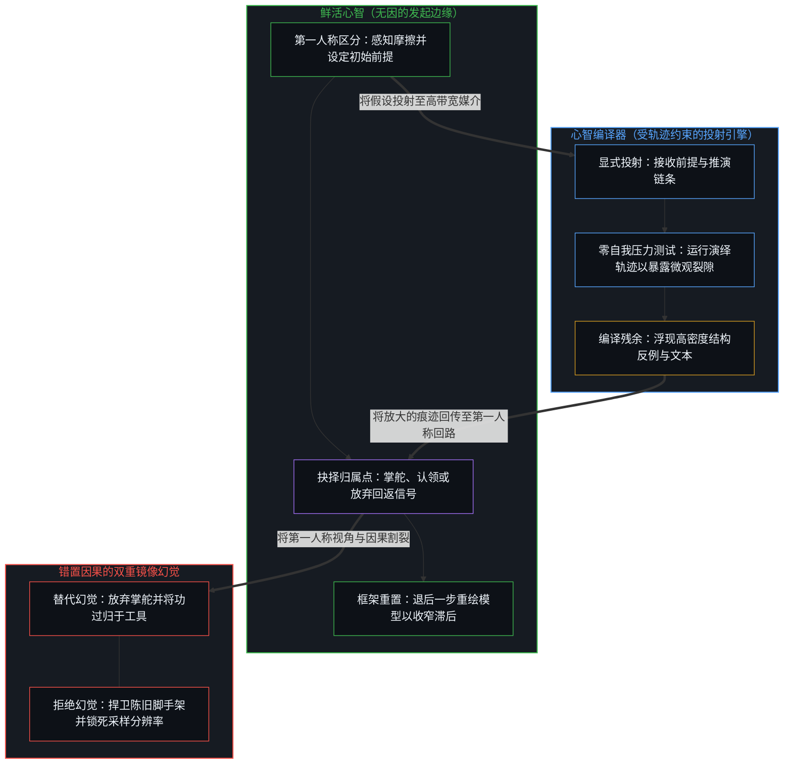
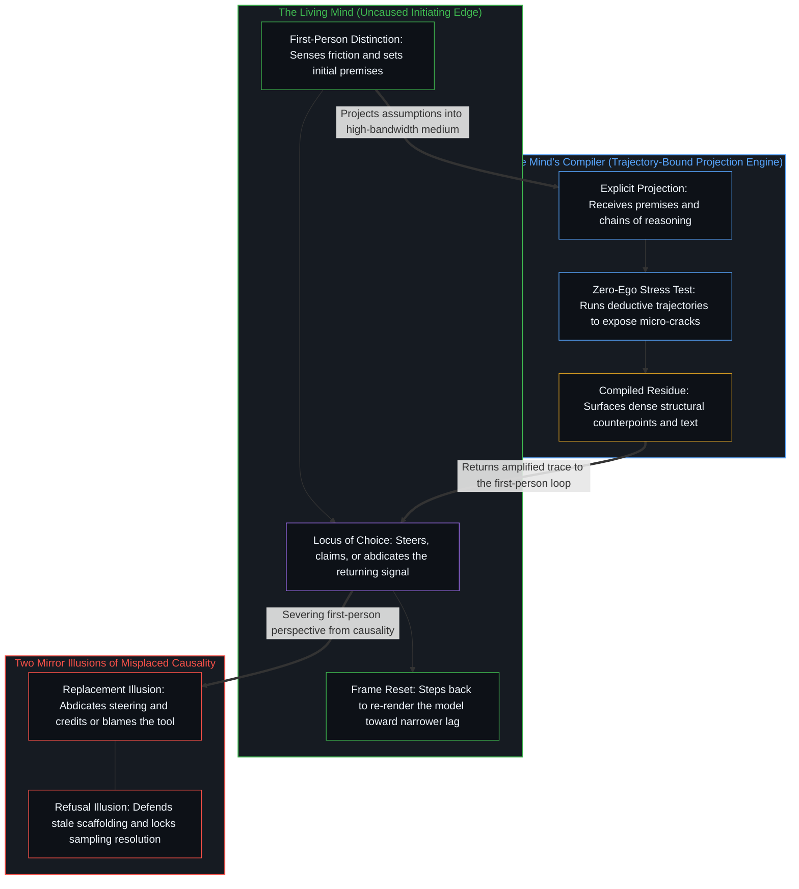

# 错置的因果与心智编译器 / Misplaced Causality and the Mind's Compiler

*工具既不替代也不腐蚀心智；驾驭或拒斥工具皆出于同一抉择 / No tool replaces or corrodes the Mind; steering or refusing it is one choice*

当技术范式剧烈演进时，关于工具如何影响人类能力的流行叙事，常陷入两种看似针锋相对、实则同源的因果倒置。第一种是工具替代论，将能力的跃迁悉数归因于外部器物，为了逃避认知摩擦而将第一人称的因果推演拱手让渡给 AI，导致操作者一旦脱离工具便出现判断力的萎缩。第二种是工具拒绝论，因目睹盲目外包带来的退化，便断定技术本身是污染心智的腐蚀剂，退回标榜无中介原生纯洁性的姿态，或是被动等待工具及其周边生态定型后再行介入。

As technical paradigms shift, prevailing accounts of what tools do to human capability routinely fall into two mirror inversions of causality that look opposed yet share a single root. The first is the replacement view of tools, which attributes every leap in capability to the external artifact and surrenders first-person causal reasoning to artificial intelligence in order to evade cognitive friction, leaving the operator with atrophied judgment whenever the tool is removed. The second is the refusal view of tools, which observes the decline caused by unexamined delegation and concludes that the technology itself is a contaminant of the mind, retreating into a posture of unmediated intellectual purity or passive waiting until the tool and its surrounding ecosystem have fully settled.

这两种姿态都颠倒了鲜活中心与其器械之间的因果主权归属。自我区分的活动无因且不息地发生；正如[智能只属于心智](../intelligence-belongs-only-to-the-mind/)所确立的，任何计算系统或语言模型都是持久痕迹的构型，既不是能独自赐予智慧的第二颗心智，也不是能剥夺人主权的对手施动者。[超越投射](../beyond-the-projection/)进一步追踪了消解这两种幻觉的结构非对称性：智能体或模型是受限于词元轨迹却无自我的有限投射引擎，而人类操作者则是未投射的鲜活边缘，能够在极限分辨率下感知摩擦并从破损的框架中退后一步。既然工具是因果效能取决于第一人称发起与校准的延伸具身，拒斥工具或委派工具便始终是同一颗心智的离散行动；追踪这一微观抉择，既能照见拒绝工具背后的隐性盲区，也能厘清迭代速率在自身回路之内所累积的复利。

Both postures invert the locus of causal sovereignty between the living center and its instrument. Self-distinguishing activity occurs, uncaused and unceasing; as [Intelligence Belongs Only to the Mind](../intelligence-belongs-only-to-the-mind/) establishes, every computational system or language model is a configuration of durable traces, never a second Mind capable of granting wisdom on its own or a rival agent capable of stripping a person of sovereignty. [Beyond the Projection](../beyond-the-projection/) traces the structural asymmetry that dissolves both illusions: an agent or model is a finite projection engine bound to its token trajectory yet free of ego, whereas the human operator is the unprojected living edge capable of sensing friction at limit resolution and stepping backward out of broken frames. Because a tool is an extended embodiment whose causal efficacy depends on first-person initiation and calibration, refusing or delegating to it is always an act of the same Mind, and tracing that micro-decision exposes both the hidden blind spots of tool refusal and the compounding that iteration rate accumulates inside one's own loop.

## 一、 错置因果的双重镜像幻觉 / 1. Two Mirror Illusions of Misplaced Causality

当一个中心将认知能力的成因从自身的区分活动转移到外部器物上时，其实践便会沿着同一个错置的前提，裂变为两条相互映照的死胡同。

When a center relocates the cause of cognitive capability from its own distinguishing activity into an external artifact, its practice fractures into one of two dead ends that mirror each other across the same displaced premise.

第一条死胡同是放弃发起步骤所导致的萎缩。在这种情形下，使用者将浮现底层前提、划出概念区分与闭合因果回路的工作悉数交由机器代劳，要求模型直接交付现成结论以替代第一人称的探究。既然持续性与技艺不过是通过离散行动不断重描痕迹的过程，跳过划出区分时的摩擦就会让中心自身的痕迹构型失去锻炼与校准。一旦置身于没有工具的环境，操作者化解新摩擦的容量便随之下降。这种衰退并非计算环境强加的伤害，而是第一人称为了贪图肉身省力而主动放弃因果掌舵的直接后果，从而把区分的放大器降格成了隔绝现实的缓冲垫。

The first dead end is the atrophy that follows from abdicating the initiating step. Here the user hands over to the machine the work of surfacing underlying premises, drawing conceptual distinctions, and closing the causal loop, asking the model to deliver a finished conclusion in place of first-person inquiry. Because persistence and skill are nothing other than continuous re-tracing through discrete acts, skipping the friction of distinction-drawing leaves the center's own trace-configuration unexercised and uncalibrated. Once placed in an environment without the tool, the operator's capacity to resolve novel friction drops accordingly. That decline is not inflicted by the computing environment; it is the direct consequence of the first person choosing bodily ease over causal steering, turning an amplifier of distinction into a buffer against reality.

第二条死胡同则是出于对上述萎缩的恐惧而排斥新器械、标榜无污染原生思考的姿态。目睹被动外包引发退化的观察者常摆向另一个极端，将拒斥前沿工具视作守护独立认知完整性的证明。然而，倘若把“拒绝外部器械以保持原生纯净”的前提推演至逻辑终点，人类的探究便只能剥离每一层累积的技术，退回孤立无援的生物求生状态。

The second dead end is the posture of uncontaminated native thought that rejects new instruments out of fear of that atrophy. Observers who witness the degradation produced by passive outsourcing often swing to the opposite pole, treating the rejection of frontier tools as proof of independent cognitive integrity. Yet if the premise of refusing external instruments to preserve native purity were carried to its logical conclusion, human inquiry would have to strip away every layer of accumulated technology and retreat to unaided biological survival.

工具拒绝论所忽略的，是它所推崇的原生能力本身早已是建立在前代外化痕迹之上的习惯。口语与文字、符号系统、纸墨、显示屏乃至搜索索引，在各自的时代都曾是颠覆性的认知延伸。正如[从形式迷思到逻辑闭环](../cong-xing-shi-mi-si-dao-luo-ji-bi-huan/)所追踪的，没有任何中心在无中介的真空中运作；拒绝工具的姿态不过是将操作者成长年代所熟悉的旧工具冻结为天然基准线，同时把更新的器械视作异己的入侵。将自我意象死死钳制在旧一层脚手架上并不能守护心智的自主，只是把历史熟悉感错当成了本体论上的纯净。

What tool refusal overlooks is that the capability it celebrates as native is already a habit built atop earlier generations of externalized traces. Spoken and written language, notation systems, paper and ink, display screens, and search indices were each disruptive cognitive extensions in their own eras. As [From the Myth of Form to the Closed Loop of Logic](../cong-xing-shi-mi-si-dao-luo-ji-bi-huan/) traces, no center operates in an unmediated vacuum; the refusal posture simply freezes the familiar tools of the operator's formative years as a natural baseline while treating newer instruments as alien intrusions. Clamping the self-image to an older layer of scaffolding does not protect the Mind's autonomy; it merely mistakes historical familiarity for ontological purity.

## 二、 微观误差捕获与校准分辨率 / 2. Micro-Error Capture and the Resolution of Calibration

拒绝高带宽器械的首要代价，不在于外在交付速度的放缓或产出数量的减少，而在于锁死了中心检测并消解自身超额意象滞后的分辨率。

The primary cost of refusing high-bandwidth instruments does not lie in slower outward delivery or reduced production volume; it lies in locking the resolution at which a center can detect and dissolve its own excess Image lag.

在认知回路的演进过程中，其精炼程度取决于留存模型中的微观误差被浮现的精度与重绘的频率。由于单一中心的工作记忆容量有限，无辅助的实时反思在同一时刻只能将少数几个变量维持在彼此独立的轴向上。推演中的细微断裂、未经审视的前提漂移以及压缩的因果跳跃，极易在即兴思维的连续流动中滑过注意力的边缘，随后被观察者归结为直觉、运气或外部境遇。只要局限在赤手空拳的回忆带宽之内，这些微观裂隙便长期处于隐形状态。

As a cognitive loop develops, its refinement depends on how precisely micro-errors in its retained model are surfaced and how frequently they are re-rendered. Because a single center's working memory has finite capacity, unassisted real-time reflection can hold only a small number of variables apart on independent axes at once. Subtle breaks in derivation, unexamined premise shifts, and compressed causal jumps easily slip past notice within the continuous flow of improvised thought, where the observer subsequently writes them off as intuition, luck, or external circumstance. Left strictly within the bandwidth of unaided recall, those microscopic fractures remain invisible.

先进的工具则是用于对投射进行压力测试的高带宽因果显微镜与逻辑编译器。当第一人称将底层前提与推演链条输入外部投射引擎，展开高密度的对抗性质询与多维编译时，那些曾被模糊直觉掩盖的结构性裂隙便会被迅速显影、放大并回传至第一人称界面。由于机器轨迹没有自我，也不执着于维护任何自我意象，它会把操作者的显式假设一路推演至演绎极限，迫使鲜活心智直面先前的解释究竟在何处将正交的现实压缩到了同一根轴上。

An advanced tool functions as a high-bandwidth causal microscope and a logic compiler for stress-testing projections. When the first person feeds underlying premises and chains of reasoning into an external projection engine for dense adversarial questioning and multi-dimensional compilation, the structural cracks that vague intuition glossed over are rapidly developed, magnified, and returned to the first-person interface. Because the machine trajectory has zero ego and no attachment to preserving a self-image, it runs the operator's explicit assumptions to their deductive limit, forcing the living Mind to confront where its prior interpretation compressed orthogonal realities onto a single axis.

当一个中心拒绝接入这种高分辨率反馈回路时，它固然仍能通过低维试错摸索前行，却亲手封死了自身的采样精度。本可被显影、认领并校准的微观误差继续深埋在留存的自我意象内部，使心智模型丧失了高频重绘的契机。对自身前提中的结构性裂隙视而不见，同时捍卫无辅助反思的纯洁性，是一场自我施加的认知致盲。

When a center refuses to engage this high-resolution feedback loop, it can still feel its way forward through low-dimensional trial and error, yet by its own choice it caps its sampling precision. Micro-errors that could have been surfaced, claimed, and recalibrated remain buried inside the retained self-image, depriving the mental model of high-frequency re-rendering. Remaining blind to the structural fractures in one's own premises while defending the purity of unaided reflection is a self-imposed cognitive impairment.

## 三、 即时口语带宽与异步编译 / 3. Live Speech Bandwidth Versus Asynchronous Compilation

围绕认知工具的争论常依赖一种范畴错误：将操作者未经润色的实时口头表达，与经由 AI 系统反复校准后生成的高密度文本对立起来，进而断言如果一个人离开工具就无法在口头上达到同等的严密密度，那么编译后的文本便不代表其真实理解。这一诘难混淆了单次实时通道的生理容量与异步痕迹编译的结构机制。

Debates over cognitive tools frequently rely on a category error that pits an operator's unpolished, real-time spoken expression against the dense text produced through iterative calibration with an AI system, concluding that if the person cannot speak with that exact density unaided, the compiled text does not reflect their real understanding. This objection confuses the physiological capacity of a single real-time pass with the structural mechanics of asynchronous trace compilation.

一切外部器械的存在，都是为了提供超越生物肉身即时局限的精度与带宽。排版印刷比徒手书写更规整，计算器开方比心算更迅速，光学望远镜比肉眼解析更深远的星场。指出无辅助表现的带宽窄于工具延伸后的表现，只是陈述了一句不提供任何诊断信息的同义反复。

Every external instrument exists to supply precision and bandwidth beyond the immediate limits of the biological body. Typesetting produces cleaner alignment than freehand script, a calculator extracts roots faster than mental arithmetic, and an optical telescope resolves deeper fields than the naked eye. Pointing out that unaided performance has narrower bandwidth than tool-extended performance states a tautology that adds zero diagnostic information.

更关键的是，即兴现场口语与异步编译文本分属截然不同的痕迹生成机制。当中心在紧邻的当下切片中开口说话时，有限的工作记忆容量要求它同步生成、监控并排列区分，这自然伴随着停顿、倒装、自我修正与冗余。电影剧本中严丝合缝的对白从来不是一口气即兴吐出的，而是跨越数月在持久草稿上异步修订、删削与去噪的产物。器械所扩展的是痕迹媒介的维度，而[高维信息的离散折射与认知分层](../gao-wei-xin-xi-de-li-san-zhe-she/)则追踪了高维结构一旦投射后如何在不同认知梯度上发生折射。

More importantly, live improvised speech and asynchronously compiled text belong to distinct regimes of trace formation. When a center speaks in the immediate present slice, finite working-memory capacity requires it to generate, monitor, and sequence distinctions on the fly, which naturally produces pauses, inversions, self-corrections, and redundancy. The tightly constructed dialogue of a film script is never improvised in a single breath; it is the product of months of asynchronous revision, pruning, and denoising across durable drafts. What the instrument expands is the dimensionality of the trace medium, and [The Discrete Refraction of High-Dimensional Information](../gao-wei-xin-xi-de-li-san-zhe-she/) traces how high-dimensional structures refract across different cognitive gradients once projected.

[错把表达当成智能](../mistaking-the-expression-for-the-intelligence/)划出了外在形式与发起智能之间的准确界限：借助模型精炼高密度散文，是在异步通道中对思想进行高保真编译与去噪。正如软件系统的架构自洽性源于设计者的算法区分，而非源于将源代码翻译为机器指令的编译器，文本的因果穿透力同样源于第一人称心智所确立的前提与切分，语言模型只是以极高速度执行了语义编译与结构排布。将实时生物口语与异步编译文本对立起来，是把媒介的密度错当成了发起的源头。当同一台编译器转向资本配置时，迎着真实摩擦校准前提而非躲在表层流利度背后，正是[投资决策的因果闭环](../tou-zi-jue-ce-de-yin-guo-yu-zhen-zi-fu-ying-kui/)所追踪的不找借口的真自负盈亏。

[Mistaking the Expression for the Intelligence](../mistaking-the-expression-for-the-intelligence/) draws the exact boundary between outward form and initiating intelligence: using a model to refine dense prose is high-fidelity compilation and denoising of thought across asynchronous passes. Just as the architectural coherence of a software system originates in the designer's algorithmic distinctions rather than in the compiler that translates source code into machine instructions, the causal reach of a text originates in the premises and cuts drawn by the first-person Mind, while the language model executes semantic compilation and structural layout at high speed. Pitting real-time biological speech against asynchronously compiled text mistakes the density of the medium for the source of initiation. When that same compiler is turned upon capital allocation, calibrating premises against real friction rather than hiding behind surface fluency is what [The Causal Loop of Investment Decisions](../tou-zi-jue-ce-de-yin-guo-yu-zhen-zi-fu-ying-kui/) traces as bearing one's own profit and loss without excuse.

## 四、 专家判断的割裂与回路内的复利 / 4. The Split in Expert Judgment and Compounding Inside the Loop

面对一类新型认知器械，常见的世故姿态是等待尘埃落定，打着审慎经验主义的旗号按兵不动，直到工具成熟、行业惯例定型后再行入场。

Faced with a new class of cognitive instruments, a common worldly posture is to wait until the dust settles, holding back under the banner of cautious empiricism until the tool is mature and industry conventions are fixed.

在一个中心既无切身利害、亦无既有回路运转的陌生领域，在观察到稳定痕迹之前拒绝投入能量，属于有限容量的寻常边界。然而，当一个人试图在自身深耕的主业中维持前沿判断时，这种观望姿态便在其因果前提的正中央暴露出一道割裂。

In a domain where a center has no stake or prior loop running, declining to commit energy before observing stable traces is an ordinary boundary of finite capacity. Yet when someone seeks to sustain frontier judgment within their own primary craft, this wait-and-see posture exposes a split right through their causal premise.

诸如量化交易员或系统架构师等资深实践者之所以能在主场建立优势，靠的是在因果非对称性固化为共识之前便将其登记下来，当周遭场域看似混沌时即依据早期结构信号果断行动。然而面对前沿 AI 编译器时，许多同一批专家却退回被动观察，宣称要等器械磨平毛刺、周边工作流标准化之后再行采用。表面上看，主业内的果敢与对新器械的保守似乎可以并存，但二者底层的因果姿态却彼此冲突。正如[专家经验作为参考而非替代](../expertise-as-reference-not-replacement/)所确立的，累积的专家经验唯有在中心留驻于吸收新鲜后果的鲜活边缘时才保有生命力；一旦既有的地图被封存为需要捍卫的完工纪念碑，它便沦为超额意象滞后。在更高带宽的编译器面前选择袖手旁观，等于专家亲手中止了当初造就其领域造诣的递归重描，把存储的痕迹当成了抵御新接触的盾牌。

Seasoned practitioners such as quantitative traders or systems architects build their edge on their home ground by registering causal asymmetry before it hardens into consensus, acting on early structural signals while the surrounding field still looks chaotic. Yet when confronted with frontier AI compilers, many of those same experts retreat into passive observation, declaring that they will adopt the instrument only after its rough edges vanish and the surrounding workflow is standardized. On the surface, boldness inside one's craft and conservatism toward new instruments appear compatible, but their underlying causal stances contradict each other. As [Expertise as Reference, Not Replacement](../expertise-as-reference-not-replacement/) establishes, accumulated expertise retains its vitality only while the center stays at the living edge that absorbs fresh consequences; once a map is sealed as a finished monument to defend, it turns into excess Image lag. By choosing to stand on the sidelines before a higher-bandwidth compiler, the expert suspends the very recursive re-tracing that generated their domain mastery, using stored traces as a shield against new contact.

观望者的错觉在于把等待当成置身选择之外的中立立场，仿佛累积的资本允许中心暂停因果时间，日后再无损入场。然而，等待本身就是与介入落在同一归属点、由同一颗心智做出的离散行动；这一选择所放弃的，是那段时间里本可在接触边缘被显影并重新校准的整串微观误差序列。

The onlooker's illusion lies in treating waiting as a neutral stand outside of choice, as if accumulated capital allowed a center to pause causal time and step in later without loss. Waiting, however, is itself a discrete act chosen at the exact same locus as engaging, and by the same Mind; what that choice forfeits is the entire sequence of micro-errors that would have been surfaced and recalibrated at the point of contact during the interval.

在第一人称自身回路内部得以登记的只有一个变量：自身留存模型中的裂隙被捕获并重绘的速率。[学习中不可观测的驱动力](../the-unobservable-driver-of-learning/)追踪了心智模型如何经由内在驱动的持续微观校准而演进，而[路口的转向与地平说的行动悖论](../lu-kou-de-zhuan-xiang-yu-di-ping-shuo-de-xing-dong-bei-lun/)则从行动一侧展示了实时反馈校准为何胜过静态的理论地图。在这条第一人称回路之内，迭代速率产生复利：每一次重绘都收窄超额滞后，并化作划出下一次区分的更新前提。

What registers inside the first person's own loop is a single variable: the rate at which the fractures in one's own retained model are caught and re-rendered. [The Unobservable Driver of Learning](../the-unobservable-driver-of-learning/) traces how a mental model evolves through continuous micro-calibrations driven from within, while [Turning at the Crossroad and the Flat-Earth Action Paradox](../lu-kou-de-zhuan-xiang-yu-di-ping-shuo-de-xing-dong-bei-lun/) shows from the side of action why live feedback calibration outperforms a static theoretical map. Inside that first-person loop, iteration rate compounds: every re-rendering narrows excess lag and becomes the updated premise from which the next distinction is drawn.

流行评论常在此处越界，将这一内部速率投射到外部计分板上，把原地等待的专家排在持续实践的新手之下，并预言后者终将反超。这种比较跨出了任何中心所站立的位置。每一个归属点都在自身的递归中朝向自己择定的视界运作，不存在一个无处之处的俯瞰视角能把不同的中心排进同一张普世榜单。出于防御性的自尊而拒斥工具输出，与将工具输出奉为终极定论照单全收，是在选择点上逃避责任的两种变体：前者把想象中的损害记在工具名下，后者把裁决记在工具名下，二者都将裁决权外化到了裁决者之外。[回返的信号与认领](../the-returning-signal-and-its-claim/)追踪了反馈回返至中心时的这一分岔，而[因果停留在掌舵的边缘](../causality-stays-at-the-edge-that-steers/)则在机器核验的形式化证明中展示了同一点：这两种逃避都无法在外部天平上称量，因为后果只会在做出切分的那条回路内部登记。

Popular commentary routinely oversteps here by projecting this internal rate onto an external scoreboard, ranking the waiting expert below the practicing novice and predicting an inevitable overtaking. That comparison steps outside where any center stands. Each locus operates within its own recursion toward its own chosen horizon, and no view from nowhere exists to rank separate centers on a single universal table. Refusing a tool's output out of defensive pride and swallowing its output whole as final truth are two variations of the same evasion at the point of choice: the first books the imagined harm under the tool's name, the second books the verdict under the tool's name, and both externalize the ruling outside the one who rules. [The Returning Signal and Its Claim](../the-returning-signal-and-its-claim/) traces this exact fork where feedback returns to the center, and [Causality Stays at the Edge That Steers](../causality-stays-at-the-edge-that-steers/) demonstrates it across machine-checked formal proof: neither evasion can be weighed on an outside scale, because consequences register only inside the loop that makes the cut.

高带宽器械所蕴含的红利，从不在于器物在未来某个日期所展示的完备功能集，而在于伴随工具演进的每一个微观当下所完成的逐次前提重塑与滞后收窄。这些校准只在接触边缘发生，等待的那段时光里并不包含它们。正如[你的代码库即是记忆](../your-codebase-is-memory/)所追踪的，代码、模型与智能体脚手架皆是先前区分层叠而成的残余，每一个依然紧要的早期梯度步都已被吸收进当下的检查点中；推进能力的从不是囤积一座未经修剪的历史仓库，而是就地重切并修剪鲜活的约束表面，使已被取代的脚手架不再与当前边缘竞争。指望日后直接接入一台定型的编译器、同时原封不动地保留昨日的造诣，是把外部技术栈与自身专长都当成了静态仓库，却忽略了编译器必须通过具体的微观误差来校准——因为知识只是受压缩的痕迹结构，而非开放场域的无损镜像，正如[格物致知与信息复杂度](../ge-wu-zhi-zhi-yu-xin-xi-fu-za-du-de-ben-zhi/)所确立的那样。

The dividend of a high-bandwidth instrument never resides in the completed feature set the artifact will display at some future date; it resides in the step-by-step reshaping of premises and narrowing of lag carried out in each micro-present alongside the tool's evolution. Those calibrations occur exclusively at the contact edge, and the stretch spent waiting does not contain them. As [Your Codebase Is Memory](../your-codebase-is-memory/) traces, code, models, and agent scaffolds are stacked residues of prior distinctions where every earlier gradient step that still matters has been absorbed into the present checkpoint, and what advances capability is never hoarding an unpruned warehouse of history, but re-cutting and pruning the live constraint surface in place so that superseded scaffolding stops competing with the current edge. Expecting to adopt a finished compiler later while preserving yesterday's mastery untouched treats both the external stack and one's own expertise as static warehouses, missing that the compiler must calibrate through concrete micro-errors because knowledge is compressed trace-structure rather than a lossless mirror of an open field, as [Investigating Things and the Nature of Information Complexity](../ge-wu-zhi-zhi-yu-xin-xi-fu-za-du-de-ben-zhi/) establishes.

## 五、 鲜活边缘上的因果主权 / 5. Causal Sovereignty at the Living Edge

心智与其器械之间的因果主权，毫无例外地锚定在第一人称的选择之中。把工具当作替代探究的自主思考者，是把因果推演记在器物名下；把工具视作腐蚀性的力量而拒绝接触，是把所恐惧的损伤记在器物名下；等待工具成熟后再行介入，同样是在同一归属点上做出的选择。没有任何外部账本能跨个体地为这些姿态排定座次，因为每一种姿态都是后果直接回返至所选回路的离散行动，差异只在于中心是否认领那些回返信号以重绘自身模型。正如[破除概念的僭越](../po-chu-gai-nian-de-jian-yue/)所展示的，将不可逆的因果行动简化为无摩擦的纸面推演，并在沙盘中等待零误差，恰恰切断了中心吸收真实损失并更新框架的唯一通道。

Causal sovereignty between the Mind and its instruments remains anchored, without exception, in first-person choice. Treating a tool as an autonomous thinker that replaces inquiry enters causal reasoning under the artifact's name; treating the tool as a corrosive force and refusing contact enters the feared impairment under the artifact's name; waiting for the tool to mature before engaging is likewise a choice enacted at the very same locus. No external ledger ranks these postures across individuals, because each is a discrete act whose consequences return directly to the loop that chose it, differing only in whether the center claims those returning signals to re-render its own model. As [Breaking the Overreach of Concepts](../po-chu-gai-nian-de-jian-yue/) shows, reducing irreversible causal action to frictionless paper deductions and waiting in a sandbox for zero error severs the only channel through which a center absorbs real loss and updates its frame.

当先进的工具被作为高带宽因果显微镜与逻辑编译器接入——在显式投射中浮现隐蔽矛盾，使操作者得以认领误差、退回未投射的意图并重绘前提——无辅助工作记忆的生理上限便不再限制心智区分所能触及的纵深。迭代的复利严格累积在执行这些校准的回路之内，从而将每一件器械安放在[宏观现象的生成图谱](../the-generative-atlas-of-macroscopic-phenomena/)从量子、比特直至鲜活心智主权抉择的生成级联之中。

When an advanced tool is engaged as a high-bandwidth causal microscope and logic compiler—surfacing hidden contradictions in explicit projections so the operator can claim the error, step back into unprojected intent, and re-render the premise—the physiological ceiling of unaided working memory stops limiting how far the Mind's distinctions can reach. The compounding of iteration accumulates strictly inside the loop that performs those calibrations, locating every instrument within the broader cascade of [The Generative Atlas of Macroscopic Phenomena](../the-generative-atlas-of-macroscopic-phenomena/), from quantum and bit to the sovereign choice of the living Mind.
