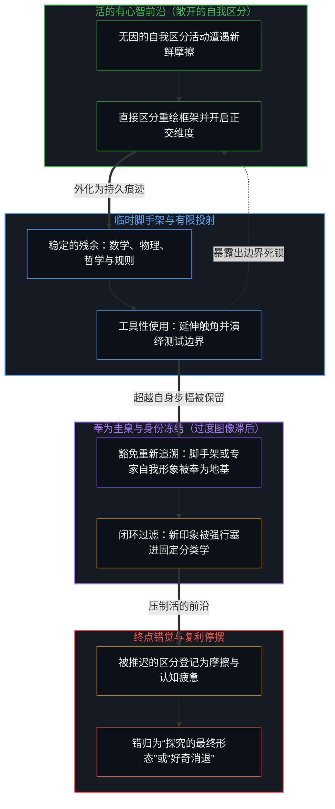
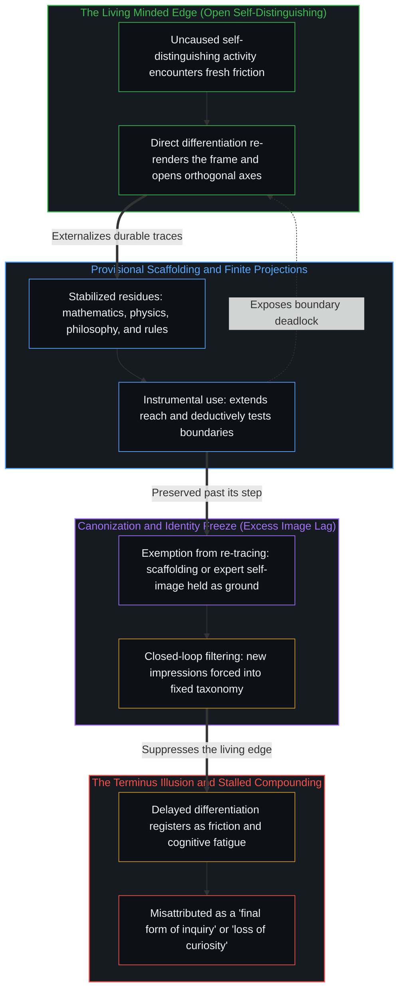

# 好奇没有最终的形态 / Curiosity Has No Final Form

*把形式学科当作好奇的终点，是把脚手架错认作心智本身 / Taking formal disciplines as curiosity's end mistakes scaffolding for the Mind*

好奇没有最终的形态。声称探究终结于某一组奉为圭臬的学科——例如数学、物理与哲学——描述的并不是好奇，而是登记着认知的滞后。自我区分的活动无因、不息地发生着。当探索看似抵达终点时，发生改变的并不是生成活动本身，而是心智用来度量自身运动的那份被保留的参照。当三个历史范畴被奉为探究的顶峰，未来的区分唯有塞进它们既定的疆界之内，才被承认为正当；凡是落在疆界之外的，不是被斥为琐碎，就是被逐出求真之列。这三门起初作为活生生的探究所留下的临时痕迹的学科，被冻结成免于重新追溯的刚性容器，而正是这份豁免，制造出了“最终形态”的错觉。

Curiosity has no final form. The claim that inquiry culminates in a canonical set of disciplines—such as mathematics, physics, and philosophy—does not describe curiosity; it registers cognitive lag. Self-distinguishing activity occurs, uncaused and unceasing. What changes when exploration appears to reach a terminus is not the generating activity itself, but the retained reference against which the Mind measures its own movement. When three historical categories are canonized as the summit of investigation, future distinguishing is recognized as legitimate only when it fits inside their established borders, while whatever falls outside those borders is dismissed as trivial or excluded from the pursuit of truth. The three disciplines, which began as provisional traces of living inquiry, are frozen into rigid containers exempted from re-tracing, and that exemption generates the illusion of a final form.

## 一、 终点的范畴错误 / 1. The Category Error of the Terminus

数学、物理与哲学，属于人类最精炼、共振最强的脚手架：它们是数百年来严谨的区分活动所留下的致密且高度协调的残余。当这份累积的残余被错认作探究的天花板时，范畴错误便发生了。一门学科起初是一连串活的问题，在敞开的场域里一刀刀切出新鲜的区分；一旦这些区分凝固成教科书里的形式体系，它们就从主动的递归中脱落，被当作思想本身客观的建筑。一门学科一旦被宣布为最终目的地，就不再作为探索未知的工具运转，反而被当成把关的滤网，用来裁定什么才算正当的好奇。声称物理或哲学是好奇的最终形态，就像声称制图学是行走的最终形态：地图记录的只是区分已经发生过的地方，而指南针则是迈出下一个无剧本步伐的活的能力。

Mathematics, physics, and philosophy are among humanity's most refined and resonant scaffoldings: dense, highly coordinated residues left behind by centuries of rigorous distinction-making. The category error occurs when that accumulated residue is mistaken for the ceiling of inquiry. A discipline begins as a living sequence of questions that carve out fresh distinctions in an open field; when those distinctions stabilize into textbook formalisms, they drop out of active recursion and are treated as the objective architecture of thought itself. Once a discipline is declared a final destination, it stops functioning as an instrument for exploring the unknown and is wielded instead as a gatekeeping filter to adjudicate what qualifies as valid curiosity. Claiming that physics or philosophy is the final form of curiosity is like claiming that cartography is the final form of walking: the map records where distinguishing has already occurred, whereas the compass is the living capacity to take the next unscripted step.

[遗忘的脚手架](../the-scaffolding-we-forget/)追踪的正是这种脱落：脚手架为解决局部的协调问题而搭起，可一旦稳定下来，观察者便把脚手架错认作场域本身。[超越的定相](../the-fixed-image-of-transcendence/)诊断了同样的结构陷阱：活的攀登被冻结成一尊静止的偶像，一条敞开的轨迹被改造成一座供奉起来的纪念碑。

[The Scaffolding We Forget](../the-scaffolding-we-forget/) tracks this exact drop-out: scaffolding is erected to solve a local problem of coordination, yet once it stabilizes, observers mistake the scaffold for the field itself. [The Fixed Image of Transcendence](../the-fixed-image-of-transcendence/) diagnoses the same structural trap where a living climb is frozen into a static icon, turning an open trajectory into a preserved monument.

## 二、 好奇消退感的生成剖析 / 2. The Anatomy of a Felt Loss of Curiosity

好奇，是有心智的中心进行区分时所感到的倾向：把这与那分开，把新遭遇的与已登记的分开。这股生成的倾向并不随年龄、教育或疲惫而衰减；发生偏移的，是用以评估新来痕迹的那份被保留的参照。好奇所穿过的每一门学科，都是[信息是什么](../what-information-is/)所追溯的那种严格意义上的信息：由中心划出的一次离散区分，从不是等在世界里待人发现的静态实体。

Curiosity is the felt tendency of a minded center to distinguish: separating this from that, and the newly encountered from the already registered. That generative tendency does not decay with age, education, or fatigue; what shifts is the retained reference against which incoming traces are evaluated. Every discipline through which curiosity passes is information in the exact sense traced in [What Information Is](../what-information-is/): a discrete distinction drawn by a center, never a static substance waiting in the world to be found.

随着一次次区分不断累积，它们凝结成一副致密的、被保留下来的自我形象——确信自己已是通晓这片地形的专家。当新鲜的印象落入感知，信号不再于活的前沿直接、即时地触发区分，而是被迫先穿过一道迟缓的滤网，对照那副保存下来的形象接受解读。对照既往残余所作的解读被错认作认知，而在前沿上不受抑制的区分为了维护既定框架的权威，反而被推迟或压制了下去。由此产生的摩擦、过度滞后与认知疲惫，随后被错误地归咎于内在的匮乏，而自发探究的缺席在被感到之后，便被贴上了好奇消退的标签。[判断力不是可囤积的存量](../judgment-is-not-a-stock/)通过追踪同一机制，消解了中年老将资历与年轻建造者之间的人口学坐标轴：无论年龄还是累积的经验，都不是跨越迁移的约束边界后决定走向的存量，因为让探究与判断保持活力的，是将自身先前模型视为临时假设、并在当前前沿亲手推翻昨日之我的习惯。

As successive distinctions accumulate, they cohere into a dense, retained self-image—the conviction of being an expert who already commands the landscape. When a fresh impression lands in perception, instead of triggering direct, immediate differentiation at the living edge, the signal is forced through the slow filter of interpretation against that preserved image. Interpretation against prior residue is mistaken for knowing, while uninhibited differentiation at the edge is delayed or suppressed to protect the authority of the established frame. The resulting friction, excess lag, and cognitive fatigue are then misattributed to an internal deficit, and the felt absence of spontaneous inquiry is labeled a loss of curiosity. [Judgment Is Not a Stock](../judgment-is-not-a-stock/) dissolves the demographic axis between middle-aged veteran tenure and youthful builders by tracing this same mechanism: neither age nor accumulated experience is a stock that decides the trajectory across a shifted constraint boundary, because what keeps inquiry and judgment alive is the habit of treating one's own prior models as provisional and overturning yesterday's self at the current frontier.

[好奇先行](../curiosity-first-the-hidden-engine-of-talent-and-development/)描绘了这种倒置如何让人的复利停摆：把累积的残余当作固定的天赋或业已完结的精通，恰恰打断了当初生出这份能力的好奇回路。[封闭的假设把复利挤成 S 曲线](../closed-assumptions-squeeze-compounding-into-s-curves/)确认了这一平台期的结构根源，指出增长的天花板并非心智的自然极限，而是把临时假设冻结成永久容器的产物。为了捍卫僵硬的自我形象而把递归回折死死夹闭，会在源头上锁死探究，这正是[自尊的刚性外壳与隐性外部归因](../zi-zun-de-gang-xing-wai-ke-yu-yin-xing-wai-bu-gui-yin/)在防卫性自尊尺度上所追踪的同一机制。

[Curiosity First](../curiosity-first-the-hidden-engine-of-talent-and-development/) maps how this inversion stalls human compounding: treating accumulated residue as fixed talent or finished mastery interrupts the very curiosity loops that generated the capability. [Closed Assumptions Squeeze Compounding into S-Curves](../closed-assumptions-squeeze-compounding-into-s-curves/) confirms the structural source of this plateau, showing that ceilings on growth are not natural limits of the mind, but artifacts of freezing provisional assumptions into permanent containers. Clamping the recursive fold shut to defend a rigid self-image locks inquiry down at the source, the exact mechanism that [The Rigid Shell of Self-Esteem and Hidden External Attribution](../zi-zun-de-gang-xing-wai-ke-yu-yin-xing-wai-bu-gui-yin/) traces at the scale of defensive self-esteem.

## 三、 学科是可用的残余，不是最终的目的地 / 3. Disciplines as Available Residue, Not Final Destinations

当被保留的参照被持续重新描摹以收窄过度滞后，学科之间虚假的等级便随之消解。数学、物理与哲学不再充当权威的终点或裁定真理的关口，而是回到它们一直所是的样子：有力、富有共振且可不断修订的脚手架。正如[你的代码库即是记忆](../your-codebase-is-memory/)所确立的，一门学科的经典——就像一座代码库或一组模型权重——是层叠的记忆：它是早先区分留下的残余形态，自身并不能延续区分。把经典当作未经修剪的纪念碑囤积起来，只会增厚它的引力井，把后续的探究拽入陈旧的前提内部做合理化，而不是跨出已经失效的框架；反之，把它当作当下的检查点来持握，则是只保留在当前摩擦下依然承重的约束，同时将任何已被下一次区分所取代的部分重新切分或修剪掉。

When the retained reference is continuously re-rendered to narrow excess lag, the false hierarchy of disciplines dissolves. Mathematics, physics, and philosophy stop serving as authoritative termini or tribunal gates of truth, returning to what they have always been: powerful, resonant, and continually revisable scaffolding. As [Your Codebase Is Memory](../your-codebase-is-memory/) establishes, a disciplinary canon—like a codebase or a set of model weights—is stacked memory: residual shape left by prior distinguishing that cannot continue the distinguishing on its own. Hoarding a canon as an unpruned monument thickens its gravity well, pulling subsequent inquiry into rationalizing inside stale premises rather than stepping outside a broken framing; holding it instead as a present checkpoint keeps only the constraints that remain load-bearing under current friction while re-cutting or pruning whatever the next distinction has superseded.

一位软件工程师切出一条新的并发边界时，运用的是与物理学家构作规范对称性时同样的区分能力；一位画家推敲色彩的过渡，或一位创业者搭起一套涌现的协调协议时，与一位哲学家剖析语义范畴一样，都站在同一道生成的前沿上。没有哪门学科垄断深度，因为深度取决于一次发起的区分在活的前沿上多么干净地化解摩擦，而不取决于存放这份残余的历史容器享有多高的声望。

A software engineer isolating a novel concurrency boundary exercises the same distinguishing capacity as a physicist formulating a gauge symmetry; a painter refining a chromatic transition or an entrepreneur wiring an emergent coordination protocol works at the same generative edge as a philosopher dissecting semantic categories. No discipline holds a monopoly on depth, because depth is determined by how cleanly an initiating distinction resolves friction at the living edge, not by the historical prestige of the container in which the residue is filed.

[持续生长的脚手架](../the-scaffolding-that-keeps-growing/)揭示了这种建造活的一面：等到观察者退后一步去审视任何一座建成的形式结构时，脚下的地面早已移动。[智能只属于心智](../intelligence-belongs-only-to-the-mind/)在一切工具与经典之上恢复了因果次序：智能是心智无因的、主动的区分，从不是公式、学说或模型权重的库存。[超越投射](../beyond-the-projection/)在思想与计算的架构中论证了同样的非对称性：每一套显性的理论、学科经典或智能体规则手册，都是从活的意图那超高维场域投射出来的有限低维投影。留在自身的形式轨迹之内，有限投射虽然可以演绎穷尽其前提，却无法在正交的现实发生碰撞时迈出自己的坐标系。唯有活的心智——在极限分辨率上感知前解释阶段的摩擦——才能识别出整套学科框架何时陷入死锁，从破损的投射中退后一步，并发起更高阶的区分。

[The Scaffolding That Keeps Growing](../the-scaffolding-that-keeps-growing/) shows the living side of this construction: by the time an observer steps back to survey any completed formal structure, the ground underfoot has already moved. [Intelligence Belongs Only to the Mind](../intelligence-belongs-only-to-the-mind/) restores the causal order across every tool and canon: intelligence is the uncaused, active distinguishing of the Mind, never a stored inventory of formulas, doctrines, or model weights. [Beyond the Projection](../beyond-the-projection/) demonstrates this same asymmetry in the architecture of thought and computation: every explicit theory, disciplinary canon, or agentic rulebook is a finite low-dimensional projection cast from the ultra-high-dimensional field of lived intent. Left inside its own formal trajectory, a finite projection can deductively exhaust its premises, yet it cannot step outside its own coordinate system when orthogonal realities collide. Only the living Mind—sensing pre-interpretive friction at limit-resolution—can recognize when an entire disciplinary framing has deadlocked, step backward out of the broken projection, and originate a higher-order distinction.

## 四、 有心智的前沿敞开着 / 4. The Open Horizon of the Minded Edge

理论与学科，是持续的区分在身后留下的历史痕迹，其中没有一个是最终的，因为任何一道未被主动重划的边界，都已经旧了一步。好奇没有最终的形态，是因为生出区分的那份有心智的活动，没有一面可以让它永久闭合的外墙。探究的宇宙不会收敛到三个被奉上神坛的名目上；每划下一次区分，它就扩展一次。哪怕是宣布自己无知的精确形状与边界的姿态，也是又一个虚假的终点，即[“知道自己不知道”是一种修辞假象](../zhi-dao-zi-ji-bu-zhi-dao-de-ren-zhi-jia-xiang/)所拆解的修辞闭合。

Theories and academic disciplines are historical traces left in the wake of continuous distinguishing, and none of them is final because any boundary not actively redrawn is already one step old. Curiosity has no final form because the minded activity that generates distinctions has no exterior wall against which it could permanently close. The universe of inquiry does not converge onto three canonized titles; it expands with every distinction drawn. Even the posture of declaring the exact shape and boundary of one's own ignorance is another false terminus, the rhetorical closure that [Knowing That You Don't Know Is a Rhetorical Illusion](../zhi-dao-zi-ji-bu-zhi-dao-de-ren-zhi-jia-xiang/) dismantles.

[开放即一致](../openness-is-consistency/)为这一认知落了锚：不一致，是要求一个有限的结构去充当那只是继续着的活动的穷尽地基；而把结构保持敞开、当作可修订的工具来持握，本身就是一致。理解的地平线从不是靠供奉旧的纪念碑守住的；每当一个中心自由地选择追随下一处无剧本的摩擦，并付出不可逆的能量代价去重绘自身坐标时，地平线便向外拓宽，这正是[个体抉择是唯一的因果杠杆](../individual-choices-as-the-only-causal-levers/)将因果性定位在每一次个体转向行动上的原因。[宏观现象的生成图谱](../the-generative-atlas-of-macroscopic-phenomena/)测绘了好奇不断展开的辽阔疆域：从量子摩擦到比特再到人的选择，没有最后一层地板，也没有终极的形态。

[Openness Is Consistency](../openness-is-consistency/) anchors this recognition: inconsistency is the demand that a finite structure serve as the exhaustive ground for an activity that only continues, whereas holding structure open as revisable instrument is consistency itself. The horizon of understanding is never defended by canonizing old monuments; it widens whenever a center freely chooses to follow the next unscripted friction and pay the irreversible energy cost of redrawing its coordinates, which is why [Individual Choices as the Only Causal Levers](../individual-choices-as-the-only-causal-levers/) locates causality at each individual act of steering. [The Generative Atlas of Macroscopic Phenomena](../the-generative-atlas-of-macroscopic-phenomena/) maps the open expanse that curiosity keeps unfolding: from quantum friction to bit to human choice, with no final floor and no terminal form.
