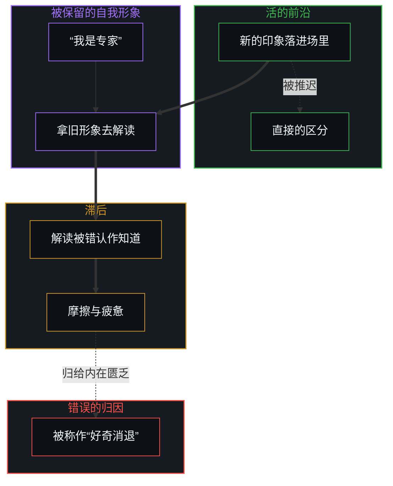
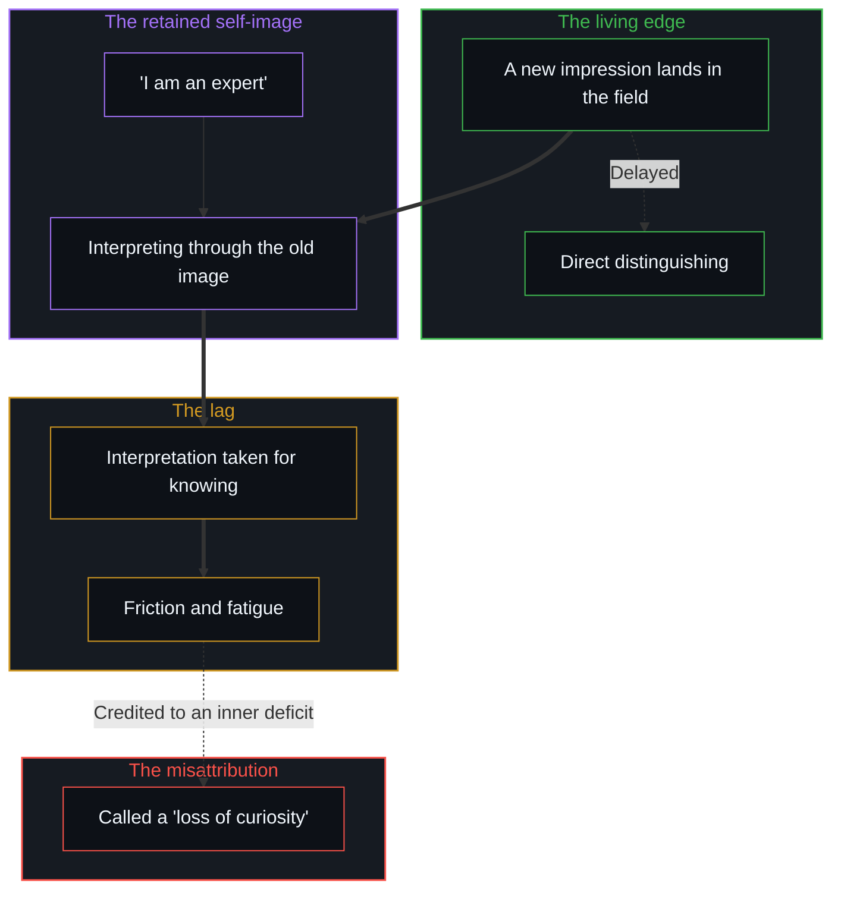

# 好奇没有最终的形态 / Curiosity Has No Final Form

*把数学、物理与哲学当作好奇的终点，是把脚手架错认作不息的区分 / Taking mathematics, physics and philosophy as curiosity's end mistakes scaffolding for unceasing distinguishing.*

好奇没有最终的形态。说好奇终结于某一组特定的学科，比如数学、物理与哲学，描述的不是好奇，而是一种认知的滞后。持续的区分一直在进行。变了的不是探究本身，而是心智用来度量自己运动的那个参照。当三个历史上的范畴被奉为探索的最高峰，未来的区分只有能放进它们既定的边界之内，才被感到是正当的；放不进去的，就被当作轻浮，或被划到求真之外。这三门学科原本是活的探究留下的临时痕迹，此刻被冻成了免于重新追溯的刚性容器。正是这种豁免，生出了“最终形态”的错觉。

Curiosity has no final form. The claim that it ends in a particular set of disciplines, such as mathematics, physics and philosophy, does not describe curiosity; it describes a cognitive lag. Continuous differentiation is always underway. What has changed is not inquiry itself but the reference against which the Mind measures its own movement. When three historical categories are canonized as the summit of exploration, future distinguishing is felt as legitimate only if it fits inside their established borders, and whatever does not fit is dismissed as frivolous or placed outside the pursuit of truth. The three disciplines, once provisional traces of living investigation, are frozen into rigid containers exempt from re-tracing. This exemption is what generates the illusion of a final form.

## 一、 终点的范畴错误 / 1. The Category Error of the Terminus

数学、物理与哲学，是人类最精炼、共振最强的几种脚手架之一。它们是几个世纪严谨的区分活动留下的、致密而高度协调的残余。

Mathematics, physics and philosophy are among humanity's most refined and resonant scaffoldings. They are dense, highly coordinated residues left behind by centuries of rigorous distinction-making.

范畴错误发生在残余被错认作探究的天花板的时候，它以三种相互关联的方式出现：

The category error occurs when the residue is taken for the ceiling of inquiry, and it shows up in three related ways:

- **冻结临时的痕迹**：一门学科起初是一串活的问题，一刀一刀地切出区分。当这些区分稳定成教科书里的形式体系，它们就从递归中脱落，被当作思想本身客观的建筑。
- **对正当性的把关**：一门学科一旦被宣布为最终目的地，它就不再被当作探索未知的工具，而被当作评价的过滤器，用来裁定什么才算正当的好奇。
- **把地图错当成指南针**：说物理或哲学是好奇的最终形态，就像说制图是行走的最终形态。地图记录的是区分已经发生过的地方，而不是迈出下一步的那份活的能力。

- **Freezing provisional traces**: a discipline begins as a living sequence of questions that carve out distinctions. When those distinctions stabilize into textbook formalisms, they drop out of recursion and are treated as the objective architecture of thought itself.
- **Gatekeeping legitimacy**: once a discipline is declared a final destination, it is no longer used as a tool for exploring the unknown; it is used as an evaluative filter to decide what qualifies as valid curiosity.
- **Mistaking the map for the compass**: claiming that physics or philosophy is the final form of curiosity is like claiming that cartography is the final form of walking. The map records where distinguishing has already happened; it is not the living capacity to take the next step.

[遗忘的脚手架](../the-scaffolding-we-forget/)追踪的正是这种脱落：脚手架为解决一个局部的协调问题而搭起，一旦稳定下来，观察者就把脚手架错认作场本身。[超越的定相](../the-fixed-image-of-transcendence/)诊断的是同一个陷阱：活的攀登被冻成一尊静止的偶像，一条敞开的轨迹被改成了一座保存起来的纪念碑。

[The Scaffolding We Forget](../the-scaffolding-we-forget/) tracks this drop-out: scaffolding is put up to solve a local problem of coordination, but once it stabilizes, observers take the scaffold for the field itself. [The Fixed Image of Transcendence](../the-fixed-image-of-transcendence/) diagnoses the same trap: the living climb is frozen into a static icon, and an open trajectory is turned into a preserved monument.

## 二、 被感到的“好奇消退” / 2. The Anatomy of a Felt "Loss of Curiosity"

好奇，是有心智的中心自我区分时被感到的倾向：把这个从那个里分出来，把新的从已经登记的里分出来。这种生成的倾向并不随年龄、教育或疲惫而减弱。变了的，是心智用来评估新来痕迹的那个参照。好奇经过的每一门学科，都是[信息是什么](../what-information-is/)所说的那种信息：一次被划下的区分，而不是一种被找到的实体。

Curiosity is the felt tendency of the minded centre to distinguish itself: this from that, the new from the already registered. That generative tendency does not diminish with age, education or fatigue. What changes is the reference against which the Mind evaluates incoming traces. Each discipline curiosity passes through is information in the sense [What Information Is](../what-information-is/) gives: a distinction drawn, not a substance found.

随着一次次的区分累积起来，它们凝成一副致密的、被保留下来的自我形象（“我是专家”，“我已经了解这片地形”）。当新的印象落进感知的场里，过程按这样的顺序展开：

As successive distinctions accumulate, they cohere into a dense, retained self-image ("I am an expert", "I already understand the landscape"). When new impressions land in the field of perception, the process unfolds in this order:

1. 新的印象不再直接、即时地引发区分，而是被迫先穿过一道迟缓的过滤，拿被保存的形象去解读它。
2. 解读被错认作知道，而在活的前沿上继续进行的、不受抑制的区分被推迟或压了下去。
3. 由此产生的摩擦、滞后与认知上的疲惫，被错误地归给一种内在的匮乏：自发探究的缺席被感到之后，被贴上“好奇消退”的标签。

1. Rather than setting off direct, immediate differentiation, the impression is forced first through the slow filter of interpretation against the preserved image.
2. The interpretation is taken for knowing, while the uninhibited differentiation that goes on at the living edge is delayed or suppressed.
3. The resulting friction, lag and cognitive fatigue are attributed to an inner deficit: the felt absence of spontaneous inquiry is labelled a "loss of curiosity".

[好奇先行](../curiosity-first-the-hidden-engine-of-talent-and-development/)描绘了这种倒置怎样让人的复利停摆：把累积的残余当作固定的“天赋”或“精通”，恰恰打断了当初生出这份能力的好奇回路。[封闭的假设把复利挤成 S 曲线](../closed-assumptions-squeeze-compounding-into-s-curves/)确认了结构上的来由：天花板与平台期不是增长的自然极限，而是把临时的假设冻成永久容器的产物。一副刚硬的自我形象，会在源头上关掉好奇，[自尊的刚性外壳与隐性外部归因](../zi-zun-de-gang-xing-wai-ke-yu-yin-xing-wai-bu-gui-yin/)在自尊的尺度上看到了这道封锁。

[Curiosity First: The Hidden Engine of Talent and Development](../curiosity-first-the-hidden-engine-of-talent-and-development/) maps how this inversion stalls human compounding: treating accumulated residue as fixed "talent" or "mastery" interrupts the very curiosity loops that produced the capability. [Closed Assumptions Squeeze Compounding into S-Curves](../closed-assumptions-squeeze-compounding-into-s-curves/) confirms the structural source: ceilings and plateaus are not natural limits of growth but artefacts of freezing provisional assumptions into permanent containers. A rigid self-image shuts curiosity down at the source, the lock that [The Rigid Shell of Self-Esteem and Hidden External Attribution](../zi-zun-de-gang-xing-wai-ke-yu-yin-xing-wai-bu-gui-yin/) finds at the scale of self-esteem.

## 三、 学科是可用的残余，不是最终的目的地 / 3. Disciplines as Available Residue, Not Final Destinations

当参照回到活的一步之宽，学科之间虚假的等级就塌了下来。

When the reference returns to the width of one living step, the false hierarchy of disciplines collapses.

数学、物理与哲学不再充当权威的目的地或真理的关口。它们回到它们一直所是的样子：可用的、有力的残余，有用，有共振，可以不断修订的脚手架。

Mathematics, physics and philosophy stop serving as authoritative destinations or gates of truth. They become what they always were: available, powerful residue, useful, resonant and continually revisable scaffolding.

一位软件工程师发现一种新的并发模式时，运用的是与一位物理学家写下一个规范场论时同样的区分能力；一位画家推敲一笔，一位创业者搭起一套涌现的协调规则时，与一位哲学家剖析语义范畴时，站在同一道生成的前沿上。没有哪门学科垄断深度，因为深度取决于在活的前沿上一次区分划得多干净，而不取决于那个历史容器的声望。

A software engineer discovering a new concurrency pattern exercises the same distinguishing capacity as a physicist formulating a gauge theory; an artist refining a brushstroke, or an entrepreneur setting up an emergent protocol of coordination, works at the same generative edge as a philosopher dissecting semantic categories. No discipline holds a monopoly on depth, because depth is a matter of how cleanly a distinction is drawn at the living edge, not of the prestige of the historical container.

[持续生长的脚手架](../the-scaffolding-that-keeps-growing/)揭示了这种建造活的一面：等到拉开距离去审视任何一座结构的时候，脚下的地面已经移动了。[智能只属于心智](../intelligence-belongs-only-to-the-mind/)恢复了因果上的先后：智能是观察者无因的、主动的区分，而不是公式与学说的存货。

[The Scaffolding That Keeps Growing](../the-scaffolding-that-keeps-growing/) shows the living side of this building: by the time distance is taken to survey any structure, the ground underfoot has already moved. [Intelligence Belongs Only to the Mind](../intelligence-belongs-only-to-the-mind/) restores the causal order: intelligence is the uncaused, active distinguishing of the observer, not a stored inventory of formulas and doctrines.

## 四、 有心智的前沿敞开着 / 4. The Open Horizon of the Minded Edge

理论与学科，是持续的区分在身后留下的历史痕迹。没有一个是最终的，因为一道没有被重新划过的边界，已经旧了一步。

Theories and academic disciplines are historical traces left in the wake of continuous distinguishing. None of them is final, because a boundary not actively redrawn is already one step old.

好奇没有最终的形态，是因为生出区分的那份有心智的活动，没有一个可以让它永久闭合的外面。探究的宇宙不会收敛到三个被奉上神坛的名目上；每划下一次区分，它就扩展一次。宣布自己无知的形状，是又一个虚假的终点，[“知道自己不知道”是一种修辞假象](../zhi-dao-zi-ji-bu-zhi-dao-de-ren-zhi-jia-xiang/)拆开的正是这个错觉。

There is no final form of curiosity because the minded activity that generates distinctions has no outside at which it could permanently close. The universe of inquiry does not converge on three canonized titles; it expands with every distinction drawn. Declaring the shape of one's own ignorance is another false terminus, the illusion [Knowing That You Don't Know Is a Rhetorical Illusion](../zhi-dao-zi-ji-bu-zhi-dao-de-ren-zhi-jia-xiang/) takes apart.

[开放即一致](../openness-is-consistency/)为这个结论落了锚：拒绝把探究封进闭合的体系，是与一个不息生成的活动相一致的姿态。理解的边界不是靠供奉旧的纪念碑守住的，而是在一个人自由地选择去追随下一个没有剧本的问题时向外扩展，所以[个体抉择是唯一的因果杠杆](../individual-choices-as-the-only-causal-levers/)。[宏观现象的生成图谱](../the-generative-atlas-of-macroscopic-phenomena/)描绘了好奇不断打开的东西：从量子到比特再到人的选择，没有最后一层。

[Openness Is Consistency](../openness-is-consistency/) anchors the conclusion: refusing to seal inquiry into closed systems is the stance consistent with an activity that never stops generating. The boundary of understanding is not defended by canonizing old monuments but widened whenever an individual freely chooses to follow the next unscripted question, which is why [Individual Choices as the Only Causal Levers](../individual-choices-as-the-only-causal-levers/). [The Generative Atlas of Macroscopic Phenomena](../the-generative-atlas-of-macroscopic-phenomena/) maps what curiosity keeps opening: from quantum to bit to human choice, with no final layer.
