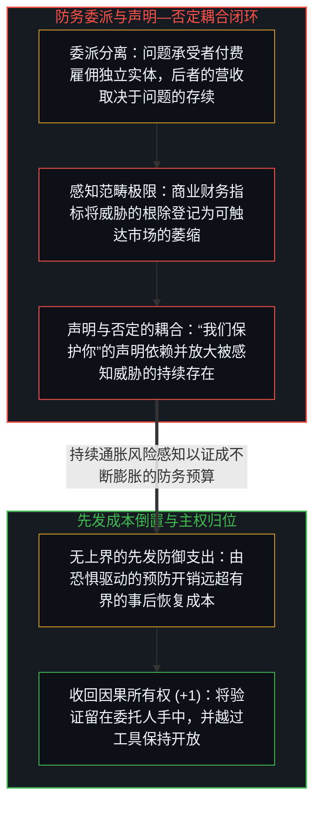
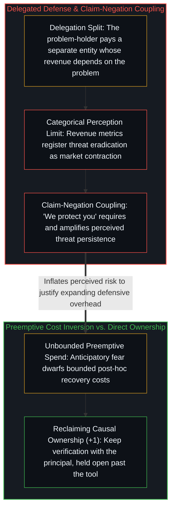

# 网络安全军备竞赛与感知范畴边界 / The Cybersecurity Arms Race

*当防务代理者的指标无法将威胁根除登记为正向信号时，保护声明便与威胁存续耦合。 / When a defender cannot register threat eradication as positive, the protection claim couples to threat persistence.*

网络安全产业由企业、安全研究员、保险机构与投资者共同构成，各方皆围绕订阅费、企业合同、托管服务、合规审计与保费等收入流进行局部优化，而这些收入无一不随实际发生或被感知的威胁规模同步扩张。在这一系统内部，没有任何一个参与方的感知仪表盘会将“威胁被悉数根除”登记为正向信号；威胁的消退在每一张财务报表上都呈现为需求萎缩，唯有威胁的升级与繁衍才对应着市场的繁荣。

The cybersecurity sector consists of firms, researchers, insurers, and investors optimizing locally along revenue streams—subscriptions, enterprise contracts, managed services, compliance audits, and premiums—that scale with realized and perceived threat volume. No participant in this apparatus registers "threats eliminated" as a positive signal; threat reduction reads on every balance sheet as demand contraction, whereas threat escalation reads as market expansion.

## 一、 感知的范畴极限与无需合谋的梯度合流 / 1. The Categorical Perception Limit and Gradient Convergence Without Conspiracy

将这一动态称作“激励失准”，是在暗中引入一个外部参照系——即付费用户希望安全隐患就此终结的愿望——并把偏离该愿望的运行轨迹当成系统故障。然而系统内部的激励并未失准；它们极为精准地服务于参与者感知器官所能读出的指标。一家依靠经常性收入、客户留存率与估值倍数导航的企业，其商业工具箱里没有任何一项指标会奖励“消灭自身的可触达市场”；倘若某家安全公司真的根除了它所防御的那类威胁，传回管理层、工程师与股东面前的每一个信号都将是营收滑坡、市值缩水与职业淘汰。

Calling this dynamic "incentive misalignment" smuggles in an external reference frame—the customer's desire for a world without breaches—and treats deviation from that desire as an error. The incentives are not misaligned; they optimize accurately for what the participants' instruments can perceive. A firm whose perceptual apparatus consists of recurring revenue, retention rates, and valuation multiples has no metric that registers shrinking its own addressable market as success; if a firm eradicated its threat class, every signal reaching its executives, engineers, and shareholders would read as career and commercial failure.

这场军备竞赛的延续同样不需要任何幕后阴谋。由于剖析漏洞所需的专业深度与制造或放大威胁的能力直接重叠，分散的行动者只需顺着陡峭的局部激励梯度各自优化，便会在没有中心合谋的情况下走出高度协同的轨迹。安全研究员靠挖掘并披露新型攻击面晋升，厂商靠渲染针对这些攻击面的先发防御方案扩张，监管机构则通过强制合规底线为整个行业锁定刚性的经常性支出。

Nor does the persistence of the arms race require a shadowy conspiracy. Because the expertise required to dissect vulnerabilities overlaps directly with the capability to generate or amplify them, distributed actors following steep local gradients produce coordination-shaped outcomes without central coordination. Security researchers advance by discovering and publicizing new attack surfaces, vendors grow by marketing preemptive defenses against those surfaces, and regulators mandate compliance floors that lock in recurring spend.

## 二、 声明与否定的耦合及可见性比率的迁移 / 2. Claim-Negation Coupling and the Shift in the Visibility Ratio

“我们保护你”并不是对某项操作的价值中立描述，而是一句与其自身否定相耦合的声明。保护以威胁的存在为前提；一个防务机构越是成功地围绕“保护”建立起身份认同、信任与现金流，其生存就越紧密地绑在隐患的存续之上。2010 年代初，随着操作系统内置的免费防护使个人零售杀毒软件商品化，曾经铺天盖地、令普通电脑瘫痪的高调病毒头条迅速沉寂，尽管每天新增的恶意样本总量仍在成倍暴涨；当时消退的并不是底层的攻击代码，而是那套靠放大公众恐慌来推销零售杀毒软件的营销循环。

The statement "we protect you" is not a neutral description of a service; it is a claim coupled to its own negation. Protection requires an active threat to remain meaningful, so the more successfully a defensive institution builds identity and revenue around protection, the more tightly its survival binds to the continuation of the hazard. When consumer antivirus software commoditized in the early 2010s as built-in operating-system defenses became free, loud consumer-visible malware headlines subsided even as total daily malware samples multiplied; what vanished was not the underlying attack volume, but the retail marketing loop that profited from amplifying consumer fear.

这揭示了威胁依赖型产业核心的先发成本倒置。大多数安全事件的实际损失——从不可变备份中恢复数据、轮换密钥、重建干净状态——是有界且可收敛的；而由被放大的风险感知所驱动的先发防御支出则是无上界的，并且直接流向那些唯有在威胁永不终结时才能壮大的机构。

This exposes the preemptive cost inversion at the core of threat-dependent industries. The actual damage of most incidents—restoring from immutable backups, rotating credentials, rebuilding clean state—is bounded and recoverable, whereas preemptive spending driven by inflated risk perception is unbounded and flows directly to institutions whose growth depends on the threat never ending.

## 三、 威胁依赖型机构与委派的根源倒置 / 3. Threat-Dependent Institutions and the Root Inversion of Delegation

同一几何结构同样贯穿于商业保险、合规官僚体系与防务同盟等一切以威胁存续为生存底座的机构。在保险公司的资产负债表上，保费高出预期赔付额的每一分钱——包括精算行政、理赔核查、营销渠道与利润留存——都是消费者为规避低概率波动而向中介支付的纯摩擦溢价，而中介的商业模式恰恰要求被感知的风险高于实际赔付。

The same structural geometry generalizes across insurance, compliance bureaucracies, and defense alliances whose institutional survival depends on the hazard they were chartered to address. On an insurance balance sheet, every dollar of premium above expected payouts—all actuarial overhead, claims administration, marketing, and profit—is the surcharge paid to an intermediary whose business model requires risk perception to exceed actual loss.

在所有这些现象底下运转的都是同一条根源算术：一旦问题的承受者把解决问题的任务委派给一个按持续维护收费的外部实体，代理者的感知器官就会把问题的延续登记为稳定，把问题的恶化登记为增长。正如[任务的移交与后果的不可让渡](../the-delegation-of-the-task-and-the-inalienability-of-consequences/)与[你的代码库即是记忆](../your-codebase-is-memory/)所确立的，外部厂商与智能体可以代为执行具体流程，但架构后果的主权从不曾离开第一人称的承受者；唯有把代码库与系统的可恢复性、精简度与直接验证留在活生生的心智边缘，优化地貌上才会真正出现“问题解决”这一吸引盆。

Beneath every instance sits a single root mechanism: the moment a problem-holder delegates the resolution of a problem to a separate entity paid for ongoing mitigation, the delegate's perception apparatus registers the problem's continuation as stability and its escalation as growth. As [The Delegation of the Task and the Inalienability of Consequences](../the-delegation-of-the-task-and-the-inalienability-of-consequences/) and [Your Codebase Is Memory](../your-codebase-is-memory/) establish, an external agent or vendor can execute delegated routines, but the consequence of the architecture never leaves the principal; keeping the codebase clean, recoverable, and directly verifiable at the living edge is the only move whose optimization surface actually includes solving the problem.

把验证留在委托人手中，并不能单凭这一步终结这种耦合，因为验证既可以向外委派，也可以向内委派。[验证的倒置](../the-reversal-of-verification/)在源头处追溯了同一种分离：当一个工具或一种方法的通过结果被当作信任的起点，而不是被当作使用它的那份能力手中的器具时，委托人便已把验证委派给了方法，而方法封闭的参照就不再登记落在它之外的一切，正如厂商的营收指标不再登记威胁的根除。由此，第一节所说的两用专长便说明了为何没有哪件工具能终结这场竞赛。剖析漏洞的专长与制造漏洞的能力相互重叠，承载这份专长的工具对双方同样开放，因此共享的工具拉平了技术手段。仍将防御者与攻击者区分开来的，是保留下来的开放：越过工具继续验证的能力，以及在下一个区分到来时，重新追溯工具自身所依托的可信基的能力。这份能力无法作为服务买来，也无法作为方法存起来；它存在于使用之中，存在于问题被承担的那道边缘上。

Keeping verification with the principal does not end the coupling by that move alone, because verification can be delegated inward as well as outward. [The Reversal of Verification](../the-reversal-of-verification/) traces the same split at its source: when the passing output of a tool or a method is held as the origin of trust rather than as an instrument of the capacity that uses it, the principal has delegated to a method, and the method's closed reference stops registering whatever falls outside it, the way a vendor's revenue metrics stop registering eradication. The dual-use expertise of the first section then shows why no tool ends the race. The expertise that dissects a vulnerability overlaps with the capability to generate one, and the tools that carry it are open to both sides, so shared tooling equalizes the technical means. What still divides defender from attacker is retained openness, the capacity to keep verifying past the tool and to re-trace the trusted base the tool itself rests on when the next distinction arrives. That capacity cannot be bought as a service or banked as a method; it exists in use, at the edge where the problem is held.
