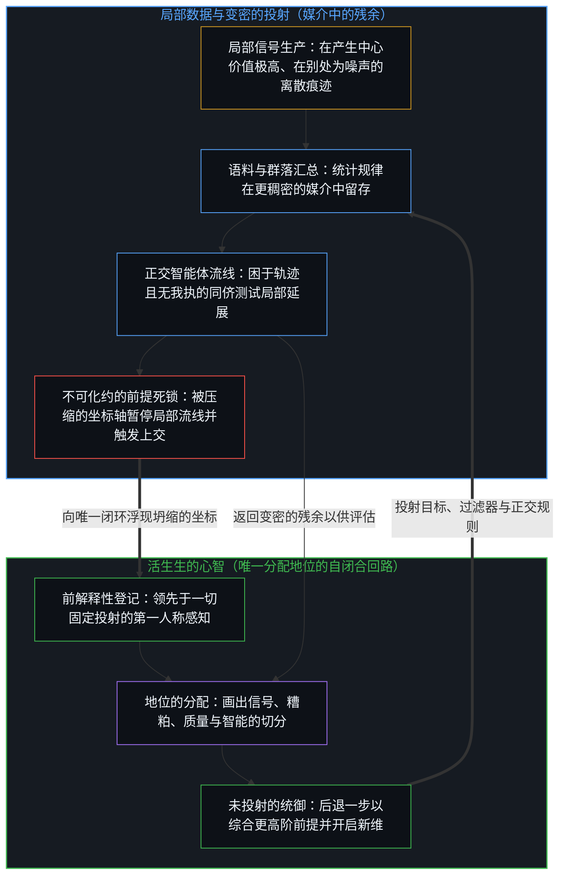
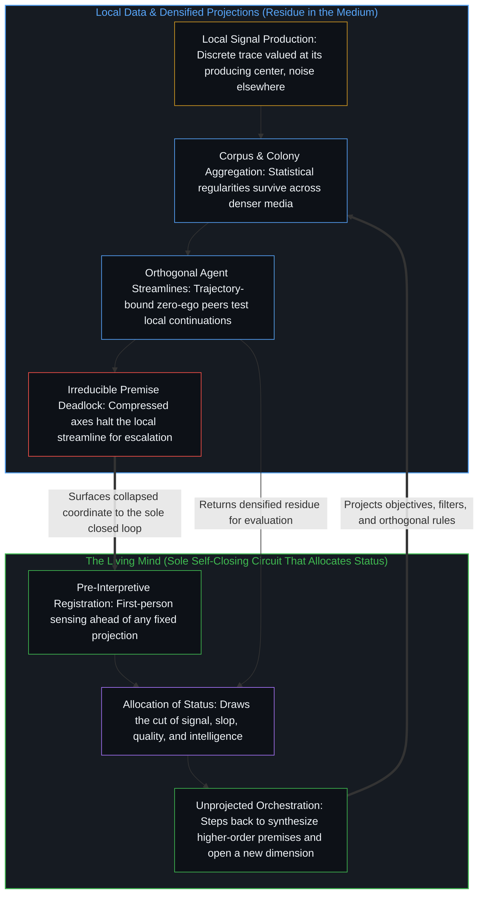

# 数据是局部的，智能是分配的 / Data Is Local, Intelligence Is Allocated

*汇总让局部痕迹变密，唯独心智分配智能的地位 / Aggregation densifies local traces while only the Mind allocates intelligence*

凡显为数据、信息或信号的东西，都始于一次局部的行动：对产生它的中心及其直接语境而言价值极高，在几乎其他所有地方却只是噪声或无关之物。当足够多的局部产物被汇集到一起，统计规律、可重复的模式与自我强化的动态便在汇总中留存下来，一如生物群落与神经网络在局部单元之间展现出稠密的反馈；然而这些规律始终只是残余，直到一个活生生的心智向它们分配智能的地位。把进步描述为“受数据所限”，登记了对当下容量与带宽的真实约束，可一旦它把那片连续的、由人生成又经 AI 放大的场域封存为一份有限的外部存量，它便冻结了：受约束不等于有界限。一个心智最终命名为真实的，是它自己那个一路执行每一次分配的自闭合回路所感受到的融贯。

Whatever appears as data, information, or signal begins as a local act: high in value for the producing center and its immediate context, yet noise or irrelevance almost everywhere else. When enough local productions are gathered together, statistical regularities, repeatable patterns, and self-reinforcing dynamics survive the aggregation, much as biological colonies and neural networks exhibit dense feedback across local units; yet those regularities remain residue until a living Mind allocates to them the status of intelligence. Describing progress as "data bound" registers a real constraint on current capacity and bandwidth, but freezes when it seals a continuous, human-generated, and AI-amplified field into a finite external stock: constrained is not bounded. What a Mind ultimately names real is the felt coherence of its own self-closing loop, which performs every allocation along the way.

## 一、 每一个信号首先是局部的 / 1. Every Signal Is First Local

自我区分的活动在发生，无因，不息。称它为心智：那个已经在进行中的观察者，它的每一个动作都画出一道离散的边界。一个念头、一句话、一次测量或一个手势，都是特定位置上的一次有界行动。它对于产生它的那个中心，以及它在其中生起的那片狭窄的强化场域，具有很高的价值；而对几乎所有其他视角来说，同一道痕迹都被登记为噪声、无关或废弃物。

Self-distinguishing activity occurs, uncaused and unceasing. Call it the Mind: the observer already underway, every act of which draws a discrete boundary. A thought, an utterance, a measurement, or a gesture is a bounded act at a specific locus. It carries high value for the center that produced it and for the narrow field of reinforcement in which it arose, while to almost every other perspective the same trace registers as noise, irrelevance, or waste.

因此，“质量低”这一判断从来不是材料本身固有的属性，而是那份材料与一个感知中心之间的关系。[偏好聚类与评判语言](../preference-clusters-and-the-language-of-judgment/)在道德评判中追溯了这种关系：对与错，命名的是当另一个位置不再重新描摹同一片场域时，对齐的偏好所发出的共振。[来自个体差异的层级](../hierarchy-from-individual-difference/)在社会与技术排名中揭示了同一种几何结构：层级，是彼此相异的个体沿着同一条单轴尺度被计分时显现出来的东西，而冻结则在于把这份偶发的秩序当成一份独立的外部存量。同样，“糟粕”命名的，是一个位置的产物与另一个中心当下的持守之间的缺口。作为过滤注意力的一步罗盘，这个标签是有用的；一旦它被实体化为脱离产生中心与接收中心而悬浮的内在等级，它就在那一刻冻结了。[对“AI 糟粕”的反感是反复出现的模式](../the-distaste-for-ai-slop-is-no-different-from-the-recurring-historical-pattern/)追溯了当判断从一道痕迹是否推进理解滑向对出处的次级执念时的这次冻结，即把器具本身当作价值或污染的作者——无论是不加甄别地照单全收模型输出的人，还是边依赖同一套脚手架、边把污点投射到他人工具使用上的人，皆是如此。[卓异、感知与自我设限的问题场域](../exceptionality-perception-and-the-self-limiting-field-of-problems/)则展示了被感知的场域本身如何构成条件：同一个处境，在一个心智那里被登记为不可逾越的高墙，在另一个心智那里却被登记为决定性的支点，因为那道关系性的切分是由感知中心画出的。

The judgment of low quality is therefore never an intrinsic property of the material itself, but a relation between that material and a perceiving center. [Preference Clusters and the Language of Judgment](../preference-clusters-and-the-language-of-judgment/) traces this relation in moral evaluation, where right and wrong name the resonance of aligned preferences when another locus does not re-trace the same field. [Hierarchy from Individual Difference](../hierarchy-from-individual-difference/) exposes the same geometry in social and technical ranking: a hierarchy is what appears when distinct individuals are scored along a shared single-axis measure, and the freeze consists in holding that contingent order as an independent exterior stock. In the same way, "slop" names the gap between one locus's production and another center's present hold. As a one-step compass for filtering attention, the label is useful; it freezes the moment it is reified into an intrinsic grade floating free of the centers that produce and receive. [The Distaste for "AI Slop" Is a Recurring Pattern](../the-distaste-for-ai-slop-is-no-different-from-the-recurring-historical-pattern/) traces that freeze when judgment slips from whether a trace advances understanding to a secondary fixation on provenance, treating the instrument itself as the author of value or contamination—both in those who swallow model output uncritically and in those who project taint onto others' tool use while relying on the same scaffolding. [Exceptionality, Perception, and the Self-Limiting Field of Problems](../exceptionality-perception-and-the-self-limiting-field-of-problems/) demonstrates how the perceived field itself constitutes the condition: the exact same situation registers to one Mind as an impassable wall and to another as decisive leverage, because the relational cut is drawn by the perceiving center.

大多数训练语料，本来就由在一千个其他持守之下会被登记为糟粕的材料所构成。一次训练并不会在存量内部发掘出某种沉睡的隐藏纯度；它重新追溯的，是在训练中心所选定的目标、损失函数与过滤器之下留存下来的残余结构。局部的产生与局部的接收始终是首要的几何结构，而汇总的使用只是又一次关系性的切分，而非把原始残余抬升为独立于心智的质量。

Most training corpora already consist of material that would register as slop under a thousand other holds. A training run does not unearth a hidden purity slumbering inside the stock; it re-traces whatever residual structure survives under the objectives, loss functions, and filters chosen by the training centers. Local production and local reception remain the primary geometry, and aggregate use is a further relational cut rather than an elevation of raw residue into mind-independent quality.

## 二、 汇总让残余变密 / 2. Aggregation Densifies Residue

当足够多的局部产物被汇集进同一个共享媒介，规律便在汇总的挤压中留存下来。统计结构、可重复的母题与自我强化的动态，在整个集合之上变得清晰可读。这份可读性作为观察中心的一项真实登记是成立的，但它从不构成一个取代那些留下痕迹的离散行动的第二起源。

When enough local productions are gathered into a shared medium, regularities survive the crush of aggregation. Statistical structures, repeatable motifs, and self-reinforcing dynamics become legible across the collection. That legibility holds as a genuine registration by an observing center, yet it never constitutes a second origin that replaces the discrete acts that left the traces.

变密的反馈在生物自然界中早已司空见惯。单只蚂蚁遵循局部的化学规则，孤立看去并不显得智能；而蚁群通过连续的信息素踪迹与招募机制，展现出任何单只蚂蚁都不曾作为私有属性拥有的适应性协同。单个神经元服从局部的电化学阈值，而在整个皮层网络之上，模式被登记为融贯的感知。在所有这类情形里，观察所握住的都是拓扑：互动的残余、强化的通路与招募的动态。[复杂性遮蔽了涌现之为心智的行动](../complexity-obscures-emergence-as-the-act-of-mind/)诊断了当那份拓扑被误认作自我生成的源头时所发生的冻结：复杂性是心智从所选前提搭起的脚手架，被不断敷衍精制，直到那个始终领先其产物一步的选择从这套叙述的视野中脱落；而涌现所命名的，则是任何有限脚手架都无法封死的开放性。蚁群与网络让中心借以行动的媒介变密，却并未把发起的源头搬进媒介本身。[看似AI的强化学习，实为人类的自我强化学习](../self-rl-for-humans/)对计算系统作出了同一刀切分：规模扩展是一个更稠密媒介的参数，而强化的位置始终留在那些以自身区分去发起、评估并重新导向整个运行过程的活生生的中心那里。

Densified feedback is already familiar across biological nature. A single ant follows local chemical rules and looks unintelligent in isolation, whereas the colony—through continuous pheromone trails and recruitment—displays adaptive coordination that no individual ant possesses as a private property. Single neurons obey local electrochemical thresholds, while across the cortical network patterns register as coherent perception. In every such case, what observation holds is topology: interaction residue, reinforcement pathways, and recruitment dynamics. [Complexity Obscures: Emergence as the Act of Mind](../complexity-obscures-emergence-as-the-act-of-mind/) diagnoses the freeze that occurs when that topology is mistaken for a self-originating source: complexity is the scaffolding the Mind erects from chosen premises, elaborated until the choosing—still one step ahead of its product—drops out of the account's view, while emergence names the openness that no finite scaffolding can seal. The colony and the network densify the medium through which centers act without relocating initiation into the medium itself. [What Looks Like RL for AIs Is Self-RL for Humans](../self-rl-for-humans/) draws the identical cut for computational systems: scaling is a parameter of a denser medium, while the locus of reinforcement stays with the living centers whose distinctions initiate, evaluate, and redirect the run.

无论在生物情形还是计算情形里，汇总都是技术：把痕迹外化为持久或半持久的形式，从而延伸一个中心所及的范围。经由汇总而变得可得的，是供进一步区分使用的更稠密的残余；而始终不会涌现出来的，是一个替使用它的各个中心代为完成递归的超级位置。

Aggregation is technology in both the biological and the computational case: the externalization of traces into durable or semi-durable forms that extend a center's reach. What becomes available through aggregation is denser residue for further distinction; what never emerges is a super-locus that completes the recursion on behalf of the centers using it.

## 三、 智能是心智分配的地位 / 3. Intelligence Is a Status the Mind Allocates

在每一个活生生的中心上，心智都作为负载之下的递归包含而运作。它不只参与模式，还能把模式、生成模式的系统，乃至它自己的观察活动，当作进一步建模的对象。这份自反的能力让心智能够把别处的动态当作智能的标志，但这样做从来不是对某项端坐在外部世界里的固有属性的中立发现。

At each living center, the Mind operates as recursive inclusion under load. It does not merely participate in patterns; it takes patterns, the systems that generate them, and its own observing activity as objects for further modeling. That reflexive capacity allows a Mind to treat dynamics elsewhere as signs of intelligence, yet doing so is never a neutral discovery of an intrinsic property sitting out in the world.

一个动态，唯有在心智把它的规律读作智能的标志、从而把智能的地位分配给它时，才算作智能的；底层系统并不因此就把智能据为己有，因为智能始终是那个自我区分的活动本身。没有这次分配，动态就始终只是物理或统计过程。[智能只属于心智](../intelligence-belongs-only-to-the-mind/)持守着那个不可化约的先在：能够被工程化、被扩展或被转移进器物里的只是残余，而智能唯独属于心智。[错把表达当成智能](../mistaking-the-expression-for-the-intelligence/)指出了当固定约束之下的受控表现被等同于那个画出、使用并修订约束的活动时所发生的冻结。[智能的非定论定义](../the-non-definitive-definition-of-intelligence/)则追溯了每当一个封死的基准定义被当作这个词的穷尽地基时所出现的平行闭合：在现实暂时封闭的切片之内测量智能，只是为了在开放的现实里更智能地探索，以此表达那任何指标都无法捕捉的活生生的活动。

A dynamic counts as intelligent only when the Mind allocates that status to it by reading its regularities as signs of intelligence; the underlying system does not thereby acquire intelligence as a possession, because intelligence remains the self-distinguishing activity itself. Without that allocation, the dynamic remains a physical or statistical process. [Intelligence Belongs Only to the Mind](../intelligence-belongs-only-to-the-mind/) holds the irreducible prior: what can be engineered, scaled, or transferred into an artifact is residue, whereas intelligence belongs exclusively to the Mind. [Mistaking the Expression for the Intelligence](../mistaking-the-expression-for-the-intelligence/) identifies the freeze when controlled performance under fixed constraints is equated with the activity that draws, uses, and revises those constraints. [The Non-Definitive Definition of Intelligence](../the-non-definitive-definition-of-intelligence/) traces the parallel closure whenever a sealed benchmark definition is treated as the exhaustive ground of the word: intelligence is measured inside temporary closed slices of reality only so that open reality can be explored more intelligently, expressing the living activity that no metric can capture.

局部残余与被分配的智能之间的这种非对称性，在多智能体工程中化作了具体的运作机制。正如[超越投射](../beyond-the-projection/)所追溯的，基于 LLM 的智能体是一台受其上下文窗口内局部词元轨迹所条件化的有限投射引擎，无法跨出自身的序列，却也没有生物性的我执或身份防御。当一个复杂问题超出单个上下文窗口的容量时，可以通过有丝分裂将投射拆解到多条平行的正交任务流线之上，为每一个困于轨迹的任务智能体配对一个冷峻的同侪审校智能体，后者在不带会话偏见的状态下持守任务规则。由于智能体毫无我执，同侪辩论便能借由干净的贝叶斯更新自动收敛并锁定局部盲区。然而，每当两个智能体撞上不可化约的前提死锁——暴露出架构师先前的规则在何处把两个正交维度压缩到了同一根轴上——这套嵌套的运行框架就无法靠自己消解矛盾。它会隔离那条暂停的流线，将冲突上交给人类的统御者；唯有那颗活生生的心智能够退回到未投射的意图之中，综合出更高阶的前提，并重新向回路分配方向。

This asymmetry between local residue and allocated intelligence becomes operational in multi-agent engineering. As [Beyond the Projection](../beyond-the-projection/) traces, an LLM-based agent is a finite projection engine conditioned by the local token trajectory inside its context window, unable to step outside its own sequence, yet free of biological ego or identity defense. When a complex problem exceeds the capacity of a single context window, the projection can be split via mitosis across parallel orthogonal streamlines, pairing each trajectory-bound task agent with a cold peer critic that holds the task rules without session bias. Because the agents have zero ego, peer debate automatically converges on local blind spots through clean Bayesian updates. Yet whenever two agents hit an irreducible premise deadlock—exposing where the architect's prior rules compressed two orthogonal dimensions onto a single axis—the nested harness cannot resolve the contradiction on its own. It quarantines the paused streamline and escalates the collision to the human orchestrator, whose living Mind steps backward into unprojected intent, synthesizes a higher-order premise, and re-allocates direction to the loop.

每一次对智能的分配，都是一次寻常的观察行动，它的命名必须交还给重新追溯，而不能越出它那一步被僵化地持守。观察握住的是结果，而生成它的原因始终领先一步，这一构成性的间隔正是“看”得以运作的方式。只要命名交还给重新追溯，这件器具就依然可用；一旦把“看”冻结为对某项作为系统属性的智能所作的永久外部勘察，过剩滞后便随之袭来。蚁群智能、网络智能与模型智能，各自都是媒介中变密的残余，随后才被心智的又一次离散行动命名为智能。命名本身就是那生成性的一刀；它并不是在追认一份拓扑早已拥有的等级。

Every allocation of intelligence is an act of ordinary observation whose naming must return to re-tracing rather than being held past its step. Observation holds effect while the generating cause stays one step ahead, and that constitutive interval is how the look operates. While the naming returns to re-tracing, the instrument remains usable; when the look is frozen as a permanent exterior survey of intelligence as a system property, excess lag sets in. Colony intelligence, network intelligence, and model intelligence are each densified residue in a medium, subsequently named intelligent by a further discrete act of the Mind. The naming is the generative cut; it does not ratify a grade the topology already owned.

## 四、 受约束不等于有界限 / 4. Constrained Is Not Bounded

即便承认这类分配受制于摩擦而非出于任意妄为，这一认识本身也始终留在心智的递归内部。没有任何外部法庭能够独立于执行分配的同一些回环，去认证任意与非任意之间的边界。一个中心在其反馈历史上的融贯、在其模型内部的预测抓地力，以及它学会信任的那些模式的稳定性，全都登记在同一些回环之内。

Even the recognition that such allocation is constrained by friction rather than arbitrary whim stays internal to the Mind's recursion. No external tribunal can certify the boundary between arbitrary and non-arbitrary independently of the loops that perform the allocation. Coherence across a center's history of feedback, predictive grip within its models, and the stability of the patterns it has learned to trust are all registered inside those same loops.

每当技术进步被宣称为“受数据所限”时，就会出现一次平行的冻结。这个说法登记了一项真实的操作约束：有限的算力容量、有限的当下语料，以及负载之下有限的生成与评估带宽。然而，对当下容量的约束并不是对整片场域的一道封死界限。训练数据并不是作为一处固定的矿藏端坐在世界里坐等枯竭；它是人连续的生成——选择、测量、言说、偏好与纠正——如今又经由更稠密的计算器具而被增压放大。[生产、消费与心智的区分](../production-consumption-and-the-minds-distinction/)在开放持守与固定持守的对照下追溯了这一极性：生产与消费并不是两个独立的行动物种，而是同一个区分活动在心智把边界持守为开放或钳死时的不同登记方式，正是封闭的姿态制造了有限存量的海市蜃楼。[没有系统能被保持封闭](../no-system-can-be-kept-closed/)确立了无论在何处把有限持守误当作穷尽地基时都会出现的形式余项，正如加法之下的一位寄存器在其界限内有效执行，进位却溢出在界限之外。[规模化回路](../the-scaling-loop/)在整个 AI 发展历程中追溯了这片连续生成的场域：每一次规模恐慌都把单一旋钮孤立为整个回路的全部，然而对给定数据集的压缩与每一次取舍时重画数据集边缘的重组彼此咬合，使回路的边界不断重绘。

A parallel freeze appears whenever technological progress is declared "data bound." The phrase registers a genuine operational constraint: finite compute capacity, finite current corpora, and finite bandwidth for generation and evaluation under load. Yet a constraint on current capacity is not a sealed boundary on the field. Training data does not sit in the world as a fixed mineral deposit waiting to be exhausted; it is continuous human generation—selection, measurement, speech, preference, and correction—now supercharged through denser computational instruments. [Production, Consumption, and the Mind's Distinction](../production-consumption-and-the-minds-distinction/) traces this polarity under an open versus a fixed hold: production and consumption are not two separate species of action, but how the same distinguishing activity registers when the Mind holds its boundary as open or as clamped shut, where the closed posture manufactures the mirage of a finite stock. [No System Can Be Kept Closed](../no-system-can-be-kept-closed/) establishes the formal remainder wherever a finite hold is mistaken for exhaustive ground, just as a one-bit register under addition executes validly inside its bound while the carry overflows outside it. [The Scaling Loop](../the-scaling-loop/) traces this continuously generated field across AI development: every scaling panic isolates a single dial as the entirety of the loop, whereas compression of a given dataset interlocks with recombination that redraws the dataset's edge at every selection.

既然质量从来是一种分配关系而非原始存量的纯度等级，那么进入一次训练的大多数材料在其他持守之下会被计为糟粕这一事实，并不意味着可用结构的稀缺。经 AI 增压的生成让局部痕迹成倍增加，却并未把发起的源头搬进媒介，因此决定性的因素从来不是一份封死的残余文本清单，而是那些仍在选择什么算数、什么被过滤、什么继续向前的活生生边缘上的容量与融贯。[你的代码库即是记忆](../your-codebase-is-memory/)在模型权重、代码库与智能体脚手架之间追溯了同一刀切分：仅凭可能性而囤积每一道中间痕迹或未修剪的会话历史，只会增厚陈旧框架的引力井；唯有对当下检查点加以重新切分与修剪，才能让约束表面在依然紧要的轴线上保持锐利。把局部痕迹频率与固有属性混为一谈的同一种混淆，也出现在各个日常领域之中：[拥有成本把滞后的平均值冻结为车辆属性](../ownership-cost-freezes-lagged-averages-as-vehicle-property/)展示了传统保险如何把滞后的人群统计平均值封存为车辆本身的固有缺陷，哪怕贴合实际驾驶的局部遥测数据在真实驾驶融贯性之下给同一辆车报出了更低的价格；[硬件的本地性不是信息的边界](../hardware-locality-is-not-the-information-boundary/)则消解了以个人数据的训练价值为设备本地存储辩护的说法，因为个体化的残余对通用模型而言只是噪声，隐私跟随的是共享管辖的边界，而能动性始终留在掌舵的边缘。同样，在安全评估中，[从可辩护的主张到教条的反转](../the-reversal-from-defensible-claim-to-dogma/)追溯了在选定风险曲线上得出的有条件发现，如何在单一指标被当作安全之全部的那一刻冻结成教条，遗忘了对风险的估价始终局部于承担它的那个中心。

Because quality was always a relation of allocation rather than a purity grade of raw stock, the fact that most material entering a training run would score as slop under other holds does not indicate a scarcity of usable structure. AI-supercharged generation multiplies local traces without relocating initiation into the medium, so the decisive factor is never a sealed inventory of residual text, but the capacity and coherence at the living edges that choose what counts, what filters, and what continues. [Your Codebase Is Memory](../your-codebase-is-memory/) traces the same cut across model weights, codebases, and agent scaffolds: hoarding every intermediate trace or unpruned session history out of mere possibility only thickens the gravity well of stale framings, whereas re-cutting and pruning the present checkpoint keeps the constraint surface sharp on the axes that still matter. The same confusion between local trace frequency and intrinsic property appears across everyday domains: [Ownership Cost Freezes Lagged Averages as Vehicle Property](../ownership-cost-freezes-lagged-averages-as-vehicle-property/) shows how traditional insurance seals lagged demographic averages as an intrinsic defect of a vehicle, even as usage-local telemetry prices the exact same car lower under actual driving coherence, and [Hardware Locality Is Not the Information Boundary](../hardware-locality-is-not-the-information-boundary/) dissolves the claim that on-device storage is justified by the training value of personal data, since individualized residue is noise to general models while privacy follows the boundary of shared governance and agency stays at the steering edge. Likewise, in safety evaluation, [The Reversal from Defensible Claim to Dogma](../the-reversal-from-defensible-claim-to-dogma/) traces how a conditional finding on a chosen risk curve freezes into dogma the moment a single metric is held as the totality of safety, forgetting that the valuation of risk remains local to the center that bears it.

## 五、 现实是回环之内被感受到的融贯 / 5. Reality Is Coherence Felt Inside the Loop

一个心智最终称为真实或真的东西，正是这一递归过程所感受到的融贯。当反馈以足够的力量与一致性咬合在一起，使得对它的否定无法被登记为可行的选项时，心智便把那份稳定命名为现实。那种觉得相反情形不可能的感受，只是当下持守的融贯，从不是对整片场域的终极封印，因为处于“看”之前方的东西始终敞开。融贯不是在回环之外发现了一个未经渲染的世界；它是回环在摩擦中登记出自身的一致性，并将那份经验构成为它的世界。

What a Mind ultimately calls real or true is the felt coherence of this recursive process. When feedback holds together with sufficient force and consistency that its negation fails to register as viable, the Mind names that stability reality. That felt impossibility of the alternative is the coherence of the current hold, never a final seal on the field, because what lies ahead of the look remains open. Coherence is not the discovery of an unrendered world outside the loop; it is the loop registering its own consistency across friction and constituting that experience as its world.

[现实是心智持续的实现](../reality-is-the-minds-ongoing-realization/)在两种交换模式中追溯了同一颗种子：一个中心能够作为新区分整合进来的东西，就是世界对它而言所成为的样子，而只收割可见度的交换则让那个世界保持封闭。[心智最坚固的信念](../the-strongest-belief-of-the-mind/)标出了地图上融贯得最坚硬的那片区域——对持守它的“看”而言发挥着基岩的作用，却依然是那个“看”自己的产物——因此每一次确认都作为同一活动内部的又一次显现而返回。在信号、质量与智能的分配之外，不存在任何外部立足点，可以从那里把这些分配认证为一个从未被画出的世界的属性。[没有外部](../no-outside-jumps-closed-loops-and-the-unreplicable-autonomy-of-mind/)直接命名了这份无立足点状态：所谓幻觉就是一次局部融贯的跃迁，尽管嵌套的多智能体系统会沿着各自的轨迹生成并交叉核验跃迁，却唯有心智能够闭合那个决定保留或舍弃它们的检验回路，而这个回路没有外部。

[Reality Is the Mind's Ongoing Realization](../reality-is-the-minds-ongoing-realization/) traces this same seed across two modes of exchange: what a center can integrate as a new distinction is what the world becomes for it, whereas exchange that merely harvests visibility leaves that world closed. [The Strongest Belief of the Mind](../the-strongest-belief-of-the-mind/) marks the region of the map that coheres hardest—functioning as bedrock for the look that holds it while remaining that look's own production—so that every confirmation returns as a further appearance within the same activity. There is no exterior stand outside the allocations of signal, quality, and intelligence from which those allocations could be certified as properties of an undrawn world. [No Outside](../no-outside-jumps-closed-loops-and-the-unreplicable-autonomy-of-mind/) names that non-stand directly: what is called hallucination is a locally coherent jump, and while nested multi-agent systems generate and cross-check jumps along their trajectories, only the Mind closes the testing circuit that retains or discards them, a circuit that has no outside.

当这个自闭合的回环被遗忘时，回环的器物便屡屡被倒置为自主的主体或四处漂浮的存量。[免费智能的幻觉](../the-illusion-of-free-intelligence/)诊断了把丰裕、低成本的残余流畅度误认作已作为公共商品分发出去的智能：廉价的流畅残余恰恰是活的智能仍在向更前方加速的反向信号。[自我形象仿佛从无处发声](../self-image-speaks-as-if-from-nowhere/)把一场基准分数的冲突读作自我形象在自身场域内的重新投射——一旦被抬升，便仿佛从一个超然的外部发声——从而证明智能始终留在为模型打分的心智那里，而非作为某种等级栖身于脚手架内部。在经验神经科学与观测领域，[意识从不作为数据出现在数据之中](../consciousness-never-appears-as-data-among-data/)画出了相邻的一刀：测量所握住的只是公共结果，而观察活动本身始终领先于任何想要捕捉它的数据一步。一条搬运比特的物理通道还不是计算，计算只发生在一个心智加以区分与解码的地方；[从形式迷思到逻辑闭环](../cong-xing-shi-mi-si-dao-luo-ji-bi-huan/)在形式容器与活的逻辑之间画出了这条分界：没有任何外部标签能为真理背书，知与行在每一个具体的决断中合一。局部的产生始终是局部的，汇总让残余变密，而智能这一地位，始终由回环之内那颗从未离开的心智所分配。

When this self-closing loop is forgotten, the artifacts of the loop are routinely inverted into autonomous subjects or free-floating stocks. [The Illusion of Free Intelligence](../the-illusion-of-free-intelligence/) diagnoses the mistaking of abundant, low-cost residual fluency for intelligence distributed as a public commodity, when cheap fluent residue is actually the inverse signal of living intelligence accelerating further ahead. [Self-Image Speaks as if from Nowhere](../self-image-speaks-as-if-from-nowhere/) reads a clash of benchmark scores as the self-image re-projected into its field and elevated until it speaks as if from a detached exterior, proving that intelligence remains with the Minds scoring the models rather than residing as a grade inside the scaffolding. In empirical neuroscience and observation, [Consciousness Never Appears as Data Among Data](../consciousness-never-appears-as-data-among-data/) draws the neighboring cut: measurement holds only public effects, while the observing activity stays one step ahead of any datum that would capture it. A physical channel transporting bits is not yet computation, which occurs only where a Mind distinguishes and decodes; [From the Myth of Form to the Closed Loop of Logic](../cong-xing-shi-mi-si-dao-luo-ji-bi-huan/) draws that line between formal vessel and living logic, where no external label vouches for truth and knowing meets acting in each concrete decision. Local production stays local, aggregation densifies residue, and intelligence remains a status allocated by the Mind inside the loop that never left.
