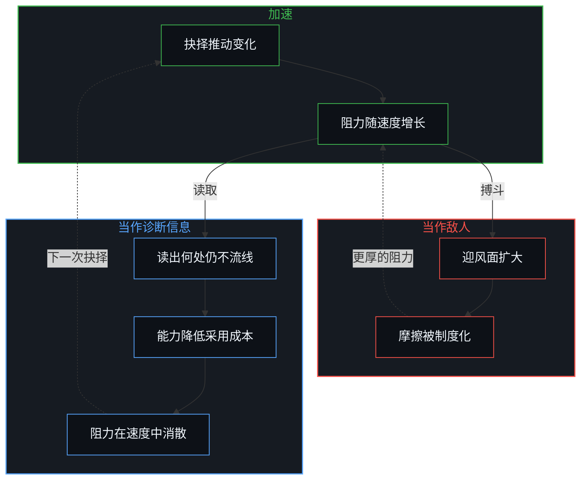
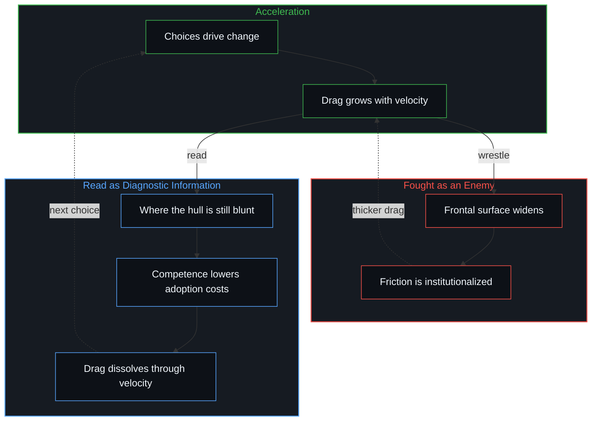

# 减速是加速时感受到的阻力 / Deceleration Is the Drag Felt When Accelerating

*减速不是对抗进步的独立力量，而是速度带来的阻力，被当作敌人时才稳定下来 / Deceleration is not a force opposing progress but drag made by velocity, stabilized only when fought as an enemy.*

把文明与技术的进步框定为加速与减速两种意识形态的对决，是一个范畴错误。减速不是站在战场对面、自行生成的独立力量；它是加速本身穿过既有介质时产生的反作用阻力。这份阻力一旦被实体化为一个本体上的敌人，加速的物体就会张大自己的截面去与介质搏斗，把一时的摩擦稳定成长期的对立制度。有纪律的回应把阻力认作诊断的信息：既证明速度已经达到，也邀请把船体修得更流线。

Framing civilizational and technological progress as an ideological duel between acceleration and deceleration is a category error. Deceleration is not an independent, self-originating force standing across a battlefield; it is the reactive drag that acceleration itself generates as it moves through an existing medium. When that resistance is reified into an ontological enemy, the accelerating body widens its cross-section to fight the medium, stabilizing passing friction into lasting institutions of opposition. The disciplined response takes drag as diagnostic information: evidence that velocity has been reached, and an invitation to streamline the hull.

## 一、 阻力随速度增长，不随意识形态 / 1. Drag Scales with Velocity, Not Ideology

在流体力学里，阻力随速度的平方增长。阻力的感受越尖锐，越可以确定速度或它的变化率已经陡增。这股力是反作用的：它不发起，只抵抗。它不是不请自来、要叫停运动的自主实体，而是在稠密的场中移动得更快时直接的、可测的后果。

In fluid dynamics, drag grows with the square of velocity. The sharper the sense of resistance, the more certain it is that velocity, or its rate of change, has surged. The force is reactive: it does not initiate; it resists. It is not an autonomous entity that arrived unbidden to halt motion, but the direct, measurable consequence of moving faster through a dense field.

同样的几何也支配着技术与文化的地形。尖锐的制度摩擦、不断加厚的监管丛林、道德上的警报，以及要求“暂停”或“放慢”的急切呼声，都不是在真空中诞生的独立哲学。它们是变化的坡度变陡时恰好出现的阻力峰值。

The same geometry governs the technological and cultural terrain. Sharp institutional friction, thickening regulatory undergrowth, moral alarms and urgent demands to “pause” or “slow down” are not independent philosophies born in a vacuum. They are the drag spikes that appear just as the slope of change steepens.

仪表的指针在动，是因为载具在加速。把这份反应误读为另一股独立的、原初的对立力量，是寻常的形象滞后：把自己运动产生的摩擦，当成一个外来的力的来源。[进步叙事中的症候与原因](../symptom-and-cause-in-the-narratives-of-progress/)追踪的是同一次倒置：把进步拖在身后的湍流，混同为它的驾驶引擎。

The instrument needle moves because the vehicle is accelerating. Misreading this reaction as a separate, primordial opposing power is ordinary Image lag: taking the friction generated by one’s own movement for an alien origin of force. [Symptom and cause in the narratives of progress](../symptom-and-cause-in-the-narratives-of-progress/) tracks the same inversion: confusing the trailing turbulence of progress with its steering engine.

## 二、 与介质搏斗，反而稳定了阻力 / 2. Fighting the Medium Stabilizes the Resistance

更深的扭曲，始于把阻力当作必须征服的首要问题，而不是当作一份可以用流线化来化解的自然反应。

The deeper distortion begins when drag is treated as the primary problem to conquer rather than as a natural reaction to be streamlined.

把减速人格化为一套连贯的敌对意识形态，认定长期的敌人、恶意的联盟与必须在战斗中击败的道德缺陷，摩擦就被稳定在原处。本可以只是一层短暂的气流剪切层的东西，被授予了正式的制度边界、政治身份与坚固的堡垒。放慢的呼声多以道德语言出现，[道德语言作为投影](../moral-language-as-projection/)把这种语言读作从封闭现实出发的投影。

Personifying deceleration as a coherent adversarial ideology, with permanent enemies, malicious coalitions and moral deficits to be defeated in battle, holds the friction in place. What could have stayed a passing aerodynamic shear layer is granted formal institutional borders, political identities and entrenched battlements. Calls to slow down arrive mostly in moral language, which [Moral Language as Projection](../moral-language-as-projection/) reads as projection from a closed reality.

“对抗减速”的姿态本身就扩大了运动物体的迎风面积。本该投入引擎效率与外形塑造的能量，被转去打诊断式的论战，向周围的空气发动文化战争。载具慢下来，不是因为介质无法穿越，而是因为它长出了巨大的附肢去与风角力。[阻力体感与速率差](../felt-resistance-and-the-speed-differential/)把这次因果倒置说得更清楚：被感到的阻力，是前进中的能力与滞后的适应之间速率差的成比例的感受。把生成的资源抽去争辩周围的怀疑，压平了未采用者赶上来的私人激励，反而固化了那些表演性战斗所哀叹的滞后。[限制是选择性的税](../restriction-is-a-selective-tax/)追溯了同一个动态：监管与限制的屏障不是无法穿越的石墙，而是选择性的摩擦，惩罚宽大的迎风面，放过专注、流线的流动。

The very posture of “fighting deceleration” enlarges the frontal area of the moving body. Energy that belongs to engine efficiency and the shaping of the hull is diverted into diagnostic polemics and cultural warfare against the ambient air. The vehicle slows not because the medium was impassable, but because it grew massive appendages to wrestle with the wind. [Felt Resistance and the Speed Differential](../felt-resistance-and-the-speed-differential/) states this causal inversion more exactly: felt resistance is the proportional sensation of a speed differential between advancing capability and lagging adaptation. Siphoning generative resources into contesting ambient skepticism flattens the private incentive for non-adopters to catch up, entrenching the very lag the performative battles lament. [Restriction is a selective tax](../restriction-is-a-selective-tax/) traces the same dynamic: regulatory and restrictive barriers are not impassable stone walls but selective frictions that penalize a broad frontal surface while leaving focused, streamlined flows intact.

## 三、 阻力在速度与能力中消散 / 3. Drag Dissolves Through Velocity and Competence

在物理系统里，空气阻力不是靠对大气喊叫来解决的，而是靠持续的外形改进与持续的推力。在人的系统里，阻力的自然消散循着一个确定的次序：

In physical systems, aerodynamic drag is resolved not by shouting at the atmosphere but by continuous refinement of shape and sustained thrust. In human systems, the natural dissolution of drag follows a definite sequence:

1. **能力降低采用成本：** 随着能力成熟，那些让谨慎显得正当的实际风险与不确定性下降，防御的姿态变得昂贵而多余。
2. **激励重新对齐：** 起初只登记到扰动与摩擦的相关方，开始从新的生产力基线中获益。
3. **速度本身带来淘汰：** 更快状态下的运作，在争论结束之前就让此前的制度性异议失去了对象。

1. **Competence lowers adoption costs:** as capabilities mature, the actual risks and uncertainties that made caution legitimate decline, and defensive posturing becomes expensive and redundant.
2. **Incentives realign:** stakeholders who at first registered only disruption and friction begin to benefit from the new baseline of productivity.
3. **Speed itself brings obsolescence:** operating in the faster state leaves earlier institutional objections without an object before the debates conclude.

把减速稳定为长期的敌人，就短路了这条演化式的消散。它把双方锁进一场冻结的围城：挑战者要求无条件投降，介质则筑起更厚的防波堤。[持续生长的脚手架](../the-scaffolding-that-keeps-growing/)追溯这场围城之下的冻结：当前结构被保存的形象被持守为完成的，而结构本身仍在生长。

Stabilizing deceleration into a permanent enemy short-circuits this evolutionary dissolution. It locks both sides into a frozen siege in which the challenger demands unconditional surrender and the medium builds thicker breakwaters. [The scaffolding that keeps growing](../the-scaffolding-that-keeps-growing/) traces the freeze beneath that siege: the preserved image of a current structure held as finished, while the structure itself keeps growing.

## 四、 阻力作为诊断的反馈 / 4. Resistance as Diagnostic Feedback

进步不消除阻力；它按自己速度的比例生成阻力。

Progress does not eliminate resistance; it generates resistance in proportion to its own speed.

阻力的出现，是真实的变化正在发生的最清楚的信号。一项没有遇到摩擦、没有引起警报、没有制度阻力的事业，相对于周围的介质，速度为零。

The presence of drag is the clearest signal that real change is under way. An endeavor that meets no friction, no alarm and no institutional drag is moving at zero velocity relative to its surrounding medium.

策略上要做的，既不是否认阻力，也不是把它实体化为一场神圣的战争，而是把阻力当作未经过滤的反馈：一次传感器读数，测出当前的速度，并显出载具在哪里仍然钝、仍有湍流、仍与现实耦合不良。[失败即信息](../failure-as-information/)讲的正是这份纪律：摩擦与碰撞不是道德判决，而是下一次迭代的精确数据。[技术变革的局部陷阱](../the-local-trap-of-technological-change/)把这份诊断用在技术革命上：存量底盘的迟缓，是互补资本的流体摩擦，不是停滞的证据。

The strategic task is neither to deny the drag nor to reify it into a sacred war, but to treat resistance as unfiltered feedback: a sensor reading that measures current speed and shows where the vehicle is still blunt, turbulent or poorly coupled to reality. [Failure as information](../failure-as-information/) sets out this discipline: friction and collision are not moral verdicts but precise data for the next iteration. [The Local Trap of Technological Change](../the-local-trap-of-technological-change/) applies this diagnostic to technological revolutions: the sluggishness of the legacy base is the hydrodynamic friction of complementary capital, not evidence of stagnation.

剩下的，是让油门开着，改进外形，降低系数。[个体抉择是唯一的因果杠杆](../individual-choices-as-the-only-causal-levers/)仍是掌舵唯一的所在：进步一次一个流线的抉择地继续，不理会身后留下的湍流。

What remains is to keep the throttle open, refine the geometry and reduce the coefficient. [Individual choices as the only causal levers](../individual-choices-as-the-only-causal-levers/) stays the sole site of steering: progress continues one streamlined choice at a time, indifferent to the turbulence left in its wake.
