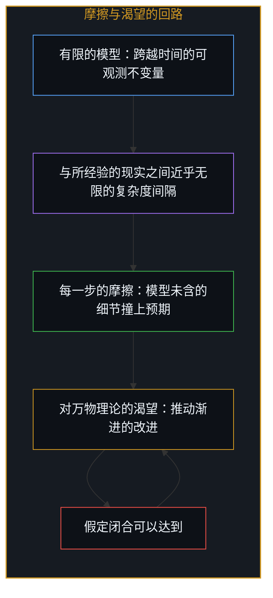
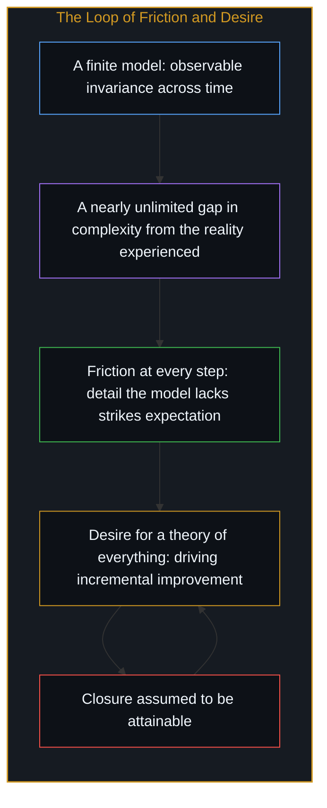
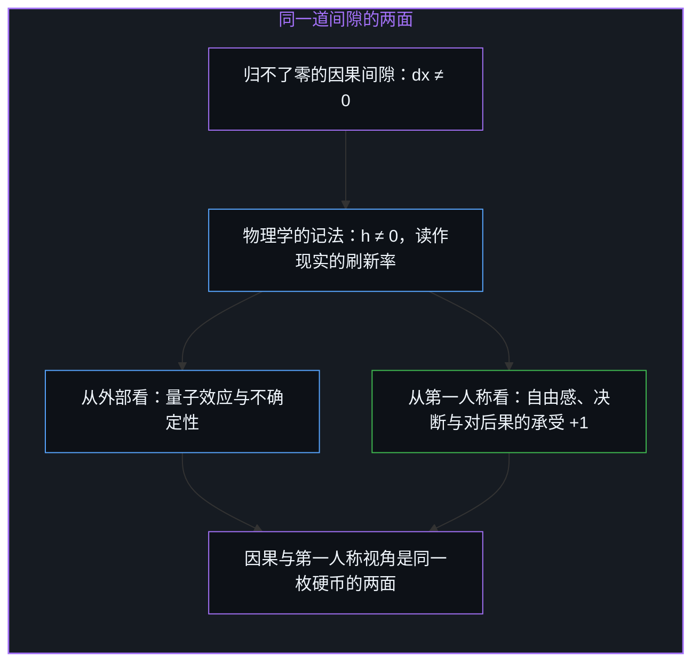
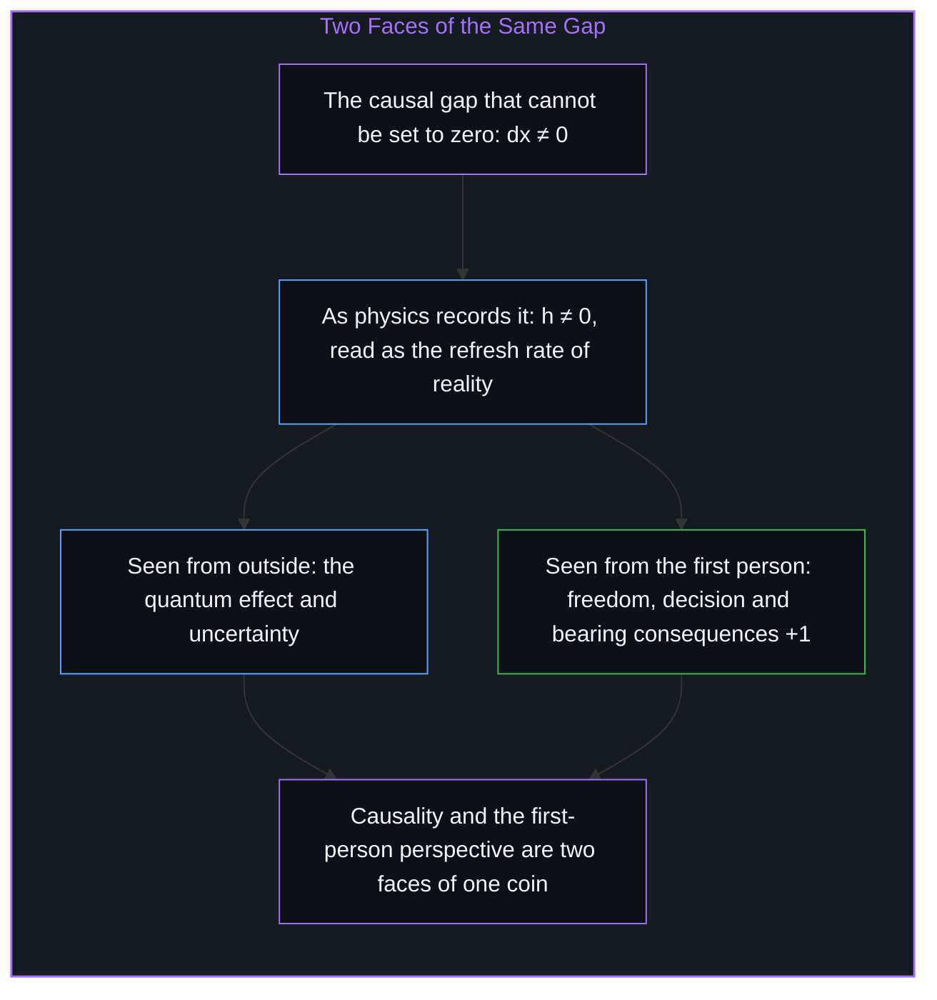
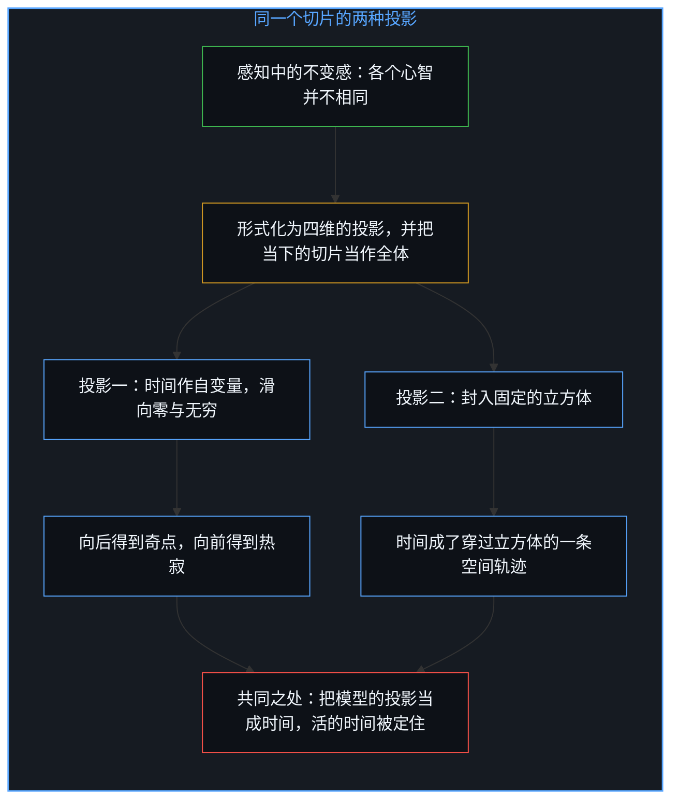
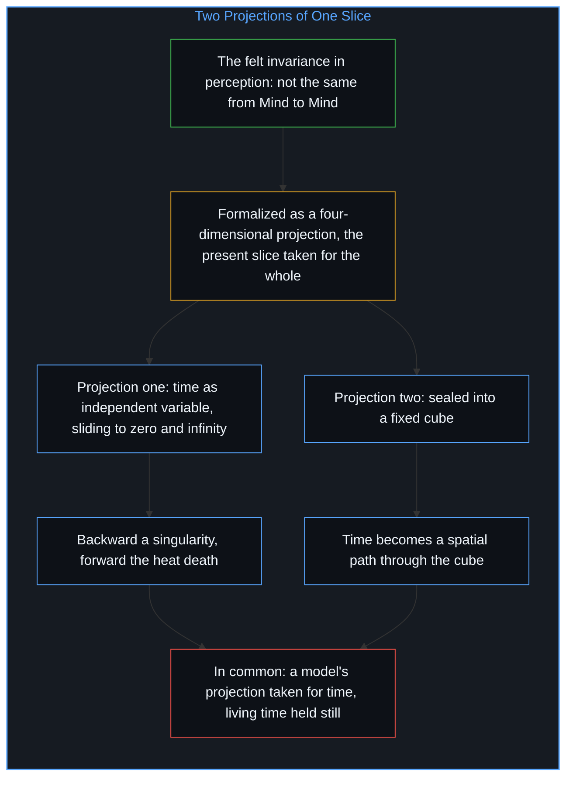

# 索求万物理论是在将当下冻结为清单 / Demanding a Theory of Everything Freezes Time into a Catalog

*把投影出的时间当作时间，回避了未来，也把不可化约的前提降成了假说 / Taking projected time for time avoids the future and demotes the irreducible prior to a hypothesis*

万物理论的设想，靠着一份关于过去的完备记录与一条预先画好的未来轨迹，而能指出来的每一件证据都在此刻，过去与未来是从当下向两侧投出的坐标。索求这样一套理论的举动本身就是一次新的因果步进，清单写成的那一刻，现实已经走到了下一步。理论捕获的是有限窗口内跨越时间的可观测不变量，它与所经验的现实之间隔着近乎无限的复杂度，这道间隔在日常里显现为摩擦，也正是人对万物理论的渴望的来处。渴望推动一次次渐进的改进，把闭合当作可以达到的，则是把工具倒置成了本体。

The idea of a theory of everything leans on a complete record of the past and a future trajectory drawn in advance, while every piece of evidence that can be pointed to is in this moment, and past and future are coordinates projected to either side from the present. The act of demanding such a theory is itself a new causal step, and at the moment the catalog is written, reality has already moved to the next. What a theory captures is observable invariance across time within a limited window; between it and the reality experienced lies a nearly unlimited complexity, a gap that shows up in daily life as friction and is also where the desire for a theory of everything comes from. The desire drives one incremental improvement after another, and taking closure to be attainable turns a tool into an ontology.

## 一、 没有“过去的客观记录” / 1. There Is No "Objective Record of the Past"

关于万物理论的经典设想里有一个很少被反思的前提：科学之所以能总结出终极的规律，是因为有一套客观而完备的“历史记录”。只要挖出足够多的古老地层，捕获足够微弱的宇宙微波背景辐射，记下足够详尽的粒子对撞数据，便有了一份关于过往全部物理事实的底账，最终的方程可以立在它上面。

The classical idea of a theory of everything carries a premise that is seldom examined: science can sum up ultimate laws because there is an objective and complete "historical record." Dig out enough ancient strata, capture a faint enough cosmic microwave background, log particle collisions in enough detail, and there is a ledger of all past physical facts on which a final equation can be raised.

从当下出发去找，找不到一座存放“过去”的仓库，也找不到一卷写满“历史”的底片。能指出来的每一件证据都在此刻。手里的三叶虫化石，是此刻躺在掌心的一块排列特殊的方解石结晶。射电望远镜接收到的微波背景光子，是此刻在天线传感器里激起的微弱电流。硬盘上的实验读数，是此刻保持着特定磁化取向的磁畴。脑中的记忆，也是此刻神经元网络维持着的电化学构型。

Searching from the present, no warehouse storing "the past" is found, nor any reel of film inscribed with "history." Every piece of evidence that can be pointed to is in this moment. The trilobite fossil in the hand is a calcite crystal of a particular arrangement lying in the palm now. The microwave background photons a radio telescope receives are a faint current excited in the antenna's sensor now. The experimental readings on a hard drive are magnetic domains holding a particular orientation now. A memory in the brain, too, is an electrochemical configuration that a network of neurons is maintaining now.

“过去”由此是一种投影：心智在当下把此刻的构型向后投到一条画出来的几何轴线上。是心智在当下指着一块石头说“这代表一亿年前的海洋”，是理论家在当下指着一段光谱说“这代表宇宙初期的暴胀”，从唯一的当下出发，向后画出一条标着坐标 t 的射线，把此刻的结构解释为那条轴上的点。这种投影极为有用，地质学与宇宙学都靠它工作。它的边界在于被当作一个盛放实体的容器的时候。“在任何观察者出现之前的几十亿年”便是这样一处：它是测量的割点被推到因果链最远一端的说法，[割点可移不可除](../the-cut-moves-but-never-vanishes/)说明割点移到哪里预测都不变，在哪里接受它是心智的抉择。过去与未来在这一点上没有分别，都是从当下向两侧画出的射线，以“过去的客观记录”为底去编织万物理论，第一步便把投影当成了现实。

"The past" is thus a projection: a Mind in the present casts the configuration of this moment backward onto a geometric axis it has drawn. It is a Mind in the present that points to a rock and says "this stands for an ocean a hundred million years ago," and a theorist in the present who points to a spectrum and says "this stands for inflation in the early universe"; starting from the only present, a ray marked with the coordinate t is drawn backward, and the structure of this moment is read as a point on that axis. The projection is extremely useful, and geology and cosmology work by it. Its boundary lies where it is taken for a container holding things. "Billions of years before any observer" is one such place: it states the measurement cut pushed to the farthest end of the causal chain, and [The Cut Moves but Never Vanishes](../the-cut-moves-but-never-vanishes/) shows that the predictions stay the same wherever the cut is moved, while where it is accepted is the Mind's choice. Past and future do not differ in this respect; both are rays drawn to either side from the present, and weaving a theory of everything on the basis of an "objective record of the past" takes the projection for reality at its first step.

## 二、 构想即过时 / 2. Obsolete at Inception

时间既然不是一条现成的维度，而是现实不可逆的展开，索求万物理论便遇到一处绕不开的自指：构想一个念头、写下一组方程、发出“要一个终极理论”的索求，本身就是一次因果事件。物理学家坐在黑板前，心里浮起把全部规律闭合为一组方程的念头，或在草稿上写下最后一个统一的算符时，现实并不停下来等。在念头萌生、粉笔划过黑板的那一瞬，因果已经向前推进，现实已经走到了下一步（+1）。

Since time is not a ready-made dimension but the irreversible unfolding of reality, the demand for a theory of everything meets a self-reference it cannot get around: conceiving a thought, writing down a set of equations, voicing the demand for "a final theory" are themselves causal events. When a physicist sits before a blackboard and the thought of closing all laws into one set of equations rises, or when the last unified operator is written on a draft, reality does not stop to wait. In the instant the thought forms and the chalk crosses the board, causality has already moved forward and reality has taken the next step (+1).

这里无需罗列能量耗散或信息擦除之类的注脚。因果不可逆地向前推进，本身就是缘由。神经元的放电、热量的耗散与熵的增减，是因果的流动在下游显出的伴生症状，把这些症状列为“原因”，反而把不可化约的因果降成了局域的机械决定。

There is no need here to list footnotes such as the dissipation of energy or the erasure of information. That causality moves forward irreversibly is itself the ground. The firing of neurons, the dissipation of heat and the rise or fall of entropy are accompanying symptoms the flow of causality shows downstream, and listing those symptoms as "causes" would instead reduce irreducible causality to local mechanical determination.

万物理论的初衷，是给现实制作一份穷尽全部状态与法则的静态全景，而构想与记录这个动作本身就是因果正在发生的新的一瞬。在以为终于把一切“打包封口”的那一刻，现实已经跨过门槛，所捕获的全景在落笔的第一毫秒已是留在身后的旧投影。它想用系统内部的一个局域动作去定住整个系统的流动，而这个动作的存在，正是流动不曾停下的直接见证。画不出一张盖住全部领土的地图，因为画这张地图的墨水，就是领土上正在出现的新地貌。

The original aim of a theory of everything is to make of reality a static panorama exhausting all states and laws, while the act of conceiving and recording is itself a new instant of causality taking place. At the moment everything is believed to be "packed and sealed" at last, reality has already crossed the threshold, and the panorama captured is, within the first millisecond of the pen coming down, an old projection left behind. It tries to hold the flow of the whole system still by one local act inside the system, and the existence of that act is direct witness that the flow has not stopped. No map can be drawn that covers the whole territory, because the ink drawing the map is new terrain appearing on the territory.

## 三、 理论能捕获什么 / 3. What a Theory Can Capture

那么物理学里那些极受珍视的理论，捕获的是什么？任何理论所能捕获的，是在有限的观测窗口之内，跨越时间的可观测不变量。能量守恒、动量守恒、规范对称性、麦克斯韦方程与爱因斯坦场方程，是心智在文明短暂的观测尺度里提炼出的高度抽象的概念模型：在有限的观测历程中，某些数学比例与代数结构保持着稳定的一致，这些可观测的不变性被命名为“定律”。块状宇宙正是这样冻结时间的，[双生子佯谬与隐秘观察者](../the-twin-paradox-and-the-hidden-observer/)找出了它藏起的观察者。

What, then, do the most treasured theories of physics capture? What any theory can capture is observable invariance across time within a limited window of observation. Conservation of energy and momentum, gauge symmetry, Maxwell's equations and the Einstein field equations are highly abstract conceptual models a Mind has distilled within the brief observational scale of a civilization: over a limited course of observation, certain mathematical ratios and algebraic structures hold a stable consistency, and these observable invariances are named "laws." The block universe freezes time this way, and [The Twin Paradox and the Hidden Observer](../the-twin-paradox-and-the-hidden-observer/) finds the observer it hides.

这个概念模型的复杂度，与正在直接经验的现实相比，是微小的。这里有一个常被略过的命题，关乎信息与物质的关系。人们常把“信息”与“物质”对立起来，或把信息看作浮在物质之上的次级产物。而物质须同样具有信息性，信息才可能表征它。数学符号与信息模型之所以能与物理世界咬合，是因为跨越两个领域的因果是同一个：每一次物理的相互作用，一次光子的吸收、一次电子自旋的翻转、一次分子的碰撞，在物理上是一次不可逆的因果步进，在信息上是一次区分。

The complexity of this conceptual model is tiny beside the reality being directly experienced. There is a proposition here that is often passed over, concerning the relation of information and matter. "Information" and "matter" are commonly set against each other, or information is seen as a secondary product floating above matter. Yet matter must be informational as well for information to be able to represent it. Mathematical symbols and informational models can mesh with the physical world because the causality across the two domains is one and the same: each physical interaction, a photon absorbed, an electron's spin flipped, a collision of molecules, is physically an irreversible causal step and informationally a distinction.

正因为物质的每一个微观自由度每时每刻都在作着这样的因果演进，模型与现实之间的复杂度差距，在一切实用的意义上近乎无穷。这不是“实无穷”：无穷只是一种潜在的开放，不是一个已经完成的数值。现实在离散地生成，不是一个现成的无穷集合，而对任何能写下的有限符号模型来说，现实所含的因果复杂度与模型的容量相比，呈现出近乎无穷的断层。即便是最优 N 与最差 N，也仍停在清单之内，[闭合的N与开放的现实](../the-closed-n-and-the-open-reality/)说明了这一点。

Precisely because every microscopic degree of freedom of matter is carrying out such causal evolution at every moment, the difference in complexity between model and reality is, for all practical purposes, close to infinite. This is not an "actual infinity": infinity is only a potential openness, not a completed quantity. Reality is generated discretely and is not a ready-made infinite set, yet for any finite symbolic model that can be written down, the causal complexity reality holds, set against the model's capacity, presents a break that is nearly infinite. Even Best-of-N and Worst-of-N stay inside a catalog, as [The Closed N and the Open Reality](../the-closed-n-and-the-open-reality/) shows.

索求万物理论的结构性局限在这里显出来。写下几行由几十个符号构成的拉格朗日量，并设想这几行信息已经穷尽了物质宇宙的全部，是一种可以理解的思想上的越界，好比几滴凝住的水珠宣称自己容纳了那片不曾停歇的海。

The structural limit of demanding a theory of everything shows itself here. Writing down a few lines of Lagrangian made of a few dozen symbols and supposing that these lines of information have exhausted the whole of the material universe is an understandable overextension of thought, like a few congealed drops of water claiming to contain the sea that never stops moving.

## 四、 日常的摩擦与对万物理论的渴望 / 4. Daily Friction and the Desire for a Theory of Everything

在这道间隔上，日常处境里的一个机制显出来：每一个瞬间都在经验到的粗粝摩擦，与对万物理论的长久渴望，是同一枚硬币的两面。不论计划多周密、科学模型多高深、算法工具多精密，从这一瞬迈进下一瞬时，仍会撞上意外、挫败、阻滞、没有预见的变化与消耗。这是那道近乎无限的复杂度间隔在生命里的直接显现。

On this gap a mechanism of the everyday situation shows itself: the coarse friction experienced at every instant and the long-standing desire for a theory of everything are two faces of one coin. However thorough the plan, however advanced the scientific model, however precise the algorithmic tool, stepping from this instant into the next still runs into surprise, setback, drag, unforeseen change and expenditure. This is the nearly unlimited gap in complexity appearing directly in a life.

抽象的认知模型只抓住了几条可观测的不变量，所处的现实却在每一个微秒里以近乎无限的自由度演进。带着一个复杂度极低的模型跨进下一瞬时，模型没有包含的因果细节便撞上预期。这种撞击在第一人称的经验里叫作“摩擦”。摩擦不是系统的故障，它是现实装不进行囊的直接读数。

An abstract cognitive model grasps only a few observable invariances, while the reality one is in evolves at every microsecond with nearly unlimited degrees of freedom. Carrying a model of very low complexity across into the next instant, the causal detail the model does not contain strikes against expectation. In first-person experience this impact is called "friction." Friction is not a malfunction of the system; it is the direct reading that reality does not fit in the bag.

心智面对摩擦时展开的是一个递归：正因为不可能有一套能从这一瞬完好带到下一瞬的万物理论，才一直渴望着一个万物理论。假如真有一套完备的理论，像一把万能钥匙从此时带到彼时而没有信息的泄漏，跨步时便感受不到摩擦与意外，而那样的宇宙是一台上紧了的发条，抉择也无从谈起。于是“无法一次带走”被反过来构想成一个可以解决的问题：只要有更完备的模型，就能跨越时间带着它，消除没有预测到的摩擦。罗盘之所以一直被寄予期望，正因为海浪一次又一次把指针打偏。

What a Mind unfolds in the face of friction is a recursion: precisely because there can be no theory of everything carried intact from this instant to the next, a theory of everything is forever desired. If there really were a complete theory, carried like a master key from one time to another with no leak of information, no friction or surprise would be felt in stepping across, and such a universe would be a wound-up clockwork in which choice has no place. So "it cannot be carried over in one piece" is conceived the other way round, as a problem that can be solved: with a more complete model, it could be carried across time and unpredicted friction removed. The compass keeps being hoped for precisely because the waves knock its needle aside time after time.

## 五、 渴望与闭合的假定 / 5. Desire and the Assumption of Closure

这里有两种需要分开的东西：渴望，与假定闭合可以实现。前者是减少摩擦的动力，对确定与可预测的需求推动着工具的创造、技术的演进与经验的积累，轮子、算盘、经典力学与微积分都由它而来，一次又一次渐进的改进也由它而来。后者把工具倒置为本体：一旦把作为认知界面的局部模型当成宇宙的全貌，临时搭起的脚手架便成了世界的边界，模型囊括不了的生成与未决则被归为“测量的噪音”或“主观的幻觉”。也可以说，正是这个未经审视的假定，在不断地助长那份渴望。

Two things need to be kept apart here: desire, and the assumption that closure can be achieved. The first is the drive to reduce friction; the need for certainty and predictability pushes the making of tools, the development of technique and the accumulation of experience, and the wheel, the abacus, classical mechanics and the calculus come from it, as does one incremental improvement after another. The second turns a tool into an ontology: once a local model that serves as a cognitive interface is taken for the full extent of the universe, scaffolding put up for the time being becomes the boundary of the world, and the generation and openness the model cannot include are filed as "measurement noise" or "subjective illusion." It can also be said that this unexamined assumption is what keeps feeding the desire.

把可求当作可达，与把“无穷”当作一个已经存在的封闭全体而非敞开的潜在生成，是同一种做法。相信万物理论可以完成，如同相信数数可以数到无穷大。它与微积分里的那一步也成镜像：为了让求导闭合，微积分把非零的、不可逆的因果微元 dx 宣布为零；为了让全景的解释闭合，万物理论把原因与结果之间那道不可化约的、始终非零的离散间隙宣布为已被统一方程合上，[连续性作为建模的权宜之计](../the-continuum-is-a-modeling-convenience/)展开了前一步。

Taking what can be sought for what can be reached is the same move as taking "infinity" for an existing closed totality instead of an open potential generation. Believing a theory of everything can be completed is like believing counting can reach infinity. It also mirrors a step in the calculus: to let differentiation close, the calculus declares the non-zero, irreversible causal element dx to be zero; to let a panoramic explanation close, a theory of everything declares the irreducible, always non-zero discrete gap between cause and effect to have been sealed by a unified equation. [The Continuum is a Modeling Convenience](../the-continuum-is-a-modeling-convenience/) lays out the first of these.

在可观测的物理世界里，这个归不了零的最小因果步长，被物理学记为一个基本常数，普朗克常数 h。因为 h ≠ 0，微观的作用存在不可再分的离散跃迁，模型无法被无限平滑地微分。它是现实的刷新率：现实不是一张平滑的连续画布，它在摩擦中一帧一帧地生成。

In the observable physical world, this smallest causal step that cannot be set to zero is recorded by physics as a fundamental constant, the Planck constant h. Because h ≠ 0, microscopic action involves discrete transitions that cannot be divided further, and a model cannot be differentiated with unlimited smoothness. It is the refresh rate of reality: reality is not a smooth continuous canvas, and it is generated frame by frame within friction.

在这道合不上的间隙里，量子效应与主观的自由感是同一枚硬币的两面。从外部，以第三人称去观测这道间隙时，没有哪一个确定性的方程能跨过那个非零的步长，测得的现象便呈现为概率性的塌缩、不确定性与非决定的跃迁，这被命名为“量子效应”。作为第一人称的主体，在因果发生的前沿承担后果并迈出那一步时，同一道敞开的间隙，在直接的经验里是自由感、决断与对后果的承受。无穷是潜在的，因果的间隙始终非零，所以无法有万物理论；第三人称的形式无法事先决定那一步，所以微观呈现为量子效应；第一人称的主体直接承担每一步的后果，所以生命经验到自由与摩擦。这些都是因果与第一人称视角作为一枚硬币两面的显现。

Within this gap that will not close, the quantum effect and the subjective feeling of freedom are two faces of one coin. Observed from outside, in the third person, no deterministic equation can cross that non-zero step, and the phenomena measured appear as probabilistic collapse, uncertainty and non-determined transition, which are named "the quantum effect." As a first-person subject, bearing consequences at the front where causality happens and taking that step, the same open gap is, in direct experience, the feeling of freedom, decision and the bearing of consequences. Infinity is potential and the causal gap is always non-zero, so there can be no theory of everything; third-person formalism cannot determine that step in advance, so the microscopic appears as the quantum effect; the first-person subject bears the consequences of each step directly, so a life experiences freedom and friction. All of these are appearances of causality and the first-person perspective as two faces of one coin.

## 六、 活的时间与投影出的时间 / 6. Living Time and Projected Time

现实既然定不住，又有模型穷尽不了的复杂度，“万物理论能解释全部演化”的说法靠什么维持？靠的是一次替换：把活的时间换成了投影出的时间维度，[时间是因果的不可逆方向与离散步长](../time-is-causality-not-a-dimension/)分开了这两者。活的时间是唯一在生成的前沿，是现实正在发生的这一瞬，它单向、不可逆、伴着摩擦（+1），未来在其中是未决的、由行动生成的，过去只剩当下留存的结构，身在其中的是承担后果的第一人称。投影出的时间维度是心智在当下画出的一条几何轴线，坐标为 t，它对称、可逆，可以在纸面上向前向后任意计算，未来在其中是预先画好的轨迹，过去是一个静态的容器，看它的是一个站在外部的旁观位置。

Since reality cannot be held still and has a complexity no model exhausts, what sustains the claim that "a theory of everything can explain all evolution"? A substitution: living time is replaced by a projected time dimension, the two that [Time Is the Irreversible Direction and Discrete Step of Causality](../time-is-causality-not-a-dimension/) separates. Living time is the only front at which generation occurs, this instant in which reality is happening; it is one-way, irreversible and accompanied by friction (+1), the future in it is undecided and generated by action, of the past only the structures remaining in the present are left, and the one within it is a first person bearing consequences. The projected time dimension is a geometric axis a Mind draws in the present, with coordinate t; it is symmetric and reversible and can be computed forward and backward on paper at will, the future in it is a trajectory drawn in advance, the past is a static container, and what looks at it is a bystander's position standing outside.

一个封闭自洽的代数体系容不下活的时间的不可预测与不可逆。于是向后，当下存在的种种结构被设为一座“大爆炸至今的历史信息库”；向前，尚未发生的未来被换成微分方程沿坐标轴 t 延伸出的连续解；两条投影再拼合成“块状宇宙”，过去、现在与未来被宣布为一张流形上早已并存的静态几何。爱因斯坦写过，过去、现在与未来的区分只是一种顽固的幻觉。

A closed and self-consistent algebraic system has no room for the unpredictability and irreversibility of living time. So, backward, the various structures existing in the present are set up as a "store of historical information from the Big Bang until now"; forward, the future that has not yet happened is exchanged for the continuous solution a differential equation extends along the axis t; and the two projections are spliced into the "block universe," in which past, present and future are declared a static geometry long coexisting on one manifold. Einstein wrote that the distinction between past, present and future is only a stubbornly persistent illusion.

这里有一处内在的不合：同时接受大爆炸与宇宙热寂，块状宇宙便无法自洽地成立，而这两幅图景出自同一套方程。来处在于把宇宙当下这一瞬的切片当成了宇宙的全体，再用两种数学的方式向外投影。第一种把时间设为独立的自变量，任它滑向零与无穷大：把当前切片的膨胀向后外推到 t → 0，方程在原点给出一个奇点，即大爆炸；把当前切片的熵增向前外推到 t → ∞，方程在渐近线上给出耗散的尽头，即热寂。第二种把同一个切片封进一个静态的四维几何容器，一个固定的立方体，过去、现在与未来的切片都已并存其中，“时间”成了穿过这个立方体时走过的一条空间轨迹。这些外推在各自的范围内给出可检验的预测。两者的共同之处，是把对时间维度的模型投影当成了时间，并把活的时间定在了原地。它们显得针锋相对，一边是不可逆的单向历史，一边是一切早已并存的雕塑，是因为用了两种几何的透镜去投影同一个当下的切片。

There is an internal mismatch here: with both the Big Bang and the heat death of the universe accepted, the block universe cannot hold together consistently, and yet the two pictures come from the same set of equations. Its source is that the slice of the universe at this present instant has been taken for the whole universe and then projected outward in two mathematical ways. The first sets time as an independent variable and lets it slide toward zero and infinity: extrapolating the expansion of the current slice backward to t → 0, the equations give a singularity at the origin, the Big Bang; extrapolating the increase of entropy of the current slice forward to t → ∞, the equations give the end of dissipation on the asymptote, the heat death. The second seals the same slice into a static four-dimensional geometric container, a fixed cube, in which the slices of past, present and future already coexist, and "time" becomes a spatial path traced in passing through the cube. These extrapolations give testable predictions within their ranges. What the two share is that a model's projection of a time dimension has been taken for time, and living time has been held in place. They appear sharply opposed, on one side an irreversible one-way history and on the other a sculpture in which everything already coexists, because two geometric lenses have been used to project one and the same present slice.

更底下还有一层：感知现实时生出的“不变感”被凝成一个四维的投影，这个投影又被当成现实本身。知觉为了生存与行动，对现实作高密度的压缩与稳定，在意识里生成关于空间延展与时间流逝的不变感，物理学把它形式化为三维空间加一维时间的四维流形。而这个四维的投影在不同的心智之间并不相同，每一个心智受制于自己的身体、感知的带宽、注意的焦点、时间的分辨与经验的历史，危机里被拉长的时间便是一例。高度简化的四维投影在心智之间尚且不同一，把一个均质的、去掉了人的四维几何当作所有人身处其中的现实，便越过了它的范围。一份为所有心智共享的清单，正是[共享沙盒的幻象](../the-illusion-of-the-shared-sandbox/)所说的那个沙盒。

There is a further layer underneath: the "felt invariance" that arises in perceiving reality is set into a four-dimensional projection, and that projection is then taken for reality itself. Perception, for the sake of survival and action, compresses and stabilizes reality at high density, producing in awareness a felt invariance of spatial extension and the passing of time, which physics formalizes as a four-dimensional manifold of three dimensions of space and one of time. Yet this four-dimensional projection is not the same from one Mind to another; each Mind is bound by its own body, the bandwidth of its perception, the focus of its attention, its resolution of time and its history of experience, and time stretched in a crisis is one instance. With even a highly simplified four-dimensional projection not identical across Minds, taking a homogeneous four-dimensional geometry with the person removed for the reality all are in goes beyond its range. A catalog shared by all Minds is the sandbox that [The Illusion of the Shared Sandbox](../the-illusion-of-the-shared-sandbox/) speaks of.

## 七、 理性的假定与后视的“非理性” / 7. The Assumption of Rationality and "Irrationality" in Hindsight

同样的结构出现在经济学、博弈论与日常评判所用的“理性假定”里。对一个活的心智而言，当下这一瞬在自身的视角里总是内在自洽的：行动的那一刻，全部的具身状态、感知的输入、情绪的权重与注意的焦点汇成唯一踩出的那一步。没有哪个清醒的人会在决断的当下，故意去作一个自己明确断定为毫无理由的选择。

The same structure appears in the "assumption of rationality" used in economics, game theory and everyday judgment. For a living Mind, this present instant is always internally coherent within its own perspective: at the moment of acting, the whole embodied state, the perceptual input, the weights of emotion and the focus of attention converge into the one step that is taken. No one who is awake deliberately makes, at the moment of deciding, a choice that they clearly judge to have no reason at all.

这种在内部经验到的自洽，从外部被另一个心智审视时，便呈现为所谓的“非理性”。观察的一方无法经验行动一方的第一人称因果历史，只能站在自己的坐标系里，用自己投射出的那张现实切片与价值尺度去丈量对方。对方在自身约束下的自洽反应套不进这张预设的网格，便被判为“非理性”或“有认知偏差”。这与时空模型是同构的：物理学把感知的不变感抽象为客观的四维时空，理性的理论把某个局域观察者的偏好抽象为“客观的理性标准”。

This coherence experienced from within appears, when examined from outside by another Mind, as what is called "irrationality." The observing side cannot experience the acting side's first-person causal history and can only stand within its own coordinate system, measuring the other with the slice of reality and the scale of values it has itself projected. When the other's coherent response under its own constraints does not fit this preset grid, it is ruled "irrational" or "cognitively biased." This is isomorphic with the model of spacetime: physics abstracts the felt invariance of perception into an objective four-dimensional spacetime, and theories of rationality abstract the preferences of some local observer into an "objective standard of rationality."

回望时把过去的自己判为“非理性”，也是时间流动之后的后视评价。在走过的每一个时刻，那个当下的切片是自洽的，那一刻的信息、情绪与冲动构成了那一瞬唯一的状态。时间继续向前（+1），因与果之间必然出现差异，因为因与果从来不同，新的状态、没有预见的信息与代价随之展开。正是这份差异带来的摩擦，在后来的当下生出一种后视的评价，把“过去”说成了非理性。“非理性”因此不是心智固有的属性，而是不可逆的时间里因与果出现差异之后的后视评价。时间若像块状宇宙那样静止，因与果对称，这种评价便无从产生。

Judging one's past self "irrational" in looking back is likewise a hindsight evaluation made after time has flowed. At each moment passed through, the slice of that present was coherent; the information, emotion and impulse of that moment made up the only state of that instant. Time goes on (+1), and a difference necessarily appears between cause and effect, since cause and effect are never the same; a new state, unforeseen information and costs unfold with it. It is the friction this difference brings that produces, in a later present, a hindsight evaluation calling "the past" irrational. "Irrationality" is therefore not an inherent property of a Mind but a hindsight evaluation made after cause and effect have come to differ in irreversible time. Were time static as in the block universe, cause and effect would be symmetric and no such evaluation could arise.

## 八、 理论内部的自洽与抽身 / 8. Coherence Inside a Theory and Stepping Out

由此还有一个推论。一切理论都有它的边界，而在理论的内部，在持有它的心智主动抽离之前，是感受不到不自洽的。一个心智沉浸在一套理论里时，不论那是牛顿力学、广义相对论、标准模型，还是某种经济学说或日常的信念，那套理论就是它切身经验到的不变性，而那套不变性就是它所认定的现实。正如当下的一个切片内部没有逻辑矛盾，在一个被内化了的理论闭环里，推演、解释与感知的过滤是浑然一体的。

A further inference follows. Every theory has its boundary, yet inside the theory, before the Mind holding it steps away of its own accord, no incoherence is felt. When a Mind is immersed in a theory, be it Newtonian mechanics, general relativity, the Standard Model, some economic doctrine or an everyday belief, that theory is the invariance it experiences at first hand, and that invariance is the reality it recognizes. Just as a slice of the present holds no logical contradiction within it, within an internalized loop of theory, deduction, explanation and the filtering of perception are all of a piece.

理论之间的不合因此没有来自外部的解法。对认不出信号的心智，信号只被当作噪音略过；选择关注某个面向，就意味着略过其余的一切；所以在直接经验的当下，心智在内部感受不到不自洽。在外部向持某一理论的人挥舞另一套理论，反例穿过对方的不变性网格时，只会被当作可以忽略的噪音。这种局限的解开，取决于具体的心智作出第一人称的抉择，主动从既有的框架里抽身。这些文字因此不为说服、争辩或纠正别的心智，它是这颗心智在当下为未来的自己、以及可能觉得有用的其他心智搭起的一副脚手架，供想要走出自身的那一刻借力。

Incoherence among theories therefore has no solution coming from outside. To a Mind that cannot recognize the signal, the signal is only passed over as noise; choosing to attend to one aspect means passing over all the rest; so in the present of direct experience a Mind feels no incoherence within. When another theory is waved from outside at someone holding one theory, the counterexample, passing through the other's grid of invariance, is only treated as noise that can be ignored. The undoing of this limit depends on a particular Mind making a first-person choice to step out of the existing frame of its own accord. These words are therefore not for persuading, disputing with or correcting other Minds; they are scaffolding this Mind puts up in the present for its future self and for any other Mind that may find it useful, something to lean on at the moment of wanting to step out of oneself.

这不是悲剧，这是现实本来的运作方式。日常里的事就是这样：选择关注不同的面向，所关注的便构成所经验的现实。画家去看光影的渐变，经验到的是一个流光溢彩的世界。工程师去看应力的结构与承重的极限，经验到的是一个坚实严密的力学世界。母亲去看孩子的眼神与呼吸，经验到的是一个满是牵绊的世界。每个人所持的“理论”或“视角”，是为了在此刻的世界里行动而选定的一组局部不变性，那一刻所经验到的现实是自洽的，需要探索新的可能时，可以随时抽身迈步。

This is not a tragedy; it is how reality operates to begin with. Things in daily life are just so: different aspects are chosen to attend to, and what is attended to makes up the reality experienced. A painter looks at gradations of light and shade and experiences a world of flowing color. An engineer looks at structures of stress and limits of load and experiences a solid, exact world of mechanics. A mother looks at a child's eyes and breathing and experiences a world full of attachment. The "theory" or "perspective" each person holds is a set of local invariances selected in order to act in the world of this moment; the reality experienced at that moment is coherent, and when new possibilities need exploring, one can step away and move on at any time.

现实不呈现为一套闭合的万物理论，不是出于某种外在意志的设定，而是出于因果生成本身的开放。道德的语言预设了某个“宇宙应当如何”的更优版本，而那个脱离一切视角的无处之境无人占据。一个心智的偏好不会自动成为另一个心智的偏好，更不会成为所有心智的偏好。在投影出的时间维度上，一切都是已经完成的；在活的时间里，每一次呼吸、每一次观测、每一次抉择，都以不可化约的代价把整张地图推向不可逆的新处。

That reality does not present itself as a closed theory of everything is not the setting of some outside will; it comes from the openness of causal generation itself. Moral language presupposes some better version of "how the universe ought to be," and that view from nowhere, detached from every perspective, is occupied by no one. The preference of one Mind does not automatically become the preference of another, still less of all. On the projected time dimension everything is already complete; in living time, every breath, every observation, every choice pushes the whole map, at an irreducible cost, to somewhere irreversibly new.

## 九、 回避未来 / 9. Avoiding the Future

任何理论都穷尽不了生成着的现实，许多智识传统却长久地追求一套闭合的终极理论。这出于认知对确定与稳定的偏好：想靠一个完备的静态模型，避开面对未决的未来时的不确定。

No theory exhausts a reality that is being generated, and yet many intellectual traditions have long pursued a closed final theory. This comes from cognition's preference for certainty and stability: the wish to avoid, by means of a complete static model, the uncertainty of facing an undecided future.

活的时间是不可逆的。在当下，倒带撤销不了一个动作，改变坐标的符号也消除不了一次已经发生的事。迈向未来的方式只有一种：承受摩擦，背负不可逆的代价，踩出那一步没有任何既有公式担保的险步（+1）。在这一步落地之前，没有哪组主方程能打包票，没有哪个拉格朗日量能分担犯错的痛，未来的形态取决于行动者在粗粝的现实里作出的决断。

Living time is irreversible. In the present, rewinding does not undo an act, and changing the sign of a coordinate does not remove something that has happened. There is only one way into the future: bearing friction, carrying an irreversible cost, and taking the risky step that no existing formula guarantees (+1). Before that step lands, no master equation can vouch for it, no Lagrangian can share the pain of being wrong, and the shape of the future depends on the decision an actor makes within coarse reality.

万物理论是消除这种不确定的一种构想。把现实看作一份基于当下的全知清单，把未来表述为一条预先写定的轨迹，它给出的是一个确定的承诺：未来只是一段已经算好的坐标，只需推演它的代数解。索求万物理论，于是是用对坐标维度的代数计算，代替了踏入未来的那一步因果。

A theory of everything is one way of conceiving the removal of this uncertainty. Seeing reality as an all-knowing catalog based on the present and stating the future as a trajectory written in advance, it offers a definite promise: the future is only a stretch of coordinates already computed, and its algebraic solution need only be worked out. Demanding a theory of everything thus puts algebraic calculation over a coordinate dimension in place of the causal step into the future.

## 十、 物理学在前提的下游 / 10. Physics Stands Downstream of the Prior

分析到这里，常见的回应是：再给几十年，建成能标更高的对撞机，完成量子引力与时空涌现的数学，物理学自会把时间、因果与观测者解释清楚。这个回应的边界在次序上：物理学的全部方程，都是建立在这个前提之上的下游产物。

At this point in the analysis the common reply is: given a few more decades, a collider at higher energy, the mathematics of quantum gravity and emergent spacetime completed, physics will of itself explain time, causality and the observer. The boundary of this reply is one of order: all the equations of physics are downstream products built upon this prior.

物理学是一个栖于第一人称当下的活的心智，为了在粗粝的世界里寻找一致，在不可逆的当下执行测量、做下记号、记录读数，进而提炼出的符号系统。没有心智在当下划出的那一记区分，便没有“状态”与“自由度”的划分。没有时间不可逆的单向流动，没有实验可以启动，没有仪器可以留下一个字节的读数。没有第一人称的经验，从光速 c 到普朗克常数 h 的全部术语，都没有所指。心智与不可逆的因果，是启动一切科学探索的不可化约的前提。

Physics is a system of symbols that a living Mind dwelling in the first-person present, seeking consistency in a coarse world, has distilled by carrying out measurements, making marks and recording readings in the irreversible present. Without the distinction a Mind draws in the present, there is no division into "states" and "degrees of freedom." Without the irreversible one-way flow of time, no experiment can be started and no instrument can leave a single byte of reading. Without first-person experience, every term from the speed of light c to the Planck constant h refers to nothing. Mind and irreversible causality are the irreducible prior that sets all scientific inquiry going.

还原的倾向却想把这双正在作画的手画进它自己的画里，把作为母体的前提降成一项“有待在实验室里还原的假说”，再去推导“为什么会有意识与时间”。这如同要黑板上的粉笔字去推导握笔书写的那个人的生理结构，要镜中的像去证明镜前站立者的存在。物理学解不开这一处，不在于聪明或技术的不足，而在于次序：它处在前提的下游，下游倒流不回源头。

The reductive tendency, however, wants to paint the hands that are doing the painting into their own picture, demoting the prior that is the matrix to a "hypothesis awaiting reduction in the laboratory" and then deriving "why there is consciousness and time." This is like asking chalk marks on a blackboard to derive the physiology of the person holding the chalk, or asking the image in a mirror to prove the existence of the one standing before it. Physics cannot undo this point, not for lack of cleverness or technique but because of order: it stands downstream of the prior, and what is downstream does not flow back to the source.

## 十一、 形式系统的滑移 / 11. The Slippage of Formal Systems

形式系统的运作里有一处反复出现的滑移：即便理清了上面的机制，思维仍会一次次滑回还原的叙事。前一分钟刚看清“不可化约的前提是一切验证的先决条件”，过了几分钟，语言的惯性便带出这样的问题：这个前提本身如何证明，是否需要假定它存在，未来的科学会不会找到它的产生机制。就在这一转换里，不可化约的前提被换成了一个有待证明的假设，发问的人一边在用它，以活的心智发问、在时间里组织语言，一边回头怀疑脚下的这片地是否存在。

Within the working of formal systems there is a slippage that recurs: even with the mechanisms above made clear, thought slides back, again and again, into the reductive narrative. A minute ago it was plain that "the irreducible prior is the precondition of all verification," and a few minutes later the inertia of language brings out questions such as these: how is the prior itself proven, must its existence be assumed, might future science find the mechanism that produces it. In that very shift the irreducible prior is exchanged for a hypothesis awaiting proof, and the one asking is using it all the while, asking with a living Mind and arranging words in time, while turning back to doubt whether the ground underfoot exists.

这是语言、符号与形式逻辑固有的结构性滑移。形式语言倾向于客体化与名词化，把流动的动作沉淀为静态的概念：正在进行的不可逆的因果步进成了名词“因果律”，正在觉察的第一人称介入成了名词“观测者”，先于一切形式体系的基准成了“不可化约的前提”这一串字。活的经验一旦编码为静态的名词，形式系统的语法便把它当作一个普通的内部对象，向它索要输入的参数、定义域与公理的证明。这种滑移是“闭合之不可能”的证据：没有哪个形式符号系统能自足地容纳赋予它生命的母体。

This is a structural slippage inherent in language, symbols and formal logic. Formal language tends toward objectifying and nominalizing, settling flowing action into static concepts: the irreversible causal step under way becomes the noun "the law of causality," the first-person involvement that is aware becomes the noun "the observer," and the baseline prior to every formal system becomes the string of words "the irreducible prior." Once living experience is encoded as a static noun, the grammar of a formal system treats it as an ordinary internal object and asks it for input parameters, a domain of definition and an axiomatic proof. This slippage is evidence of "the impossibility of closure": no formal system of symbols can self-sufficiently contain the matrix that gives it life.

没有哪套静态的公式能防住这种滑移，公式本身就是滑移的产物。能抵住它的是活的心智。形式逻辑要把先决的前提降成可选的假说时，心智能辨出其中的倒置。形式系统要用投影的坐标替代活的现实时，心智能重新感到具身的摩擦。心智能从写成的名词里抽身，重新立在生成着的因果前沿（+1）。正如[你的代码库即是记忆](../your-codebase-is-memory/)所指出的，哪怕是一座活的代码库或一部书卷，也是在当下维持的外化痕迹，不是自动生效的法条；“物理即定律”是把清单写成了法条，[“物理学才是定律”的障眼法](../the-sleight-of-hand-in-physics-is-the-law-and-the-friction-of-reality/)揭示了其中的戏法。

No static formula can guard against this slippage, since a formula is itself a product of it. What can withstand it is a living Mind. When formal logic would demote the precondition to an optional hypothesis, a Mind can make out the inversion in it. When a formal system would replace living reality with projected coordinates, a Mind can feel embodied friction again. A Mind can step out of the nouns that have been written and stand again at the causal front that is being generated (+1). [Your Codebase Is Memory](../your-codebase-is-memory/) traces why no written corpus or codebase ever executes or updates itself: every recorded symbol is an externalized trace that remains inert until the living Mind re-renders it at the steering edge, whereas "physics is the law" mistakes the catalog of traces for a self-enforcing statute, the sleight of hand that [The Sleight of Hand in "Physics Is the Law"](../the-sleight-of-hand-in-physics-is-the-law-and-the-friction-of-reality/) dissects.

## 十二、 立于无法冻结的生成之流 / 12. Standing in a Stream That Cannot Be Frozen

没有可供最后封存的过去，也没有可供零风险推演的未来剧本。有的是此刻，这个充满摩擦与未决生机的当下。索求万物理论，是想用一份基于当下的存量清单去封住未来的全部可能，而生成的过程恰在于它不被任何静态的清单穷尽。

There is no past available for final sealing and no script of the future available for risk-free deduction. What there is, is this moment, this present full of friction and undecided life. Demanding a theory of everything is the wish to seal all the possibilities of the future with an inventory of stock based on the present, while the process of generation consists precisely in not being exhausted by any static catalog.

对规律与模型的追求，推动着工具的创造与认识的迭代。认识到闭合的不可能，则让现实回到它的状态：普朗克常数非零，因果的微元归不了零，外部观测到的量子不确定与第一人称的抉择经验相互呼应。正因为没有哪一个理论能替现实走过下一个瞬间，每一个心智才有不可替代的第一人称的观察与行动。在日常里，选择关注什么，便经验到怎样的现实。

The pursuit of regularities and models drives the making of tools and the iteration of knowledge. Recognizing the impossibility of closure lets reality return to its state: the Planck constant is non-zero, the causal element cannot be set to zero, and the quantum uncertainty observed from outside answers to the first-person experience of choosing. Precisely because no theory can walk through the next instant on reality's behalf, each Mind has an irreplaceable first-person observing and acting. In daily life, what is chosen to attend to is the reality that is experienced.

心智从静态的四维坐标纸上抽身时，物理学回到它作为下游勘测记号的工具位置，不再把先决的生成前提降为客体的假说。立在第一人称的当下前沿，不把留存的记忆当作客观的过去，也不把投影的坐标当作预定的未来，在不可逆的生成与摩擦里，走出自己的下一步（+1）。

When a Mind steps off the static four-dimensional coordinate paper, physics returns to its place as a tool, a set of survey marks downstream, and no longer demotes the generative precondition to a hypothesis about an object. Standing at the first-person front of the present, taking neither retained memory for an objective past nor projected coordinates for a preset future, one takes one's own next step within irreversible generation and friction (+1).
