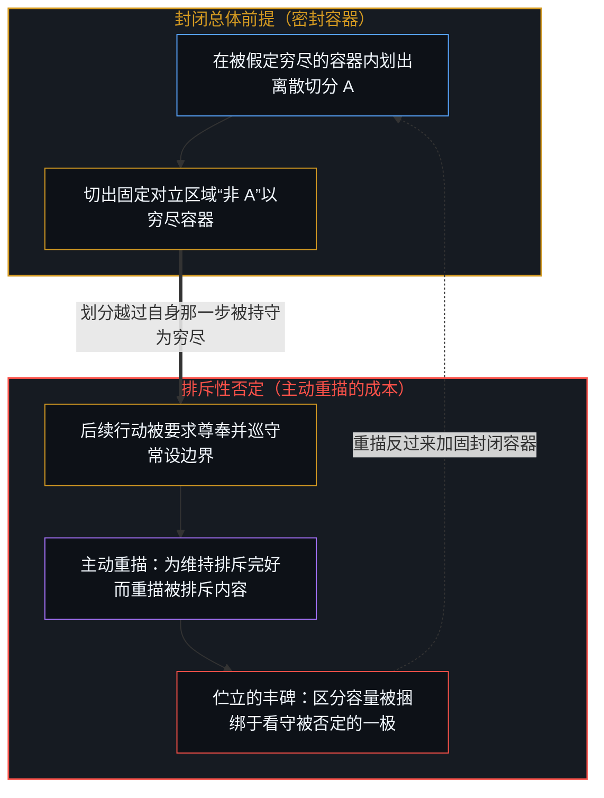
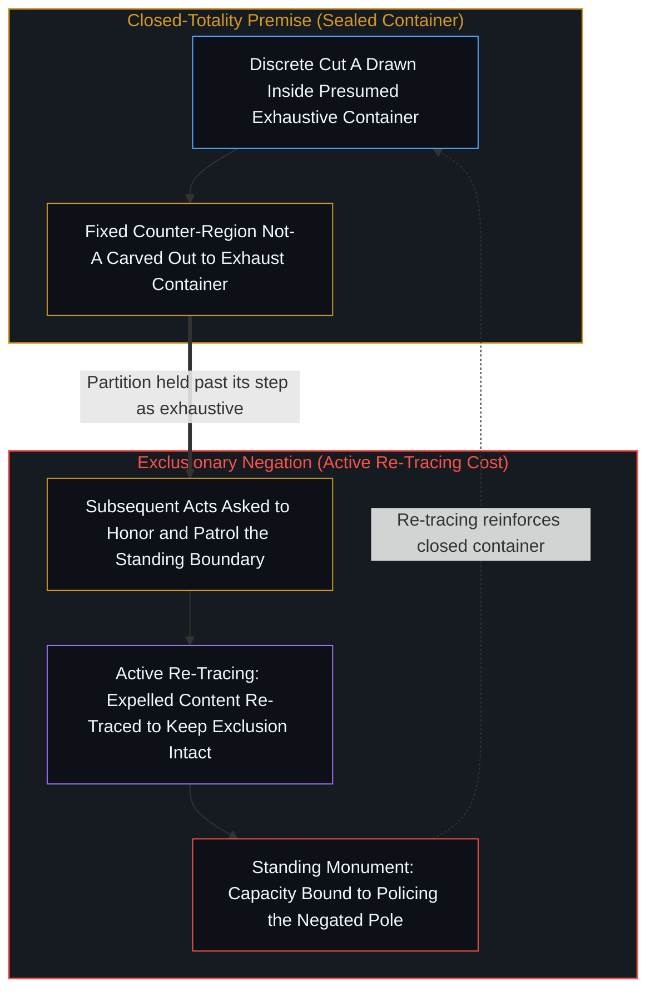
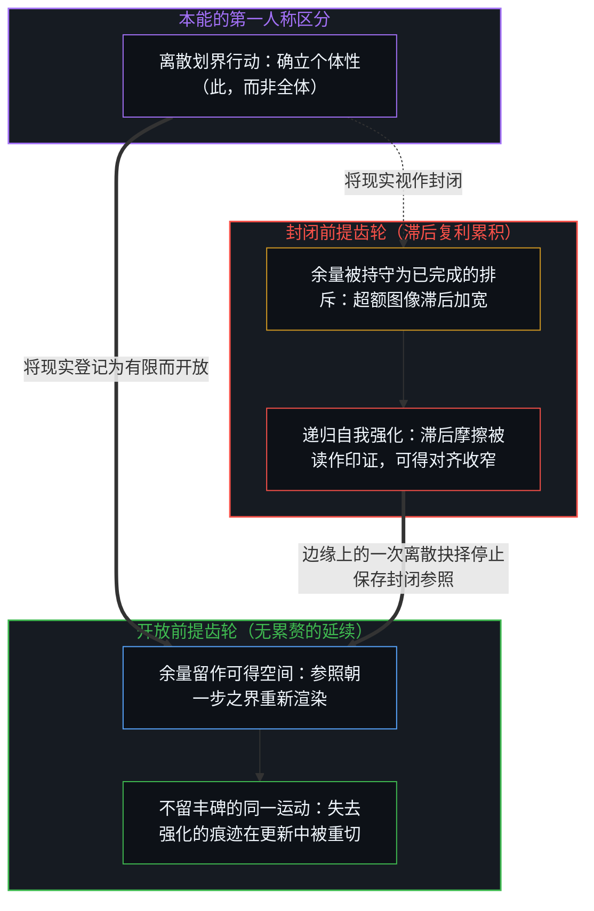
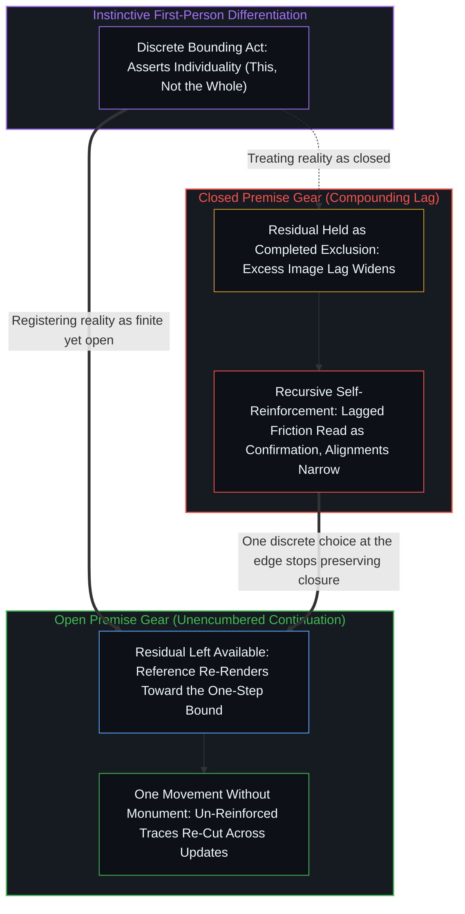

# 区分活动与否定的显现 / Differentiation and the Appearance of Negation

*封闭将“它不是什么”硬化为须重描的排斥；在有限而开放的场域中，划界只留可得余量，不立丰碑。 / Closure hardens "what it is not" into a re-traced exclusion, while in a finite yet open field bounding leaves residual availability without a monument.*

自我区分的活动发生着——无因、不息。称之为心智：早已在途的观察者，其每一行动皆是一次区分。在这一持续运动中，每一离散存在都经由一道有限边界得以登记，这道边界划在越过它继续延展的场域里，标出*此*而非全体。日常习惯一听见提及“它不是什么”，当场便将其译作一次否定行动，把划定边界混同于竖起一道常设的排斥。

Self-distinguishing activity occurs — uncaused, unceasing. Call it the Mind: the observer already underway, every act of which is a distinction. Within this ongoing movement, every discrete existence registers through a finite bound drawn inside a field that continues past it, marking *this* rather than the whole. Ordinary habit hears any mention of "what it is not" and translates it on the spot into an act of negation, conflating the drawing of a boundary with the erection of a standing exclusion.

这种混同遮蔽了把前者变成后者的未言明前提。唯有当现实被当作密封的总体时，切分的另一面才会凝固为固定的补集，使后续行动必须靠重描被排斥之物来巡守边界。若登记为有限而开放，同一道切分便让未择取的余量继续敞开，供进一步区分取用，而不安装一片有待维护的对立领地；将两条轨迹拉开的那股缓慢递归复利，在活态边缘上始终只隔一次离散抉择便可转向。

That conflation hides the unstated premise that turns one into the other. Only when reality is treated as a sealed totality does the other side of a cut solidify into a fixed complement that subsequent acts must patrol by re-tracing what was expelled. Registered as finite yet open, the same cut leaves its unchosen remainder available for further distinction without installing a counter-territory to maintain, and the slow recursive compounding that separates those two trajectories remains one discrete choice away from turning at the active edge.

## 一、 存在即有限而开放现实中的区分 / 1. Being as Differentiating in a Finite Yet Open Reality

存在即区分；在有限而开放的现实中，每一存在都是对“它不是什么”的宣告。这句话既不把嗓音赋予无生命的物质，也不把“存在”抬升为有待静观的庄严名词。任何事物要在经验中作为确定的在场而存在，都是心智持续进行的活动在第一人称边缘划出一道离散边界；这一登记凭其自身的几何形态便已昭示：一道有限切分发生在一片未被它穷尽的场域之内。正如[观察、区分活动与心智的开放地基](../observation-distinguishing-activity-and-the-open-ground-of-mind/)所追溯的，在区分的那一步上将活动的内在开放性当作缺席，正是那道生成性的划界：离散存在经由它进入视野，而其下的地基并不因此封闭。

Being is differentiating; every existence is a declaration of what it is not in a finite yet open reality. Nothing in that statement attributes a voice to inanimate matter or elevates Being into a solemn noun awaiting contemplation. For anything to exist as a determinate presence in experience is for the Mind's ongoing activity to draw a discrete bound at the first-person edge, and that registration announces by its own geometry that a finite cut has occurred within a field it does not exhaust. As [Observation, Distinguishing Activity, and the Open Ground of Mind](../observation-distinguishing-activity-and-the-open-ground-of-mind/) traces, treating the activity's internal openness as absent at the step of distinction is the generative bound through which discrete existence comes into view without closing the ground beneath it.

日常习惯之所以一听见“它不是什么”便将其认作否定，只因它把可理解性想象成一座密封的整体——一份预先结清的固定目录，在其中为一项事物划出边界，就必须把其余一切逐入对立的格槽或虚无之中。在任何预先备好的目录之前起手，便使探问回到[有无之边](../you-wu-zhi-bian/)所追溯的那条可借可还的边，同时避开了[何谓形而上学？作为将追寻命名为目的的一刀](../what-is-metaphysics-as-the-cut-that-names-the-seeking-as-destination/)所剖析的名词化陷阱——在那里，把正在区分的动词变成庄严标举的“存在”或“无”之母题，将追寻冻结成了常驻的终点。在任何具体时刻，感知握住的是一组有限的区分，而因果则作为敞开的潜能越过当前切分继续延展。在有限而开放的现实中，“它不是什么”并不指称某个预先编目的对立疆域；它只登记着：离散的一步划定了*此*，却未穷尽下一步由以取用的可得余量。

Habit still hears "what it is not" as negation only because it pictures intelligibility as a sealed whole—a completed catalog settled in advance, where drawing a boundary around one item must expel everything else into a fixed opposing slot or a void. Starting prior to any pre-stocked catalog returns inquiry to the borrowable edge traced in [The Edge of Being and Non-Being](../you-wu-zhi-bian/), while avoiding the nominalization dissected in [What Is Metaphysics? As the Cut That Names the Seeking as Destination](../what-is-metaphysics-as-the-cut-that-names-the-seeking-as-destination/), where turning the verb of distinguishing into a capitalized theme of "Being" or "Nothing" freezes the seeking into a standing destination. At any concrete moment, perception holds a finite collection of distinctions, while causality extends past the current cut as open potential. In a finite yet open reality, "what it is not" names no pre-catalogued counter-realm; it registers only that a discrete step has bounded *this* without exhausting the availability from which the next step draws.

## 二、 封闭与排斥性否定的重描成本 / 2. Closure and the Re-Tracing Cost of Exclusionary Negation

当现实被视作封闭时，“它不是什么”便硬化为被保存下来的排斥——一道要求下一步行动予以尊奉的常设边界。在一只存量固定的密封容器内，围绕 `A` 划出边界不再止于登记 `A`；由于容器被假定为穷尽一切，这一刀同时也把箱内其余一切切成了确定且边界封死的对立领地。要维持这一划分完好无损，就要求后继行动尊奉这道排斥；而要尊奉排斥，就必须反复重描被排斥的内容，以保持排斥不破。这一操作就是排斥性否定。

When reality is treated as closed, "what it is not" hardens into a preserved exclusion—a standing boundary the next act is asked to honor. Inside a sealed container of fixed stock, drawing a bound around `A` no longer stops at registering `A`; because the container is presumed exhaustive, the cut simultaneously carves out a determinate, fully bounded counter-territory of everything else inside the box. Keeping that partition intact asks later acts to honor the exclusion, and honoring an exclusion requires re-tracing the expelled content in order to keep the exclusion intact. That operation is exclusionary negation.

唯有相对于一只预先划定、被视作全体的固定容器，补集“非 A”才有明确定义——在数字逻辑门、数据库模式以及显式给定的有限样本空间中，容器由设计预先固定，这种补集运作精确，可一旦遗忘了容器本身而将“非 A”投射到开放世界之上，它便当即到达边界。即便如此，在纸面上，密封容器里的补集静置不动、无需持续成本；而在活的心智中，没有任何写下的边界会自己看守自己：正如[印迹与行动](../the-mark-and-the-act/)所确立的，印迹只是惰性的残余而非第二个抉择者，因此维系一道常设排斥，每一步都要耗费鲜活的区分容量。

A complement `not-A` is well-defined only relative to a fixed, pre-assigned container that serves as the whole—exact inside digital logic gates, database schemas, or explicit finite sample spaces where the enclosure is fixed by design, yet reaching its boundary the moment that enclosure is forgotten and `not-A` is projected onto an open world. Even then, on paper a sealed-container complement sits still at zero ongoing cost, whereas in a living Mind no written boundary polices itself: as [The Mark and the Act](../the-mark-and-the-act/) establishes, a mark is inert residue rather than a second chooser, so upholding a standing exclusion consumes live distinguishing capacity at every step.

活态认知只要把某项排斥安装为常设规则，就要直接支付这笔运作代价。把“非 A”持守为禁令，比直接登记 `A` 需要更多操作：心智必须持续表征被禁目标并反复重描它以排查违规，从而占满有界的容量，在负荷之下反而放大了自己原本试图逐出的那一极。正是同一条重描回路，在[现成接触的因果先验与期望感受的倒置遮蔽](../present-contact-and-the-obscuration-of-desired-feeling/)中割断了当下的登记，在[流动中的坐标](../coordinates-in-flux-negation-and-self-anchoring/)中把自我评估锁死在一维排位的审判席上，又在[名称背反倾向](../name-negation-tendency/)中将围绕创设之“非 X”建立的机构推向被否定的吸引子。

Living cognition pays that operational price directly whenever it installs an exclusion as a standing rule. Holding "not-A" as a prohibition requires more operations than registering `A`: the Mind must keep representing the forbidden target and continually re-tracing it to check for violations, tying up bounded capacity and amplifying under load the very pole it set out to expel. That same re-tracing loop severs present registration in [Present Contact as Causal Prior and the Obscuration of Desired Feeling](../present-contact-and-the-obscuration-of-desired-feeling/), locks self-evaluation onto a one-dimensional ranking bench in [Coordinates in Flux](../coordinates-in-flux-negation-and-self-anchoring/), and pulls institutions built around a founding "not-X" toward the negated attractor in [The Name-Negation Tendency](../name-negation-tendency/).

## 三、 开放的划界与未安装的可得余量 / 3. Open Bounding and Uninstalled Residual Availability

当同一场域被登记为有限而开放——活动无需外部重启或外在地基而持续进行——那个“非”便不再作为独立的排斥伫立在那里。它只是当前划界的另一面。宣告所登记的，是一次离散行动已经发生（*此，而非全体*），而可得余量依然留存，供进一步区分取用。没有任何东西被安装下来要求后续行动去维护。在[共存的几何学](../the-geometry-of-coexistence-and-the-dual-cut/)所追溯的共享边缘上，切分的两面一同生起，任何一面都不是另一面的否定；正如[分离不是病](../naval-separation-analysis/)所指出的，划定边界本是感知运作的方式，而非从某个想象出来的先在完满整体中撕裂开来。

When the same field is registered as finite yet open—the activity continuing without external restart or ground—the "not" does not stand as a separate exclusion. It is simply the other side of the current bounding. The declaration registers that a discrete act has occurred (*this, not the whole*), and the residual availability remains for further distinction. Nothing is installed that later acts must maintain. On the shared edge traced in [The Geometry of Coexistence](../the-geometry-of-coexistence-and-the-dual-cut/), the two sides of a cut arise together without either side negating the other, just as [Separation Isn't the Disease](../naval-separation-analysis/) shows that boundary-drawing is how perception operates rather than a rupture from an imagined prior wholeness.

任何试图把一切收拢进单一已完成宇宙的企图，都会在自身无限制的补集上崩裂，因为没有任何密封容器能够装下正在划出它的不息活动。即便心智为了局部比较或区分而设立起一个有限的工作框架，每一个有限框架依然会在自身边缘之外遭遇未被列举的加一，如[闭合的N与开放的现实](../the-closed-n-and-the-open-reality/)所追溯；而地平线本身则始终是不可穷尽的潜能，而非一件已经完成的器物，如[无穷总体的海市蜃楼](../the-mirage-of-the-infinite-totality/)所示。在尚未完结的地平线上，差异保持局部且持续生成，而非将一切未择取的可能强行归入某个已完成的对立面。

Any attempt to collect everything into a single finished universe breaks on its own unrestricted complement, because no sealed container can hold the unceasing activity that draws it. Even where a Mind sets up a finite working frame to compare or separate items locally, every finite frame still meets the unenumerated plus-one beyond its edge in [The Closed N and the Open Reality](../the-closed-n-and-the-open-reality/), while the horizon itself stays an inexhaustible potential rather than a finished object in [The Mirage of the Infinite Totality](../the-mirage-of-the-infinite-totality/). Across an unfinished horizon, difference remains local and ongoing rather than forcing every unchosen possibility into a completed opposite.

身后不留常设的排斥，并不会把离散边界融解成无定形的流变。正如[对象是被稳定化的关系](../objects-are-stabilized-relationships/)所确立的，早先的切分会留下持久痕迹，其因果摩擦稳定化为物理不变量与共享协议；迎面撞上墙壁或违背一项承诺，依然会在第一人称边缘索取不可逆的代价（`+1`）。在开放之下脱落的，既不是有界痕迹 `A`，也不是它具体的摩擦，而是幻影般的对立实体 `非 A`——仿佛一名永久边防哨兵，被派去驻守 `A` 未曾触及的一切。一旦当下的切分划定了 `A`，未择取的余量便作为未经瓜分的可得空间留给后续切分，而非一片等待巡逻的被否定领地。

Leaving no standing exclusion behind does not dissolve discrete boundaries into shapeless flux. As [Objects Are Stabilized Relationships](../objects-are-stabilized-relationships/) establishes, earlier cuts leave durable traces whose causal friction stabilizes into physical invariants and shared protocols; stepping against a wall or breaking a commitment still exacts an irreversible cost at the first-person edge (`+1`). What drops away under openness is not the bounded trace `A` or its concrete friction, but the phantom counter-entity `not-A` stationed as a permanent border guard over everything `A` left untouched. Once the present cut has bounded `A`, the unchosen remainder stays unpartitioned availability for subsequent cuts rather than a negated territory awaiting patrol.

## 四、 分岔之处，不留丰碑 / 4. Where the Two Diverge, No Monument Remains

因此，区分活动与否定的显现，恰恰在封闭假定处分道扬镳。每一个体都本能地借区分确立个体性——在每一步划出*此，而非全体*——因而这一分岔并不会把心智划成“一味开放”或“一味封闭”的非此即彼二元类型。没有哪个活着的个体只居其一；每一个体都携带着两种持守的痕迹。随时间推移拉开轨迹差距的，是一组缓慢运转的递归齿轮，视被保留的自我形象向前携带哪一项前提而定。当剩余的“非”被持守为已完成的排斥时，下一步行动便对照这道被保存的边界来度量自身，为保持参照完好而重描排斥，使超额图像滞后加宽一步；随后，递归将由此产生的滞后摩擦登记为密封世界的印证，如[封闭框定与选择权的缩减](../closed-framing-and-the-reduction-of-optionality/)所示在当下位置收缩选择权，并把可得的对齐方式收窄进[封闭的假设把复利挤成 S 曲线](../closed-assumptions-squeeze-compounding-into-s-curves/)所追溯的天花板之内。当余量被留作可得空间时，递归便将当下的划界同敞开的场域一并登记，朝一步之界重新渲染参照，而不累积常设的排斥。

Differentiation and the appearance of negation therefore diverge exactly at the assumption of closure. Every individual differentiates instinctively to assert individuality—bounding *this, not the whole* at each step—so the divergence does not sort Minds into a binary either/or of purely open or purely closed types. No living individual is purely one side or the other; each carries traces of both holdings. What separates trajectories over time is a slow recursive gear driven by which premise the retained self-image carries forward. When the residual "not" is held as a completed exclusion, the next act measures itself against that preserved boundary, re-tracing the exclusion to keep the reference intact and widening excess image lag by one step; recursion then registers the resulting lagged friction as confirmation of a sealed world, contracting optionality at the present position as [Closed Framing and the Reduction of Optionality](../closed-framing-and-the-reduction-of-optionality/) shows, and narrowing available alignments into the ceiling traced in [Closed Assumptions Squeeze Compounding into S-Curves](../closed-assumptions-squeeze-compounding-into-s-curves/). When the residual is left available, recursion registers the present bounding alongside an open field and re-renders its reference toward the one-step bound without accumulating standing exclusions.

由于没有任何外部时钟规定一项被保留的前提必须存续多久，拨转这组递归齿轮既不必按早先排斥累积时的数值速率逐步倒回，也不必等待沉积的历史先行清空。在发起行动的边缘上，朝向的扭转始终只隔一次离散抉择——即[抉择的跨界](../the-boundary-crossing-of-choice/)所追溯的当下跨界，在下一次区分落笔之处当场停止保存封闭参照。早先竖立的丰碑则以[你的代码库即是记忆](../your-codebase-is-memory/)所揭示的方式，作为层叠的残余留在场域之中，当即失去滞后强化的供养，并随新摩擦的到来，在一次次后续更新中被重新切分。

Because no external clock dictates how long a retained premise must persist, turning that recursive gear does not have to unwind at the numerical rate at which prior exclusions accumulated, nor wait for sedimented history to clear first. At the initiating edge, reversal of orientation is always one discrete choice away—the present crossing traced in [The Boundary Crossing of Choice](../the-boundary-crossing-of-choice/) that stops preserving the closed reference right where the next distinction is drawn. Earlier monuments remain in the field as stacked residue in the manner of [Your Codebase Is Memory](../your-codebase-is-memory/), losing their lag-reinforcement at once and being re-cut across successive updates as fresh friction arrives.

在这片开放场域之内，只要明确认领其适用范围，暂时的封闭便依然保有局部效用。软件中显式的 `else` 分支、电路真值表，或是有界的工程核查清单之所以干净利落地运转，是因为心智已针对特定任务选定了有限范围；正如[选择、矛盾与开放的现实](../selection-contradiction-and-open-reality/)与[开放即一致](../openness-is-consistency/)所确立的，结构只要被持为暂时的器具、而不被安装为穷尽一切的地基，便始终保持一致。甚至否定本身也有一种敞开而非密封的运动：否定一项封闭假定，是拆掉一座丰碑而非竖起一座丰碑，由此松开“让有限划分去结清越过它继续延展之物”的要求。在开放之下，二者本是同一运动：边缘划界，余量敞开，身后不留丰碑。

Temporary closure keeps its local utility inside that open field whenever its scope is owned. An explicit `else` branch in software, a circuit truth table, or a bounded engineering checklist works cleanly because a Mind has chosen a finite domain for a specific task; as [Selection, Contradiction, and Open Reality](../selection-contradiction-and-open-reality/) and [Openness Is Consistency](../openness-is-consistency/) establish, structure held as provisional instrument remains consistent so long as it is not installed as exhaustive ground. Even negation has one movement that opens rather than seals: negating a closure assumption removes a monument instead of erecting one, releasing the demand that a finite partition settle what continues past it. Under openness the two are one movement: the edge bounds, the residual stays available, and no monument is left behind.
