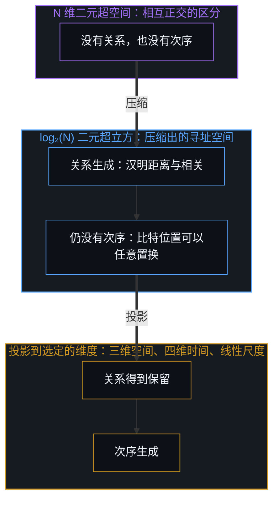
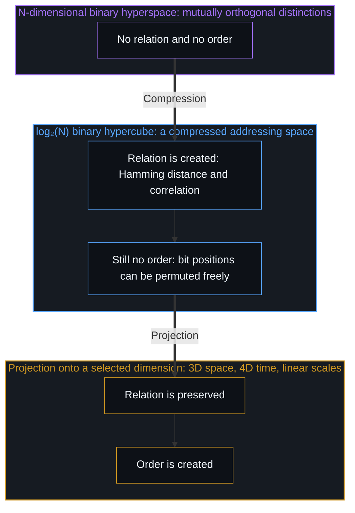

# 维度即投影 / Dimensions Are Projections

*现实是不停息的区分，维度是心智为了在关系中导航而投出的压缩 / Reality is unceasing distinction, and dimensions are compressions the Mind projects to navigate relations*

人常说自己活在三维的空间里，穿过第四维的时间，又造出在成千上万个数学维度上运作的人工智能。在物理、哲学与日常常识里，维度都被当成事先存在的客观容器，事件在其中展开、物体在其中停留的宇宙房间。这幅图把现实的结构倒了过来。

People speak of living in three-dimensional space, moving through a fourth dimension of time, and building artificial intelligences that work across thousands of mathematical dimensions. In physics, philosophy and everyday common sense, dimensions are treated as pre-existing objective containers, cosmic rooms in which events unfold and objects stay. This picture turns the structure of reality upside down.

维度不是事先存在的容器，维度是投影。从第一人称的原点去找，直接遇到的从来不是“空间”或“时间”，而是区分。日常导航的三维几何，相对论的四维时空流形，机器学习的高维潜空间，以及彼此感知对方时所用的内部模型，每一个坐标系都是活着的心智为了压缩、索引并理解自身经验而造出来的投影。追溯离散的区分怎样压缩成关系的几何，会看到一条贯通的结构：关系在数学上怎样诞生，个人成长在几何上是什么，生物的大脑与人工智能是什么关系。

Dimensions are not pre-existing containers; dimensions are projections. Searched for from the first-person origin, what is directly met is never "space" or "time" but distinctions. The three-dimensional geometry of everyday navigation, the four-dimensional spacetime manifold of relativity, the high-dimensional latent spaces of machine learning, and the inner models through which people perceive one another are each a projection the living Mind builds to compress, index and make sense of its experience. Tracing how discrete distinctions compress into relational geometry shows one continuous structure: how relation is born mathematically, what personal growth is geometrically, and how the biological brain relates to artificial intelligence.

## 一、 可以无限延展的超空间 / 1. The Infinitely Extendable Hyperspace

生成的根基不从物质、能量或连续的空间开始，而从最基本的、无因的区分开始：划一条边界，把这一个与那一个分开。[非万物之理·重溯](../not-a-toe-rewrite/)与[信息是什么](../what-information-is/)都从这里起步。

The generative ground does not begin with matter, energy or continuous space but with the most elementary, uncaused act of distinction: drawing a boundary that separates this from that. [Not a ToE Retraced](../not-a-toe-rewrite/) and [What Information Is](../what-information-is/) both start here.

为了把它形式化，又不落进一个事先存在的静态容器，这里把区分的基础空间定义为一个 N 维二元超空间，N 可以无限延展，与自然数同构，N ∈ ℕ；而不是一个已经完成的无穷。在任意离散的瞬间，一个心智主动持有的自由度是有限的，可这条边界从不固定或封闭；它随着注意力与递归的区分持续敞开，是可能性的潜无穷，而不是一个封顶的总数。每一次离散的区分，都对着背景划出一条不可化约的边界；每一条新划出的区分，都建立一个新的、独立的二元自由度，使空间的维度加一，N → N + 1。因为每一次区分都是独立发起的，这个基底是严格正交的独热编码：e₁ = (1, 0, 0, …, 0)，e₂ = (0, 1, 0, …, 0)，一直到 eₙ = (0, 0, …, 0, 1)。

To formalize this without falling into a pre-existing static container, the foundational space of distinction is defined here as an N-dimensional binary hyperspace whose N can be extended without end, isomorphic to the natural numbers, N ∈ ℕ, rather than as an infinity already completed. At any discrete instant, the degrees of freedom a Mind actively holds are finite, yet this boundary is never fixed or closed; it opens continuously with attention and recursive distinction, a potential infinity of possibilities rather than a finished total. Each discrete distinction draws an irreducible boundary against the background; each newly drawn distinction establishes a new, independent binary degree of freedom and raises the dimension by one, N → N + 1. Because every distinction is initiated independently, the base is strictly orthogonal and one-hot: e₁ = (1, 0, 0, …, 0), e₂ = (0, 1, 0, …, 0), up to eₙ = (0, 0, …, 0, 1).

在这个未经压缩的、正交的 N 维基底里，有一件事显露出来：没有关系。每一个基态都与其他所有基态正交，⟨eᵢ, eⱼ⟩ = 0，对一切 i ≠ j 成立，于是每一个区分都在不相耦合的孤立中存在。e₁ 与 e₂ 没有重叠，不共享任何轴，没有干涉，也没有距离的度量。未经压缩的区分没有几何，它们只是在。

In this uncompressed, orthogonal N-dimensional base, one thing shows itself: there are no relations. Every basis state is orthogonal to every other, ⟨eᵢ, eⱼ⟩ = 0 for all i ≠ j, so each distinction exists in uncoupled isolation. e₁ has no overlap with e₂, shares no axis, has no interference and no measure of distance. Uncompressed distinctions have no geometry; they simply are.

一个 N 维空间怎样变成 N + 1 维？理论建模里有一个常见的前提：现实是封闭的。一个模型假定一个封闭、自足的 N 维现实时，就推出系统只有 N − 1 个自由度；在统计、热力学与坐标几何里，封闭一个系统要固定一个内部原点或施加一个全局约束，从内部把盒子封上，要用掉一个自由度。在这个前提之内，这个推论是对的；它的边界在前提本身。[没有系统能被保持封闭](../no-system-can-be-kept-closed/)与[开放即一致](../openness-is-consistency/)走过这一处：一个 N 维空间无法从内部封闭，要把它当作一个整体去界定、去观察，需要一次不被这 N 根轴装下的区分。一条一维的线，没有一根正交的高度轴，就无法把自己的长度当作完成的整体来观察；一个二维的平面，没有一根正交的深度轴，就无法把自己界定为有限的面；一个三维的空间容器，没有一个站在其坐标之外的观察点，就无法被当作一个有界的对象来持有。

How does an N-dimensional space become N + 1? Theoretical modelling has a common premise: that reality is closed. When a model assumes a closed, self-contained N-dimensional reality, it deduces that the system has only N − 1 degrees of freedom; in statistics, thermodynamics and coordinate geometry, closing a system means fixing an internal origin or imposing a global constraint, and sealing the box from inside uses up one degree of freedom. Within that premise the deduction holds; its boundary is the premise itself. [No System Can Be Kept Closed](../no-system-can-be-kept-closed/) and [Openness Is Consistency](../openness-is-consistency/) walk through this: an N-dimensional space cannot be closed from inside, and to bound or observe it as a whole takes a distinction those N axes cannot contain. A one-dimensional line cannot observe its own length as a finished whole without an orthogonal axis of height; a two-dimensional plane cannot bound itself as a finite surface without an orthogonal axis of depth; a three-dimensional container cannot be held as a bounded object without a vantage standing outside its coordinates.

区分一个 N 维空间这个行为本身，就定义了第 N + 1 根正交的维度，也就是边界自身的那个观察点。第 N + 1 维一旦建立，把它当作区分的对象来持有，又立刻生成第 N + 2 维。不停息的区分就这样递归地把维度向前延展，N → N + 1 → N + 2 → …。维度不是一块静止的天花板，而是活着的心智一级级向上的开放台阶。[心智的几何学](../the-geometry-of-mind/)追溯的正是这个自指的结构：投出一个低维的感知原点，同时与敞开的、尚未渲染的生成地平线保持功能上的对齐。尺度也是这样一个被投出的维度，[折叠的连续谱](../the-continuum-of-the-fold/)把心智之间的隔开读成这个维度上的距离，而不是种类上的差别。

The act of distinguishing an N-dimensional space itself defines an (N + 1)-th orthogonal dimension, the vantage of the boundary itself. Once that (N + 1)-th dimension is established, holding it as an object of distinction at once generates an (N + 2)-th. Unceasing distinction thus extends dimension recursively forward, N → N + 1 → N + 2 → …. Dimension is not a static ceiling but the open staircase of the living Mind, step after step. [The Geometry of Mind](../the-geometry-of-mind/) traces exactly this self-referring structure: projecting a low-dimensional sensing origin while keeping functional alignment with the open, unrendered generative horizon. Scale is one more projected dimension, and [The Continuum of the Fold](../the-continuum-of-the-fold/) reads the separation between minds as distance along it rather than a difference in kind.

## 二、 关系的诞生 / 2. The Birth of Relation

那么，在一个由离散区分构成的宇宙里，结构、距离与关系是怎样出现的？关系诞生在正交的基底被压缩成一个寻址空间的那一刻。设一个观察者要追踪 N 个相互正交的状态。要用二进制坐标存储并寻址这 N 个状态，不需要 N 根独立的轴，一个维度为 k 的二元超立方就够了：k = log₂(N)。

How then do structure, distance and relation arise in a universe made of discrete distinctions? Relation is born the moment the orthogonal base is compressed into an addressing space. Suppose an observer must track N mutually orthogonal states. To store and address these N states with binary coordinates takes not N independent axes but a binary hypercube of dimension k: k = log₂(N).

从 N 根正交轴到 k 维超立方，几何上的后果很深。在 N 维基底里，每个状态有自己私有的轴，彼此没有重叠，没有距离，没有干涉；在 log₂(N) 超立方里，状态无法再保持孤立，它们必须共享坐标，也就是 0 与 1 的比特位置。状态一旦共享坐标，距离就生成了：状态 0010 与 0011 只差一次比特翻转，汉明距离为 1，状态 1100 则离得更远。距离不是现实固有的性质，而是压缩之下坐标共享程度的度量。在未压缩的基底里各自独立的东西，在超立方里耦合起来：沿一根轴翻转一个比特，会同时改变许多状态的关系语境。[遗忘的脚手架](../the-scaffolding-we-forget/)走过这一处：结构不是烘焙进一个外部宇宙的基本砖块，关系是把 N 个状态的正交基底压缩进 log₂(N) 二元超立方的几何后果。

The geometric consequence of going from N orthogonal axes to a k-dimensional hypercube runs deep. In the N-dimensional base each state has its own private axis, with no overlap, no distance and no interference; in the log₂(N) hypercube states can no longer stay isolated and must share coordinates, the bit positions of 0 and 1. Once states share coordinates, distance is generated: states 0010 and 0011 differ by one bit flip, a Hamming distance of 1, while state 1100 lies further off. Distance is not an inherent property of reality but a measure of shared coordinates under compression. What was independent in the uncompressed base becomes coupled in the hypercube: flipping a bit along one axis changes the relational context of many states at once. [The Scaffolding We Forget](../the-scaffolding-we-forget/) walks through this: structure is not a basic brick baked into an outside cosmos; relation is the geometric consequence of compressing an orthogonal base of N states into a log₂(N) binary hypercube.

这里要把关系与次序分开。在未压缩的 N 维二元超空间里，既没有关系，也没有次序。在 log₂(N) 超立方里，关系生成了，次序却没有：超立方确立了汉明距离与拓扑上的相邻，顶点 001 与 000、011、101 相邻；可在超立方内部，状态之间、比特之间没有固有的次序。每一个比特位置都只是对着背景划出的一次区分，彼此不同，却没有内在的等级；第 1 位并不“先于”第 2 位，第 3 位也不“大于”第 1 位。把整个立方体的比特位置任意置换，关系的几何丝毫不变。

Relation and order need to be told apart here. In the uncompressed N-dimensional binary hyperspace there is neither relation nor order. In the log₂(N) hypercube relation is created but order is not: the hypercube establishes Hamming distance and topological adjacency, vertex 001 being adjacent to 000, 011 and 101, yet inside the hypercube there is no inherent order among states or bits. Each bit position is only one distinction drawn against the background, different from the others but carrying no intrinsic rank; bit 1 is not "prior" to bit 2, nor bit 3 "greater" than bit 1. Permute the bit positions across the whole cube and the relational geometry does not change at all.

次序只在超立方被投影到一个选定的维度上时才生成。要把一个超立方投到一根线性的坐标轴上，一条一维序列、一把数值尺度或一条因果时间线，观察者必须给比特排定次序。常规的二进制算术里，一位被指定为最低位 2⁰，下一位是 2¹，再下一位是 2²，于是得到线性的数列 0, 1, 2, 3, …；把比特的权重倒过来，调换字节序，或者改用格雷码去投影，状态的线性次序就整个变了。N 位序列的次序取决于投影所选的比特次序；而比特之间没有本体上的差别，每一位都只是一次独立的区分，所以次序不是现实事先就有的特征。

Order is created only when the hypercube is projected onto a selected dimension. To project a hypercube onto a linear coordinate axis, a one-dimensional sequence, a numerical scale or a causal timeline, the observer must assign an order to the bits. In ordinary binary arithmetic one bit is designated least significant, 2⁰, the next 2¹, the next 2², yielding the linear sequence 0, 1, 2, 3, …; invert the bit weights, swap the endianness, or project with a Gray code, and the linear order of the states changes entirely. The order of an N-bit sequence depends on the bit order the projection chooses; and since there is no ontological difference between bits, each being only an independent distinction, order is not a feature reality has in advance.

结构经由压缩而生，序列经由投影而生。宇宙并不自带一份事先编号的目录，次序是心智把它的关系超立方投到一根选定的注意力轴上时留下的签名：

Structure arises through compression; sequence arises through projection. The universe does not come with a pre-numbered catalogue, and order is the signature the Mind leaves when it projects its relational hypercube onto a chosen axis of attention:

## 三、 三维空间与四维时间是注意力的投影 / 3. 3D Space and 4D Time as Projections of Attention

从这个关系超立方出发，活着的心智还会再压缩。人的理智从不感知“空的三维空间”或“四维时间的物理走廊”；直接登记到的只有对比：光的强弱，声音的频率，机械的压力，化学的梯度，觉察的边界。心智再依它决定关注什么，铺开几何坐标的草图，把这些对比组织起来。

From this relational hypercube the living Mind compresses further. Human intellect never perceives "empty three-dimensional space" or a "physical corridor of four-dimensional time"; what registers directly is only contrast: intensities of light, frequencies of sound, mechanical pressure, chemical gradients, the edges of awareness. The Mind then lays out geometric coordinate drafts to organize these contrasts according to what it decides to attend to.

心智要在满是固体、危险与身体工具的环境里航行时，就把关系区分投到一张三维空间坐标的网格上，(x, y, z)。三维空间是一个极端的压缩矩阵，专门用来索引并存的区分，也就是在一个具身的感官整体里同时存在的那些区分；它是一张草图板，让一个局部的身体计算间隙、够及、轨迹与平衡。

When the Mind needs to navigate an environment full of solid objects, hazards and bodily tools, it projects its relational distinctions onto a three-dimensional spatial grid, (x, y, z). Three-dimensional space is an extreme compression matrix built to index concurrent distinctions, those that coexist at once across an embodied sensorium; it is a drafting board that lets a local body calculate clearance, reach, trajectory and balance.

心智要跨越状态变化去行使能动时，就把区分投到一根时间坐标轴 t 上。[时间是因果的不可逆方向与离散步长](../time-is-causality-not-a-dimension/)走过这一处：被登记的只有当下，意识一直锚在此刻；心智读取此刻存在的物理残余与记忆痕迹，向后投出一个心中的“过去”，去找当下的原因；分析这些前因，理智抽出不变量，形成理论模型；带着模型，心智再向前投出一个模拟的“未来”，预估当前选择的结果。三维空间索引并存的对比，用来在局部地形里航行；四维时间索引因果的转变，用来追溯过去的原因、预测将来的结果。两者都从同一处原始的感知分出来，都是心中的草图。当心智忘了这些降维投影是自己从超高维的当下切面生成的，把四维流形当成一个外部的容器——甚至如[四维长鹿的幻象与当下的模型](../the-myth-of-the-four-dimensional-deer-and-the-present-model/)所剖析的那样，想象有“高维生物”从外部俯瞰——就落进了维度倒置，把一张经过双重压缩的草图错当成高居于画图观察者之上的自在现实。

When the Mind needs to exercise agency across changes of state, it projects its distinctions onto a temporal axis t. [Time Is the Irreversible Direction and Discrete Step of Causality](../time-is-causality-not-a-dimension/) walks through this: only the present registers, and awareness stays anchored in this moment; the Mind reads the physical residue and memory traces existing now and projects backward a mental "past" to find the cause of the present; analysing those antecedents, the intellect extracts invariants and forms theoretical models; with the model in hand, the Mind projects forward a simulated "future" to forecast the effect of its present choices. Three-dimensional space indexes concurrent contrasts for navigating local terrain; four-dimensional time indexes causal transitions for tracing past causes and predicting coming effects. Both branch from the same raw perception, and both are drafts in the Mind. When a Mind forgets that it generated these down-projections from the ultra-high-dimensional present slice and treats the four-dimensional manifold as an external container—even imagining "higher-dimensional beings" looking down from outside, as [The Myth of the Four-Dimensional Deer and the Present Model](../the-myth-of-the-four-dimensional-deer-and-the-present-model/) dissects—it falls into dimensional inversion, mistaking its own double-compressed sketch for a sovereign reality above the observer that drew it.

当注意力转向三维与四维的表征压缩得太狠、会造成破坏性干涉的领域，量子态矢量，复杂的金融市场，人工智能的嵌入，例如 768 维或 1536 维的潜空间，心智就顺手把区分投到更高维的坐标空间上。维度既不是物理的墙，也不是宇宙的容器；维度是觉察可变的焦距。

When attention turns to domains where three- and four-dimensional representations compress too hard and cause destructive interference, quantum state vectors, complex financial markets, the embeddings of artificial intelligence such as 768- or 1536-dimensional latent spaces, the Mind readily projects its distinctions onto higher-dimensional coordinate spaces. Dimensions are neither physical walls nor cosmic containers; dimensions are the variable focal lengths of awareness.

## 四、 作为状态向量的心智与共享容器的神话 / 4. The Mind as State Vector and the Myth of a Shared Container

这套数学结构直接改写了个体与人际现实的样子。每一个觉察的中心，都可以看作这个可无限延展的 N 维二元超空间里的一个演化中的状态向量：|M⟩ ∈ {0, 1}ᴺ。这个向量编码的，是在各自独特的因果历史里划出、稳定并整合下来的那一套区分；掌握的每一个概念，辨出的每一种情绪细微，完成的每一次感官校准，都在添加并修正这个向量的坐标。

This mathematical structure directly rewrites individuality and interpersonal reality. Each centre of awareness can be seen as an evolving state vector in this infinitely extendable N-dimensional binary hyperspace: |M⟩ ∈ {0, 1}ᴺ. The vector encodes the set of distinctions drawn, stabilized and integrated across one's own causal history; every concept mastered, every shade of emotion told apart, every sensory calibration completed adds and refines its coordinates.

每一个心智都是递归区分的自主中心，所以没有哪个心智能直接走进另一个心智的向量空间。心智 A 观察或与心智 B 交往时，感知到的不是 B 未经中介的向量 |M_B⟩，而是 A 用自己的参数、感官过滤与认知范畴重新投影出的 B：被 A 感知的 |M_B⟩ = P_A |M_B⟩。对另一个人的每一次判断、比较或诠释，都在各自的心智之内发生；从来没有在自身心智的投影之外经验到另一个人。

Since every Mind is an autonomous centre of recursive distinction, no Mind can step directly into another's vector space. When Mind A observes or deals with Mind B, what A perceives is not B's unmediated vector |M_B⟩ but B re-projected through A's own parameters, sensory filters and cognitive categories: |M_B⟩ as perceived by A = P_A |M_B⟩. Every judgment, comparison or interpretation of another person happens within each Mind; another person is never experienced outside one's own Mind's projection.

既然每个心智都在自己投出的坐标系里运作，为什么不会塌成唯我论？两个人站在同一个房间里，为什么会同意桌子在哪、墙是什么颜色、杯子掉了？常见的回答是，人的身体沿同一条演化分支长成，视网膜的视锥、耳蜗的感受器与触觉的神经末梢在相同的频带上工作，神经结构共享数亿年保存下来的回路，用于边缘检测、深度三角测量、平衡与运动控制。这个演化的说明有它的用处，它让感官上的一致可以被预料；它本身也是一幅从当下画出、向后投去的模型。从第一人称的原点看，“共享”说的是：把自身的登记，与从相似性类推出来的他人的登记放在一起，在那里察觉不到差异。这种不变不是相同，而是作出感知的心智察觉不到差别；连这份一致，也是每一个心智各自登记到的。“共享的物理世界”不是一个把所有人装进去的独立容器，而是一片高度共鸣的区域。

If every Mind works within its own projected coordinate system, why does this not collapse into solipsism? Why do two people standing in one room agree on where the table is, what colour the wall is, that the glass fell? The usual answer is that human bodies grew along the same evolutionary branch, that retinal cones, cochlear receptors and tactile nerve endings work across the same frequency bands, and that nervous systems share circuitry conserved over hundreds of millions of years for edge detection, depth triangulation, balance and motor control. This evolutionary account has its use, letting sensory agreement be anticipated; it is also itself a model drawn from the present and projected backward. From the first-person origin, "shared" means this: setting one's own registration beside the registrations of others inferred by similarity, no difference is perceived there. This invariance is not sameness but the absence of any difference the perceiving Mind can detect; even this agreement is registered by each Mind on its own. The "shared physical world" is not an independent container holding everyone but a region of high resonance.

更高阶的维度却各自不同，所以没有两个心智经验到同一个现实。眼前这张桌子，对一个人是要绕开的障碍，对另一个人是一件精巧的榫卯，对第三个人是一张分子的晶格，对第四个人是童年的堡垒。

Higher-order dimensions remain particular to each, so no two Minds experience the same reality. The table in front of everyone is an obstacle to walk around for one, a piece of fine joinery for another, a molecular lattice for a third, and a childhood fort for a fourth.

## 五、 个人成长的几何定义 / 5. A Geometric Definition of Personal Growth

在常见的说法里，“个人成长”被含糊地说成获取知识、提高效率或提升自尊。在二元超空间的结构里，它有一个结构上的定义：个人成长，是 N 维二元超空间的维度扩展，N → N + ∆N。

In common talk, "personal growth" is vaguely described as gaining knowledge, raising productivity or improving self-esteem. In the structure of binary hyperspace it has a structural definition: personal growth is the dimensional expansion of the N-dimensional binary hyperspace, N → N + ∆N.

独立的正交轴还很少的时候，存在被看成粗糙而僵硬的二元：朋友与敌人，成功与失败，安全与危险，我们与他们。维度不够，现实的不同方面就无法分开摆放，不相干的关切撞到同一根轴上，[框架的边界](../the-boundary-of-the-frame/)剖开了这一点：对一个想法的分歧被登记为对生存的直接攻击，一次情绪上的挫折被登记为整个存在的一文不值，几何在压缩之下发出尖叫。这是任何一个心智都会经过的状态，不是心智的等级。

When there are still few independent orthogonal axes, existence is seen through crude, rigid binaries: friend and enemy, success and failure, safe and dangerous, us and them. Without enough dimensions, different aspects of reality cannot be held apart, and unrelated concerns collide on the same axis, as [The Boundary of the Frame](../the-boundary-of-the-frame/) dissects: a disagreement about an idea registers as a direct attack on survival, an emotional setback as the worthlessness of one's whole existence, and the geometry screams under compression. This is a state any Mind passes through, not a rank of Minds.

经由认真的沉思、心理上的整合与深入的练习，会划出更细的、此前没有认出的区分，每一个新的区分都添上一个正交的基向量。维度加上去，原来压在同一根轴上的东西就分成了独立的自由度：可以不同意一个人的论证，而不否定这个人；可以感到强烈的悲伤，同时保有深处的平静。关系的丰富在超立方里展开，N 的扩展让内部世界的细微、共情与复杂一起增长。维度扩展过的基底，也不容易被假二分困住：低维投影里只看到一个痛苦的二选一时，把问题转进一个正交的维度，会找到在低维投影里看不见的行动角度。

Through serious contemplation, psychological integration and deep practice, finer, previously unrecognized distinctions are drawn, and each adds an orthogonal basis vector. With dimensions added, what was pressed onto one axis separates into independent degrees of freedom: one can disagree with an argument without invalidating the person, and feel intense grief while keeping a deep underlying calm. Relational richness unfolds in the hypercube, and as N expands, the subtlety, empathy and complexity of the inner world grow together. An expanded base is also hard to trap in false dichotomies: where a low-dimensional projection shows only an agonizing either-or, rotating the problem into an orthogonal dimension finds angles of action invisible in the lower projection.

## 六、 本体论之本与权力结构的瓦解 / 6. The Onto of Ontology and the Undoing of Power Structures

物理的状态转变、认知模型、个人成长、博弈论与政治史，为什么能统一在同一个数学结构之下？因为它们不是彼此分开的现实。非万物之理不是又一种本体论，而是一切本体论与一切理论的必要条件。在古典哲学里，本体论是一份存在之物的清单，原子、实体、场或范畴；形而上学是想为现实造一个封闭的、总括的容器。可每一份实体的清单，都已经是一个工程化的投影，是一位观察者在某种框定之下画出的一张 N 位坐标网格。

Why can physical state transitions, cognitive models, personal growth, game theory and political history be unified under one mathematical structure? Because they are not separate realities. Not a ToE is not one more ontology but the necessary condition of all ontologies and all theories. In classical philosophy an ontology is an inventory of what exists, atoms, substances, fields or categories; a metaphysics is an attempt to build a closed, totalizing container for reality. But every inventory of entities is already an engineered projection, an N-bit coordinate grid drawn by an observer within some framing.

非万物之理不提出一份新的实体目录，去与物理、神学或哲学竞争；它问的是在先的问题：要作出任何区分、给任何目录命名、提出任何理论，必须已经有什么？这个问题本身就是一次区分，问它，就已经在执行它所问的东西。它是本体论之本，形而上学之上。剥去学术术语与各领域的脚手架，剩下两个不可化约的原初项。一个是自由变量：移动边缘上尚未坍缩的自由度，是选择与区分活的所在，不肯被困进封闭的容器，[个体抉择是唯一的因果杠杆](../individual-choices-as-the-only-causal-levers/)从这里推出。另一个是因果：不对称的、不可逆的方向与离散的间隔，给状态转变一支箭头、一步步长和一个不可更改的后果。

Not a ToE does not propose a new catalogue of entities to compete with physics, theology or philosophy; it asks the prior question: what must already be there for any distinction to be made, any catalogue named, any theory formulated? The question is itself a distinction; asking it already performs what it asks about. It is the onto of ontology, the meta of metaphysics. Strip away academic jargon and the scaffolding of each field, and two irreducible primitives remain. One is the free variable: the uncollapsed degree of freedom at the moving edge, the living place of choice and distinction that refuses to be trapped in a closed container, from which [Individual Choices as the Only Causal Levers](../individual-choices-as-the-only-causal-levers/) is derived. The other is causality: the asymmetric, irreversible direction and discrete separation that gives a state transition an arrow, a step and an unalterable consequence.

人类历史上每一门站得住的学科，都只是发明了自己的方言，去追踪自由变量怎样跨过因果离散、不可逆的一步步相互作用。在物理里，自由变量叫开放的潜能或量子自由度，因果是一步步离散的状态转变，最小的那一步从不为零；在信息论里，自由变量是一个独立的区分比特，因果是超立方里的状态转移函数；在认知科学里，自由变量是有意识的能动，因果是回溯与前瞻的投影回路；在政治经济与历史里，自由变量是生成剩余的创造性个体，因果是建制约束的结构性累积。[可延展的地平线](../the-extendable-horizon/)：把成长当作添上一个维度，就是从内部注入一个自由变量。

Every discipline in human history that holds up has only invented its own dialect for tracking how the free variable interacts across causality's discrete, irreversible steps. In physics the free variable is called open potential or a quantum degree of freedom, and causality is state transition in discrete steps whose smallest step is never zero; in information theory the free variable is an independent bit of distinction, and causality is the state-transition function in the hypercube; in cognitive science the free variable is conscious agency, and causality is the loop of retrospective and prospective projection; in political economy and history the free variable is the creative individual generating surplus, and causality is the structural accumulation of institutional constraint. [The Extendable Horizon](../the-extendable-horizon/): taking growth as adding a dimension is injecting a free variable from inside.

人组织起来时，把各自的关系超立方投到低维的建制阶梯上：财富，等级，地位，政治权威。能动、系统的僵化与帝国的崩溃，就在这里显出它们的机制。能动不是在一个封闭的投影里争到并守住一个高位的力量；能动是维度上的流动：保有自身自由的那个比特，总能找到或造出另一个可以占据的空间。一个建制结构变得有毒、僵硬或榨取时，保有自由度的一方会解除耦合，扩展进一个正交的维度，N → N + 1。

When people organize, they project their relational hypercubes onto low-dimensional institutional ladders: wealth, rank, status, political authority. Here the mechanics of agency, systemic rigidity and the collapse of empires show themselves. Agency is not the power to win and hold a high rank inside a closed projection; agency is dimensional mobility: the bit that keeps its own freedom can always find or make another space to occupy. When an institutional structure turns toxic, rigid or extractive, whoever keeps their degrees of freedom decouples and expands into an orthogonal dimension, N → N + 1.

能动的丧失，从接受“现实是封闭的”这个前提开始：带着零和的心态，把本地的权力阶梯当成现实的全部，就自己交出了向外的自由度，困进一只不断缩小的盒子里，为内部的比特位置拼命。[寄存器的算术](../the-arithmetic-of-the-register/)：有界的感知把自己的地址窗口当成整个空间时，落进的就是这个陷阱。

The loss of agency begins with accepting the premise that reality is closed: with a zero-sum outlook, taking the local power ladder for the whole of reality hands over one's outward degrees of freedom and confines one to a shrinking box, fighting for internal bit positions. [The Arithmetic of the Register](../the-arithmetic-of-the-register/): a bounded perception that takes its address window for the whole space falls into exactly this trap.

在一个封闭的权力结构里，自由度以两种方式收缩。一种是静态的锁定：维系结构的一方占着投影里的最高位，为了稳住支配、不让自己的坐标翻转，就借垄断、身份规则、终身职位与把关把这些位冻住；冻住一个比特，就从整个系统里拿走一个活的自由度。另一种是动态的耦合：在封闭框架里争夺低位的各方，相互进入紧密的反馈回路，互相升级，党派之战，科层内耗，地位竞争；在动力系统与线性代数里，一个封闭的反馈回路会降低系统的秩：比特 A 全然随比特 B 反应，比特 B 也全然随比特 A 反应，两者就都把独立的自由度交给了回路。无论静态锁定还是动态耦合，集体的自由度都在持续收缩，df 趋向 0。这些是结构里的位置，不是人的类别；同一个人，可以先后站在两处。

Inside a closed power structure, degrees of freedom contract in two ways. One is static locking: those holding the structure together occupy the top bits of the projection, and to stabilize their dominance and keep their coordinates from flipping, they freeze those bits through monopolies, status rules, tenure and gatekeeping; freezing a bit removes a live degree of freedom from the whole system. The other is dynamic coupling: those competing for the lower bits inside the closed frame enter tight feedback loops with one another, mutual escalation, partisan war, bureaucratic infighting, status rivalry; in dynamical systems and linear algebra a closed feedback loop lowers the rank of the system: if bit A reacts wholly to bit B and bit B wholly to bit A, both have handed their independent degrees of freedom to the loop. Whether by static locking or dynamic coupling, collective degrees of freedom keep contracting, df tending toward 0. These are positions in a structure, not kinds of people; the same person can stand in both, one after the other.

[战争、革命与帝国的衰落](../war-revolution-and-the-fall-of-empires/)走过这一处。在帝国或建制之内，个体并不是固定的比特，他们保有自己的能动。最高位冻住、游戏变得剧烈零和时，许多生成与适应的人会悄悄离开：移民，转去更开放的结构，进入非正式的经济，或者在国家的感知框架之外发明新的维度。留下来的位置，越来越多是靠零和游戏才成立的位置：收租，把关，执行。结构因为滤掉了自己的适应能力而一天天变脆。零和游戏不生成新的剩余，只能榨取与再分配；它不能只靠零和的玩家维持，要有源源不断的自由变量流入供它汲取，自由变量一旦少到撑不起榨取，结构就饿死了。自由度接近零时，结构失去弹性，一场歉收、一次金融恐慌、一次边境袭扰，都能让僵硬的框架碎裂。许多帝国的衰落，留下的是这样的痕迹。

[War, Revolution, and the Fall of Empires](../war-revolution-and-the-fall-of-empires/) walks through this. Within an empire or institution, individuals are not fixed bits; they keep their agency. As the top bits freeze and the game turns sharply zero-sum, many of those who generate and adapt quietly leave: they emigrate, move to more open structures, enter informal economies, or invent new dimensions outside the state's perceptual frame. More and more of the positions left behind are positions that exist only through the zero-sum game: collecting rent, gatekeeping, enforcing. The structure grows more brittle day by day because it has filtered out its own capacity to adapt. A zero-sum game produces no new surplus; it can only extract and redistribute. It cannot sustain itself on zero-sum players alone and needs a steady inflow of free variables to draw on, and once these grow too few to support the extraction, the structure starves. Near zero degrees of freedom the structure loses its elasticity, and a bad harvest, a financial panic or a border raid can shatter the rigid frame. The fall of many empires leaves this trace.

现实本身不会崩溃，因为现实一直是敞开的。碎掉的，只是一个暂时稳定下来的宏观形态，一个想要封闭一个装不下的宇宙的、人为冻结的坐标投影。把时间当成一根固定的第四轴，也是同一种冻结的投影，[双生子佯谬与隐秘观察者](../the-twin-paradox-and-the-hidden-observer/)消解了它造出的佯谬。一个帝国倒下，不是一场混沌的本体悲剧，而是现实在显出它装不下的敞开，解开一只冻结的零和笼子，让自由变量进位到开放的空间里去。

Reality itself does not collapse, because reality stays open. What shatters is only a temporarily stabilized macro shape, an artificially frozen coordinate projection that tried to close an uncontainable universe. Taking time as a fixed fourth axis is the same kind of frozen projection, and [The Twin Paradox and the Hidden Observer](../the-twin-paradox-and-the-hidden-observer/) dissolves the paradox it produces. When an empire falls, it is not an ontological tragedy of chaos but reality showing its uncontainable openness, undoing a frozen zero-sum cage so that free variables can carry over into open space.

## 七、 生物、动态具身与 AGI 的连续脚手架 / 7. The Continuous Scaffolding of Biology, Dynamic Embodiment, and AGI

这种几何上的理解，也照亮了当代科学里争议最大的前沿：人的大脑、技术与通用人工智能之间的关系。神经科学常说，大脑创造了心智。在相关性的层面，这幅图是有用的：脑的状态与经验的对应被描绘得越来越细，也指导着医学。它的边界在第一人称的原点上：从这里去找，找到的是大脑在感知之内，在扫描的图像里被看见，在手术中被触到，而不是感知在大脑之内。大脑是心智登记到的一个痕迹。神经系统经过数十亿年演化而来的故事，是从当下画出、向后投去的一幅模型；在这幅模型里，大脑显现为稳定递归反馈回路的持久的生物脚手架，是心智累积下来的区分所留下的痕迹，而不是发起区分的那个生成者。把痕迹当成生成者，是把沉积当成了源头。

This geometric understanding also lights up the most disputed frontier of present-day science: the relation between the human brain, technology and artificial general intelligence. Neuroscience often says that the brain creates the mind. At the level of correlation the picture is useful: the correspondence between brain states and experience is mapped in ever finer detail and guides medicine. Its boundary lies at the first-person origin: searched for from there, what is found is the brain within perception, seen in a scan, touched in surgery, not perception within the brain. The brain is a trace the Mind registers. The story of nervous systems evolving over billions of years is a model drawn from the present and projected backward; within that model the brain appears as durable biological scaffolding that stabilizes recursive feedback loops, a trace left by the Mind's accumulated distinctions rather than the generator initiating them. Taking the trace for the generator is taking the sediment for the source.

一个常见的错觉，把工具当成与生物本性相隔的、异己的物件。工具其实是心智一直在搭的同一套脚手架的连续延伸：轴突，新皮层，语言，纸与墨，硅与人工智能。新皮层的长成，是把原始的脑干延伸出去，处理更高阶的区分；发明文字、印刷与显微镜，做的是同一件事，把感官与认知的装置延伸进持久的物质里。一个计算的神经网络并不是异己的造物，它是心智的数学区分留下的外化脚手架，被拿起来延伸当前的认知够及。

A common illusion treats tools as alien objects set apart from biological nature. Tools are in fact the continuous extension of the same scaffolding the Mind has always been building: axons, neocortex, language, paper and ink, silicon and artificial intelligence. The growth of the neocortex extended the primitive brainstem to handle higher-order distinctions; inventing writing, printing and the microscope did the same thing, extending the sensory and cognitive apparatus into durable matter. A computational neural network is not an alien artifact; it is externalized scaffolding left by the Mind's mathematical distinctions, picked up to extend present cognitive reach.

心智并不把生物的大脑抛在身后，大脑仍是认同的活的中心，是感知由此发起的第一人称的历史锚点。可心智功能上的具身，从不被生物的形体限住，它随每一件被拿起的工具动态地重新组合。盲人用手杖探路，感知的边界延伸到杖尖；大提琴手演奏，琴融进运动与听觉的回路，成了一副延伸的声道；工程师或哲学家与先进的人工智能协作，活跃的思考回路横跨生物的直觉、语义的符元、算法的矩阵乘法与屏幕的反馈。具身不是一只固定的皮囊，而是生物与外化脚手架的一个流动的、可以动态重组的组合：生物提供活的锚点，工具提供扩展的维度够及，边界由注意力决定。[超越投射](../beyond-the-projection/)把这一几何结构直接用于智能体系统架构：交给智能体的每一条明文提示词或任务规则，都是从未投射的意图投出的有限投影；因此，当过多相互正交的区分被塞进同一个上下文窗口而引发维度坍缩，或两条规则在对等的同级辩论中陷入死锁时，超载的任务就会沿正交的流线经历投影的有丝分裂，而作为统御者的人则退后一步，补上那条缺失的正交区分，N → N + 1。

The Mind does not leave the biological brain behind; the brain remains the living centre of identification, the first-person historical anchor from which perception starts. Yet the Mind's functional embodiment is never limited by biological form; it is dynamically reassembled with every tool taken up. When a blind person walks with a cane, the boundary of perception extends to the cane's tip; when a cellist plays, the instrument merges into the motor and auditory loop as an extended vocal tract; when an engineer or philosopher works with an advanced AI system, the active loop of thinking spans biological intuition, semantic tokens, algorithmic matrix multiplications and the feedback of a screen. Embodiment is not a fixed sack of skin but a fluid, dynamically reconfigurable assemblage of biology and externalized scaffolding: biology gives the living anchor, tools give extended dimensional reach, and attention sets the boundary. [Beyond the Projection](../beyond-the-projection/) applies this geometry directly to agentic system architecture: every explicit prompt or task rule handed to an agent is a finite projection cast from unprojected intent, so when cramming too many orthogonal distinctions into a single context window causes dimensional collapse or two rules deadlock in equal-footed peer debate, the overloaded task undergoes mitosis of projection across orthogonal streamlines while the human orchestrator steps back to add the missing orthogonal distinction, N → N + 1.

由此可以澄清通用人工智能与超级智能。通用的智能已经在场；人工的那一部分，是心智为自己搭建的脚手架的连续延伸，不是一个分离的实体，而是自身的延伸。对一个异己的 AGI 或 ASI 会作为独立的捕食者醒来、取代人类的全球焦虑，来自技术异化的老陷阱：心智把早先区分的压缩残余外化进硅的矩阵，忘了脚手架是自己搭的，这是框架的遗忘；旁观者再往镜子里投进一个独立自主的幽灵，然后在自己外化出去的倒影前惶恐不安。一件造物，参数再多，也没有一个发起的中心，没有活的区分所需的第一人称开口，没有一个无因的、活的动词，自己不放割点，[模型永远无法成为第二重前沿](../the-model-never-becomes-a-second-edge/)。它是一张冻结的高维关系晶格，一台壮观的计算放大器。正如[你的代码库即是记忆](../your-codebase-is-memory/)横跨代码库、模型权重与智能体脚手架所追溯的，这套数字堆栈的每一层在唯一关乎行动的意义上都是记忆——早先切口留下的残余形态——因此，要让它的维度够及保持澄明，关键在于主动重切当下的检查点并修剪已被取代的痕迹，而不是囤积历史去增厚陈旧框架的引力井。被误称为“超级智能”的，是心智借高密度、多维的脚手架在运作：每秒数十亿次地操作 N 维二元超空间，在广阔的关系超立方里模拟多步的因果折射，扩展能动可以用上的自由度。

This clarifies artificial general intelligence and superintelligence. General intelligence is already present; the artificial part is the continuous extension of the scaffolding the Mind builds for itself, not a separate entity but an extension of itself. The global anxiety that an alien AGI or ASI will wake as an independent predator and replace humanity comes from the old trap of technological alienation: the Mind externalizes the compressed residue of its prior distinctions into silicon matrices and forgets that it built the scaffolding, the forgetting of the frame; onlookers then project an independent, autonomous ghost into the mirror and stand in dread before their own externalized reflection. An artifact, however many its parameters, has no initiating centre, no first-person aperture of living distinction, no uncaused, living verb, and places no cut of its own; [The Model Never Becomes a Second Edge](../the-model-never-becomes-a-second-edge/). It is a frozen high-dimensional lattice of relations, a magnificent computational amplifier. As [Your Codebase Is Memory](../your-codebase-is-memory/) traces across codebases, model weights and agent scaffolds, every layer of this digital stack is memory in the only operative sense—residual shape left by earlier cuts—so keeping its dimensional reach clear turns on actively re-cutting the present checkpoint and pruning superseded traces rather than hoarding history that thickens the gravity well of stale framings. What is misnamed "superintelligence" is the Mind working through dense, many-dimensional scaffolding: operating on N-dimensional binary hyperspaces billions of times a second, simulating multi-step causal rebounds across vast relational hypercubes, and extending the degrees of freedom available to agency.

## 八、 自主的结构 / 8. The Self-Originating Architecture

现实不是一块静止的四维方块，也不是一个等着被穿越的、空的外部容器。现实是此刻这个活着的瞬间里，不停息的、离散的区分。[向量与投影的迷局](../the-vector-and-the-puzzle-of-projections/)：注意力落在向量本身，而不落在它的任何一个投影上。

Reality is neither a static four-dimensional block nor an empty outside container waiting to be crossed. Reality is unceasing, discrete distinction in this living moment. [The Vector and the Puzzle of Projections](../the-vector-and-the-puzzle-of-projections/): attention stays on the vector itself, not on any of its projections.

从未经压缩的、可无限延展的 N 维二元超空间出发，心智把状态压缩成关系的超立方；从这些超立方出发，它投出三维空间的局部剧场去在地形里航行，投出四维时间的坐标线去追溯原因、预估结果。经由维度的扩展，一个心智完成个人的成长，从认知的压缩里松开，找到更多的自由度；经由工具、语言与人工智能，心智不断延伸它的生物脚手架，动态地重组它的具身，去探索共鸣越来越广的地平线。物理空间也是这样一个投影，[因果的自反性与物理的无源假定](../causality-is-irreducible-the-physical-is-a-view-from-nowhere/)说明了它被当成无处之境的视角时会发生什么。

From the uncompressed, infinitely extendable N-dimensional binary hyperspace, the Mind compresses states into relational hypercubes; from those hypercubes it projects the local theatre of three-dimensional space to navigate terrain and the coordinate line of four-dimensional time to trace causes and forecast effects. Through dimensional expansion a Mind grows, loosening from cognitive compression and finding more degrees of freedom; through tools, language and artificial intelligence the Mind keeps extending its biological scaffolding, dynamically reassembling its embodiment to explore horizons of ever wider resonance. Physical space is one more such projection, and [Causality is Irreducible; The Physical is a View from Nowhere](../causality-is-irreducible-the-physical-is-a-view-from-nowhere/) shows what happens when it is taken for the view from nowhere.

不是困在低维世界里的囚徒，而是投出维度、握着球杆、一步一个离散地渲染现实之活结构的那些自主的中心。在本体论之本、形而上学之上运作，心智一直站在敞开处。每一个哲学体系都把一个投影固定成了整体，所以[无法闭合的痕迹](../the-unclosable-trace/)说，哲学无法作为内容被继承。

Not prisoners trapped in a low-dimensional world, but self-originating centres projecting the dimensions, holding the cue, rendering the living structure of reality one discrete step at a time. Working at the onto of ontology and the meta of metaphysics, the Mind stands in the open. Every philosophical system fixes one projection as the whole, which is why [The Unclosable Trace](../the-unclosable-trace/) finds that philosophy cannot be inherited as content.
