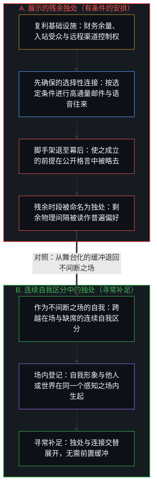
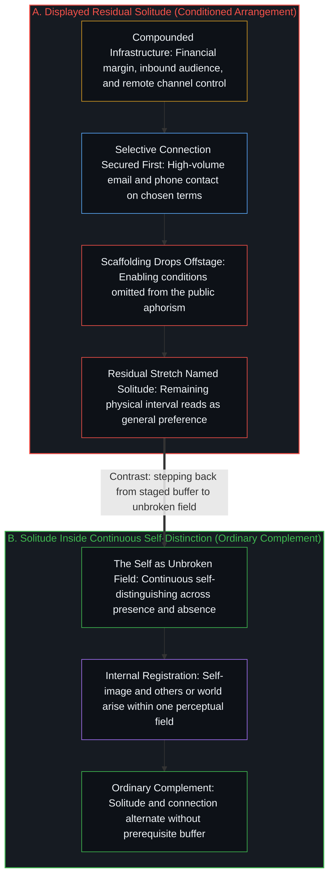

# 展示的独处是已确保连接后的残余 / Displayed Solitude Is Residual After Secured Connection

*独处的公开陈述并不揭示一种普遍可达的状态，而揭示一种已经先确保了选择性连接的特殊安排。 / The public statement of solitude does not reveal a universally reachable state; it reveals a special arrangement in which selective connection has already been secured.*

远程与异步通信工具降低了远距接触的实际成本，减少了对即时亲身在场的日常需要；随着人们将越来越多社交往来路由至这些经过编辑、带宽更窄的渠道，被稀释的接触留下一层挥之不去的连接不足之感，同时也让未经编排的同场共在显得摩擦更大、更少被人寻求。在这条已经偏移的基线之上，德里克·西弗斯反复公开说出的那句话——*“与人同在时，我常盼望独处；独处时，我从未盼望与人同在。”*——读起来像一种简单的独处偏好，然而他自己的记录显示，这句话发自一个由入站受众、积累的财务余量与远程渠道控制权共同支撑的平台。一旦选择性连接早已通过这些渠道得到确保，大段独自相处的物理时段便作为未被排程的残余留了下来，而并不在连续自我区分的同一个场内与隐含意义上的独处立于同一基点。当这套特殊安排被公开陈述、却未将其物质与社会前提摆到台前时，说出口的偏好与维系它的基础设施之间的缺口，便经由结构推论把这句陈述转化成一道不可及的区分，哪怕丝毫不作动机断言。

Remote and asynchronous communication tools lower the practical cost of distant contact and reduce the everyday need for immediate physical presence; as people route more of their social exchange through these edited, lower-bandwidth channels, attenuated contact leaves a lingering sense of insufficient connection while making unscripted co-presence feel higher-friction and less sought after. Against that shifted baseline, Derek Sivers's recurring public remark — *"Often have I been with people and wished I was alone. Never have I been alone and wished I was with people."* — reads like a simple preference for solitude, yet his own record shows it issuing from a platform sustained by an inbound audience, accumulated financial margin, and remote channel control. Once selective connection has already been secured through those channels, long physical stretches alone remain as an unscheduled residual rather than standing on the same footing as solitude in its implied meaning inside one continuous field of self-distinction. When that special arrangement is stated publicly without foregrounding its material and social prerequisites, the gap between the spoken preference and the infrastructure sustaining it turns the statement by structural inference into an unreachable distinction, even with zero claim of motive.

## 一、 资源条件使独处成为残余而非起点 / 1. Resource Conditions Make Solitude a Residual Rather Than a Starting Point

德里克·西弗斯的公开记录提供了一个具体例证，说明表面上对陪伴的谢绝，实则依托着充沛的中介化交流。他 2026 年那则言论的种种变体——与人同在时盼望独处，独处时从不盼望陪伴——可顺着访谈与短文一路追溯至 2011 年、2019 年与 2020 年，并伴随着他“独处的社交家”这一自述：肉身独自坐在办公室或新西兰的屋舍里，每天却回复数百封邮件，并与远方的朋友通上数小时语音电话。同一份记录还记载着：他面对面的成年人社交窗口大约只有两到三小时，超出之后亲身在场便感到消耗；他明确偏好电话胜过当面闲聚；人留在原地，十年间回复了来自 86,000 人的逾 200,000 封邮件，每封耗时不到一分钟。即便在旅行途中，或每天二十三小时待在断网小屋里的日子，所接收的往来依然经过选择性路由——或者跨越不同城市，与先写信给他的读者安排 247 场定向一对一会面；或者每隔一两天带笔记本电脑进镇下载邮件、给朋友打电话，然后再回到安静的工作之中。

Derek Sivers's public record supplies a concrete instance of how an apparent refusal of company rests on abundant mediated exchange. Variants of his 2026 remark — wishing to be alone while with others, never wishing for company while alone — trace back through interviews and microposts to 2011, 2019, and 2020 alongside his self-description as a "solitary socialite": sitting physically alone in his office or in a New Zealand house while answering hundreds of emails a day and spending hours on voice calls with distant friends. Across that same record, he reports an in-person adult social window of roughly two to three hours after which physical presence feels draining, an explicit preference for phone calls over hanging out in person, and over 200,000 emails answered from 86,000 people across a decade at under a minute apiece while staying in one place. Even when traveling or living twenty-three hours a day in an offline cabin, the intake stays selectively routed — scheduling 247 targeted one-on-one meetings across cities with readers who first wrote to him, or bringing a laptop into town every day or two to download mail and call friends before returning to quiet work.

这套选择性依托于远在格言出口之前便已筑起的财务与社交隔离层。西弗斯记述自己出售 CD Baby 与 HostBaby 之前已在银行存有大约 400 万美元——一笔他称之为“足够”的资金——并在这两家公司以 2200 万美元出售之前，将它们转入*独立音乐人慈善剩余单位信托*；这是一项不可撤销的安排，其本金将在他去世后归入音乐教育事业，同时每年按其价值的 5% 向他终身给付，作为其持续收入。无论那层财务缓冲，还是按他设定的条件主动发起接触的读者流，都既非来自外部的无偿馈赠，也不是一台自主运转的因果引擎；两者皆是早先离散抉择复利积累的残余——在独立线上发行仍是一片未绘疆域时创办服务、长年累月持续写作发表，以及大规模回复往来信件——再加上成千上万其他中心选择参与其中，这正是[拥有更多从不是原因](../having-more-is-never-the-cause/)与[不预测是没有觉察的预测](../not-predicting-is-predicting-without-awareness/)所追溯的那种复利。一旦这些安排顺畅运转起来，支撑它们的脚手架便从视野中退去，正如同[遗忘的脚手架](../the-scaffolding-we-forget/)所追溯的：可靠的器具从递归中退出，令其产物看似能够自立。因此，物理意义上的独自一人，乃是偏好连接早已得到缓冲*之后*所余下的那段间隔；需要经济余量与入站受众支撑的，是这份经由安排而留下的残余，从不是独处本身，也不是心智自身的区分能力。

That selectivity runs on financial and social insulation built well before the aphorism is uttered. Sivers notes holding roughly $4 million in the bank prior to selling CD Baby and HostBaby — a sum he names "enough" — and transferring both companies ahead of the $22 million sale into the *Independent Musicians Charitable Remainder Unitrust*, an irrevocable structure whose principal passes to music education upon his death while distributing 5% of its value to him annually for life as his ongoing income. Neither that financial cushion nor the stream of readers initiating contact on his terms is an unearned gift from outside or an autonomous causal engine; both are compounded residues of earlier discrete choices — launching a service while independent online distribution remained unmapped, publishing for years, and answering correspondence at scale — joined by thousands of other centers choosing to engage, the exact compounding [Having More Is Never the Cause](../having-more-is-never-the-cause/) and [Not Predicting Is Predicting Without Awareness](../not-predicting-is-predicting-without-awareness/) trace. Once those arrangements run smoothly, the enabling scaffolding recedes from view, just as [The Scaffolding We Forget](../the-scaffolding-we-forget/) traces reliable instruments dropping out of recursion so their product looks self-standing. Physical aloneness is therefore the interval left over *after* preferred connection has already been buffered; what requires economic margin and an inbound audience is this arranged residual, never solitude itself or the Mind's own capacity for distinction.

这一样式比数字平台更加古老，也不局限于某一位写作者的性情。1845 至 1847 年间，亨利·戴维·梭罗居于瓦尔登湖畔，他的实验刻意剥去物质累赘，以检验人若要潜心思考究竟只需多少经济配置；他在*《来客》*一章里也明确记下屋中留有三把椅子——一把留给独处，两把留给友谊，三把留给社交。然而后世的文化接受却屡屡把*《瓦尔登湖》*当作自足独处的象征，将背后的康科德脚手架推到幕后：木屋免租搭在拉尔夫·沃尔多·爱默生的林地上，距村镇仅一英里半；梭罗定期步行进镇置办杂物，赴家中或爱默生家的晚餐；母亲辛西娅与姐妹们替他洗衣并送来烘焙糕点；朋友们也频繁造访湖畔。无论缓冲来自十九世纪的村镇与家庭厨房，还是二十一世纪的电子邮件、单位信托给付及全球语音专线，只要物质托底与选择性的人际接触留在画框之外，而未排进日程的物理独处时段独自占据舞台，一幅孤身自足的公共肖像便会随之浮现。

This pattern is older than digital platforms and reaches beyond one writer's temperament. When Henry David Thoreau lived at Walden Pond from 1845 to 1847, his experiment deliberately stripped away material overhead to examine how little economic machinery a life requires to attend closely to thought, and his *"Visitors"* chapter explicitly acknowledged keeping three chairs — one for solitude, two for friendship, and three for society. Yet subsequent cultural reception routinely treats *Walden* as an emblem of self-contained solitude by dropping its Concord scaffolding offstage: the cabin sat rent-free on Ralph Waldo Emerson's woodlot a mile and a half from the village, Thoreau walked regularly into town for errands and family or Emerson dinners, his mother Cynthia and sisters handled his laundry and supplied baked goods, and friends frequently called at the pond. Whether buffered by a nineteenth-century village and family kitchen or by twenty-first-century email, unitrust distributions, and global voice lines, a public portrait of solitary self-sufficiency emerges when material support and selective human contact stay out of frame while the unscheduled physical stretch holds the stage.

## 二、 连接的持续使自我区分可见 / 2. Continuity of Connection Makes Self-Distinction Visible

自我区分的活动发生着——无因、不息。称之为心智：早已在途的观察者，其每一个行动都是一次区分。在那片持续的活动之中——亦即作为整个感知之场的自我之中——一切显现生起并彼此关联：自己与他人、近与远、沉默与言语。正如[自我形象仿佛从无处发声](../self-image-speaks-as-if-from-nowhere/)所追溯的，心智在该场域之内将自身重新投射为一个有界的自我形象——一个对照周遭关系而计分的有限项——而围绕这个自我形象被登记为他人与世界的一切，依然显现于自我之内，而非出现在感知那不间断的活动之外。因此，横跨在场与缺席而持续不断的，并非房间里身体的物理数目，而是与自身感知之间的切身连接——亦即这个自我，自我形象与显现为他人或世界的一切，皆持续在其中成形。

Self-distinguishing activity occurs — uncaused, unceasing. Call it the Mind: the observer already underway, every act of which is a distinction. Within that continuous activity — the Self as the full field of perception — every appearance arises and relates: self and other, near and far, silence and speech. As [Self-Image Speaks as if from Nowhere](../self-image-speaks-as-if-from-nowhere/) traces, the Mind re-projects itself inside that field as a bounded self-image — one finite term scored against surrounding relations — while what registers as other people and the world around that self-image still appears inside the Self rather than outside perception's unbroken activity. What continues unbroken across presence and absence is therefore not the physical count of bodies in a room, but the felt connection to one's own perception, the Self within which both the self-image and what appears as others or the world continually take shape.

追溯这份连续性消解了表面的割裂，同时既不否认其他活的中心各自存在于自己的所在，也不否认具身摩擦自有分量。正如[分离不是病](../naval-separation-analysis/)所确立的，划定边界正是感知得以登记任何事物的方式，而非有待治愈的缺陷；孤独只在一套次生的匮乏故事覆写到边界之上时才会生起。其他中心依然是各自所在处的独立位点，它们的行动作为经过中介的痕迹抵达己方场域之内——无论是隔桌传来的说话声、屏幕上延迟抵达的几行字，还是空屋里的沉默。远程与异步工具改变了接触的实际选项，在无需肉身共在的情况下传递经由编辑的交流片段，从而模糊了“独处”与“与人同在”之间旧有的社交对照。然而，工具既不生成、也不熄灭去注意这一点的能力——注意到心智自身的区分活动正跨越每一种外部安排而连续不断。

Tracing that continuity dissolves the apparent split without denying that other living centers exist at their own loci or that embodied friction carries weight. As [Separation Isn't the Disease](../naval-separation-analysis/) establishes, drawing boundaries is how perception registers anything at all rather than a defect to be cured, while loneliness arises only when a secondary story of deficit is laid over a boundary. Other centers remain independent loci whose actions arrive inside one's field as mediated traces — whether through spoken voice across a table, delayed lines on a screen, or silence in an empty room. Remote and asynchronous tools alter the practical options for contact and blur the older social contrast between being alone and being with people by delivering edited fragments of exchange without bodily co-presence. Yet tools neither generate nor extinguish the capacity to notice that the Mind's own distinguishing activity continues unbroken across every external arrangement.

一旦清楚注意到这份连续性，往来信件充裕抑或物理独自一人的外部条件，便从构成性的前提退居为境遇里的次要变化。隐含意义上的独处显现为连接的寻常补足与对照——安静的分化与未经缓冲的共处在同一个不间断的活动之内交替展开——而不是必须先确保了偏好的远程接触形式方能购得的残余。由于重新投射出的自我形象与周遭世界双双在自我之内得到登记，连接既不会在房间空下来时被关断，身处人群之中也无法在注意力仍耽于护卫某个偏好自我形象时保证清晰。看见这一互补性，并非保留给任何手握累积资本、入站读者群或偏远木屋之人；在寻常条件下，它向任何将注意直接转向这一区分本身的心智敞开。

Once that continuity is clearly noticed, external conditions of abundant correspondence or physical solitude recede from constitutive prerequisites to secondary variations in setting. Solitude in its implied meaning appears as the ordinary complement and contrast to connection — quiet differentiation alternating with unbuffered company inside one unbroken activity — rather than a residual that must first be purchased by securing preferred forms of remote contact. Because both the re-projected self-image and the surrounding world register inside the Self, connection is not switched off when a room empties, nor does presence in a crowd guarantee clarity when attention remains absorbed in guarding a preferred self-image. Seeing that complementarity is not reserved for anyone holding accumulated capital, an inbound readership, or a remote cabin; it stands open under ordinary conditions to any mind turning attention directly to the distinction itself.

## 三、 公开陈述将特殊安排呈现为普遍观察 / 3. The Public Statement Presents a Special Arrangement as a General Observation

当这种残余形态的独处作为一条未经修饰的个人准则被公开陈述、却略去持续供养它的经济与平台脚手架时，这句陈述便通过结构推论起到大多数人无法共享的区分作用。作出这一推论丝毫不必预设发言者的意图或动机；它直接出于两点之间的落差：流传开来的个人观察，以及令这套安排在规模上得以落地生活的先决条件；同一落差也解释了为何这种安排听上去令人向往，对大多数人却始终触不可及。正如[当观察变成表演](../when-observation-becomes-performance/)所追溯的，在受众面前传开的私人校准，留下的是一份剥除了原有局部校准条件的可携带残余；而正如[成功学](../cheng-gong-xue/)针对事后整理出的原则所揭示的，把已经成形的偏好摆到台前，便略去了当初让这一姿态站稳脚跟的多年抉择序列与蓄积余量。置于公共视野之内，正如[生产的不透明与消费的权重](../the-opacity-of-production-and-the-weight-of-consumption/)与[来自个体差异的层级](../hierarchy-from-individual-difference/)所确立的，从容自主的可视表层会在陌生人之间即刻登记下来，支撑它的生产、风险与绵延不断的往来信件却在幕后保持不透明；于是，沿着一把共同的自主尺度去读取这一被展示的偏好，便把一份并不共享的安排渲染成隐含的位阶之别。

When that residual form of solitude is stated publicly as an unadorned personal rule, omitting the economic and platform scaffolding that keeps it supplied, the statement functions by structural inference as a distinction most cannot share. Nothing about that inference requires claiming intent or motive in the speaker; it follows from the gap between the circulated personal observation and the prerequisites that make it livable at scale, which explains why the arrangement can sound desirable while remaining unreachable for most. As [When Observation Becomes Performance](../when-observation-becomes-performance/) traces, a private calibration circulated before an audience leaves behind portable residue stripped of the local conditions that calibrated it; and as [Theories After Success](../cheng-gong-xue/) shows for post-outcome principles, presenting the finished preference omits the multi-year sequence of choices and built margin that made the posture viable. In public view, as [The Opacity of Production and the Weight of Consumption](../the-opacity-of-production-and-the-weight-of-consumption/) and [Hierarchy from Individual Difference](../hierarchy-from-individual-difference/) establish, the visible surface of unhurried autonomy registers immediately across strangers while the production, risk, and ongoing correspondence sustaining it remain opaque offstage, so that reading the displayed preference along a shared measure of autonomy renders an unshared arrangement as an implicit difference in standing.

认清那份经由安排的残余为何对大多数人而言遥不可及，并不会把稀缺变成阻拦清晰本身的门槛。正如[开悟的相与门槛的倒置](../the-form-of-enlightenment-and-the-inversion-of-gates/)所论证的，把极端外部条件的稀有性错当成先验因果壁垒，便会设下一张核对清单，反而阻断了它自称要解释的直接照见。若将 400 万美元、一座慈善信托、一群入站受众或一间免租木屋当作前置条件，仿佛先集齐它们，独处才能不再显现为剥夺，那便重演了[有条件的自由](../you-tiao-jian-de-zi-you/)所剖析的条件句法：当下的能动性被抵押给未必会对齐的外部条件，而即便这些条件悉数凑齐，底层的锁扣依然完好无损。

Recognizing why that arranged residual stays out of reach for most does not turn scarcity into a threshold against clarity itself. As [The Form of Enlightenment and the Inversion of Gates](../the-form-of-enlightenment-and-the-inversion-of-gates/) demonstrates, mistaking the rarity of extreme external conditions for a prior causal barrier installs a checklist that obstructs the direct seeing it pretends to explain. Treating $4 million, a charitable trust, an inbound audience, or a rent-free cabin as preconditions before solitude can appear as anything other than deprivation repeats the conditional grammar dissected in [Conditional Freedom](../you-tiao-jian-de-zi-you/), where present agency is mortgaged to external conditions that may never align and still leave the underlying lock intact if they do.

认出隐含意义上的独处乃是连续自我区分之中连接的寻常补足，并不取消那个特殊情形；它只是将其定位。特殊情形是这样一套安排：选择性连接早已按选定条件得到确保，余下的物理间隔才得以被持守并命名为独处。寻常情形则在眼下无论何种境遇里都已经展开——无论是未经编排的房间、喧嚣的信息流，还是一张安静的书桌——在那里，注意力在同一个不间断的感知之场内，直接转向连接与其补足之间的区分，既无需先买下余量才能启程，也不必借用任何其他中心的残余方能看清。

Recognizing solitude in its implied meaning as an ordinary complement to connection inside continuous self-distinguishing does not cancel the special case; it simply locates it. The special case is the arrangement in which selective connection has already been secured on chosen terms so that the remaining physical interval can be held and named as solitude. The ordinary case stands already underway inside whatever setting is presently at hand — an unscripted room, a noisy feed, or a quiet table — where attention turns directly to the distinction between connection and its complement inside one unbroken field of perception, needing no purchased margin to begin and borrowing no other center's residual to see clearly.
