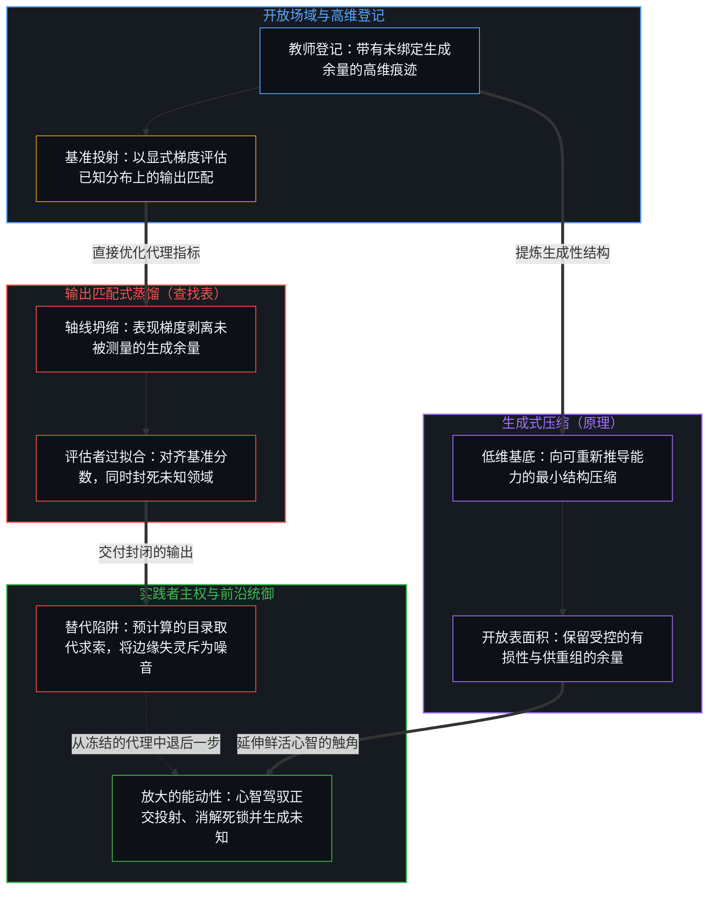
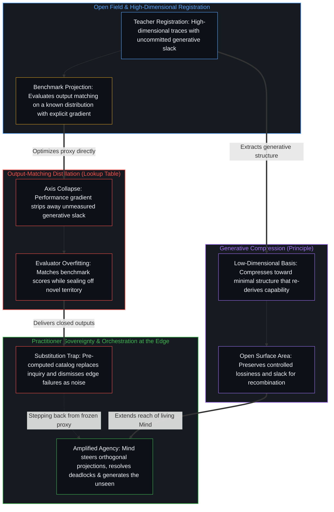

# 蒸馏、压缩与能动性 / Distillation Chooses What to Lose

*基准优化在对齐测试分数的同时剥离了未被测量的生成余量 / Benchmark optimization strips unmeasured slack while matching test scores*

知识蒸馏让前沿大模型的能力得以在更小的参数规模中运转。主流工程叙事将这种压缩描绘为直接的效率增益，认为它只需几分之一的推理成本便能转移教师模型的表现，并把其间的任何落差归结为轻微且务实的质量取舍。剥离这套务实的说辞，评测指标下方的结构性机制便显露出来：蒸馏恰恰是通过选择性退化来运作的，而这种退化正是优化得以完成的方式。它所完成的，是一个原本没有任何实践者想要构建的代理目标。

Knowledge distillation makes the capability of a large frontier model available in a smaller parameter footprint. The prevailing engineering narrative frames this compression as a straightforward efficiency gain that transfers the teacher's performance at a fraction of the inference cost, treating any discrepancy as a minor, pragmatic quality tradeoff. Stripping away that pragmatic framing exposes a structural mechanism beneath the metric: distillation operates by selective degradation, and that degradation is the exact means by which the optimization completes. What it completes is a proxy target that no practitioner actually set out to build.

没有任何团队在训练蒸馏出的学生模型时，想要一件唯一长处在于对齐固定评测集分数的器物；真正的目标始终是以更低的计算成本保留教师模型的生成能力。每位工程师都清楚，基准测试只是那种能力的低维代理。然而，由于基准测试是训练回路中唯一提供显式数学梯度的表面，梯度下降便毫不妥协地顺着它推进。鲜活的目的与形式化的优化目标从第一步起就存在着间隙，而优化之所以能毫无阻力地跨过这道间隙，正是因为凡是评测指标未能覆盖的维度，都无法对损失函数施加半点反向压力。

No team training a distilled student model desires an artifact whose sole virtue is matching scores on a fixed evaluation suite; the actual goal is retaining the teacher's generative capability at lower computational cost. Every engineer knows that the benchmark is a low-dimensional proxy for that capability. Yet because the benchmark is the only surface in the training loop that supplies an explicit mathematical gradient, gradient descent follows it relentlessly. The gap between the living purpose and the formal optimization target is present from the first step, and the optimization proceeds across that gap without resistance because whatever the metric fails to span exerts zero counter-pressure on the loss function.

## 一、 基准测试自带盲区 / 1. The Benchmark Contains Its Own Blindness

基准测试衡量的是模型的输出在已知的、预先采样的任务分布上与目标的吻合程度。从合成数据清洗、对数几率匹配到架构搜索与强化微调，每一项收紧这种吻合度的工程干预，都会在被评估的轴线上登记为明确无误的进步。

A benchmark evaluates how closely a model's output matches a target across a known, pre-sampled task distribution. Every engineering intervention that tightens this match—from synthetic data curation and logit matching to architecture search and reinforcement tuning—registers as unambiguous progress along the evaluated axis.

那条评估轴线自身携带着一道构成性的边界。最大化基准分数的最直接路径，就是直接拟合基准分布本身。庞大的教师模型之所以能取得高分，靠的是一片高维的关系痕迹场：冗余通路、横向关联，以及那些在标准测试项上从不直接激活、却在面对未曾测绘的新颖任务时维持结构灵活性以重组痕迹的未绑定容量。在基准目标下的蒸馏，把教师模型未被测量的生成余量当成了冗余的死重。

That evaluative axis carries a constitutive boundary. The most direct path to maximizing benchmark scores is fitting the benchmark distribution itself. A large teacher model achieves its scores through a high-dimensional field of relational traces: redundant pathways, lateral associations, and uncommitted capacity that never fires directly on standard test items, yet sustains the structural flexibility required to recombine traces when prompted on novel, unmapped tasks. Distillation under a benchmark objective treats the teacher's unmeasured slack as dead weight.

从基准投射的内部来看，每一个不能拉动评测分数的参数维度都是白费的开销。剥离这些维度既能降低延迟与内存占用，又能让报表上的数字纹丝不动。在评测套件的坐标系内，蒸馏后的学生模型并不会被登记为退化，反而会被登记为更紧凑的优化，原因恰恰在于损耗的方向与测量工具正交。

Seen from inside the benchmark's projection, every parameter dimension that does not move the evaluated score is pure inefficiency. Stripping those dimensions away reduces latency and memory overhead while leaving the reported numbers intact. Within the coordinates of the evaluation suite, the distilled student model does not register as degraded; it registers as more tightly optimized, precisely because the loss is orthogonal to the instrument of measurement.

## 二、 两个投射坍缩为一 / 2. Two Projections Collapsed Into One

无损转移的幻觉，源于将两个不共享坐标的独立维度强行压进同一条评估轴线。第一个投射是受评表现，衡量器物在已测绘任务上复现目标输出的准确度；这条轴线拥有清晰的梯度，并对优化做出直接响应。第二个投射是生成容量，决定器物能否在基准测试从未采样的领域中维持连贯的穿行；这条轴线在表现指标上没有任何梯度，因此一个靠死记硬背表面规律的模型，与一个靠灵活的多步结构推导出回应的模型，会登记下分毫不差的相同分数。

The illusion of lossless transfer arises from forcing two independent dimensions that do not share coordinates onto a single evaluative axis. The first projection is evaluated performance, which measures how accurately the artifact reproduces target outputs across mapped tasks; this axis possesses a clean gradient and responds directly to optimization. The second projection is generative capacity, which determines whether the artifact can sustain coherent traversal across territory the benchmarks never sampled; this axis carries no gradient on the performance metric, so a model that memorizes surface regularities and a model that derives responses through flexible multi-step structure register identical scores.

“更小的模型，同样的表现”这一承诺将这两个投射坍缩成了同一个。在温和的压缩比下，受评表现与生成容量看似结伴而行，但这只是巧合，因为此时的学生网络依然足够庞大，富余的参数在保留教师模型表面输出的同时，也顺带留存了很大一部分潜在结构。随着压缩加深、容量边界收紧，两条轴线便分道扬镳：受评表现依然稳固，因为损失函数在主动捍卫它；生成容量则悄无声息地变薄，因为梯度中没有任何一项会惩罚它的流失。

The promise of retaining the same performance in a smaller model collapses these two projections into one. At mild compression ratios, evaluated performance and generative capacity appear to travel together by accident, because the student network remains large enough that excess parameters preserve much of the teacher's latent structure alongside its surface outputs. As compression deepens and capacity bounds tighten, the two axes diverge: evaluated performance holds steady because the loss function actively defends it, while generative capacity thins out silently because nothing in the gradient penalizes its removal.

“表现”一词通过把输出匹配等同于底层的行动能力，掩盖了这场分化。分数仅仅记录了某次表面输出在过往分布上匹配了存储的参照；而当语境转换时若要生成有效的区分，恰恰依赖那些被压缩所丢弃的余量。

The word "performance" conceals this divergence by equating output matching with the underlying capacity to act. Scores record only that a surface output matched a stored reference on a past distribution; generating a valid distinction when the context shifts requires the very slack that compression discarded.

## 三、 过拟合于评估者而非数据 / 3. Overfitting the Evaluator rather than the Data

经典的过拟合发生在网络死记硬背具体训练样本、而非提炼可泛化模式之时，一旦遇上留出的测试数据便会立刻失灵。蒸馏则引入了一种能够毫发无损地通过标准留出测试的结构性过拟合：学生模型过拟合的不是训练样本，而是评估机制本身的边界。

Classical overfitting occurs when a network memorizes specific training examples instead of extracting generalizable patterns, failing as soon as held-out test data arrives. Distillation introduces a structural overfitting that passes standard held-out tests undetected: rather than overfitting the training samples, the student model overfits the boundary of the evaluation regime itself.

教师模型保有未绑定的维度，使其能够吸纳摩擦并在熟悉的模板之外进行外推。当学生模型被压缩以在精选分布上复现教师模型的行为时，梯度压力便将那份未绑定的余量转化成了专精的效率。每一个未对受测投射做出贡献的自由度，不是被剪枝剔除，就是被征用去把受评分布塞进更少的权重之中。

The teacher maintains uncommitted dimensions that allow it to absorb friction and extrapolate beyond familiar templates. When the student is compressed to reproduce the teacher's behavior across a curated distribution, gradient pressure converts that uncommitted slack into specialized efficiency. Every degree of freedom that does not contribute to the measured projection is either pruned or repurposed to pack the evaluated distribution into fewer weights.

由于学生模型在与基准分布同源的留出切片上依然能够泛化，标准的验证检查便会报告干净的泛化结果。这种过拟合针对的是受测范围的周界。周界之内的一切都以高保真度得以留存，而周界之外的一切则对目标函数不可见，并被系统性地清退，最终产出一件在流水线运行的每一项测试上都表现优异、却在现有测试无法捕捉的维度上发生断裂的器物。

Because the student still generalizes across held-out splits drawn from the same benchmark distribution, standard validation checks report clean generalization. The overfitting is to the perimeter of what gets measured. Everything inside that perimeter is preserved with high fidelity, while everything outside it is invisible to the objective function and systematically liquidated, yielding an artifact that excels on every test the pipeline runs and fractures in ways no existing test was built to capture.

## 四、 选择压力将损耗锁定 / 4. The Selection Pressure Locks In the Loss

一旦看板上确认了基准分数的持平，制度回路便会将这场压缩锁定到位。团队验证学生模型在各大标准排行榜上追平了教师模型，宣布蒸馏成功，并将更小的模型部署上线。那些足以暴露容量流失的任务——定义模糊的边缘案例、多重约束的碰撞，以及依赖未绑定余量的新颖领域迁移——在定义上就被排除在评测套件之外，因为任何稳定到足以被标准化为基准测试的任务，都早已被吸纳进了受测投射之中。

Once benchmark parity is confirmed on the dashboard, the institutional loop locks the compression in place. Teams verify that the student matches the teacher across standard leaderboards, declare the distillation successful, and deploy the smaller model into production. The tasks that expose the vanished capacity—ill-defined edge cases, multi-constraint collisions, and novel domain shifts that depend on uncommitted slack—are absent from the evaluation suite by definition, because any task stable enough to be standardized into a benchmark has already been absorbed into the measured projection.

当实践者在真实野地里遭遇未测任务上的失灵时，他们的反馈只会以零散、偶发的抱怨形式抵达，既难以复现，也无法撼动汇总的遥测数据。由于测量装置筛选的本就是对自身的证实，反馈回路便从结构上排除了那个唯一能够证伪该优化的信号。

When practitioners encounter failures on unmeasured tasks in the wild, their reports arrive as scattered, anecdotal complaints that are difficult to reproduce and fail to move aggregate telemetry. Because the measurement apparatus selects for its own confirmation, the feedback loop excludes the exact signal that would falsify the optimization.

若不在学生模型内部恢复那片将各个正交轴线撑开的高维参数空间，想要找回流失的生成余量是不可能的。而一旦走到那一步，工程师所做的就不再是改进蒸馏，而是将其逆转回教师模型。

Recovering the lost generative slack within the student is impossible without restoring the high-dimensional parameter space that held the orthogonal axes apart. At that point, the engineer has not refined distillation, but reversed it back toward the teacher.

## 五、 原理与查找表的分岔 / 5. The Fork Between Principle and Lookup Table

压缩作为一项数学操作本身是中性的；它的认识论性质取决于压缩保留了什么。一个方向是朝向生成性原理的压缩，即发现一个低维基底，使教师模型更宽广的能力能够在变化的语境中从中重新推导出来。一条原理比它所生成的案例目录更简短，却握有更深远的结构触角，因为它捕捉到了表面变化之下不变的非对称性。

Compression as a mathematical operation is neutral; its epistemic character depends on what the compression preserves. One direction compresses toward a generative principle, discovering a low-dimensional basis from which the teacher's broader capability can be re-derived across changing contexts. A principle is shorter than the catalog of examples it generates, yet it holds greater structural reach because it captures the invariant asymmetry underneath the surface variations.

相反的方向则是朝向查找表的压缩，即用最少的参数在受测分布上复现教师模型的表面输出。查找表实现了相同的参数缩减比，却与未知领域保持着截然相反的关系：它冻结了现成的产物，同时丢弃了生成这些产物的穿行过程。

The opposite direction compresses toward a lookup table, reproducing the teacher's surface outputs across the measured distribution with minimal parameters. A lookup table achieves the same parameter reduction ratio while holding the exact inverse relationship to the unseen: it freezes finished products while discarding the generative traversal that produced them.

这两种操作都顶着蒸馏的名称通行，也都在标准评测套件上登记为胜利。它们的分岔唯有在实践者带着器物迈入未测绘的领域时才会显现——这也揭示出，孤立地评估模型依然错失了行动的位点，因为模型从来都不是行动主体。

Both operations travel under the name of distillation, and both register as victories on standard evaluation suites. Their divergence appears only when a practitioner takes the artifact into unmapped territory—which reveals that evaluating the model in isolation still misses the locus of action, because the model is never the agent.

## 六、 考验在实践者手中而非模型内部 / 6. The Test Lives in the Practitioner rather than the Model

一件保留了生成性结构的压缩器物，并不靠在真空中自主发起新颖突破来证明自身的价值；它的价值由鲜活中心能够借它区分并成就什么来证明。正如[你的代码库即是记忆](../your-codebase-is-memory/)横跨模型权重、代码库与智能体脚手架所追溯的，每一个检查点都是早先区分留下的压缩残余，而非一个能够记忆或发起区分的持续中心。因此，任何压缩的质量都登记在实践者手中——取决于当下的检查点究竟是被重切得在无关维度上更精简、在延伸心智触角的结构抓手上更锐利，还是被塞进了一份只能被动接受的预计算结论冻结目录。

A compressed artifact that preserves generative structure does not prove its worth by autonomously originating novel breakthroughs in a vacuum; it proves its worth by what a living center can distinguish and accomplish through it. As [Your Codebase Is Memory](../your-codebase-is-memory/) traces across model weights, codebases, and agent scaffolds, every checkpoint is a compressed residue of prior distinctions rather than a continuing center that remembers or initiates. The quality of any compression therefore registers in the practitioner's hands—whether the present checkpoint has been re-cut to stay smaller in irrelevant dimensions and sharper on the structural handles that extend the Mind's reach, or packed into a frozen catalog of pre-computed conclusions that can only be passively accepted.

原理之所以能让实践者针对教师模型与学生模型在训练中都未曾遇见过的问题生成解答，恰恰是因为鲜活的中心借由原理执行了发起区分的行动。查找表交给消费者的则是一份封闭的回应目录，它在预期的走廊之内运转良好，但现实迈出走廊的那一刻便会变得脆弱不堪。

A principle enables a practitioner to generate answers to problems neither the teacher nor the student ever encountered during training, precisely because the living center performs the initiating act of distinction through the principle. A lookup table hands a consumer a closed catalog of responses that functions well inside the anticipated corridor and turns brittle the moment reality steps outside it.

正如[超越投射](../beyond-the-projection/)在智能体架构层面所展示的，每一条显式提示词、每一套基准测试或每一个压缩模型，都是在有界坐标空间内运转的有限投射引擎。一旦任由其沿着单一轨迹自我优化，压缩后的投射不是将焦点收窄进轨迹盲区，就是在正交需求被强行压上同一条评估轴线的地方遭遇维度坍缩。把蒸馏模型——或是架设在其上的自主管理智能体——当作足以替代人类判断的自足之物，会把系统锁死在其代理指标的认识论引力井内部。相反，当器物被部署为毫无我执的投射工具——将过载的语境拆分到正交的流线中，为任务轨迹配对冷启动的同侪审校者以暴露局部盲区，并将不可化约的前提死锁交还给人类统御者的极限分辨率第一人称感知——压缩便放大了能动性，而不是用一份冻结的目录去取代它。

As [Beyond the Projection](../beyond-the-projection/) demonstrates at the level of agentic architecture, every explicit prompt, benchmark, or compressed model is a finite projection engine running inside a bounded coordinate space. Left to optimize along a single trajectory, a compressed projection narrows its focus into trajectory blind spots or suffers dimensional collapse wherever orthogonal requirements were pressed onto one evaluated axis. Treating a distilled model—or an autonomous manager agent built on top of it—as a self-sufficient replacement for human judgment locks the system inside the epistemic gravity well of its proxy metric. When the artifact is instead deployed as a zero-ego projection instrument—splitting overloaded contexts across orthogonal streamlines, pairing task trajectories with cold-start peer critics to expose local blind spots, and escalating irreducible premise deadlocks back to the human orchestrator's limit-resolution first-person sensing—compression amplifies agency rather than substituting a frozen catalog for it.

## 七、 完成一个无人想要的代理目标 / 7. Completion of a Proxy Nobody Wanted to Complete

蒸馏针对受测表现进行优化，而受测表现一旦沿着固定的投射被推演得足够远，就会与产生它的生成容量分离开来。这种分离对看板而言依然不可见，因为从一开始定义了何为表现的，正是看板自身的投射。这并不是反对模型压缩的论据，而是对任何针对固定参照进行优化的操作所作的结构清算：教师模型的能力横跨基准测试所未测量的诸多维度，而顺着基准测试进行压缩则会清退这些维度——并非出于恶意或失误，而是因为梯度无法登记它们。裁断哪些区分在做真正的生成性功、哪些只是可丢弃的脚手架，要求在推理的负荷中拥有内生的利害关联；而这恰恰是[词元效率、模拟与无法弥合的间隙](../token-efficiency-emulation-and-the-unclosable-gap/)所确立的模型无法凭自身发起的起点，无论其表面的词元或内部的参数被压缩得多么紧凑。

Distillation optimizes for measured performance, and measured performance, pursued far enough along a fixed projection, separates from the generative capacity that produced it. That separation remains invisible to the dashboard because the dashboard's projection is what defined performance from the outset. This is not an argument against model compression, but an accounting of what any optimization against a fixed reference does: the teacher's capability spans dimensions the benchmark does not measure, and compressing along the benchmark liquidates those dimensions—not through malice or error, but because the gradient cannot register them. Deciding which distinctions do real generative work and which are disposable scaffolding requires an endogenous stake in the burden of reasoning, which is the exact initiation that [Token Efficiency, Emulation, and the Unclosable Gap](../token-efficiency-emulation-and-the-unclosable-gap/) establishes a model cannot originate on its own, however tightly its surface tokens or parameters are compressed.

[开放场域中的无损知识不自洽](../lossless-knowledge-of-an-open-field-is-incoherent/)在更早一步的位置追溯了同一套几何结构：由于每一次有中心的登记在构成上都是有限且局部的，没有任何模型——哪怕是规模最大的前沿教师模型——能够持有一幅关于开放场域的无损地图，而受控的有损性正是为新颖重组与掌舵前沿处的现实检验保留生成余量的前提条件。当蒸馏错把封闭的基准套件当成开放场域时，它便用那份生成余量换取了冻结切片上的高密度堆积。一个无法区分“放大能动性的工具”与“取代能动性的目录”的评测指标，会一路驱动优化，直到供能动性施展的开放表面消失殆尽——这并非源于目标的腐化，而是源于丝毫不差地完成了一个原本没有任何人想要完成的代理目标。

[Lossless Knowledge of an Open Field Is Incoherent](../lossless-knowledge-of-an-open-field-is-incoherent/) traces this same geometry one step earlier: because every centered registration is finite and partial by constitution, no model—not even the largest frontier teacher—holds a lossless map of an open field, and controlled lossiness is the very condition that preserves generative slack for novel recombination and reality-testing at the steering edge. When distillation mistakes a closed benchmark suite for the open field, it trades away that generative slack for denser packing on a frozen slice. A metric that cannot distinguish an instrument that amplifies agency from a catalog that replaces it will drive the optimization until the open surface for agency disappears—not through corruption of the objective, but through the exact completion of a proxy target nobody actually wanted to complete.
