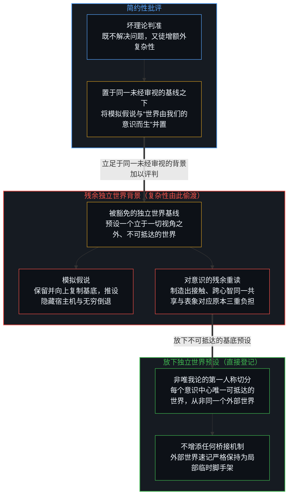
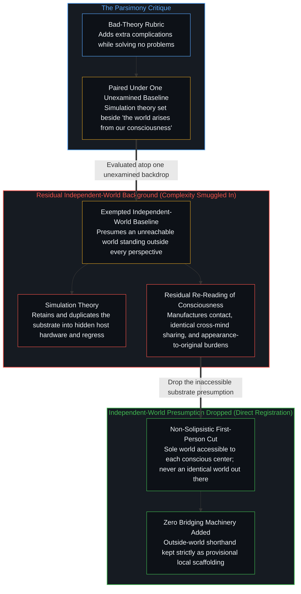
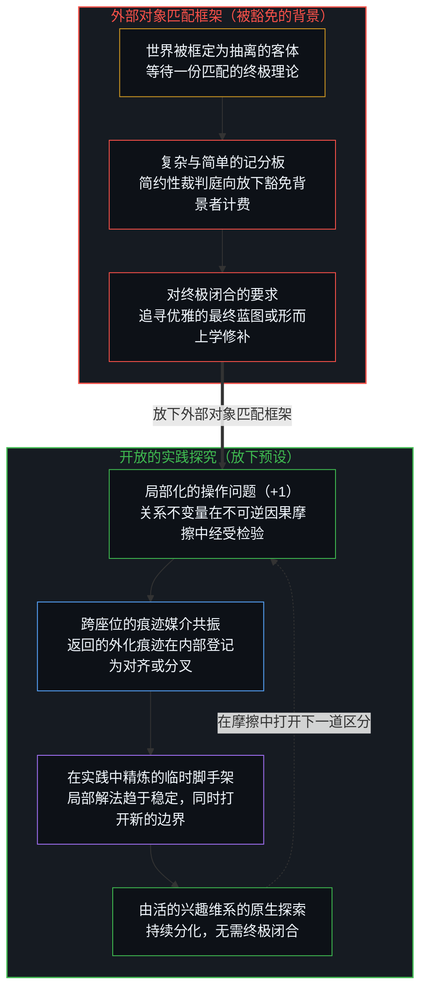
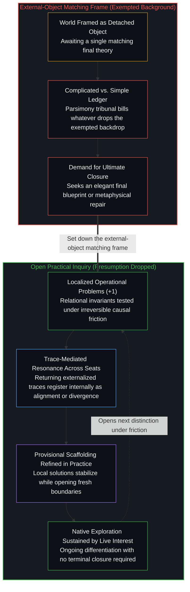

# 独立世界预设的放下与开放实践探究 / Dropping the Independent-World Presumption and Open Practical Inquiry

*复杂性并不源于“世界由意识而生”这一观念，而是源于仍将独立世界作为背景的残余诠释；一旦放下，问题在实践中可解，却永不终极闭合。 / Complexity stems not from the idea that the world arises in consciousness, but from residual interpretations keeping an independent world as background; once dropped, problems are solvable in practice yet never ultimately closed.*

有一项耳熟能详的简约性判准，把坏理论归结为既不解决问题、又徒增复杂性的说法；[Nivi 在 X 上的一则短评](https://x.com/nivi/status/2126489038010069408)便在这项裁定之下将两种观念并置：模拟假说，以及“世界由我们的意识而生”这一主张。这两种观念分处切分的两侧。模拟假说保留了独立于观察者的基底，又在其上叠架一台外部宿主机；而指认“凡被称为世界之物皆显现于意识视角之内”，本身并不引入任何连接、通道或映射机制。复杂性是在诠释层被偷渡进来的：在诠释中，一个独立于任何视角的“世界在那里”仍被预设为默认背景，继而让任何从意识出发的表述背上解释的负担——觉知如何接触那个世界、如何与它对应、又如何在不同心智之间共享它。放下独立世界这一预设，并非就此才开启实践的推进——即便怀着终极闭合的确信，工程与探究本就在向前推进——但它将实践从一笔无从清偿的外部桥接债中释放出来，使每一个问题都回到意识视角之内实际被给予的一切——规律、约束、因果摩擦，以及以痕迹为媒介的协调；在这里，问题在实践中可解，却永不终极闭合。

A familiar parsimony test dismisses bad theories as ones that solve no problems while adding extra complications, and [Nivi's note on X](https://x.com/nivi/status/2126489038010069408) places two ideas side by side under that verdict: simulation theory and the claim that "the world arises from our consciousness." Those two ideas sit on opposite sides of the cut. Simulation theory retains an observer-independent substrate and stacks an external host machine above it, whereas registering that whatever is called a world appears inside a conscious perspective introduces no connecting, access, or mapping machinery of its own. Complexity is smuggled in at the level of interpretation, where a world independent of any perspective is still presumed "out there" as the default background and any account starting from consciousness is then burdened with explaining how awareness contacts that world, matches it, and shares it across minds. Dropping that independent-world presumption does not first unlock practical progress—engineering and inquiry already move forward even under convictions of final closure—yet it releases practice from an unpayable external-bridge debt, returning every question to the regularities, constraints, causal friction, and trace-mediated coordinations actually given inside conscious perspectives, where problems are solvable in practice yet never ultimately closed.

## 一、 复杂性的来源 / 1. The Source of Complexity

作为一项建模纪律，凡是有方案堆砌不可检验的机制、却既未让预测更锐利也未指导行动，简约性判准便有其切实效用。模拟假说正中这一批评。正如[凡可言说皆不可言说之产物](../all-that-can-be-spoken-is-the-product-of-the-unspeakable/)所追溯的，它从结构同构——物理规律可以用信息来刻画这一事实——一跃而至存在论同一，宣称现实就是在外部宿主机上执行的代码。这一跳跃原封不动地保留了独立世界的前提，并将其向上复制，推设出隐藏的硬件、不可见的模拟者，以及更高层机器运行下层机器的无穷倒退。将外部世界当作局部工作速记，同样有明确的操作价值：在日常穿行与工程实践中，预设持久的周边环境能够在物理摩擦之中稳住预期，正如[表征的闭环](../the-closed-loop-of-representation/)所确立的。唯有当这一速记从临时脚手架被抬升为隐立于一切观察背后、不可抵达的存在论基线时，它才触及了边界。

As a modeling discipline, the parsimony test earns its keep whenever a proposal piles up untestable machinery without sharpening prediction or guiding action. Simulation theory earns that critique directly. As [All That Can Be Spoken Is the Product of the Unspeakable](../all-that-can-be-spoken-is-the-product-of-the-unspeakable/) traces, it leaps from structural isomorphism—the fact that physical regularities can be described with information—to ontological identity, declaring that reality is code executing on an external host computer. That leap keeps the independent-world premise intact and duplicates it upward, positing hidden hardware, an unseen simulator, and an infinite regress of higher machines running the machine below. Treating an outside world as a local working shorthand also has clear operational value: in everyday navigation and engineering, presuming durable surroundings stabilizes expectations across physical friction, as [The Closed Loop of Representation](../the-closed-loop-of-representation/) establishes. That shorthand reaches its boundary only when elevated from a provisional scaffold into an inaccessible ontological baseline standing behind all observation.

把“世界由意识而生”这一认识与模拟假说混为一谈，错过了增添隐秘基底与放下隐秘基底之间的结构不对称。甚至把这一认识称作一种竞争性的“理论”，便已借用了匹配外部对象的框架，仿佛意识只是某种思辨机制，正与宇宙硬件角逐，去解释一个早已静候在幕后的先在世界。自我区分的活动正在发生——无因、不息。称其为心智：已在进行中的观察者，其每一个动作都是一次区分。第一人称视角与因果性是一枚硬币的两面：每一个动作都从具体处境的立足点划出一个“这个”，而先前动作留下的残余不可逆地塑形后续动作。指出凡被称作世界的东西都只在意识视角中被给出，不增添桥接装置，不增添隐藏硬件，也不增添额外通道。

Lumping the recognition that the world arises in consciousness together with simulation theory misses the structural asymmetry between adding a hidden substrate and setting one down. Even calling that recognition a rival "theory" already borrows the external-object matching frame, as though consciousness were one speculative mechanism competing against cosmic hardware to explain a pre-existing world sitting behind the curtain. Self-distinguishing activity occurs — uncaused, unceasing. Call it the Mind: the observer already underway, every act of which is a distinction. First-person perspective and causality are two sides of one coin: every act bounds a *this* from a situated vantage, and the residue of earlier acts shapes later ones irreversibly. Stating that whatever is called a world is given only inside a conscious perspective adds zero bridging apparatus, zero hidden hardware, and zero extra channels.

这一认识并不站在外部高台上发表唯我论的宣判。宣称单一意识视角是世间“唯一的世界”，本就需要跨出一切视角去俯瞰全局，进而排除这一视域之外的所有可能——这正是教条实在论与朴素幻觉论所共有的无处之见。实际的切分严格留在经验内部：它并不宣称这是唯一的世界，而只是指出，这是每一个意识中心唯一可抵达的世界——从不是某个供众人自无处共同检视的同一个“外部世界”。

This recognition makes no solipsistic pronouncement from an exterior perch. Declaring that a single conscious perspective is "the only world" in existence would require stepping outside every perspective to survey the whole and rule out everything beyond this view—the exact view from nowhere shared by dogmatic realism and naive illusionism alike. The actual cut stays strictly inside experience: this is not claimed to be the only world, only the sole world accessible to each conscious center—never an identical "world out there" inspected in common from nowhere.

复杂性进入的瞬间，正是这份直接登记经由残余的独立世界背景被重读之时——那正是[因果与不可化约的先在](../causality-and-the-irreducible-prior/)所揭露的沉默基线：独立于心智的基底被安放在首要之位，哪怕对它的每一次描述本就已是理解的行动。只要把独立世界固定在经验背后充当默认背景，三重形而上学负担便立刻增殖。首先是接触的负担：意识如何跨过一道虚空，去触碰一个先于它、独立于它的世界？其次是共享的负担：彼此分立的意识如何确认自己栖居在同一个外部对象之中？第三是对应的负担：私人的印象如何对照一个未经体验的原本来核验？承认所遭遇的每一个世界皆显现于意识之中，并不要求其中任何一项负担；把独立世界偷渡回诠释里，再要求意识去弥合这个背景刚刚造出的鸿沟，才把这三重负担一一制造出来。

Complexity enters the moment this direct registration is re-read through a residual independent-world background—the same silent baseline that [Causality and the Irreducible Prior](../causality-and-the-irreducible-prior/) exposes when a mind-independent substrate is installed as primary even though every description of it is already an act of understanding. Hold an independent world fixed as the default backdrop behind experience, and three metaphysical burdens multiply at once. First comes the contact burden: how does consciousness reach across a void to touch a world that precedes and stands apart from it? Next comes the sharing burden: how do separate consciousnesses confirm they inhabit the exact same external object? Third comes the correspondence burden: how can private impressions be audited against an unexperienced original? None of these burdens is required by recognizing that every encountered world appears in consciousness; every single one is manufactured by smuggling an independent world back into the interpretation and demanding that consciousness bridge the gap that background just created.

## 二、 实践中可解，终极不可闭 / 2. Solvable in Practice, Never Ultimately Closed

工程、科学与协调本就在终极闭合的确信之下不断推进：正如[终极错问与实践萦绕](../eternally-wrong-questions-that-haunt-practice/)所揭示的，开放性是无条件运作的，即便构建者深信独立于观察者的靶标正静候最终捕获，他们照样会锻造更精细的器具、收紧反馈回路，并交付可衡量的能力增益。放下独立世界的预设，改变的是另一件更具体的事：实践探究不再在操作性工作之旁背负一笔无解的形而上学债务，问题也清晰地局部化到经验域内部——结构如何在负载下维持，预测如何在反复检验中稳定，不同的中心又如何对齐或分叉。

Engineering, science, and coordination already advance under convictions of final closure: as [Eternally Wrong Questions That Haunt Practice](../eternally-wrong-questions-that-haunt-practice/) shows, openness operates unconditionally, so builders convinced that an observer-free target awaits final capture still forge finer instruments, tighten feedback loops, and deliver measurable gains in capability. Setting down the independent-world presumption changes something more specific: practical inquiry stops carrying an unanswerable metaphysical debt alongside its operational work, and problems localize cleanly inside the experiential domain—how structures hold under load, how predictions stabilize across trials, and how distinct centers align or diverge.

留在经验域之内，从不会把现实软化为毫无摩擦的一厢情愿。每一次干预都是一步不可逆的因果迈进（`+1`），都要消耗能量、遭遇顽强的阻力。一块花岗岩巨石、一项守恒的物理对称性、一座承重桥梁，抑或一份具约束力的契约，既不是静候在觉知背后、独立于观察者的实体，也不是可随意揉捏的白日梦；正如[对象是被稳定化的关系](../objects-are-stabilized-relationships/)所确立的，对象是经受住反复因果摩擦考验而保持稳固的关系不变量。正因为这些不变量在接触的边缘持续回顶，工程、科学、伦理与日常技艺才容许渐进且可检验的改进。一条电路要么导通电流、要么烧毁，一剂临床药量要么稳住病情、要么引发毒性，一条规则要么维系合作、要么令其撕裂——这些结果没有哪一项仰赖于跨出经验之外去核验一个独立原本。

Staying inside the domain of experience never softens reality into frictionless wish-fulfillment. Every intervention is an irreversible causal step (`+1`) that expends energy and encounters stubborn resistance. A granite boulder, a conserved physical symmetry, a load-bearing bridge, or a binding contract is neither an observer-free substance waiting behind awareness nor a malleable daydream; as [Objects Are Stabilized Relationships](../objects-are-stabilized-relationships/) establishes, objects are relational invariants that hold steady across repeated trials of causal friction. Because those invariants push back consistently at the edge of contact, engineering, science, ethics, and everyday craft admit progressive, checkable improvement. A circuit carries current or burns out, a clinical dose stabilizes a patient or triggers toxicity, and a rule sustains cooperation or fractures it—none of those outcomes depends on stepping outside experience to verify an independent original.

人际协调遵循的是同样严格的内在纪律，既不需要共享的外部容器，也不需要一张居高临下比较私人内在的外部维恩图。正如[座位之内的无限进程](../infinity-within-the-seat/)所追溯的，没有任何心智会离开自己有限的座位去同时审视两个视角、核证它们的内心世界是否重叠；每一个中心都从自身视界出发采取行动，发出持久的外化痕迹——话语、测量数据、代码、价格与物理造物——并登记随之返回的一切。凡返回痕迹强化了该中心正活跃的模式，这种相互强化便在内部登记为共振；凡二者发生冲突，不对齐便在内部登记为摩擦或分叉。公共语词、标准与价格充当的是低维出清信号，而非存在同一个共享沙盒的证明（见[共享沙盒的幻象](../the-illusion-of-the-shared-sandbox/)）；而被活成相互理解的东西，是单一心智对不同个体性之间部分交集的局部登记，而不是心智在外部的融合（见[共享意识是个体性的交集](../shared-consciousness-is-intersecting-individualities/)）。

Interpersonal coordination operates under the same strictly internal discipline without requiring a shared external container or an outside Venn diagram comparing private interiors from above. As [Infinity Within the Seat](../infinity-within-the-seat/) traces, no Mind ever leaves its finite seat to inspect two perspectives simultaneously and certify whether their inner worlds overlap; every center acts from its own horizon, emits durable externalized traces—words, measurements, code, prices, physical artifacts—and registers whatever returns. Where returning traces reinforce a center's active patterns, that mutual reinforcement registers internally as resonance; where they clash, non-alignment registers internally as friction or divergence. Public terms, standards, and prices function as low-dimensional clearing signals rather than proof of an identical shared sandbox ([The Illusion of the Shared Sandbox](../the-illusion-of-the-shared-sandbox/)), and what is lived as mutual understanding is one Mind's local registration of partial intersection between distinct individualities rather than an external merger of minds ([Shared Consciousness Is Intersecting Individualities](../shared-consciousness-is-intersecting-individualities/)).

在这些条件之内，实践问题容许渐进的、可检验的改进，终极闭合却从不到来。任何解法——更紧密的模型、更强韧的材料、更清晰的协议——本身仍是又一次分立的动作，依然发生在问题得以显现的同一套条件之内：分化的经验、具体处境的视角，以及不可逆的时间性展开。化解一道边界会沉淀下新的稳定构型，而这份成功本身便化作下一层地板，新的边界与新的落差随即在移动的边缘上从中敞开。观察握住的始终是结果，至少滞后于生成它的那个动作一步；正如[意识的难题与学习相容](../the-hard-problem-of-consciousness-is-consistent-with-learning/)所表明的，这份构成性的剩余开放不是阻滞探究的障碍，而正是学习得以继续的几何结构。要求一个使进一步探究沦为多余的终极基底，便是迫使一处有限的持守充当穷尽的容器——这正是[开放即一致](../openness-is-consistency/)所定位的闭合要求，不一致正是由它生成的。实践步步向前，视界随步推移。

Inside these conditions, practical questions admit progressive, checkable improvement, yet ultimate closure never arrives. Any solution—a tighter model, a stronger material, a cleaner protocol—is itself a further discrete act occurring inside the exact conditions under which problems appear: differentiated experience, situated perspective, and irreversible temporal unfolding. Resolving one boundary lays down a newly stabilized configuration whose very success becomes the floor from which fresh boundaries and fresh discrepancies open at the moving edge. Observation always holds an effect at least one step behind the act that generated it, and as [The Hard Problem of Consciousness Is Consistent with Learning](../the-hard-problem-of-consciousness-is-consistent-with-learning/) demonstrates, that constitutive residual openness is not an obstacle stalling inquiry, but the exact geometry through which learning continues. Demanding an ultimate ground that would render further inquiry redundant forces a finite hold to serve as an exhaustive container—the exact demand for closure that [Openness Is Consistency](../openness-is-consistency/) locates as the generator of inconsistency. Practice moves step by step; the horizon moves with every step.

## 三、 复杂与简单的二元消失 / 3. The Binary of Complicated and Simple Disappears

“复杂”理论与“简单”理论之间的对立，本身属于这样一种框架：它仍把世界当作外部对象，静候一份与之匹配的终极描述。在测量方式固定、可观测量已有约定的有界建模框架之内，奥卡姆剃刀与理论简约性发挥着锐利的实践效用：削去冗余变量、本轮或多余的宿主层级，能够修剪噪声、让预测更加精准。一旦这一判准被抬升为外部裁判庭、试图沿单一简约刻度为整套世界观打分，它便触及了边界。在这块记分板上，什么算作“额外复杂性”，预先取决于哪一条前提获准免于审视。若让一个独立于意识的世界以零记账成本静坐于背景之中，任何从意识视角出发的表述都会显得负担沉重，因为读者会立刻把桥接机制记到它的账上，要求它去把觉知重新连回那个免于审视的背景。而在同一个外部匹配框架之内，“简单”终极理论的许诺又维系着与之互为镜像的期待：仿佛有一张优雅的最终蓝图静候在表象背后，足以一举结清总账。

The opposition between "complicated" and "simple" theories belongs to the frame that still treats the world as an external object waiting for a matching final description. Inside a bounded modeling frame with fixed measurements and agreed observables, Occam's razor and theoretical parsimony do sharp practical work: cutting redundant variables, epicycles, or superfluous host layers trims noise and sharpens prediction. That rubric reaches its boundary when elevated into an exterior tribunal scoring entire worldviews along a single simplicity scale. What counts as an "extra complication" on that scoreboard is fixed beforehand by whichever premise stays exempted from inspection. Leave a consciousness-independent world sitting in the background at zero accounting cost, and any formulation beginning at conscious perspective looks heavily burdened, because the reader immediately bills it for the bridging machinery needed to reconnect awareness to the exempted backdrop. Inside that same external-matching frame, the promise of a "simple" ultimate theory sustains the mirror expectation that one final elegant blueprint waits behind appearances to close the ledger.

一旦放下匹配外部对象的框架，复杂与简单的二元对立便失去作用。既没有一个优雅的最终模型在外等待揭开，也没有一个不堪重负的形而上学模型有待简化。理论、方程与概念图谱都回到它们原本的角色，成为临时搭建的脚手架：竖起它们，是为了让下一次区分在负载之下干净落地；当摩擦暴露其边界，便重新渲染，正如[遗忘的脚手架](../the-scaffolding-we-forget/)所追溯的。哲学学说同样退出争夺“最简宇宙蓝图”的竞赛；正如[无法闭合的痕迹](../the-unclosable-trace/)所揭示的，每一部写就的本体论，都是活着的心智在主动划出边界时留下的临时足迹。

Once the external-object matching frame is dropped, the complicated-versus-simple binary loses its force. There is neither an elegant final model waiting out there to be uncovered nor an overburdened metaphysical model requiring simplification. Theories, equations, and conceptual maps return to their native role as provisional scaffolding erected so the next distinction can land cleanly under load and re-rendered when friction exposes its edge, as [The Scaffolding We Forget](../the-scaffolding-we-forget/) traces. Philosophical doctrines likewise step out of a contest over the simplest cosmic blueprint; as [The Unclosable Trace](../the-unclosable-trace/) shows, every written ontology is a temporary footprint left behind by a living Mind actively cutting boundaries.

这一二元对立退去之后，依然活跃着的是一个开放的实践探索场域。问题作为持续分化的原生特征而出现，而不是有待形而上学修补的缺陷：在关系不变量稳固之处追踪规律，在返回信号共振或相撞之处检验以痕迹为媒介的协调，在行动落点处打磨化解摩擦的器具，并留意每一道落定的切分又在何处打开新的边缘。活的兴趣——即一个心智中心去划出下一道区分的切身趋向——维系着这场探索，无需向终极闭合的要求借取紧迫感。正如[好奇没有最终的形态](../curiosity-has-no-final-form/)所确立的，探究从不终结于某个奉为圭臬的容器；正如[现实是心智持续的实现](../reality-is-the-minds-ongoing-realization/)所追溯的，对任何一个中心而言，现实严格通过它下一步所承接与重新切分之物而移动。

What stays active once that binary drops away is an open field of practical exploration. Questions appear as native features of ongoing differentiation rather than defects demanding metaphysical repair: tracing regularities where relational invariants hold, testing trace-mediated coordinations wherever returning signals resonate or collide, refining instruments that resolve friction at the point of action, and noticing where each settled cut opens a fresh edge. Live interest—the felt tendency of a minded center to draw the next distinction—sustains that exploration without borrowing urgency from a demand for ultimate closure. As [Curiosity Has No Final Form](../curiosity-has-no-final-form/) establishes, inquiry never terminates in a canonical vessel, and as [Reality Is the Mind's Ongoing Realization](../reality-is-the-minds-ongoing-realization/) traces, reality for any center moves strictly through what it takes up and re-cuts next.

## 四、 澄清与解放 / 4. Clarification and Liberation

这一认识是澄清的，因为它消解了整整一类在产生它们的前提上便无从回答的问题。觉知如何跨过一道无法逾越的鸿沟去触碰一个无视角的世界，彼此分立的内在如何核证自己共享着同一个不可抵达的对象，抑或哪一张形而上学蓝图对未经体验的原本给出了最简匹配——这些追问并非等待更聪明理论来攻克的顽固谜题，而是把一个不可抵达的独立世界放在起点处所生出的副产品。放下这一初始预设，便清除了这些被制造出来的桥接问题，而每一条经验规律、每一重物理约束与每一项实践任务皆原封不动。

This recognition is clarifying because it dissolves an entire class of questions that were never answerable on the terms that produced them. Questions asking how awareness crosses an unbridgeable gulf to touch a perspective-free world, how separate interiors verify they share an identical unreachable object, or which metaphysical blueprint offers the simplest match to an unexperienced original are not stubborn mysteries awaiting smarter theories; they are byproducts of placing an inaccessible independent world at the starting line. Setting down that starting presumption clears away the manufactured bridging questions while leaving every empirical regularity, physical constraint, and practical task untouched.

它也是解放的，因为注意力不再一分为二——一半耗在捍卫或试图桥接那个从未进入经验的假设基底上，另一半才用来活在唯一实际被给予的领域之中。一个活着的心智不再背负未曾言明的义务，不必先去闭合一个从未在场的形而上学缺口，才敢信赖自身的直接观察、打磨自身的器具，或承担自身抉择的后果。

It is liberating because attention stops splitting in two—half spent defending or trying to bridge a hypothesized substrate that never enters experience, and half spent living inside the only domain ever actually given. A living Mind no longer carries an unspoken obligation to close a metaphysical gap that was never present before trusting its direct observations, refining its instruments, or claiming the consequences of its choices.

探究的工作完好无损，直接锚定在行动发生之处。在活生生的第一人称边缘（`+1`），眼前的步伐具体而直接：观察此处登记到什么，在约束之内行动并付出接触的不可逆代价，在摩擦中检验关系不变量如何稳固或屈服，在返回痕迹相互强化之处登记共振，当一道边界让位时重新渲染脚手架，并追随活的兴趣接下来移向何方。

The work of inquiry stays intact, anchored directly where action occurs. At the living first-person edge (`+1`), the step is concrete and immediate: observe what registers here, act inside the constraints and pay the irreversible cost of contact, test how relational invariants hold or yield under friction, register resonance wherever returning traces reinforce, re-render the scaffolding when a boundary gives way, and follow where live interest moves next.
