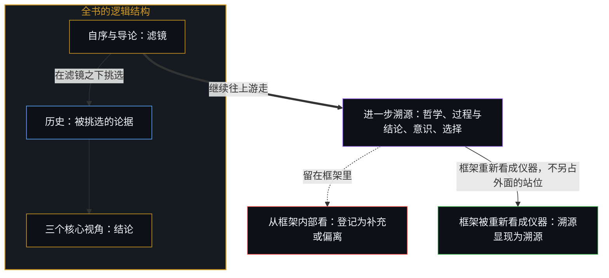
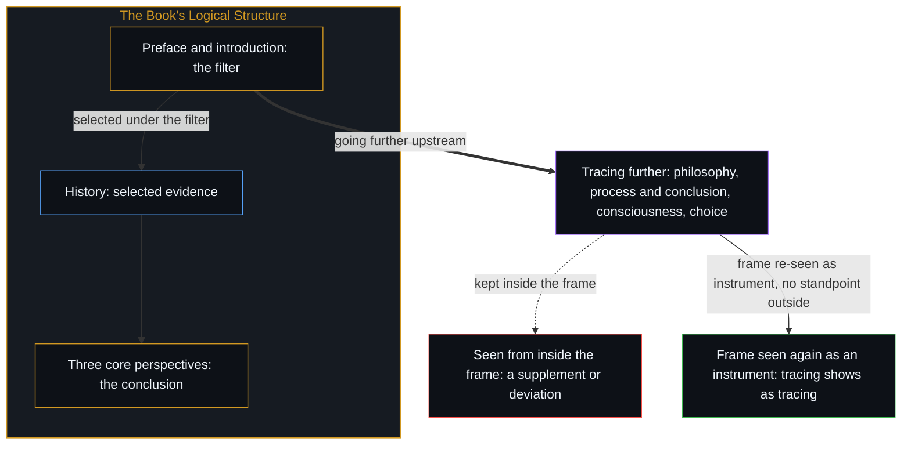

# 读《中文哲学简史》有感 / Reflections on A Short History of Philosophy in Chinese

*从已经搭好的框架内部看，进一步的溯源不容易被识别为真正的不同 / From inside a frame already in place, further tracing back is hard to recognize as genuinely different.*

读完高鹏学弟的《中文哲学简史》，可以清楚地看到它整体的逻辑结构：自序是前提，三个核心视角是结论，中间的历史是精心挑选的论据。针对自序，可以继续往更上游走。

Having read A Short History of Philosophy in Chinese by Gao Peng, a younger fellow alumnus, the book's overall logical structure is plain to see: the preface is the premise, three core perspectives are the conclusion, and the history in between is carefully selected evidence. From the preface one can keep going further upstream.

从已经搭好的框架内部看，进一步的溯源不容易被识别为真正的不同。维特根斯坦《逻辑哲学论》序言里的那句话，印证了这一点。

From inside a frame already in place, further tracing back is hard to recognize as genuinely different. The sentence in the preface to Wittgenstein's Tractatus Logico-Philosophicus bears this out.

## 一、 自序与导论是滤镜 / 1. The Preface and Introduction Are a Filter

自序开篇特地不用“中国”“中华”，而用“中文”：中国、中华、华夏不易于给出简单的学术定义；本书以语言和文字为界，写所有以中文为载体的哲学，也包括对中文母语学习者影响较大的西方译作。一般意义上的中西哲学之分，是两条对象、两套传统。换成“中文”之后，凡进入中文的，译作、对照、对母语者的影响，都已经落在对象之内，中与西不再是两条可以并立的哲学，西已经被命名、收进了中文。作为结构原则的互动，有一半是这一刀先装上的。

The preface deliberately opens with "Chinese" as a language (Zhongwen) rather than "China" as a country or civilization (Zhongguo or Zhonghua): China, the Chinese nation and Huaxia resist simple academic definition, so the book draws its boundary by language and script and writes about all philosophy carried in Chinese, including Western works in translation that have strongly shaped native learners of Chinese. The usual division between Chinese and Western philosophy is two objects and two traditions. Once the boundary becomes "Chinese," everything that has entered Chinese, translations, comparisons, influence on native speakers, already falls within the object; Chinese and Western philosophy are no longer two philosophies that can stand side by side, and the Western has already been named and taken into Chinese. Half of interaction as the book's structural principle is installed by this first cut.

这一刀是滤镜的一部分，不是已经洗净的界定。中文同样要再切，古与今、原文与译作；后文的独尊、皇权、王朝，也仍要借“中国”这类它声称避开的词才能写下去。切开是真的；把它当成已经解决的对象问题，就有些牵强。

This cut is part of the filter, not a definition already washed clean. Chinese has to be cut again too, ancient and modern, original and translation; and the later talk of sole orthodoxy, imperial power and dynasties can only be written with the very words, "China" among them, that the book claims to avoid. The cut is real; treating it as a settled question of the object is a stretch.

自序与导论里“必要的态度”那一部分，几乎把全书其余的方法论前提一次抛出：语言与文字是哲学的核心问题（书中将诸多哲学问题归结为语言本身的问题）；古中文经过两千多年打磨，逻辑的严谨远高于当代中文，白话文运动之后的现代汉语在学术思想的表达上仍不成熟，因此作者主张尽量直接读古文，减少翻译与注释；中文哲学不可能孤立存在，必须放在跨语言、跨文化的互动中理解；哲学更重视思维的方法与过程，而非结论。这些不是开场白，而是全书的滤镜。后面所有的历史叙述，都是在这个滤镜下被选择、被组织、被评价的。

The section of the preface and introduction on "necessary attitudes" sets out nearly all of the book's remaining methodological premises at once: language and script are the core problem of philosophy ("many problems of philosophy are in essence problems of language itself"); classical Chinese, polished over two thousand years, is far more logically rigorous than contemporary Chinese, and modern Chinese after the vernacular movement is still immature for scholarly thought, so the author urges reading classical texts directly as far as possible, with less translation and commentary; Chinese philosophy cannot exist in isolation and must be understood in cross-linguistic, cross-cultural interaction; and philosophy values the method and process of thinking over conclusions. These are not opening remarks but the book's filter. All the historical narrative that follows is selected, organized and evaluated through it.

## 二、 三个核心视角是结论 / 2. The Three Core Perspectives Are the Conclusion

作者明确的三个核心视角，是这部书真正想抵达的结论。

The three core perspectives the author states explicitly are the conclusions the book really means to reach.

第一，现代汉语尚不足以作为思想学的可靠载体，古汉语更适合。导论对此论述最充分，后面虽不再反复强调，态度却一以贯之：直接读古文被当作更高的标准，对现代的注解与翻译保持警惕，认为一字之误，得出的道理便可能南辕北辙。合流篇讨论形神之争时仍是这一态度：西方著作经过多层翻译，错误叠加；直接读中文母语的原创，无非是在古文上下功夫。

First, modern Chinese is not yet adequate as a reliable carrier for the study of thought, and classical Chinese is better suited. The introduction argues this most fully; later chapters no longer press it, but the attitude holds throughout: reading classical texts directly is treated as the higher standard, modern commentary and translation are held at arm's length, and "one wrong character and the reasoning drawn from it may end up pointing the opposite way." The chapter on convergence keeps the same attitude in discussing the debate over form and spirit: Western works pass through layers of translation and errors accumulate, while reading original work in one's native Chinese simply means working at the classical text.

第二，中文思想不是独立发展的，而是在与其他语言所承载的思想交流互动中演进的。这是全书最显性的结构原则。导论已经把中文哲学的发展定为四段：百家争鸣、独尊儒术、众家合流、全球化。从“争鸣篇”开始，就把古希腊、古印度与先秦诸子并置；“独尊篇”写的是这个结构里的收缩段，董仲舒之后儒学被定为国家主导的政治哲学，先秦其他流派被内化、工具化或出世；“合流篇”明确说要把这一时期的东西方融汇贯通，大量处理佛教传入、阿拉伯思想、中世纪欧洲；“全球篇”则进入近现代的中西对照、阿拉伯哲学，以及当代新儒学与西方的对话。互动不是每一章都在做平行比较，而是全书自己的情节：争鸣、收缩、合流、全球化。

Second, Chinese thought did not develop on its own but evolved in exchange and interaction with thought carried in other languages. This is the book's most explicit structural principle. The introduction already divides the development of Chinese philosophy into four stages: the contention of the hundred schools, the sole orthodoxy of Confucianism, the convergence of many schools, and globalization. From the chapter on contention onward, ancient Greece and ancient India are set beside the pre-Qin masters; the chapter on orthodoxy covers the contracting phase of this structure, in which after Dong Zhongshu Confucianism was fixed as the state's leading political philosophy and the other pre-Qin schools were internalized, made instrumental or withdrew from the world; the chapter on convergence states outright that it means to fuse East and West in this period completely, and deals at length with the arrival of Buddhism, Arabic thought and medieval Europe; the chapter on globalization moves into modern comparisons of China and the West, Arabic philosophy, and the dialogue of contemporary New Confucianism with the West. Interaction is not a parallel comparison done in every chapter but the book's own plot: contention, contraction, convergence, globalization.

第三，被归于维特根斯坦的“语言即世界”。维特根斯坦本人在全书出现得较晚（全球篇讨论语言分析哲学与李泽厚的批评时），作者对语言的基础性态度却贯穿始终：语言既是载体，也是研究的对象与工具；哲学问题很大程度上就是语言问题。在作者那里，这与“语言即世界”的立场高度同构。

Third, "language is the world," the position the book attributes to Wittgenstein. Wittgenstein himself appears late in the book (in the chapter on globalization, where analytic philosophy of language and Li Zehou's criticisms are discussed), yet the author's foundational attitude toward language runs throughout: language is at once carrier, object of study and tool, and the problems of philosophy are to a large extent problems of language. For the author, this is closely isomorphic with the position that language is the world.

## 三、 历史是论据库 / 3. History Is a Store of Evidence

全书编年加比较的结构，争鸣、独尊、合流、全球，并不是在讲“中文哲学通史”。它一直在做两件事：用跨文化的平行与互动材料，证明中文思想从来不是封闭生长的；用语言问题，翻译、概念对应、古今文的差异、符号与文字的张力，一再提醒读者，思想的边界与语言的边界高度重合。因此，历史本身成了服务于三个核心视角的论据库。作者并不是在写一部“客观史”，而是在用历史支撑他已经认定的语言观与思想观。这本书的重心不在“中文哲学发生了什么”，而在“如何通过语言与跨文化的互动来理解思想本身”。

The book's chronological-plus-comparative structure, contention, orthodoxy, convergence, globalization, is not telling a "general history of Chinese philosophy." It keeps doing two things: using material on cross-cultural parallels and interaction to show that Chinese thought never grew in isolation, and using problems of language, translation, the matching of concepts, the gap between classical and modern Chinese, the tension between symbol and script, to remind the reader again and again that the boundaries of thought and of language largely coincide. History itself therefore becomes a store of evidence serving the three core perspectives. The author is not writing an "objective history" but using history to support a view of language and thought already settled on. The book's center of gravity is not "what happened in Chinese philosophy" but "how thought itself is to be understood through language and cross-cultural interaction."

## 四、 针对自序的进一步溯源 / 4. Tracing Further Back from the Preface

针对自序，可以继续往更上游走。

From the preface one can keep going further upstream.

哲学不只是一种特殊的思想学，而是所有思想学与学问，也就是知识的源头。哲学起初包罗一切；随着各门学科分化出去，它逐渐退守到那些分支学科尚无法触及的领域，在现代的学科体系里更是如此，这也正是博士学位（PhD）里的“P”代表哲学的原因。然而，作为对求知的终极探索，哲学依然保持着最初的博大精深，始终涵括那些解释不尽的无穷探索。所谓“思想学”，研究的是所思所想留下的痕迹，是已经观察到的效果；它永远无法穷尽，因为思想学总是至少慢思想本身一拍。[前因，后果](../qian-yin-hou-guo/)追的是同一种不对称：观察在果这一边，因总是领先那一步；[你的代码库即是记忆](../your-codebase-is-memory/)也由此把成文的著述与代码库归位为活的心智留在身后的外化记忆，而不是思考活动本身。

Philosophy is not just one particular study of thought but the source of every study of thought and every learning, that is, of knowledge. Philosophy at first encompassed everything; as the specialized disciplines branched off, it gradually withdrew to the domains those branches could not yet reach, all the more so in the modern system of disciplines, which is why the "P" in PhD stands for philosophy. Yet as the ultimate inquiry into knowing, philosophy keeps its original breadth and depth, always encompassing the endless inquiries that no explanation exhausts. What is called the "study of thought" studies the traces of what has been thought, effects already observed; it can never be exhausted, because the study of thought is always at least one beat behind thinking itself. [Cause Before, Effect After](../qian-yin-hou-guo/) traces the same asymmetry: observation stays on the side of the effect while the generating cause remains one step ahead, and [Your Codebase Is Memory](../your-codebase-is-memory/) shows that every written canon or codebase is likewise an externalized trace that depends on the living Mind at the steering edge to re-read and reconsolidate it rather than thinking on its own.

结论远没有过程重要。过程是思想的轨迹，结论不过是轨迹上的里程碑；两者的区别在于解析度，或者说抽象的层次。结论的演化本身就是更高层次的过程，而过程本身又是更低层次思考的里程碑。[生命的意义在起草之中](../the-meaning-of-life-is-in-the-drafting/)追的是同一种层差：意义在仍湿的草稿上生成，不在已经誊清的页上被找回。

Conclusions matter far less than process. Process is the trajectory of thought, and a conclusion only a milestone on it; the difference between them is one of resolution, or of level of abstraction. The evolution of conclusions is itself a process at a higher level, and process is itself a milestone of thinking at a lower level. [The Meaning of Life Is in the Drafting](../the-meaning-of-life-is-in-the-drafting/) traces the same difference of level: meaning arises on the draft still wet, not recovered from the page already fair-copied.

哲学是知识的源头，思想是哲学的源头，意识是思想的先导。一切认知始于意识。

Philosophy is the source of knowledge, thought the source of philosophy, consciousness the origin of thought. All cognition begins in consciousness.

理性是前提稳定的逻辑链条；情感是前提跳跃的逻辑片段。

Reason is a chain of logic whose premises hold steady; emotion is a fragment of logic whose premises leap.

意义并不存在于语言本身，而在于意识对语言的解读。[遗忘的脚手架](../the-scaffolding-we-forget/)追的是语言被握成世界的那一次脱落：组织一旦可用，搭建就退出递归，世界显得本来如此。

Meaning does not lie in language itself but in consciousness's interpretation of language. [The Scaffolding We Forget](../the-scaffolding-we-forget/) traces the drop-out by which language comes to be held as the world: once the organization is usable, the building of it leaves recursion, and the world looks as though it had always been so.

学习理性哲学，是通过观察现象来推导它的原因，再以此为前提演绎、加以验证。若一开始就追求现实的结果，便是把因果的顺序弄反了。这与年龄有一定的相关，却并不构成因果。

Learning rational philosophy means inferring causes from the observation of phenomena, then taking those as premises to deduce and verify. To chase practical results from the start is to reverse the order of cause and effect. This correlates somewhat with age, but does not amount to causation.

数字化与符号化是语言和文字的一种特殊表达方式。它们可以让意识对它们所代表的意义得到更稳定的解读，但不能把这份解读封定。因此逻辑学里有罗素悖论，数学里有哥德尔不完备定理，即便是计算机语言也难免溢出。

Digitization and symbolization are a particular mode of expression of language and script. They can give consciousness a steadier interpretation of the meanings they stand for, but cannot seal that interpretation. Hence logic has Russell's paradox, mathematics has Gödel's incompleteness theorems, and even computer languages cannot avoid overflow.

科学从假设到论证可以悉数公式化、模型化，但这种周延仅限于不违反其前提条件之内，而非无条件的周延。它是对现实作封闭建模的一种解读，而现实本身是开放的。哲学之所以无法回避，是因为意识无法回避；可哲学又常常被“回避”，因为意识可以、并且经常进行自我否定。[没有系统能被保持封闭](../no-system-can-be-kept-closed/)追的是同一种非封闭：有限的持守封不住只在继续的活动。

Science can be formalized and modeled throughout from hypothesis to argument, yet that closure holds only within its own premises, never unconditionally. It is an interpretation that models reality as closed, while reality itself is open. Philosophy cannot be avoided because consciousness cannot be avoided; yet philosophy is often "avoided," because consciousness can and often does negate itself. [No System Can Be Kept Closed](../no-system-can-be-kept-closed/) traces the same non-closure: a finite hold cannot seal an activity that only continues.

“大多数情况下的大多数人并没有选择的权力”，这恰恰是个人自由选择的集体表现。它不是独立的情感与理性的反面，而是“独立的情感与理性”的历史在现实中留下的痕迹，是下一刻自由选择的背景。认为没有选择，本身也是一种选择。“大多数情况下的大多数人并没有选择的权力”，恰恰就是大多数人在大多数情况下（自由地）选择认为自己没有选择的权力。[个体抉择是唯一的因果杠杆](../individual-choices-as-the-only-causal-levers/)追的是同一种归位：每一个离散的行动仍是自己的杠杆，条件是场，不是替行动供因的第二作者。[作茧不是自缚](../zuo-jian-bu-shi-zi-fu/)追的是同一种选择：把痕迹读成枷锁，对照的仍是一块本应不受痕迹约束的空白。

"Most people in most circumstances have no power to choose": this is precisely the collective expression of individual free choice. It is not the opposite of independent feeling and reason but the trace that the history of "independent feeling and reason" has left in reality, the background of the next moment's free choice. To believe one has no choice is itself a choice. "Most people in most circumstances have no power to choose" is exactly most people in most circumstances (freely) choosing to believe they have no power to choose. [Individual Choices as the Only Causal Levers](../individual-choices-as-the-only-causal-levers/) traces the same return: each discrete act remains its own lever, and conditions are the field, not a second author supplying the act's cause. [Spinning a Cocoon Is Not Binding Oneself](../zuo-jian-bu-shi-zi-fu/) traces the same choice: reading traces as shackles still measures them against a blank that ought to be free of traces.

## 五、 从已经搭好的地基内部看 / 5. Seen from Inside a Foundation Already Laid

自序是全书逻辑结构的地基。进一步的溯源，哲学是否只是特殊的思想学、过程与结论的嵌套、意识作为更源初的层级、选择与无选择的递归，实际上是在质疑这个地基本身。从已经搭好的框架内部看，进一步的溯源不容易被识别为真正的不同，更像是同一方向上的补充或偏离。只有跳出为全书预设的语言、历史与互动的框架，溯源才会显现为溯源。

The preface is the foundation of the book's logical structure. Tracing further back, whether philosophy is only a particular study of thought, the nesting of process and conclusion, consciousness as the more original level, the recursion of choice and no choice, is in effect questioning that foundation itself. From inside a frame already in place, further tracing back is hard to recognize as genuinely different and looks more like a supplement or deviation along the same direction. Only by stepping out of the frame of language, history and interaction preset for the book does tracing back show itself as tracing back.

这种跳出不是另占一个外面的站位。框架被重新看成仪器，而不是判定异同的地基，进一步的溯源才不会被收成补充或偏离。[最初的区分](../the-initial-distinction/)追的是同一种封闭：后续的严谨全部运行在第一次切开的场地里，它不能走出去为那一刀作证，也不能消除那一刀。

This stepping out is not taking up another standpoint outside. Only when the frame is seen again as an instrument, rather than as the ground for judging what is the same and what differs, is further tracing back no longer absorbed as supplement or deviation. [The Initial Distinction](../the-initial-distinction/) traces the same closure: all later rigor runs on the ground the first cut opened, and it cannot step outside to testify for that cut, nor undo it.

维特根斯坦在《逻辑哲学论》序言里的那句话，印证了这一点：

The sentence in the preface to Wittgenstein's Tractatus Logico-Philosophicus bears this out exactly:

> 也许只有那些自己已经思考过书中所表达的思想的人，才能理解这本书。

> This book will perhaps be understood only by those who have themselves already thought the thoughts which are expressed in it.
