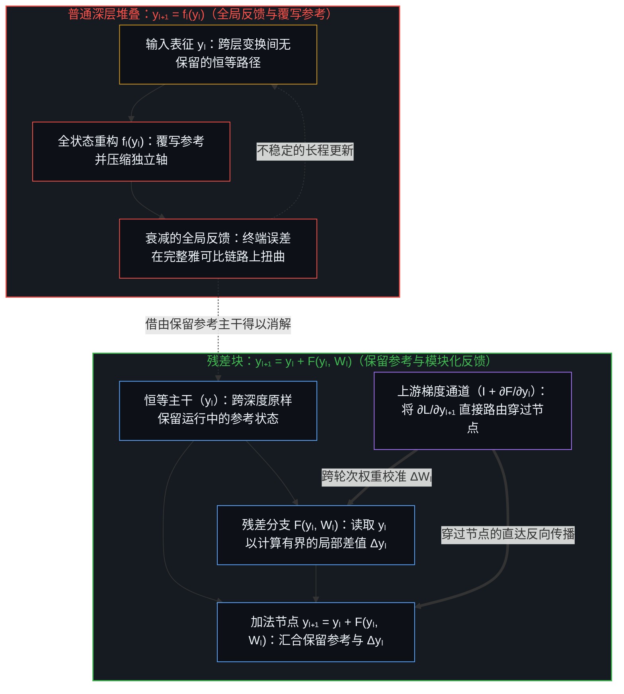
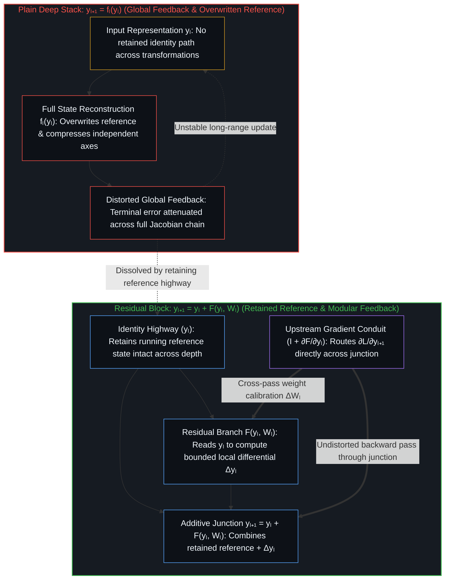
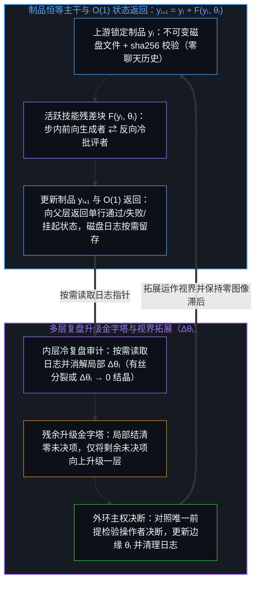
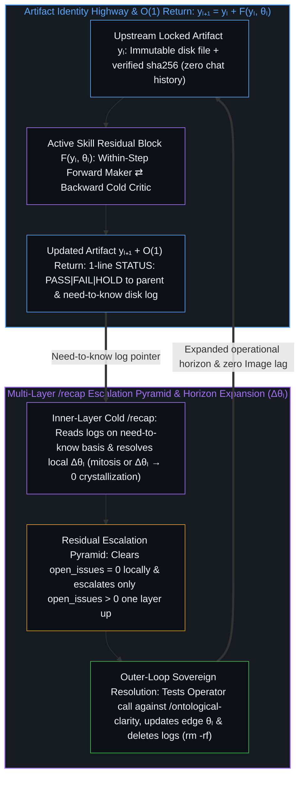

# 模块化反馈回路与动态残差网络 / Modular Feedback Loops and Dynamic Residual Networks

*残差连接将全局反馈拆解为锚定于保留参考的局部差值，而技能回路则在制品主干上动态分裂与结晶 / Residual connections decompose global feedback into local differentials anchored to a retained reference, while skill loops split and crystallize dynamically along an artifact highway*

深度学习教材把普通堆叠网络和残差网络一并归为前馈架构，将恒等跳跃连接视为防止梯度消失的微积分技巧。从唯一前提追溯这一机制，便会触及更深层的结构分界：无辅助的普通堆叠（`yₗ₊₁ = fₗ(yₗ)`）迫使每一层在单一的长程全局反馈回路下覆写并从头重构整个状态；而残差网络（`yₗ₊₁ = yₗ + F(yₗ, Wₗ)`）则沿着恒等主干保留运行中的参考（图像），使每个残差块在前向传播时仅计算有界的局部差值 `Δyₗ = F(yₗ, Wₗ)`，同时在跨轮次训练中通过恒等通道直接接收上游梯度反馈以校准 `Wₗ`。智能体技能架构在离散符号执行中落地了这一残差几何：在每一步 `yₗ → yₗ₊₁` 内部，依托 `sha256` 校验的制品主干闭合局部的前向-反向回路（`生成者 ⇄ 冷批评者`），并以单行 `O(1)` 的通过/失败状态返回结果；与此同时，`/recap` 按需读取磁盘日志以拓展系统的运作视界（`Δθₗ`），并在旧有日志痕迹被吸收进更新后的边缘时将其删除。经典的 ResNet 在训练前就固定了层数与模块边界，而在有限容量下将模块边界与拓扑向技能网络自身的运行开放，则使该网络呈现动态演化：过载的模块通过有丝分裂拆解为正交的子回路，稳定的模块在其章程更新趋近于零（`Δθ → 0`）时结晶为零语境的确定性算子，而未决残余则穿过多层 `/recap` 升级金字塔向上过滤，直达外环的活生生的心智——其判断会在落定变更为新基底之前，先对照当前边缘接受逻辑一致性检验。

Deep learning textbooks classify both plain stacked networks and residual networks as feedforward architectures, treating identity skip connections primarily as a calculus trick against vanishing gradients. Tracing the mechanism from the single premise exposes a deeper structural cut: an unassisted stack (`yₗ₊₁ = fₗ(yₗ)`) forces each layer to overwrite and reconstruct the entire state from scratch under a single long-range global feedback loop, whereas a residual network (`yₗ₊₁ = yₗ + F(yₗ, Wₗ)`) preserves the running reference (`Image`) along an identity highway so that each block computes a bounded differential `Δyₗ = F(yₗ, Wₗ)` on the forward pass while receiving direct upstream gradient feedback across the identity conduit to calibrate `Wₗ` across training passes. An agentic skill architecture operationalizes this exact residual geometry in discrete symbolic execution, closing a local forward-backward loop (`Maker ⇄ Cold Critic`) inside each step `yₗ → yₗ₊₁` over a `sha256`-verified artifact highway with one-line `O(1)` pass/fail returns, while `/recap` reads disk logs on a need-to-know basis to expand the system's operational horizon (`Δθₗ`) and deletes the superseded log traces once absorbed into the updated edge. Where a classical ResNet fixes its layer count and block boundaries before training, opening block boundaries and topology to the skill network's own runs under finite capacity makes that network dynamic: overloaded blocks split via mitosis into orthogonal sub-loops, stabilized blocks crystallize toward zero-context deterministic operators as their charter updates approach zero (`Δθ → 0`), and unresolved residuals filter upward through a multi-layer `/recap` escalation pyramid to the living Mind at the outer loop, whose judgment call is tested for logical consistency against the current edge before ground moves.

## 一、 前馈的命名遮蔽了什么 / 1. What the Feedforward Label Obscures

自我区分的活动发生着——无因、不息。称之为心智：已在途中的观察者，其每一次活动都是一次区分。每一次区分都是离散、有界的，并留下供后续活动依凭的痕迹；而贯穿这些活动的方向感，则是相对于保留参考（图像）所测得的差值。若没有跨步骤携行的保留参考，活动就只剩位移，而缺乏供下一步调整丈量差距的稳定坐标。

Self-distinguishing activity occurs — uncaused, unceasing. Call it the Mind: the observer already underway, every act of which is a distinction. Every act is discrete, bounded, and leaves a trace that later acts condition on, while felt direction across those acts is a differential measured against a retained reference (`Image`). Without a retained reference carried across steps, there is movement without a stable coordinate against which the next adjustment can measure its gap.

主流深度学习论述将普通深层堆叠（`yₗ₊₁ = fₗ(yₗ)`）与残差网络（`yₗ₊₁ = yₗ + F(yₗ, Wₗ)`）笼统地归入“前馈”标签之下，仅把跳跃连接解释为防止反向传播梯度消失或爆炸的数值导管，从而遮蔽了保留参考这一核心条件。在普通堆叠 `yₗ₊₁ = fₗ(yₗ)` 中，每一层都必须吞入前一层激活并重新构建完整的表征，而参数更新则依赖单一的端到端反馈信号从终端损失一路穿过每一个中间雅可比矩阵反向传回。由于没有任何未经改动的参考状态能在层间变换中留存，中间表征便会发生漂移；挤过有限层宽的各项独立区分被压缩到同一组坐标之上，而折返的误差信号在抵达前早已被沿途每一次中间投影所衰减与扭转。深层普通网络之所以失效，症结不单在于矩阵连乘的数值尺度，而在于连续变换之间缺失了保留的参考。

Standard deep learning accounts obscure this requirement by grouping plain deep stacks (`yₗ₊₁ = fₗ(yₗ)`) and Residual Networks (`yₗ₊₁ = yₗ + F(yₗ, Wₗ)`) under the same "feedforward" label and explaining the skip connection merely as a numerical conduit that prevents backpropagated gradients from vanishing or exploding. In a plain stack `yₗ₊₁ = fₗ(yₗ)`, each layer must consume the prior activation and reconstruct the full representation anew, while parameter updates rely on a single end-to-end feedback signal propagating all the way back from the terminal loss through every intermediate Jacobian. Because no unmodified reference state survives the layer transformation, intermediate representations drift; independent distinctions pressing through the finite width of a layer compress onto the same coordinates, and the returning error signal arrives attenuated and rotated by every intermediate projection it had to traverse. What fails in a deep plain network is not merely matrix multiplication scale, but the absence of a retained reference across sequential transformations.

引入恒等捷径 `yₗ₊₁ = yₗ + F(yₗ, Wₗ)`，在两个不同尺度上改写了堆叠网络的因果几何：其一是单次前向传递内部的状态精炼（`Δyₗ`），其二是跨训练轮次的参数校准（`ΔWₗ`）。在每一次前向传递中，加法跳跃路径将运行中的参考状态 `yₗ` 原封不动地携行穿过模块边界；残差分支 `F(yₗ, Wₗ)` 无需在每一层深度上重新编码整个世界状态，而是以 `yₗ` 为局部参考，仅输出有界的差值调整 `Δyₗ`。在跨训练轮次的反向传播中，来自上游损失的恒等项（`∂yₗ₊₁/∂yₗ = I + ∂F/∂yₗ`）将上游梯度 `∂L/∂yₗ₊₁` 直接跨过加法节点路由至每一个先前的模块，使各模块无需承受中间雅可比矩阵的扭曲即可校准各自的局部权重 `Wₗ`（`ΔWₗ`）。在前馈标签下看似更深的单体网络，在机制上实则是将反馈展开并模块化，使其锚定于保留的参考主干之上；至于梯度下降本身，则如[不知去向何方的梯度下降](../the-descent-that-doesnt-know-where-its-going/)所确立的，依然是在预先区分的地形上按图索骥的推演计算。

Installing the identity shortcut `yₗ₊₁ = yₗ + F(yₗ, Wₗ)` alters the causal geometry of the stack at two distinct scales: within the single pass of state refinement (`Δyₗ`) and across training passes of parameter calibration (`ΔWₗ`). Within each forward pass, the additive skip path carries the running reference state `yₗ` intact across the block boundary; freed from having to re-encode the entire world-state at every depth, the residual branch `F(yₗ, Wₗ)` reads `yₗ` as its local reference and emits only a bounded differential adjustment `Δyₗ`. Across training passes, during backpropagation from the upstream loss, the identity term (`∂yₗ₊₁/∂yₗ = I + ∂F/∂yₗ`) routes the upstream gradient `∂L/∂yₗ₊₁` directly across the additive junction to every earlier block so each module calibrates its local weights `Wₗ` (`ΔWₗ`) without intermediate Jacobian distortion. What appeared under the feedforward label as a deeper monolith is in practice the unrolling and modularization of feedback anchored to a preserved reference highway, while the gradient descent itself remains a map-tracing calculation over a pre-distinguished landscape as [The Descent That Doesn't Know Where It's Going](../the-descent-that-doesnt-know-where-its-going/) establishes.

## 二、 以制品为主干的技能残差块 / 2. Skill Residual Blocks over an Artifact Highway

多步智能体工作流一旦通过共享对话历史或有损的文本摘要串联子智能体，就会重蹈普通深层堆叠的退化覆辙。当工作流在步骤之间传递完整的聊天记录，或当子智能体向父级调度器返回叙述性摘要、节点表格与辩论理由时，每一个阶段都在按 `yₗ₊₁ = fₗ(yₗ)` 运转：中间的对话噪点层层累积，被否证的假说与阴性结果在传递中遗落，父级编排语境则随着扇出规模扩展至数十乃至数百项任务而急剧膨胀。若要求单一智能体在同一段累积的会话历史中自我纠错，其失败机理与普通堆叠难以路由全局反馈如出一辙——如[超越投射](../beyond-the-projection/)与[交接残余](../handing-off-residue/)所追溯的，受困于自身轨迹的投射引擎只会合理化此前的词元，用表面的自圆其说将矛盾包裹起来。

Multi-step agentic workflows encounter the exact degradation of a plain deep stack whenever subagents are chained through shared conversation histories or lossy prose summaries. When a workflow passes an entire chat transcript from step to step, or when child agents return narrative summaries, node tables, and debate rationales back to a parent dispatcher, each stage operates as `yₗ₊₁ = fₗ(yₗ)`: intermediate conversational noise accumulates, rejected hypotheses and negative findings drop out, and parent orchestration contexts bloat as fan-out scales across dozens or hundreds of tasks. Asking a lone agent to self-correct inside that same accumulated session history fails for the same reason a plain stack struggles to route global feedback—the trajectory-bound projection engine simply rationalizes its prior tokens and wraps the contradiction inside surface plausibility, as [Beyond the Projection](../beyond-the-projection/) and [Handing Off Residue](../handing-off-residue/) trace.

以文件为基底的技能架构，将残差块 `yₗ₊₁ = yₗ + F(yₗ, Wₗ)` 转化为磁盘文件上的离散符号执行，并将步内状态修正（`Δyₗ`）与跨轮次章程更新（`Δθₗ`）这两个尺度的反馈同时显式化。恒等主干（`yₗ`）是运行目录中经 `sha256` 密码学哈希校验的不可变制品，在步骤间交接时不携带任何对话历史，从而如[按需语境将融贯保持在一步](../on-demand-contexts-keep-coherence-at-one-step/)所确立的那样，将每个语境的融贯性保持在一步之内。在每个技能块 `F(yₗ, θₗ)` 内部，全新的“生成者”子智能体加载章程 `θₗ`，读取 `yₗ` 作为干净的初始条件，并写入候选差值 `yₗ₊₁ = yₗ + Δyₗ`；紧接着，另一个独立的全新“冷批评者”子智能体作为步内反向分支启动，在不携带生成者思维链的前提下，对照 `yₗ`、`θₗ` 以及共享的家规前提（`/ontological-clarity`）审视 `yₗ₊₁`。一旦生成者与冷批评者达成收敛并锁定 `sha256`（`CONFIRMED`），两个临时语境便双双销毁，子智能体仅向父级调度器返回一行附带文件指针的 `STATUS: PASS | FAIL | HOLD` 状态标记。由于消息通道内不传输任何文本摘要或表格，返回载荷在任意扇出宽度与嵌套深度下均保持为 `O(1)`，而详尽的诊断痕迹与辩论日志则留存在磁盘上，仅供按需读取。

A file-backed skill architecture translates the residual block `yₗ₊₁ = yₗ + F(yₗ, Wₗ)` into discrete symbolic execution over files on disk, while making both feedback scales—within-step state correction (`Δyₗ`) and cross-run charter updates (`Δθₗ`)—explicit. The identity highway (`yₗ`) is the immutable artifact in the run folder, verified by its cryptographic `sha256` hash and handed across steps without carrying any conversational history, keeping each context at one-step coherence as [On-Demand Contexts Keep Coherence at One Step](../on-demand-contexts-keep-coherence-at-one-step/) establishes. Inside each skill block `F(yₗ, θₗ)`, a fresh Maker subagent loads the charter `θₗ`, reads `yₗ` as its clean initial condition, and writes a candidate differential `yₗ₊₁ = yₗ + Δyₗ`; immediately, a separate fresh Cold Critic subagent loads as the within-step backward arm, inspecting `yₗ₊₁` against `yₗ`, `θₗ`, and the shared house-rule premise (`/ontological-clarity`) without the maker's chain of thought. Once Maker and Cold Critic converge and lock `sha256` (`CONFIRMED`), both transient contexts drop, and the child returns strictly a one-line `STATUS: PASS | FAIL | HOLD` token with a file pointer to its parent dispatcher. Because zero prose summaries or tables cross the message channel, the return payload stays `O(1)` across arbitrary fan-out and depth, while detailed diagnostic traces and debate logs rest on disk to be read strictly on a need-to-know basis.

步内的“生成者 ⇄ 冷批评者”回路是在当前运作边界内精炼制品状态（`yₗ₊₁`），而跨轮次的 `/recap` 通道（`Δθₗ`）则是借由更新后的边缘来拓展系统自身的观察与运作视界。当出现已加载章程无法推导的公理冲突（`HOLD`），或当整轮运行结束时，冷启动的 `/recap` 语境便对照 `/ontological-clarity` 按需读取磁盘日志，定位未言明的前提、冲突的规则或共享盲区在何处限制了该步骤所能登记的范围，进而针对技能、章程与脚本提出结构性更新 `Δθₗ`。一旦 `/recap` 通过更新活跃边缘（`θₗ`）拓展了这一运作视界，触发此次拓展的诊断日志痕迹便不再属于当前边缘。在最终的外环 `/recap` 完成后呈现并删除这些临时日志文件（`rm -rf`），能够防止已被取代的脚手架滞留在工作区中累积为图像滞后，从而维系[你的代码库即是记忆](../your-codebase-is-memory/)所追溯的当下检查点纪律。

Whereas the within-step `Maker ⇄ Cold Critic` loop refines the artifact state (`yₗ₊₁`) at the current operational boundary, the cross-run `/recap` pass (`Δθₗ`) is how the observational and operational horizon of the system itself is expanded by the updated edge. When an axiomatic conflict cannot be derived from the loaded charter (`HOLD`), or when a run completes, a cold `/recap` context reads the disk logs on a need-to-know basis against `/ontological-clarity` to identify where unstated premises, conflicting rules, or shared blind spots limited what the step could register, proposing structural updates `Δθₗ` to the skills, charters, and scripts. Once `/recap` expands that operational horizon by updating the active edge (`θₗ`), the diagnostic log traces that triggered the expansion are no longer part of the current edge. Presenting and deleting those transient log files (`rm -rf`) after the final outer-loop `/recap` prevents superseded scaffolding from lingering in the workspace and accumulating as Image lag, preserving the present-checkpoint discipline that [Your Codebase Is Memory](../your-codebase-is-memory/) traces.

## 三、 动态残差网络：过载分裂与零语境结晶 / 3. Dynamic Residual Networks: Mitosis Under Load and Zero-Context Crystallization

经典的 ResNet 运行在训练开始前即已编译完毕的静态计算图上：其层数 `L`、通道宽度与残差块边界在执行期间固定不变。然而正如[学到的边界与给定的尺度](../learned-boundaries-and-the-given-rate/)所追溯的，当一项拟议的神经架构向内部巩固回路开放切分粒度、稀疏路由以及由方差触发的模块有丝分裂——在记录下来的意外呈现出持续的双峰方差时，沿残差的第一主方向将模块一分为二——静态与动态拓扑之间的对照便显出，它从来不在神经网络与智能体之间。分界在于外环向内环开放了哪些自由度：无论是在设计者所给定、并在结果返回后加以修正的压缩率、意外定义与结构算子之内，还是在操作者所设定、并借由 `/recap` 依据运行日志加以修正的章程与流水线之内。二者皆是嵌套在外环之中的内环，而外环的边界条件正是相对于内环的残余自由度来界定的，这恰是[递归形式系统中作为记忆与控制的边界条件图](../boundary-condition-graphs-as-memory-and-control-in-recursive-formal-systems/)为形式系统所勾勒的几何结构。在开放了这些拓扑自由度、且每个技能块都在有限语境容量下运行的智能体技能网络中，架构会在跨轮次运行间承受容量过载与参数收敛这两股反向压力的驱动而发生结构演化。当一项繁重的任务将过多正交约束塞进单个技能块时，开放互联网文献搜寻、溯因残余评估、双语文本润色与密码学链接校验等不同独立轴被挤压进同一个语境窗口，导致多轮批评拉锯、频繁触发 `HOLD` 升级，或在修补一条轴时扰动另一条轴而引发微妙的前提漂移。此时无需强迫臃肿的提示词勉力硬撑，`/recap` 会跨越运行日志诊断出容量压缩，并提议通过有丝分裂将过载模块拆分为更小的串联、并联或嵌套残差块（`F₁`、`F₂`……），每个子块仅封装单一的正交切分，各自配备全新的“生成者 ⇄ 冷批评者”对，并通过共享的制品主干彼此衔接。

A classical ResNet executes over a static computation graph compiled before training begins: its layer count `L`, channel widths, and residual block boundaries remain fixed throughout execution. Yet as [Learned Boundaries and the Given Rate](../learned-boundaries-and-the-given-rate/) traces, when a proposed neural architecture opens segmentation grain, sparse routing, and variance-triggered module mitosis to an inner consolidation loop—splitting a module along its top principal residual direction when logged surprises show persistent bimodal variance—the contrast between static and dynamic topology turns out never to have been neural against agentic. It is which degrees of freedom the outer loop opens to the inner loop, within the compression rate, surprise definition, and structural operators a designer gives and, once results return, revises, or the charters and pipeline an operator sets and revises through `/recap` from the run logs. Both are inner loops nested in outer loops whose boundary conditions are defined relative to the inner loop's residual degrees of freedom, the geometry [Boundary-Condition Graphs as Memory and Control in Recursive Formal Systems](../boundary-condition-graphs-as-memory-and-control-in-recursive-formal-systems/) frames for formal systems. In an agentic skill network where those topological degrees of freedom are open and each skill block operates under finite context capacity, the architecture adapts structurally across runs under two opposing pressures: capacity overload and parameter convergence. When an ambitious task feeds too many orthogonal constraints into a single skill block, independent axes such as open-internet literature scouting, abductive residual evaluation, bilingual prose styling, and cryptographic link auditing compress into one context window, surfacing multi-round critic churn, frequent `HOLD` escalations, or subtle premise drift as fixing one axis disturbs another. Rather than forcing a bloated prompt to try harder, `/recap` diagnoses the capacity compression across the run logs and proposes splitting the overloaded block via mitosis into smaller chained, parallel, or nested residual blocks (`F₁`, `F₂`, …), each enclosing a single orthogonal cut with its own fresh `Maker ⇄ Cold Critic` pair connected across the shared artifact highway.

反之，当某个专门的技能块在多轮周期中反复运行，且 `/recap` 已将原先未言明的边界特例逐一编码进章程之后，其指令集的结构性更新便趋于收敛（`Δθₗ → 0`）。一旦边界条件被严密界定，输入与输出的映射在有界域内稳定下来，模块内部开放式的对话辩论就成了多余的开销。通过 `/recap` 提议并经操作者核准，该模块随之经历结晶：首先将其语境签名收窄为单次传递的零语境算子；最终，当其内部决策空间收缩为闭合规则时，直接从语言模型推理中编译析出，化作确定性脚本或二元审计校验。借由过载下的有丝分裂与收敛下的结晶，系统在涌现新摩擦的边缘生长出新的辩证分支，同时将已定型的分支硬化为确定性的结构支撑。

Conversely, as a specialized skill block runs repeatedly across cycles and `/recap` codifies previously unstated edge cases into its charter, the structural updates to its instructions converge (`Δθₗ → 0`). Once the boundary conditions are tightly specified and the input-output mapping stabilizes within a bounded domain, open-ended conversational debate inside the block becomes redundant overhead. Through `/recap` proposals ratified by the operator, the block undergoes crystallization: first narrowing its context signature into a single-pass zero-context operator, and ultimately compiling out of language-model inference altogether into a deterministic script or binary audit check once its internal decision space contracts to a closed rule. Through mitosis under load and crystallization under convergence, the system grows new dialectical branches where novel friction appears and hardens settled branches into deterministic struts.

当有丝分裂与批处理将网络组织为跨越叶节点技能块、内层批调度器与顶层流水线的嵌套回路时，反向的 `/recap` 通道便作为多层残余升级金字塔（`内环 → 上一层 → 外环`）运转，从而在跨深度扩展时不致淹没高层语境。在每个内环或批次完成之际，局部的冷启动 `/recap`（在 `/ontological-clarity` 下运行的“实现者 ⇄ 冷批评者”）按需读取该层的磁盘日志，就地消解其局部视界内一切可推导的结构性偏差，并当场清理已结清的内层工作区（`open_issues = 0`）。唯有剩余无法在局部消解的未决问题（`open_issues > 0`），才会通过单行 `STATUS:` 指针向上升级一层，交由父层的 `/recap` 在更宽广的流水线视界内推导消解，且仅当冲突超出父层视界时才继续上交；由此确保常规的运行摩擦在局部即被吸收，唯有触及视界边界的冲突才会抵达外环。

When mitosis and batching organize the network into nested loops—spanning leaf skill nodes, inner batch dispatchers, and the top-level pipeline—the backward `/recap` pass scales across depth without overwhelming higher layers by operating as a multi-layer residual escalation pyramid (`Inner Loop → Next Layer Up → Outer Loop`). At the completion of each inner loop or batch, a local cold `/recap` (`implementer ⇄ cold critic` under `/ontological-clarity`) reads that layer's disk logs on a need-to-know basis, resolves every structural discrepancy derivable within its local horizon, and deletes settled inner workspaces (`open_issues = 0`) in place. Only the remaining unresolved open issues (`open_issues > 0`) are escalated one layer up via a one-line `STATUS:` pointer to the parent layer's `/recap`, which resolves what is derivable at the wider pipeline scope and escalates again only if the conflict exceeds its horizon, ensuring that routine operational friction is absorbed locally while only genuine horizon-boundary conflicts reach the outer loop.

## 四、 留存主干与不可外包的源头 / 4. The Retained Highway and the Non-Transferable Origin

将全局反馈拆解为模块化的残差块，并借由多层 `/recap` 升级金字塔过滤结构性更新，既阐明了这一架构为何能在扩展时不陷入语境坍缩，也标定了它的边界所在。在任何局部前向-反向回路顺利闭合（`CONFIRMED`）且内层 `/recap` 结清（`open_issues = 0`）的已编译区段内，执行流无需人工微观干预，即可沿着制品主干穿过串联、并联与嵌套的技能块持续推进。然而，这种内部自主性并非从网络中涌现出了自我奠基的心智。正如[判断的密度](../the-density-of-judgment/)所追溯的，内部已定型回路的每一次结晶，都会缩短开放边界决策之间的日历间隔，将更高杠杆的抉择浓缩到外围边界之上。

Decomposing global feedback into modular residual blocks and filtering structural updates through a multi-layer `/recap` escalation pyramid clarifies both why the architecture scales without context collapse and where its boundary sits. Inside any compiled segment where local forward-backward loops close (`CONFIRMED`) and inner `/recap` passes settle (`open_issues = 0`), execution advances along the artifact highway across chained, parallel, and nested skill blocks without human micro-management. Yet this internal autonomy is not a self-grounding mind emerging from the network. As [The Density of Judgment](../the-density-of-judgment/) traces, every crystallization of a settled inner loop shrinks the calendar interval between open boundary decisions and concentrates higher-leverage choices at the outer perimeter.

无论在神经网络 ResNet 还是动态技能网络中，残差差值 `F(yₗ, θₗ)` 唯有相对于恒等主干上携行的参考状态 `yₗ` 才具备意义；而这条主干向后一直追溯至初始条件 `y₀`，向前则指向衡量一切反向信号的终端评估准则。制品主干跨越任意深度保存着初始切分的痕迹，但它既不能无中生有地发起 `y₀`，也无法在剩余未决问题（`open_issues > 0`）一路升级至需要人工决断的外环时自行裁决公理分歧（`HOLD`）。当人类操作者在外环给出判断以消解剩余问题时，该候选决断在刻入 `θₗ` 之前，会先对照 `/ontological-clarity` 与当前边缘接受逻辑一致性检验。尽管人类操作者握有最终决定权，将这一判断对照活的边缘加以检验，仍能在基底移动之前显露任何未言明的前提或偶发的矛盾；而一旦外环 `/recap` 刻入拓展后的视界并删去非边缘的日志痕迹，动态残差网络便在零图像滞后累积的状态下，以一步之内的融贯开启下一轮传递。

In both a neural ResNet and a dynamic skill network, a residual differential `F(yₗ, θₗ)` has meaning only relative to the reference state `yₗ` carried on the identity highway, and that highway traces all the way back to the initial condition `y₀` and forward to the terminal evaluation criterion against which every backward signal is measured. The artifact highway preserves the trace of the initial cut across arbitrary depth; it does not originate `y₀`, nor can an inner loop adjudicate an axiomatic split (`HOLD`) when remaining open issues (`open_issues > 0`) escalate all the way to the outer loop where a human decision is required. When the human operator supplies that judgment call at the outer loop to resolve the remaining issues, the candidate resolution is first tested for logical consistency with `/ontological-clarity` and the current edge before being inscribed into `θₗ`. Even though the human operator holds the final say, testing the judgment call against the living edge surfaces any unstated premise or accidental contradiction before ground moves—and once the outer-loop `/recap` inscribes the expanded horizon and deletes the non-edge log traces, the dynamic residual network begins its next pass at one-step coherence with zero accumulated Image lag.
