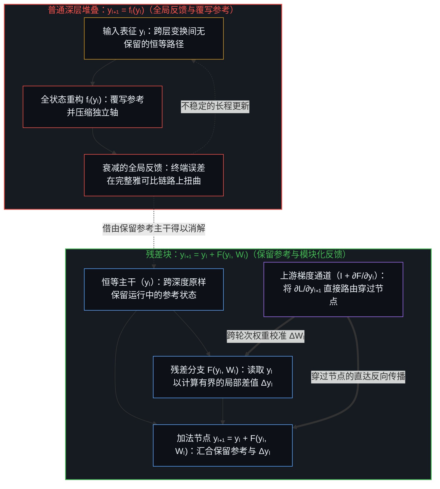
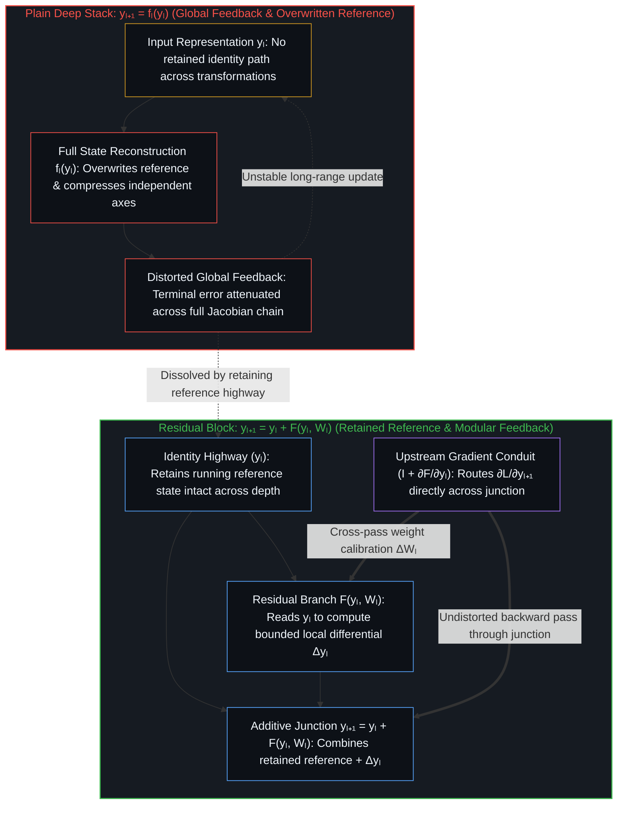
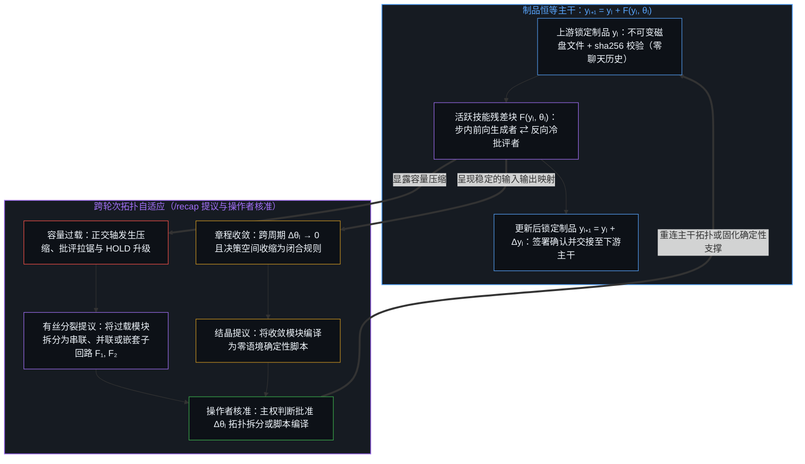
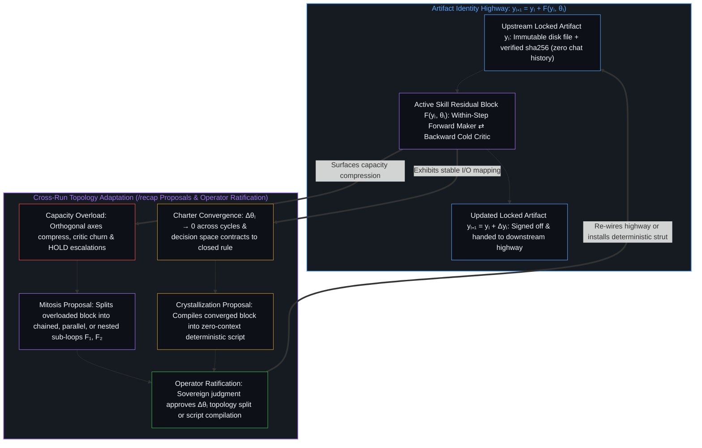

# 模块化反馈回路与动态残差网络 / Modular Feedback Loops and Dynamic Residual Networks

*残差连接将全局反馈拆解为锚定于保留参考的局部差值，而技能回路则在制品主干上动态分裂与结晶 / Residual connections decompose global feedback into local differentials anchored to a retained reference, while skill loops split and crystallize dynamically along an artifact highway*

深度学习教材把普通堆叠网络和残差网络一并归为前馈架构，将恒等跳跃连接视为防止梯度消失的微积分技巧。从唯一前提追溯这一机制，便会触及更深层的结构分界：无辅助的普通堆叠（`yₗ₊₁ = fₗ(yₗ)`）迫使每一层在单一的长程全局反馈回路下覆写并从头重构整个状态；而残差网络（`yₗ₊₁ = yₗ + F(yₗ, Wₗ)`）则沿着恒等主干保留运行中的参考（图像），使每个残差块在前向传播时仅计算有界的局部差值 `Δyₗ = F(yₗ, Wₗ)`，同时在跨轮次训练中通过恒等通道直接接收上游梯度反馈以校准 `Wₗ`。智能体技能架构在离散符号执行中落地了这一残差几何，并进一步将其推展：在每一步 `yₗ → yₗ₊₁` 内部，依托 `sha256` 校验的制品主干闭合局部的前向-反向回路（`生成者 ⇄ 冷批评者`），同时由 `/recap` 跨运行轮次提出技能章程的更新 `Δθₗ`。由于智能体技能块运行在有限容量之下而非预编译的静态计算图内，网络本身随之呈现动态演化：当不同独立轴在负载下发生压缩时，过载的模块便通过有丝分裂拆解为正交的子回路；而当结构性的章程更新趋于收敛（`Δθ → 0`）时，稳定的模块则结晶为零语境的确定性算子，与此同时，起始状态（`y₀`）与终极前提始终锚定在活生生的心智之上。

Deep learning textbooks classify both plain stacked networks and residual networks as feedforward architectures, treating identity skip connections primarily as a calculus trick against vanishing gradients. Tracing the mechanism from the single premise exposes a deeper structural cut: an unassisted stack (`yₗ₊₁ = fₗ(yₗ)`) forces each layer to overwrite and reconstruct the entire state from scratch under a single long-range global feedback loop, whereas a residual network (`yₗ₊₁ = yₗ + F(yₗ, Wₗ)`) preserves the running reference (`Image`) along an identity highway so that each block computes a bounded differential `Δyₗ = F(yₗ, Wₗ)` on the forward pass while receiving direct upstream gradient feedback across the identity conduit to calibrate `Wₗ` across training passes. An agentic skill architecture operationalizes this exact residual geometry in discrete symbolic execution, and extends it by closing a local forward-backward loop (`Maker ⇄ Cold Critic`) inside each step `yₗ → yₗ₊₁` over a `sha256`-verified artifact highway while `/recap` proposes cross-run charter updates `Δθₗ`. Because agentic skill blocks operate under finite capacity rather than inside a pre-compiled static graph, the network itself becomes dynamic: overloaded blocks split via mitosis into orthogonal sub-loops when independent axes compress, and stabilized blocks crystallize toward zero-context deterministic operators as their structural charter updates approach zero (`Δθ → 0`), while the initiating state (`y₀`) and the terminal premise remain anchored to the living Mind.

## 一、 前馈的命名遮蔽了什么 / 1. What the Feedforward Label Obscures

自我区分的活动发生着——无因、不息。称之为心智：已在途中的观察者，其每一次活动都是一次区分。每一次区分都是离散、有界的，并留下供后续活动依凭的痕迹；而贯穿这些活动的方向感，则是相对于保留参考（图像）所测得的差值。若没有跨步骤携行的保留参考，活动就只剩位移，而缺乏供下一步调整丈量差距的稳定坐标。

Self-distinguishing activity occurs — uncaused, unceasing. Call it the Mind: the observer already underway, every act of which is a distinction. Every act is discrete, bounded, and leaves a trace that later acts condition on, while felt direction across those acts is a differential measured against a retained reference (`Image`). Without a retained reference carried across steps, there is movement without a stable coordinate against which the next adjustment can measure its gap.

主流深度学习论述将普通深层堆叠（`yₗ₊₁ = fₗ(yₗ)`）与残差网络（`yₗ₊₁ = yₗ + F(yₗ, Wₗ)`）笼统地归入“前馈”标签之下，仅把跳跃连接解释为防止反向传播梯度消失或爆炸的数值导管，从而遮蔽了保留参考这一核心条件。在普通堆叠 `yₗ₊₁ = fₗ(yₗ)` 中，每一层都必须吞入前一层激活并重新构建完整的表征，而参数更新则依赖单一的端到端反馈信号从终端损失一路穿过每一个中间雅可比矩阵反向传回。由于没有任何未经改动的参考状态能在层间变换中留存，中间表征便会发生漂移；挤过有限层宽的各项独立区分被压缩到同一组坐标之上，而折返的误差信号在抵达前早已被沿途每一次中间投影所衰减与扭转。深层普通网络之所以失效，症结不单在于矩阵连乘的数值尺度，而在于连续变换之间缺失了保留的参考。

Standard deep learning accounts obscure this requirement by grouping plain deep stacks (`yₗ₊₁ = fₗ(yₗ)`) and Residual Networks (`yₗ₊₁ = yₗ + F(yₗ, Wₗ)`) under the same "feedforward" label and explaining the skip connection merely as a numerical conduit that prevents backpropagated gradients from vanishing or exploding. In a plain stack `yₗ₊₁ = fₗ(yₗ)`, each layer must consume the prior activation and reconstruct the full representation anew, while parameter updates rely on a single end-to-end feedback signal propagating all the way back from the terminal loss through every intermediate Jacobian. Because no unmodified reference state survives the layer transformation, intermediate representations drift; independent distinctions pressing through the finite width of a layer compress onto the same coordinates, and the returning error signal arrives attenuated and rotated by every intermediate projection it had to traverse. What fails in a deep plain network is not merely matrix multiplication scale, but the absence of a retained reference across sequential transformations.

引入恒等捷径 `yₗ₊₁ = yₗ + F(yₗ, Wₗ)`，在两个不同尺度上改写了堆叠网络的因果几何：其一是单次前向传递内部的状态精炼（`Δyₗ`），其二是跨训练轮次的参数校准（`ΔWₗ`）。在每一次前向传递中，加法跳跃路径将运行中的参考状态 `yₗ` 原封不动地携行穿过模块边界；残差分支 `F(yₗ, Wₗ)` 无需在每一层深度上重新编码整个世界状态，而是以 `yₗ` 为局部参考，仅输出有界的差值调整 `Δyₗ`。在跨训练轮次的反向传播中，来自上游损失的恒等项（`∂yₗ₊₁/∂yₗ = I + ∂F/∂yₗ`）将上游梯度 `∂L/∂yₗ₊₁` 直接跨过加法节点路由至每一个先前的模块，使各模块无需承受中间雅可比矩阵的扭曲即可校准各自的局部权重 `Wₗ`（`ΔWₗ`）。在前馈标签下看似更深的单体网络，在机制上实则是将反馈展开并模块化，使其锚定于保留的参考主干之上；至于梯度下降本身，则如[不知去向何方的梯度下降](../the-descent-that-doesnt-know-where-its-going/)所确立的，依然是在预先区分的地形上按图索骥的推演计算。

Installing the identity shortcut `yₗ₊₁ = yₗ + F(yₗ, Wₗ)` alters the causal geometry of the stack at two distinct scales: within the single pass of state refinement (`Δyₗ`) and across training passes of parameter calibration (`ΔWₗ`). Within each forward pass, the additive skip path carries the running reference state `yₗ` intact across the block boundary; freed from having to re-encode the entire world-state at every depth, the residual branch `F(yₗ, Wₗ)` reads `yₗ` as its local reference and emits only a bounded differential adjustment `Δyₗ`. Across training passes, during backpropagation from the upstream loss, the identity term (`∂yₗ₊₁/∂yₗ = I + ∂F/∂yₗ`) routes the upstream gradient `∂L/∂yₗ₊₁` directly across the additive junction to every earlier block so each module calibrates its local weights `Wₗ` (`ΔWₗ`) without intermediate Jacobian distortion. What appeared under the feedforward label as a deeper monolith is in practice the unrolling and modularization of feedback anchored to a preserved reference highway, while the gradient descent itself remains a map-tracing calculation over a pre-distinguished landscape as [The Descent That Doesn't Know Where It's Going](../the-descent-that-doesnt-know-where-its-going/) establishes.

## 二、 以制品为主干的技能残差块 / 2. Skill Residual Blocks over an Artifact Highway

多步智能体工作流一旦通过共享对话历史或有损的文本摘要串联子智能体，就会重蹈普通深层堆叠的退化覆辙。当工作流在步骤之间传递完整的聊天记录，或将探索过程压缩为二手摘要时，每一个阶段都在按 `yₗ₊₁ = fₗ(yₗ)` 运转：中间的对话噪点层层累积，被否证的假说与阴性结果在传递中遗落，接收端的语境被上游轨迹的认知引力井所裹挟。若要求单一智能体在同一段累积的会话历史中自我纠错，其失败机理与普通堆叠难以路由全局反馈如出一辙——如[超越投射](../beyond-the-projection/)与[交接残余](../handing-off-residue/)所追溯的，受困于自身轨迹的投射引擎只会合理化此前的词元，用表面的自圆其说将矛盾包裹起来。

Multi-step agentic workflows encounter the exact degradation of a plain deep stack whenever subagents are chained through shared conversation histories or lossy prose summaries. When a workflow passes an entire chat transcript from step to step, or compresses an exploration into a secondary summary, each stage operates as `yₗ₊₁ = fₗ(yₗ)`: intermediate conversational noise accumulates, rejected hypotheses and negative findings drop out, and the receiving context is pulled into the upstream trajectory's epistemic gravity well. Asking a lone agent to self-correct inside that same accumulated session history fails for the same reason a plain stack struggles to route global feedback—the trajectory-bound projection engine simply rationalizes its prior tokens and wraps the contradiction inside surface plausibility, as [Beyond the Projection](../beyond-the-projection/) and [Handing Off Residue](../handing-off-residue/) trace.

以文件为基底的技能架构，将残差块 `yₗ₊₁ = yₗ + F(yₗ, Wₗ)` 转化为磁盘文件上的离散符号执行，并将两个尺度的反馈同时显式化。恒等主干（`yₗ`）是运行目录中经 `sha256` 密码学哈希校验的不可变制品，通过不携带任何数据的指针在步骤间交接，剥离一切对话历史，从而如[按需语境将融贯保持在一步](../on-demand-contexts-keep-coherence-at-one-step/)所确立的那样，将每个语境的融贯性保持在一步之内。人工神经网络中的 ResNet 在推理时只执行单次前向传递 `F(yₗ, Wₗ)`，而将反向反馈推迟到跨步骤的权重更新 `ΔWₗ`；受技能章程 `θₗ` 约束的智能体残差块 `F(yₗ, θₗ)` 则在迈向制品主干的下一步之前，直接在当前步骤内部嵌入了局部的前向-反向状态精炼回路（`Δyₗ`），同时将 `/recap` 留作跨运行周期的章程更新（`Δθₗ`）。

A file-backed skill architecture translates the residual block `yₗ₊₁ = yₗ + F(yₗ, Wₗ)` into discrete symbolic execution over files on disk, while making both feedback scales explicit. The identity highway (`yₗ`) is the immutable artifact in the run folder, verified by its cryptographic `sha256` hash and handed across steps via a data-free pointer without carrying any conversational history, keeping each context at one-step coherence as [On-Demand Contexts Keep Coherence at One Step](../on-demand-contexts-keep-coherence-at-one-step/) establishes. Whereas a neural ResNet computes a single forward pass `F(yₗ, Wₗ)` at inference time and defers backward feedback to cross-step weight updates `ΔWₗ`, an agentic residual block `F(yₗ, θₗ)` governed by a skill charter `θₗ` embeds a local forward-backward state-refinement loop (`Δyₗ`) inside the step itself before advancing along the artifact highway, while reserving `/recap` for cross-run charter updates (`Δθₗ`).

在每个技能块内部，前向分支是一个全新的“生成者”子智能体：它加载章程 `θₗ`，读取上游制品 `yₗ` 作为干净的初始条件，执行有界的生成变换以提出候选差值 `Δyₗ`，并写入 `yₗ₊₁ = yₗ + Δyₗ`。紧接着，另一个全新的子智能体——“冷批评者”——作为步内反向分支启动。冷批评者剥离了生成者的工作思维链，对草稿轨迹没有任何自我执念；它仅对照 `yₗ`、章程 `θₗ` 以及共享的唯一前提来审视候选制品 `yₗ₊₁`，从输出结果逆向溯因，挑明独立轴在何处发生了压缩、或论断在何处偏离了前提。生成者与冷批评者在局部反复迭代，直至每一项质疑都追溯至共享前提并通过 `sha256` 锁定（`CONFIRMED`）；此时两个临时语境双双销毁，经校验的制品 `yₗ₊₁` 沿着恒等主干继续流向下一个串联、并联或嵌套的模块。当出现已加载章程无法推导的公理冲突（`HOLD`），或当整轮运行结束时，外层的 `/recap` 审计便对运行目录执行跨周期的反向传播，针对技能章程本身提出结构性更新 `Δθₗ`。

Inside each skill block, the forward arm is a fresh Maker subagent that loads the charter `θₗ` and reads the upstream artifact `yₗ` as its clean initial condition, executing a bounded generative transformation to propose a candidate differential `Δyₗ` and write `yₗ₊₁ = yₗ + Δyₗ`. Immediately, a separate fresh subagent—the Cold Critic—loads as the within-step backward arm. Stripped of the maker's working chain-of-thought and having zero ego investment in the draft trajectory, the Cold Critic inspects only the candidate artifact `yₗ₊₁` against `yₗ`, the charter `θₗ`, and the shared house-rule premise, reasoning abductively backward from the output to expose where independent axes were compressed or where a claim drifted from its premise. Maker and Cold Critic iterate locally until every flag traces to the shared premise and locks via `sha256` (`CONFIRMED`), at which point both transient contexts drop and the verified artifact `yₗ₊₁` continues down the identity highway to the next chained, parallel, or nested block. When an axiomatic conflict cannot be derived from the loaded charter (`HOLD`), or when an entire run completes, the outer `/recap` audit conducts the cross-run backward pass over the run folder to propose a structural update `Δθₗ` to the skill charter itself.

## 三、 动态残差网络：过载分裂与零语境结晶 / 3. Dynamic Residual Networks: Mitosis Under Load and Zero-Context Crystallization

神经网络中的 ResNet 运行在训练前即已编译完毕的静态计算图上：其层数 `L`、通道宽度与残差块边界在执行期间固定不变。而如[递归形式系统中作为记忆与控制的边界条件图](../boundary-condition-graphs-as-memory-and-control-in-recursive-formal-systems/)所界定的，运行在边界条件图之上的智能体技能网络并不受制于静态拓扑。由于每个技能块都是在有限语境容量下运作的离散中心，其架构会在跨轮次运行中承受两股反向张力的驱动而发生结构演化：容量过载与参数收敛。

A neural ResNet executes over a static computation graph compiled before training begins: its layer count `L`, channel widths, and residual block boundaries remain fixed throughout execution. An agentic skill network operating over a boundary-condition graph, as [Boundary-Condition Graphs as Memory and Control in Recursive Formal Systems](../boundary-condition-graphs-as-memory-and-control-in-recursive-formal-systems/) frames it, is not bound to a static topology. Because each skill block is a discrete center operating under finite context capacity, its architecture adapts structurally across runs under two opposing pressures: capacity overload and parameter convergence.

当一项复杂的任务将过多正交约束塞进单个技能块时，该模块便会触及自身的容量边界。本属于不同独立轴的区分——例如开放互联网文献搜寻、溯因残余评估、双语文本润色与哈希链接校验——被挤压进同一个语境窗口，导致多轮批评拉锯、频繁触发 `HOLD` 升级，或在修补一条轴时扰动另一条轴而引发微妙的前提漂移。此时无需强迫臃肿的提示词勉力硬撑，`/recap` 会跨越运行目录诊断出容量压缩，并提议通过有丝分裂拆解过载的技能块。经操作者核准后，原本单一的残差块便分裂为若干更小的串联、并联或嵌套残差块（`F₁`、`F₂`……），每个子块仅封装单一的正交切分，各自配备全新的“生成者 ⇄ 冷批评者”回路，并通过共享的制品主干彼此衔接。

When an ambitious task feeds too many orthogonal constraints into a single skill block, the block hits its capacity boundary. Distinctions that belong on independent axes—such as open-internet literature scouting, abductive residual evaluation, bilingual prose styling, and cryptographic link auditing—compress into a single context window, producing multi-round critic churn, frequent `HOLD` escalations, or subtle premise drift as fixing one axis disturbs another. Rather than forcing a bloated prompt to try harder, `/recap` diagnoses the capacity compression across the run folder and proposes splitting the overloaded skill block via mitosis. Once ratified by the operator, one residual block divides into smaller chained, parallel, or nested residual blocks (`F₁`, `F₂`, …), each enclosing a single orthogonal cut with its own fresh Maker ⇄ Cold Critic pair connected across the shared artifact highway.

反之，当某个专门的技能块在多轮周期中反复运行，且 `/recap` 已将原先未言明的边界特例逐一编码进章程之后，其指令集的结构性更新便趋于收敛（`Δθₗ → 0`）。一旦边界条件被严密界定，输入与输出的映射在有界域内稳定下来，模块内部开放式的对话辩论就成了多余的开销。通过 `/recap` 提议并经操作者核准，该模块随之经历结晶：首先将其语境签名收窄为单次传递即可完成制品变换的零语境算子；最终，当其内部决策空间收缩为闭合规则时，直接从语言模型推理中编译析出，化作确定性脚本或二元审计校验。借由过载下的有丝分裂与收敛下的结晶，整个系统作为动态残差网络运转——在涌现新摩擦的边缘生长出新的辩证分支，同时将已定型的分支硬化为确定性的结构支撑。

Conversely, as a specialized skill block runs repeatedly across cycles and `/recap` codifies previously unstated edge cases into its charter, the structural updates to its instructions converge (`Δθₗ → 0`). Once the boundary conditions are tightly specified and the input-output mapping stabilizes within a bounded domain, the open-ended conversational debate inside the block becomes redundant overhead. Through `/recap` proposals ratified by the operator, the block undergoes crystallization: first narrowing its context signature into a zero-context operator that transforms artifacts in a single pass, and ultimately compiling out of language-model inference altogether into a deterministic script or binary audit check once its internal decision space contracts to a closed rule. Through mitosis under load and crystallization under convergence, the system operates as a dynamic residual network that grows new dialectical branches where novel friction appears and hardens settled branches into deterministic struts.

## 四、 留存主干与不可外包的源头 / 4. The Retained Highway and the Non-Transferable Origin

将全局反馈拆解为模块化的残差块，并容许这些模块动态地分裂与结晶，既阐明了这一架构为何能在任意深度下扩展而不陷入语境坍缩，也标定了它的边界所在。在任何局部前向-反向回路顺利闭合（`CONFIRMED`）的已编译区段内，执行流无需人工微观干预，即可沿着制品主干穿过串联、并联与嵌套的技能块持续推进。然而，这种内部自主性并非从网络中涌现出了自我奠基的心智。正如[判断的密度](../the-density-of-judgment/)所追溯的，内部已定型回路的每一次结晶，都会缩短开放边界决策之间的日历间隔，将更高杠杆的抉择浓缩到外围边界之上。

Decomposing global feedback into modular residual blocks and allowing those blocks to split and crystallize dynamically clarifies both why the architecture scales without context collapse and where its boundary sits. Inside any compiled segment where local forward-backward loops close (`CONFIRMED`), execution advances along the artifact highway across chained, parallel, and nested skill blocks without human micro-management. Yet this internal autonomy is not a self-grounding mind emerging from the network. As [The Density of Judgment](../the-density-of-judgment/) traces, every crystallization of a settled inner loop shrinks the calendar interval between open boundary decisions and concentrates higher-leverage choices at the outer perimeter.

无论在神经网络 ResNet 还是动态技能网络中，残差差值 `F(yₗ, θₗ)` 唯有相对于恒等主干上携行的参考状态 `yₗ` 才具备意义；而这条主干向后一直追溯至初始条件 `y₀`，向前则指向衡量一切反向信号的终端评估准则。制品主干跨越任意深度保存着初始切分的痕迹，但它既不能无中生有地发起 `y₀`，也无法在两条正交要求于未编码边缘相撞时裁决公理分歧（`HOLD`）。即便负责提议拓扑有丝分裂或章程权重更新 `Δθₗ` 的 `/recap`，其本身也依然是有界的残差算子，其提议必须等待主权判断的采纳方能落定。动态残差网络之所以能跨越任意深度将融贯性保持在一步之内，恰恰因为它从不把模块化的差值更新误认作那个提供初始种子、持守核心前提、并在掌舵边缘认领最终制品的活生生的心智。

In both a neural ResNet and a dynamic skill network, a residual differential `F(yₗ, θₗ)` has meaning only relative to the reference state `yₗ` carried on the identity highway, and that highway traces all the way back to the initial condition `y₀` and forward to the terminal evaluation criterion against which every backward signal is measured. The artifact highway preserves the trace of the initial cut across arbitrary depth; it does not originate `y₀`, nor can it adjudicate an axiomatic split (`HOLD`) when two orthogonal requirements collide at an uncodified edge. Even `/recap`, which proposes topological mitosis or charter weight updates `Δθₗ`, remains a bounded residual operator whose proposals await sovereign acceptance before ground moves. The dynamic residual network keeps coherence at one step across arbitrary depth precisely because it never mistakes its modular differential updates for the living Mind that supplies the initial seed, holds the house premise, and claims the final artifact at the steering edge.
