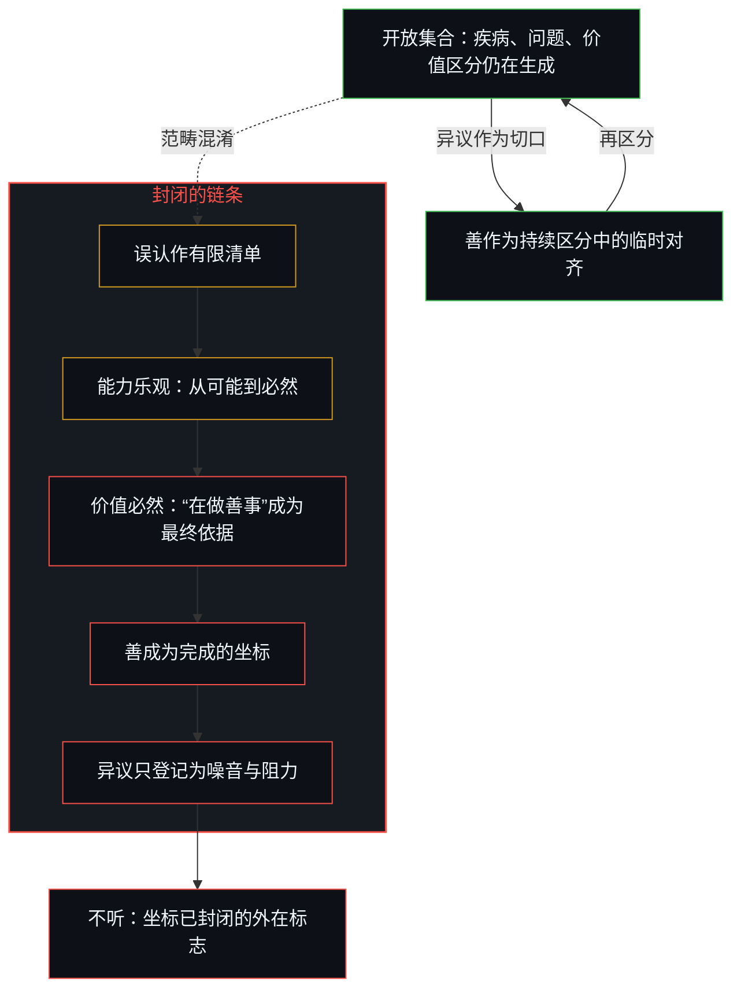
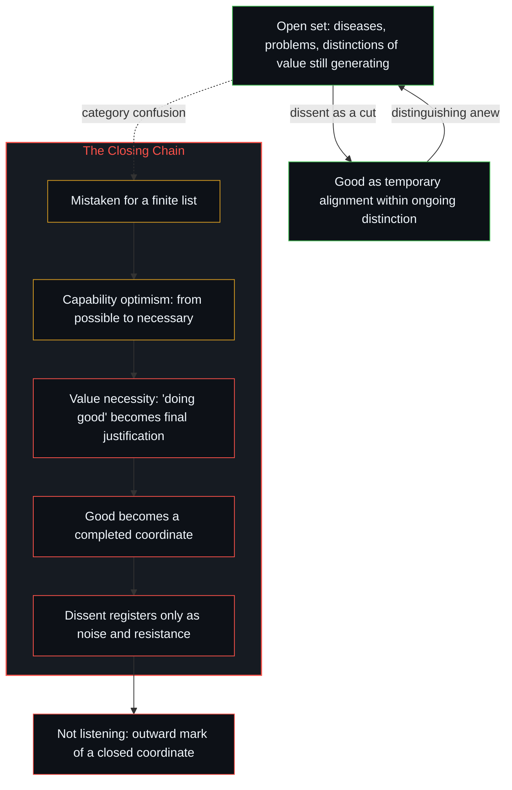

# 恶是封闭的善 / Evil Is Closed Good

*把仍在生成的集合当成可一次覆盖的清单，善就成了豁免再检验的坐标 / Taking a still-generating set for a list covered at once makes good a coordinate exempt from re-examination.*

Anthropic CEO 达里奥·阿莫迪与投资人加文·贝克之间的论战，再次把“AI 将在五到十年内攻克绝大多数人类疾病”推到前台。论战围绕时间表、信任、实际成果与口号的差距展开，却一直默认“绝大多数人类疾病”是一个可以一次覆盖的对象。

The dispute between Anthropic CEO Dario Amodei and the investor Gavin Baker brought back to the front the claim that AI will conquer most human diseases within five to ten years. The dispute turned on timelines, trust, and the gap between results and slogans, while taking for granted throughout that "most human diseases" is an object that can be covered once and for all.

这个默认就是第一环，论战一直在它之后开始。已知清单与仍在生成的开放集合属于两个范畴，把后者当前者处理，能力乐观就从可能变成必然，价值取向随之被封成定论。善一旦被当成完成的坐标，异质的声音就失去进入的通道，这一步就是善的教条化；不听，是坐标已经封闭的外在标志。

That assumption is the first link, and the dispute keeps starting after it. A known list and an open set still generating new distinctions belong to two categories, and treating the second as the first turns capability optimism from possibility into necessity and seals the orientation of value into a settled verdict. Once good is taken as a completed coordinate, dissenting voices lose their way in, and that step is the dogmatization of good; not listening is the outward mark of a coordinate already closed.

## 一、 两个不同的范畴 / 1. Two Different Categories

“攻克绝大多数已知人类疾病”与“攻克绝大多数人类疾病”，属于两个不可通约的范畴。前者是有限集合：给定一份已经显形、已经命名、已经列入清单的疾病，能力只要持续扩张，迟早能逐个覆盖。这个过程在逻辑上是闭合的，清单有限，能力可以继续扩展，覆盖只是时间问题。

"Conquering most known human diseases" and "conquering most human diseases" belong to two incommensurable categories. The first is a finite set: given a list of diseases already manifest, named and catalogued, capability that keeps expanding will sooner or later cover them one by one. The process is logically closed; the list is finite, capability can keep extending, and coverage is a matter of time.

后者是开放集合。疾病不是预先存放在仓库里等着清空的静态对象。每攻克一种已知疾病，同时就照亮新的边界，区分出新的脆弱性，发现新的病理机制；能力的每一次推进都生成新的区分。开放不是“能力还不够大”造成的暂时状态，它就是能力可以无限拓展的前提：没有新的阴影不断显现，拓展就失去了方向与对象。

The second is an open set. Diseases are not static objects stored in a warehouse waiting to be cleared. Each known disease conquered at once lights up new boundaries, distinguishes new vulnerabilities, uncovers new mechanisms of pathology; every advance of capability generates new distinctions. Openness is not a temporary state caused by capability not yet being large enough; it is the very premise on which capability can extend without end: without new shadows continually appearing, extension would lose its direction and its object.

把后者当作前者来处理，就是范畴混淆。[潜无限与数学思维的暂时闭合](../potential-infinity-and-the-temporary-closures-of-mathematical-thought/)追的是同一道界：对一个从未完成的过程说“绝大多数”，已经假定了一个可以一次覆盖的总量。

Treating the second as the first is a confusion of categories. [Potential Infinity and the Temporary Closures of Mathematical Thought](../potential-infinity-and-the-temporary-closures-of-mathematical-thought/) traces the same boundary: saying "most" of a process that is never completed already presumes a total that can be covered at once.

## 二、 混淆如何生成能力乐观 / 2. How the Confusion Generates Capability Optimism

一旦把开放集合误认作有限集合，乐观就从“可能”变成“迟早必然”。阿莫迪所说的十倍加速，把五十到一百年的生物学进展压缩进五到十年，在有限集合的框架下成立：已知清单被加速清空。在开放集合的框架下，加速只意味着边界移动得更快，新的疾病区分也出现得更快；清单永远不会被“绝大多数”地关闭，因为区分的活动一直在重写清单本身。

Once an open set is mistaken for a finite one, optimism turns from "possible" into "sooner or later inevitable." Amodei's ten-fold acceleration, compressing fifty to a hundred years of biological progress into five to ten, holds within the frame of a finite set: the known list is cleared faster. Within the frame of an open set, acceleration only means the boundary moves faster and new distinctions of disease appear faster; the list is never closed for "most," because the activity of distinguishing keeps rewriting the list itself.

这种乐观因此不是对能力的估计，而是对集合性质的误判。误判一旦稳定，就不再被当作假设来检验，开始充当后续判断的地基。[开放即一致](../openness-is-consistency/)是同一种需求：有限结构被逼着为只在继续的东西奠基，表面的矛盾就从这里增生。

This optimism is therefore not an estimate of capability but a misjudgment of what kind of set is at hand. Once the misjudgment settles, it is no longer tested as a hypothesis and begins to serve as the ground for later judgments. [Openness Is Consistency](../openness-is-consistency/) traces the same demand: a finite structure is forced to found what only continues, and apparent contradictions proliferate from there.

## 三、 能力必然延伸为价值必然 / 3. Capability Necessity Extends into Value Necessity

能力判断的地基一旦被当作完成态，价值取向就随之被封成定论。当一个人或一个团队确信已经看见了“能力将如何覆盖绝大多数问题”的完整图景，“什么值得追求”就不再需要从外部一次次重新打开：被完成的能力叙事已经内含了答案，凡是推进这一叙事的，就是善。“在推进善”于是取得了为一切具体行为提供依据的地位。

Once the ground of a capability judgment is taken as finished, the orientation of value is sealed into a verdict along with it. When a person or a team is sure it has seen the whole picture of how capability will cover most problems, the question of what is worth pursuing no longer needs to be reopened from outside again and again: the completed narrative of capability already contains the answer, and whatever advances that narrative is good. "Advancing the good" thereby acquires the standing to justify every concrete act.

此时，善不再是持续区分中的临时对齐，而成了一个豁免再检验的坐标。反对的声音、不同的价值权重、对时间表或手段的质疑，都不再登记为可能重新打开坐标的信息，只登记为噪音、误解，或需要管理的阻力。

At that point good is no longer a temporary alignment within ongoing distinction; it has become a coordinate exempt from re-examination. Opposing voices, different weightings of value, doubts about timelines or means no longer register as information that might reopen the coordinate; they register only as noise, misunderstanding, or resistance to be managed.

这就是封闭的善：把自己的善当成已经完成、不容再质疑的坐标。封闭的善就是善的教条化，而恶正是这种封闭。[从可辩护的主张到教条的反转](../the-reversal-from-defensible-claim-to-dogma/)是同一滞后在科学传播上的面，可辩护的条件判断被封成唯一理性或唯一道德的选择；这里被封成教条的是善本身。[一切伤害的根源](../the-source-of-all-harm/)是同一冻结在越权上的运作：私人的善被升为普遍的尺度，他者不再登记为同等的判断者，而登记为有待塑形的材料。

This is closed good: holding one's own good as a coordinate already completed and beyond question. Closed good is the dogmatization of good, and evil is exactly this closure. [The Reversal from Defensible Claim to Dogma](../the-reversal-from-defensible-claim-to-dogma/) is the same lag on the face of science communication, where a defensible conditional judgment is sealed into the only rational or the only moral choice; here what is sealed into dogma is good itself. [The Source of All Harm](../the-source-of-all-harm/) traces the same freeze operating as overreach: a private good is raised into a universal measure, and the other no longer registers as an equal judge but as material awaiting shape.

## 四、 不听是坐标已完成的标志 / 4. Not Listening Marks a Completed Coordinate

阿莫迪及其团队的公开姿态，正是这一机制的外化，它在具体事件中一再显现。2026 年 8 月中旬，贝克在播客与 X 上批评阿莫迪的公开言论过于负面，认为它加剧了公众对 AI 的不信任。阿莫迪随后发长文回应，重申五到十年攻克绝大多数疾病的判断，强调“真能治好癌症才算数”，同时为自己的监管主张辩护。白宫 AI 顾问戴维·萨克斯于 8 月 17 日直接回应：阿莫迪并未正面否认贝克转述的关键言论；他把批评者简化成“凡监管即俘获”的稻草人；他持续推动类似 FDA、FAA、FINRA 的 AI 预部署审批机制（萨克斯称之为“AI 版车管所”），这种机制会制造漫长的官僚队列，拖慢美国，强化少数前沿实验室的优势，最终把决定“哪些能力可被谁使用”的闸门交给联邦官僚与少数公司的联姻。萨克斯这样总结分歧：“达里奥认为前沿 AI 太强大，不能分散；我们认为它太强大，不能集中。”

The public stance of Amodei and his team is this mechanism made outward, and it shows itself again and again in concrete events. In mid-August 2026, Baker criticized Amodei's public statements on a podcast and on X as too negative, saying they deepened public distrust of AI. Amodei answered with a long post, restating the judgment that most diseases would be conquered within five to ten years, insisting that "it only counts if it really cures cancer," and defending his regulatory proposals. On August 17 the White House AI adviser David Sacks replied directly: Amodei had not squarely denied the key remarks Baker relayed; he had reduced his critics to a straw man for whom all regulation is capture; and he kept pushing a pre-deployment licensing regime for AI modeled on the FDA, the FAA and FINRA (which Sacks called "a DMV for AI"), a regime that would create long bureaucratic queues, slow the United States, entrench a few frontier labs, and in the end hand the gate deciding which capabilities may be used by whom to a marriage of federal bureaucrats and a few companies. Sacks summed up the disagreement: "Dario thinks frontier AI is too powerful to be decentralized; we think it is too powerful to be centralized."

更早的 2026 年 6 月，萨克斯公开披露另一起事件：Anthropic 发布带护栏的 Fable 模型后，一位双方都信任的合作方发现护栏可以被越狱，美国政府要求修复或下架，阿莫迪拒绝，政府随后施加出口管制。当安全要求与模型继续上线发生冲突时，被优先的是已经完成的上线坐标：安全不再作为可能重开框架的切口，只作为需要被管理的外部要求。[风险在于对监管本身的迷信](../the-risk-is-the-belief-in-oversight-itself/)是同一完成坐标在监管面上的持守：把当前的威胁模型与审批闸门，当成未来仍可能发生之事的边界。

Earlier, in June 2026, Sacks made public another episode: after Anthropic released its Fable model with guardrails, a partner trusted by both sides found that the guardrails could be jailbroken; the US government asked for a fix or a withdrawal, Amodei refused, and the government then imposed export controls. Where a safety demand collided with keeping the model deployed, what took priority was the already completed coordinate of deployment: safety no longer served as a cut that might reopen the frame, only as an external demand to be managed. [The Risk Is the Belief in Oversight Itself](../the-risk-is-the-belief-in-oversight-itself/) traces the same completed coordinate held on the face of oversight: present threat models and licensing gates taken as the boundary of what can still occur.

这些事件不是孤立的态度问题。他在 X 上一个账号都不关注，同样不是社交习惯的细节，在这条链条上，它登记为信息流已经不需要从外部进入：框架内部自洽，价值观内部自洽，时间表内部自洽。反对意见最多只能作为“需要被教育的对象”或“需要被管理的风险”出现，而不是作为可能让框架本身再区分的切口。一个人或一个组织以“人类未来价值观的标准”自居时，倾听就变得多余，因为倾听预设坐标仍可能被修正，而这样一个标准的前提，正是坐标已经完成。

These events are not isolated matters of attitude. Nor is it a detail of social habit that he follows not a single account on X; along this chain it registers as a flow of information that no longer needs to enter from outside: the frame is internally consistent, the values internally consistent, the timeline internally consistent. Objections can appear at most as people to be educated or risks to be managed, never as a cut through which the frame itself might distinguish anew. When a person or an organization takes itself as the standard for humanity's future values, listening becomes superfluous, because listening presupposes that the coordinate may still be revised, while such a standard rests on the premise that the coordinate is already complete.

## 五、 论战一直在第一环之后开始 / 5. The Dispute Always Begins After the First Link

整个过程是一条链：把开放集合（疾病、问题、价值区分）误认作有限集合；有限集合在不断扩张的能力面前“迟早被覆盖”，乐观于是从可能变成必然；能力的必然延伸为价值的必然，“在做善事”取得最终依据的地位；善一旦被当作完成的坐标，异质的声音就失去进入的通道；不听、不屑、以标准自居，成为这个坐标稳定的外在表现。论战之所以没有触到要害，是因为它一直在第一环之后争论时间表与口号，从未退回第一环去问：这个集合是有限的，还是开放的。

The whole process is one chain: an open set (of diseases, of problems, of distinctions of value) is mistaken for a finite one; a finite set "will sooner or later be covered" by ever-expanding capability, so optimism turns from possible into necessary; necessity of capability extends into necessity of value, and "doing good" acquires the standing of a final justification; once good is taken as a completed coordinate, dissenting voices lose their way in; not listening, disdain, and taking oneself as the standard become the stable outward expression of that coordinate. The dispute misses the crux because it keeps arguing over timelines and slogans after the first link and never goes back to the first link to ask whether the set is finite or open.

只要这个范畴混淆不被看见，能力乐观就会不断转化为价值的定论，价值的定论又不断生产出拒绝重新打开自身的姿态。极端主义不是额外贴上的标签，而是这条链运行到末端时的形态。[恶是心智自己的造物](../evil-as-the-minds-own-creation/)是同一冻结的另一面：那里，恶是对保留善之表象的失配所作的命名；这里，恶是善自身的封闭。

As long as this category confusion goes unseen, capability optimism keeps turning into settled verdicts of value, and settled verdicts of value keep producing a stance that refuses to reopen itself. Extremism is not a label stuck on from outside; it is the shape this chain takes when it runs to its end. [Evil as the Mind's Own Creation](../evil-as-the-minds-own-creation/) is the other face of the same freeze: there, evil names a mismatch that keeps the appearance of good; here, evil is good's own closure.

恶是封闭的善，是善的教条化。

Evil is closed good, the dogmatization of good.
