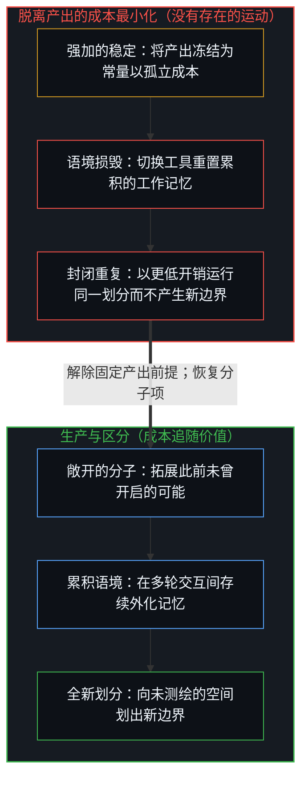
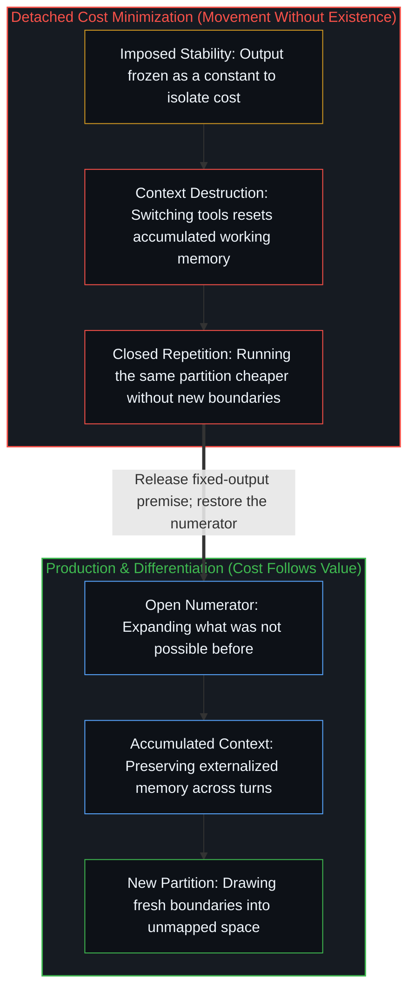

# 没有区分的效率是没有存在的运动 / Efficiency Without Differentiation Is Movement Without Existence

*将产出冻结为常量以最小化成本，是错把分母当成了整个方程。 / Freezing output as a constant to minimize cost mistakes the denominator for the equation.*

围绕 AI 工具的讨论中，有一股日益高涨的声浪正聚焦于成本：如何切换模型以节省 token，如何用更低廉的开销完成同一项任务，如何为了速度而优化工作流。在封闭的规格说明书内部，这些做法本身并无差池，但它们却错把分母当成了整个方程。

There is a growing discourse around AI tools that centers on cost: how to switch models to save tokens, how to do the same task cheaper, how to optimize workflows for speed. None of this is wrong inside a closed specification, yet it mistakes the denominator for the equation.

当一个人把成本当作独立自变量来优化时，他便切断了成本与成本本该服务之物——产出——之间的关联。成本本身成了终极目标。投入与生产之间的反馈回路就此断裂，剩下的只是电子表格管理，而非真正的作业。

When someone optimizes cost as an independent variable, they sever it from what cost is supposed to serve—output. Cost becomes its own objective. The feedback loop between input and production breaks. What remains is spreadsheet management, not work.

这种混淆之所以挥之不去，是因为当产出被维持在稳定状态时，最优化与最小化会呈现出全同的可观测结果。注意，这不是指产出在事实上真的稳定——产出极少固定不变。环境在迁移，可能性在延展，需求在演进。但最小化者强行将产出视作恒定，因为唯有在这一前提下，把成本当成独立自变量才讲得通。这种稳定并非观察所得的事实，而是为了保全框架强行施加的约束。

The confusion persists because optimization and minimization produce identical observables when output is held stable. Not when output actually *is* stable—output is rarely stable. The environment shifts, possibilities expand, requirements evolve. But the minimizer holds output as stable because that is the condition under which cost makes sense as an independent variable. The stability is not observed—it is imposed to preserve the frame.

这种假象靠主动压制来维持。新的可能性被归档为噪声，不断延展的前沿被压平为“同样的活，干得更便宜”，异常现象则被塞进既有的分类抽屉里。产出之所以显得稳定，是因为最小化者预先划定了语境边界，把一切会戳破这种稳定假象的因素都排除在外。一旦这种压制失效——当外部条件发生无可回避的剧变时——真正的优化者会顺应工作的需求果断上调投入；而最小化者则会顽抗到底，因为他们早已锁死了错误的不变量。到了那时，他们围绕削减成本建立起了习惯、身份认同乃至组织架构，原本必要的动态调整反而被读取为系统的溃败，而非系统的正常运作。

This is actively maintained. New possibilities get filed as noise, the expanding frontier gets flattened into "same task, do it cheaper," and anomalies get wrapped into existing categories. Output looks stable because the minimizer has defined their context to exclude everything that would reveal it is not. The moment that suppression fails—when conditions shift undeniably—the optimizer scales input upward because the work demands it. The minimizer resists, because they have locked onto the wrong invariant. And by then they have built habits, identity, and organizational structure around cost reduction. The necessary adjustment registers as failure rather than as the system working properly.

## 一、 语境损毁问题 / 1. The Context Destruction Problem

每一次模型切换都会摧毁累积的语境。共同的工作记忆、校准过的沟通默契、多轮交互建立起来的隐性理解——这一切都会瞬间归零。这并非无足轻重的损耗。语境累积正是这些工具产出实际价值的核心机制：正如[你的代码库即是记忆](../your-codebase-is-memory/)所确立的，代码库或工作会话中外化的痕迹构成了结构性脚手架，使鲜活的领航边缘得以做出更高阶的区分，而不必每次都从零开始重新推导此前的每一道边界。在摧毁语境纵深的同时优化 token 成本，是在优化一个显眼的分母，同时却在清算那个使复合生产成为可能的累积痕迹基底。

Every model switch destroys accumulated context. The shared working memory, the calibrated communication patterns, the implicit understanding built over turns—all of it resets. This is not a minor inefficiency. Context accumulation is the mechanism through which these tools generate their actual value: as [Your Codebase Is Memory](../your-codebase-is-memory/) establishes, externalized traces in a repository or working session form the structural scaffolding that lets the living steering edge draw higher-order distinctions without re-deriving every prior boundary from scratch. Optimizing token cost while destroying contextual depth optimizes a visible denominator while liquidating the accumulated trace substrate that makes compound production possible.

讽刺之处还在叠加：只要工作跨越单轮交互，脱离产出的成本最小化反而会推高实际总成本。丢失语境后，不得不额外耗费三轮交互去重建它，账面上省下的那点余额便荡然无存——无论以 token 计价，还是以远为昂贵的注意力与推进势能计价，皆是如此。

The irony compounds: detached minimization increases effective cost whenever work spans more than a single turn. Lose context, spend three extra rounds rebuilding it, and the "savings" evaporate—measured in tokens and in the far more expensive currency of attention and momentum.

## 二、 作为涌现属性的效率与作为强加约束的效率 / 2. Efficiency as Emergent Property vs. Imposed Constraint

从专注生产中自然涌现的效率，与作为前置约束强加的效率，在结构上截然不同。当你专注于自己真正想要创造的产出时，成本会自我组织。你会自然而然地为特定的任务选用趁手的工具——不是因为你在算计开销，而是因为手头的活计本身指定了工具。成本曲线会追随价值曲线。正如[清单合上之后，胜过免费](../better-than-free-after-the-checklist-closes/)所阐明的，一旦既定清单合上，唯有持续的区分才能让价值保持鲜活。

There is a structural difference between efficiency that emerges from focused production and efficiency imposed as a constraint. When you are focused on what you are actually trying to produce, cost self-organizes. You naturally use the right tool for the right task—not because you are managing cost, but because the work itself dictates the tool. The cost curve follows the value curve. Once the checklist closes, only differentiation keeps value alive, as [Better Than Free After the Checklist Closes](../better-than-free-after-the-checklist-closes/) lays out.

这才是严整意义上的最优化：成本是产出的函数。当产出被假定为稳定时，最优化在外观上很像最小化，这也正是两者被混为一谈的根源。但它们是截然不同的机制，只是在局部产生了暂时重合的观测表象——前者是因为产出真实地支配着成本，后者则是因为视野被强行收窄，剔除了所有会暴露产出并未固定的信号。在固定边界内做高效率的运动，恰恰落入了[生产、消费与心智的区分](../production-consumption-and-the-minds-distinction/)所界定的消费范畴。

This is optimization in the proper sense: cost as a function of output. It may look like minimization when output is held as stable, and that is precisely why the two get confused. But they are different mechanisms producing temporarily identical observables—one because output genuinely dictates cost, the other because the frame has been narrowed to exclude everything that would reveal output is not fixed. Efficient motion with a fixed boundary is consumption in the sense [Production, Consumption, and the Mind's Distinction](../production-consumption-and-the-minds-distinction/) defines.

## 三、 深层模式：错认价值的成本优化 / 3. The Deeper Pattern of Cost-Optimization as Misidentified Value

把成本优化当成独立目标，永远是错认价值的信号。当一个人真正理解某个过程在创造什么时，相对于产出而言，投入成本在感知中就会退居次席。真正起作用的是整个比值，而非孤立的分母。那些执迷于抠算分母的人，恰恰暴露出他们从未把分子做大到足以改写比值的地步。

Cost-optimization as an independent goal is always a signal of misidentified value. When someone understands what a process produces, the input cost becomes perceptually secondary against the output. The ratio matters, not the isolated denominator. People who obsess over the denominator are revealing they have never made the numerator large enough for the ratio to shift.

这一规律具有普遍性：任何指标一旦与它本该测量的对象脱钩，就会反过来沦为它本该服务之物的死敌。算计 token 数量的人，早已不再追踪这些 token 催生了什么成果；算计工时的人，也早已不再追踪这些时间建造了什么作品。

This generalizes: any metric detached from what it is supposed to measure becomes adversarial to the thing it was supposed to serve. The person counting tokens is no longer tracking what those tokens produce. The person counting hours is no longer tracking what those hours build.

## 四、 更廉价的重复与前所未有的可能 / 4. Same but Cheaper vs. What Wasn't Possible Before

当下围绕 AI 的讨论，被“如何更便宜地干同一件事”所主导。而真正的跃迁，在于那些此前无从企及、如今却成为可能的事物。“我把 API 成本削减了 40%”是一则干净利落、易于传播的叙事；“我探出了一条凭一己之力无从抵达的思考脉络”则是高度个人化、依附于具体语境、难以打包传授的体验。于是信号发生了倒置：越是易于传播的 AI 经验之谈，就越不可能触及使用 AI 真正珍贵的核心。

The discourse around AI is dominated by how to do the same thing cheaper. The actual transformation is what becomes possible that was not possible before. "I reduced my API cost by 40%" is a clean, shareable narrative. "I discovered a line of thinking I could not have reached alone" is personal, context-dependent, and hard to transmit. The signal inverts: the more shareable the AI advice, the less likely it captures what is actually valuable about using AI.

成本优化属于成熟期的使用模式——唯有当你早已确知自己在生产什么、且探索前沿已经合拢时，你才会去优化成本。然而前沿并未合拢。眼下执着于优化成本，无异于在大航海时代斤斤计较燃料效率。真正的问题从来不是如何更廉价地航行，而是你能驶向哪片前人未至的海域。专门针对 token 效率训练的模型便是最清晰的例证，正如[Token 效率、模拟与无法弥合的间隙](../token-efficiency-emulation-and-the-unclosable-gap/)所指出的：效率是利害投入的结果，而非其源头。

Cost optimization is a mature use pattern—you optimize cost when you already know what you are producing and the frontier is closed. The frontier is not closed. Optimizing cost now is optimizing fuel efficiency during the age of exploration. The question is not how to sail cheaper. It is where you can sail that no one has been. A model trained for token efficiency is the clearest case, as [Token Efficiency, Emulation, and the Unclosable Gap](../token-efficiency-emulation-and-the-unclosable-gap/) shows: efficiency is the effect of a stake, not its source.

## 五、 存在即区分 / 5. To Be Is to Be Different

一个存在者并非仅由其内部属性所定义，而是由“它是什么”与“它不是什么”之间的整道边界所共同界定。负空间承担着同等的本体论做功。一旦抹去负空间，事物本身也会随之坍缩——因为不再有任何背景可供将它区分出来。

A being is defined not by its internal properties alone, but by the entire boundary between what it is and what it is not. The negative space does equal ontological work. Remove it and the thing collapses—there is nothing to distinguish it from.

倘若你使用工具只是为了以更低廉的成本产出与从前相同的东西，那你便什么也没有创造出来。在任何起效的操作意义上，工具都没有让你变得更丰沛。你还是原来的你，只是转得更快了。没有新的划分，没有新的边界，也就没有新的存在。

If your use of a tool produces the same outputs as before, just cheaper, you have not created anything. The tool has not made you more in any operative sense. You are the same, faster. No new partition, no new boundary, no new existence.

定义“是”的，是一切“是”加上一切“不是”。同一性并非静态的肯定断言，而是一次主动的划分。事物与其补集相伴而生。区分是基底性的操作：存在即区分，这并非既有事物身上的一项可选属性，而是存在本身的运作机制。存在得更充沛，就意味着做出更深远的区分，而非更高效地重复既有图式。没有区分的效率，只是没有存在的运动。

What defines "is" is everything that is, plus everything that is not. Identity is not a static positive claim—it is an active partition. The thing and its complement co-arise. Distinction is the foundational operation: existence is differentiation, not as an optional attribute of existing things, but as the mechanism of existence itself. To exist more is to differentiate more, not to repeat the existing pattern more efficiently. Efficiency without differentiation is movement without existence.
