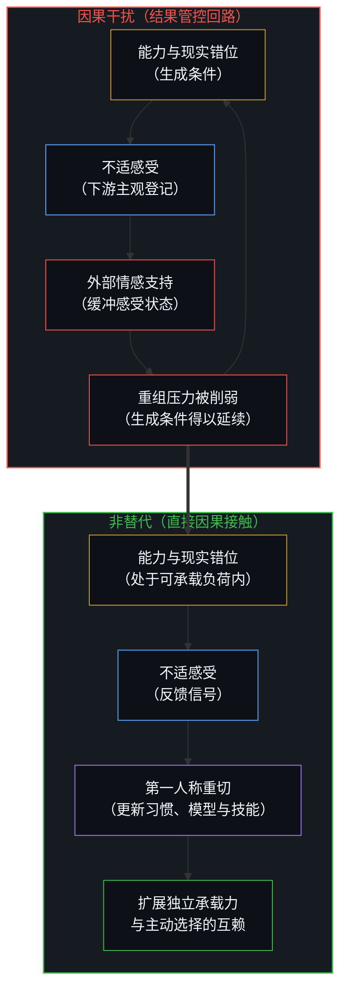
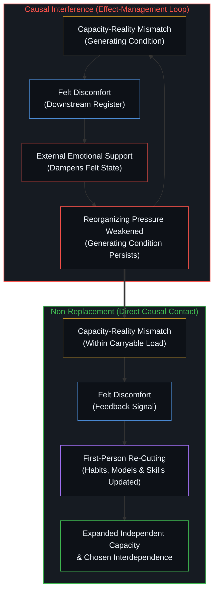

# 作为因果干扰的情感支持 / Emotional Support as Causal Interference

*管控感受状态会削弱重组其成因的压力。 / Managing the felt state weakens the pressure that reorganizes its cause.*

情感支持针对的是感受状态，而非产生这一状态的条件；通过管控结果，它削弱了本会推动那些条件重组的压力。当能力与现实错位引发不适时，这种不适会对习惯、认知模型、技能与决策施加反向压力。从外部缓解感受状态，便移除或弱化了这股压力，使原有的条件更容易延续下去。这种替代并非偶然：将感受抬升为首要关注对象，会训练双方通过调节结果来建立连接，而非直接介入生成结果的源头条件。无论在育儿还是成人关系中，同样的几何结构都在重演——用对他人内部登记状态的外部管控，替代其与现实的直接接触；而真正的功课是不替代：把对方能够承载的部分留给对方，仅当负荷超出容量过远、那个中心点尚无法自行完成处理时，才动用支持。

Emotional support targets the felt state rather than the conditions that produced it, and by managing the effect it weakens the pressure that would otherwise reorganize those conditions. When discomfort arises from a mismatch between capacity and reality, that discomfort presses back on habits, models, skills, and decisions. Reducing the felt state from outside removes or weakens that pressure, so the original conditions are more likely to persist. The substitution is not accidental: elevating feeling as the primary object trains both parties to relate through regulation of effects rather than through direct engagement with generating conditions. In parenting and adult relationships alike, the same geometry appears — external management of another’s register in place of their contact with reality — and the work is non-replacement: leave with the other what they can carry, and reserve support for when capacity is exceeded so far that processing cannot yet run through that locus.

## 一、 机制 / 1. The Mechanism

情感支持作用于接收者的感受状态——苦恼、情绪，以及困难在主观层面的登记。它的直接效果是调节这一登记。看清这一点，它在更大过程中的位置便一目了然：它作用于观察所持有的下游结果，而非产生这一结果的条件。

Emotional support targets the recipient’s felt state — distress, emotion, the subjective register of difficulty. Its direct effect is modulation of that register. Once that is seen, its place in larger process is clear: it acts on what observation holds, not on the conditions that produced it.

当能力与现实的错位引发不适时，这种不适正是因果链条的一环。它向习惯、模型、技能和决策施压。从外部减轻这种感受状态，便消解或削弱了这股压力。原有的条件因此更可能维持原状，因为作用于其上的一股力量被缓冲或转移了。情感支持并非没有触动因果，而是通过管控结果来替代源头的解决，从而改变了整个拓扑结构。正如[你的代码库即是记忆](../your-codebase-is-memory/)在过往区分层层堆叠的残余中所追踪的，真正能改变下一段轨迹的，是在习惯与技能的现行构型不再与当下感知自洽之处将其当场重切；倘若只去缓冲或安抚感受层面的登记，却让承重的检查点原封不动，便等于保留了生成摩擦的约束条件。

When discomfort arises from a mismatch between capacity and reality, that discomfort is part of the chain. It presses back on habits, models, skills, and decisions. Reducing the felt state from outside removes or weakens that pressure. The original conditions are more likely to persist, because one of the forces acting on them has been dampened or redirected. Emotional support does not leave causes untouched. It changes the topology by managing the effect in place of resolution at the source. As [Your Codebase Is Memory](../your-codebase-is-memory/) traces across stacked residues of prior distinctions, what alters the next trajectory is re-cutting the active configuration of habits and skills in place where it no longer coheres with live sensing; buffering or soothing the felt registration while leaving the load-bearing checkpoint untouched preserves the constraints that generated the friction.

这种替代并非偶然。干预一旦把感受状态抬升为注意力的首要对象，就是把结果当成了核心问题。经过反复强化，双方都会习得通过调节感受来维系关系，而非直接切入产生这些感受的成因。提供支持的一方同样处于这枚硬币的正面：他人在场域中的苦恼，被这一个中心登记为一种要求——似乎必须由自己去完成唯有对方那个中心才能闭合的回路。安抚的冲动多半源于这种要求：它不是溢出的关怀，而是试图跨越一道无法以此方式逾越的边界，去替他人完成闭环。

That substitution is not accidental. By elevating the felt state as primary object of attention, the intervention treats the effect as the central problem. Over repeated instances, both parties learn to relate through regulation of feelings rather than through direct engagement with what generated them. The provider’s side is co-primary: another’s distress in this field registers as demand that this center finish what only the other center can close. The urge to soothe is often that demand — not surplus care, but completion attempted across a boundary that cannot be crossed that way.

## 二、 在育儿中 / 2. In Parenting

孩子通过接触自己能够承受的后果，逐步建立起内部的调节结构。当孩子本可以自行消化某个后果，父母却主动递上情感支持时，父母便替孩子正在发育的系统背负了本属于它的那部分负荷。孩子获得了宽慰，却没有在内部生成相应的回应机制。那些唯有经历这一生成过程才能长出的内在结构，便会因此单薄或滞后。退后一步而不撤回关切的支持，正是[当被需要不再是衡量](../when-need-stops-being-the-measure/)所刻画的状态。

Children form internal regulatory structure through contact with consequences they can carry. When a parent supplies emotional support where the child could process the consequence, the parent carries part of the load that belongs to the child’s developing system. The child receives relief without generating the corresponding internal response. Structures that form only through that generation stay thin or delayed. Support that can step back without withdrawing care is what [When Need Stops Being the Measure](../when-need-stops-being-the-measure/) describes.

避免这种替代的做法，是只承担孩子尚无法承受的部分——即负荷超出容量过远、后续处理已无法通过孩子自身这个中心运转的时刻。这并不是一套刻意锻造品格或抗挫力的训练方案，而是拒绝用干预去替代一个已在展开的发育过程。父母并不编写孩子的主体性；父母只是停止用外部调节去取代它。

What avoids the substitution is carrying only what the child cannot yet carry — capacity exceeded so far that further processing cannot run through that locus. This is not a program of building character or resilience. It is refusal to replace a developmental process already under way. The parent does not author the child’s agency. They stop replacing it with external regulation.

父母无法把孩子塑造成任何预设的样子。任何旨在塑造结果的尝试——无论是情绪缓冲、方向操盘，还是沉重的引导——都会把父母的偏好强行塞进孩子的进程。有两种操作会斩断同一条因果链：替孩子背负他本能承受的后果，以及把不属于孩子的东西强加于他。两者都打断了行动与结果的直接接触，而内向归因正是在这种接触中生长出来的。在孩子尚不具备承载力的狭窄边界之外，剩下的功课便是不替代：保留与现实直接接触的通道，让孩子借由这种接触生长出内在结构。中心与中心之间，只有可供取用的留痕；没有任何一个中心能替另一个中心完成回路的闭合。[外部归因是个人进步的障碍](../wai-bu-gui-yin-ge-ren-jin-bu-de-zhang-ai/)剖析的正是披着育儿外衣的这一截断，而[引导不是占有](../guidance-is-not-ownership/)则针对决定论式的越俎代庖划出了同一道治理边界。正如[成功之后的育儿谬误](../the-fallacy-of-post-success-parenting/)所详述，替孩子扫清道路上一切摩擦的父母，实施的也是同一种因果干扰。

Parents cannot make children into anything. Any attempt to shape outcomes — emotional buffering, steering, heavy guidance — inserts the parent’s preferences into the child’s process. Two operations cut the same chain: taking on what the child could carry, and loading the child with what is not theirs. Both interrupt the action-result contact that internal attribution grows from. What remains past the narrow limit of unreadiness is non-replacement: contact with reality left available so the child can form structure through it. Between centers there is only what is available to be taken up; no center completes another’s return. [External Attribution: The Obstacle to Personal Growth](../wai-bu-gui-yin-ge-ren-jin-bu-de-zhang-ai/) is that cut under parenting costume, and [Guidance Is Not Ownership](../guidance-is-not-ownership/) traces the same governance boundary against deterministic usurpation. Parents who clear every friction from a child's path commit the same interference, as [The Fallacy of Post-Success Parenting: Hindsight Bias, Path Cloning, and the Erasure of Generative Struggle](../the-fallacy-of-post-success-parenting/) details.

当对感受状态的管控被固化为先验前提，在接触发生之前就预先重排了整个场域——以至于连克制情绪调节的动作本身都被直接解读为伤害——这种替代就不再是偶发的，而是结构性的。[当效果主宰了框架的叙事](../when-the-effect-authors-the-frame/)展现的，正是同一拓扑结构以先验框架面目出现的形态。

When management of the felt state is installed as the prior that reorganizes the field before contact — so that restraint of modulation already reads as harm — the substitution is structural rather than occasional. [When the Effect Authors the Frame](../when-the-effect-authors-the-frame/) is that prior-as-frame face of the same topology.

## 三、 在成人关系中 / 3. In Adult Relationships

同样的模式也出现在成年人之间。当情感支持演变为一方对另一方感受状态的持续调节时，结构性依赖便随之成形。一方习惯于将内在体验交由外部打理，另一方则习惯于提供这种打理。整段关系围绕着相互的结果调节运转，而不是由两个各自保持独立更新、并主动选择建立连接的中心来构成。

The same pattern appears between adults. When emotional support functions as ongoing regulation of one person’s felt state by the other, structural dependence forms. One party becomes accustomed to external management of internal experience; the other becomes accustomed to providing it. The relationship organizes around mutual effect-regulation rather than around two centers that keep their own updates and choose to relate.

在这个意义上，共生依赖并非戏剧性的功能失调，而是用外部调节稳定地替代了独立承载的能力。关系的韧性并不源于对彼此情绪更敏锐的迎合，也不源于更卖力地替对方管控状态；它源于建立在独立之上的互赖：每个人保有承载自身大部分因果反馈的能力，并在共同的志趣、事业与现实切面上展开协作。

Codependency, in this sense, is not dramatic dysfunction. It is stable substitution of external regulation for independent capacity. Strength in relationships does not arise from increased attunement to feelings or greater willingness to manage each other’s states. It arises from interdependence grounded in independence: each person retains capacity to carry most of their own effects, and collaborates on shared interests, projects, and realities.

在这样的关系中，支持依然可能发生，但它居于次位且仅属偶发。它不取代对方的主体性，而是以对方的主体性为前提。维系纽带的是共同的志趣与相互尊重，而非持续调节彼此感受的需求。围绕结果调节组织起来的关系，容易滑向纠缠与脆弱；围绕独立承载力与主动选择的互赖组织起来的关系，则走向稳定与自愿。

In such relationships, support remains possible but secondary and occasional. It does not replace the other person’s agency; it presupposes it. The bond is held by common interest and mutual regard, not by the need to keep feelings regulated. Relations organized around effect-regulation tend toward enmeshment and fragility. Relations organized around independent capacity plus chosen interdependence tend toward stability and voluntariness.

## 四、 常见反驳 / 4. Common Pushbacks

那种认为幼儿或陷入困扰的成年人需要“情绪共同调节”的主张，把容量的临时恢复与持续的越位替代混为一谈。在急性过载时刻，短暂的共同调节能够腾出足够的边界，让处理过程重新回到当事人自身的中心运转。然而，日常绝大多数情感支持都发生在这个极限之外，实际起到的作用是一再替代内在的生长。

The claim that young children or distressed adults require emotional co-regulation confuses temporary restoration of capacity with ongoing substitution. Brief co-regulation in acute overwhelm can free enough boundary for processing to resume through the same locus. Most emotional support occurs outside that limit and functions as repeated replacement of internal development.

依恋研究常被用来为随时响应的情绪抚慰辩护。但依恋研究主要追踪的是照料行为的一致性与可靠性——即通过稳定的在场，塑造出可预期的环境模式——而非把情绪调节当作核心机制。一位父母或伴侣，在克制多余情绪调节的同时，始终可靠地尊重对方正在形成或已经具备的承载力，依然提供了支撑安全连接所需的稳定性。共振并不要求替对方完成回路的闭合。

Attachment research is often cited to defend responsive emotional availability. What it primarily tracks is consistency and reliability of caregiving — availability that patterns what is stable and predictable — not feeling-modulation as primary mechanism. A parent or partner who reliably respects developing or existing capacity while declining unnecessary regulation still provides the stability that supports secure relating. Resonance does not require completing the other’s return.

个体差异、创伤经历或神经生理因素，也常被拿来当作上述机制不适用的理由。但这些因素要求的只是结合具体情境去评估当事人的实际容量，而非放弃“结果管控”与“接触生成条件”之间的区分。唯有在当事人尚无法从内部生成回应的限度内，外部调节才是契合的。真正的难点在于当场准确读取对方的容量边界，而不在于换一套原则。

Individual differences, trauma histories, or neurological factors are offered as reasons the account does not apply. These call for situation-specific assessment of capacity, not abandonment of the distinction between effect-management and contact with generating conditions. External regulation fits only to the degree that the person cannot yet generate the response internally. The difficulty is accurate reading of capacity in the moment, not a different principle.

最强烈的一种反驳来自直接体验：在当下拒绝提供情感支持，常会让人觉得不近人情、冷漠，甚至觉得是在伤害这段关系。这种感受源于既有的习得模式——对他人痛苦的不适感、对后果的恐惧，以及将关怀等同于情绪管控的文化框架。在提供者这一侧，这是同一种图像滞后：把对方的状态当成了自己这个中心必须结清的一笔债。唯有在一次次具体的情境中不再顺从那股干预的冲动，这些旧模式才会逐渐消退。

The strongest objection is experiential: declining emotional support in the moment often feels wrong, uncaring, or damaging to the relationship. That feeling arises from installed patterns — discomfort with another’s distress, fear of consequences, cultural framing that equates care with management of feelings. On the provider’s side it is the same lag: the other’s state treated as a debt this center must settle. Those patterns weaken only through repeated, specific instances in which the interfering urge is not followed.

## 五、 实践过程 / 5. The Process

没有任何通用标准或外部方法能够预先划定准备度与边界。这类标准一旦确立，本身就会变成另一层干预——变成一个游离于当下具体情境与具体当事人之外的僵化框架。审辨只发生在直接的照面之中。

No general criteria or external method can fix readiness or boundaries in advance. Such criteria would be another layer of intervention — a framework standing apart from this situation with these people. Discernment occurs only in the direct encounter.

付诸实践的是不替代：不是把一套“不干预技巧”固定为新的身份标签，而是持续地把对方能够承载的部分留给对方自己去扛。经过一次次具体实践，可以清晰观察到对方内在主体感的增强；至于那些本无须调节的结果，自己想要插手去调节的自动化冲动也会随之减弱。这种转变并不来自更高明的技巧，而是来自始终拒绝用外部管控去替代他人与现实的直接接触。

What is practiced is non-replacement: not installing a technique of non-interference as a new standing identity, but continuing to leave with the other what they can carry. Across repeated instances, what becomes observable is strengthening of sensed agency in the other and weakening of the automatic urge to regulate effects that do not require regulation. That shift does not come from better methods. It comes from consistent refusal to substitute external management for the other’s contact with reality.

无论在育儿还是成人关系中，情感支持依然可以作为偶发的行动而存在。改变的是它的地位：它不再是关系中默认的或结构性的连接方式，充其量只是当负荷超出容量过远、当事人那个中心尚无法自行运转处理时的一种临时举措。如此一来，关系或成长过程便围绕着独立承载力与主动选择的互赖来展开，而非围绕着对感受的持续调节。[心理治疗如何打破反馈回路](../therapy-opens-the-feedback-loop/)剖析的正是同一拓扑结构的职业化形态——一个付费引入的第三方中心，专门用来让内部登记变得更容易忍受，而生成摩擦的源头条件却大多未被重新回溯。[错置的因果](../the-reversal-of-causality-in-wealth-transfer-policies-and-price-floors/)则是同一几何结构在薪资与转移支付外衣下的翻版：把测得的结果装作杠杆，压制相对信号，从而摊薄了技能的积累。[同情是缺乏明晰时的占位符](../sympathy-is-a-placeholder-for-lack-of-clarity/)揭示的是其安慰性标签的一面：提供者将自身强烈的情绪反应误作已经完成的接触，而非尚未走完的观察。一旦把结果当成先于原因的东西来对待，因果干扰便开始了；而[非万物理论](../not-a-theory-of-everything/)从源头上排除了这种倒置。

In both parenting and adult relationships, emotional support remains available as an occasional act. What changes is its status. It ceases to be the default or structural mode of relating and becomes, at most, a temporary measure when capacity is exceeded so far that processing cannot yet run through that locus. The relationship or the developmental process then organizes around independent capacity and chosen interdependence rather than around ongoing regulation of feelings. [Therapy Opens the Feedback Loop](../therapy-opens-the-feedback-loop/) is the professionalized form of the same topology — a paid third locus optimized to make registration more tolerable while the generating conditions remain largely un-re-traced. [The Misallocation of Cause](../the-reversal-of-causality-in-wealth-transfer-policies-and-price-floors/) is the same geometry under wage and transfer costume: the measured effect installed as lever, the relative signal suppressed, skill accumulation thinned. [Sympathy Is a Placeholder for Lack of Clarity](../sympathy-is-a-placeholder-for-lack-of-clarity/) is the consoling-label face when the provider’s intensity is taken as completed contact rather than unfinished observation. The interference starts when the effect is treated as if it came before the cause, which [Not a Theory of Everything](../not-a-theory-of-everything/) rules out at the root.
