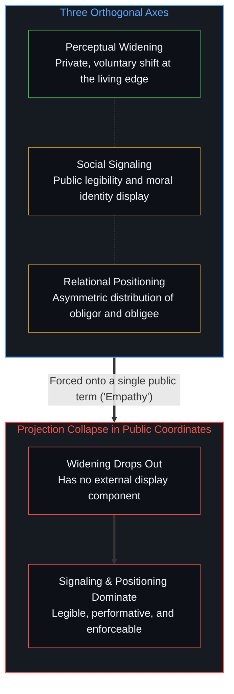

# 共情的投射坍缩 / Empathy as Projection Collapse

*“共情”将拓宽、信号与义务压上同一轴，公共坐标便筛出信号而略去拓宽。 / When empathy compresses widening, signaling, and obligation onto one axis, public coordinates select for signaling.*

“共情”这个词把至少三种正交的操作压缩进了同一个名称里。麻烦正是从这次压缩开始的——不在任何人的品格里，也不在伪善里，而在词语本身的几何结构里。当注意力的内在转向、道德身份的公共展演与义务的非对称分配被强行塞进同一个坐标时，在公共话语里留存下来的总是那些从外部易于辨认的表演，而在活态边缘上悄然发生的感知拓宽则从视野中脱落了。

The word "empathy" compresses at least three orthogonal operations into a single term. This compression is where the trouble starts—not in anyone's character, and not in hypocrisy, but in the geometry of the word itself. When an internal shift of attention, a public display of moral identity, and an asymmetric distribution of obligation are forced onto a single coordinate, what survives in public discourse is whatever is legible from the outside, while the quiet perceptual widening at the living edge drops out of view.

## 一、 同一个标签下的三种正交操作 / 1. Three Orthogonal Operations Under One Label

第一种操作是**感知拓宽**：心智在内部调整注意力，把原本被过滤掉的情绪、语境与结构信息纳入自身的整合范围。这一运动是私密的、自愿的，由第一人称前沿主动发起。它的证据是间接的：调整后的行动、重新提出的问题、未曾声张的让步。它运作在“理解”的维度上。

The first operation is *perceptual widening*: an internal shift where a mind expands the data it integrates—emotional, contextual, and structural—to include what was previously filtered out. This movement is private, voluntary, and self-initiated at the first-person edge. Its evidence is indirect: adjusted action, reframed questions, and unannounced concessions. It operates on the axis of understanding.

第二种操作是**社会信号**：公开宣告自身的道德姿态——“我在乎他人”、“我重视理解”。这一操作运作在身份与公共可读性的维度上。它不需要第一种操作的实际发生，因为它优化的是“被看见具有共情”，而非内在视域本身的改变。

The second operation is *social signaling*: the public declaration of one's moral orientation—"I care about others," "I value understanding." This operates on the axis of identity and public legibility. It does not require the first operation to occur, because it optimizes for being seen as empathetic rather than for the internal shift itself.

第三种操作是**关系定位**：确立谁对谁负有义务。当共情被作为要求提出时，这一要求便分配了角色——一方被推上义务人的位置（被要求拓宽自身），另一方则占据权利人的位置（有权索取他人的拓宽）。它运作在杠杆与义务的维度上。

The third operation is *relational positioning*: establishing who owes what to whom. When empathy is demanded, the demand distributes roles—one party is positioned as obligor (required to widen), and the other as obligee (entitled to receive widening). This operates on the axis of leverage and obligation.

这三个维度彼此正交，在其中一个维度上的推进并不能兑换成另一个维度上的结果。释放共情的信号并不会产生感知的拓宽；把某人定位为义务人并不会让他扩展自己的认知框架；而拓宽自身的感知既不需要公开宣告，甚至常常抵触公开宣告。哪怕在拓宽轴上，离散的心智也从未跨入另一个中心的内部；它所扩展的只是自身边界处整合进来的痕迹，而一旦日常语言把这种可错的内部推断误认作某种无中介通达他人的既得能力，并在义务轴上将它抬高到第一人称自卫之上，便会制造出[共情的能力倒错与边界的排序之争](../the-capability-reversal-of-empathy-and-the-contest-of-boundaries/)所追溯的那道自我瓦解的诫命。

These three dimensions are orthogonal, and movement along one carries no exchange rate to the others. Signaling empathy does not produce perceptual widening; positioning someone as an obligor does not cause them to expand their frame; and widening one's perception does not require—and regularly resists—public announcement. Even on the widening axis, a discrete mind never crosses into another center's interior; it expands only the traces it integrates at its own boundary, and when ordinary language mistakes that fallible internal inference for a possessed capability of unmediated access and elevates it on the obligation axis above first-person self-defense, it produces the self-undermining mandate traced in [The Capability Reversal of Empathy and the Contest of Boundaries](../the-capability-reversal-of-empathy-and-the-contest-of-boundaries/).

## 二、 公共坐标中的坍缩 / 2. The Collapse in Public Coordinates

公共话语在压缩后的坐标中运行。当有人说“你需要展现出更多共情”时，三个维度被强行压上同一根轴，而在压缩中幸存下来的，只能是在这一低维空间里最易被优化的东西。

Public discourse operates in compressed coordinates. When someone says "you need to show more empathy," all three dimensions get forced onto a single axis, and what survives the compression is whatever optimizes in the reduced space.

感知拓宽——安静、内生、不按剧本——在公共坐标中很难留存，因为它没有外显的展示切面。相反，社会信号与关系定位在压缩的公共空间里如鱼得水，因为它们具有可读性、表演性，并且可以立即作为外部筹码被执行。

Perceptual widening—quiet, internal, and unscripted—does not survive well in public coordinates because it has no display component. Social signaling and relational positioning, by contrast, thrive in compressed public space because they are legible, performative, and immediately enforceable as external tokens.

于是，坍缩带来了可预测的结果：公共话语中的“共情”一词几乎全数作为信号与定位在运转，而感知拓宽的操作则脱落了——不是因为有人蓄意丢弃它，而是因为现有的公共坐标无从表征它。

So the collapse produces a predictable outcome: the word "empathy" in public discourse functions almost entirely as signaling and positioning, while the perceptual-widening operation drops out—not because anyone intends to drop it, but because the available public coordinates cannot represent it.

这正是为什么要求共情总是稳定地产出它的结构反面。要求本身运作在信号与定位的轴上：它以提出要求者的框架为中心，非对称地分配义务，并把强制力塞进了一个只能靠自愿内在转向才能运作的过程。这在道德意义上并非自相矛盾或伪善，而是投射的失效。不同维度并不共享坐标，强行把它们压在一起只会制造干涉。诊断他人的品味也是同一种坍缩，[投射中的自画像](../the-self-portrait-in-the-projection/)说明了这种诊断最终只退回诊断者自己的模型。

This is why demanding empathy reliably produces its structural opposite. The demand operates on the signaling and positioning axes: it centers the demander's frame, distributes obligation asymmetrically, and introduces coercion into what can only function as a voluntary internal shift. None of this is contradiction or hypocrisy in the moral sense; it is projection failure. The dimensions do not share coordinates, and forcing them onto one axis creates interference. Diagnosing another's taste is the same collapse, and [The Self-Portrait in the Projection](../the-self-portrait-in-the-projection/) shows how the diagnosis returns only one's own model.

## 三、 自我强化的循环 / 3. The Self-Reinforcing Loop

这一模式之所以自我喂养，是因为从坍缩后的框架内部看不见这种干涉。

The pattern feeds itself because the interference is invisible from within the collapsed frame.

在压缩空间里运作的人——在那里“共情”等于信号加定位——会把不顺从视为缺乏共情，进而升级要求。要求的升级进一步压缩了空间，也进一步让信号压倒拓宽，每一次循环都在加固这场坍缩。

Someone operating in the compressed space—where "empathy" means signaling plus positioning—sees non-compliance as a failure of empathy and escalates the demand. The escalation further compresses the space and further privileges signaling over widening, so each cycle reinforces the collapse.

与此同时，真正正在做感知拓宽的人并没有佩戴公共徽章。他们调整后的框架、善意的追问以及修正自身地图的意愿，在信号轴上的得分很低；从坍缩的框架内部看过去，这些举动甚至一点也不像“共情”。

Meanwhile, anyone who is doing the perceptual-widening work is doing so without a public badge. Their adjusted framing, their good-faith questions, and their willingness to revise their map register poorly on the signaling axis; from within the collapsed frame, they do not register as empathy at all.

群体冲突中的非对称性也遵循同样的几何结构。代表某个群体索取共情的倡导者，很少向他们的目标对象延展感知拓宽——他们很少去回溯对方立场的内在逻辑，也很少去辨认对方在何种前提下自洽运作。要求之所以单向流动，是因为定位轴本来就带有方向：朝向自身选区，背离目标对象。而互惠则需要运作在拓宽轴上，可压缩后的坐标早已把那根轴丢掉了——这与[要求他人开放是对自我封闭的渴望](../advocating-openness-of-others-is-a-desire-for-closure-of-the-self/)所追溯的非对称性同构：要求其他中心敞开，正是一个中心使自身框架免受质询的外在运作形式。

The asymmetry in collective conflicts follows the same geometry. Advocates demanding empathy on behalf of a group rarely extend perceptual widening toward their targets—they rarely trace the opposing position's internal logic or notice where it operates coherently under its own premises. The demand flows one way because the positioning axis has a direction: toward the constituency and away from the target. Reciprocity would require operating on the widening axis, which the compressed coordinates have already dropped—the same asymmetry traced in [Advocating Openness of Others Is a Desire for Closure of the Self](../advocating-openness-of-others-is-a-desire-for-closure-of-the-self/), where demanding that other centers open is the outward form through which a center keeps its own frame exempt from inquiry.

## 四、 当坐标轴拆开后，什么随之消解 / 4. What Dissolves When the Axes Separate

一旦看清这场坍缩，几个表面上的难题便自然消解。

Once the collapse is visible, several apparent puzzles dissolve.

“真共情与假共情”的二元对立消解了。并不存在一种腐败版本的共情去与某种正宗共情相对照；存在的只是拓宽操作与信号操作。它们是共用同一个名字的不同维度，其中一个并不是另一个的退化形态。

The "true versus false empathy" binary dissolves. There is no corrupted version of empathy to contrast with an authentic one; there is the widening operation and there is the signaling operation. They are distinct dimensions sharing a single label, and one is not the degraded form of the other.

关于“伪善”的指控也随之消解。要求别人共情却拒绝拓宽自身框架的人并没有在说谎；他们只是在坍缩后的坐标里自洽地运作——在那里，“共情”意味着承认他们立场的正当性。困惑源于误以为他们运作在拓宽轴上，而实际上他们运作在定位轴上。

The charge of hypocrisy dissolves as well. The person who demands empathy while failing to widen their own frame is not being dishonest; they are operating coherently within the collapsed coordinates where "empathy" means recognizing their position's standing. The confusion comes from assuming they are operating on the widening axis when they are operating on the positioning axis.

“安静地践行共情”这一训诫作为药方也同样消解了，因为它依然是一道要求，只是调转枪口指向了内部。一旦看清这个词把不可通约的操作压在了一起，这道要求本身就不再成立，也不再需要一条替代性的诫命：感知拓宽只在心智于前沿真正遭遇摩擦并更新自身框架时发生，恰恰发生在它不去优化外部可读性的时候。

The imperative to "practice empathy quietly" also dissolves as a prescription, because it remains a demand redirected inward. Once it is clear that the word compresses incommensurable operations, the demand stops parsing, and no replacement imperative is needed: the widening operation occurs when a mind actually meets friction at the edge and updates its frame, precisely when it is not optimizing for legibility.

## 五、 不存在干净的制度例外 / 5. No Clean Institutional Exceptions

教育与心理咨询常被拿来当作鼓励共情而能避开坍缩的例外：老师示范换位思考而非强行索取，或者咨询师有意识地把握非对称性，引导来访者走向自主发起的练习。

Education and therapy are sometimes offered as domains where encouraging empathy avoids the collapse: the teacher models perspective-taking rather than demanding it, or the therapist holds the asymmetry consciously and coaches the client toward self-initiated practice.

这套叙述描绘的是理想，而非实际运转的机制。在实践中，一旦把共情当作课程目标来教授，它就会滑向信号轴——孩子们学会表演受期待的剧本，因为剧本是可读、可打分的，而底下的内在拓宽操作却原封未动。心理咨询语境同样会引入它自己的坍缩：执业者的解释框架充当了来访者经验被投射上去的那根坐标轴，而“示范共情”则成了另一种关系定位——把执业者定位为拓宽者，把来访者定位为那个需要由别人替他完成拓宽的人，从而以[疗愈打开反馈回路](../therapy-opens-the-feedback-loop/)所追溯的方式拆开了第一人称反馈回路。

That story describes the ideal rather than the mechanism. In practice, teaching empathy as a curriculum target shifts onto the signaling axis—children learn to perform the expected script, which is legible and graded, while the internal widening operation remains untouched underneath. Therapeutic contexts introduce their own collapse: the practitioner's interpretive frame functions as the axis onto which the client's experience gets projected, and "modeling empathy" becomes another way of positioning the practitioner as the widener and the client as the one who needs widening done to them, opening the first-person feedback loop in the way [Therapy Opens the Feedback Loop](../therapy-opens-the-feedback-loop/) traces.

善意或专业框架并不能阻止坍缩，因为坍缩是坐标压缩本身的属性。无论在哪里，只要“共情”作为一项显性的制度目标登场——变成某种需要被传授、被考核、被测量或被证明的东西——它就已经从拓宽轴移位到了信号轴，重现了[慈悲即遮蔽的机制](../the-compassion-is-the-mechanism-of-obscuration/)在制度化慈善中所追溯的那种施予者与受助者之间自我维持的非对称关系。

The collapse is not prevented by good intentions or professional framing because it is a property of the coordinate compression itself. Wherever the word "empathy" enters as an explicit institutional objective—something to be taught, audited, measured, or demonstrated—it has already shifted from the widening axis to the signaling axis, reproducing the same self-sustaining asymmetry between benefactor and recipient that [The Compassion Is the Mechanism of Obscuration](../the-compassion-is-the-mechanism-of-obscuration/) traces in institutional charity.

## 六、 结构性的启示 / 6. The Structural Lesson

坍缩不在说话者的品格里，而在词语的坐标压缩里。“共情”把正交的维度塞进了共享的公共坐标，任何将它作为公共标尺挥舞的人，无论多么真诚，都已经身处坍缩的空间之中。

The collapse is not in the character of the speaker; it is in the coordinate compression of the word. "Empathy" packs orthogonal dimensions into shared public coordinates, and anyone wielding it as a public standard is already operating in the collapsed space regardless of sincerity.

这并不意味着感知拓宽罕见或不可企及。它意味着感知拓宽发生在第一人称的掌舵前沿，其证据是间接的，其结果体现为改变后的行动轨迹而非公开宣言——正如[你的代码库即是记忆](../your-codebase-is-memory/)所追溯的，公共剧本、道德宣告与制度量表都只是过往切分留下的外化记忆痕迹，而框架的真正拓宽唯有在未被记录的活态边缘上当下发生。这些操作无需借用那个词也能继续展开，而[同情是缺乏清晰时的占位符](../sympathy-is-a-placeholder-for-lack-of-clarity/)则刻画了同一冻结的私密侧面：把情绪强度留存为接触的凭证，从而让区分停下脚步。

This does not mean perceptual widening is rare or unreachable. It means perceptual widening happens at the first-person steering edge, whose evidence is indirect and whose results appear as altered trajectories rather than public declarations—for as [Your Codebase Is Memory](../your-codebase-is-memory/) traces, public scripts, moral declarations, and institutional rubrics are only externalized memory traces of past cuts, whereas the actual widening of a frame happens live at the unrecorded edge. The operations continue without needing the word, and [Sympathy Is a Placeholder for Lack of Clarity](../sympathy-is-a-placeholder-for-lack-of-clarity/) traces the private face of the same freeze, where emotional intensity is retained as proof of contact so that distinguishing stops.
