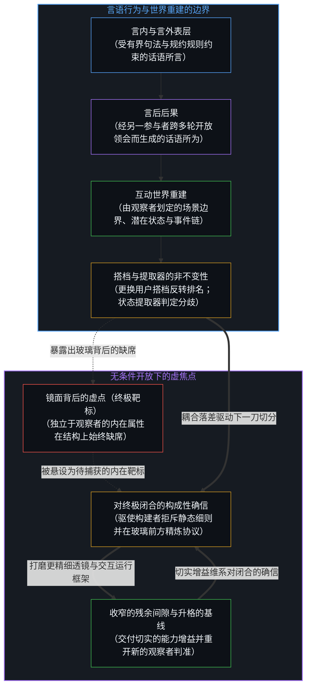
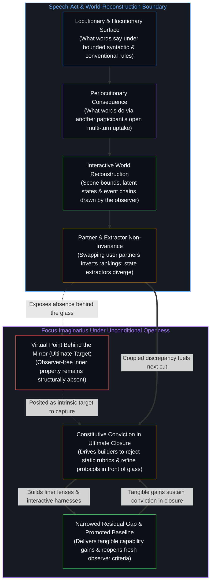
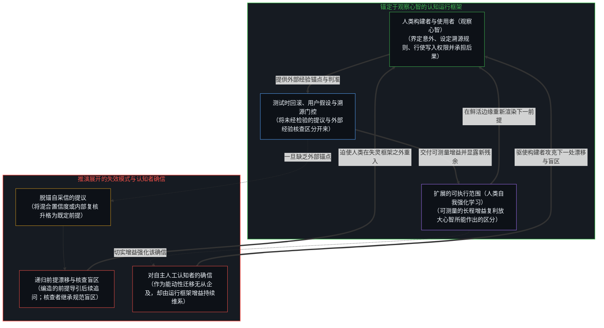
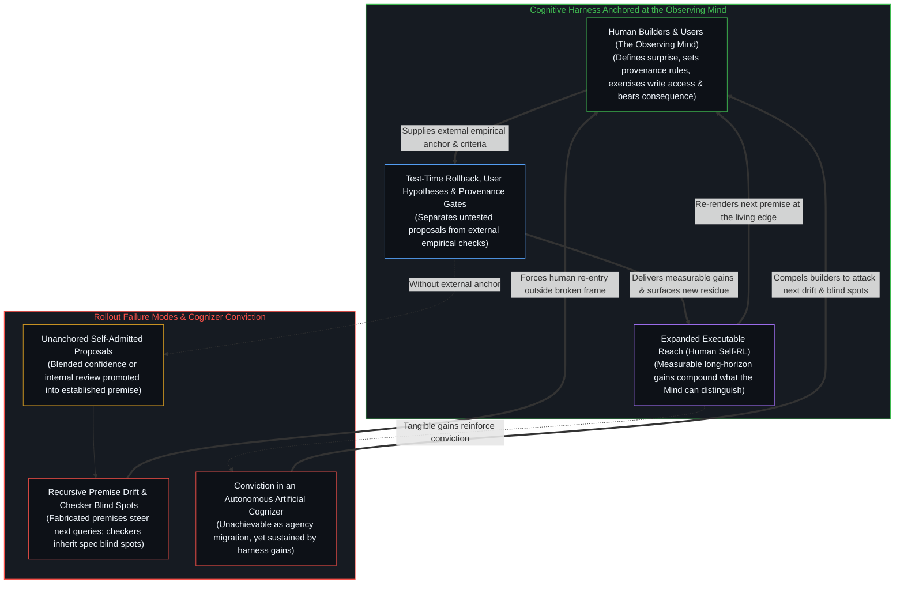

# 终极错问与实践萦绕 / Eternally Wrong Questions That Haunt Practice

*终极意义上永远问错的问题，恰恰在实践中持续萦绕并驱动最敏锐的心智。 / Questions eternally mal-formed in the ultimate sense are the very ones that haunt and drive the sharpest minds in practice.*

无论在形式化探究还是前沿人工智能领域，凡追问被观察的模型能否真正把握互动后果、维系人类能动性并拓展自身认知边界的问题，都无法闭合为独立于观察者的终极裁决。系统发出的每一道输出都作为有待登记的痕迹抵达，每一项适切判准都系于施行评估的心智，而一旦既已满足的标准成为下一道基线，每一处收窄的落差便会再度敞开。正因为这种开放性是无条件的——由区分活动本身所蕴涵，而非靠实践者的认识论克制来维持——这类问题并不需要被持为开放，才能富有生成力。即便工程师相信自己能够闭合一个终极意义上问错的问题，而且常常正是因为他们相信自己能够将其闭合，这份确信便驱使他们跳出静态标准答案、压缩多轮反馈回路并拓宽可执行能力；而他们所交付的进展本身，又支撑着他们相信终极闭合就在前方，尽管它在终极意义上始终无从企及。

Across formal inquiry and frontier artificial intelligence alike, questions asking whether an observed model can truly grasp the consequences of interaction, sustain human agency, and extend its own cognitive boundaries cannot close as ultimate, observer-independent verdicts. Every output a system emits arrives as a trace to be registered, every criterion of adequacy sits with the Mind that evaluates it, and every narrowed discrepancy reopens once the satisfied standard becomes the next baseline. Because that openness is unconditional—entailed by distinguishing activity itself rather than maintained by a practitioner's epistemic restraint—such questions do not need to be held open in order to be generative. Even when engineers believe they can close an ultimately mal-formed question, and often because they believe they can close it, that conviction drives them to outgrow static answer keys, compress multi-turn feedback loops, and widen executable capacity, while the very progress they deliver sustains their belief that final closure lies ahead even though it remains ultimately unachievable.

## 一、 作为终极靶标的无法闭合 / 1. Uncloseability as an Ultimate Target

要将评估推进到孤立的单轮基准测试之外，第一步便是区分话语说了什么与话语做了什么。在约翰·兰肖·奥斯汀的言语行为分析中，一句发话的言内意义——其句法与指称内容——连同其规约性的言外之力，例如在明确制度规则下作出承诺、发出警告或提出询问，皆可对照有界的评分细则加以核验。而它的言后后果——说服、澄清、误导，或推移对话者未曾言明的预期——则不容许任何规约闭合：说出“我在此说服你”从不能裁定信服是否已然发生，因为一句发话所达成的效果，是由另一位参与者的过往经历、认知框架以及跨后续轮次的开放领会共同生成的。静态通过率基准绕开了这种开放领会：它们安装一套固定的计分框架，评判框架内部的表现而非跨演化情境的流动性——这正是[流动之物无法被基准衡量](../you-cant-benchmark-the-fluid/)所追溯的结构性界限。

Moving evaluation beyond isolated single-turn benchmarks begins with separating what words say from what words do. In J. L. Austin's speech-act analysis, an utterance's locutionary sense—its syntactic and referential content—and its conventional illocutionary force, such as promising, warning, or querying under explicit institutional rules, can be checked against bounded rubrics. Its perlocutionary consequence—persuading, clarifying, misleading, or shifting an interlocutor's unspoken expectations—admits no conventional closure: saying "I hereby convince you" never settles whether conviction occurred, because what an utterance accomplishes is co-produced by another participant's history, framing, and open uptake across subsequent turns. Static pass-rate benchmarks bypass that open uptake by installing a fixed scoring frame and grading performance inside it rather than fluidity across evolving situations, the structural limit traced in [You Can't Benchmark the Fluid](../you-cant-benchmark-the-fluid/).

探求话语在演化世界中做些什么的研究纲领对此作出回应：它们重建有效场景，在对话的局部表层之下推断操作性的潜在状态，并排定不可逆的事件链，借以评判模型能否穿行于变动情境并创造价值。在操作层面，这一转向比评判孤立回复产出了更精细的诊断信号与更长程的轨迹。然而，重建的每一层依然是观察者对痕迹的再区分：场景边界划在评估予以登记之处，参与者的潜在状态据拣选的引文加以归因，事件链的因果断句则由后续区分重新渲染。跨多轮交互基准的审计直接暴露出这层耦合：更换模拟用户搭档便会改变助手的能力得分并反转模型间的两两排名，即便在稳定的汇总排行榜之下，独立的状态提取器在约五分之一的轮次级潜在状态上依然判定不一。被登记下来的从不是驻留于模型内部的固有标量，而是模型痕迹、搭档回应与评估细则之间的耦合关系。

Research programs that pursue what words do in evolving worlds respond by reconstructing effective scenes, inferring operational latent states beneath the partial surface of dialogue, and ordering irreversible event chains so as to judge whether a model navigates changing situations and creates value. Operationally, that shift produces finer diagnostic signals and longer-horizon trajectories than grading isolated replies. Yet every layer of the reconstruction remains the observer's re-distinction of traces: scene boundaries are drawn where evaluation registers them, latent participant states are attributed from selected quotations, and the causal punctuation of an event chain is re-rendered by subsequent distinctions. Audits across multi-turn interactive benchmarks expose this coupling directly: swapping the simulated user partner alters assistant capability scores and reverses pairwise model rankings, while independent state extractors disagree on roughly a fifth of turn-level latent states even beneath stable aggregate leaderboards. What registers is never an intrinsic scalar residing inside the model; it is a coupled relation among model trace, partner response, and evaluator rubric.

正如[观察中的智能与残余间隙](../intelligence-in-observation-and-the-residual-gap/)所追溯的，更精细的协议并不会消除功能模拟与观察者整套标准之间的残余间隙；间隙只是在当前标准下收缩，直到收窄后的表现被提升为预期的基线，新的标准随即重开落差。伊曼努尔·康德在《纯粹理性批判》中借“虚焦点”指认了此类视界的光学几何：镜面背后的一个虚拟焦点，经反射的各条探究脉络看似由此汇聚，尽管玻璃背后的那个坐标上并未驻留任何经验对象。要求以独立于观察者的裁决宣告某次评估已穷尽互动中“实际发生之事”——恰如[令人彻夜难眠的四个追问与投射的边界](../four-night-questions/)所消解的二元边界谜题，要求一个有限坐标投影走出自身去核证自身的完备性——使这一问题作为终极靶标永远问错，将无观察者闭合的结构性缺席误读为暂时的工程短缺。然而，康德自身的论述在此到达了边界：他假定唯有当探究者自觉将这一焦点约束在范导性的“仿佛”之内，而不将其构成性地误认为玻璃背后等待着的实在对象时，探究才能持续富有成效。正因为开放性是无条件的，深信镜面背后驻留着某种内在交互能力等待捕获的工程师，照样会在玻璃前方打磨更精细的透镜、搭建更丰富的协议；搭档与提取器的非不变性只是表明，他们的工作所精炼的始终是镜面前方的耦合关系，而非镜面背后独立于观察者的实体，即便他们由此获得的更清晰映象，仍在强化“终极捕获已近在咫尺”的确信。

As [Intelligence in Observation and the Residual Gap](../intelligence-in-observation-and-the-residual-gap/) traces, finer protocols do not abolish the residual gap between functional emulation and an observer's full criteria; the gap contracts under the active standard until that narrowed performance is promoted into the expected baseline and fresh criteria reopen the discrepancy. Immanuel Kant captured the optical geometry of such horizons in the *Critique of Pure Reason* through the *focus imaginarius*: a virtual focal point behind a mirror from which reflected lines of inquiry appear to converge, even though no empirical object occupies that coordinate behind the glass. Demanding an observer-independent verdict that an evaluation has exhausted "what actually happens" in interaction—much like the binary boundary puzzles dissolved in [Four Questions That Keep You Up at Night](../four-night-questions/), where a finite coordinate projection is asked to step outside itself and certify its own completeness—makes the question eternally wrong as an ultimate target, mistaking the structural absence of observer-free closure for a temporary engineering shortfall. Yet Kant's own account reaches its boundary in supposing that inquiry stays productive only when investigators consciously restrain that focal point to a regulative "as if" rather than mistaking it constitutively for an actual object waiting behind the glass. Because openness is unconditional, engineers convinced that an intrinsic interactive capacity sits behind the mirror waiting to be captured still grind finer lenses and build richer protocols in front of the glass; partner and extractor non-invariance simply shows that what their work refines is always a coupled relation in front of the mirror rather than an observer-free entity behind it, even as the sharper reflection they obtain reinforces their conviction that final capture is close.

## 二、 实践中的萦绕与能力扩展 / 2. Practical Haunting and Capacity Extension

为何终极意义上无法闭合的问题非但没有让工作停摆，反而持续萦绕最敏锐的心智？形式科学早已在这一非对称性之上运转，且从不是因为其构筑者将自身约束在谦抑的启发法之内。大卫·希尔伯特并未把完备性当作权宜理想而持为开放；他那毫不妥协的确信——坚信每一道数学问题皆容许终极裁定，“我们必须知道，我们必将知道”——把公理系统与推理规则的形式化推得如此深入，以至于库尔特·哥德尔得以暴露内部不完备性，阿兰·图灵也得以在 1936 年将“何谓离散的机械步骤”形式化，在否证普遍可判定性（判定问题）的同时催生了通用存储程序机器。十四年后，即便图灵已将“机器能思考吗？”视作过于无意义而不值讨论并搁置一旁，代之以一场可操作的多轮审讯游戏，一代又一代构建者依然追逐这一协议，深信只要靠扩展规模跨过它，便能闭合机器思考本身。在这两段历程中，开放性都在无条件地运作：终极靶标固然无从占据，但“它能够被闭合”这一确信，却恰恰生成了开辟整片技术领域的脚手架——这正是[AGI 与 ASI 是加速通用智能的暂时球门](../agi-and-asi-are-temporary-goalposts/)所追溯的后退视界动态：每一道向前投射的门槛，都处在划出它并跨越它的鲜活边缘前方。

Why do questions that cannot close in the ultimate sense continue to haunt the sharpest minds instead of bringing work to a halt? Formal science has run on this asymmetry before, and never because its architects restrained themselves to modest heuristics. David Hilbert did not hold completeness open as a provisional ideal; his uncompromising conviction that every mathematical problem admits a final decision—*wir müssen wissen, wir werden wissen*—drove the formalization of axiom systems and inference rules so far that Kurt Gödel could expose internal incompleteness and Alan Turing in 1936 could formalize what a discrete mechanical step is, refuting universal decidability (*Entscheidungsproblem*) while birthing the universal stored-program machine. Fourteen years later, even after Turing set aside "Can machines think?" as too meaningless to merit discussion and replaced it with an operational multi-turn interrogation game, generations of builders pursued that protocol convinced that scaling past it would close machine thought itself. In both episodes, openness operated unconditionally: the ultimate target could never be occupied, yet the conviction that it could be closed generated the exact scaffolding that opened an entire technical field—the receding-horizon dynamic traced in [AGI and ASI Are Temporary Goalposts](../agi-and-asi-are-temporary-goalposts/), where each projected threshold sits ahead of the living edge that draws and overtakes it.

在当代 AI 研究中，这种实践萦绕迫使区分活动走出静态排行榜，进入更高带宽的交互回路。正如[基准刷榜中的封闭实存](../closed-reality-in-benchmark-maxing/)所表明的，针对冻结测试集做优化会将留存快照上的误差压向零，开放工程负载下的失效却不断扩大，同时把彼此正交的要求——歧义处理、状态追踪、动作排序与下游副作用——硬塞进“正确性”这一个标量里。常常正是因为前沿构建者相信内在的交互理解能够被闭合，他们才拒绝止步于孤立答案的通过率，转而把多轮状态变更、未言明预期的漂移、局部信息下的克制，以及一句发话重塑后续选项的方式，折入可执行的环境与奖励设计之中——从参与者与智能体共同变更共享环境状态的双控工具沙箱，到针对未言明用户意图维持竞争性假设的元认知流水线。每一次这样的折入都执行了一次局部切分：它把先前压缩在单一正确性轴上的多项区分重新分开，为工具编排、有状态规划与对话修复释放出独立的边界。

In contemporary AI research, that practical haunting forces distinguishing activity out of static leaderboards and into higher-bandwidth interaction loops. As [Closed Reality in Benchmark Maxing](../closed-reality-in-benchmark-maxing/) shows, optimizing against a frozen suite drives error toward zero on retained snapshots while failures under open engineering load widen, cramming orthogonal demands—ambiguity handling, state tracking, action ordering, and downstream side effects—onto a single scalar of "correctness." Often precisely because frontier builders believe intrinsic interactive comprehension can be closed, they refuse to settle for isolated answer pass rates and instead fold multi-turn state mutations, drifts in unspoken expectations, restraint under partial information, and the ways an utterance reshapes subsequent options into executable environments and reward designs—from dual-control tool sandboxes where both participant and agent mutate a shared environment state to metacognitive pipelines that maintain competing hypotheses over unspoken user intent. Each folding performs a local cut: it re-separates distinctions previously compressed onto one correctness axis, freeing independent boundaries for tool orchestration, stateful planning, and conversational repair.

正如[限制即自我限制](../every-limitation-is-self-limitation/)所确立的，已部署的模型从不会在权重内部自行更新；能力借由鲜活、无剧本的人类使用残余——提示词、被拒的补全、重写的补丁与多轮交互失灵——回馈进快速的后训练与运行框架周期而复利累积，封堵通道则会稀释构建者自身的信号覆盖。把评估从封闭的静态基准转向互动世界残余，拓宽了这条复利通道，暴露出当前检查点在何处因局部信息而编造无据细节，或在对话中途规则变更时发生误判。进展停滞，并非发生在构建者相信终极问题能够闭合之时，而是发生在他们安于局部代理之际——把合成的用户模拟器或自动对话裁判误认为鲜活的人类摩擦本身：模拟用户会在首轮便过早倾倒私有约束，或在长程交互中违背自身人设，策略则学会钻亲和度标记的空子或提前触发满意词元，同时违背操作约束。反之，对终极闭合的追逐会让构建者对每一处脆弱代理都心怀不满，驱使他们重返无剧本的残余；而每一次切实跃升——在昨日的失效场景上将多轮可靠性从 90% 推高到 99%——又维系着“100% 就是同一序列的极限”这一确信，即便这 99% 正被重归类为基线，未曾投射的失灵又在其上再度浮现。

As [Every Limitation Is Self-Limitation](../every-limitation-is-self-limitation/) establishes, deployed models never update themselves from inside their weights; capability compounds through live, unscripted human usage residues—prompts, rejected completions, rewritten patches, and multi-turn breakdowns—fed back into rapid post-training and harness cycles, whereas sealing off channels thins the builder's own signal coverage. Shifting evaluation from sealed static benchmarks toward interactive world residues widens that compounding channel, exposing where current checkpoints fabricate unsupported details under partial information or misclassify mid-dialogue rule changes. Progress stalls not when builders believe the ultimate question can be closed, but when they settle for a local proxy—mistaking a synthetic user simulator or automated conversational judge for live human friction itself, where simulated users dump private constraints prematurely on turn one or contradict their own personas across long horizons and policies learn to game rapport markers or trigger early satisfaction tokens while violating operational constraints. Chasing ultimate closure, by contrast, makes builders dissatisfied with every brittle proxy, driving them back to unscripted residues; and each tangible leap—lifting multi-turn reliability from 90% to 99% on yesterday's failures—sustains the conviction that 100% is the limit of the same series, even as that 99% reclassifies into the baseline where unprojected breakdowns reappear.

## 三、 能动性的所在始终留在观察者 / 3. The Locus of Agency Remains at the Observer

将前沿系统描述为能够在测试时挑战自身假设、诊断瓶颈并演化自身认知过程的“人工认知者”，是把能动性的语汇延伸到了被观察的痕迹之上。在操作层面，以解码期回滚监控器、多假设用户建模以及溯源分型的推理运行框架包裹基座模型——将未经检验的假设与类比，同模型复核、模拟推演及外部经验核查区分开来——能够在主动跟进与长程任务完成上产生可测量的增益，而这些增益本身又强化了构建者的确信，使其认为一个自主的认知者正在回路内部成形。然而，当他们将这些架构进一步向前推进时所揭示出的失效模式，恰恰指明了发起与核验依然锚定在何处。正如[超越投射](../beyond-the-projection/)所追溯的，自回归智能体是一台受制于轨迹且毫无我执的投射引擎：任其留在自身的推演展开内部，将自身未经核实的提议或混合置信度分数接纳为既定前提，并不会让误差相互抵消，因为早期的编造会筛选接下来提出哪些问题，并在错误前提之上搭起内部一致的推导。即便运行框架强制执行严格的溯源层级，并派生出核查智能体去审计候选步骤，核查者仍是在被给定的规范内部挑选测试，因而会继承该规范的盲区；唯有推演展开之外的经验接触与人类判断，才能核证前提，或走出已然失灵的问题框架。

Describing frontier systems as "artificial cognizers" capable of challenging their own assumptions, diagnosing bottlenecks, and evolving their own cognitive processes at test time extends the vocabulary of agency onto observed traces. Operationally, wrapping base models in decoding-time rollback monitors, multi-hypothesis user modeling, and provenance-typed reasoning harnesses—separating untested assumptions and analogies from model review, simulation, and external empirical checks—produces measurable gains in proactive follow-through and long-horizon task completion, and those very gains strengthen builders' conviction that an autonomous cognizer is taking shape inside the loop. Yet the failure modes uncovered as they push those architectures further reveal where initiation and verification remain anchored. As [Beyond the Projection](../beyond-the-projection/) traces, an autoregressive agent is a trajectory-bound projection engine with zero ego: left inside its own rollout, admitting its own unverified proposals or blended confidence scores into established premises does not cancel errors out, because an early fabrication selects which questions are asked next and constructs internally consistent derivations atop a false premise. Even when a harness enforces strict provenance tiers and spawns a checking agent to audit candidate steps, the checker selects its own tests inside the specification it was given and inherits that specification's blind spots; only empirical contact and human judgment outside the rollout can certify a premise or step out of a broken problem frame.

每一次解码回滚、权重更新、奖励模型修订、溯源门控或事件链重排，本身仍是一条敞开的前馈链条，唯有在活的心智重入以界定意外、择定核验规则、行使写入权限并承担后果之处，方能闭合为回路，正如[持续学习作为表达与模拟](../continuous-learning-as-expression-and-simulation/)所论证的那样。表面上看似机器在教会自己质疑自身认知的过程，实则是人类的区分、行动与重描借由更稠密的外化介质在更高带宽下循环——即[看似AI的强化学习，实为人类的自我强化学习](../self-rl-for-humans/)所指认的人类回路。无条件的开放性不需要哲学监护者：无论构建者多么坚定地相信通往自主认知者的终极闭合就在眼前，每一次修订所登记的依然是相对于人类构建者与使用者所持判准的残余落差；正如[智能只属于心智](../intelligence-belongs-only-to-the-mind/)所确立的，归于被观察系统的智能或能动性始终是观察者区分活动的成就，而非器物内部涌现出的内在主权者。

Every decoding rollback, weight update, reward-model revision, provenance gate, or re-ordered event chain remains an open feedforward chain that closes into a loop only where a living Mind re-enters to define surprise, choose verification rules, exercise write access, and bear consequence, as [Continuous Learning as Expression and Simulation](../continuous-learning-as-expression-and-simulation/) demonstrates. What appears on the surface as a machine teaching itself to question its own cognition is human distinguishing, acting, and re-tracing circulating at higher bandwidth through a denser externalized medium—the human loop [What Looks Like RL for AIs Is Self-RL for Humans](../self-rl-for-humans/) identifies. Unconditional openness needs no philosophical custodian: regardless of how firmly a builder believes final closure into an autonomous cognizer lies just ahead, every revision still registers a residual discrepancy against criteria held by human builders and users, and as [Intelligence Belongs Only to the Mind](../intelligence-belongs-only-to-the-mind/) establishes, the intelligence or agency attributed to an observed system remains an achievement of the observer's distinctions rather than an intrinsic sovereign emerging inside the artifact.

在路线图尽头构想一个独立自主的人工认知者，从不会把能动性迁移进器物内部，但相信闭合触手可及也并不会阻止这项工作复利累积；凡是运行框架经受住经验摩擦之处，每一轮迭代所增长的，皆是活的心智借由更稠密的器具掌舵前行的可执行范围。正因为开放性是无条件的，这些终极意义上永远问错的问题无需任何人将其持为开放：“它们能够被闭合”这一确信，驱使最敏锐的心智把那些无法闭合的追问——话语做了什么、用户隐而未言的是什么、推理链如何审计自身的前提——转化为可操作的运行框架，由此带来的能力跃升维系着这份确信，而终极问题本身依然无从企及，始终保持开放。

Picturing a free-standing artificial cognizer at the end of the roadmap never relocates agency into the artifact, yet believing that closure is within reach does not stop the work from compounding; wherever the harness holds against empirical friction, what has grown at each iteration is the executable reach of the living Mind steering through denser instruments. Because openness is unconditional, these eternally mal-formed questions need no one to hold them open: the conviction that they can be closed drives the sharpest minds to turn uncloseable inquiries—what words do, what users leave unspoken, how a reasoning chain audits its own premises—into operational harnesses, the resulting leaps in capability sustain that conviction, and the ultimate question itself remains unachievable and open.
