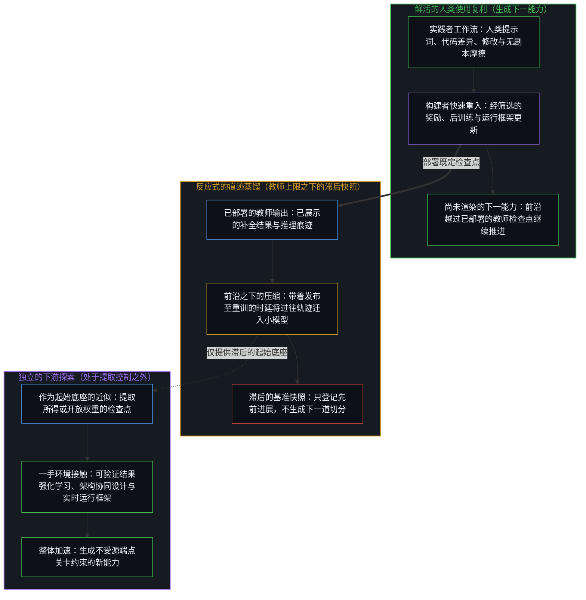
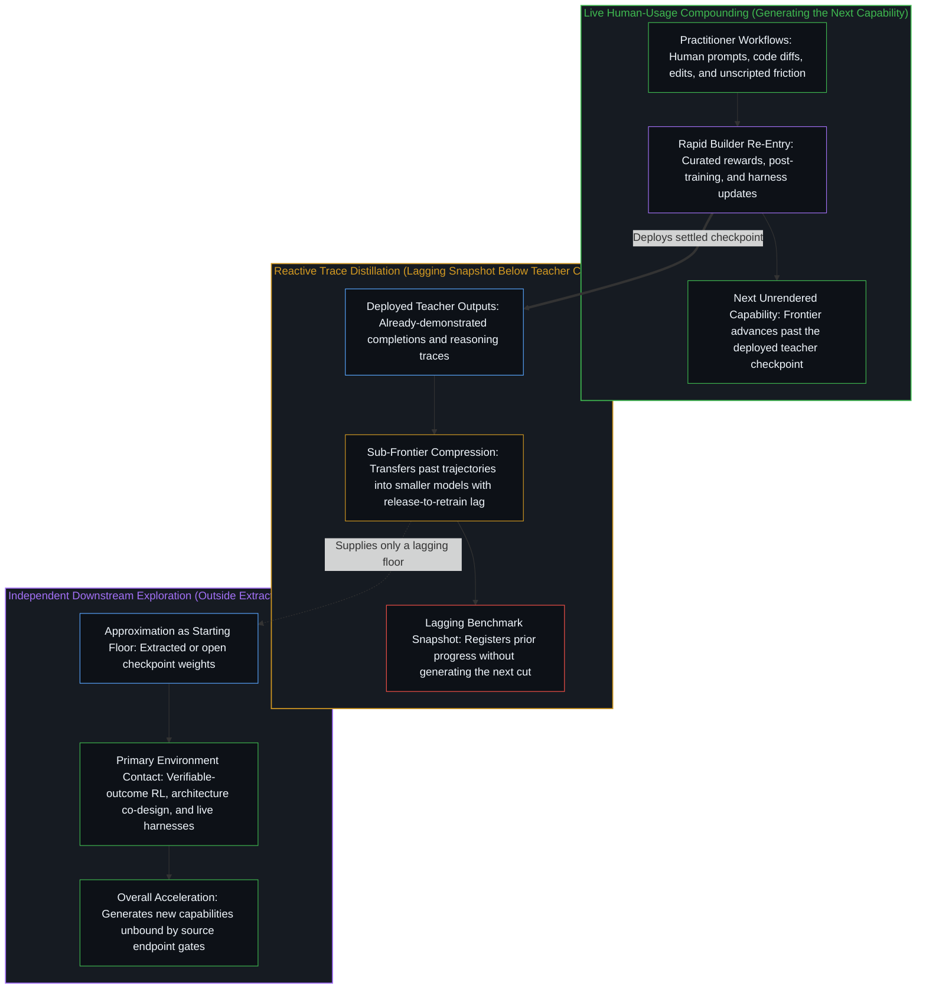
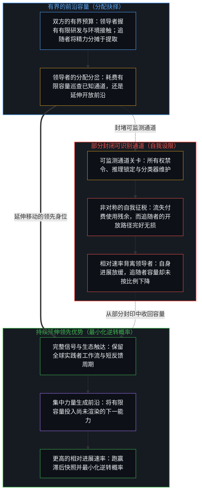
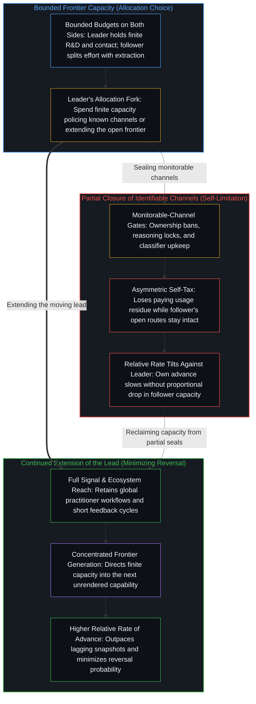

# 限制即自我限制 / Every Limitation Is Self-Limitation

*对可识别通道的约束将有限资源从开放探索中抽离，使相对进展率背离自我设限的一方。 / Constraining identifiable channels diverts finite resources from open exploration, tilting the relative rate of advance against the self-limiting side.*

按地域、所有权结构或 API 端点限制前沿模型的访问权限，建立在这样一个前提之上：封住可识别的通道，便能保护领先优势免遭能力提取。然而，鲜活的人类工作留下的使用残余构成能力复利的连续通道之一；对已有输出的蒸馏则只产生滞后的近似，无法生成尚未出现的下一能力。后续在该近似之上的创新，既突破了初始提取的上限，也不受源端点所设任何关卡的约束；控制只能施加于当前可识别的封闭通道，而选项空间保持开放。因此，将有限资源投向部分封堵的同时，也稀释了设限者自身的信号覆盖，放慢了自身的探索速率。

Restricting access to a frontier model across regions, ownership structures, or API endpoints rests on the premise that sealing identifiable channels protects a lead against capability extraction. Yet usage residues left by live human work form one continuous channel of capability compounding, while distilling existing outputs produces only a lagging approximation and cannot generate the next capability not yet produced. Subsequent innovation built on that approximation escapes both the ceiling of the initial extraction and any gate placed on the source endpoint, and controls can be applied only to currently identifiable closed channels while the option space remains open. Allocating finite resources to partial containment therefore also thins the restrictor's own signal coverage and slows its own rate of exploration.

## 一、 使用残余作为复利通道 / 1. Usage Residues as a Compounding Channel

已部署的模型不会从权重内部自行调整。正如[机器智能作为人类智能的组合反馈回路](../machine-intelligence-as-the-combinatorial-feedback-loop-of-human-intelligence/)所追溯的，人类使用者在真实交互中生成分布、偏好与误差信号，人类构建者再经由后训练、奖励设计与运行框架更新将这些残余回馈进去，持续调校模型在特定语言、领域与工作流上的行为。每一条提示词、每一处代码差异、每一次被拒的补全、每一份重写的补丁，以及每一轮多步工具调用的失灵，最初都是实践者在无剧本摩擦中检验工具的局部行动，一如[数据是局部的，智能是分配的](../data-is-local-intelligence-is-allocated/)所确立的那样，在那一工作前沿承载着高价值信号。这些残余并不会自动复利：企业服务条款常将商业 API 载荷隔离在外，构建者也仍须精心筛选过滤器与奖励判准，以免原始采纳率指标奖励投机迎合或抹平代码库惯例。然而，一旦开启数据授权的编码运行框架与交互层级闭合了这条回路，鲜活的人类工作流方差便会提供合成实验室环境无法模拟的材料：实践者实际带来的问题分布迁移、区域软件栈的惯用写法，以及令当前权重失灵的边缘案例。正如[看似AI的强化学习，实为人类的自我强化学习](../self-rl-for-humans/)所揭示的，这种迭代调校正是人类区分活动在更高带宽下的循环。

A deployed model does not adjust itself from inside its weights. Through real interaction, human users generate distributional, preference, and error signals, and human builders feed those residues back through post-training, reward design, and harness updates to refine behavior across specific languages, domains, and workflows, as [Machine Intelligence as the Combinatorial Feedback Loop of Human Intelligence](../machine-intelligence-as-the-combinatorial-feedback-loop-of-human-intelligence/) traces. Each prompt, code diff, rejected completion, rewritten patch, and multi-turn tool failure begins as a local act where a practitioner tests the instrument against unscripted friction, carrying high signal at that working edge in the way [Data Is Local, Intelligence Is Allocated](../data-is-local-intelligence-is-allocated/) establishes. Those residues do not compound automatically: enterprise terms frequently fence off commercial API payloads, and builders still have to curate filters and reward criteria so raw acceptance metrics do not reward gaming or flatten repository conventions. Yet where opted-in coding harnesses and interactive tiers close that loop, live human workflow variance supplies what synthetic laboratory environments cannot simulate: the shifting distribution of problems practitioners actually bring, the idioms of regional software stacks, and the edge cases where current weights break. That iterative refinement is human distinguishing circulating at higher bandwidth, as [What Looks Like RL for AIs Is Self-RL for Humans](../self-rl-for-humans/) shows.

排除一个大规模、技术熟练的使用者群体——例如禁止未列入许可名单的地域接入，并将禁令在全球范围内延伸至由这些法域控股的任何子公司，横跨对话界面、编码运行框架、API 与云转售渠道——在减少收入的同时，也切断了这道持续的学习信号。在跨年度的工业发布周期下，多语种语用、系统工具链或智能体工作流覆盖上的盲区，尚可掩映在先前的惯性之后。而当构建者依托实时编辑差异，将后训练检查点与编码运行框架的更新周期压缩至数周、数日乃至数小时，被切断群体的残余缺失便会迅速显现：每一轮缺少这些工作流的迭代都在别处打磨模型，却让未被查询的地带留在暗处，不出数轮便浮现为可测量的相对间隙。

Excluding a large, technically proficient user population—such as barring unlisted geographies and extending prohibitions worldwide to any subsidiary majority-owned from those jurisdictions across chat interfaces, coding harnesses, APIs, and cloud resellers—simultaneously reduces revenue and severs that ongoing learning signal. Under multi-year industrial release schedules, a blind spot in multilingual pragmatics, systems tooling, or agentic workflow coverage could stay masked behind prior momentum. When builders instead update post-training checkpoints and coding harnesses on cycles compressed to weeks, days, or hours of live edit diffs, the absence of a severed cohort's residue registers rapidly: each cycle run without those workflows sharpens the model elsewhere while leaving unqueried terrain dark, surfacing within a few iterations as a measurable relative gap.

## 二、 蒸馏只复制已存在的能力 / 2. Distillation Copies Only What Already Exists

在既有前沿之下，蒸馏作为压缩手段行之有效：将更强教师模型已经探出的轨迹转移进更小的稠密模型，所需算力远低于在小规模上从头探索；而单端点防御——例如加密或摘要化推理块、运行提取分类器——也确实能在该接口上对粗放的对话记录复制造成可测量的折损。在 Anthropic 2026 年 10 月披露的数据中，锁定并摘要化推理痕迹配合分类器封禁，使其自有平台上的原始推理词元提取量下降了 90% 至 99%，并令基于摘要记录蒸馏出的学生模型在 SWE-bench Verified 上的得分从 80.4% 跌至 71.8%。然而，无论是这类转移还是这类防御，都严格作用于已经存在之物。由于观察所持握的既定结果比生成它的行动至少滞后一步，蒸馏复制的只是已部署教师模型所展示过的输出与痕迹。正如[蒸馏、压缩与能动性](../distillation-compression-agency/)所追溯的，用采集来的补全结果或推理记录训练学生模型，是在拟合过往解法的投射，同时剥离未绑定的高维余量；这便以[过拟合作为追随者模式](../overfitting-as-the-follower-mode/)所指认的方式，将单纯的模仿锁死在已知地形的压缩地图之上。它无法生成教师模型的构建者尚未产出的下一能力；而在从教师模型部署、提示词采集、清洗到学生模型重训的整段时延中，单纯的模仿始终落在移动的前沿之后。

Below an existing frontier, distillation works effectively as compression: transferring trajectories a stronger teacher has already discovered into smaller dense models costs far less compute than discovering them from scratch at small scale, and single-endpoint defenses—such as encrypting or summarizing reasoning blocks and running extraction classifiers—do measurably degrade naive transcript copying on that interface. In Anthropic's October 2026 disclosures, locking and summarizing reasoning traces alongside classifier bans cut raw reasoning-token extraction on its own platform by ninety to ninety-nine percent and dropped a student model distilled on summarized transcripts from 80.4 percent to 71.8 percent on SWE-bench Verified. Yet both the transfer and the defense operate strictly on what already exists. Because observation holds settled effects at least one step behind the act that generated them, distillation copies only the outputs and traces a deployed teacher model has already demonstrated. Training a student on harvested completions or reasoning transcripts fits a projection of past solutions while stripping uncommitted high-dimensional slack, as [Distillation Chooses What to Lose](../distillation-compression-agency/) traces, locking pure imitation onto a compressed map of known terrain in the manner [Overfitting as the Follower Mode](../overfitting-as-the-follower-mode/) identifies. It cannot generate the next capability the teacher's builders have not yet produced, and across the delay from teacher deployment through prompt harvesting, cleaning, and student retraining, pure imitation stays behind the moving edge.

因此，任何基准上的可测间隙——无论是因摘要化而在单一提供者的记录上被拉大，还是在公开排行榜上被收窄——都是先前进展的滞后快照，而非衡量谁在生成下一能力的尺度。后续间隙的缩小速率，取决于底座容量、环境交互与迭代速度上的整体加速，而非由蒸馏这一行为本身决定。一旦下游构建者仅将提取所得或开放的近似当作起始底座，转而直接与可执行编译器、形式化验证器、内存压缩注意力机制、低精度训练以及鲜活的开发者运行框架展开交互，他们便不再是在复制教师模型的输出分布，而是在直面因果摩擦开展一手探索——这是给初始提取端点设卡所无法管辖的。

Any measurable gap on a benchmark—whether widened on one provider's transcripts by summarization or narrowed on a public leaderboard—is therefore a lagging snapshot of prior progress rather than a measure of who generates the next capability. The subsequent rate at which the gap narrows is determined by overall acceleration across base capacity, environment interaction, and iteration speed, not by the act of distillation itself. Once downstream builders treat an extracted or open approximation only as a starting floor and interact directly with executable compilers, formal verifiers, memory-compressed attention, low-precision training, and live developer harnesses, they are no longer copying a teacher's output distribution; they are running primary exploration against causal friction that gating the initial extraction endpoint cannot govern.

## 三、 选项空间的开放性使控制不完整 / 3. Open Option Space Renders Controls Incomplete

任何控制都只作用于可监测的通道：特定端点、会话格式、账户模式、地理边界或企业所有权结构。一项政策或分类器只能瞄准已经稳定到足以被明文规定和审计的痕迹，把一份由已知路径构成的有限名册误认作整片延续场域——这正是[没有系统能被保持封闭](../no-system-can-be-kept-closed/)在任何有界持守被当作自我封印之处所确立的形式余留。在运作层面上，正如[起作用的是信念](../what-works-is-the-belief/)所追溯的，一道禁令只约束那些把它持守为地基的中心。当地域与控股排除条款同锁定的多轮推理块、对分类器标记请求照常计费等措施叠加在一起时，守规的跨国工程团队与合法开发者会遵守条款、撤离平台；而决意提取者则只把这道屏障当作一项路由成本——在住宅代理池、旧版检查点、二级对话记录转售商或设有不同护栏的竞争前沿模型之间灵活换道。

Any control applies only to monitorable channels: specific endpoints, session formats, account patterns, geographic borders, or corporate ownership structures. A policy or classifier can target only traces that have already stabilized enough to be specified and audited, mistaking a finite register of known pathways for the entire field of continuation—the formal remainder [No System Can Be Kept Closed](../no-system-can-be-kept-closed/) establishes wherever a bounded hold is treated as self-sealing. In operational terms, a prohibition binds only the centers that hold it as ground, as [What Works Is the Belief](../what-works-is-the-belief/) traces. When regional and majority-ownership exclusions pair with locked multi-turn reasoning blocks and billing on classifier-flagged requests, compliant multinational engineering teams and lawful developers honor the terms and vacate the platform, whereas determined extractors treat the barrier as a routing cost—pivoting across residential proxy pools, older checkpoints, secondary transcript resellers, or rival frontier models with different guardrails.

一旦可识别的通道受到约束，行动者便转向其他路径：替代提供者、本地微调、宽松许可的开放权重、即插即用的兼容 API 端点，或尚未枚举的技术架构。被挤出的实践者无需与提供者争辩服务条款；只需在本地编码运行框架中覆写一行基础 URL 变量，多文件编辑、工具调用与终端报错痕迹便会直接导入竞争方开放权重提供者所托管的 Anthropic 兼容端点，以转身离开封闭牌桌的方式践行[正交的拒绝](../the-orthogonal-refusal/)。二十世纪九十年代的密码学出口管制遵循过同一种几何结构：它令守规的本土软件背上遗留的降级加密套件包袱，同时催化出遍布全球的开放实现；正如半导体带宽上限催生出潜在注意力 KV 缓存压缩与低精度训练，并随后作为宽松许可的开放权重扩散开来。由于选项空间保持开放，残余路径无法预先穷尽封闭。

Once identifiable channels are constrained, actors shift to other routes: alternate providers, local fine-tuning, permissive open weights, drop-in compatible API endpoints, or technical architectures not yet enumerated. Displaced practitioners do not need to contest a provider's terms; overriding a single base-URL variable in a local coding harness redirects multi-file edits, tool calls, and terminal error traces straight into Anthropic-compatible endpoints hosted by rival open-weight providers, enacting [The Orthogonal Refusal](../the-orthogonal-refusal/) by walking away from the closed table. Export controls on 1990s cryptography followed the same geometry, saddling compliant domestic software with legacy downgrade suites while catalyzing open global implementations, just as semiconductor bandwidth caps spurred latent-attention KV-cache compression and low-precision training that subsequently spread as permissive open weights. Because the option space remains open, residual pathways cannot be exhaustively closed in advance.

## 四、 相对速率最小化逆转概率 / 4. Relative Rates Minimize the Probability of Reversal

每一位构建者都在工程注意力、算力与鲜活环境接触的有界预算内作分配。领导者若保持完整的工作流信号，并将容量集中于生成下一能力，便能提高自身的进展速率。追随者若将部分有限精力投向提取、清洗与重构昨日的输出，其留给独立进展的残余容量本就较低。向外的通道限制却使这一天平背离领导者：拒收数以万亿计的付费词元，在削减收入与鲜活使用残余的同时，还将有状态的 API 改写负担与误判摩擦强加给合规开发者；而为所有权审计、代理猎手与提取分类器配备人力，则将持续的工程容量抽离去维护封印——这既付出了[限制是选择性的税](../restriction-is-a-selective-tax/)所剥离出的执行者维护成本，也在向外一侧重现了[关闭选择权的代价](../the-price-of-closing-optionality/)在向内谨慎推迟发布时所追溯的那种自我减速。限制降低了领导者的进展速率，却并未按比例降低追随者在开放路径与一手环境中的残余容量。

Every builder allocates from a bounded budget of engineering attention, compute, and live environmental contact. A leader that preserves full workflow signals and concentrates its capacity on generating the next capability raises its own rate of advance. A follower that allocates part of its finite effort to extracting, cleaning, and reconstructing yesterday's outputs already retains lower residual capacity for independent advances. Outward channel restriction tilts that balance against the leader: turning away trillions of paid tokens cuts revenue and live usage residue while imposing stateful API rewrites and false-positive friction on legitimate developers, and staffing ownership audits, proxy hunters, and extraction classifiers diverts continuous engineering capacity into maintaining the seal—paying the enforcer's upkeep cost that [Restriction Is a Selective Tax](../restriction-is-a-selective-tax/) isolates, and reproducing on the outward side the same self-inflicted slowdown that [The Price of Closing Optionality](../the-price-of-closing-optionality/) traces when inward caution delays release. Restriction lowers the leader's rate of advance without proportionally lowering the follower's residual capacity across open routes and primary environments.

因此，最低的逆转概率附着于持续延伸领先，而非部分封闭已知子集。正如[恶是投射出的抗拒](../evil-as-projected-resistance/)所剖析的，将机构身份与独占的领先身位熔合，会把追随者的快速印证重塑为亟待筑墙封堵的越界；而认识到多方参与的场域超出任何单一主体的独占，则会如[封闭竞技场中的开放视野](../open-vision-in-a-closed-arena/)所追溯的那样，将克制圈占视作战略上的融贯而非脆弱。每一道旨在阻截另一中心延续的对外屏障，都支取自同一份注意力、工程投入与鲜活接触的有界预算——而行动着的心智本就是借由这份预算生成自身的下一步。自我区分的活动发生着——无因，不息。将有限资源分配给一组封闭通道，其本身就是一次区分，它稀释了可供下一道切分使用的开放残余。

The lowest probability of reversal therefore attaches to continued extension of the lead, not to partial closure of a known subset. Fusing institutional identity with an exclusive lead recasts rapid follower validation as a transgression to be walled off, as [Evil as Projected Resistance](../evil-as-projected-resistance/) dissects, whereas recognizing that a multi-actor field exceeds exclusive capture treats restraint from enclosure as strategic coherence rather than vulnerability, as [Open Vision in a Closed Arena](../open-vision-in-a-closed-arena/) traces. Every outward barrier aimed at halting another center's continuation is paid from the same bounded budget of attention, engineering, and live contact through which an acting Mind generates its own next step. Self-distinguishing activity occurs — uncaused, unceasing. The allocation of finite resources to a closed set of channels is itself a distinction that thins the open residue available for the next cut.
