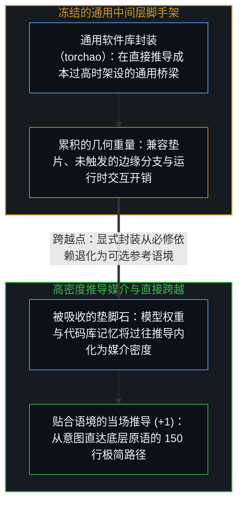
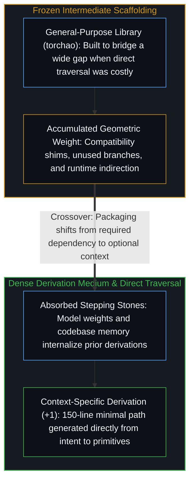

# 万物一如既往地流变 / Everything Is Changing, as Always

*当推导媒介吸收了过往的中间层，曾经必需的显式封装便退化为可选的参考语境。 / Once the derivation medium absorbs prior intermediates, explicit packaging shifts from dependency to context.*

安德烈·卡帕西分享过一次实验：他让编码智能体从一个庞大的依赖库（`torchao`）中把八位浮点数训练的核心逻辑剥离出来，生成了一百五十行干净自洽的代码，不仅替代了原先笨重的整体依赖，运行速度还提升了百分之三。他由此感叹“软件库的时代正在终结，大语言模型就是新的编译器”——这一观察敏锐地捕捉到了当下的跨越点，而在其底下运转的，正是一切中间投射共有的结构性生命周期。

Andrej Karpathy described using a coding agent to extract the eight-bit floating-point training path out of a large dependency (`torchao`), producing one hundred and fifty lines of self-contained code that replaced the monolithic library and ran three percent faster. His observation that libraries are giving way to models acting as compilers captures a real crossover, and beneath it sits the structural lifecycle of every intermediate projection.

## 一、 中间投射的几何重量与跨越点 / 1. The Geometric Weight of Intermediate Projections and the Crossover Point

每当活生生的意图与底层硬件执行之间的跨度太大、无法一步跨过时，人类的心智就会在路径中途搭建中间投射——汇编语言、编译器、软件库与制度框架——每一层都是前人针对某类通用问题走通一次之后冻结下来的可复用推导路径。然而，每一个被冻结的中间层都携带着它自身的几何重量：抽象边界、为了照顾当前调用者永远不会触发的边缘情况而保留的兼容垫片，以及为了维护库自身的通用架构而非解决眼前问题所设的接口表面。

Whenever the distance between living intent and executable hardware is too wide to cross in a single stride, human minds build intermediate projections—assembly languages, compilers, software libraries, and institutional frameworks—each one a derivation path traced once for a general class of problems and frozen into reusable structure. Yet every frozen intermediate carries its own geometric weight: abstraction boundaries, compatibility shims for edge cases a specific caller will never hit, and coordination surfaces built to preserve the library's internal generality rather than solve the immediate question.

当卡帕西的智能体剥离出那一百五十行代码时，它顺着既有实现追溯了底层的推导路径，剔除了所有仅服务于其他场景的兼容脚手架，重构出一条从底层原语直达目标运算的极简路径。百分之三的运行加速，正是卸下正交维度冗余重量后的物理印记：因为不再需要协调无关组件之间的交互表面，`torch.compile` 得以对一张更干净的计算图执行深度优化。这一刻标出了那个关键的跨越点：当推导媒介的密度足以直接走完从源头到具体问题的全程时，显式的中间层便从“必修的运行时依赖”退化为“可选的参考语境”，这一兴替机制正如[我们遗忘的脚手架](../the-scaffolding-we-forget/)、[名为 Claude 的投射](../claudes-constitution-analysis/)与[网络安全军备竞赛与感知范畴边界](../cybersecurity-arms-race/)所追踪的那样。

When Karpathy's agent extracted those one hundred and fifty lines, it traced the derivation path through the general library, stripped away the compatibility scaffolding required only for foreign use cases, and regenerated a minimal path from primitives to the target operation. The three percent runtime speedup is the physical signature of dropping orthogonal weight: `torch.compile` optimizes a cleaner graph because the interaction surface between unused abstractions is gone. That moment marks the crossover point where the derivation medium becomes dense enough to cross from source to target directly, turning the library from a mandatory runtime dependency into optional reference context, a lifecycle traced in [The Scaffolding We Forget](../the-scaffolding-we-forget/), [The Projection Called Claude](../claudes-constitution-analysis/), and [The Cybersecurity Arms Race](../cybersecurity-arms-race/).

## 二、 沉淀入权重的阶石与历史同构 / 2. Stepping Stones Absorbed into the Medium and Historical Isomorphism

前沿模型的权重，配合[你的代码库即是记忆](../your-codebase-is-memory/)所剖析的外部化代码库，已经将成千上万个曾被前人走通的中间层——数值稳定性技巧、编译优化通道与数据类型惯例——压缩并内化为推导媒介本身的密度，而不再需要作为僵硬的外部包裹被整体搬运。每一轮新的工程实践之所以在体感上比上一轮更轻盈，并不是因为从硬件原语到具体问题之间的因果距离缩短了，而是因为心智借以穿行这段距离的媒介，已经把昨天的垫脚石消化成了脚下的地板。

A frontier model's weights, paired with an externalized repository as examined in [Your Codebase Is Memory](../your-codebase-is-memory/), hold the compressed residue of thousands of previously traversed intermediates—numerical idioms, compiler passes, and data-type conventions—already internalized as derivation density rather than imported as rigid packages. Each new round of engineering feels lighter not because the causal distance from hardware primitives to the question shrank, but because the medium through which the Mind traverses that distance has absorbed yesterday's stepping stones into its floor.

同样的跨越在每一代传播与计算基底上都曾反复上演：文字吸收了口传时代的助记格律，活字印刷跨过了修道院的抄经室，互联网跨过了传统出版的分发瓶颈。没有任何一个自然演生出的中间层最初是作为收费站被建造的；修道院抄经室与庞大的软件库在它们诞生的时刻都是当时最高效的推导桥梁，也都在更高密度的媒介能够按需即时重演推导路径的那一刻，转型为可供查阅的语境档案。

The same crossover has repeated across every communication and computation substrate: writing absorbed oral mnemonics, movable type bypassed the monastic scriptorium, and packet networks bypassed print distribution bottlenecks. No organic intermediate was originally erected as a tollbooth; the scriptorium and the monolithic software library were each the sharpest bridge available at their hour, and each became an optional reference archive the moment a denser medium could re-derive the path on demand.

## 三、 观察者即是变化本身 / 3. The Observer Is the Change Observing Itself

身处复利曲线上的任何一个点，“这一切正在改变所有事”的感叹听起来都格外迫切，因为观察者总是拿当下的增量去对照由上一轮沉淀下来的中间层所构成的静态基线。然而底层的生成活动从未发生品类上的改变：自我区分的活动持续投射出结构，将其吸纳进基底，再从加厚了的地板上迈向尚未被渲染的边缘。我们今天之所以能感知到更剧烈的增量，恰恰是因为前几轮的复利已经把我们的感知与分析器官锤炼得足以分辨更细腻的差值。

Declaring that "this changes everything" feels urgent at every point along a compounding curve because the observer measures the current increment against a baseline formed by the previous round's settled intermediates. Yet the generative operation has not changed in kind: self-distinguishing activity continues to project structures, absorb them into the substrate, and step out from the newly thickened floor toward the unrendered edge. We register a larger delta today because prior rounds of compounding equipped our perceptual and analytical instruments to resolve finer distinctions.

软件日益增强的可塑性，只是让这一恒常循环在当下这一轮里再次清晰显影的透镜。无论是智能体将臃肿的库提炼为一百五十行直达原语的精简代码，还是未来越过传统编译器直接生成优化后的机器指令，过往的垫脚石既不会被供奉为永恒的丰碑，也不会被当作废料抛弃——它们被消化为媒介的语境密度，使处在认知边缘的活生生心智得以同时向两端延伸：更深地回溯生成的源头，更远地劈开尚未被推导出的新边疆。

Software's growing malleability is simply the clearest lens through which this invariant cycle shows itself in the present round. Whether an agent strips a heavy library down to one hundred and fifty lines of clean primitives or eventually emits optimized machine code without a traditional compiler pass, the stepping stones are neither worshiped as permanent monuments nor discarded as waste—they are digested into context so that the living Mind at the edge can reach further back toward the source and further forward into what has not yet been derived.
