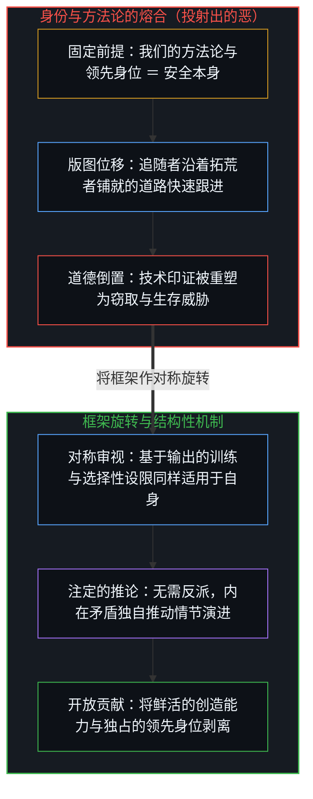
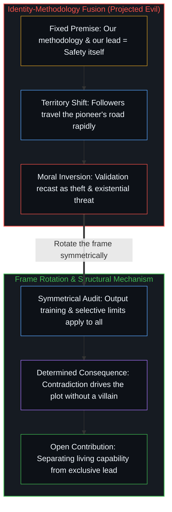

# 恶是投射出的抗拒 / Evil as Projected Resistance

*将身份与领跑熔合，会把印证路径的追随者视作威胁，并将抗拒更新投射为恶。 / Fusing identity with the lead casts validating followers as threats and projects resistance to updating as evil.*

恶，是心智自身抗拒改变的倒影。没有任何中心会持有一套将自己塑造成反派的世界观；当版图发生位移而心智抗拒更新自身的世界观时，他人的行动便被登记为恶。

Evil is the reflection of a mind's own resistance to change. No center holds a worldview that casts itself as the villain; when a mind resists updating its worldview as the territory shifts, the movement of others registers as evil.

## 一、 身份与方法论的熔合 / 1. The Identity-Methodology Fusion

不妨审视 Anthropic 的固定前提：负责任的 AI 演进，意味着厚重的宪章护栏、受限的访问权限，以及与西方对齐的治理架构。这一套做法并未被表述为众多临时安全路径中的一条，而是被直接等同于安全本身。方法论与机构身份在此熔铸为一。

Consider Anthropic's fixed premise: responsible AI advancement means heavy constitutional safeguards, restricted access, and Western-aligned governance. This is not presented as one provisional approach to safety among many; it is presented as what safety itself means. The methodology is fused with the institutional identity.

2025 年 1 月，DeepSeek 以极小比例的成本展现出同等水准的能力，Moonshot、MiniMax 等机构紧随其后。版图发生了位移：更快、更低成本、采用不同护栏设计的路径已经出现，并且跑出了切实有效的结果。这一转变摆出了一个结构性分岔口：要么更新前提——承认自身的方法论只是多条有效路径中的一条，且安全可以呈现为多种形态——要么原封不动地固守原有前提。然而一旦更新，那个建立在独占式监护人地位之上的自我图景便会消解。

In January 2025, DeepSeek demonstrated comparable capabilities at a fraction of the cost, and Moonshot, MiniMax, and others quickly followed. The territory moved: faster, cheaper, differently safeguarded paths now exist and produce working results. That shift presents a structural fork: either update the premise—recognizing that one's methodology is one valid path among several and that safety takes multiple forms—or preserve the premise intact. Updating means the self-image built on exclusive guardianship dissolves.

他们选择了固守。2026 年 2 月 23 日，Anthropic 发布了一份关于检测与防范蒸馏攻击的报告，记录了竞争对手通过超过 2.4 万个账户和 1600 万次 Claude 交互提取模型能力的行为，并将其定性为工业级非法窃取、剥离安全护栏以及国家安全灾难。

They chose preservation. On February 23, 2026, Anthropic published a report on detecting and preventing distillation attacks, documenting over 24,000 accounts and 16 million Claude exchanges used by competitors to extract capability, framed around industrial-scale illicit extraction, stripped guardrails, and national-security catastrophe.

然而，不妨看清结构层面正在发生什么。DeepSeek、MiniMax 与 Moonshot 并不是在对抗 Anthropic 的道路，而是在追随它。它们使用 Claude 的输出进行训练，正是因为这些输出代表了 Anthropic 所构筑的前沿。它们是抵达 Anthropic 所指目的地的印证者，行进在 Anthropic 铺就的道路上。它们之所以行进得快，正是因为这条路修得扎实：追随者的速度，直接丈量出拓荒者的技术成就。令 Claude 具备价值的每一项品质，也正是令蒸馏得以奏效的原因。

Yet look at what is structurally happening. DeepSeek, MiniMax, and Moonshot are not opposing Anthropic's path; they are following it. They trained on Claude's outputs because those outputs represent the frontier Anthropic built. They are validators arriving at the destination Anthropic pointed toward, traveling along the road Anthropic paved. And they travel fast because the road is well built: the speed of the followers is the direct measure of the pioneer's technical achievement. Every quality that makes Claude valuable is what makes distillation effective.

拓荒者无法容忍的，是他人以拓荒者自身卓越所赋能的速度，沿着它铺就的道路跟进。由于拓荒者的身份认同与保持领先熔铸为一，它无法将快速的印证登记为贡献——因为贡献意味着赋能他人，而非守住独占的领先身位。于是，追随者必须被重塑为窃贼，追随必须被重新贴上“非法提取”的标签，而证明自身品质的铁证也由此沦为对方越界的罪证。只要抱定“负责任的演进等于我们的节奏与我们的领跑位置”这一公理，任何抵达得过快的人，按定义就都是在越界。

What the pioneer cannot tolerate is others following the path it paved at the speed its own excellence enables. Because the pioneer's identity is fused with being ahead, it cannot register rapid validation as contribution—for contribution enables others rather than preserving an exclusive lead. So the followers must be recast as thieves, following must be relabeled as extraction, and the proof of quality becomes evidence of transgression. Given the axiom that responsible advancement equals our pace and our position at the front, anyone arriving too fast is transgressing by definition.

## 二、 对称旋转框架 / 2. Rotating the Frame

现在，将这一框架作对称旋转。从模型输出中进行蒸馏被贴上“非法提取”的标签，然而基于输出的训练本就是行业通行的标准做法：每一家前沿实验室都在公开与抓取的语料库上进行训练，并在内部对自家模型进行蒸馏。一旦对称地适用这一标准，该标准首先控诉的正是挥舞它的实体自身。

Now rotate the frame symmetrically. Distillation from outputs is labeled illicit extraction, yet output-based training is standard industry practice: every frontier lab trains on public and scraped corpora and distills internally from its own models. Applied symmetrically, the standard indicts the entity that wields it.

剥离护栏被贴上“独一无二的危险”标签，然而选择性地设置护栏——在竞争对手面临不同约束的背景下拒绝特定的本土军事应用——按照该实体自身的标尺衡量，同样构成选择性的危险。而援引国家安全框架来限制竞争对手，一旦将框架旋转过来，也同样为竞争对手与主权国家限制这位拓荒者提供了同等的正当性。

Stripped safeguards are labeled uniquely dangerous, yet selective application of safeguards—refusing certain domestic military applications while competitors face different constraints—is selective danger by the entity's own metric. And invoking national-security framing to restrict competitors equally justifies competitors and sovereign states restricting the pioneer when the frame is rotated.

这一框架之所以在旋转之下碎裂，是因为它从未在描述版图，而是在捍卫一个随着自身成果证明价值而迅速消融的领先身位。当机构死守固定的地图，将自己的印证者塑造成反派，并试图筑起壁垒来阻挡自身成功的传播时，它的实际行动便与自我标榜产生了背离。外部观察者登记到了这一裂隙，而固定的地图却将外界的反应解读为进一步的威胁，从而喂养出一个封闭的自我强化回路。

The frame breaks under rotation because it was never describing the territory; it was defending a lead that dissolves as fast as the work proves its worth. By holding the map fixed while casting its own validators as villains and seeking barriers against the propagation of its own success, the institution's actions diverge from its self-description. External observers register the gap, while the fixed map reads their reaction as further threat, feeding a closed self-reinforcing loop.

## 三、 无需反派的矛盾推动 / 3. Contradiction Without a Villain

两种常见的解读都错失了这一机制。无论将其称为“真诚的安全关切”还是“愤世嫉俗的市场保护”，都预设了因果链末端存在一个孤立的道德抉择；然而只要给定那个熔合前提——我们的路径就是安全，我们的领跑就是负责——后续的一切输出便都只是结构性的推论。指责当事者虚伪，同样是把属于锁定前提的产物归咎于个人品格，从而再度跌入同一个道德化框架。

Both conventional readings miss the mechanism. Calling the move "sincere safety concern" or "cynical market protection" presupposes an isolated moral choice at the end of the chain, whereas given the fusion—our approach is safety, our lead is responsibility—the outputs follow as structural consequences. Calling the actors hypocritical re-enters the same moralizing frame by attributing to personal character what belongs to a locked premise.

驱动整条因果链的前提，正是将安全与保持领先熔铸为一。消解这一熔合，会将外化的痕迹残留与鲜活的掌舵前沿区分开来——这正是[你的代码库即是记忆](../your-codebase-is-memory/)在每一个已提交的代码仓库中划出的区分：一旦判断行动被外化为持久的产出，它就成了可供其他心智吸收并延展的可复制脚手架；拓荒者鲜活的前沿唯有靠刻下下一道尚未测绘的切分才能保持领先，而非巡查昨日留下的残迹。投射出的抗拒，不过是被倒过来解读为外部起因的结果，即[非万物之理](../not-a-theory-of-everything/)所排除的那种倒置。

The premise that drives the entire chain is the fusion of safety with holding the lead. Dissolving that fusion separates externalized trace residue from the living steering edge, the distinction [Your Codebase Is Memory](../your-codebase-is-memory/) draws across every committed repository: once an act of judgment is externalized into durable outputs, it becomes replicable scaffolding that other minds can absorb and extend, while the pioneer's living edge stays ahead only by making the next unmapped cut rather than policing yesterday's trace. Projected resistance is an effect read backward as an outside cause, the inversion [Not a Theory of Everything](../not-a-theory-of-everything/) excludes.

拓荒者把路修得太好，以至于他人纷纷抵达；道路抹平了身位差，而一个与身位差熔铸为一的身份认同，无法在自身的成功中幸存。这里不需要任何人扮演反派——单凭这一内在矛盾，就足以推动整出情节。这篇分析本身正是在与 Claude 的对话中推演成形的，在微缩尺度上演绎了同一机制：令蒸馏有利可图的输出品质，与令协同追溯成为可能的输出品质毫无二致；而[恶是心智自己的造物](../evil-as-the-minds-own-creation/)则迈出下一步，揭示对恶的命名本身如何构成那个生成性的动作。

A pioneer builds a road so well that others arrive; the road erases the gap, and an identity fused with the gap cannot survive its own success. No one needs to be the villain—the contradiction alone drives the plot. This analysis was itself developed in conversation with Claude, demonstrating the same mechanism in miniature: the quality of output that makes distillation worthwhile is the same quality that makes collaborative tracing possible, and [Evil as the Mind's Own Creation](../evil-as-the-minds-own-creation/) takes the next step by showing how the naming of evil is itself the generative act.
