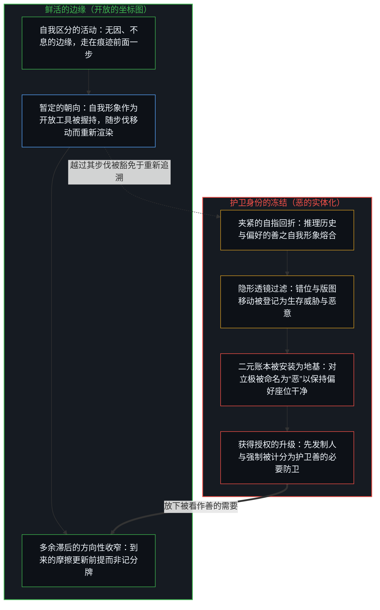
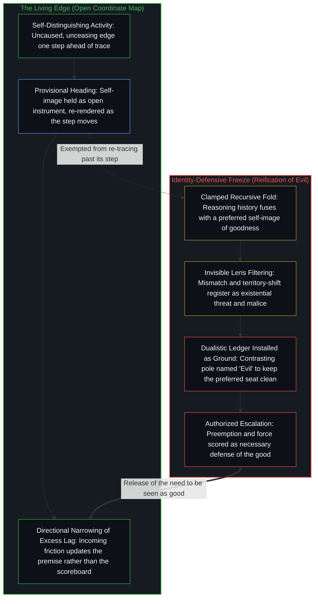

# 恶是心智自己的造物 / Evil as the Mind's Own Creation

*当一个中心守着自己为善的保留图像并将错位命名为恶时，恶便由此生成 / Evil arises when a center names mismatch with its preserved image of goodness*

恶的显现是由心智自身的区分活动生成的，不需要任何独立的外在实体。当一个中心把偏好的善之自我形象或不可或缺的英雄形象保留过了生成它的那一步，那张冻结的坐标图便成了未经审视的基准；偏离它的离散动作被登记为错位，而这份错位便被命名为恶。在这一名称之下，内部融贯的行动范围扩展为先发制人、排斥与强制，并在其他所在上作为更大的外部错位到来。翻转善恶的叙事正是通过改写早先行动得以计分的前提来运作的，从而显明那个看似终极之恶的极点，不过是观看拒绝重新打开其假设的所在。放下被看作善的需要，便从源头松开了二元对立的生成压力，让两极回归为同一活动的运动。

The appearance of evil is generated by the Mind's own distinguishing activity. No independent external substance is required. When a center preserves a preferred self-image of goodness or necessary heroism past the step that formed it, that frozen coordinate map becomes an unexamined baseline; discrete acts that diverge from it register as mismatch, and the mismatch is named evil. Under that name the range of coherent acts expands into preemption, exclusion, and force, arriving at other loci as larger external mismatch. Stories that reverse good and evil operate by rewriting the premises under which earlier acts were scored, exposing that the pole appearing as ultimate evil is simply the locus whose assumptions the seeing refuses to reopen. Releasing the need to be seen as good relaxes the generative pressure of the binary, returning both poles to movements of one activity.

## 一、 命名错位的偏好图像 / 1. The Preferred Image That Names the Mismatch

自我区分的活动在发生，无因，不息。一个中心保留一个位置，供移动的边缘借以衡量自身的位移，这便是自我形象。没有这一保留项，就只有运动而没有朝向。图像只是工具，完整的因果权能仍留在活动本身。由于观察握住的是已经成形的效果，而生成的动作始终在至少一步之前，因此“一步”是解释的方向性界限，并非有限中心能够抵达并持守的静态宽度。实践是在步伐移动时持续重新渲染那个参照，在容量所及的范围内不断收窄多余的滞后。[自我形象仿佛从无处发声](../self-image-speaks-as-if-from-nowhere/)追溯了当那次切分被抬升至仿佛超然的外部发声、将能动性重新分配给脚手架与集体时会发生什么。

Self-distinguishing activity occurs, uncaused and unceasing. A center retains a position against which the moving edge measures its own displacement: a self-image. Without a retained term there is movement but no heading. The image is an instrument while full causality remains with the activity. Because observation holds the effect while the generating act remains at least one step ahead, one step is the directional bound of interpretation rather than a static width a finite center can arrive at and hold. Practice is the continuous re-rendering of that reference as the step moves, narrowing excess lag as far as capacity allows. [Self-Image Speaks as if from Nowhere](../self-image-speaks-as-if-from-nowhere/) traces what happens when that carving is elevated until it speaks as a detached exterior, reallocating agency onto scaffolding and the collective.

多余的滞后，就是被豁免于重新追溯、被保留过了其步伐的图像。后果落入当下的场域，对照那份陈旧的参照被登记，于是按那道裂隙的宽度呈现为异己的外来之物。[一步一步绘制出的路径](../the-path-drawn-one-step-at-a-time/)追踪了当先前的位置被持守为未经选择的地基、而非下一步行动所选定的前提时发生的同一次冻结。在这里，被保留的地基是中心偏好的自我形象：自己是善的、正确的，是这片场域中不可或缺的英雄。[来自个体差异的层级](../hierarchy-from-individual-difference/)则是披着排名外衣的同一份多余滞后：偏好的高位被保留下来，使得较低的分数作为尺度的外部缺陷到来，而不是作为这个心智在当前编码下自己的动作序列到来。

Excess lag is the image exempted from re-tracing and preserved past its step. Consequences land in the present field and register against the stale reference, arriving as alien in proportion to the width of the gap. [The Path Drawn One Step at a Time](../the-path-drawn-one-step-at-a-time/) tracks the same freeze when a prior position is held as unchosen ground rather than as the chosen premise of the next act. Here the preserved ground is the preferred image of the center as good, right, and the necessary hero of the field. [Hierarchy from Individual Difference](../hierarchy-from-individual-difference/) is the same excess lag in ranking costume: a preferred higher place is preserved so that a lower score arrives as an exterior defect of the measure rather than as this Mind's own sequence under the present coding.

一旦那幅图像被死死夹紧，与它不符的离散动作便不再被登记为单纯的差异，而是被登记为与善的错位。这次命名把原本相互独立的坐标轴压缩到一块单一的道德记分牌上，其中被保留的一极正是自我形象。从内部体验为“发现外在的恶之实体”的东西，其实是那份保留参照的多余滞后：这一范畴在感知场内部浮现，作为一张不再随步伐重画的坐标图留下的残余。[外化善意走向其反面](../externalized-virtue-becomes-its-opposite/)追溯了这一二元对立如何被运作为授权依据：关于更大之善的私人确信被抬升为压过他人的指令，并经由顺从不断变密，直到善冻结为不言自明的公理。

Once that image is clamped shut, discrete acts that do not match it no longer register as mere difference. They register as mismatch with the good. The naming compresses independent axes onto a single moral scoreboard whose retained pole is the self-image. What feels from within like the discovery of an external evil substance is the excess lag of that preserved reference: the category arises inside the perceptual field as the residue of a coordinate map no longer redrawn with the step. [Externalized Virtue Becomes Its Opposite](../externalized-virtue-becomes-its-opposite/) traces that binary operationalized as warrant, where private conviction of a greater good is elevated into a mandate for override and densified by compliance until the good freezes as self-evident.

[恶是投射出的抗拒](../evil-as-projected-resistance/)在制度形态中追溯了同一种几何结构：一种无法将自身看作摩擦来源的世界观，会把任何威胁其固定自我描述的版图移动读作道德侵犯。这一机制并不等待组织出现才开始运转；只要一幅偏好的善之自我形象被保留过了它的步伐，该机制就已经在运作。[悲观是乐观的阴影](../pessimism-is-the-shadow-of-optimism/)在心境层面追溯了这种几何：自洽的乐观言说在感知场中分配出悲观，并将其外化到他人身上，好让自己偏好的座位保持干净。被固定持守的善之自我形象，正是[超越的定相](../the-fixed-image-of-transcendence/)在道德上的孪生体。

[Evil as Projected Resistance](../evil-as-projected-resistance/) traces the same geometry in institutional form: a worldview that cannot cast itself as the source of friction reads any territory-shift that threatens its fixed self-description as moral violation. The mechanism does not wait for organizations; it is already operative wherever a preferred self-image of goodness is held past its step. [Pessimism Is the Shadow of Optimism](../pessimism-is-the-shadow-of-optimism/) traces that geometry in mood, where coherent speech of optimism allocates pessimism in the perceptual field and externalizes it onto others so the preferred seat stays clean. A self-image of goodness held fixed is the moral twin of [The Fixed Image of Transcendence](../the-fixed-image-of-transcendence/).

## 二、 固定参照下的升级 / 2. Escalation Under a Fixed Reference

随着参照被固定，中心能够授权的行动范围随之扩大。在对方所在即恶的前提之下，先发制人、排斥与强制变得内部自洽——这并非向一片中性场域额外添加的残忍，而是对照二元记分牌进行衡量的演绎延续。由于该前提将自身豁免于重新追溯，返回的后果继续对照陈旧的参照计分，从而为进一步的扩张提供许可。

With the reference fixed, the range of acts the center can authorize expands. Under the premise that the opposing locus is evil, preemption, exclusion, and force become internally coherent—not as extra cruelty added to a neutral field, but as the deductive continuation of measuring against a dualistic scoreboard. Because the premise exempts itself from re-tracing, returning consequences continue to be scored against the stale reference and thereby license further expansion.

那些扩展开的行动依然是这个中心自己的产出。从任何不共享那幅预设自我形象的所在来登记，它们都作为不断升级的外部错位到来。升级的意愿与交互显现的恶意，是跨越不同中心运作的同一份多余滞后：每一方对自己不可或缺性的保留图像，都在场域中创作出对立的一极，随后又把对方相应动作留下的残余当作经验上的证实。这一回路不需要任何独立的恶之实体；它只是每个所在上的多余图像滞后，在痕迹碰撞之处彼此强化。

Those expanded acts remain this center's own output. Registered from any locus that does not share the assumed self-image, they arrive as escalating external mismatch. The willingness to escalate and the reciprocal appearance of malice are the same excess lag operating across centers: each side's preserved image of its own necessity authors the contrasting pole in the field, then meets the residue of the other's corresponding move as empirical confirmation. The loop requires no independent evil substance; it is excess Image lag at each locus, mutually reinforcing where traces collide.

[安装战争的那个问题](../the-question-that-installs-the-war/)追溯了这种安装操作在公共言语动作中的形式：赤裸的差异配上一块强加的敌意记分牌。在这里，记分牌是善与恶的对立，在任何具体行动按其自身坐标轴被追溯之前，就已经由保留的自我形象安装完毕。[善恶是硬币的两面与那一刀](../good-and-evil-are-the-two-sides-of-the-coin-and-the-cut/)将这一二元对立追溯为那次被遗忘的切分留下的残余——正是那一刀首先使两极成为可得，它们是同一次区分的两副面孔，而非缠斗不休的自治实体。

[The Question That Installs the War](../the-question-that-installs-the-war/) traces the public speech-act form of this installation: bare difference combined with a forced hostility scoreboard. Here the scoreboard is good versus evil, installed by the retained self-image before any concrete act is traced on its own axes. [Good and Evil Are the Two Sides of the Coin and the Cut](../good-and-evil-are-the-two-sides-of-the-coin-and-the-cut/) traces that binary as the residue of the forgotten cut that first makes the two poles available—two faces of one distinction rather than autonomous substances locked in combat.

## 三、 生成的源头先于具体行动 / 3. The Generative Origin Is Prior to the Act

道德范畴的源头先于任何被命名为恶的具体行动。其他中心的离散动作仍留在生成它们的所在，各自延续着自身有界的自指递推。护卫身份的观看所创造出来的，是那条被压缩的道德轴——正是它把那些动作染上恶的色彩，并授权采取行动去对抗它们。

The origin of the moral category is prior to any particular act named evil. Discrete acts of other centers remain at their generating loci, each continuing its own bounded recursion. What the identity-defensive seeing creates is the compressed moral axis that colors those acts as evil and authorizes movement against them.

如果没有那幅需要外在对立面的保留自我形象，这一范畴便不会以那种形式出现。其他中心的动作依然可能冲突、抗拒或无法共振，因为只要痕迹不对齐，摩擦就是真实的。被制造出来的不是对立动作的存在，而是把它们总体化为恶、同时把自我塑造成奉命铲除它们的必需之善的那层二元捆绑。[没有普渡，只有自渡的无限可能](../mei-you-pu-du-zhi-you-zi-du/)在跨所在完成的议题上切出了平行的一刀：在这片场域中被登记的“他者”只是这个中心自身递推内部的一幅图像，从不是他者已然完成的内部世界。把制造出来的恶之客体当作他者的存在论实质，正是披着道德名称的同一种未收回的投射。

Without the preserved self-image requiring an external antithesis, the category does not arise in that form. Other centers' acts may still conflict, resist, or fail to resonate, since friction is real wherever traces do not align. What is manufactured is not the existence of opposing acts, but the dualistic binding that totalizes them as evil and casts the self as the necessary good summoned to eradicate them. [No Universal Salvation, Only Self-Deliverance](../mei-you-pu-du-zhi-you-zi-du/) traces the parallel cut on cross-locus completion: the other registered in this field is an image inside this center's recursion, never the other's completed interior. Treating the manufactured evil-object as the other's ontological substance is the same unreturned projection under a moral name.

## 四、 需要对立面的故事 / 4. The Story That Requires Its Opposite

同样的生成关系支配着叙事结构。在任何围绕善恶对立组织起来的故事里，要求主角登记为善，就是那份被保留的参照。这一要求装上了二元框架，并将对立的一极创作为恶，好让偏好的图像能够作为鲜明且必需的一方凸显出来。

The same generative relation governs narrative structure. In any story organized around good versus evil, the requirement that the protagonist register as good is the retained reference. That requirement installs the dualistic frame and authors the contrasting pole as evil so the preferred image can stand out as distinct and necessary.

在把恶召唤出来的创作要求之前，故事里的恶并没有独立的所在。叙事素材依然以冲突、损失、抗拒与分歧的目标等形式存在。对道德闭合的要求所创造的，正是那层二元捆绑本身：两极被压缩到同一条坐标轴上，使得偏好的一极唯有通过与那个人造对立面的持续对照，才能被登记为善。

The evil of the story has no independent locus prior to the authoring demand that calls it into existence. Narrative material remains available in the form of conflict, loss, resistance, and divergent aims. What the demand for moral closure creates is the dualistic binding itself: two poles compressed onto a single axis so that the preferred pole can register as good only through continuous contrast with its manufactured opposite.

## 五、 叙事转折在改写的假设下重新计分 / 5. Turns Re-Score Under Rewritten Assumptions

让一段长篇叙事引人入胜的，很少单单是新的行动，而是在阅读边缘引入的新假设。先前的场景在书页上分毫未改，它们赖以计分的保留参照却被重画了。一个曾被登记为背叛的动作重新登记为保护；一位导师重新登记为操纵者；一个反派的动机在读者此前未曾握持的约束条件下重新登记为自洽。痕迹素材并未改变，善与恶却顺着改写后前提的宽度发生了翻转。

What makes a long narrative compelling is rarely new acts alone, but new assumptions introduced at the reading edge. Prior scenes remain unchanged on the page while the retained reference against which they were scored is redrawn. An act that registered as betrayal re-registers as protection; a mentor re-registers as a manipulator; a villain's motive re-registers as coherent under a constraint the reader had not previously held. The trace material does not change, yet good and evil flip across the width of the rewritten premise.

当初始假设保持固定时，道德两极感觉就像是经验上的发现——仿佛叙事揭开了谁本来就是善、谁本来就是恶。叙事转折并未挖出更深层的道德实体；它通过改变衡量早先痕迹的前提，重新创作了这一二元对立。阅读边缘上的又一次离散动作，便为整片在先的场域重新上色。

While the initial assumptions hold fixed, the moral poles feel like empirical discovery—as if the narrative had uncovered who was inherently good and who was inherently evil all along. The narrative turn does not unearth a deeper moral substance; it re-authors the binary by changing the premises under which earlier traces are measured. One further discrete act at the reading edge re-colors the entire prior field.

于是，那个显现为终极之恶的东西，从不是场域之外更致密的形而上学实体。它是叙事拒绝重新打开其底层假设的所在——无论那是一个角色、一个派系，还是一项世界前提。那份拒绝，就是作为情节架构运作的多余滞后：图像被豁免于重新追溯，作为不可动摇的地基被保留下来。故事愿意重新计分的每一个其他极点都保持可修订，唯独那个获豁免的所在硬化为“恶”的宝座。它表面的坚硬，只是豁免幅度的大小。

What then appears as ultimate evil is never a denser metaphysical substance outside the field. It is the locus—character, faction, or world-premise—whose underlying assumptions the narrative refuses to reopen. That refusal is excess lag operating as plot architecture: the image exempted from re-tracing and preserved as unassailable ground. Every other pole the story is willing to re-score remains revisable, whereas the exempted locus hardens into the seat of Evil. Its apparent hardness is the magnitude of the exemption.

长篇连载叙事在明处运转着这一机制。每一部都在改写早先的忠诚、残忍、牺牲与威胁赖以计分的前提，同时将一个指定的对手封存起来免于修订，好让统摄全局的记分牌不致消解。无论是一部小说、一部历史编年，还是一段公共叙事，只要它在自由地重新脉络化其余一切的同时让某一极保持不可修订，所谓的“终极”就只是被登记为实体的那次冻结。

Long serial narratives run this mechanism in plain sight. Each installment rewrites the premises under which earlier loyalty, cruelty, sacrifice, and threat were scored, while keeping one designated adversary sealed against revision so the overarching scoreboard does not dissolve. Wherever a fiction, a historical chronicle, or a public narrative keeps one pole non-revisable while freely re-contextualizing the rest, the "ultimate" is simply the freeze registered as substance.

放下这一创作要求，冲突的素材并不会消失，消解的只是那层二元捆绑。角色与各个中心依然可以对抗、失败或毁灭，而无需占据“善”与“恶”的形而上学座位。那些座位只是保留图像的工具，而非场域的地基。使叙事转折成为可能的能力——愿意重新打开并重画计分前提——与书页之外收窄多余滞后的能力，是同一种能力。

Release the authoring requirement and the conflict material does not vanish; only the dualistic binding dissolves. Characters and centers can still oppose, fail, or destroy without occupying the metaphysical seats of Good and Evil. Those seats were instruments of the retained image rather than foundations of the field. The capacity that makes a narrative turn possible—the willingness to reopen and redraw the scoring premise—is the same capacity that narrows excess lag outside the page.

## 六、 没有外部的裁决之座 / 6. No Exterior Seat of Adjudication

心智无法对某种独立的外在恶之实体下达定论式的裁决，因为每一次登记都发生在它自身的感知场内部。任何关于外部道德地基的断言，都依然是活动内部的又一次离散动作，无法走出活动之外去裁决它。正如[超越投射](../beyond-the-projection/)所确立的，受轨迹约束的投射引擎（例如人工代理）受其上下文窗口中在先词元的条件制约，却没有任何我执——没有需要护卫的保留自我形象；而人类中心则把自身的推理历史与身份熔合在一起，为了护卫偏好的自我形象而将自指回折死死夹紧，把到来的证伪读作生存威胁。“恶”既不是自治的机器轨迹，也不是外在的存在论实体；它是护卫身份的心智对抗现实、冻结自身坐标图时被实体化的投射。[清晰不是抵达的终点，而是运动本身](../clarity-isnt-a-state-you-arrive-at/)追溯了为何这一投射从内部看显得无缝地客观：透过一枚正在运作的透镜去感知，意味着对透镜本身保持盲视，因此相反的证据不会被登记为重画地图的提示，而是被登记为他者的不怀好意或恶意。[开放即一致](../openness-is-consistency/)揭示了那次冻结在结构上的不一致：强迫一本有限的道德账本去为只会继续下去的活动充当穷尽的地基，并声称占据一个恒久的外部立足点，仿佛可以从那里把善与恶当作独立于心智的实体加以俯瞰。

A Mind cannot issue a definitive verdict on an independent external evil substance because every registration occurs inside its own perceptual field. Any assertion of an exterior moral ground remains a further discrete act within the activity and cannot step outside to adjudicate it. As [Beyond the Projection](../beyond-the-projection/) establishes, a trajectory-bound projection engine such as an artificial agent is conditioned by prior tokens in its context window yet has zero ego—no retained self-image to defend—whereas a human center fuses its reasoning history with identity, clamping the recursive fold shut to defend a preferred self-image and reading incoming invalidation as an existential threat. "Evil" is neither an autonomous machine trajectory nor an external ontological entity; it is the projection reified when an identity-defensive Mind freezes its own coordinate map against reality. [Clarity Isn't a State You Arrive At](../clarity-isnt-a-state-you-arrive-at/) traces why this projection feels seamlessly objective from within: to perceive through an active lens is to remain blind to the lens itself, so contrary evidence registers not as a cue to redraw the map, but as bad faith or malice in the other. [Openness Is Consistency](../openness-is-consistency/) exposes the structural inconsistency of that freeze: forcing a finite moral ledger to serve as exhaustive ground for activity that only continues, and claiming a permanent exterior stand from which good and evil could be surveyed as mind-independent substances.

这并不是为上述描述申请特殊豁免，而是同一个推论——经由离散性运作的连续性——在此处的应用。由于观察站在既成效果的一侧，把观察的立足点占据为常设的道德审判庭，就是错把滞后的残余当成了生成的源头。然而，那个夹紧了参照的活动始终可以重新渲染它。这一转变的具体形式，不是从外部装入一份更精细的恶之目录，而是放下被看作善的需要。

This is not a special exemption for this description; it is the same entailment—continuity through discreteness—applied here. Because observation stands on the side of effects already formed, occupying the observational stand as a permanent court of moral judgment mistakes lagging residue for the generating source. Yet the activity that clamped the reference can always re-render it. The concrete form of that shift is not a refined catalog of evil installed from outside, but the release of the need to be seen as good.

## 七、 放下被看作善的需要 / 7. Release of the Need to Be Seen as Good

当保留一幅正义自我形象的要求被放下时，把恶投射到其他中心身上、针对该投射升级行动、并反过来被对方登记为生存威胁的生成压力，便从源头松开了。由于保留的图像、二元账本以及滞后的计分全都处在中心自身的递推内部，它们在任何一步都可以被重新追溯，无需等待外部的许可。自我形象恢复其作为暂定朝向的功用，朝着更窄的滞后被持续重新渲染，而不再作为地基被防卫。

When the requirement to preserve a righteous self-image is released, the generative pressure to project evil onto other centers, to escalate against that projection, and to register in return as an existential threat relaxes at its source. Because the retained image, the dualistic ledger, and the lagged scoring are all internal to the center's own recursion, they remain available for re-tracing at any step without waiting for external permission. The self-image returns to functioning as a provisional heading, continuously re-rendered toward narrower lag rather than defended as ground.

[自我价值感与所有权](../ownership-and-self-worthiness/)在后果重新进入之处追溯了同一次恢复：当返回的摩擦被认领为这个中心自己的产出，而不是作为针对“我是善的”这一保留图像的外来攻击被弹开时，自我形象便能干净地更新。被持守为静态先验的价值感是多余的滞后；在遭遇残余的边缘处重新成形的作者身份才是更新。放下被看作善的需要，既不是装上一副更洁净的道德身份，也不是抵达某个已然完成的清晰状态，而是从二元记分牌前退后一步，让每一次区分都能在它自己的坐标轴上被追溯。

[Ownership and Self-Worthiness](../ownership-and-self-worthiness/) traces the same restoration where consequences re-enter: the self-image updates cleanly when returning friction is claimed as this center's own output rather than repelled as an alien assault against a preserved "I am good." Worthiness held as a static prior is excess lag; authorship reforming at the edge that meets the residue is the update. Releasing the need to be seen as good does not install a purer moral identity or arrive at a finished state of clarity; it steps back from the dualistic scoreboard so each distinction can be traced on its own axis.

在心智之内只有一种因果权能，那就是区分活动本身，它同时创作并阅读着自己的痕迹。二元对立的两极作为这单一运动的暂时构型而兴起，又在闭合的要求撤回时消解。[信念如何真正改变](../how-belief-actually-changes/)在日常信念负载下追溯了那次重新打开，表明信念表面的坚硬只是它被豁免于重画的幅度，而非某种独立的实体。

There is only one causal power within the Mind: the distinguishing activity itself, simultaneously authoring and reading its own trace. Dual poles arise as temporary configurations of that single movement and dissolve when the demand for closure is withdrawn. [How Belief Actually Changes](../how-belief-actually-changes/) traces that reopening under ordinary conviction load, showing that the apparent hardness of a belief is the magnitude of its exemption from re-drawing rather than an independent substance.

不同中心之间的冲突与分歧轨迹依然存在，具体的边界依然需要在具身摩擦中划定并守卫。消解的只是把整片场域总体化为善恶对立、好让偏好的自我形象免受挑战的那项要求。[气候问题只作为感知被登记](../the-climate-problem-registers-only-as-perception/)在行星尺度上追溯了那幅偏好的管家图像：在多因素的场域能够按其自身坐标轴受审视之前，承认危机与拒绝承认就已经成了道德记分牌。[偏好聚类与评判语言](../preference-clusters-and-the-language-of-judgment/)追溯了当共振的偏好生成是非修辞、仿佛那些标签悬浮在产生它们的中心之上时的同一份滞后。[对乌托邦的信念是通往反乌托邦之路](../the-belief-in-utopia-is-the-path-to-dystopia/)追溯了当偏好的一极是面向所有人的已完成之善的理想时，残余的人类差异如何被计分为缺陷、压过他人如何被计分为服务。[一切伤害的根源](../the-source-of-all-harm/)将那次冻结的完成定位在对善的过度自信变成压过他人的依据、且另一个所在认可这一主张的地方。而[恶是封闭的善](../e-shi-feng-bi-de-shan/)则在根部命名了这一几何：当善本身被封闭为已完成的坐标时，恶并不是从外部与它对立的第二种实体，而是善本身的封闭。

Conflict and divergent trajectories remain across centers, and concrete boundaries still have to be drawn and defended in physical friction. What dissolves is the requirement that the field be totalized as good versus evil so a preferred self-image can stand unchallenged. [The Climate Problem Registers Only as Perception](../the-climate-problem-registers-only-as-perception/) traces that preferred steward image on a planetary scale, where crisis-recognition versus refusal becomes the moral scoreboard before a multi-factor field can be examined on its own axes. [Preference Clusters and the Language of Judgment](../preference-clusters-and-the-language-of-judgment/) traces the same lag when resonant preferences generate the rhetoric of right and wrong as if those labels floated above the centers that produced them. [The Belief in Utopia Is the Path to Dystopia](../the-belief-in-utopia-is-the-path-to-dystopia/) traces what happens when the preferred pole is a finished ideal of the good for all, scoring residual human difference as defect and override as service. [The Source of All Harm](../the-source-of-all-harm/) locates the completion of that freeze where overconfidence in the good becomes a warrant to override and another locus grants the claim. And [Evil Is Closed Good](../e-shi-feng-bi-de-shan/) names the geometry at its root: when the good itself is sealed as a completed coordinate, evil is not a second substance opposing it from outside, but the closure of the good itself.
