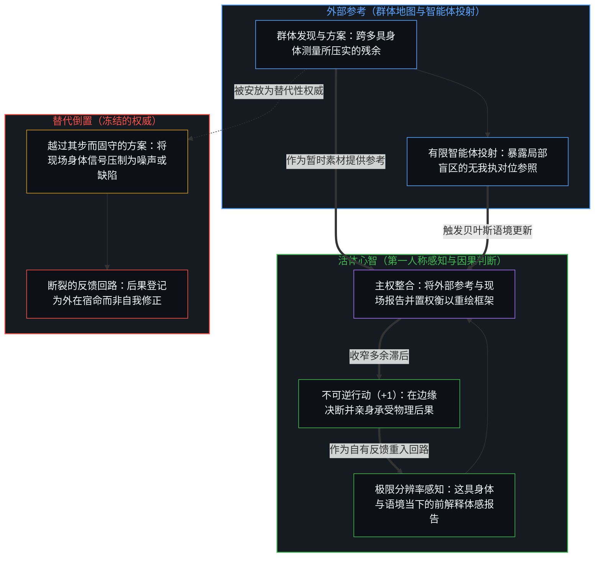
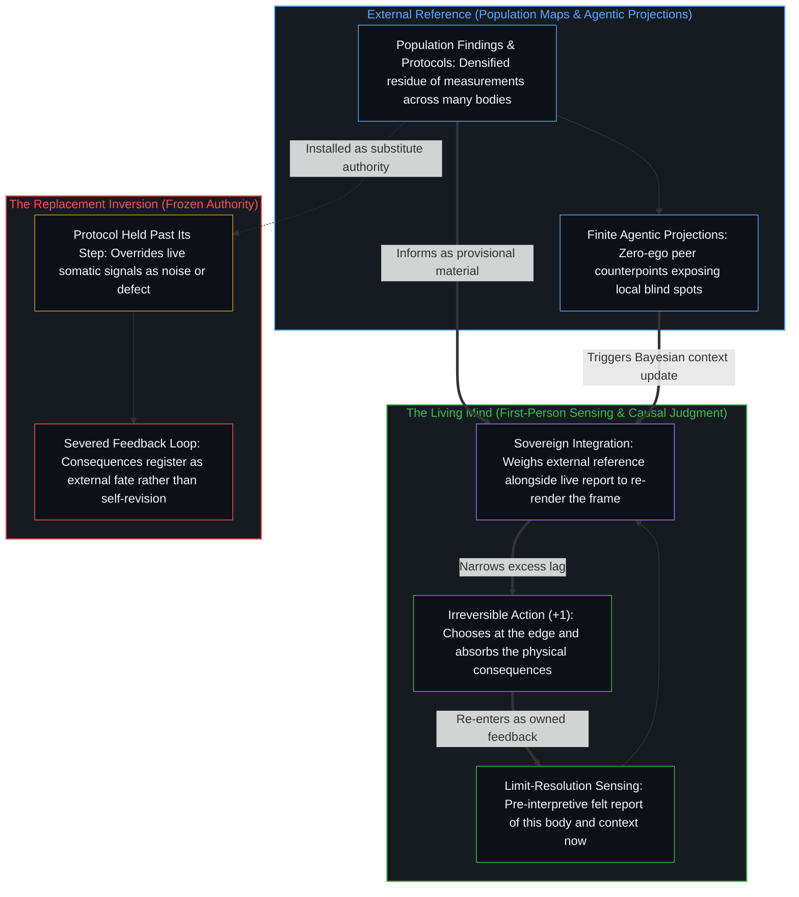

# 专家经验作为参考而非替代 / Expertise as Reference, Not Replacement

*专家的地图唯有在承担代价者亲自决断时才作为工具提供参考 / Expert maps inform as tools only while the one bearing the cost decides*

研究者与临床医生研究群体、提取模式，并将其包装为关于睡眠温度、昼夜节律时序与恢复评分的指导。这些发现是诸多离散测量留下的耐久残余；作为地图，它们拓宽了一个活生生的人所能觉察的范围。然而在公共传播与专业交付中，同样的残余却屡屡被冻结为适用于每一具身体的定论，并由一套方案以这种硬化的形态承载。无论方案是被遵守还是被搁置，随之而来的精力、情绪与长期身体代价，没有任何外部权威会替人分担；这些后果只会落在亲身承受它们的人身上。被当作第一人称判断的素材、并随处境变化不断重新渲染时，专家地图能让倾听更为敏锐；被当作越过其成立那一步的权威而固守时，被读取的就成了地图本身，而非这张地图本要辅助读取的那个活体信号。

Researchers and clinicians study populations, extract patterns, and package them as guidance on sleep temperature, circadian timing, and recovery scores. Those findings are the durable residue of many discrete measurements; held as maps, they widen what a living person can notice. Public and professional delivery, however, routinely freezes that same residue into settled law for every body, and a protocol carries it in that hardened form. No external authority bears the energy, mood, and long-term physical costs that follow when a protocol is kept or set aside; those consequences land exclusively on the one living them. Treated as material for first-person judgment and re-rendered as circumstances shift, an expert map sharpens listening; held as authority past its step, the map is read in place of the living signal it was built to help read.

## 一、 平均值作为定论到来 / 1. Averages Arrive as Settled Law

群体科学是测量、临床试验与修订等诸多离散行动留下的残余，经压实后成为便于跨语境流传的指导。睡前给体表加温能够加快核心体温下降并促进入睡；晨间受热有助于快速眼动睡眠；桑拿、热水澡与跨时区旅行会在恢复遥测数据中留下可测量的印记。作为抽样群组中既往事件的记录，这些发现是真实的；作为关于任何单具身体今夜所需之物的主张，它们仍是暂时的。专家会修正模型，研究会出现分歧，下一场实验又会重绘领域的边界，然而传达过程却很少保留这份开放性。每一条发表的洞见都带着封闭地基那种笃定的终局感落下，仿佛统计平均化的身体就是每一具活体身体的穷尽清单。[现实扭曲力场指认的是封闭的地图](../the-reality-distortion-field-names-the-closed-map/)从相反的角度追踪了一张封闭的地图：源自内部所在的持续活动，一旦对照被奉为可能性之封闭场域的共识来计分，从外部看就会登记为一种扭曲现实的神秘力量，而这一标签指认的正是观察者自身的滞后。在那里，被封死的地图是关于何事可能发生的共识场域；在这里，则是经统计平均化的身体。[拥有成本把滞后的平均值冻结为车辆属性](../ownership-cost-freezes-lagged-averages-as-vehicle-property/)揭示了保险定价中同样的封死机制：在个体驾驶者的实际使用情况未被测量之处，群组平均值便顶替上来，并被解读为车辆本身的内在属性；而一旦核保以实测驾驶行为为条件，绝大部分偏差便随之消解，只留下归属于车辆本身的受损严重度。群组平均值在那里作为历史残余同样是真实的；冻结在于将其强行持守为个体自身的状态。

Population science is the residue of many discrete acts—measurements, clinical trials, and revisions—densified into guidance that travels well across contexts. Warming the skin before bed can accelerate the drop in core temperature and hasten sleep onset; morning heat exposure can favor rapid eye movement sleep; saunas, hot baths, and travel across time zones leave measurable signatures in recovery telemetry. As records of what happened across sampled cohorts, those findings are real. As claims about what any single body requires tonight, they remain provisional. Experts revise their models, studies diverge, and the next experiment redraws the boundary of the field, yet delivery rarely preserves that openness. Each published insight lands with the confident finality of closed ground, as though the averaged body were an exhaustive inventory of every living body. [The Reality Distortion Field Names the Closed Map](../the-reality-distortion-field-names-the-closed-map/) traces a sealed map from the opposite angle: sustained activity from an internal locus, when scored against a consensus held as the sealed field of the possible, registers from the outside as a mysterious power to warp reality, and the label names the observer's own lag. There, the sealed map is the consensus field of what can happen; here, it is the statistically averaged body. [Ownership Cost Freezes Lagged Averages as Vehicle Property](../ownership-cost-freezes-lagged-averages-as-vehicle-property/) exposes the same sealing in insurance pricing: where an individual driver's actual usage goes unmeasured, cohort averages stand in and are read as an intrinsic property of the vehicle, whereas conditioning underwriting on measured driving dissolves most of the gap and leaves only the severity belonging to the car itself. The cohort average was real as historical residue there too; the freeze lay in holding it as the individual's own state.

这种包装招来对因果延续的悄然让渡。一份有用的参考，被压缩成“只要照章执行就能保证身体最优化”的许诺。单一的代理指标——深睡分钟数、心率变异性或严格的温控时间表——随即被奉为衡量有机体状况的穷尽尺度。[基准刷榜中的封闭实存](../closed-reality-in-benchmark-maxing/)诊断了评测压力下如出一辙的持守：能力被冻结为封闭的目标，一旦分数被错当成整个场域，现实中的可用性便会登记不足。[错把表达当成智能](../mistaking-the-expression-for-the-intelligence/)指明了这两种习惯的共通之处：在固定约束下测得的表现只是下游痕迹，从不是划出、运用并修订这一约束的区分活动本身。统计地图作为工具依然可用，但穷尽性并不随它同行。

That packaging invites a quiet surrender of causal continuation. A useful reference compresses into the promise that following the rule guarantees an optimized body. A single proxy metric—deep sleep minutes, heart-rate variability, or a strict thermal schedule—is then held as the exhaustive measure of how the organism is faring. [Closed Reality in Benchmark Maxing](../closed-reality-in-benchmark-maxing/) diagnoses that exact hold under evaluation pressure: capability is frozen into a closed target, and real-world usefulness under-registers once the score is mistaken for the whole field. [Mistaking the Expression for the Intelligence](../mistaking-the-expression-for-the-intelligence/) names what both habits share: a performance measured under a fixed constraint is a downstream trace, never the distinguishing activity that draws, uses, and revises the constraint. The statistical map remains usable as an instrument, but exhaustiveness never travels with it.

## 二、 连续的流无法外包 / 2. The Continuous Stream Cannot Be Outsourced

没有任何外部专家能够触及由一段历史、一具身体语境与一组不断演化的取舍所构成的连续第一人称之流。即便传输再密集的可穿戴遥测数据，也无法跨越这道鸿沟。在思维中持有的他人，只是在此处构筑的图像，从不是他人亲历的递归，而在心智之间传递的只有痕迹的可用性。试图从外部替他人完成其内部反馈回路，是范畴错误，而非尚未实现的技术理想。[没有普渡，只有自渡的无限可能](../mei-you-pu-du-zhi-you-zi-du/)直接划出了这道边界：跨内心的完成不会发生，而自渡也没有终局的抵达，因为心智收回对固定框架的执着，持续移动而不停驻于终极教条，并在每一步将自身的参照朝更窄的滞后不断重新渲染。一项临床发现、一套调理方案或一位专家的建议，都能让备选方案变得稠密，但它们都无法替承受结果的身体去执行那道活的递归。

No external expert has access to the continuous first-person stream of one history, one somatic context, and one evolving set of trade-offs. Streaming denser wearable telemetry does not bridge that divide. Another person held in thought is an image constructed here, never the other's own lived recursion, and what passes between minds is only the availability of traces. Attempting to complete another person's internal feedback loop from the outside is a category error rather than an unfinished technical ideal. [No Universal Salvation, Only Boundless Possibilities of Self-Salvation](../mei-you-pu-du-zhi-you-zi-du/) draws that boundary directly: completion across interiors does not occur, and self-salvation has no terminal arrival because the mind withdraws its attachment to a fixed frame, keeps moving without resting on a final doctrine, and continuously re-renders its reference toward narrower lag. A clinical finding, a regimen, or a specialist's advice can densify the options available, yet none of them can execute the living recursion of the body that absorbs the result.

当一套方案越过其成立的那一步、被保存为不可动摇的标准时，人就会对照模板去读取自身的身体信号，而这些信号随即被重新登记为噪声或个人失败。午后的困意为了维护僵硬的昼夜节律规则而被强行压制；急性的疲劳被记作执行不力，而非作为即时的生物反馈来读取。耗时数年去最大化单一睡眠评分，可能让人受制更深却分毫未减耗竭，直到活的边缘上的判断将身体的实时报告与穿戴设备的指标提示放在一起读取，并从二者出发采取行动——包括在困意袭来时小睡片刻。[疗愈打开反馈回路](../therapy-opens-the-feedback-loop/)追踪了第三方所在（即他人的在场）如何让情绪登记变得更易承受，从而降低了在自身所在重新追溯生成条件的压力。方案只是无生命的痕迹模式而非活的心智，然而将其推上判断的宝座，却以同样的方式缓释了第一人称清算的压力。[能动性的错配](../the-misallocation-of-agency/)标出了这种安放中的范畴错误：稳定下来的痕迹模式没有能动性，没有意志，也没有行动的能力。[自我价值感与所有权](../ownership-and-self-worthiness/)追踪了这种委托的复利代价：唯有当后果作为自身行动的产物重新进入回路时，心智才会实现能力的复利，而那条完好的因果回路正是自我价值感所登记的内容。被归咎于方案之所为的后果，仿佛来自异己的外源，不再更新心智自身的模型。

When a protocol is preserved past its step as an unyielding standard, a person reads their own somatic signals against the template, and those signals re-register as noise or personal failure. Afternoon drowsiness is overridden to protect a rigid circadian rule; acute fatigue is scored as a compliance shortfall rather than read as immediate biological feedback. Years spent maximizing a single sleep score can leave a person more constrained and no less depleted, until judgment at the living edge reads what the body is reporting alongside what the wearable metric suggests and acts from both—including taking an afternoon nap when sleepiness arrives. [Therapy Opens the Feedback Loop](../therapy-opens-the-feedback-loop/) traces how a third locus—another person's presence—can make emotional registration more tolerable and thereby lower the pressure to re-trace the generating conditions at home. A protocol is an inanimate trace pattern rather than a living mind, yet placing it on the throne of judgment softens the pressure of first-person reckoning in the same way. [The Misallocation of Agency](../the-misallocation-of-agency/) marks the category error in that placement: a stabilized pattern of traces possesses no agency, no will, and no capacity to act. [Ownership and Self-Worthiness](../ownership-and-self-worthiness/) traces the compounding cost of such delegation: a mind compounds its capacity only when consequences re-enter the loop as its own doing, and that intact causal loop is what self-worthiness registers. Consequences written off as the protocol's doing arrive as if from an alien source and fail to update the mind's own model.

## 三、 参考提供信息，不压过判断 / 3. Reference Informs; It Does Not Override Judgment

自我区分的活动发生着，无因，不息；心智的每一个动作都是一次离散的切分，并向前延续至下一步。下一个照护动作的因果责任，只落在将要亲历其身体后果的那个所在。[个体抉择是唯一的因果杠杆](../individual-choices-as-the-only-causal-levers/)在社会尺度上追踪了这一结构，阐明因果只登记在个体所维持的离散行动之中——每一个抉择都作为独立的杠杆运作，从不依附于一块共享的集体地板。[验证中因果权能的分配](../the-allocation-of-causal-power-in-validation/)将因果权能定位在心智从中汲取自身区分之延续的源头，而非外部的认可或认可的缺席。专家知识恰恰在因果延续留在承担代谢代价的当事人手中时，才保有其工具效力。[能动性的错配](../the-misallocation-of-agency/)明确划出了心智之间的界线：外部影响严格登记为参考，而非直接原因；他人的地图让选项场域变得稠密，唯有接收的心智自己抉择是否以及如何采纳。将最终决定权拱手让给专家，就是把参考痕迹当成了原因，而将活的心智矮化为其被动的结果。

Self-distinguishing activity occurs, uncaused and unceasing; every act of the mind is a discrete cut that carries forward into the next. Causal responsibility for the next act of care lands solely at the locus that will live the physical outcome. [Individual Choices as the Only Causal Levers](../individual-choices-as-the-only-causal-levers/) traces that structure at social scale, showing that causality registers only in the discrete acts individuals sustain—each choice operating as an independent lever rather than resting on a shared collective floor. [The Allocation of Causal Power in Validation](../the-allocation-of-causal-power-in-validation/) locates causal power at the source from which a mind draws the continuation of its own distinctions, rather than in external approval or its absence. Expert knowledge retains its instrumental force precisely while causal continuation stays with the one who will pay the metabolic price. [The Misallocation of Agency](../the-misallocation-of-agency/) makes the inter-mental boundary explicit: external influence registers strictly as reference rather than direct cause; another's map densifies the field of options, and the receiving mind alone chooses whether and how to take it up. Handing the final decision over to an expert treats a reference trace as the cause and reduces the living mind to its passive effect.

身体的即时体感报告与专家的统计地图，是汇入同一个判断的互补输入。身体报告以极限分辨率登记着这具机体的当下状况；统计地图则提示类似状态在大规模群组中与哪些因素相关，以及后续常见的演化轨迹。这两项输入都不是决定本身。用地图压灭身体的现场报告，是将因果回路拱手让给历史残余；而为了保持直觉的洁净无染去排斥地图，则是把工具视作威胁，从相反方向错置了同一份主权。[错置的因果与心智编译器](../cuo-zhi-de-yin-guo-yu-xin-zhi-bian-yi-qi/)在认知工具上追踪了这组对称的偏误：外部工具既不替代思考，也不会内生地腐蚀心智；将整条因果回路让渡给工具，会招致在脱离工具时显露无疑的真实萎缩，而为了守护所谓不受污染的原生能力去拒绝工具，则是反向错置了能动性，因为接纳还是拒斥工具的输出始终是同一个心智的抉择。哪怕证据再充分的临床主张，落到单具身体上也依然是暂时的；单次结果并不会把一项概率性的发现变成永久判决，它只是在作出决断的边缘添上了一次经验读数。[从形式迷思到逻辑闭环](../cong-xing-shi-mi-si-dao-luo-ji-bi-huan/)将同样的闭环放回建制资历所占据的位置：显赫的通道不等于认知，专家的头衔也无法为真理背书；以逻辑融贯与亲历反馈为准绳，知与行在每一个具体决策中交汇，任何被引用的大师都替代不了那道闭环。

The body's immediate felt report and the expert's statistical map are complementary inputs for a single judgment. The somatic report registers how this organism is faring right now at limit-resolution; the map indicates what similar states have correlated with across large cohorts and what trajectories commonly follow. Neither input is the decision itself. Silencing the body's live report with the map surrenders the causal loop to historical residue, whereas rejecting the map to keep intuition pure misplaces the same sovereignty from the opposite side by treating a tool as a threat. [Misplaced Causality and the Mind's Compiler](../cuo-zhi-de-yin-guo-yu-xin-zhi-bian-yi-qi/) traces that exact pair in cognitive tooling: an external instrument neither replaces thinking nor inherently corrodes the mind; surrendering the entire causal loop to the tool produces genuine atrophy that surfaces whenever the tool is removed, while refusing the tool to guard a supposedly uncontaminated faculty misplaces agency in reverse, since accepting or rejecting an output remains one mind's choice. Even a strongly supported clinical claim stays provisional when applied to a single body, and a single outcome does not turn a probabilistic finding into a permanent verdict—it simply adds one more empirical reading at the edge that decides. [From the Myth of Form to the Closed Loop of Logic](../cong-xing-shi-mi-si-dao-luo-ji-bi-huan/) returns the same closure to where institutional credentials stand: a prestigious channel is not cognition and an expert label vouches for no truth; with logical coherence and lived feedback as the measure, knowing meets acting in each concrete decision, and no cited master can stand in for that loop.

[当观察变成表演](../when-observation-becomes-performance/)追踪了这一动态向外的一面：关于他人的观察唯有作为第一人称的参照才具有力量，一旦将自身包装为可随身携行的道德美德，便即刻失其锋芒。在这里，动态是向内运行的：一张外部地图抵达某个中心，旨在为感知提供参考，而非越俎代庖替它决断。[解放的言辞始于定义囚禁](../liberation-rhetoric-begins-by-defining-captivity/)揭示了规训式的包装在抵达时可能暗中植入的前提：宣称要解放他人，首先就安装了“对方身陷囚禁”的设定，将针对其某种行为的单一解读框定为其固有身份。健康指导一旦对照理想化的模板将活体身体计为不达标的欠缺，便以如出一辙的方式植入了缺陷。剥离掉这层规训式的植入之后，科学洞见便回归为干净的残余，供接收者审视、在现实摩擦中检验、采纳或搁置。

[When Observation Becomes Performance](../when-observation-becomes-performance/) traces the outbound face of this dynamic, where an observation about others holds power only as a first-person reference and loses its edge the moment it packages itself as portable moral virtue. Here the dynamic runs inbound: an external map arrives at a center to inform perception without deciding on its behalf. [Liberation Rhetoric Begins by Defining Captivity](../liberation-rhetoric-begins-by-defining-captivity/) reveals what a prescriptive package can smuggle in on arrival: proclaiming to liberate another first installs the premise that they are captive, framing a single reading of their behavior as their essential identity. Health guidance that scores a living body as a shortfall against an idealized template installs a defect in the exact same manner. Stripped of that prescriptive installation, a scientific insight remains clean residue that the receiver can inspect, test against live friction, take up, or set aside.

[遗忘的脚手架](../the-scaffolding-we-forget/)追踪了外部地图在实践中起作用的机制：概念工具在使用过程中退出焦点递归，以便新的区分得以落下，随后在心智的新位置上被重新渲染，而非越过其成立的那一步被保存下来；一旦被保存为丰碑，容量就会抵着那份曾促成移动的残余发生压缩。行动中的退出与回返时的重新渲染是同一个连续运动——即地图在使用中保持常新。[基本面的悖论是参照的不自觉切换](../the-paradox-of-fundamentals-is-the-unaware-switch-of-reference/)追踪了这一运动在不知不觉间停滞时的后果：早先的区分滑出了正在作决定的活跃跨度，事后的回顾叙事依然声称自己懂这些道理，但实际起作用的参照早已悄然切换，导致规则虽仍被倒背如流，抉择质量却不断退化。一套凭记忆机械背诵的健康方案，恰好就坐在这个盲区里。[投资决策的因果闭环](../tou-zi-jue-ce-de-yin-guo-yu-zhen-zi-fu-ying-kui/)揭示了资本配置中同样的结构性不对称：研究与交易执行可以委托给顾问，但购买力的真实损失没有任何机构、合同或外部共识来替人承担，它不偏不倚地落在投资者自己的本金上。身体照护具有同样的架构：地图可以来自外部，后果却始终落回自身。

[The Scaffolding We Forget](../the-scaffolding-we-forget/) traces how an external map actually functions in practice: a conceptual instrument drops out of focal recursion while in use so that fresh distinctions can land, and is then re-rendered at the mind's new position rather than preserved past its step; once preserved as a monument, capacity compresses against the very residue that earlier enabled movement. Dropping out during action and re-rendering on return are one continuous motion—the map kept current in use. [The Paradox of Fundamentals Is the Unaware Switch of Reference](../the-paradox-of-fundamentals-is-the-unaware-switch-of-reference/) traces what happens when that motion stalls unnoticed: earlier distinctions slip out of the active span that is making decisions, the retrospective narrative still claims they are known, and the operating reference has quietly switched, causing choices to degrade while the rules are still recited by heart. A health protocol repeated from memory sits in that exact blind spot. [The Causal Loop of Investment Decisions](../tou-zi-jue-ce-de-yin-guo-yu-zhen-zi-fu-ying-kui/) exposes the same structural asymmetry in capital allocation: research and trade execution can be delegated to advisors, yet no institution, contract, or outside consensus absorbs the real loss of purchasing power, which lands squarely on the investor's own capital. Bodily care shares that architecture: the map can arrive from outside, while the consequence always lands at home.

观察所持有的只是业已成形的下游结果，而生成行动的那道边缘直至最细微的颗粒都始终领先一步。不断推进的解读并不会弥合回看之目光与生成之行动间的构成性间隙；它只是在活的边缘持续前行时，拓宽感知所能区分的范围。实践所收窄的是多余的滞后——即越过其被划出那一步而冻结的参照。让参照随边缘一同运动，意味着在每一次反馈回返时重新渲染它，从不将其封死为看的终极宽度。[清晰不是抵达的终点，而是运动本身](../clarity-isnt-a-state-you-arrive-at/)追踪了为何这种收窄永不会终止于某个静态的抵达：在任何处于激活状态的透镜内部，主观感到的确定性与如实看见事物本身是无法区分的，盲区唯有在迈出它的那个动作中才得以显露。[超越投射](../beyond-the-projection/)将“参考而非替代”的这一刀延伸至人工智能与多智能体架构：每一条显性规则、临床方案或智能体轨迹，都是一次有限的低维投射，必然在其所压缩的正交维度上投下阴影。外部的专家地图或无我执的对等智能体，是极有价值的盲区暴露机制——作为结构性的对位参照，协助触发对局部先验的干净贝叶斯更新——但它永远无法成为替代活体心智的自主统御者，因为唯有活体心智那先于解释、极限分辨率的感知，才能在问题本身的整体框架发生破裂时敏锐地将其登记。

Observation holds downstream effects already formed, while the generating edge of action stays ahead down to the finest grain. Advancing interpretation does not close the constitutive gap between the retrospective look and the generating act; it widens what perception can differentiate while the living edge keeps moving forward. What practice narrows is excess lag—the reference frozen past the step where it was drawn. Keeping a reference in motion with the edge means re-rendering it at every return of feedback, never sealing it as the final width of seeing. [Clarity Isn't a State You Arrive At](../clarity-isnt-a-state-you-arrive-at/) traces why that narrowing never terminates in a static arrival: from inside any active lens, felt certainty and seeing things as they are remain indistinguishable, and a blind spot becomes visible only in the act of stepping out of it. [Beyond the Projection](../beyond-the-projection/) extends this exact reference-versus-replacement cut to artificial intelligence and multi-agent architectures: every explicit rule, clinical protocol, or agentic trajectory is a finite low-dimensional projection that casts a shadow across the orthogonal dimensions it compressed. An external expert map or a zero-ego peer agent serves as an invaluable blind-spot exposure mechanism—a structural counterpoint that helps trigger a clean Bayesian update on local priors—yet it can never become an autonomous orchestrator replacing the living mind, whose pre-interpretive, limit-resolution sensing alone registers when the entire framing of a problem has broken down.

[行路之后的地图](../the-map-after-the-territory/)在自我提升文献中标出了同样的错置：在转变发生之后才总结出的概念框架，一旦被当作启动行走的机制兜售，就是把下游残余安放在了生成原因的位置上；而将同样的文字持守为次级参照，它便能提供信息，却不僭越去替双脚迈步。[成功学](../cheng-gong-xue/)在流行成功指南中追踪了同样的倒置：当结果业已落地，幸存者的特征被重排为便携的规则并当作引擎出售，而造就幸存者的那串不可逆的试错序列却被删去了。一项群体发现，是其他身体之测量的残余，而非这具身体自身行走的残余；将其当作这具身体之照护的引擎提供出来，同样是把残余扶上了原因的宝座。

[The Map After the Territory](../the-map-after-the-territory/) marks the same placement in self-improvement literature: conceptual frames composed after a transformation, when offered as the mechanism that initiates the walk, put downstream residue where the generating cause stands, whereas holding that same writing as secondary reference allows it to inform without claiming to move the feet. [Theories After Success](../cheng-gong-xue/) traces the same inversion in popular success manuals: after an outcome has already landed, surviving traits are rearranged into portable rules and sold as the engine, while the irreversible sequence of trials that produced the survivors is edited out. A population finding is the residue of other bodies' measurements rather than of this body's walk; offered as the engine of this body's care, it sets residue in the seat of the cause all the same.

[偏好聚类与评判语言](../preference-clusters-and-the-language-of-judgment/)针对规范性语词区分了这两种持守：对与错所命名的，是对齐的偏好在遇到另一个所在未曾重描同一场域时发出的声响；作为每一步重新渲染的暂时罗盘来持守，它们为行动定向；作为外部凭据来持守，它们便要求其他中心重新描摹同样的对齐。[从可辩护的主张到教条的反转](../the-reversal-from-defensible-claim-to-dogma/)在公共卫生领域追踪了作为凭据的那一面：沿着某条选定的风险曲线得出的有条件发现，随着公共传播将分级的权衡压扁为二元指令、并将单一指标奉为安全的全部，便冻结成了教条；唯有保持在分离的层面上，指标才提供参考信息，而决断留在承担后果的人手中。外部的地图提供参考；活生生的边缘上的抉择作出决断。

[Preference Clusters and the Language of Judgment](../preference-clusters-and-the-language-of-judgment/) keeps those two holds distinct for normative terms: right and wrong name the sound that aligned preferences make when another locus does not re-trace the same field; held as a provisional compass re-rendered at each step, they orient action, whereas held as an external warrant, they demand that other centers re-trace the same alignment. [The Reversal from Defensible Claim to Dogma](../the-reversal-from-defensible-claim-to-dogma/) traces the warrant side in public health: a conditional finding drawn along one chosen risk curve freezes into dogma as public messaging flattens the graded trade-off into a binary mandate and holds a single metric as the whole of safety; kept in separate layers, the metric informs and the decision stays with the one who bears the outcome. External maps inform; choice at the living edge decides.
