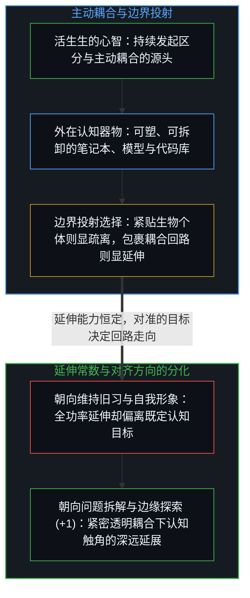
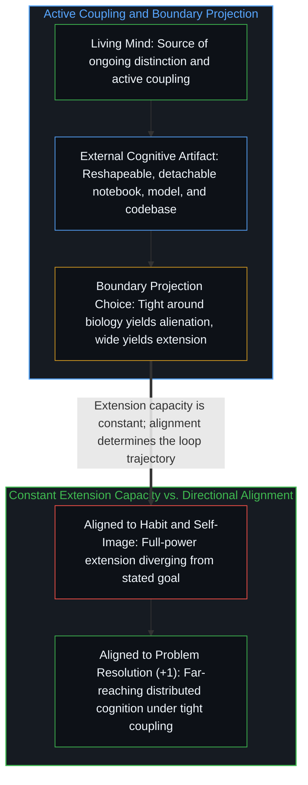

# 作为认知主动延伸的工具 / Tools as Active Extensions of Cognition

*认知延伸并非静态融合而是持续耦合的过程，其变化不在于能力有无而在于对齐方向。 / Cognitive extension is an active coupling process whose variation lies in directional alignment.*

克拉克与查尔默斯在 1998 年提出的“延展心智”命题指出，认知过程能够跨越生物有机体的皮肤与颅骨边界。然而日常讨论常将其简写为“工具变成了认知的一部分”。这种表述并不精确：它暗示了一种静态的吞并与融合，仿佛外在器物消融进了自我之中、抹平了内外的区分。这种把延伸当成静态合并的说法，反而将它原本试图消解的那道边界重新实体化了。

The extended mind thesis introduced by Andy Clark and David Chalmers in 1998 observes that cognitive processes can reach beyond the skin and skull of the biological organism. In everyday discussion, this is frequently summarized by saying that tools "become part of cognition." That phrasing is imprecise: it implies a static merger, as if the external artifact dissolved into the self and erased externality altogether, reifying the very boundary the observation ought to dissolve.

## 一、 持续耦合与指向的变异 / 1. Ongoing Coupling and Variation in Direction

在经典的奥托笔记本思想实验中，患有记忆障碍的奥托时刻查阅、更新并信赖随身携带的笔记本，如同常人依赖生物记忆。当耦合紧密运转时，记忆过程确实分布在脑神经回路与纸页之间；但当他放下笔记本转身离开，这一延伸便随即终止。笔记本从未“变成”奥托本人，它始终保持着外在性、可塑性与可拆解性。认知的延伸不是一次性的身份兼并，而是以持续耦合为前提的主动动态过程，正如[遗忘的脚手架](../the-scaffolding-we-forget/)与[框内延伸与维度跃迁](../extension-and-shift/)所揭示的那样。

In the classic thought experiment, Otto consults his notebook constantly—updating it, trusting it, and relying on it just as an ordinary person relies on biological memory. While that coupling is tight, the process of remembering distributes across neural pathways and paper pages; the moment he sets the notebook down and walks away, the extension ends. The notebook never "becomes" Otto, remaining external, reshapeable, and detachable throughout. Cognitive extension is not a one-time annexation of identity, but an active dynamic process conditional on ongoing coupling, as examined in [The Scaffolding We Forget](../the-scaffolding-we-forget/) and [Extension and Shift](../extension-and-shift/).

人类向外延伸认知的能力本身是一个常数：每一个人都在时刻与日历、搜索引擎、账本乃至他人进行持续的外部耦合。真正发生变化的并不是“有没有延伸能力”，而是耦合所对准的方向——即这一外部回路究竟是在服务于当事人声称的认知目标，还是偏转到了其他目标之上。一个“不会有效使用人工智能工具”的人，并非缺乏认知延伸的能力；他同样在全功率地向外延伸，只不过延伸的方向对准了维持熟悉的工作流、规避不确定性、保全既有自我形象或追求眼前的舒适感。变化从来不在能力的大小，而在对齐的方向。

The capacity for cognitive extension is a constant across human minds: everyone couples continuously with calendars, search engines, ledgers, and other people. What varies is not whether extension happens, but where it aligns—whether the coupling serves the stated cognitive objective or diverges toward a different target. Someone who struggles to use artificial intelligence tools effectively is not missing the capacity to extend; they are extending at full power toward maintaining familiar workflows, avoiding uncertainty, preserving self-image, or optimizing for immediate comfort. The variation lies in direction, not in capacity.

## 二、 边界伪影与外化认知的同构 / 2. Boundary Artifacts and Externalized Cognition

一旦看清“自我”、“工具”与“认知”各自都是特定尺度下的投射，围绕延展心智的争论便迎刃而解。如果把边界紧贴着生物有机体画一圈，笔记本就显得是外在的；如果把边界绕着“人加笔记本”的耦合系统画一圈，笔记本就成了系统内部的一环；如果再把镜头拉远到物种尺度的知识演化，单个大脑本身也成了宏大网络中的节点。没有任何一条边界享有本体论上的特权，每一条边界都服务于特定的核算目的——照亮一部分关系，同时遮蔽另一部分关系。争论之所以在原地打转，是因为双方都假定自然界里预刻着一条唯一正确的边界。

Once "self," "tool," and "cognition" are recognized as scale-dependent projections, the extended-mind debate dissolves. Draw a boundary tightly around the biological organism, and the notebook appears external; draw it around the coupled organism-and-notebook system, and the notebook appears internal; draw it around species-level knowledge evolution, and individual brains appear as nodes within a wider network. No boundary is ontologically privileged; each enables certain calculations while obscuring others. The debate runs in circles only when both sides assume that one boundary is carved into reality prior to the observer's cut.

这一视角同样直接消解了“人类与人工智能赛跑”的对立叙事。大语言模型在人类产出的语料上训练，经由人类的反馈塑形，并在一轮轮人机交互中迭代演化；正如[你的代码库即是记忆](../your-codebase-is-memory/)与[智能只属于心智](../intelligence-belongs-only-to-the-mind/)所阐明的，模型与外部代码库是人类认知模式的外化、压缩与加速。所谓“异己的对手”，不过是把镜头死死锁在自动化执行的那一截管线上、同时切断其起源并把边界画得过于紧窄所产生的缩放伪影。当心智通过提问、审视与重构同模型及代码库建立起高透明度、低摩擦的紧密耦合时，思考便在这一可随时拆解、随时重塑的外在回路上伸向远方。

This perspective likewise dissolves the narrative of a race against artificial intelligence across an adversarial divide. Large language models are trained on human outputs, shaped by human feedback, and refined through iterative human interaction; as examined in [Your Codebase Is Memory](../your-codebase-is-memory/) and [Intelligence Belongs Only to the Mind](../intelligence-belongs-only-to-the-mind/), both models and external codebases are patterns of human cognition externalized, compressed, and accelerated. Perceived alienation arises from zooming in on the automated segment while drawing the boundary too tightly around the uncoupled biological individual. When a mind engages these external artifacts in tight, transparent coupling—prompting, critiquing, and re-tracing—cognition reaches further precisely because the boundary remains a flexible instrument rather than a prison wall.
