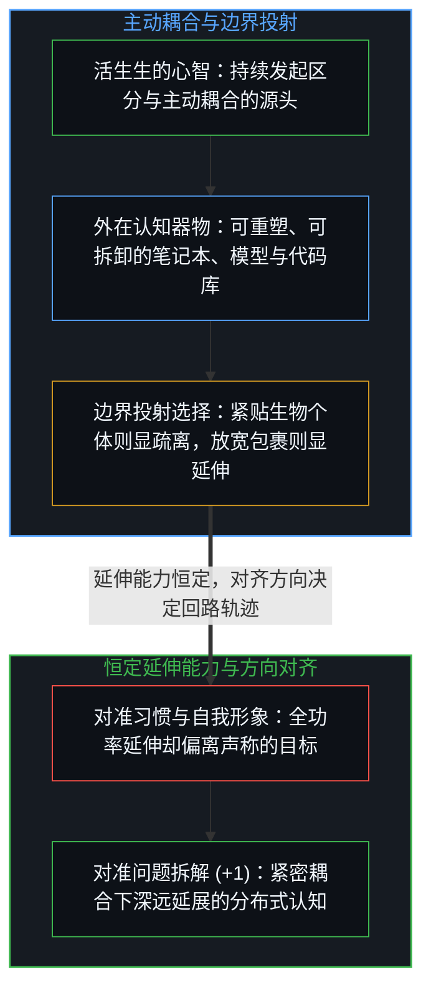
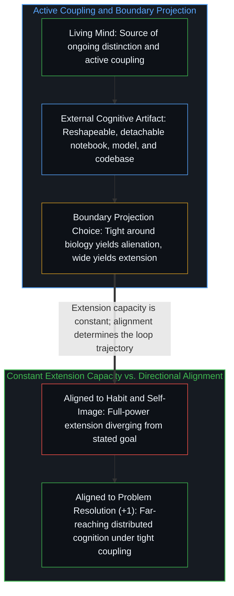

# 作为认知主动延伸的工具 / Tools as Active Extensions of Cognition

*认知延伸是主动耦合的过程，其变化在于对齐方向。 / Cognitive extension is an active coupling process whose variation lies in directional alignment.*

安迪·克拉克与大卫·查尔默斯在 1998 年提出的“延展心智”命题指出，认知过程能够跨越生物有机体的皮肤与颅骨。在日常讨论中，这常被概括为“工具成为了认知的一部分”。这种表述并不精确：它暗示了一种静态融合，仿佛外在器物消融进了自我之中、一举抹除了外在性，从而将这一观察原本意在消解的那道边界重新实体化了。

The extended mind thesis introduced by Andy Clark and David Chalmers in 1998 observes that cognitive processes can reach beyond the skin and skull of the biological organism. In everyday discussion, this is frequently summarized by saying that tools "become part of cognition." That phrasing is imprecise: it implies a static merger, as if the external artifact dissolved into the self and erased externality altogether, reifying the very boundary the observation set out to dissolve.

## 一、 持续耦合与指向的变异 / 1. Ongoing Coupling and Variation in Direction

在经典的思想实验中，奥托时刻查阅自己的笔记本——不断更新、信赖并依赖它，正如常人依赖生物记忆。当这一耦合紧密运转时，记忆过程分布在神经通路与纸页之间；一旦他放下笔记本转身离开，延伸便随即终止。笔记本从未“变成”奥托，而是全程保持着外在性、可重塑性与可拆卸性。认知延伸不是一次性的身份吞并，而是以持续耦合为前提的主动动态过程，正如[遗忘的脚手架](../the-scaffolding-we-forget/)与[框内延伸与维度跃迁](../extension-and-shift/)所剖析的那样。

In the classic thought experiment, Otto consults his notebook constantly—updating it, trusting it, and relying on it just as an ordinary person relies on biological memory. While that coupling is tight, the process of remembering distributes across neural pathways and paper pages; the moment he sets the notebook down and walks away, the extension ends. The notebook never "becomes" Otto, remaining external, reshapeable, and detachable throughout. Cognitive extension is not a one-time annexation of identity, but an active dynamic process conditional on ongoing coupling, as examined in [The Scaffolding We Forget](../the-scaffolding-we-forget/) and [Extension and Shift](../extension-and-shift/).

认知延伸的能力在人类心智中是一个常数：每一个人都在时刻与日历、搜索引擎、账本乃至他人进行持续耦合。发生变化的不是延伸是否发生，而是它对准了何处——即这一耦合究竟是在服务于所声称的认知目标，还是偏离到了另一个目标之上。一个难以有效使用人工智能工具的人，并非缺失认知延伸的能力；他同样在全功率地向外延伸，只是方向对准了维持熟悉的工作流、规避不确定性、护持自我形象，或是为眼前的舒适感做优化。差异在于方向，而不在于能力。

The capacity for cognitive extension is a constant across human minds: everyone couples continuously with calendars, search engines, ledgers, and other people. What varies is not whether extension happens, but where it aligns—whether the coupling serves the stated cognitive objective or diverges toward a different target. Someone who struggles to use artificial intelligence tools effectively is not missing the capacity to extend; they are extending at full power toward maintaining familiar workflows, avoiding uncertainty, preserving self-image, or optimizing for immediate comfort. The variation lies in direction, not in capacity.

## 二、 边界伪影与外化认知 / 2. Boundary Artifacts and Externalized Cognition

一旦看清“自我”、“工具”以及“认知”的系统外围各自都是依尺度而定的投射——正如[维度即投影](../dimensions-are-projections/)所追溯的那样——围绕延展心智的争论便随之消解。把边界紧贴着生物有机体画一圈，笔记本就显得是外在的；把边界绕着“有机体加笔记本”的耦合系统画一圈，笔记本就成了系统内部的一环；再把边界画在物种尺度的知识演化上，单个大脑便呈现为更广阔网络中的节点。这些投射出的边界没有任何一条享有本体论上的特权；每一条边界都服务于特定的核算目的，在照亮一部分关系的同时遮蔽另一部分关系，而争论之所以在原地打转，仅仅是因为双方都假定某一条外围边界先于观察者的切分而预先镌刻在实在之中。然而，痕迹在功能上的对等并非发起源头上的对等：将系统边界放宽以纳入笔记本或大脑网络，并不会把那个划定边界、驾驭耦合的第一人称心智消解为被动的反馈回路或集合主体。

Once "self," "tool," and the system perimeter of "cognition" are recognized as scale-dependent projections—as traced in [Dimensions Are Projections](../dimensions-are-projections/)—the extended-mind debate dissolves. Draw a boundary tightly around the biological organism, and the notebook appears external; draw it around the coupled organism-and-notebook system, and the notebook appears internal; draw it around species-level knowledge evolution, and individual brains appear as nodes within a wider network. None of these projected boundaries is ontologically privileged; each serves a specific accounting purpose, illuminating certain relations while obscuring others, and the debate runs in circles only when both sides assume that one perimeter is carved into reality prior to the observer's cut. Yet functional parity of traces is not parity of initiation: widening the system boundary to include a notebook or a network of brains does not dissolve the first-person Mind that draws the boundary and steers the coupling into a passive feedback loop or an aggregate subject.

这一视角同样消解了隔着敌对鸿沟与人工智能赛跑的叙事。大语言模型在人类的产出上训练，经由人类的反馈塑形，并在一轮轮人机交互中打磨精炼；正如[你的代码库即是记忆](../your-codebase-is-memory/)与[智能只属于心智](../intelligence-belongs-only-to-the-mind/)所剖析的，模型与外部代码库都是外化、压缩并加速了的人类认知模式。疏离感的产生，源于将镜头拉近到自动化执行的那一截管线上，同时把边界过紧地画在未耦合的生物个体四周。当心智与这些外在器物建立起紧密而透明的耦合——正如[递归形式系统中作为记忆与控制的边界条件图](../boundary-condition-graphs-as-memory-and-control-in-recursive-formal-systems/)所追溯的那样，在始终居于终极外层回路的同时，跨越延展的边界条件图持续提问、审视并重描痕迹——认知之所以能触及更远的地方，恰恰在于边界始终是一柄灵活的器具，而非一道囚墙。

This perspective likewise dissolves the narrative of a race against artificial intelligence across an adversarial divide. Large language models are trained on human outputs, shaped by human feedback, and refined through iterative human interaction; as examined in [Your Codebase Is Memory](../your-codebase-is-memory/) and [Intelligence Belongs Only to the Mind](../intelligence-belongs-only-to-the-mind/), both models and external codebases are patterns of human cognition externalized, compressed, and accelerated. Perceived alienation arises from zooming in on the automated segment while drawing the boundary too tightly around the uncoupled biological individual. When a Mind engages these external artifacts in tight, transparent coupling—prompting, critiquing, and re-tracing across an extended boundary-condition graph while remaining the ultimate outer loop, as traced in [Boundary-Condition Graphs as Memory and Control in Recursive Formal Systems](../boundary-condition-graphs-as-memory-and-control-in-recursive-formal-systems/)—cognition reaches further precisely because the boundary remains a flexible instrument rather than a prison wall.
