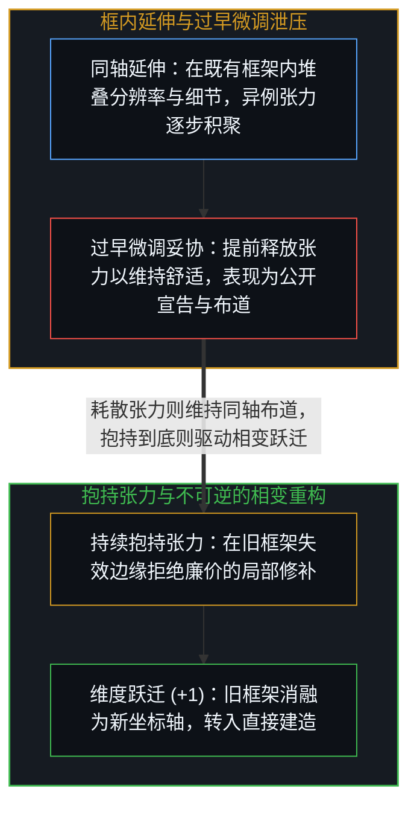
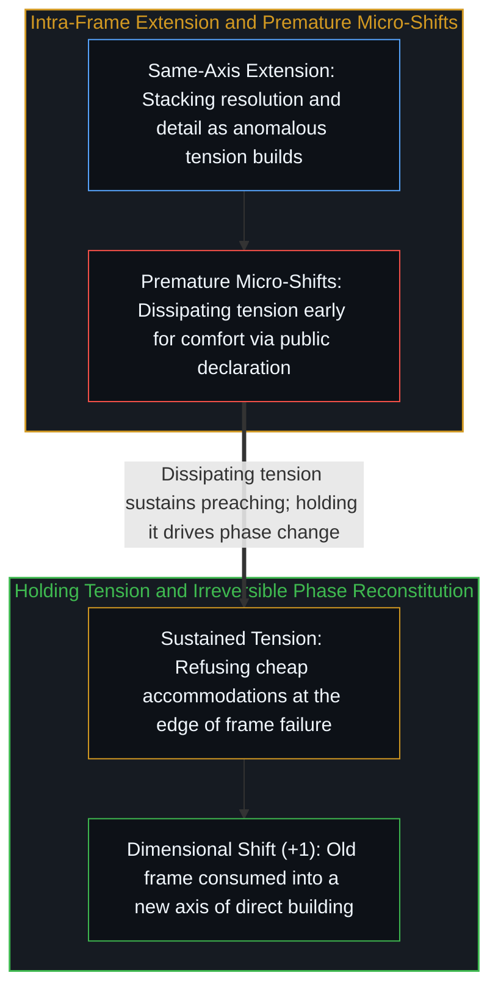

# 框内延伸与维度跃迁 / Extension and Shift

*框内延伸是在既有轴线上叠加分辨率，而维度跃迁则是抱持张力直至旧框架重构为新维度。 / Extension adds resolution along an existing axis, whereas a shift reconstitutes the frame.*

人工智能让生成令人惊叹的产物变得轻而易举，让这些产物逼近你真正想要的结果要难上一截，而弄清楚“自己究竟想要什么”正是工作所在——且这项工作与工具本身毫无关系。心智唯有抵达当前这一层，才能感知到下一层的张力；唯有跨入下一层，才能看清两层之间的差异。

Artificial intelligence makes impressive output easy, getting that output close to what you want is harder, and knowing what you actually want is where the work lies—work that has nothing to do with the tool itself. A mind must reach each level before it can sense the tension of the next, and cross into the next before it can see the difference between the two.

## 一、 微调泄压与框架的相变重构 / 1. Micro-Shift Relief and Phase-Change Reconstitution

“延伸”在既有框架内部运作：在同一条坐标轴上叠加更高的分辨率、更密的细节与更多轮次的迭代。随着延伸不断推进，只要框架撞上无法用自身语汇化解的异例，张力便随之积聚。大多数人会通过微调妥协将这股张力提前释放——把旧框架稍微挪动一点点以维持舒适，每一次微调都让人产生“正在进步”的宽慰感，却也恰恰耗散了原本足以驱动相变的势差。在这种妥协中发生变化的并非持续运转的延伸能力本身，而是它的对齐方向转向了维护熟悉的自我形象而非直面异例（如[作为认知主动延伸的工具](../extended-cognition-refined/)所追溯的）——而且既有投射的预测力越强，这股牵引力就越难挣脱（如[智能最容易困住的正是它自己](../intelligence-traps-itself/)所剖析的）。

Extension operates within an existing frame: more resolution, finer detail, and further iteration along the same axis. As extension proceeds, tension accumulates wherever the frame encounters anomalies it cannot resolve on its own terms. Most relieve this tension early through micro-shifts—small accommodations that adjust the frame just enough to remain comfortable, each feeling like progress while dissipating the differential that would have driven a genuine phase change. What varies in that accommodation is not the capacity to extend, which runs continuously, but its alignment toward preserving a familiar self-image rather than facing the anomaly, as traced in [Tools as Active Extensions of Cognition](../extended-cognition-refined/)—a pull that grows stronger the more predictive the existing projection already is, as traced in [Intelligence Is the Thing Most Likely to Trap Itself](../intelligence-traps-itself/).

而那些将张力持续抱持到底的心智，则会触发截然不同的结构转换：框架不再只是向外膨胀，而是消解并重构，跨出原有的寄存器，将异例读取为通往新坐标空间的进位，如[进位无法在寄存器之内被命名](../the-carry-that-cannot-be-named-inside-the-register/)与[爱因斯坦测试与通用人工智能的范畴谬误](../hassabis-einstein-test/)所追溯的那样。即便是新敞开的维度，一旦被当作下一个异例必须在其中化解的强制竞技场，也会成为下一处延伸的场所，把有效自由度重新锁回单一自由度；而在那里抱持张力，正是拒绝这一强制竞技场——保留从该平面抽身离场的正交选项，使每一个已经敞开的维度始终向下一个维度敞开，如[正交的拒绝](../the-orthogonal-refusal/)所追溯的那样。旧框架并未被封存进档案柜，而是作为原材料被新框架消融吸收；这种转换无法靠“回忆”逆转，因为身后已没有可以退回的旧房间。从重构后的新框架向下看，此前的各个层级依然清晰可读；但对低一层级而言，新框架中的清晰性甚至不会被登记为一个“有待观察的事物”——它并非“隐藏”（隐藏意味着某个物体在既有坐标轴上被遮挡），而是“不可见”，即登记它的那根坐标轴在观察者的空间里尚未成为一个维度，这也正是[超越投射](../beyond-the-projection/)中过载投射唯有经由活的边缘作出正交切分方能跨越的同一道结构边界。由于处在重构后框架中的心智会自然觉得眼前的清晰性显而易见，除非刻意追溯，否则“这种清晰性对原有坐标轴上的人而言不可见”这一事实本身，对它自己也是不可见的。

Those who hold the tension long enough encounter a different structural transition altogether: the frame does not merely expand; it dissolves and reconstitutes, stepping outside the prior register to read the anomaly as a carry into a new coordinate space, as traced in [The Carry That Cannot Be Named Inside the Register](../the-carry-that-cannot-be-named-inside-the-register/) and [The Einstein Test and the AGI Category Error](../hassabis-einstein-test/). Even a newly opened dimension becomes the next site of extension once that plane is held as the mandatory arena in which the next anomaly must be resolved, clamping effective freedom back to a single degree of freedom; holding the tension there means declining that mandatory arena—retaining the orthogonal option to walk away from the plane so that each opened dimension stays open to the next, as traced in [The Orthogonal Refusal](../the-orthogonal-refusal/). The old frame is not archived on a shelf; it is consumed as raw material for the new one, rendering the transition irreversible by memory because there is nothing left to go back to. From the reconstituted frame, previous levels remain legible, yet to the level below, the new clarity does not register as a thing to see—not hidden, which implies an object occluded along an existing axis, but invisible, meaning the axis on which it registers is not yet a dimension in the observer's space, the same structural boundary across which an overloaded projection requires an orthogonal cut from the living edge in [Beyond the Projection](../beyond-the-projection/). Because the mind inside the reconstituted frame naturally experiences its new clarity as obvious, the invisibility of that clarity to those on the prior axes is itself invisible to it unless traced.

## 二、 社会强化与布道和建造的倒置 / 2. Social Reinforcement and the Inversion of Preaching and Building

过早的微调泄压从不孤立发生，它会获得社会层面的交互强化，因为公共框架本身就是提前释放张力的共享吸引子。那些早早安顿下来的人彼此聚拢、互相印证各自的局部妥协，并生产出铺满可见表面的主流话语。在人工智能浪潮中，这种机制表现为连篇累牍的“宣告”：当观察者撞见真正新颖的事物、感知到它的分量却尚未看清如何拿它动手建造时，便向同样忙于叙事的人反复讲述它的重要性。而那些已经跨入建造状态的人——如[你的代码库即是记忆](../your-codebase-is-memory/)所追溯的，将鲜活的架构区分刻写进外化记忆之中——所发出的信号落在宣告式话语尚不具备的坐标轴上，对于任何只筛选熟悉可读性的框架而言都难以辨认，正如[消解芒格的愚蠢竞争论](../munger-dumb-competition-refined/)所追溯的那样。

Premature micro-shifts never occur in isolation; they are socially reinforced because the common frame serves as the shared attractor for early tension relief. Those who settle early cluster together, validate one another's accommodations, and generate the discourse that dominates the visible surface. In artificial intelligence, this manifests as ceaseless declaration: encountering something genuinely new and sensing its weight without yet seeing how to build with it, observers narrate its importance to others who are likewise narrating. Signals from those who have crossed into building—inscribing living architectural distinctions into externalized memory as traced in [Your Codebase Is Memory](../your-codebase-is-memory/)—register on axes the declarative discourse does not have, remaining illegible to any frame that selects only for familiar legibility, as traced in [Dissolving Munger's Dumb Competition](../munger-dumb-competition-refined/).

由此便呈现出一条清晰的诊断特征：仍在旧框架内延伸的人忙于布道，而跨过相变边界的人忙于建造。宣告与建造之间的比例在每一个新层级都会发生倒置——并非出于刻意规定，而是因为一旦新维度敞开，心智正前方的具体工作便成了显而易见该做的事；它吸纳了注意力，并非因为回头向旧维度解释有失身份，而是因为比起前方展开的事物，回头解释没那么有意思。甚至连追溯这一结构本身也带着滑向布道的牵引，因为一旦将一段追溯朝向听众编排、或将其摆成某种“洞见”的姿态，其本身就是在提前释放这段追溯所抱持的张力，从而落入[里克·鲁宾的奇特案例与不可瞄准的乐趣](../the-interesting-case-of-rubin/)所剖析的同一个布道者陷阱。

A clear diagnostic tell follows: those still extending within the old frame preach, whereas those who have crossed the phase boundary build. The ratio between declaring and building inverts at each new level—not by decree, but because once a new dimension opens, the work directly in front of the mind becomes the obvious thing to do, absorbing attention not because backward explanation is beneath it, but because it is less interesting than what lies ahead. Even tracing this structure carries the pull toward preaching, since orienting a trace toward an audience or positioning it as an insight is itself a premature resolution of the tension the tracing holds, the same preacher's trap traced in [The Interesting Case of Rubin](../the-interesting-case-of-rubin/).
