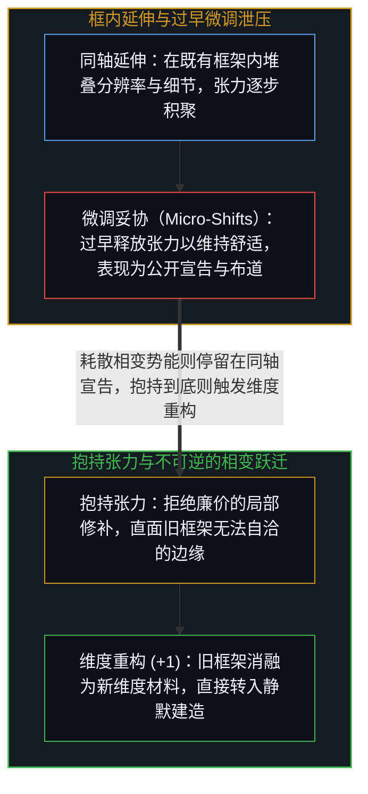
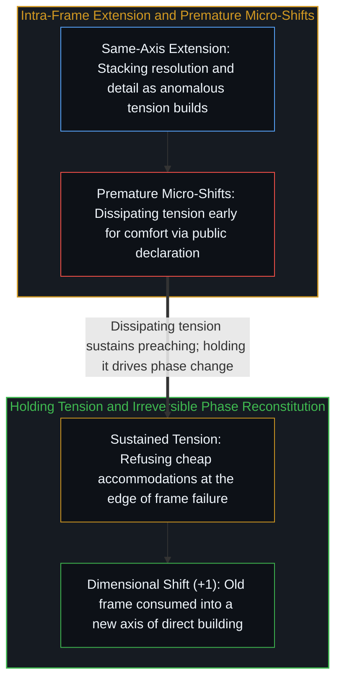

# 框内延伸与维度跃迁 / Extension and Shift

*框内延伸是在既有轴线上叠加分辨率，而维度跃迁则是抱持张力直至旧框架重构为新维度。 / Extension adds resolution along an existing axis, whereas a shift reconstitutes the frame.*

人工智能让生成令人惊叹的产物变得轻而易举，让这些产物逼近你真正想要的结果要难上一截，而弄清楚“自己究竟想要什么”才是真正的工作所在——且这项工作与工具本身毫无关系。心智唯有抵达当前这一层，才能感知到下一层的张力；唯有跨入下一层，才能看清两层之间的差异。

Artificial intelligence makes impressive output easy, getting that output close to what you want is harder, and knowing what you actually want is the real work—work that has nothing to do with the tool itself. A mind must reach each level before it can sense the tension of the next, and cross into the next before it can see the difference between the two.

## 一、 微调泄压与框架的相变重构 / 1. Micro-Shift Relief and Phase-Change Reconstitution

“延伸”始终在既有框架内部运作：在同一条坐标轴上叠加更高的分辨率、更密的细节与更多轮次的迭代。随着延伸不断推进，既有框架迟早会撞上无法用自身语汇化解的矛盾，张力随之积聚。大多数人在张力刚一浮现时，便通过微小的局部妥协（micro-shifts）将其提前释放——把旧框架稍微挪动一点点以维持舒适，每一次微调都让人产生“正在进步”的宽慰感，却也恰恰耗散了原本足以驱动真正相变的势能。

Extension operates within an existing frame: more resolution, finer detail, and further iteration along the same axis. As extension proceeds, tension accumulates wherever the frame encounters anomalies it cannot resolve on its own terms. Most relieve this tension early through micro-shifts—small accommodations that adjust the frame just enough to remain comfortable, each feeling like progress while dissipating the very energy that would have driven a genuine phase change.

而那些将张力持续抱持到底的心智，则会触发截然不同的结构变化：框架不再是向外膨胀，而是消解并重组。旧框架并未被封存进档案柜，而是作为原材料被新框架消融吸收；这种相变无法靠“回忆”逆转，因为身后已没有可以退回的旧房间。从重构后的新框架向下看，此前的各个层级历历在目；但从低一层级向上看，新框架中的清晰性甚至不会被登记为一个“有待发现的隐藏物体”。“隐藏”意味着在已有坐标轴上被遮挡，而“不可见”则意味着承载它的那根坐标轴在观察者的空间里尚未生成，正如[超越投射](../beyond-the-projection/)与[作为认知主动延伸的工具](../extended-cognition-refined/)、[爱因斯坦测试与通用人工智能的范畴谬误](../hassabis-einstein-test/)、[智能最容易困住的正是它自己](../intelligence-traps-itself/)与[消解芒格的愚蠢竞争论](../munger-dumb-competition-refined/)所揭示的那样。

Those who hold the tension long enough encounter a different structural transition altogether: the frame does not merely expand, it dissolves and reconstitutes. The old frame is not archived on a shelf; it is consumed as raw material for the new one, rendering the transition irreversible by memory because there is nothing left to go back to. From the reconstituted frame, previous levels remain legible, yet to the level below, the new clarity is not hidden—it is invisible, meaning the axis on which it registers is not yet a dimension in the observer's space, as traced in [Beyond the Projection](../beyond-the-projection/) and [Tools as Active Extensions of Cognition](../extended-cognition-refined/), [The Einstein Test and the AGI Category Error](../hassabis-einstein-test/), [Intelligence Is the Thing Most Likely to Trap Itself](../intelligence-traps-itself/), and [Dissolving Munger's Dumb Competition](../munger-dumb-competition-refined/).

## 二、 社会强化与布道和建造的倒置 / 2. Social Reinforcement and the Inversion of Preaching and Building

过早的微调泄压从不孤立发生，它会迅速获得社会层面的交互强化。大众框架之所以成为大众框架，恰恰因为它是提前释放张力的最省力吸引子；那些通过微调获得宽慰的人彼此聚拢、互相印证，并生产出铺满公共视野的主流话语。在人工智能浪潮中，这种机制表现为连篇累牍的“宣告”：当人们撞见真正新鲜的事物，能够感觉到它非同小可，却尚未跨入知道如何拿它动手建造的那一维时，第一反应便是将其叙事化。叙事在同样忙于叙事的人群中循环回响，而那些已经跨过相变、将认知沉淀进外部代码库（如[你的代码库即是记忆](../your-codebase-is-memory/)所剖析的）并直接动手建造的人所发出的信号，在宣告者的框架里难以辨认。

Premature micro-shifts never occur in isolation; they are socially reinforced because the common frame serves as the shared attractor for early tension relief. Those who settle early cluster together, validate one another's accommodations, and generate the discourse that dominates the visible surface. In artificial intelligence, this manifests as ceaseless declaration: encountering something genuinely new and sensing its weight without yet seeing how to build with it, observers narrate its importance to others who are likewise narrating. Signals from those who have crossed into building—inscribing living architectural distinctions into externalized memory as traced in [Your Codebase Is Memory](../your-codebase-is-memory/)—remain largely illegible on the axes of the declarative discourse.

由此便呈现出一条清晰的诊断分界：仍在旧框内延伸的人忙于布道，已经完成相变跃迁的人忙于建造。这一比例在每一个层级都会发生倒置——并非出于刻意的姿态，而是因为一旦跨入新维度，动手推进眼前的具体工程就成了水到渠成的事，而向旧维度回头解释反而失去了吸引力。甚至当我们写下这段结构追溯时，想要把它包装成某种面向听众的“洞见”的冲动，本身也是同一种试图提前释放张力的微调诱惑；唯有在每一次落笔与每一行构造中持续抱持张力，认识的运动才不会在自我加冕中停摆。

A clear diagnostic tell follows: those still extending within the old frame preach, whereas those who have crossed the phase boundary build. The ratio between declaring and building inverts at each new level—not by moral decree, but because once a new dimension opens, the work directly in front of the mind absorbs its full attention. Even the act of tracing this structure carries the pull toward preaching, since positioning a trace as an insight for an audience is itself a premature release of the very tension that keeps inquiry moving.
