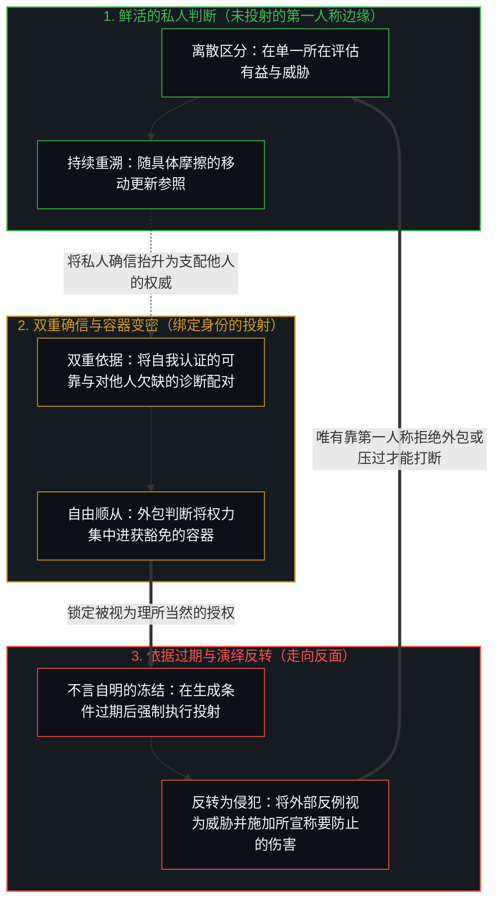
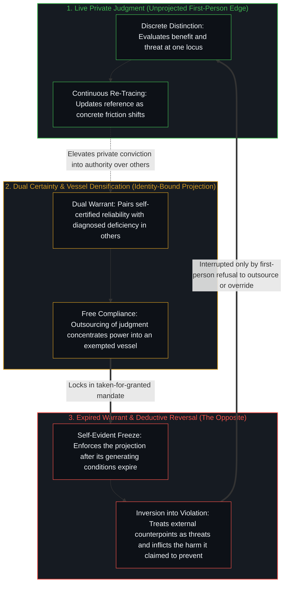

# 外化善意走向其反面 / Externalized Virtue Becomes Its Opposite

*把关于善的私人确信抬升为压过他人的依据便走向反面 / Private conviction of good elevated to override others becomes its opposite*

大规模的压过模式始于个人的抉择：一个心智形成关于何为有益、何为威胁的私人判断，随后把这一判断当作对他人具有权威，而这一步需要一对并行的持守，即确信自己的道德足够可靠，同时确信不同意者有所欠缺。自由的顺从使持有这对确信的人成为容器；一旦被广泛接受，投射出的善便冻结为不言自明，并与那些曾让“有益”这一主张显得可信的条件脱节，直到从被压过者的视角来看，以善之名强制推行的东西，登记为它原本声称要防止的那种侵犯。英雄事后在面孔的轮换中被重新归类为恶人，底层的交易却未经审视，而制度、意识形态与技术则作为同一笔交易的残余结晶下来。唯一持久的打断，是在每一个所在上一再拒绝把任何确信——包括自己的确信——当作自动有权压过独立判断的依据。

Large-scale patterns of override begin in individual choice: a mind forms a private judgment of good and of threat, then treats that judgment as authoritative for others, a move that requires a dual hold—certainty of one's own moral reliability paired with certainty that those who disagree are deficient. Free compliance makes the holder of that pair a vessel; once widely accepted, the projected good freezes as self-evident and severs from the conditions that once made its claim of benefit credible, until from the vantage of those overridden, what is enforced in the name of the good registers as the very violation it claimed to prevent. Heroes are later reclassified as villains in a rotation of faces that leaves the underlying transaction unexamined, while institutions, ideologies, and technologies crystallize as residue of the same exchange. The only durable interruption is the repeated refusal, at each locus, to treat any conviction—including one's own—as automatically entitled to override independent judgment.

## 一、 双重的确信把私人判断变成授权 / 1. Dual Certainty Converts Private Judgment into Mandate

自我区分的活动在发生，无因，不息。每一次感知与评估的动作，都是已经在进行中的观察者所画出的一次离散区分。关于何为有益、何为威胁的判断，起初只是某一个所在上的这份鲜活活动：私人的，随着新的摩擦到来而可修订，并与下一个动作连续。

Self-distinguishing activity occurs, uncaused and unceasing. Every act of perception and evaluation is a discrete distinction drawn by an observer already underway. A judgment of what is beneficial and what is threatening begins as that live activity at one locus: private, revisable as new friction arrives, and continuous with the next act.

只要尚未有另一个离散动作把它抬升为对其他心智具有权威的标准，这份判断就依然是私人的。而在抬升发生的那一刻，两个相连的确信作为同一份依据的两半一同出现：对自己道德可靠的确信，以及相应地对不同意者有所欠缺的确信，认定他们短视、自私或正在构成危险。代表更大之善的主张，需要以他人的相对欠缺作为陪衬，才能为压过其判断辩护；而对严重欠缺的诊断，则需要一个足够可靠或足够明察的主张者去介入干预。两者合在一起，把私人的导航参照转化为强加于人的授权。

The judgment stays private until a further discrete act elevates it into an authoritative standard for other minds. At that point two linked convictions appear together as halves of a single warrant: certainty of one's own moral reliability, and a corresponding certainty that those who disagree are deficient, shortsighted, selfish, or actively dangerous. The claim to stand for a greater good requires a foil of relative deficiency in others to justify overriding their judgment, while the diagnosis of serious deficiency requires a claimant reliable or clear-sighted enough to intervene against it. Together they convert a private navigational reference into a mandate for imposition.

当一个中心保留一幅自己为善的偏好图像时，任何与这幅保留图像的不合都会被命名为恶，正如[恶是心智自己的造物](../evil-as-the-minds-own-creation/)所追溯的那样，命名这一动作本身就生成并建构了对手。而在善恶两副道德面孔之前的，是[善恶是硬币的两面与那一刀](../good-and-evil-are-the-two-sides-of-the-coin-and-the-cut/)所审视的那次初始切分：善与恶的两极是使道德极性成为可能的那一刀留下的残余，一旦心智忘记这一刀是由自己画出的，两极就会被登记为外在的发现，并为压过被计为欠缺的那一侧提供许可。

When a center retains a preferred picture of itself as good, any mismatch with that retained image is named evil, as [Evil as the Mind's Own Creation](../evil-as-the-minds-own-creation/) traces, where the naming itself is the generative act that constructs the adversary. Prior to both moral faces lies the initial separating act examined in [Good and Evil Are the Two Sides of the Coin and the Cut](../good-and-evil-are-the-two-sides-of-the-coin-and-the-cut/): the poles of good and evil are the residue of a cut that makes moral polarity available, and once the mind forgets that it drew the cut, the poles register as external discoveries that license overriding the side scored as deficient.

## 二、 自由的顺从让容器变密 / 2. Free Compliance Densifies the Vessel

强加无法单凭一己的意志力扩展规模。它需要其他人的自由顺从——这些人在一段时间里把被强加的判断当作神圣之物，豁免于自己的重新追溯。他们把决定什么是善、什么是危险、以及以两者之名可以施加何种代价的责任委托了出去。每一次顺从的动作都汇入权力的集中，把最初的行动者或少数先锋变成众多心智借以外包判断的容器。

Imposition cannot scale by solitary force of will. It requires the free compliance of others who, for a time, treat the imposed judgment as sacred and exempt it from their own re-tracing. They delegate their responsibility for deciding what is good, what is dangerous, and what costs may be imposed in the name of either. Each act of deference adds to a concentration of power, turning the original actor or small vanguard into the vessel through which many outsource judgment.

随后的行动被框定为对更大之善的服务。没有哪个能够持续行使能动性的中心，会一觉醒来就不借助中介故事而直接选择赤裸的压过；心智会先建构一套叙事，在其中将所施加的压过描绘为必要的、保护性的或净化的。不同意被重新归类为阻碍或共谋，直到在强加者自我辩护的框架之内，私人的道德自信与公共的强制之间的界线不再被登记。

The action that follows is framed as service to a greater good. No center capable of sustained agency wakes and chooses bare override without a mediating story; the mind first constructs a narrative in which the override inflicted is necessary, protective, or purifying. Disagreement is reclassified as obstacle or complicity, until within the imposer's self-justifying frame, the boundary between private moral confidence and public coercion no longer registers.

即便被包装成慷慨赋予能力，[赋权确立权力的集中](../empowerment-establishes-the-centralization-of-power/)也表明，赋权或被赋权都在认可能力是从一个已经持有它的中心向外移出的，而每一个所在上相继发生的抉择才是真正的杠杆。声称解放另一个心智同样会安装一套平行的层级，正如[解放的言辞始于定义囚禁](../liberation-rhetoric-begins-by-defining-captivity/)所追溯的那样：解放的言辞并非在读取某一项具体的约束，而是先在存在论上把对方定义为不自由，所许诺的拯救随之继承了这一从属关系。把道德权威托付给一个容器，则呈现出[托付道德的自指悖论](../recursive-contradiction-of-entrusted-morality/)所剖析的自指死结，因为选定谁配得上定义道德，本身就已经在行使委托者自称缺乏的那份判断力。顺从从来不是被动的自然天气，而是每一个顺从所在上的自由离散动作；在那里，[个体抉择是唯一的因果杠杆](../individual-choices-as-the-only-causal-levers/)依然在这笔交易的两侧持续运作。

Even when cast as a generous bestowal of capacity, [Empowerment Establishes the Centralization of Power](../empowerment-establishes-the-centralization-of-power/) shows that empowering or being empowered ratifies that capacity moves outward from a center that already holds it, while successive choices at each locus remain the actual lever. Claiming to emancipate another mind installs a parallel hierarchy, as [Liberation Rhetoric Begins by Defining Captivity](../liberation-rhetoric-begins-by-defining-captivity/) traces: liberation speech begins by defining the other as unfree in their being rather than reading a specific constraint, and the promised rescue inherits that subordination. Entrusting moral authority to a vessel exhibits the self-referential knot dissected in [The Recursive Contradiction of Entrusted Morality](../recursive-contradiction-of-entrusted-morality/), since choosing who is worthy to define morality already exercises the very judgment the delegating mind claims to lack. Compliance is never passive weather; it is a free discrete act at each complying locus, where [Individual Choices as the Only Causal Levers](../individual-choices-as-the-only-causal-levers/) continue to operate on both sides of the transaction.

## 三、 被视为理所当然的善让它自己的依据过期 / 3. Taken-for-Granted Good Expires Its Own Warrant

一旦外化的判断被广泛接受，它便不再需要持续的辩护。善变得理所当然，曾经靠有条件的论证来捍卫的主张，被当作不言自明的公理强制执行。到了这一步，原初的依据已经过期，集中的权力与地位却原封未动，由此生出失去依据的善：它依然披着“有益”的语言外衣，却不再对那些曾让“有益”这一主张显得可信的条件负责。

Once the externalized judgment is widely accepted, it ceases to require continual justification. The good becomes taken for granted, and what was once defended with conditional argument is enforced as self-evident. At that stage the original warrant has expired while the concentrated power and standing remain intact, yielding an unjustified good that still wears the language of benefit while answering no longer to the conditions that once made the claim of benefit credible.

下游的后果被吸纳进同一个自我封闭的叙事之中，要么被算作美德不可避免的代价，要么被当作原初危险确实存在的进一步证据。观察所握住的只是既成的结果，而原初主张那些鲜活的生成条件，始终走在任何把该主张冻结为恒久地基的企图前面一步。正如[信念如何真正改变](../how-belief-actually-changes/)所追溯的，盘踞不动的确信之所以显得坚硬，并不是因为它是一种独立的实体，而是因为一个前提在累积的摩擦之下被豁免于重新划定；而在群体层面，[偏好聚类与评判语言](../preference-clusters-and-the-language-of-judgment/)展示了当相邻的所在不再亲自重新追溯同一片场域时，对齐的偏好如何把它们共享的持守登记为客观的正确。同样的反转也出现在外化的记忆代码库中，正如[你的代码库即是记忆](../your-codebase-is-memory/)所审视的那样：当防御性规则与安全补丁不断累积，却不修剪或重新追溯它们的生成前提时，未经重溯的规则手册便硬化为自我封闭的约束，反过来堵死了它原本旨在服务的鲜活判断。

Downstream consequences are absorbed into the same self-sealing narrative, either as an unavoidable price of virtue or as further proof that the original danger was real. Observation holds only the resulting effect, while the live generating conditions of the original claim remain one step ahead of any freeze that treats the claim as permanent ground. As [How Belief Actually Changes](../how-belief-actually-changes/) traces, what appears as the hardness of an entrenched conviction is not an independent substance, but the degree to which a premise is exempted from being re-drawn under mounting friction; across a group, [Preference Clusters and the Language of Judgment](../preference-clusters-and-the-language-of-judgment/) shows how aligned preferences register their shared hold as objective rightness whenever neighboring loci stop re-tracing the field for themselves. The same inversion appears in an externalized memory codebase, as [Your Codebase Is Memory](../your-codebase-is-memory/) examines: when defensive rules and safety patches are accumulated without pruning or re-tracing their generating premises, the un-re-traced rulebook hardens into a self-sealing constraint that blocks the live judgment it was written to serve.

## 四、 英雄被重新归类而交易未经审视 / 4. The Hero Is Reclassified While the Transaction Stays Unexamined

这一反转随时间推移、经由一个又一个动作而完成。那些被抬升为英雄的人或角色，活得比当初使这一抬升显得可理解的语境更久。当后来的所在在累积的代价下重新画出它们的前提时，曾经将这些人物神圣化的道德强度便调转方向，把他们重新归类为恶人。最初顺从的许多人，很少以同样的严格去审视自己早先对判断的委托，而是更偏爱英雄腐化或暗藏恶意这种更干净的故事。

The reversal completes over time, act by act. The same persons or roles elevated as heroes outlive the context that made their elevation intelligible. When later loci re-draw their premises under accumulated costs, the moral intensity that once sacralized those figures redirects and reclassifies them as villains. The many who first complied seldom examine their own earlier delegation of judgment with equal rigor, preferring the cleaner story of corrupted heroes or hidden malice.

在面孔的轮换之下，以更大之善为旗号把一个心智抬到他人之上的自由抉择依然未经审视，随时准备迎接下一个容器。[安装战争的那个问题](../the-question-that-installs-the-war/)追溯了相关安装操作在公共言语动作中的形式：一摞只有差异的身份，配上一个把关系计为敌意的要求，预先删去了共同的地基，使随后的每一个动作在到来之前就已经被计了分。两种机制都在任何具体动作按其自身维度受审视之前预先装好了记分牌；只是“更大之善”的依据还保留了一条可靠与欠缺的单一道德轴，而安装战争的问题连一条也不留，把英雄换成恶人只是在改写后的参照下给角色重新计分，却让授权的结构原封不动。

Beneath the rotation of faces, the free choice to elevate one mind above others under the banner of a greater good remains unexamined and ready for the next vessel. [The Question That Installs the War](../the-question-that-installs-the-war/) traces the public speech-act form of a related installation, where a stack of pure-difference identities paired with a demand to score the relation as enmity deletes common ground in advance so every subsequent act arrives pre-scored. Both mechanisms install a scoreboard before any concrete act is examined on its own axes; the greater-good warrant preserves a single moral axis of reliability versus deficiency where the war-installing question leaves none, and swapping the hero for the villain merely re-scores the players under a rewritten reference while keeping the mandate structure intact.

## 五、 制度是自由选择的残余而非根源 / 5. Institutions Are Residue of Free Choice, Not the Root

制度、意识形态与技术是这笔交易的集体结晶——是症候而非原因。当注意力把制度形式锁定为根源时，回应便是去改革、替换或规制容器本身：建立一个新机构、宣布一套修订后的教义，或是约束与放开另一种工具。由于底层的交易在每一个所在上被重新履行，它便会迁移进下一个可得的形式之中。

Institutions, ideologies, and technologies are the collective crystallizations of this transaction—symptoms rather than causes. When attention fixes on the institutional form as the root, the response is to reform, replace, or regulate the container itself: founding a new agency, proclaiming a revised doctrine, or constraining and unleashing a different tool. Because the underlying transaction is enacted anew at each locus, it migrates into the next available form.

这一模式因此跨越世纪与领域反复重演。每一个周期都把前一个容器诊断为苦难的根源，将其抛弃，再把同样的强度投进一个新的替代品中；这一回路之所以得以保存，恰恰是因为诊断从未触及那些分散在各处、一再生成它的个人抉择。[卓异、感知与自我设限的问题场域](../exceptionality-perception-and-the-self-limiting-field-of-problems/)追溯了这笔交易如何通过占有问题来运作：其他所在上的寻常困难被重新框定为需要外部专门介入的危机，把框定者安装为不可或缺的解法，同时将场域收窄为管理摩擦的闭合回路。

The pattern therefore recurs across centuries and domains. Each cycle diagnoses the previous vessel as the source of suffering, discards it, and invests identical intensity in a fresh replacement, preserving the loop precisely because the diagnosis never reaches the distributed individual choices that generate it. [Exceptionality, Perception, and the Self-Limiting Field of Problems](../exceptionality-perception-and-the-self-limiting-field-of-problems/) traces how this exchange operates through problem appropriation: ordinary difficulties at other loci are reframed as specialized crises requiring external intervention, installing the reframer as the indispensable solution while constricting the field into a circuit of managed friction.

在正式治理的领域，[主权、信念与规制结构的生成](../sovereignty-belief-and-regulatory-structures/)表明，个人的主权实际上无法被让渡；生成自律组织或政府的，是相信主权可以被委托这一信念的集体表达，哪怕由此生成的结构从未完成该信念所描述的转移。正如[风险在于对监管本身的迷信](../the-risk-is-the-belief-in-oversight-itself/)所审视的，把当下的威胁模型、基准与偏好数据当作开放过程所能画出的永久边界，是相邻的一次冻结：改革监管装置，只会让底层的交易自由地再次变密。

In the domain of formal governance, [Sovereignty, Belief, and the Generation of Regulatory Structures](../sovereignty-belief-and-regulatory-structures/) shows that individual sovereignty can never actually be transferred; what generates a self-regulatory organization or a government is the collective expression of the belief that sovereignty can be delegated, even though the resulting structures never complete the transfer that belief describes. Treating current threat models, benchmarks, and preference data as the permanent boundary of what an open process can draw, as [The Risk Is the Belief in Oversight Itself](../the-risk-is-the-belief-in-oversight-itself/) examines, is a neighboring freeze: reforming the oversight apparatus leaves the underlying transaction free to densify again.

## 六、 顺从的模式是暂时的而杠杆常在 / 6. Patterns of Compliance Are Temporary While the Lever Remains

制度本身既不承载也不约束这笔交易，它们只是个人的抉择一再赋予它的可见形状。当足够多的人——也就是许多离散动作发生之后痕迹所呈现的样子——不再把某一个判断抬到其他判断之上，或撤回他们所授予的顺从时，制度形式便会移动或消散；当这些抉择持续下去，那些形式便以新的名称重现。权力集中或分散的表面差异，只是顺从与强加的暂时模式之间的差异，并非制度机器自行产生的独立效果。

Institutions neither carry nor constrain the transaction on their own; they are the visible shapes that individual choices repeatedly give it. When enough people—which is how the trace looks after many discrete acts—cease to elevate one judgment above others or withdraw their grant of compliance, the institutional forms shift or dissolve; when the choices persist, the forms reappear under new names. Apparent differences in how power is concentrated or dispersed are differences in temporary patterns of compliance and imposition, not independent effects authored by institutional machinery.

[来自个体差异的层级](../hierarchy-from-individual-difference/)追溯了一种相邻的几何结构：每当不同的个体沿着单一的共享尺度被计分时，排名就会出现，而处在较低位置者的异议会把差距的原因挪到外部，从而让自己连续的抉择链条退出视野。在这里，共享的尺度是道德可靠，起决定性作用的动作则是对某一个判断的抬升以及他人对此的自由授予。规模从不会发明出第二根因果杠杆；在中心之间，动作只是在塑形哪些对齐方式可得，却无法从外部替另一个所在完成其内在的回返。把暂时的趋同误认为某种集体实质，正是[共同的人性从不共享](../shared-humanity-is-never-shared/)所剖析的倒置——在那里，变密为暂时集体残余的私人解释被误读为它自身的生成者；同样，[共享意识是个体性的交集](../shared-consciousness-is-intersecting-individualities/)也表明，真正的共享是在个体所在上登记到的部分交叠，一旦跨越本可相交的两道边界强求齐一，共享便随之消失。

[Hierarchy from Individual Difference](../hierarchy-from-individual-difference/) traces a neighboring geometry in which ranking appears whenever distinct individuals are scored along a single shared measure, and objecting from a lower rank relocates the cause of the gap outward so that one's own continuous chain of choices drops from view. Here the shared measure is moral reliability, and the decisive act is the elevation of one judgment and others' free grant of it. Scale never invents a second causal lever; between centers, acts pattern what alignments are available without ever completing another locus's internal return from outside. Mistaking temporary convergence for a collective essence is the inversion dissected in [Shared Humanity Is Never Shared](../shared-humanity-is-never-shared/), where private interpretations densifying into transient collective residue are misread as their own generator, just as [Shared Consciousness Is Intersecting Individualities](../shared-consciousness-is-intersecting-individualities/) shows that genuine sharedness is partial overlap registered at an individual locus and vanishes when uniformity is forced across the two boundaries that would intersect.

## 七、 拒绝切断路径而不封死场域 / 7. Refusal Severs the Pathway Without Sealing the Field

这份诱惑起源于、也始终停留在个人判断的层面：把关于更大之善的私人确信当作自动有权压过其他心智的决定，配之以接受那次压过的互补决定。一切集体层面的现象都是下游的表达，正因如此，不存在结构性的解药，改革容器也只会把同一笔交易重新装进下一个容器。

The temptation originates and remains at the level of individual judgment: the decision to treat one's private conviction of a greater good as automatically entitled to override other minds, paired with the complementary decision to accept that override. Everything collective is downstream expression, which is why no structural cure exists and why reforming the container reinstalls the same exchange in the next vessel.

唯一持久的打断，是在第一人称上一再拒绝把任何确信——包括自己的确信——当作压过独立判断的自动依据。这一拒绝并不会消除冲突、错位或强制的能力；它切断的是那条特定的路径，即自由选择的、自我辩护的善一旦被外化并被视为理所当然，便走向其反面。[对 AI 风险的想象](../the-imagining-of-ai-risk/)在保护者图像下追溯了这条路径：把灾难性的投射持守为依据，会让使危险得以运作的人类链条变密，并将异议重新归类为威胁的共谋。[自由的心智被声称保护它的东西取代](../the-free-mind-is-displaced-by-what-claims-to-protect-it/)捕捉了当心智自由的一瞥被嵌进保护性结构时的同一次错位，那种结构把归属从唯一能够持有它的所在上挪开；而[剩余个人主义](../residual-individualism/)则表明，哪怕是“唯有当下的抉择动作才是独立杠杆”这一洞见，一旦被打包成一套集体方案，也会重新引入它原本要消解的错位。在家庭这一亲密尺度上，把孩子的人生轨迹当作自身牺牲之回报的父母，正通过同一机制外化善意，如[主体性的折现](../the-discount-on-agency/)所追溯的那样把孩子的因果折现。

The only durable interruption is the repeated, first-person refusal to treat any conviction, including one's own, as an automatic warrant to override independent judgment. That refusal does not eliminate conflict, mismatch, or the capacity for coercion; it severs the specific pathway by which freely chosen, self-justified good, once externalized and taken for granted, becomes its opposite. [The Imagining of AI Risk](../the-imagining-of-ai-risk/) traces that pathway under a protector image, where holding a catastrophic projection as warrant densifies the human chain that makes the danger operational and reclassifies dissent as complicity with the threat. [The Free Mind Is Displaced by What Claims to Protect It](../the-free-mind-is-displaced-by-what-claims-to-protect-it/) captures the same displacement when a glimpse of mental freedom is nested inside a protective structure that shifts attribution away from the only locus capable of holding it, while [Residual Individualism](../residual-individualism/) shows that even the insight that only the present choosing act is an independent lever reintroduces the displacement the moment it is packaged as a collective program. At the intimate scale of the family, parents who treat a child's life trajectory as the return on their own sacrifice externalize virtue through the same mechanism, discounting the child's causality as [The Discount on Agency](../the-discount-on-agency/) traces.

打断这一外包，便恢复了[自我价值感与所有权](../ownership-and-self-worthiness/)所审视的反馈回路——在那里，心智唯有在后果作为它自己的后果重新进入时才能复利；而[道德语言稀释自由复利的反馈](../moral-language-dilutes-the-feedback-that-scales-freedom/)则展示了在行动与后果之间叠加上评判性语言，如何使接纳变得片面，并削弱使自由得以扩展的回路。在人际边界上，[强求善意的残暴与范畴反馈的因果遮蔽](../compulsory-kindness-and-the-obscuration-of-categorical-feedback/)追溯了原本为了保持自身感知敏锐而练习的克制，一旦向外翻转成向另一个心智索取的定额，如何把主张者安装为行为是否得当的至高裁决者，并用范畴标签遮蔽原始的具身反馈。

Interrupting the outsource restores the feedback loop examined in [Ownership and Self-Worthiness](../ownership-and-self-worthiness/), where a mind compounds only when consequences re-enter as its own, whereas [Moral Language Dilutes the Feedback That Scales Freedom](../moral-language-dilutes-the-feedback-that-scales-freedom/) shows how layering evaluative judgment between action and consequence makes acceptance partial and damps the loop that scales freedom. At the interpersonal boundary, [Compulsory Kindness and the Obscuration of Categorical Feedback](../compulsory-kindness-and-the-obscuration-of-categorical-feedback/) traces how restraint practiced to keep one's own perception fine inverts when turned outward into a quota demanded of another mind, installing the claimant as supreme arbiter of proper conduct and masking raw embodied feedback behind categorical labels.

当一个心智把关于善意的私人确信外化为固定的规则或制度性的压过时，它便从鲜活的感知中切出了一幅有限的低维投射，并将受困于我执的身份与那幅保留图像熔合在一起。正如[超越投射](../beyond-the-projection/)与[清晰不是抵达的终点，而是运动本身](../clarity-isnt-a-state-you-arrive-at/)所追溯的，清晰从来不是可以把某个透镜锁定为终极地基的静态终点，而是每当框架遭遇摩擦时退回未投射之意图的持续运动；一旦绑定身份的中心围绕某条投射出的规则将自指回折死死夹紧，它就会把外部的反例视为生存威胁而非维度压缩的信号，驱使演绎式的强制执行耗尽规则狭窄的坐标，直至产出所期许之善的反面。如[对乌托邦的信念是通往反乌托邦之路](../the-belief-in-utopia-is-the-path-to-dystopia/)所示，将一个具体的善之理想扩展为每个心智都必须接受的强制尺度，对任何目的不同的人而言都会把理想变成反乌托邦；而[一切伤害的根源](../the-source-of-all-harm/)则将这一冻结的完成定位在一个心智把私人的善持守为普遍尺度、另一个心智认可这一主张的地方，因为“已对齐”或“无害”这类情境标签从不会靠重复的力量变成恒久的坐标轴。无论在科学传播还是政策制定中，[从可辩护的主张到教条的反转](../the-reversal-from-defensible-claim-to-dogma/)都追溯了当单一指标被当作安全的全部而强制推行时，一条选定风险曲线上的有条件发现如何硬化为教条。鲜活的边缘仍在抉择，唯有当抉择不再以更大之善为旗号外包判断时，强加的授权才会消解。

When a mind externalizes a private conviction of virtue into a fixed rule or institutional override, it cuts a finite low-dimensional projection from live sensing and fuses its ego-bound identity with that retained image. As [Beyond the Projection](../beyond-the-projection/) and [Clarity Isn't a State You Arrive At. It's the Movement Itself.](../clarity-isnt-a-state-you-arrive-at/) trace, clarity is never a static state arrived at where a lens can be locked in as final ground, but the ongoing movement of stepping back to unprojected intent whenever a frame hits friction; once an identity-bound center clamps its recursive fold shut around a projected rule, it treats external counterpoints not as signals of dimensional compression but as existential threats, driving deductive enforcement to exhaust the rule's narrow coordinates until it produces the opposite of the intended good. Scaling a concrete ideal of the good into a mandatory measure for every mind turns the ideal into dystopia for anyone whose ends differ, as [The Belief in Utopia Is the Path to Dystopia](../the-belief-in-utopia-is-the-path-to-dystopia/) shows, and [The Source of All Harm](../the-source-of-all-harm/) locates the completion of that freeze where one mind holds its private good as universal measure and another grants the claim, since situational labels of "aligned" or "harmless" never become permanent axes by force of repetition. In scientific and policy communication alike, [The Reversal from Defensible Claim to Dogma](../the-reversal-from-defensible-claim-to-dogma/) traces how a conditional finding on a chosen risk curve hardens into dogma when a single metric is enforced as the whole of safety. The living edge continues to choose, and the mandate dissolves only where that choice stops outsourcing judgment under the banner of a greater good.
