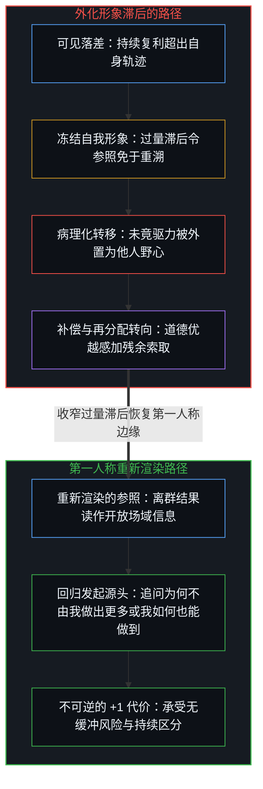
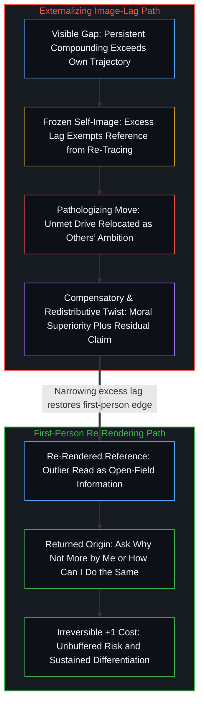
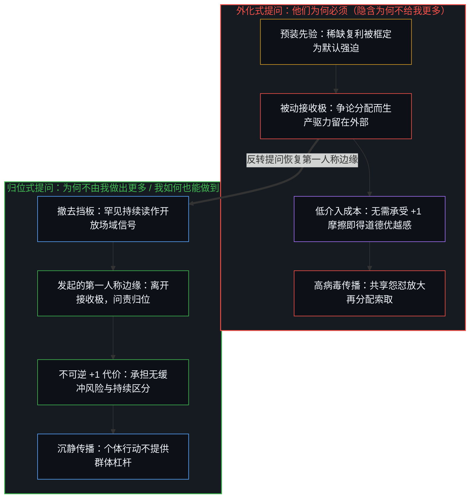
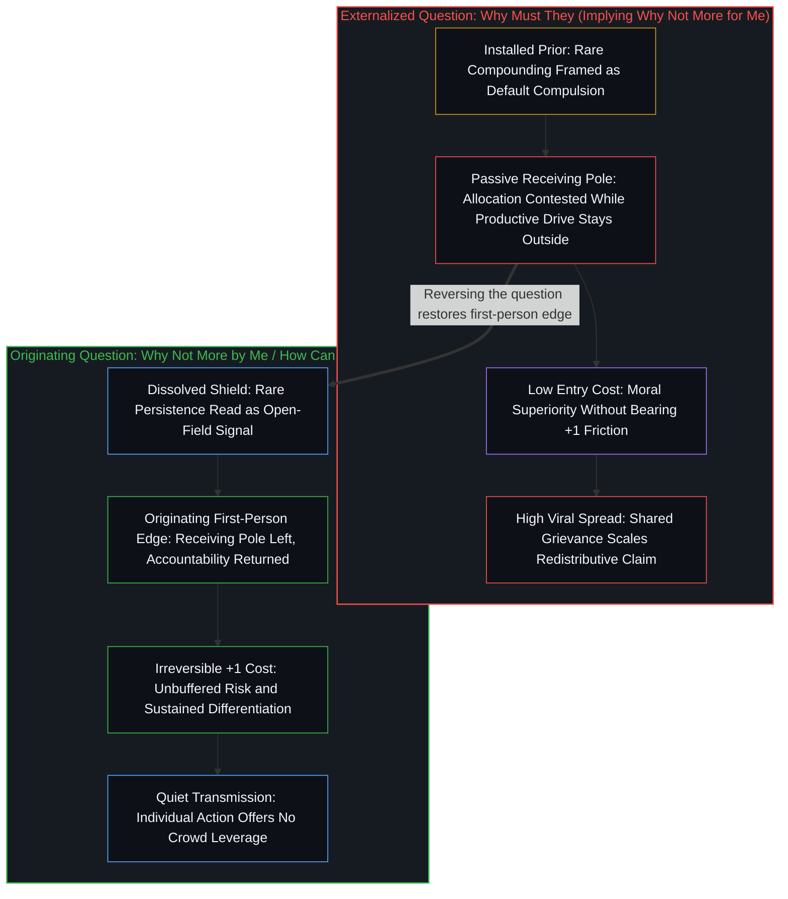

# 外部化未竟驱力为增长的病理 / Externalizing Unmet Drive as the Pathology of Growth

*将罕见成功读作病理，就是外化未竟驱力，并要求在保留驱力的同时再分配其残余。 / Reading rare success as pathology externalizes unmet drive and demands keeping the drive while reallocating its residual.*

“为什么公司必须持续增长？”把少数心智持续维系的高回报区分读作环境里的默认常态，仿佛需要为之正当化。持续超越均值的回报只出现在极少数企业里；大多数企业停滞、收缩或退出。既然这样的持续性如此稀缺，追问背后的紧迫感便不源自结果分布本身——正如[拥有更多从不是原因](../having-more-is-never-the-cause/)所追溯的，先前的占有从不写就下一步——而源自观察者与被观察者之间登记出的驱力落差。指望可见的产出，却将缺失的驱力安放在自身之外，这一姿态把私人残余转化为公共问题，再把问题转化为再分配的入口。

The question “why must companies keep growing?” reads the high-return distinctions sustained by a small number of minds as an ambient default that requires justification. Returns that continuously exceed the mean appear in a thin minority of enterprises; most stagnate, shrink, or exit. When persistence of that kind is so scarce, the urgency of the question does not arise from the distribution of outcomes—as [Having More Is Never the Cause](../having-more-is-never-the-cause/) traces, prior possession never authors the next move—but from the gap in drive registered between the observer and the observed. Counting on the visible yield while locating the missing drive outside oneself converts a private residual into a public problem, then converts that problem into an entry point for redistribution.

## 一、 罕见成功被读作问题 / 1. Rare Success Read as Problem

在审视这一问题何以带着紧迫感浮现之前，公司金融的字面机制与企业的经验行为早已表明，无论何处都不存在外在的增长强迫——最常被援引为例外的那两种情形也不例外。估值会计与商法中没有任何条款禁止一家年赚三十亿美元的盈利企业维持持平。按照默顿·米勒与弗兰科·莫迪利亚尼的估值恒等式（`Value = (NOPAT / r) + PVGO`），一家零净扩张（`PVGO = 0`）的成熟派息企业会清晰地以稳态盈利的折现价值出清；每当投入资本回报率（ROIC）低于资本成本（WACC）时，继续再投资非但不会创造、反而会损毁股东价值，此时通过派息或股票回购返还现金才是自洽的选择。小企业面板调查同样印证了，稳态经营在经验上早已是多数常态，而非反常：埃里克·赫斯特与本杰明·帕格斯利在美国调查数据中发现，不到四分之一的新创私营企业以做大为目标，约五分之四并不打算进行技术创新或建立专有流程，而是围绕所有者自主性与稳态经营来优化。高估值倍数与激烈竞争的市场，也同样没有设下任何例外。高于稳态盈利的股价或估值倍数（`PVGO > 0`）并不是资本市场签发的强制令；正如[价格是言说，理解是交易](../price-as-utterance-understanding-as-trade/)所追溯的，股价或估值倍数只是公开出清的成交价——是买卖双方当下解读未来轨迹的下游症候，不带任何发起性的因果权能。若一家盈利企业宣布零净扩张并派发现金，随着 `PVGO` 归零，其股价只会朝着 `NOPAT / r` 向下重新出清，而现金盈利照常延续；没有任何市场法则强迫增长。被登记为“强迫”或“惩罚”的，仅仅是高管、董事会或股东自己的选择：宁可捍卫一幅留存的股价或倍数形象——账面估值、股权挂钩薪酬或按增长定价的股权发行——也不愿让成交价重新渲染，正如当初选择按增长定价的资本，本身就是活的中心作出的抉择。激烈竞争的行业常借威廉·巴内特与莫滕·汉森的“红皇后跑道”来框定，而其中情形同样如此：对手创新、客户选取迁移与名义投入成本上漂，都是下游症候——它们源自其他活的心智持续划出更锐利的区分、源自客户选取更新鲜的残余——而并非迫使在位者增长的外部引擎。正如[个体抉择是唯一的因果杠杆](../individual-choices-as-the-only-causal-levers/)所追溯的，变动中的条件只改变回报地形，从不执笔任何中心的下一个抉择；当经营一家企业的心智停止更新区分，先前的残余便会变薄，而这些心智依然自由决定，是重续分化、收窄至利基市场、收割现金，还是退出。

Before examining why the question registers with urgency, the literal mechanics of corporate finance and empirical firm behavior leave no external compulsion to grow anywhere—including in the two cases most commonly cited as exceptions. Nothing in valuation accounting or commercial law prohibits a profitable business earning three billion dollars a year from staying flat. In Merton Miller and Franco Modigliani’s valuation identity (`Value = (NOPAT / r) + PVGO`), a mature dividend-paying firm with zero net expansion (`PVGO = 0`) clears cleanly at the discounted value of steady-state earnings; whenever return on invested capital (ROIC) falls short of the cost of capital (WACC), further reinvestment destroys shareholder value rather than creating it, making payout via dividends or share repurchases the coherent choice. Small-business panels confirm that steady operation is already the empirical majority rather than an anomaly: Erik Hurst and Benjamin Pugsley found across United States survey data that fewer than a quarter of private entrants aim to grow large and roughly four in five do not aim to innovate or build proprietary processes, optimizing instead for owner autonomy and steady operation. Nor do high valuation multiples or contested markets install any exception. An equity price or valuation multiple above steady-state earnings (`PVGO > 0`) is not a mandate issued by capital markets; as [Price as Utterance, Understanding as Trade](../price-as-utterance-understanding-as-trade/) traces, an equity price or multiple is a public clearing print—a downstream symptom of how buyers and sellers currently read future trajectory, carrying zero initiating causal power. If a profitable firm announces zero net expansion and pays out cash, its share price simply re-clears downward toward `NOPAT / r` as `PVGO` drops to zero while cash earnings continue; no market law compels growth. What registers as “compulsion” or “penalty” is solely executives’, boards’, or shareholders’ own choice to defend a retained share-price or multiple image—paper valuation, equity-linked pay, or growth-priced equity issuance—rather than letting the clearing price re-render, just as choosing growth-priced capital in the first place was a choice at living centers. The same holds in contested sectors often framed through William Barnett and Morten Hansen’s Red Queen treadmill: rival innovation, shifting customer elections, and nominal input-cost drift are downstream symptoms of other living Minds continuing to draw sharper distinctions and customers electing fresher residues, not an external engine compelling an incumbent to grow. As [Individual Choices as the Only Causal Levers](../individual-choices-as-the-only-causal-levers/) traces, shifting conditions alter the payoff landscape without authoring any center’s next choice; when the Minds running an enterprise stop renewing its distinctions, prior residue thins, and those Minds still freely decide whether to renew differentiation, narrow to a niche, harvest cash, or exit.

一旦把估值成交价与竞争症候归位为下游足迹，企业增长的分布便直指行动发起的源头。自我区分的活动发生着——无因、不息。称之为心智：早已在途的观察者，其每一个行动都是一次区分。由于较早的行动塑造后续行动可用的场域、却从不自行向前推进，持续的高利润与规模复利从不是企业实体自带的普遍属性；它们是具体鲜活的心智在开放分化之中反复承受无缓冲的不确定性与不可逆的 `+1` 摩擦之后，留下的下游残余。绝大多数企业从未维系住这般重溯步伐，纵向市场记录也只是将这种稀缺严格登记为事后足迹，而非命令企业行动的统计律令。亨德里克·贝森宾德对逾两万五千只美国普通股与六万四千只全球股票的研究记录显示，超过半数的股票在其存续周期内跑输一个月期国库券，而仅占 4.31% 的美国公司与 2.4% 的全球公司，便贡献了超越现金回报的全部股市净财富创造。路易斯·陈、杰森·卡塞斯基与约瑟夫·拉科尼肖克发现，连续五年实现高于中位数净利润增长的存续企业仅占约 3.0% 至 3.1%——几乎与随机抛硬币的概率（`0.5⁵`）相吻合——而 1955 年最初入选《财富》500 强的企业中，约九成已经退场或跌出榜单。即便在激烈竞争、公开定价的市场之内，这份耗损记录也证实：无论是高估值倍数还是对手推进，都既不强迫复利，也制造不出复利。正如[平均值是残余，不是引擎](../the-average-is-residue-not-the-engine/)所追溯的，汇集起来的结果从未显现出一块将企业向上托举的共同底板；复利只沿着主动区分仍在延续的细窄右尾留存。

With valuation prints and competitive symptoms returned to their place as downstream footprints, the distribution of corporate growth points directly back to where action originates. Self-distinguishing activity occurs — uncaused, unceasing. Call it the Mind: the observer already underway, every act of which is a distinction. Because earlier acts shape the field available to later ones without propelling themselves forward, persistent high profits and scale compounding are never a general property of corporate entities; they are the downstream residual left by specific living Minds repeatedly bearing unbuffered uncertainty and irreversible `+1` friction inside open differentiation. Most enterprises never sustain that pace of re-tracing, and longitudinal market records register this scarcity strictly as ex-post footprints rather than as a statistical law commanding firms. Hendrik Bessembinder’s studies of more than twenty-five thousand United States common stocks and sixty-four thousand global equities record that over half underperformed one-month Treasury bills over their lifetimes, while just 4.31 percent of United States firms and 2.4 percent of global firms accounted for the entire net equity wealth created above cash. Louis Chan, Jason Karceski, and Josef Lakonishok found that five-year consecutive above-median bottom-line earnings growth occurs in roughly 3.0 to 3.1 percent of surviving firms—virtually matching a random coin flip (`0.5⁵`)—and roughly nine out of ten companies on the original 1955 Fortune 500 have exited or fallen off the list. Even inside contested, publicly priced markets, that attrition record confirms that neither high multiples nor rival advances compel or manufacture compounding. As [The Average Is Residue, Not the Engine](../the-average-is-residue-not-the-engine/) traces, pooled outcomes never reveal a shared floor propelling firms upward; compounding endures only along a thin right tail where active differentiation continues.

当一个追问把如此稀缺的残余当作需要正当化的病理性强迫来对待时，探究的方向便已经从“为何如此罕见”滑向了“为何它必须继续”。前一个问题停留在经验观察层面，审视在市场摩擦与竞争消磨之下，究竟有多少中心仍在持续延展区分。后一个问题则在任何证据到来之前，就先装入了一个未经明言的前提：它预设这种罕见的持续构成了一种遍布环境的强迫，也构成了需要约束的公共负担。无论是公司规则、估值倍数，还是对手推进，都从未强迫任何一家企业继续扩张；究竟选择复利、持平、收割，还是退出，每项抉择都留在经营并出资该企业的心智手中。因此，要求解释他人何以必须持续增长背后的那股紧迫感，并不源于市场必然，而源于观察者自身的姿态如何登记这道落差。

When a question treats so scarce a residual as a pathological compulsion needing justification, the direction of inquiry has already slid from “why is it so rare?” to “why must it continue?” The first question stays with empirical observation of how few centers keep extending differentiation against market friction and competitive decay. The second installs an unstated premise before any evidence arrives: it presupposes that rare persistence constitutes an ambient compulsion and a public burden requiring constraint. Neither corporate rules, valuation multiples, nor rival advances ever compel an enterprise to keep expanding; every choice to compound, stay flat, harvest, or exit remains with the Minds running and funding it. The urgency behind demanding why others must keep growing therefore comes not from market necessity, but from how the observer’s own posture registers that gap.

## 二、 外化与病理化 / 2. Externalization and Pathologizing

将“他们为何必须更多”置于中心，把自身未竟的驱力外化为对他人野心的病理化描述。在持续比较之下，活的心智保留一幅自我形象作为衡量方位的器具；由于诠释总是至少比生成的那一步晚一步，这份参照唯有随着行动推进而持续重新渲染，才保持可用。一旦豁免这幅留存下来的自我形象、不再重溯它——让它越过自身那一步，以受捍卫的肖像而非暂时的方位留存下来，即[自我形象仿佛从无处发声](../self-image-speaks-as-if-from-nowhere/)所追溯的那次冻结——结果便会对照一条陈旧基线进行登记，于是他人的扩张就作为来自外部的威胁降临。在开放取向之下，正如[潜能作为威胁或启发](../ones-potential-as-threat-or-inspiration/)所追溯的，另一个中心的复利会被读作开放场域里的证据，显示更宽广的区分所能触及的尺度；在封闭的零和框架之下，同一道差距却登记为减损或不义的盈余。把持续的野心重贴上病理标签（“无休止的增长是一种病态”），借由将缺失的驱力安放在自身边界之外——而非安放在自身的区分强度、风险承受或选择权行使之内——从而护住了那幅未经审视的自我形象。正如[外部归因是个人进步的障碍](../wai-bu-gui-yin-ge-ren-jin-bu-de-zhang-ai/)所确立的，把差距向外挪移，抽走了内部唯一可操作的杠杆，同时还交付了一份零成本的补偿：不同于承受不可逆的 `+1` 摩擦去构筑能力，道德或智识批判像纸面重言式（`1 + 1 = 2`）一样运转，即便物质与地位的差距原封不动，仍能恢复一种道德或智识上的优越感。

Centering “why must they have more?” externalizes unmet drive into a pathological description of others’ ambition. Under continuous comparison, a living Mind retains a self-image as an instrument for gauging orientation; because interpretation always trails the generating step by at least one step, that reference stays functional only while continuously re-rendered as action moves. Exempting the retained self-image from re-tracing—preserving it past its step as a defended portrait rather than a provisional heading, the freeze traced in [Self-Image Speaks as if from Nowhere](../self-image-speaks-as-if-from-nowhere/)—leaves outcomes registering against a stale baseline so that another’s expansion arrives as an exterior threat. Under an open orientation, as [One’s Potential as Threat or Inspiration](../ones-potential-as-threat-or-inspiration/) traces, another center’s compounding reads as open-field evidence of what wider differentiation makes reachable; under a closed, zero-sum framing, the same gap registers as subtraction or undeserved excess. Re-labeling persistent ambition as a pathology (“endless growth is a disorder”) protects the unexamined self-image by placing the missing drive outside one’s own boundary rather than inside one’s own distinction intensity, risk tolerance, or exercise of optionality. As [External Attribution Is the Obstacle to Personal Growth](../wai-bu-gui-yin-ge-ren-jin-bu-de-zhang-ai/) establishes, relocating discrepancy outward strips the only actionable lever inside, while delivering zero-cost compensation: unlike bearing irreversible `+1` friction to build capacity, moral or intellectual critique operates like a paper tautology (`1 + 1 = 2`), restoring a sense of moral or intellectual superiority even while the material and status gap remains unchanged.

既有的怨恨与社会比较理论，在到达各自边界之前，已经描摹了这场倒置的早期片段。弗里德里希·尼采（《道德的谱系》，1887 年）与马克斯·舍勒（《怨恨》，1912 年）诊断了能力受阻之下的反应性情绪如何触发舍勒所称的“价值幻觉”：当某种姿态无法在生命力或实业进取的轴线上竞争时，便将财富、规模与不懈野心贬低为腐败或浅薄，同时把无力抬升为道德美德——即便它依然珍视自己所谴责的果实。经验心理学与社会学则刻画了这一姿态在有限范围内的邻近侧面：由塞缪尔·斯托弗经 W·G·朗西曼至泰德·格尔发展起来的相对剥夺模型记录了当实际所得落后于既定预期时，可见的同侪收益如何加剧不满；亚伯拉罕·泰瑟的“自我评估维持”框架（1988 年）表明，当他人在与自我相关的维度上构成向上比较威胁时，主体如何不靠提升表现、而是借由贬低整个维度本身来中和威胁；尼尔斯·范德芬、马塞尔·泽伦伯格与里克·彼得斯（2009 年、2012 年）则追踪了较低的个人控制感一旦与“他人优势乃不当得利”的框定结合，如何将“向上追赶”的良性嫉妒转化为“向下拉平”的恶性嫉妒。在各自描摹价值倒置、维度贬低与评估闸门的描述范围之内，这些框架依然有用。然而，一旦它们把怨恨、感知到的剥夺或低控制感视作固定心理机制内部的被动情绪反射，而未能追溯两个主动动作，这些框架便到达了边界：其一，正如[相对差异与复利比较](../relative-differentials-and-the-compounding-of-comparison/)所确立的，冻结狭短窗口内的向上比较并拒绝更新自身的区分速率，正是为了维系怨怼的自洽而主动持守的自我形象滞后；其二，经典的怨恨模型假定这一框定的目的只在于取消或贬损目标驱力，却忽略了更为锋利的姿态——一边宣称野心是病态的，一边却要求那台生产引擎继续运转。

Established accounts of resentment and social comparison map early segments of this inversion before reaching their boundary. Friedrich Nietzsche (*On the Genealogy of Morality*, 1887) and Max Scheler (*Ressentiment*, 1912) diagnosed how reactive feeling under blocked capacity triggers what Scheler called a value delusion (*Wertwahn*): unable to contend on the axis of vitality or enterprise, the stance demotes wealth, scale, and relentless ambition as corrupt or shallow while elevating powerlessness into moral virtue—even while continuing to prize the fruit it condemns. Empirical psychology and sociology describe bounded adjacent facets of this posture: relative deprivation models developed from Samuel Stouffer through W. G. Runciman and Ted Gurr record how visible peer gains heighten discontent when attainment lags anchored expectations; Abraham Tesser’s Self-Evaluation Maintenance framework (1988) shows how an upward comparison threat on a self-relevant axis prompts neutralizing the threat without raising performance by devaluing that dimension altogether; and Niels van de Ven, Marcel Zeelenberg, and Rik Pieters (2009, 2012) trace how low perceived personal control combined with framing another’s advantage as undeserved turns benign “moving-up” envy into malicious “leveling-down” envy. Within their descriptive scopes—tracing value inversion, dimension devaluation, and appraisal gates—these frameworks remain useful. Yet they reach their boundary where they treat resentment, perceived deprivation, or low control as passive emotional reflexes inside a fixed psyche rather than tracing two active moves: first, as [Relative Differentials and the Comparison of Compounding](../relative-differentials-and-the-compounding-of-comparison/) establishes, freezing a short-window upward comparison and refusing to update one’s own distinction rate is an active maintenance of self-image lag to keep grievance coherent; second, classical resentment models assume the framing aims strictly to abolish or devalue the targeted drive, overlooking the sharper posture that calls ambition pathological while demanding the productive engine keep running.

## 三、 再分配作为更强版本 / 3. Redistribution as the Stronger Version

把罕见的企业持续增长转化为需要正当化的公共问题，只是较为温和的一步。更强的姿态是保留驱力的再分配：留住生出扩张产出的生产驱力，同时要求在现行产权、契约与税收规则下对它留下的残余再分走更大份额。不同于干脆拒斥商业本身，这一姿态接纳该驱力建造与供给的能力，争议的只是仍附着于发起所有者名下的那部分比例。然而，竞争性扩散早已借由雇佣、模仿、新进入者与价格下行，把所生成价值的绝大部分向外转移。在[私人残差与社会剩余的因果次序](../the-causal-order-of-private-residuals-and-social-surplus/)所追溯的战后美国非农经济核算中，威廉·诺德豪斯估算，创新者仅捕获了技术进步所创造社会总剩余的大约 2.2%，而约 97.8% 则通过更低价格与更优商品扩散至消费者；尼古拉斯·布鲁姆、马克·尚克曼与约翰·范里嫩同样记录到技术外溢效应显著超过产品市场竞争抢占，令研发的社会总回报至少达到私人回报的两倍；埃里克·布林约尔松、阿维纳什·科利斯与费利克斯·埃格斯则测算出数字搜索、地图与通信服务所产生的庞大零价格消费者剩余，而它们从未出现在企业营收账簿之上。这些经验足迹终究只是下游记录，而非因果的根基，但它们已足以消解“收益全归私有”之类的说法。扩散本身既不直接算出理想税率，也不替某个残余比例是否“过高”下定论；一旦论证从宣称增长是病态转为要求更重的再分配，争端便转移到了如何再切分一份早已扩散的剩余——同时却依然指望那个发起驱力继续运转下去。

Converting rare corporate persistence into a public problem needing justification is only the milder move. The stronger posture is drive-preserving redistribution: retain the productive drive that generates expanding output while demanding a larger share of the residual it leaves under existing property, contract, and tax rules. Unlike an outright rejection of commerce, this posture accepts the drive’s capacity to build and supply, contesting instead the fraction that remains attached to the originating owners. Yet competitive diffusion has already shifted the overwhelming balance of generated value outward through employment, imitation, new entry, and falling prices. In postwar United States nonfarm accounting traced in [The Causal Order of Private Residuals and Social Surplus](../the-causal-order-of-private-residuals-and-social-surplus/), William Nordhaus estimated that innovators captured roughly 2.2 percent of the total social surplus from technological progress while roughly 97.8 percent diffused to consumers as lower prices and improved goods; Nicholas Bloom, Mark Schankerman, and John Van Reenen similarly recorded technology spillovers exceeding product-market rivalry so that gross social returns to research run at least twice private returns, while Erik Brynjolfsson, Avinash Collis, and Felix Eggers measured vast zero-price consumer surplus from digital search, maps, and communication that never appears in corporate revenue. Those empirical footprints remain downstream records rather than the ground of causality, yet they dissolve any claim that gains stay “wholly private.” That diffusion does not by itself compute an ideal tax rate or settle whether a given residual share is “too high”; once the argument pivots from calling growth pathological to demanding heavier reallocation, the contest moves to slicing an already-diffused surplus while still counting on the originating drive to continue producing it.

把留存下来的那 2.2% 当作静待政治重新切分的闲置奖品，错失了生产与消费之间的因果次序。正如[秩序、剩余与道德拦截](../order-surplus-and-the-moral-intercept/)所追溯的，多数人的广泛消费本身早已是回流并补偿少数人杠杆式生产的回路；在后一极安放一个道德上的“应当”，是把事后的转移当作了先在创造的授权者。由于集中的资本形成、被舍弃的试错路径与协调风险从外部看始终不透明，而消费品与公共福利则在庞大的人群中即时显像——即[生产的不透明与消费的权重](../the-opacity-of-production-and-the-weight-of-consumption/)所剖析的可见性落差——留存的企业股权便看起来像一笔静态的私人囤积，而不像仍在掌舵不确定投入的活跃器具。然而，这份残余既是在第 0 步召唤高风险下注出场的事前诱因，也是维系规模运转的协调资本存量。正如[继承的残余与索取的必要](../inheritance-as-residue-and-the-need-for-extraction/)所论证的，反复削弱残余索取权，会压缩预期增量回报、压低闲置资本的机会成本，并使未来产出萎缩——扩散的消费者剩余正是从那份未来产出中生长出来的；与此同时，既有的丰裕还在同步资助着那些将生产描绘成可疑之物的阐释框架，这正是[生产创造自己的意识形态消费](../fate-loves-irony-refined/)所追溯的反讽回路。

Treating that remaining 2.2 percent as an idle prize ready for political re-slicing misses the causal order between production and consumption. As [Order, Surplus, and the Moral Intercept](../order-surplus-and-the-moral-intercept/) traces, widespread consumption by the many is already the return loop that compensates leveraged production by the few; installing a moral “should” on the later pole treats ex-post transfer as what authorizes prior creation. Because concentrated capital formation, rejected paths, and coordination risk stay opaque from outside while consumer goods and public benefits register immediately across large numbers—the visibility gap analyzed in [The Opacity of Production and the Weight of Consumption](../the-opacity-of-production-and-the-weight-of-consumption/)—retained corporate equity looks like a static personal hoard rather than an active instrument steering uncertain commitments. Yet that residual functions both as the ex-ante inducement that calls risky wagers forward at Step 0 and as the coordinating stock sustaining scale. As [Inheritance as Residue and the Need for Extraction](../inheritance-as-residue-and-the-need-for-extraction/) demonstrates, repeatedly attenuating residual claimancy compresses expected incremental returns, lowers the opportunity cost of leaving capital idle, and shrinks the future output from which diffused consumer surplus grows—even as existing abundance simultaneously subsidizes the interpretive frameworks that portray production as suspect, the ironic loop traced in [Production Creates Its Own Ideological Consumption](../fate-loves-irony-refined/).

每当关于经济扩张的形式化批判把增长病理学与普遍供给保障绑定在一起时，展现出的正是同一种保留驱力的依赖。在《稳态经济学》（1977 年）与《超越增长》（1996 年）中，赫尔曼·戴利将量上的“增长”——即在有限的生态源汇约束下不断扩张物质与能量通量——与质上的“发展”区分开来：在后者之中，更优的设计、知识与效率能够在恒定甚至更低的物质通量下扩展人类能力。当代去增长理论家——包括杰森·希克尔、乔治斯·卡利斯与马蒂亚斯·施梅尔策——将这套生态核算延伸为对系统性“增长强迫”的制度批判，认为竞争性再投资、附息债务与国家税基结构把市场锁死在永无止境的物质扩张之中，并据此主张对高耗能部门实施有计划的缩减，同时推行去商品化与“全民基本服务”——即由公共保障的医疗、住房、交通、教育与清洁能源基础设施。在暂时有界的局部视域与现有技术条件之内，戴利的这一区隔作为生态核算依然有用，能够对照局部生态源汇约束追踪物理物质与能量通量。然而，稳态与去增长两套方案在任何制度争论尚未开始之前，便已到达其更深层的首要边界：它们预设了一个固定、封闭的现实——把当今已测绘的地球生物圈、当前的资源定义，以及当前的开采与吸纳视界，冻结进一个永久密封的容器之中。这种闭合在构造上就把持续扩张变成了零和耗竭，甚至将戴利的“质性发展”也圈限在一道静态物理天花板之内；然而正如[没有系统能被保持封闭](../no-system-can-be-kept-closed/)所追溯的，有限的持守从未能封住使用它的持续区分活动，也正如[当丰裕看起来像稀缺](../when-abundance-looks-like-scarcity/)与[百万亿地平线之外](../beyond-the-hundred-trillion-horizon/)所表明的，持续分化一直在拓宽可用包络、资源分类以及分母本身。两重次生的制度与供给张力正从这一封闭现实前提向下游衍生而来。其一，在密封容器之内审视市场竞争与资本定价，会把因果权能错配给下游的市场症候——将多元的融资、再投资与竞争抉择塌缩为一条“增长强迫”的强制法则，尽管无论估值倍数还是对手推进都并未强迫扩张，且每当所有者选择稳定而非追逐进一步增长时，稳态企业早已在毫无法律或会计禁令的条件下照常运转。其二，将总量封顶以拒斥分母扩容，令这套框架自身的供给算术吃紧：一边缩减私人扩张、一边为“全民基本服务”与公共基础设施筹资，依然要依赖强健持续的生产能力、技术协调以及由此弥散出的财政剩余——这正是布兰科·米兰诺维奇指出的核算张力：停滞的总产出收窄了可用于抬升低收入基线的物质余地。一边将私人扩张诊断为系统性疾病，一边指望公共供给派发普遍红利，结果便是让发起性的生产驱力继续背负产出重担，同时又去压缩维系其运转的残余。

Formal critiques of economic expansion exhibit this same drive-preserving dependency whenever they pair growth pathology with universal provisioning guarantees. In *Steady-State Economics* (1977) and *Beyond Growth* (1996), Herman Daly separates quantitative growth—expanding physical matter-energy throughput against finite ecological source and sink constraints—from qualitative development, where improved design, knowledge, and efficiency expand human capability at constant or lower material throughput. Contemporary degrowth theorists, including Jason Hickel, Giorgos Kallis, and Matthias Schmelzer, extend that ecological accounting into an institutional critique of systemic growth compulsion (*Zwangswachstum*), arguing that competitive reinvestment, interest-bearing debt, and state revenue structures lock markets into perpetual physical expansion, and proposing planned downscaling of energy-intensive sectors alongside decommodification and Universal Basic Services—publicly guaranteed healthcare, housing, transit, education, and clean-energy infrastructure. Within a temporarily bounded local horizon and current technology, Daly’s separation remains useful as ecological accounting tracking physical matter-energy throughput against local ecological source and sink constraints. Yet both steady-state and degrowth programs reach their deeper, primary boundary before any institutional dispute begins: they presume a fixed, closed reality—freezing today’s mapped terrestrial biosphere, current resource definitions, and current extraction and sink horizons into a permanently sealed container. That closure turns continued expansion into zero-sum exhaustion by construction and boxes even Daly’s “qualitative development” inside a static physical ceiling; yet as [No System Can Be Kept Closed](../no-system-can-be-kept-closed/) traces, a finite hold never seals the ongoing distinguishing activity using it, and as [When Abundance Looks Like Scarcity](../when-abundance-looks-like-scarcity/) and [Beyond the Hundred-Trillion Horizon](../beyond-the-hundred-trillion-horizon/) show, ongoing differentiation continually widens the usable envelope, resource taxonomy, and denominator itself. Two secondary institutional and provisioning tensions follow downstream from that closed-reality premise. First, viewing market competition and capital pricing inside a sealed container misallocates causal power to downstream market symptoms—collapsing diverse financing, reinvestment, and competitive choices into a coercive law of *Zwangswachstum* even though neither valuation multiples nor rival advances compel expansion and steady-state businesses already operate without legal or accounting prohibition whenever owners choose stability over pursuing further growth. Second, capping the aggregate against denominator expansion strains the framework’s own provisioning arithmetic: financing Universal Basic Services and public infrastructure while downscaling private expansion still depends on robust ongoing productive capacity, technological coordination, and diffused fiscal surplus—an accounting tension Branko Milanovic flags when noting how stagnant aggregate output constrains the material margin available to lift lower-income baselines. Diagnosing private expansion as systemic disease while expecting public provisioning to pay universal dividends leaves the originating productive drive carrying the burden of output while compressing the residual that keeps it operating.

## 四、 提问的传播条件 / 4. Conditions for the Question’s Spread

“为什么他们必须？”早已将“为什么不给我更多？”作为未言明的背面含在其中，而这一姿态之所以远比“为什么不由我做出更多？”或“我如何也能做到？”更容易传播，正因为“为什么他们必须？”与“为什么不给我更多？”都将发问者留在被动的接收极上，争论他人产出该如何切分，却把生产驱力安放在自身之外。正如[安装战争的那个问题](../the-question-that-installs-the-war/)所追溯的，公共提问在任何回答开口之前便已装入自身前提：追问企业为何必须持续增长，架起了一块外置记分牌，参与者无需支付任何 `+1` 干预成本，即可围绕共同的抱怨对齐站位。将驱力安放在其源头的追问，并不是仍停留在同一分配框架内的“为什么不给我更多？”，而是“为什么不由我产出更多？”或“为什么不由我做出更多？”——或者干脆就是“我如何也能做到？”——这一问径直退出接收极，撤去外部挡板，将因果问责与无缓冲的 `+1` 摩擦交还给发起的第一人称边缘。在公共传播数据中，斯特凡·利奇、马格达莱纳·福尔马诺维奇、扬·尼卡东与亚历山德拉·齐霍茨卡（2026 年）在逾 120 万条关联约 24,700 份 Change.org 请愿书的 X 平台帖文中，记录了这一分叉留下的下游足迹：表达道德义愤的帖文获得了显著更高的病毒式转发量，却并未带来更多请愿签名；而指向能动性的表述虽然在信息流中传播较窄，却与具体行动呈正相关。尽管尚无受控实验直接针对这几个特定的向上比较提问进行分离检验，这种分离恰恰作为同一不对称性的下游足迹登记下来：集体义愤之所以迅速扩散，正因为对外归咎成本低廉且便于协调怨怼；而以能动性为核心的提问之所以沉静，是因为它直接要求个体采取行动。要维系对相对落差的索取主张，就必须保住低满足状态不被打破，好让怨怼保持自洽；因此，病毒式传播的条件从来不是对公司金融的中立好奇，而是持续比较之下普遍存在的驱力落差摩擦，再加上将这一落差转化为向他人残余提出索取的叙事便利。

“Why must they?” already carries “why not more for me?” as its unspoken underside, and that posture spreads far more easily than “why not more by me?” or “how can I do the same?” because both “why must they?” and “why not more for me?” keep the speaker seated on the passive receiving pole, contesting how others’ output is shared while locating productive drive outside. As [The Question That Installs the War](../the-question-that-installs-the-war/) traces, a public question installs its premises before any answer speaks: asking why companies must keep growing mounts an externalized scoreboard on which participants pay zero `+1` intervention cost and align around shared complaint. The question that locates drive at its source is not “why not more for me?”, which stays inside that same allocation frame, but “why not more from me?” or “why not more by me?”—or simply “how can I do the same?”—which leaves the receiving pole altogether, strips the external shield, and returns causal accountability and unbuffered `+1` friction to the originating first-person edge. In public-communication data, Stefan Leach, Magdalena Formanowicz, Jan Nikadon, and Aleksandra Cichocka (2026) documented a downstream footprint of this divergence across more than 1.2 million X posts linked to roughly 24,700 Change.org petitions: posts expressing moral outrage achieved substantially higher viral reposts without yielding more petition signatures, whereas agency-oriented framing traveled less widely on feeds yet correlated positively with concrete action. Although no controlled experiment directly isolates these exact upward-comparison questions, that dissociation registers as a downstream footprint of the same asymmetry: collective outrage scales rapidly because external blame costs little and coordinates grievance, whereas agency-centered questions stay quiet because they ask the individual to act. Sustaining a claim over relative disparities requires keeping low contentment intact so grievance stays coherent, making the condition for viral spread not neutral curiosity about corporate finance, but the widespread friction of drive gaps under continuous comparison paired with the narrative convenience of turning that gap into a demand over others’ residuals.

企业分布与社会比较之中没有任何力量迫使一个心智将罕见扩张读作病理，任何再分配指令也生不出它所征税的那股驱力。每一次比较终究仍在区分发起的第一人称边缘决断。面对他处可见的复利攀升，个体大可把注意力耗在让一个外化式提问保持敞开——守住一幅未经审视的自我形象免于重绘，同时索取他人承担风险留下的残余——也可以收窄那道过量滞后，把他人持续的攀升读作开放场域中的证据，看清持续区分所能带来的产出，并在此时此地决断是否亲自承受下一步无缓冲的代价。一条轨迹只会在个体选择延展它之处发生转向。

Nothing in corporate distributions or social comparisons forces a Mind to turn rare expansion into pathology, nor can any redistributive mandate generate the drive whose output it taxes. Every comparison still resolves at the first-person edge where distinctions begin. An individual facing visible compounding elsewhere can spend attention keeping an externalized question open—guarding an unexamined self-image from re-rendering while demanding the residual of someone else’s risk—or narrow that excess lag, read another’s sustained climb as open-field evidence of what persistent differentiation yields, and decide here and now whether to bear the unbuffered cost of the next move. A trajectory shifts only where the individual chooses to extend it.
