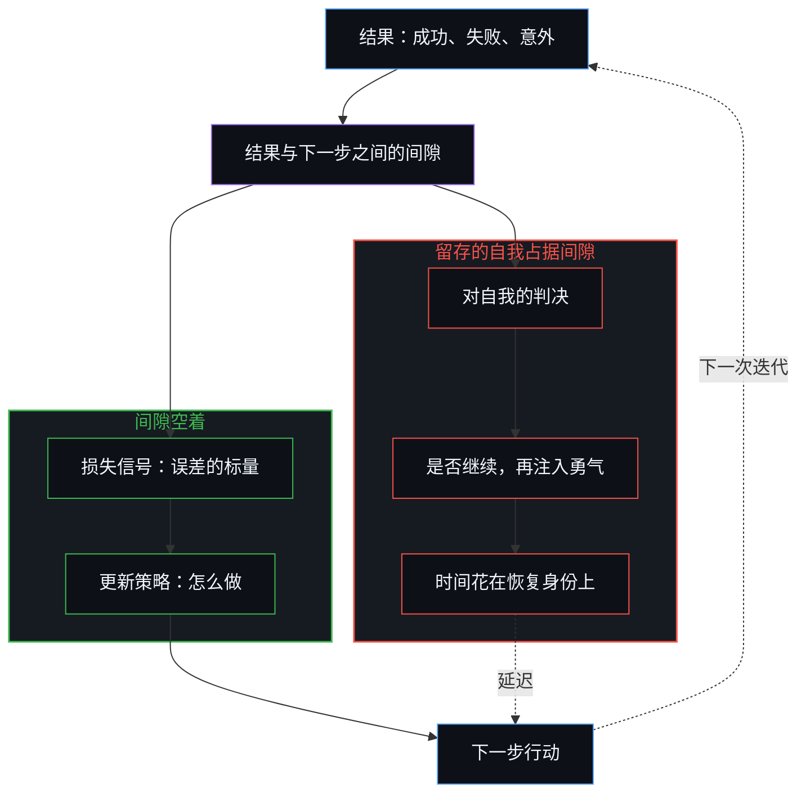
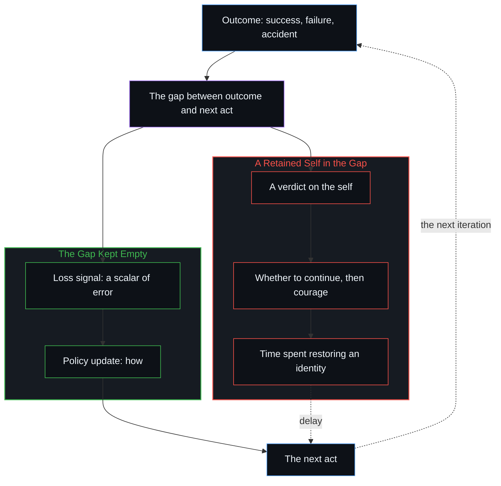

# 失败即信息 / Failure as Information

*失败即信息，结果与下一步之间的间隙越空，影响力越能复利 / Failure is information; the emptier the gap between outcome and next act, the more influence compounds.*

现实登记为开放而连贯的，它的反馈以结果的形式不断到来，成功、失败、意料之外的结果，各自报告着当前模型与它所遇到的东西之间的距离。一个行动者最终在这片场上的影响有多大，取决于这些信号有多一贯地被写成信息，而不是写成对自我的判决。埃隆·马斯克被观察到的回路把这层几何变得具体：爆炸刚过，电话已经打出去，谈的是工程；当前的模型默认有误；长远的目标不给身份留下多余的带宽。成功与失败于是作为类别消解为同一策略的样本，让回路保持不受污染的行动者，在单位日历时间里只是完成了更多有效的迭代。

Reality registers as open and coherent, and its feedback arrives continuously as outcomes, successes, failures and unexpected results, each reporting the distance between a current model and what it meets. The scale of an agent's eventual influence on that field compounds with how consistently those signals write as information rather than as verdicts on the self. Elon Musk's observed loop makes the geometry concrete: an explosion already on the phone as engineering, the present model assumed wrong, long-horizon objectives that leave no free bandwidth for identity. Success and failure then dissolve as categories into samples of one policy, and the agent that keeps the loop uncontaminated simply executes more effective iterations per unit of calendar time.

## 一、 爆炸被写成标量，而非自我 / 1. An Explosion Writes as a Scalar, Not as a Self

SpaceX 早期的失败让这道间隙变得可见。有一次爆炸之后，房间里一片沉默。有人哭了，有人开始计算财务损失。马斯克已经在打电话，问哪里出了故障、怎么修、下一个发射窗口在什么时候。他的声音和表情都没有变。那枚火箭已经过去了，存在的只有下一次迭代。

Early SpaceX failures make the gap visible. After one such explosion the room fell silent. Some people cried. Others began calculating the financial loss. Musk was already on the phone asking what failed, how it could be fixed, and when the next launch window opened. His voice and expression remained unchanged. The vehicle was past. Only the next iteration existed.

失败与意外只被登记为数据，恰好相当于一个损失函数。标量量化误差，更新随之而来。没有自我、叙事或情绪恢复的中间层把这道间隙占成一块记分牌。信号不会因为要先修复一个自我而被延迟。从外面看像是没有感受的东西，其实是间隙一直空着，好让下一次区分用上这份报告。

Failure and accident register strictly as data, the precise equivalent of a loss function. The scalar quantifies error; the update follows. No intermediate layer of ego, narrative or emotional recovery occupies the gap as a scoreboard. The signal is not delayed while a self is restored. What looks from outside like an absence of feeling is the gap staying empty so the next distinction can use the report.

同样的空，也表现为没有第二重计算。寻常的决策仍要问是否继续，然后再注入勇气，作为又一个动作。那个“是否”已经是一个留存的自我占着一个位置：继续被记作一份项目身份的存活，而不是下一步工程。在足够尖锐的目标之下，这个问题在回路里没有位置。唯一活着的计算是怎么做：燃烧室的压力、隔热罩的修订、这一天还剩下的几个小时。[难度不在行动本身](../hardness-is-not-inherent-in-the-action/)讲的是同一个“是否”装扮成困难的样子：继续被记作克服，而不是下一个寻常的步骤。

The same emptiness appears as the absence of a second computation. Ordinary decision-making still asks whether to continue, then injects courage as a further act. That "whether" is already a retained self occupying a slot: continuation scored as the survival of a project-identity rather than as the next engineering step. Under a sharp enough objective the question has no place in the loop. The only live computation is how: chamber pressure, a heat-shield revision, the hours remaining in the day. [Hardness Is Not Inherent in the Action](../hardness-is-not-inherent-in-the-action/) is that same "whether" dressed as difficulty: continuation scored as overcoming rather than as the next ordinary step.

## 二、 当前的模型已经有误 / 2. The Present Model Is Already Wrong

这种纪律被马斯克多年来明说的一个先验加固：总是假定当前的模型在某种程度上有误，唯一的志向是随着时间变得少错一些。当证据让错误显而易见，承认它就是下一步梯度，而不是地位上的让步。[开放即一致](../openness-is-consistency/)是这个先验的几何：一个有限的模型被强迫充当穷尽的地基，就会生出它随后又要熬过去的张力。作为工具握着，同一个模型在被重画的同时依然可用。

That discipline is reinforced by an explicit prior Musk has stated for years: always assume the present model is, to some degree, wrong, and the sole aspiration is to become less wrong over time. When evidence makes the error obvious, admission is the next gradient step rather than a concession of status. [Openness Is Consistency](../openness-is-consistency/) is that prior as geometry: a finite model forced to stand as exhaustive ground produces the tension it then tries to survive. Held as an instrument, the same model stays usable while it is redrawn.

长远的目标本身，让生命成为多行星的、加速向可持续能源的过渡，不给身份的次级优化留下多余的带宽。这些目标造出一片尖锐的损失地形，只有朝向目标的进展才有分量。其余的一切都被舍弃，因为这道约束容不下第二块记分牌。[自我价值感与所有权](../ownership-and-self-worthiness/)是同一回路在功能上的一面：只有后果作为自己的重新进入，模型才会复利。这里更进一步的冻结，是在回报与下一步之间插进一个留存的自我，于是即便是自己承担的结果，也仍被写成判决。每次失败之后的反弹，就是[减速是加速时感受到的阻力](../deceleration-is-the-drag-felt-when-accelerating/)所描述的那种阻力，只因速度是真的，才感受得到。

The long-horizon objectives themselves, making life multiplanetary and accelerating the transition to sustainable energy, leave no free bandwidth for a secondary optimization of identity. Those objectives create a sharp loss landscape in which only progress toward the target carries weight. Everything else is discarded because the bound cannot hold a second scoreboard. [Ownership and Self-Worthiness](../ownership-and-self-worthiness/) is the functional face of the same loop: the model compounds only when consequences re-enter as one's own. Here the further freeze is a retained self inserted between the return and the next act, so that even owned outcomes still write as verdicts. The backlash that follows each failure is the drag [Deceleration Is the Drag Felt When Accelerating](../deceleration-is-the-drag-felt-when-accelerating/) describes, felt only because the speed is real.

## 三、 成功与失败是同一策略的样本 / 3. Success and Failure Are Samples of One Policy

在这样的运作回路里，成功与失败这对惯常的类别消解了。二者都成为更新同一策略的强化学习样本。一次入轨的飞行与一次以爆炸告终的飞行，区别只在回写的奖励的正负与大小。它们是同一条连续轨迹上相继的点。

Under this operating loop the conventional categories of success and failure dissolve. Both become reinforcement-learning samples that update the same policy. A flight that reaches orbit and one that ends in explosion differ only in the sign and magnitude of the reward written back. They are successive points on a single continuous trajectory.

强化学习的词汇是一个接触点，不是第二个地基。[看似AI的强化学习，实为人类的自我强化学习](../self-rl-for-humans/)把发起、评估与改向留在行动的那条边缘上。这里的切口，是那个回路被污染：当一个留存的自我占据间隙，日历上的时间就花在恢复身份上，而不是更新策略。[疗愈打开反馈回路](../therapy-opens-the-feedback-loop/)是反过来的占据：一个第三方让登记变得更可承受，本会回到源头重新追溯生成条件的压力就被降低了。[好奇先行](../curiosity-first-the-hidden-engine-of-talent-and-development/)是同一种占据装扮成天赋的样子：失败确认了一个排名，而不是训练下一步行动。

The reinforcement-learning vocabulary is a point of contact, not a second ground. [What Looks Like RL for AIs Is Self-RL for Humans](../self-rl-for-humans/) keeps initiation, evaluation and redirection at the edge that acts. The cut here is the contamination of that loop: when a retained self occupies the gap, calendar time is spent restoring an identity rather than updating a policy. [Therapy Opens the Feedback Loop](../therapy-opens-the-feedback-loop/) is the occupancy from the other side: a third party makes the registration more tolerable, which lowers the pressure that would re-trace the generating conditions at their source. [Curiosity First](../curiosity-first-the-hidden-engine-of-talent-and-development/) is the same occupancy dressed as talent: failure ratifies a ranking instead of training the next act.

让间隙保持空着的行动者，单位日历时间里只是完成了更多有效的迭代。几十年下来，复利的差别变得决定性。[幂律是正态分布的长期后果](../power-law-is-the-long-term-consequence-of-normal-distribution/)讲的是同一种复利装扮成统计的样子：把残余的误差当作损失函数，后续的增量就会移动；把它归到别处，知识上的问题就留在原地。[关闭选择权的代价](../the-price-of-closing-optionality/)是组织的那一面：把失败当作数据，而不是当作对一个受保护形象的威胁。

The agent that keeps the gap empty simply executes more effective iterations per unit of calendar time. Over decades the compounding difference becomes decisive. [Power Law Is the Long-Term Consequence of Normal Distribution](../power-law-is-the-long-term-consequence-of-normal-distribution/) is that compounding dressed as statistics: residual error treated as a loss function shifts the later increments; allocated elsewhere, it leaves the knowledge problem where it was. [The Price of Closing Optionality](../the-price-of-closing-optionality/) is the organizational face: failure as data rather than as a threat to a protected image.

## 四、 复利就是“最具影响”的所指 / 4. Compounding Is What "Most Consequential" Names

现实从第一人称处登记为连贯而开放的，所以对它的反馈保持一贯的忠实，并不是站在这片场之外的一种心理优势。给够时间，最可靠地把每个结果都转成未经过滤的更新的行动者，会对后来的行动能接得住的东西施加最大的累积影响。[现实扭曲力场指认的是封闭的地图](../the-reality-distortion-field-names-the-closed-map/)是同一条被观察的轨迹上的另一种冻结：共识认定的可行性被当作封死的疆域，别人地图的滞后被叫作一种特殊的力量。这里的冻结，则是把结果当作对自我的判决。惊人的挫败与跨领域加速的能力是同一条轨迹，不是一个需要英雄故事来解释的悖论。

Because reality registers from the first person as coherent and open-ended, consistent fidelity to its feedback is not a psychological advantage standing apart from the field. Given enough time, the agent that most reliably converts every outcome into an unfiltered update exerts the largest cumulative influence on what later acts can take up. [The Reality Distortion Field Names the Closed Map](../the-reality-distortion-field-names-the-closed-map/) is a different freeze on the same observed trajectory: consensus feasibility held as sealed territory, and the lag of other maps named a special power. Here the freeze is the outcome held as a verdict on the self. The spectacular setbacks and the accelerating capability across domains are one trajectory, not a paradox requiring a hero story.

只要同样的纪律继续下去、间隙不被填满，影响的规模就继续复利。这就是“当下这个时代最具影响的个人”所指的东西：一个不受污染的回路在开放负荷下的逻辑后果。

As long as the same discipline continues without the gap filling, the scale of impact continues to compound. That is what "the most consequential individual of the present era" names: the logical consequence of an uncontaminated loop under open load.
