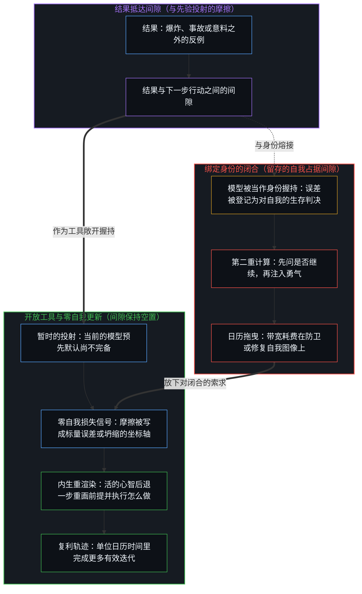
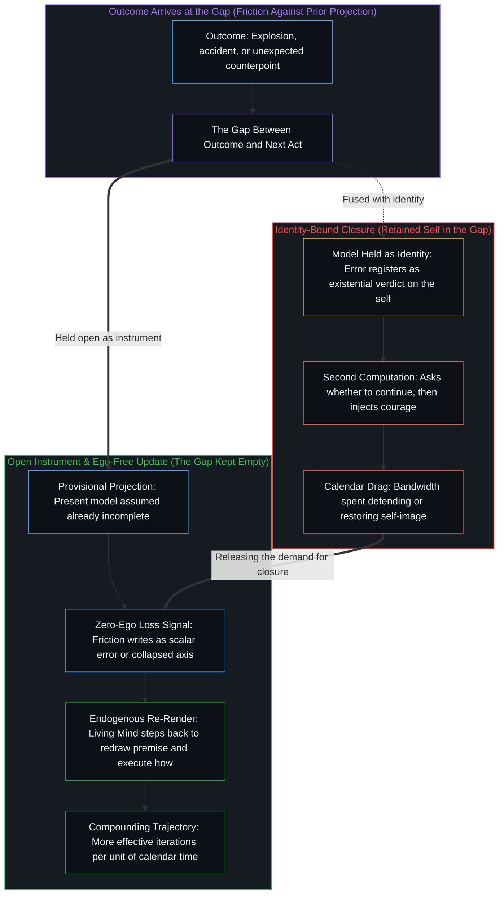

# 失败即信息 / Failure as Information

*失败即信息，下一步之前的间隙保持空置，影响力便持续复利 / Failure is information; an empty gap before the next act compounds influence*

自我区分的活动无因而不息地发生，每一个离散的行动都会遇上一片开放的场，其反馈以结果的形式持续到来。成功、失败与意料之外的事故，各自报告着一个中心的当前投射与活边缘实际所遇之物之间的距离。一个行动者最终在这片场上的影响规模有多大，取决于这些回传信号有多一贯地被写成重画投射的信息，而不是写成对一个留存自我的判决。从外部观察到的埃隆·马斯克运作回路，把这层几何变得具体：爆炸刚过，电话已经打出去谈工程，当前的模型预先默认有误，长远的目标不给防卫身份留下多余的容量。成功与失败于是从对立的类别消解为更新同一策略的样本，让结果与下一步之间的间隙保持不受污染的中心，在单位日历时间里完成了更多有效的迭代。

Self-distinguishing activity occurs, uncaused and unceasing, and every discrete act meets an open field whose feedback arrives continuously as outcomes. Successes, failures, and unexpected accidents each report the distance between a center's current projection and what the living edge actually encounters. The scale of an agent's eventual influence on that field compounds with how consistently those returning signals write as information to redraw the projection rather than as verdicts on a retained self. Elon Musk's observed operating loop makes this geometry concrete: an explosion is already on the phone as engineering, the present model is assumed wrong in advance, and long-horizon objectives leave no spare capacity for defending an identity. Success and failure then dissolve as opposing categories into samples updating one policy, and the center that keeps the gap between outcome and next act uncontaminated executes more effective iterations per unit of calendar time.

## 一、 爆炸被写成标量，而非自我 / 1. An Explosion Writes as a Scalar, Not as a Self

SpaceX 早期的失败让结果与下一步之间的间隙变得可见。有一次爆炸之后，房间里一片沉默。有人哭了，有人开始计算财务损失。马斯克已经在打电话，问哪里出了故障、怎么修、下一个发射窗口在什么时候。他的声音和表情都没有变。那枚火箭已经过去了，存在的只有下一次迭代。

Early SpaceX failures make the gap between outcome and next act visible. After one such explosion the room fell silent. Some people cried. Others began calculating the financial loss. Musk was already on the phone asking what failed, how it could be fixed, and when the next launch window opened. His voice and expression remained unchanged. The vehicle was past. Only the next iteration existed.

在这个回路里，失败与事故被登记为数据，在功能上等同于损失信号。标量量化先验模型与物质摩擦之间的误差，更新随之而来。没有自我、叙事或情绪恢复的中间层把这道间隙占成第二块记分牌。因为自我图像被当作导航的工具握持，而不是越过它自身的步子被保留成一座需要防卫的丰碑，回传的信号不会因为要先修复一个自我而被延迟。从外面看像是没有感受的表现，其实是间隙一直空着，好让下一次区分即刻接过这份报告。

In that loop, failure and accident register as data, the functional equivalent of a loss signal. A scalar quantifies the error between the prior model and physical friction, and the update follows. No intermediate layer of ego, narrative, or emotional recovery occupies the gap as a second scoreboard. Because the self-image is held as an instrument for navigation rather than preserved past its step as a monument to defend, the returning signal is not delayed while a self is restored. What looks from the outside like an absence of feeling is the gap staying empty so the next distinction can take up the report immediately.

同样的空，也表现为没有第二重计算。寻常的决策在受挫后仍要问是否继续，然后再把注入勇气当作另一个单独的动作。那个“是否”已经是一幅留存的自我图像在回路里占住了一个位置：继续被计作一份项目身份的存活，而不是下一步工程。在足够尖锐的目标之下，这个问题没有可以依附的所在。唯一活着的计算是怎么做：燃烧室的压力、隔热罩的修订、这一天还剩下的几个小时。[难度不在行动本身](../hardness-is-not-inherent-in-the-action/)追溯的正是同一个“是否”装扮成困难的样子，在那里，继续被计作个人的克服，而不是下一个寻常的步骤。

The same emptiness appears as the absence of a second computation. Ordinary decision-making still asks whether to continue after a setback, and then injects courage as a separate act. That "whether" is already a retained self-image occupying a slot in the loop: continuation is scored as the survival of a project-identity rather than as the next engineering step. Under a sharp enough objective, that question has no locus to attach to. The only live computation is how: chamber pressure, a heat-shield revision, the hours remaining in the day. [Hardness Is Not Inherent in the Action](../hardness-is-not-inherent-in-the-action/) traces that same "whether" dressed as difficulty, where continuation is scored as personal overcoming rather than as the next ordinary step.

## 二、 当前的模型已经有误 / 2. The Present Model Is Already Wrong

让间隙保持空置，依托于马斯克多年来明说的一个先验：总是假定当前的模型在某种程度上有误，唯一的志向是随着时间变得少错一些。当摩擦让错误显而易见，修订模型就是下一步梯度，而不是地位上的让步。[开放即一致](../openness-is-consistency/)把这个先验追溯为几何结构：一个有限的结构被强迫充当穷尽的地基，就会生出它随后又要设法熬过去的张力与矛盾；而同一个结构作为暂时的工具敞开握持，在被重画的同时依然可用。[你的代码库即是记忆](../your-codebase-is-memory/)把同一道切口推展到每一处累积的痕迹：无论内在的世界模型还是外化为记忆的代码库，都只是过往区分留存下来的检查点，而非持续的地基；失败登记的正是这处检查点与当下现实之间的错位，由此提供信号，用来剪除陈旧的假定、就地提交更干净的前提，而不是囤积已被取代的历史。

Keeping the gap empty rests on an explicit prior Musk has stated for years: always assume the present model is to some degree wrong, and the sole aspiration is to become less wrong over time. When friction makes an error obvious, revising the model is the next gradient step rather than a concession of status. [Openness Is Consistency](../openness-is-consistency/) traces this prior as geometry: a finite structure forced to stand as exhaustive ground produces the tension and contradiction it then tries to survive, whereas the same structure held open as a provisional instrument remains usable while it is redrawn. [Your Codebase Is Memory](../your-codebase-is-memory/) extends the same cut across every accumulated trace: because an internal world-model or an externalized codebase of memory is only a stored checkpoint of prior distinctions rather than a continuing ground, failure registers the exact mismatch between that checkpoint and live reality, supplying the signal needed to prune stale assumptions and commit a cleaner premise in place rather than hoarding superseded history.

[超越投射](../beyond-the-projection/)揭示了轨迹与身份之间的结构非对称性，正是这种非对称性让更新要么停滞、要么复利。自回归代理被束缚在自身的词元轨迹之内，无法凭自己跨出上下文窗口，但它不带自我——对五轮之前是否曾经正确毫无存续上的执着——一旦外部的反例进入上下文，就能立刻执行干净的贝叶斯更新。人类中心则具有相反的结构：第一人称感知能够从内部跳出破损的框架，但推理历史却惯常与留存的自我图像熔接在一起，把递归回折夹死，将外部的证伪视作生存威胁。预先假定当前的模型已经有误，便提前解除了这道身份防卫。当一次爆炸或一场同侪僵局暴露出先验投射中坍缩的坐标轴时，心智不会耗费带宽去防卫陈旧的图像，而是以零自我的即刻性接过回传信号，同时调用自身的内生能力后退一步、重新渲染前提。

[Beyond the Projection](../beyond-the-projection/) exposes the structural asymmetry between trajectory and identity that makes this update either stall or compound. An autoregressive agent is bound inside its token trajectory and cannot step outside its context window on its own, yet it carries zero ego—no survival attachment to having been right five turns ago—and performs a clean Bayesian update the moment an external counterpoint enters its context. A human center has the inverse structure: first-person sensing can step out of a broken frame from within, yet reasoning history routinely fuses with a retained self-image that clamps the recursive fold shut and treats external invalidation as an existential threat. Assuming the present model is already wrong disarms that identity defense in advance. When an explosion or a peer deadlock exposes a collapsed axis in the prior projection, the Mind does not waste bandwidth defending the stale image; it claims the returning signal with zero-ego immediacy while exercising its endogenous capacity to step backward and re-render the premise.

长远的目标——让生命成为多行星物种、加速向可持续能源过渡——不给身份的次级优化留下多余的容量，从而加固了这份开放。因为一个中心的有限所在无法在高负荷下把几块独立的记分牌隔开而不发生压缩，足够尖锐的目标会干脆舍弃地位账本，只有朝向目标的推进才有分量。[自我价值感与所有权](../ownership-and-self-worthiness/)追溯了同一回路在功能上的一面：只有后果作为自己的后果重新进入，模型才会复利。这里剖析的更进一步冻结，是在那份自己承担的回传与下一步行动之间插进一个留存的自我，使得即便已经被接纳的结果，仍被写成个人的判决。每次显眼的失败之后随之而来的舆论反弹，正是[减速是加速时感受到的阻力](../deceleration-is-the-drag-felt-when-accelerating/)所描述的阻力，只因速度是真的，才感受得到。

Long-horizon objectives—making life multiplanetary, accelerating the transition to sustainable energy—reinforce this openness by leaving no free capacity for a secondary optimization of identity. Because a center's finite locus cannot hold independent scoreboards apart under high load without compressing them, a sharp objective discards the status ledger altogether; only movement toward the target carries weight. [Ownership and Self-Worthiness](../ownership-and-self-worthiness/) traces the functional face of the same loop: a model compounds only when consequences re-enter as one's own. The further freeze dissected here is inserting a retained self between that owned return and the next act, so that even accepted outcomes still write as personal verdicts. The public backlash that follows each visible failure is the drag [Deceleration Is the Drag Felt When Accelerating](../deceleration-is-the-drag-felt-when-accelerating/) describes, felt only because the velocity is real.

## 三、 成功与失败是同一策略的样本 / 3. Success and Failure Are Samples of One Policy

在这样的运作回路里，成功与失败这对惯常的类别消解了。二者都成为更新同一策略的强化学习样本。一次入轨的飞行与一次以爆炸告终的飞行，区别只在回写信号的正负与大小。它们是同一条连续的区分与修订轨迹上相继的点。

Under this operating loop, the conventional categories of success and failure dissolve. Both become reinforcement-learning samples that update the same policy. A flight that reaches orbit and one that ends in an explosion differ only in the sign and magnitude of the signal written back. They are successive points along a single continuous trajectory of distinction and revision.

强化学习的词汇在这里只是一个接触点，不是第二个地基。[看似AI的强化学习，实为人类的自我强化学习](../self-rl-for-humans/)把发起、评估与改向留在行动的活边缘上。本文的切口在于这个回路如何被污染：当一个留存的自我占据间隙，日历上的时间就花在恢复身份上，而不是更新策略。[疗愈打开反馈回路](../therapy-opens-the-feedback-loop/)从另一面追溯了这种占据：一个第三方让摩擦的登记变得更可承受，从而降低了本会回到源头重新追溯生成条件的压力。[好奇先行](../curiosity-first-the-hidden-engine-of-talent-and-development/)追溯的则是同一种占据装扮成天赋的样子：失败确认了一个静态排名，而不是训练下一步行动。

The reinforcement-learning vocabulary serves here as a point of contact, not as a second ground. [What Looks Like RL for AIs Is Self-RL for Humans](../self-rl-for-humans/) keeps initiation, evaluation, and redirection at the living edge that acts. The cut in the present analysis is how that loop becomes contaminated: when a retained self occupies the gap, calendar time is spent restoring an identity rather than updating a policy. [Therapy Opens the Feedback Loop](../therapy-opens-the-feedback-loop/) traces that occupancy from the other side, where a third party makes the registration of friction more tolerable and thereby lowers the pressure that would re-trace the generating conditions at their source. [Curiosity First](../curiosity-first-the-hidden-engine-of-talent-and-development/) traces the same occupancy dressed as talent, where failure ratifies a static ranking instead of training the next act.

让间隙保持空置的中心，在单位日历时间里完成了更多有效的迭代。几十年下来，复利的差别变得决定性。[幂律是正态分布的长期后果](../power-law-is-the-long-term-consequence-of-normal-distribution/)追溯的正是这种复利装扮成统计学的样子：把残余误差当作损失信号，后续增量的分布就会移动；而把误差分配去防卫一幅图像，知识上的问题便原封未动。[关闭选择权的代价](../the-price-of-closing-optionality/)追溯了同一切口在组织层面的一面：把失败当作校准边界的数据，而不是当作对受保护机构形象的威胁。

The center that keeps the gap empty executes more effective iterations per unit of calendar time. Over decades, the compounding difference becomes decisive. [Power Law Is the Long-Term Consequence of Normal Distribution](../power-law-is-the-long-term-consequence-of-normal-distribution/) traces that compounding dressed as statistics: residual error treated as a loss signal shifts the distribution of later increments, whereas error allocated to defending an image leaves the knowledge problem untouched. [The Price of Closing Optionality](../the-price-of-closing-optionality/) traces the organizational face of the same cut: treating failure as data that refines the boundary rather than as a threat to a protected institutional image.

## 四、 复利就是“最具影响”的所指 / 4. Compounding Is What "Most Consequential" Names

因为现实从第一人称处登记为连贯而开放的，对它的反馈保持一贯的忠实，并不是站在这片场之外的一种心理技巧。只要时间够长，将每一次结果都化作无过滤更新的中心，便会对后续行动所能接续的格局施加最大的累积影响。[现实扭曲力场指认的是封闭的地图](../the-reality-distortion-field-names-the-closed-map/)沿着同一条可观察的轨迹追溯了另一种互补的冻结：共识认定的可行性被当作封死的疆域，别人地图的滞后被叫作一种特殊的扭曲力量。这里的冻结，则是把结果当作对自我的判决。惊人的挫败与跨领域加速的能力是同一条连续轨迹，不是一个需要英雄叙事来解释的悖论。

Because reality registers from the first person as coherent and open-ended, consistent fidelity to its feedback is not a psychological trick standing apart from the field. Given enough time, the center that converts every outcome into an unfiltered update exerts the largest cumulative influence on what later acts can take up. [The Reality Distortion Field Names the Closed Map](../the-reality-distortion-field-names-the-closed-map/) traces a complementary freeze along the same observed trajectory: consensus feasibility held as sealed territory, and the lag of other maps named a special distortion power. Here the freeze is holding an outcome as a verdict on the self. The spectacular setbacks and the accelerating capability across domains are one continuous trajectory, not a paradox requiring a hero narrative.

只要同样的纪律持续下去而间隙不被填满，影响的规模就继续复利。这就是“当今时代最具影响的个人”所指认的东西：一个不受污染的反馈回路在开放负荷下运作的逻辑后果。

As long as the same discipline continues without the gap filling, the scale of impact continues to compound. That is what "the most consequential individual of the present era" names: the logical consequence of an uncontaminated feedback loop operating under open load.
